# St. Charles Parish Local Coastal Program

Source: `St Charles Local Coastal Program.pdf` (St. Charles Parish, 2016; published by the state at data.dnr.la.gov/lcp/StCharlesCZM.pdf). 285 PDF pages. `## Page N` is the PDF page; the printed page number follows when the page carries one.

## Page 1

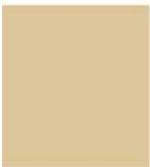

> **Figure description:** Cover art (logo and photograph fragments); not described.

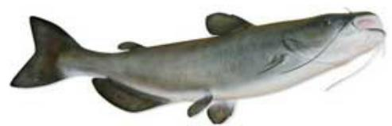

> **Figure description:** Cover art (logo and photograph fragments); not described.

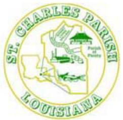

> **Figure description:** Cover art (logo and photograph fragments); not described.

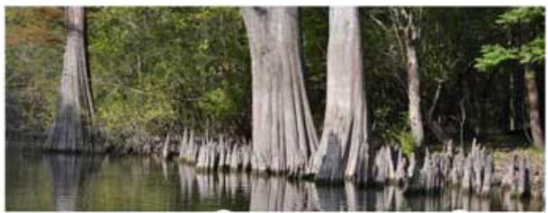

> **Figure description:** Cover art (logo and photograph fragments); not described.

St. Charles Parish Local Coastal Program

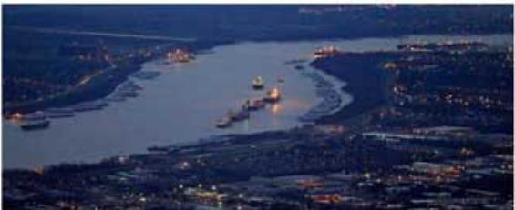

> **Figure description:** Cover art (logo and photograph fragments); not described.

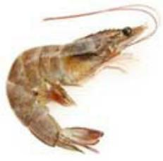

> **Figure description:** Cover art (logo and photograph fragments); not described.

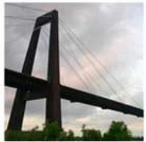

> **Figure description:** Cover art (logo and photograph fragments); not described.

St Charles Parish Department of Planning & Zoning Coastal Zone Management Section

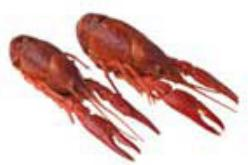

> **Figure description:** Cover art (logo and photograph fragments); not described.

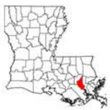

> **Figure description:** Cover art (logo and photograph fragments); not described.

Prepared by:

SCPDC

South Central Planning & Development Commission

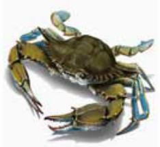

> **Figure description:** Cover art (logo and photograph fragments); not described.

## Page 2

## Page 3 (printed Page 1)

....E-1

#### TABLE OF CONTENTS

List of Tables.   
List of Figures . . ii   
Acronyms... . vii   
Parish Government and Coastal Advisory Committee . ix   
Preface and Acknowledgments . ..x

#### EXECUTIVE SUMMARY

#### INTRODUCTION

Louisiana Coastal Resource Program .. I-2   
Developing the St. Charles Parish Local Coastal Zone Management Plan ... .. I-5

#### CHAPTER 1. ENVIRONMENTAL SETTING

Geology .. . 1-2   
Wetland Habitat. . 1-5   
Soils.. . 1-7   
Wetland Change . . 1-9   
Climate .... . 1-14   
Hydrology . 1-15   
Vegetation . 1-24   
Wildlife and Fisheries .. . 1-28   
Endangered and Threatened Species. . 1-42

#### CHAPTER 2. PRINCIPAL RESOURCES

Introduction. . 2-1   
Renewable Resources . 2-2   
Biological. . 2-2   
Agriculture . 2-4   
Renewable/Non-Renewable Resources . . 2-4   
Lumber.. . 2-4   
Non-Renewable Resources . 2-4   
Oil and Gas . 2-5   
Industrial Resources . 2-5   
Water Resources.. . 2-6   
Mississippi River . . 2-6   
Lake Pontchartrain . . 2-6   
Lac Des Allemands . 2-7   
Lake Salvador . . 2-7   
Lake Cataouatche. . 2-7   
Scenic Waterways . 2-7   
Recreation . 2-8   
Unique and Particular Areas . 2-9   
Bonnet Carré Spillway . 2-9   
Davis Pond. . 2-10   
LaBranche Wetlands . 2-11   
Wildlife Management Areas (WMA) . 2-11   
Salvador . . 2-11   
Timken/Couba Island. . 2-12   
CHAPTER 3. SOCIOECONOMIC CHARACTERISTICS   
Socioeconomic Characteristics . 3-1   
20TH Century Development . . 3-1   
Demography. . 3-3   
Past Population Trends. . 3-3   
Education . 3-3   
Economy .. . 3-4   
Income. . 3-4   
Other Social Statistics . . 3-4   
Economic Sectors.. . 3-6   
Land Use . 3-6   
Existing Land Use. . 3-6   
Physical and Institutional Constraint . 3-8   
Future Land Use. . 3-9   
Parish Development .. 3-12   
Growth Management . 3-12   
CHAPTER 4. ENVIRONMENTAL ISSUES   
Land Loss. . 4-1   
Levees/Flood Prevention . 4-2   
Water Quality .. . 4-2   
Urban Uses.. . 4-2   
Industrial Uses . 4-3   
Agriculture Uses . 4-3   
Saltwater Intrusion . . 4-3   
Oil and Gas Exploration and Production . . 4-3   
Geologic Aspects . 4-3   
Hydrology . . 4-4   
Vegetation Aspects . . 4-4   
Wildlife Aspects.. . 4-5   
Fisheries Aspects.. . 4-6   
Resource Use Conflicts . 4-7

## Page 4 (printed Page 2)

## Page 5 (printed Page 3)

#### CHAPTER 5. GOALS, OBJECTIVES, AND POLICIES

Effect of Local Coastal Program Goals, Objectives and Policies. .. 5-1   
Goal 1. . 5-1   
Goal 2.. .. 5-3   
Goal 3. .. 5-6   
Goal 4.. .. 5-7   
Goal 5.. . 5-8   
Goal 6.. .. 5-9   
Goal 7.. . 5-10   
Goal 8.. . 5-14

#### CHAPTER 6. ENVIRONMENTAL MANAGEMENT UNITS

Designation and Organization of Environmental Management Units. . 6-1   
East Bank EMUs. . 6-3   
EMU-1. East Bank Community. . 6-4   
Geomorphology .. 6-4   
Soils.. . 6-4   
Hydrology . 6-5   
Vegetation and Wildlife . 6-6   
Land Use . . 6-6   
Transportation . 6-7   
Environmental Considerations. .. 6-7   
Specific Goals and Objectives . 6-9   
EMU-2. Montz Urbanized Levee . 6-10   
Geomorphology . 6-10   
Soils. . 6-11   
Hydrology 6-11   
Vegetation and Wildlife . 6-12   
Land Use . . 6-12   
Transportation . 6-13   
Environmental Considerations . 6-13   
Specific Goals and Objectives . 6-14   
EMU-3. East LaPlace Wetland . 6-15   
Geomorphology . 6-15   
Soils... . 6-15   
Hydrology . 6-16   
Vegetation and Wildlife . 6-17   
Land Use . . 6-17   
Transportation . 6-18   
Environmental Considerations . 6-18   
Specific Goals and Objectives . 6-18   
EMU-4. Bonnet Carré Floodway. . 6-19   
Geomorphology . 6-19   
Soils.. . 6-20   
Hydrology . 6-20   
Vegetation and Wildlife . 6-21   
Land Use . . 6-22   
Transportation . 6-22   
Environmental Considerations. . 6-22   
Specific Goals and Objectives . 6-22   
EMU-5. New Sarpy Swamp . 6-23   
Geomorphology . 6-23   
Soils... . 6-23   
Hydrology . 6-24   
Vegetation and Wildlife . 6-24   
Land Use . . 6-25   
Transportation . 6-25   
Environmental Considerations . 6-26   
Specific Goals and Objectives . 6-26   
EMU-6. Ormond Swamp . 6-27   
Geomorphology . . 6-27   
Soils.. . 6-28   
Hydrology . 6-28   
Vegetation and Wildlife . 6-29   
Land Use . . 6-29   
Transportation . 6-30   
Environmental Considerations . 6-30   
Specific Goals and Objectives . 6-31   
EMU-7. LaBranche Wetlands . 6-32   
Geomorphology . 6-32   
Soils.. . 6-34   
Hydrology . 6-35   
Vegetation and Wildlife .. 6-36   
Land Use . . 6-37   
Transportation . 6-38   
Environmental Considerations . 6-38   
Specific Goals and Objectives . 6-38   
West Bank EMUs. . 6-39   
EMU-8. West Bank Community. . 6-39   
Geomorphology . 6-40   
Soils.. . 6-42   
Hydrology . 6-42   
Vegetation and Wildlife . 6-43   
Land Use . . 6-44   
Transportation . 6-45   
Environmental Considerations. . 6-45   
Specific Goals and Objectives . 6-46   
EMU-9. Bayou Gauche Community . 6-47   
Geomorphology . 6-47   
Soils .. . 6-48   
Hydrology . 6-48   
Vegetation and Wildlife . 6-48   
Land Use . 6-49   
Transportation . 6-50   
Environmental Considerations . 6-50   
Specific Goals and Objectives . 6-50   
EMU-10. Paradis Mitigation Area . 6-51   
Geomorphology . 6-51   
Soils.. . 6-52   
Hydrology . 6-52   
Vegetation and Wildlife . 6-53   
Land Use . . 6-53   
Transportation . 6-54   
Environmental Considerations. . 6-54   
Specific Goals and Objectives . 6-55   
EMU-11. Allemand Wetland. . 6-56   
Geomorphology . 6-57   
Soils.. . 6-58   
Hydrology . 6-58   
Vegetation and Wildlife . 6-59   
Land Use . . 6-59   
Transportation . 6-60   
Environmental Considerations . 6-60   
Specific Goals and Objectives . 6-61   
EMU-12. Salvador Management Area. . 6-62   
Geomorphology . 6-63   
Soils. . 6-64   
Hydrology . 6-64   
Vegetation and Wildlife . 6-65   
Land Use . . 6-66   
Transportation . . 6-67   
Environmental Considerations . 6-67   
Specific Goals and Objectives . 6-67   
EMU-13. Couba Island Wetland. . 6-68   
Geomorphology . 6-69   
Soils.. . 6-69   
Hydrology . 6-70   
Vegetation and Wildlife . 6-70   
Land Use . . 6-71   
Transportation . . 6-71   
Environmental Considerations. . 6-71   
Specific Goals and Objectives . 6-71   
EMU-14. Davis Management Unit . 6-72   
Geomorphology . . 6-73   
Soils. . 6-74   
Hydrology . 6-75   
Vegetation and Wildlife . 6-75   
Land Use . . 6-78   
Transportation . 6-78   
Environmental Considerations . 6-78   
Specific Goals and Objectives . 6-79   
CHAPTER 7. LOCAL COASTAL PROGRAM ADMINISTRATION   
Introduction. . 7-1   
Duties Of The CZM Administrator. . 7-2   
Duties Of The St. Charles Parish Coastal Zone Advisory Committee. . 7-2   
Coastal Use Permit Administration. . 7-2   
General. . 7-3   
Uses of Local Concern. . 7-8   
Uses of State Concern. . 7-9   
Mitigation.. . 7-10   
Administrative Appeal Of Local Coastal Use Permit Decisions . 7-10   
Scope. . 7-10   
Notice of Appeal . 7-10   
Fees for Appeals. . 7-12   
Performance Standards For Uses Of State And Local Concern . 7-12   
Areas Of Jurisdiction . 7-13   
Exempted Uses – Activities not requiring a coastal use permit (La RS 214.34) . 7-13   
Enforcement. . 7-14   
General.. . 7-14   
Implementation . 7-14   
General.. . 7-14   
Consistency. . 7-14   
Special Areas . 7-15   
Introduction. . 7-15   
St. Charles Parish Designation Procedure . 7-16   
Procedures For The Consideration Of Uses Of Greater Than Local Benefit Or Impacts.... .. 7-17   
Introduction. 7-17   
Requirements . 7-17   
Interagency Coordination. . 7-18   
Coastal Zone Management Act Consistency . 7-18   
Consistency With State Program . 7-21   
Consistency With St. Charles’ 2030 Comprehensive Plan (Volume 1: Policy Document) ....... 7-22

## Page 6 (printed Page 4)

## Page 7 (printed Page 5)

## Page 8 (printed Page 6)

## Page 9 (printed Page 7)

#### CHAPTER 8. PUBLIC PARTICIPATION

Introduction. . 8-1   
Cooperation With SCPDC .. 8-1   
Public Comment Period . . 8-3   
Advertising Public Comments . .. 8-3   
Addressing Public Comments. . 8-5   
Approval of Public Comments. .. 8-7   
Document Approval Process. . 8-8

#### REFERENCES AND APPENDICES

Appendix A: Definitions A-1   
Appendix B: Coastal Zone Management Implementation Ordinance .B-1   
Purpose And Construction ..B-2   
Definitions. .B-2   
Local CZM Administrator. .B-7   
Local CZM Advisory Committee .B-8   
Coastal Use Permit Applications ..B-9   
Permit Review Process .B-11   
After The Fact Permits. .B-14   
Mitigation. .B-14   
Appeals . .B-15   
Enforcement In General. .B-20   
Referrals From Other Agency Officials . .B-21   
Complaints From Concerned Citizens Or Others .B-22   
Contents Of Cease And Desist Order. .B-22   
Conditions For Entering Property For Examination ..B-23   
Use Of Funds .. ..B-23   
Mitigation Trust Fund . .B-23   
Introduction of Ordinance... ..B-25   
Notice Of Plan.. ..B-26   
Appendix C: Public Participation Documentation.. ..C-1   
Appendix D: References Cited . D-1

## Page 10

## Page 11 (printed Page i)

#### LIST OF TABLES

Table 1-1. Areas of St. Charles Parish Landscape Features. . 1-1   
Table 1-2. Predominant Wetland and Soils Types in St. Charles Parish from National Wetland   
Inventory (USFWS) and Natural Resources Conservation Service (NRCS) ...... 1-7   
Table 1-3. St. Charles Parish Soils (McDaniel 1987 Soil Survey). 1-8   
Table 1-4. Wetlands of St. Charles Parish.. 1-9   
Table 1-5. Bonnet Carré Spillway Openings since Completion in 1931 1-17   
Table 1-6. Trees, shrubs and woody vines of the forested natural levee of St. Charles Parish   
(Louisiana Natural Heritage Program 2009). . 1-24   
Table 1-7. Common herbaceous plants of the forested natural levee of St. Charles Parish   
(Louisiana Natural Heritage Program 2009) 1-25   
Table 1-8. Freshwater swamp trees and shrubs of St. Charles Parish   
(Louisiana Natural Heritage Program 2009). 1-25   
Table 1-9. Common plants of the freshwater marshes of St. Charles Parish 1-26   
Table 1-10. Common plants of the intermediate marshes of St. Charles Parish 1-27   
Table 1-11. Submerged aquatic plants of St. Charles Parish   
(Louisiana Natural Heritage Program 2009). 1-27   
Table 1-12. Fish species of St. Charles Parish and Barataria Basin. 1-29   
Table 1-13. Rare Plant Species of St. Charles Parish   
(La. Natural Heritage Program 2014b) . . 1-42   
Table 1-14. Rare, Threatened and Endangered Animal Species of St. Charles Parish (La.   
Natural Heritage Program 2014a). . 1-43   
Table 2-1. Resident Commercial License Sales, St. Charles Parish: 2000-2013 (LDWF) .. 2-2   
Table 2-3. General information about the Bonnet Carré Spillway.. . 2-10   
Table 3-1: St. Charles Parish Population Statistics 3-3   
Table 3-2. Selected Economic and Social Statistics . 3-5   
Table 6-1. St. Charles Parish Environmental Management Units. 6-2

## Page 12 (printed Page ii)

#### LIST OF FIGURES

Figure 1-1. Environmental Management Units (EMUs) within St. Charles Parish and 5 foot   
contour in red. . 1-2   
Figure 1-2. Geologic map prepared by the Louisiana Geologic Survey showing the Modern   
Mississippi natural levees (Meander Belt 1), a small Meander Belt 1 1884   
crevasse complex on the West Bank, and an older, much larger crevasse that   
flowed 3,000 years BP during the building of the St. Bernard delta lobe when the   
wetlands of St. Charles Parish were first established. . 1-4   
Figure 1-3. Holocene Mississippi River delta chronology from Weinstein and Gagliano   
(1985) .. 1-5   
Figure 1-4. Wetlands and aquatic habitat in St. Charles Parish from USFWS online   
“Wetlands Mapper” . 1-6   
Figure 1-5. Stressed Cypress-Tupelo swamp in the LaBranche Wetlands on the East Bank,   
with many downed trees and scattered living ones. . 1-9   
Figure 1-6. Map of early 1900s reclamation districts that were diked and drained using steam   
pumps to create agricultural and residential land (Okey 1918). Insets show   
enlargement of the St. Charles Parish impoundments and the footprint of these   
projects today. . 1-11   
Figure 1-7. Lake Cataouatche Reclamation District as it appears today, a failed agricultural   
reclamation constructed before 1915. . 1-12   
Figure 1-8. Oil and gas wells and fields developed in St. Charles Parish since discovery of oil   
in 1938. . 1-12   
Figure 1-9. Wetland loss since 1956 is confined to two zones as mapped by Barras et al.   
(2008) . 1-13   
Figure 1-10. Mean monthly high and low temperatures (A), and precipitation for New Orleans   
and St. Charles Parish (B). . 1-15   
Figure 1-11. Overhead view (A) of Bonnet Carré Spillway and Davis Pond Freshwater   
Diversion in operation during record 2011 Mississippi River flood, and (B)   
oblique view from the river of the Davis Pond Diversion inlet and conveyance   
channel. . 1-16   
Figure 1-12. Comparison of water levels from NOAA tide stations East Bank 1 Norco B.   
LaBranche (8762372) and West Bank 1, Bayou Gauche (8762482) for 2012 (top)   
and 2008 (bottom). . 1-18   
Figure 1-13. Daily salinity in Lake Salvador at the USGS station near Lafitte (073802375)   
from October 1999 to December 2012 with discharge from the Davis Pond   
Freshwater Diversion near Boutte. .. 1-19   
Figure 1-14. Natural and artificial waterways in St. Charles Parish (Wallace Roberts & Todd   
LLC 2011). 1-21   
Figure 1-15. Existing and planned hurricane flood protection levee enlargements (Wallace   
Roberts & Todd LLC 2011). . 1-22   
Figure 1-16. St. Charles Parish wastewater treatment facilities and capacity (Wallace Roberts   
& Todd LLC 2011). 1-23   
Figure 1-17. Parish marshes adjacent to Lakes Cataouatche, Salvador and Pontchartrain are   
targeted for nutria population reduction (Louisiana Department of Wildlife and   
Fisheries 2014). . 1-32   
Figure 1-18. Migratory patterns of marine-spawned fish within the Barataria estuary, with the   
marshes and lakes of St. Charles Parish to the right (Chambers 1980)..... .. 1-33   
Figure 1-19a. Relative abundance of neotropical warblers in St. Charles Parish . 1-35   
Figure 1-19b. Relative abundance of sparrows in St. Charles Parish . 1-35   
Figure 1-19c. Relative abundance of swifts, swallows and martins in St. Charles Parish ..... 1-36   
Figure 1-19d. Relative abundance of woodpeckers and kingfishers in St. Charles Parish .... 1-36   
Figure 1-19e. Relative abundance of songbirds of the woods, fields and yards in St. Charles   
Parish . . 1-37   
Figure 1-19f. Relative abundance of gulls, terns and skimmers in St. Charles Parish. .. 1-38   
Figure 1-19g. Relative abundance of hawks, owls and vultures in St. Charles Parish . .. 1-38   
Figure 1-19h. Relative abundance of marsh and shorebirds in St. Charles Parish . 1-39   
Figure 1-19i. Relative abundance of colonial water birds in St. Charles Parish . 1-40   
Figure 1-19j. Relative abundance of ducks and geese in St. Charles Parish. 1-41   
Figure 2-1. Shows the number of shrimp licenses compared to crab licenses sold as of the   
year 2013. . 2-3   
Figure 2-2. Shows shrimp produced by the pound in thousands. . 2-3   
Figure 2-3. Shows crabs produced by the pound in millions. . 2-3   
Figure 3-1: Existing Land Use (St Charles Parish 2030 Comprehensive Plan, Volume 1:   
Policy Document page 53) . . 3-7   
Figure 3-2. Future Land Use (St Charles Parish 2030 Comprehensive Plan, Volume 1: Policy   
Document page 62) . 3-10   
Figure 3-3. Existing Zoning (St Charles Parish 2030 Comprehensive Plan, Volume 1: Policy   
Document page 62) . 3-11   
Figure 6-1. Environmental Management Units (EMUs) within St. Charles Parish and 5 foot   
contour in red . 6-3   
Figure 6-2(a). EMU-1 East Bank Community showing terrain and towns. . 6-4   
Figure 6-2(b). EMU-1 East Bank Community showing soils. . 6-5   
Figure 6-2(c). EMU-1 East Bank Community showing future land use . 6-6   
Figure 6-3(a). EMU-2 Montz Urbanized Levee showing terrain and towns . 6-10   
Figure 6-3(b). EMU-2 Montz Urbanized Levee showing soils. . 6-11   
Figure 6-3(c). EMU-2 Montz Urbanized Levee showing future land use. . 6-12   
Figure 6-4(a). EMU-3 East LaPlace Wetland showing terrain and towns. . 6-15   
Figure 6-4(b). EMU-3 East LaPlace Wetland showing soil. . 6-16   
Figure 6-4(c). EMU-3 East LaPlace Wetland showing future land use. . 6-17   
Figure 6-5(a). EMU-4 Bonnet Carre Floodway showing terrain and towns . 6-19   
Figure 6-5(b). EMU-4 Bonnet Carre Floodway showing soils. . 6-20   
Figure 6-5(c). EMU-4 Bonnet Carre Floodway showing future land use. . 6-21   
Figure 6-6(a). EMU-5 New Sarpy Swamp showing terrain and towns. . 6-23   
Figure 6-6(b). EMU-5 New Sarpy Swamp showing soils . . 6-24   
Figure 6-6(c). EMU-5 New Sarpy Swamp showing future land use . 6-25   
Figure 6-7(a). EMU-6 Ormond Swamp showing terrain and towns . 6-27   
Figure 6-7(b). EMU-6 Ormond Swamp showing soils. . 6-28   
Figure 6-7(c). EMU-6 Ormond Swamp showing future land use . 6-30   
Figure 6-8(a). EMU-7 LaBranche Wetland showing terrain and towns . 6-32   
Figure 6-8(b). EMU-7 LaBranche Wetland showing soils . 6-34   
Figure 6-8(c). EMU-7 LaBranche Wetland showing future land use. . 6-37   
Figure 6-9. EMU-7 LaBranche Wetland on USGS 7.5 minute quadrangles from 1892 to   
2012. . 6-33   
Figure 6-10(a). EMU-8 West Bank Community showing terrain, towns and federal levees. ... 6-39   
Figure 6-10(b). EMU-8 West Bank Community showing soil types. . 6-42   
Figure 6-10(c). EMU-8 West Bank Community showing planned future land use. . 6-44   
Figure 6-11. Southern portion of 1891 USGS Hahnville topographic sheet based on 1890 field   
survey showing two distributary ridges extending south from the Mississipp   
River to Bayou des Allemands. The Grand Bayou ridge carries the Southern   
Pacific Railroad but follows no extant stream while the Bayou Petit ridge to the   
east is bisected by an active channel. . 6-41   
Figure 6-12(a). Bayou Gauche Community, EMU-9, is part of the Sunset Drainage District   
polder. . 6-47   
Figure 6-12(b). EMU-9 Bayou Gauche Community showing soils . 6-48   
Figure 6-12(c). EMU-9 Bayou Gauche Community showing future land use. . 6-49   
Figure 6-13(a). Paradis Mitigation Area, EMU-10, takes up most of the Sunset Drainage District .   
. 6-51   
Figure 6-13(b). Paradis Mitigation Area, EMU-10, showing proposed route of I-49 soils....... 6-52   
Figure 6-13(c). Paradis Mitigation Area, EMU-10, showing proposed route of I-49, future land   
use. . 6-54   
Figure 6-14(a). Allemand Wetland, EMU-11, showing terrain and towns . 6-56   
Figure 6-14(b). EMU-11 Allemand Wetland showing soils. . 6-58   
Figure 6-14(c). EMU-11 Allemand Wetland showing future land use . 6-60   
Figure 6-15. Land-loss and gain in EMU-11, Allemand Wetland, and surrounding area since   
1978 from Barras et al. (2008). White inset box shows zone of greatest change   
enlarged in Figure 6-16 . 6-57   
Figure 6-16. Recent aerial image from Google Earth showing inset area of greatest change in   
EMU-11, Allemand Wetland (Figure 6-15). Colonization of shallow open water   
by cattail and floatant marsh forms circular islands that can move around. Small   
canals are tranasses made by trappers. . 6-57   
Figure 6-17(a). Recent aerial image from Google Earth showing EMU-12, Salvador   
Management Area, and the Salvador Wildlife Management Area owned by the   
Louisiana Department of Wildlife and Fisheries since 1968. . 6-62   
Figure 6-17(b). EMU-12 Salvador Management Area showing soils . 6-64   
Figure 6-17(c). EMU-12 Salvador Management Area showing (a) future land use and (b) soils....   
. 6-66   
Figure 6-18(a). EMU-13 Couba Island Management Area is coincident with the LDWF managed   
Timken WMA. . 6-68   
Figure 6-18(b). EMU-13 Couba Island Management Area soils are all Kenner muck (KE). ... 6-69   
Figure 6-18. Excerpt from land change map produced by Barras et al. (2008), showing the   
sequence and patterns of land gain and loss from 1956 to 2006 for wetlands   
including EMU-12 around Lakes Cataouatche and Salvador, and in the Davis   
Management Unit, EMU-14. . 6-63   
Figure 6-19(a). EMU-14, Davis Management Unit includes the Davis Pond Freshwater   
Diversion built by the USACE and managed by the State of Louisiana Coastal   
Protection and Restoration Authority (CPRA). . 6-72   
Figure 6-19(b). EMU-14, Davis Management showing distribution of soil types. . 6-74   
Figure 6-20. Davis Pond Freshwater Diversion receiving area (A) before construction, (B)   
after 1 year, (C) 6 years, and (D) 9 years. . . 6-73   
Figure 6-21. Mean daily discharge through Davis Pond Freshwater Diversion project   
for first decade of operation, January 2003 to January 2015 (USGS Station   
295501090190400, Davis Pond Freshwater Diversion near Boutte, LA). Heavy   
black line is 10 day moving average. . . 6-76   
Figure 6-22. Extent of rooted submersed aquatic vegetation in Lake Cataouatche in fall, 2007,   
a phenomenon that began in 2006 and recurred in 2007 to 2011, but has not   
occurred since. . 6-77   
Figure I-1. St. Charles Parish is located entirely within Louisiana’s Coastal Zone. Red lines   
outline the original Coastal Zone. . I-1   
Figure I-2. St. Charles Parish East and West Bank Hurricane Protection Levees, Davis Pond   
Diversion and I-310 Extension connecting East and West Banks across the Hale   
Boggs Memorial Bridge (Modified from St. Charles Parish 2030 Comprehensive   
Plan adopted in 2011). . I-3

## Page 13 (printed Page iii)

## Page 14 (printed Page iv)

## Page 15 (printed Page v)

## Page 16 (printed Page vi)

## Page 17 (printed Page vii)

#### ACRONYMS

BP: Before Present   
cfs: Cubic feet per Second   
CITES: Convention on International Trade in Endangered Species   
CMD: Coastal Management Division (Currently the Office of Coastal Management (State   
of Louisiana))   
C.F.R.: Code of Federal Regulations   
CPRA: Coastal Protection and Restoration Authority   
CRMA: Coastal Resource Management Act (of 1978, Act 361, as amended)   
CUG: Coastal Use Guidelines   
CUP: Coastal Use Permit   
CWPPRA: Coastal Wetlands Planning, Protection and Restoration Act   
CZAC: Coastal Zone Advisory Commission   
CZM: Coastal Zone Management   
CZMA: Coastal Zone Management Act   
CZMP: Coastal Zone Management Program   
DDT: dichlorodiphenyltrichloroethane (Insecticide)   
DPFD: Davis Pond Freshwater Diversion   
DPZ: (St. Charles Parish) Department of Planning and Zoning   
EIS: Environmental Impact Statement   
EMU: Environmental Management Unit   
FEMA: Federal Emergency Management Agency   
FLUM: Future Land Use Map   
GIS: Geographic Information Systems   
ICRR: Illinois Central Railroad   
HSDRRS: Hurricane and Storm Damage Risk Reduction System   
LA: Louisiana   
L.A.C: Louisiana Administrative Code   
LCP: Louisiana Coastal Program   
LCRP: Louisiana Coastal Resources Program   
LDEQ: Louisiana Department of Environmental Quality   
LDNR: Louisiana Department of Natural Resources   
LDNR-OCM: Louisiana Department of Natural Resources, Office of Coastal Management   
LDWF: Louisiana Department of Wildlife and Fisheries

## Page 18 (printed Page viii)

LiDAR: Light Detection and Ranging   
LNHP: Louisiana Natural Heritage Program   
LPV: Lake Pontchartrain and Vicinity   
L.R.S.: Legislative Regular Session   
MGD: Million Gallons per Day   
MRGO: Mississippi River Gulf Outlet   
MR&T: Mississippi River and Tributaries   
MS4: Municipal Separate Storm Sewer System   
MSL: Mean Sea Level   
NEPA: National Environmental Protection Act   
NFIP: National Flood Insurance Program   
NOAA: National Oceanic and Atmospheric Administration   
NORCO: New Orleans Refining Company   
NRCS: Natural Resources Conservation Service   
OCM: Office of Coastal Management (State of Louisiana)   
OCS: Outer Continental Shelf   
ppm.: Parts per Million   
ppt.: Parts per Thousand   
RSLR: Relative Sea Level Rise   
SAV: Submersed Aquatic Vegetation   
SCP: St. Charles Parish   
SCPDC: South Central Planning and Development Commission   
SMSA: Standard Metropolitan Statistical Area   
SONRIS: Strategic Online Natural Resource Information System   
UBR: Uses of regional benefit   
USACE: United States Army Corps of Engineers   
U.S.C.: United States Congress   
USDA: United States Department of Agriculture   
USFWS: United States Fish and Wildlife Service   
USGS: United States Geological Survey   
WMA: Wildlife Management Area

## Page 19 (printed Page ix)

### PARISH GOVERNMENT AND COASTAL ADVISORY COMMITTEE

Parish President V.J. St. Pierre Jr.

Parish Council Members (2014) AT LARGE, DIVISION A Councilwoman Carolyn K. Schexnaydre AT LARGE, DIVISION B Councilman Jarvis Lewis DISTRICT I Councilman Terrell Wilson DISTRICT II Councilman Billy Woodruff DISTRICT III Councilwoman Wendy Benedetto DISTRICT IV Councilman Paul J. Hogan DISTRICT V Councilman Larry Cochran DISTRICT VI Councilwoman Traci Fletcher DISTRICT VII Councilwoman Julia Fisher-Perrier

Coastal Zone Advisory Committee (2015) Chairman Milton Cambre (Norco)

Members

Craig Melancon (Destrehan)

Roland Oubre (Hahnville)

Arthur (Art) Carlson Jr. (Luling)

James Waguespack, Sr. (Destrehan)

Dr. Ray Matherne (Des Allemands)

Charles Smith (St. Rose)

Sarah Thigpen (Luling)

## Page 20 (printed Page x)

#### PREFACE AND ACKNOWLEDGMENTS

The updating and completion of the St. Charles Parish CZMP would not have been possible without the support of the St. Charles Parish Council and the Parish President, the St. Charles Planning Commission, Coastal Zone Advisory Committee, the Department of Planning and Zoning - Office of Coastal Zone Management, the Local CZM Administrator and the citizens of the parish who, over the years, have shown a great passion for and dedication to the conservation of their natural resources and the balancing of multiple uses within the coastal zone. Specific acknowledgments go to Earl Matherne, the Local CZM Administrator who has coordinated and contributed to the updating of this document and St Charles Parish Administrator Buddy Boe, who co-authored a segment of the final text.

The Louisiana Department of Natural Resources - Office of Coastal Management provided invaluable input and guidance in compliance with the State and Local Coastal Resources Management Act of 1978, as amended, and with the organizational structure of the implementation ordinance. Specific acknowledgments go to Jon Truxillo, Coastal Resources Scientist who provided guidance and support in the production of this document.

The production of this document required knowledge of the St Charles Parish wetlands and wetlands in general. Locally the CZM Advisory Committee members: Milton Cambre, Craig Melancon, Roland Oubre, Arthur (Art) Carlson Jr., James Waguespack, Sr. Dr. Ray Matherne, Charles Smith and Sarah Thigpen participated and contributed their knowledge and review.

A special thanks goes to LSU Coastal Oceanographer and Geologist Scientist G. Paul Kemp who should be acknowledged as the Chief Researcher, Author and Contributor of the document.

The following South Central Planning and Development Commission staffers/participated in the preparation of this CZMP document:

Cullen Curole (SCPDC) - Project Director, Co-Author/Contributor

Dylan Landry (SCPDC – Research, Co-Author/Contributor

Scott Leger (SCPDC) – Cartographer

Brooke Bergeron (SCPDC) – Technical Support, Research

Todd Terrebonne (SCPDC) – Graphic Designer

Lynette Cortez (SCPDC) – Technical Support

Mi Lam (SCPDC) – Technical Support

Michael Acosta (SCPDC) – Research

## Page 21 (printed E-1)

#### EXECUTIVE SUMMARY

The St. Charles Local Coastal Zone Management Program (Local CZM Program) is a system for managing the land and water resources of St. Charles Parish (Parish). Because St. Charles Parish falls entirely within the statutory boundaries of Louisiana’s Coastal Zone, the Local CZM Program has evolved in accordance with federal and state legislative mandates to protect coastal resources, while encouraging suitable development as established by the federal Coastal Zone Management Act of 1972, (P.L. 92-583) as amended in 1976 (P.L. 94-370), and the Louisiana State and Local Coastal Resources Management Act of 1978, as amended in 2009 (SLCRMA, formerly at La. R.S. 49:213 and now referenced at R.S. 49:214.21 et seq.).

The updated Local CZM Program document presented here is the culmination of a long and productive partnership between the parish and the Office of Coastal Management (OCM) within the Louisiana Department of Natural Resources (LDNR). The parish has operated a Local CZM Program that has included a CZM Coordinator and a CZM Citizens Advisory Committee since the 1980s but has not, until now, sought federal and state approval of its Local CZM Program. A draft document outlining this program was prepared in 2004 but was temporarily shelved while parish government responded to the crises brought on by hurricane impacts in 2005, 2008 and 2012, as well as events like the 2010 Deepwater Horizon oil spill that have heightened awareness of parish vulnerability and the need to prepare for factors beyond local control. Furthermore, completion of large infrastructure projects in the parish, including the Davis Pond Freshwater Diversion, the East Bank Hurricane Protection Levee, and the extension of Interstate 310 from Interstate 10 on the East Bank across the Hale Boggs Memorial Mississippi River span to Luling and LA 90 on the West Bank. Another project aims to bring the West Bank Hurricane Protection Levee up to the 100-year standard of the East Bank Hurricane Protection Levee. Finally, state approved amendments to the SLCRMA in Act 523 of 2009 (LA R.S. 49:214.21 et seq.) have modified local program guidance that has necessitated substantial updating of the Local CZM Program document.

Natural land elevations in St. Charles Parish range from more than five feet below mean sea level (MSL) in some areas ringed by levees that rely on pumps for drainage, to a maximum of 20 feet above MSL on 15 miles of the east and west natural banks of the Mississippi River. Artificial levees crest along the river at up to 30 feet, but less than 12 percent of the parish, about 22,000 acres, is above the +5 foot contour designated in State Coastal Use Guidelines as separating lands requiring Coastal Use Permits from those that do not. Another 40,000 adjacent acres, however, are former wetlands that have been artificially drained to a greater or lesser degree beginning in the early 1900s. These are described as “fastlands” in the Coastal Use Guidelines and are also not generally subject to CZM permitting. Virtually all of the 52,780 parish residents recorded in the 2010 census live within the combined 62,000 acres of uplands and fastlands, about equally distributed between east and west bank communities. In contrast, the parish has more than twice this area, 136,000 acres, of undeveloped and uninhabited freshwater swamps and fresh or slightly brackish marshes. Three-quarters of these wetlands are on the West Bank.

The Louisiana Legislature enacted SLCRMA to address conflicting demands for the use of coastal resources. Activities such as urbanization, mineral extraction, farming, hunting, fishing, and recreation must often compete for use of the same coastal land or water areas and, in some cases, can cause the deterioration of resources through pollution, erosion and subsidence. These are discussed in Chapters 1 (Environmental Setting) and 2 (Principal Resources). Estuarine areas, where freshwater and salt water mix, are particularly valuable because of the ecosystem provisioning services that they provide, including nursery habitat for fish and shellfish, feeding grounds for birds, shelter for wildlife, and rich hunting and fishing opportunities. They also serve as a nutrient sink to naturally reduce nitrogen loading to the continental shelf. In the wake of six major hurricanes that have afflicted coastal Louisiana since 2005, coastal wetlands have been increasingly valued for their capacity to protect flood control levees and developed areas from storm surge and waves.

## Page 22 (printed E-2)

St. Charles Parish adopted a “2030 Comprehensive Plan” in 2011 that forecast a moderate population growth of about one percent per year that would allow for manageable expansion of the tax base within the existing development footprint while improving flood protection and preserving “the parish’s small-town way of life, scenic natural beauty, and unique community heritage and identity for future generations.” A key recommendation of this plan is to “adopt and implement the parish’s ongoing Coastal Zone Management Plan”. After additional hurricane impacts to the parish in 2008 and 2012, an overriding consideration for the current redrafting is to provide a coastal resource management program that establishes an appropriate balance of conservation, flood protection and safe development, with an efficient administrative structure, and transparent and workable procedures for program implementation.

St. Charles Parish residents derive much of their income from employment in the petrochemical industries and port facilities sited along the Mississippi River, but the swamps and marshes of St. Charles Parish are among the healthiest and most intact within Louisiana’s Coastal Zone. Parish wetlands support important recreational and commercial fisheries. Now, the parish plays a key role in the 2012 “Louisiana’s Comprehensive Master Plan for a Sustainable Coast” because it includes two of the State’s existing man-made Mississippi River diversions in the East Bank Bonnet Carré Spillway and the Davis Pond Freshwater Diversion on the West Bank. Factors affecting where people live and their livelihoods are discussed in Chapter 3 (Socioeconomic Characteristics).

In creating this Plan for a St. Charles Parish Local CZM Program that will be approved at the state and federal levels, the parish is adopting policy goals and objectives that show understanding, willingness and capacity to take primary responsibility for review, issuance and monitoring of permits for local uses. At the same time, parish CZM administration makes it clear here that it can recognize and provide a forum for treatment of activities that also affect regional, state and national interests. How the parish will do this is provided in Chapters 4 (Environmental Issues), and 5 (Goals and Objectives).

The designation and documentation of Environmental Management Units (EMUs) in building local coastal programs is central to the administration of the Louisiana Coastal Resources Program. St. Charles Parish has chosen to divide all of the parish, excluding the portions that extend into Lakes Pontchartrain, Cataouatche and Salvador, into 14 Environmental Management Units (EMUs) that are described in Chapter 6 (Environmental Management Units). The longest chapter in this plan is taken up by detailed descriptions of each EMU, and how they are unique, in terms of geomorphology, soils, hydrology, vegetation/wildlife, existing/proposed land use, transportation infrastructure, environmental considerations and Goals & Objectives. Each of these descriptions ends with a summary of the environmental threats and opportunities that sets the stage for management at the EMU scale.

## Page 23 (printed E-3)

EMUs range in size from the 360 acre New Sarpy Swamp on the East Bank to the 52,000 acre Salvador Management Unit on the West Bank. Each also has been given a unique number. Except where truncated by the parish political boundary, which may not follow any landscape feature, each EMU is a distinct hydrologic unit with boundaries defined by the drainage and flood protection levee systems. Most of the developed parts of the parish are included in two EMUs, the East Bank and West Bank Communities, but smaller towns are also found in the Montz Urbanized Levee and Bayou Gauche Community EMUs.

In Chapter 7 (Local Coastal Program Administration), the plan addresses critical questions about how St. Charles Parish will administer the local CZM Program, laying out the responsibilities of the local administrator and Coastal Zone Advisory Committee, and detailing procedures to be followed in evaluating permits where uses and impacts are confined to the parish. A primary focus is on the role of the parish in participating with applicants and the state on review of uses and permits that are of “state concern” or require substantial mitigation for unavoidable impacts. In playing this role, the parish CZMP must be cognizant of the “consistency” requirements, so that the local program is entirely consistent with coastal use guidelines enacted by the state.

One of the consistency provisions is to provide for the full participation of federal, state and local government agencies, as well as interested or affected members of the public. This important aspect is described for the St. Charles Parish program in Chapter 8 (Public Participation). The parish public engagement policy is designed to convey a clear understanding of the uses and activities that will normally be handled within the local CZM program, and those that will require substantial review at the state or federal levels. The Plan in its entirety provides many of the answers to questions that parish residents may have about the principles of science and law that are the foundation for effective coastal management in St. Charles Parish.

## Page 24

## Page 25 (printed I-1)

#### INTRODUCTION

The St. Charles Local Coastal Zone Management Program (Local CZM Program) is a system for managing the land and water resources of St. Charles Parish (parish) which straddles the Mississippi River upstream of the New Orleans metro area (Figure I-1). Because St. Charles Parish falls entirely within the statutory boundaries of Louisiana’s Coastal Zone, the Local CZM Program has evolved in accordance with federal and state legislative mandates to protect coastal resources, while encouraging suitable development as established by the federal Coastal Zone Management Act of 1972, (P.L. 92-583) as amended in 1976 (P.L. 94-370), and the Louisiana State and Local Coastal Resources Management Act of 1978, as amended in 2009 (SLCRMA, formerly at La. R.S. 49:213 and now referenced at R.S. 49:214.21 et seq.).

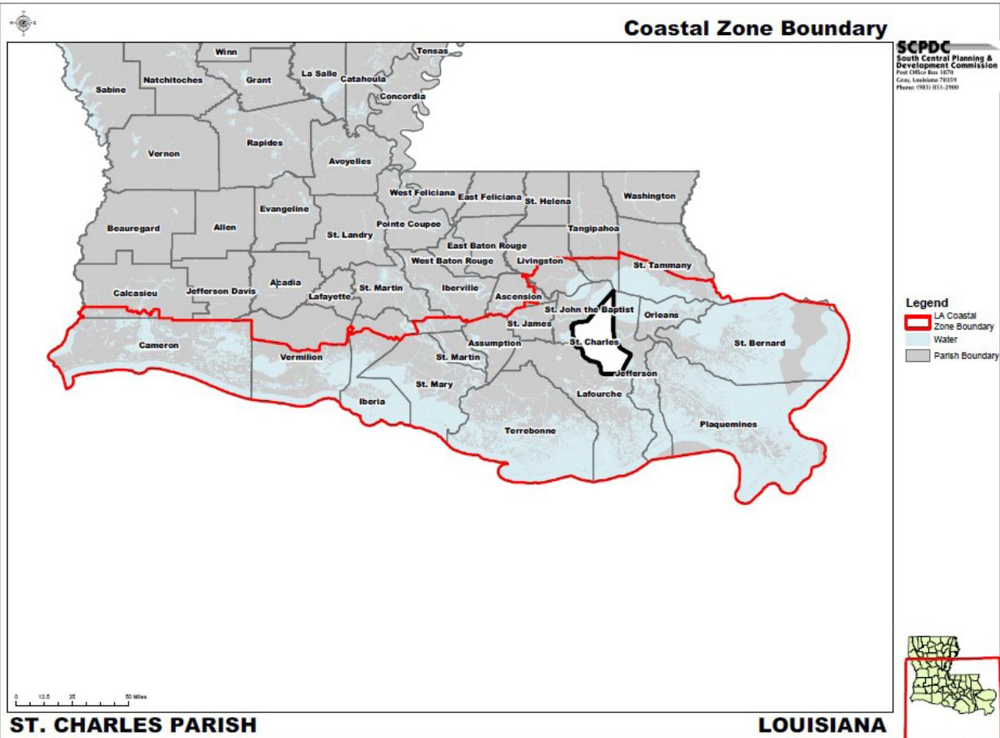

> **Figure description (machine-generated, checked by a second model against the image):** Map of Louisiana titled 'Coastal Zone Boundary', with 'ST. CHARLES PARISH' and 'LOUISIANA' printed in the bottom corners. Parish names are printed on the gray parish fills. A heavy red line marks the LA Coastal Zone Boundary. It runs along the Gulf coast from Cameron in the west to Plaquemines and St. Bernard in the east. On the inland side it runs through Cameron, Vermilion and the Iberia/St. Martin area, then north-east past Ascension and Livingston, with small spurs, and east along the northern edge of the zone near the St. Tammany parish line. Light blue marks water, which covers much of the south. St. Charles Parish is outlined in a heavy black line in the centre-east, with its name printed inside. It lies east of St. James and St. John the Baptist, north of Lafourche and west of Jefferson and Orleans. Its interior is pale, a mix of gray and light blue. The legend has three entries: LA Coastal Zone Boundary (red outline), Water (light blue) and Parish Boundary (gray). The black outline of St. Charles Parish is not in the legend. The scale bar, the SCPDC block and the small state locator inset are omitted.
>
> _Not readable or uncertain:_ The black outline around St. Charles Parish has no legend entry, so it is unlabelled. The pale fill inside it mixes gray and light blue and is hard to read at this size. The exact route of the red line through the north-central parishes is hard to follow at this size.

While the parish has operated a Local CZM Program that has included a CZM Coordinator and a CZM Citizens Advisory Committee since the 1980s, St. Charles has not, until now, sought federal and state approval of its Local CZM Program. A draft document outlining this program was prepared in 2004 but was temporarily shelved while parish government responded to the crises brought on by Hurricanes Katrina and Rita in 2005, which caused severe flooding to communities on the East (north) and West (south) banks of the Mississippi River, respectively. Since then,

## Page 26 (printed I-2)

state approved amendments to the SLCRMA in Act 523 of 2009 (LA R.S. 49:214.21 et seq.) have modified local program guidance that has necessitated substantial updating of the Local CZM Program document.

Since the initial Local CZM Program document was drafted, hurricane impacts in 2005, 2008 and 2012, as well as events like the 2010 Deepwater Horizon oil spill and the great recession of 2008 to 2010 have heightened awareness of parish vulnerability and the need to prepare for factors beyond local control. Furthermore, completion of large infrastructure projects in the parish, including the Davis Pond Freshwater Diversion, the East Bank Hurricane Protection Levee, and the extension of Interstate 310 from Interstate 10 on the East Bank across the Hale Boggs Memorial Mississippi River span to Hahnville and LA 90 on the West Bank (Figure I-2). Another project aims to bring the West Bank Hurricane Protection Levee up to the 100-year standard of the East Bank Hurricane Protection Levee.

The updated Local CZM Program document presented here is the culmination of a long and productive partnership between the parish and the Office of Coastal Management (OCM) within the Louisiana Department of Natural Resources (LDNR). After additional hurricane impacts to the parish in 2008 and 2012, an overriding consideration for the current redrafting effort, is to provide a coastal resource management program that establishes an appropriate balance of conservation, flood protection and safe development, with an efficient administrative structure, and a transparent and effective procedure for program implementation.

#### LOUISIANA COASTAL RESOURCE PROGRAM

The Louisiana Coastal Resources Program (LCRP) was formulated in response to national concern over the degradation of our nation’s coastal wetlands and other valuable resources associated with estuaries, barrier islands and other natural ecosystems found along our shores. Congress passed the Coastal Zone Management Act (CZMA P.L. 92-583) and it was signed into law on October 27, 1972. The CZMA authorized a federal grant-in-aid program to be administered by the Secretary of Commerce, who, in turn, delegated program responsibility to the National Oceanic and Atmospheric Administration’s (NOAA) Office of Coastal Zone Management. The Coastal Zone Management Act of 1972 was substantially amended on July 26, 1976, (P.L. 94-730). The Act and 1976 amendments affirm a national interest in balancing protection and development of the coastal zone by providing assistance and encouragement to U.S. coastal states to adopt state programs that meet national standards for managing coastal areas.

## Page 27 (printed I-3)

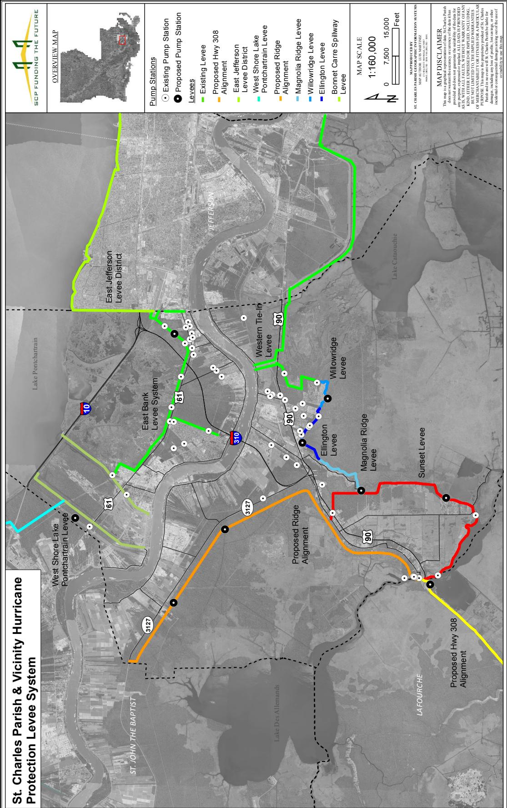

> **Figure description (machine-generated, checked by a second model against the image):** Map titled 'St. Charles Parish & Vicinity Hurricane Protection Levee System', printed vertically along the left edge, so the map is turned a quarter turn: north is toward the left of the image and east toward the top. It shows the levees over a grayscale aerial photograph, with the Mississippi River curving through the centre. The legend has two groups. Pump Stations: 'Existing Pump Station' (open white circle with a dot) and 'Proposed Pump Station' (solid black circle with a white ring). Levees: 'Existing Levee' (green), 'Proposed Hwy 308 Alignment' (orange), 'East Jefferson Levee District' (light green), 'West Shore Lake Pontchartrain Levee' (cyan), 'Proposed Ridge Alignment' (orange), 'Magnolia Ridge Levee' (light blue), 'Willowridge Levee' (blue), 'Ellington Levee' (dark blue) and 'Bonnet Carre Spillway Levee' (yellow-green). Printed place labels include Lake Pontchartrain, Jefferson, St. John the Baptist, Lafourche and Lake Des Allemands. The East Jefferson Levee District, outlined in light green, lies in the upper left near Lake Pontchartrain. The East Bank Levee System, in green, lies on the river's Lake Pontchartrain side and follows Highway 61; the label 'Western Tie-In Levee' is printed to its right. The West Shore Lake Pontchartrain Levee label is at the far left, with a cyan line at the left edge. The Proposed Ridge Alignment, in orange, runs in an arc from the Highway 3127 area at the lower left, on the St. John the Baptist side, toward the lower right near Highway 90 and the Lafourche line. The Willowridge, Ellington and Magnolia Ridge Levees are short blue segments in the centre-right. Sunset Levee is drawn in red, which the legend does not show. The yellow Proposed Hwy 308 Alignment starts at the lower-right junction with the Ridge Alignment and Sunset Levee and runs off the right edge of the map. The scale, overview inset, disclaimer and logo are omitted.
>
> _Not readable or uncertain:_ The legend's colour for Proposed Hwy 308 Alignment appears orange, while the line on the map is yellow. Sunset Levee's red line has no legend entry. Several legend colours are close (green, light green, yellow-green), and the olive lines near Highway 61 at the left could be either Bonnet Carre Spillway Levee or East Jefferson Levee District. The labels along the vertical title are small.

## Page 28 (printed I-4)

With the federal program established, Louisiana began to develop its own comprehensive coastal resources management program. The process is documented in the Louisiana Coastal Resources Program Final Environmental Impact Statement completed in 1980 by the Federal Office of Coastal Zone Management and the Louisiana Department of Natural Resources, Coastal Management Division, currently the Office of Coastal Management. The program that was approved by the federal government is based, in large part on the Louisiana State and Local Coastal Resources Management Act (SLCRMA) of 1978 (formerly at La. R.S. 49:213 and now referenced at R.S. 49:214.21 et. seq.).

The SLCRMA provided for a comprehensive management program for coastal land and water use activities and was designed to improve, standardize and track how decisions are made in determining which proposed coastal land and water uses are appropriate in view of resource limitations and vulnerabilities. The SLCRMA provided the statutory basis for the Louisiana Coastal Resources Program (LCRP) administered by the Coastal Management Division of the Louisiana Department of Natural Resources. The LCRP is designed to condition, restrict or prohibit incompatible activities in the statutory Coastal Zone, while encouraging development and other uses in suitable areas. Implementation of the LCRP has resulted in significant changes in the manner in which the coastal resources of the state are managed.

The Louisiana Legislature enacted SLCRMA to address intense and conflicting demands for the use of coastal resources. Activities such as urbanization, mineral extraction, farming, hunting, fishing, and recreation must often compete for use of the same coastal land or water areas and, in some cases, can cause the deterioration of resources through pollution, erosion and subsidence.

Estuarine areas, where freshwater and salt water mix, are particularly valuable because of the ecosystem provisioning services that they provide, including nursery habitat for fish and shellfish, feeding grounds for birds, shelter for wildlife, and rich hunting and fishing opportunities (Batker et al. 2014). They also serve as a nutrient sink to naturally reduce nitrogen loading to the continental shelf (Mitsch and Day 2006). In the wake of six major hurricanes that have afflicted coastal Louisiana since 2005, coastal wetlands have been increasingly valued for their capacity to protect flood control levees and developed areas from storm surge and waves (Shaffer et al. 2009, Wilkins et al. 2008).Of the 11.3 million acres of coastal wetlands in the conterminous United States, Louisiana has almost three million acres (25 percent) – more than any other state (Tiner 1984). In addition, 47 percent of Louisiana’s population and a majority of industrial facilities are located within its coastal zone. Louisiana’s coastal zone is where much economic activity takes place within the state, including oil and gas extraction and refining, chemical manufacturing, fabrication, port operations and tourism.

Current legislation provides that the state guidelines shall have the following goals: (R.S. 214:27(C)):

1. To encourage full use of coastal resources while recognizing it is in the public interest of the people of Louisiana to establish a proper balance between coastal development and conservation.

2. Recognize that some areas of the coastal zone are more suited for development than other areas

## Page 29 (printed I-5)

and hence use guidelines which may differ for the same uses in different areas.

3. Ensure careful consideration of the impacts of proposed uses on water flow, circulation, quantity, and quality, and requiring that the discharge or release of any pollutant or toxic material into the water or air of the coastal zone is within all applicable limits established by law, or by federal, state, or local regulatory authority.

4. Recognize the value of special features of the coastal zone such as barrier islands, fish nursery grounds, recreation areas, ports and other places where developments and facilities are dependent upon the utilization of, or access to, coastal waters.

5. Recognize areas particularly suited for industrial, commercial, or residential development and manage those areas so as to enhance their value to the people of Louisiana.

6. Minimize, whenever feasible and practical, detrimental impacts on natural areas and fish and wildlife habitat by encouraging minimal change of natural systems by multiple use of existing canals, directional drilling, and other practical techniques.

7. Provide for adequate corridors within the coastal zone for transportation, industrialization, or urbanization by encouraging the location of such corridors in already developed or disturbed areas when feasible or practicable.

8. Reduce costly delays and ensure more predictable decisions on permit applications.

9. Minimize detrimental effects of foreseeable cumulative impacts on coastal resources from proposed or authorized uses.

10. Provide ways to enhance opportunities for the use and enjoyment of the recreational values of the coastal zone.

11. Require the consideration of available scientific understanding of natural systems, available engineering technology and economic factors in the development of management programs.

12. Establish procedures and criteria to ensure that appropriate consideration is given to uses of regional, state, or national importance, energy facility siting and the national interests in coastal resources.

#### DEVELOPING THE ST. CHARLES PARISH LOCAL COASTAL ZONE MANAGEMENT PLAN

One of the objectives of the Louisiana Coastal Resources Program has been the development of capacity within parish governments to manage coastal lands and waters within jurisdictional boundaries. Some parishes became involved in developing local coastal management programs in the late seventies. St. Charles Parish also began developing its Coastal Zone Management Program at that time. The St Charles Coastal Zone Management Committee is one of the oldest active Committees in the nation.

While the parish has operated a Local CZM Program that has included a CZM Coordinator and a CZM Advisory Committee since the 1980s, St. Charles has not, until now, sought federal and state approval of its Local CZM Program. A draft document outlining this program was prepared in 2004 but was temporarily shelved while parish government responded to the crises brought on by Hurricanes Katrina and Rita in 2005, which caused severe flooding to communities on the east (north) and west (south) banks of the Mississippi River, respectively. Since then, state approved amendments to the SLCRMA in Act 523 of 2009 (LA R.S. 49:214.21 et seq.) have modified local program guidance that has necessitated substantial updating of the Local CZM Program document.

## Page 30 (printed I-6)

Construction of wetland restoration and enhancement projects (Davis Pond Freshwater Diversion) along with major developmental infrastructure improvements (I-310) has affected historic hydrology and land use. Storm surges in Lake Pontchartrain generated by Hurricanes Katrina (August 29, 2005) and Isaac (August 28, 2012) caused flooding on the east (north) bank of St Charles Parish, while Hurricanes Rita (September 23, 2005) and Gustav (September 1, 2008) caused flooding on the west (south) bank. Since that time, federal, state (Lake Pontchartrain Levee District), and other local governmental entities along with citizens have been in a rebuilding process overseeing construction of flood protection levee improvements on both the East and West Banks (Figure I-2).

St. Charles Parish adopted a “2030 Comprehensive Plan” in 2011 that forecast a moderate population growth of about 1 percent per year that would allow for manageable expansion of the tax base within the existing development footprint while improving flood protection and preserving “the parish’s small-town way of life, scenic natural beauty, and unique community heritage and identity for future generations.” A key recommendation of this plan is to “adopt and implement the parish’s ongoing Coastal Zone Management Plan,” by which is meant a Local CZM program approved at the state and federal levels.

Creating a Local CZM Program that can be approved requires documentation of policy goals and objectives that reflect an awareness of uses that affect regional, state and national interests, while also taking primary responsibility for effective review, issuance and monitoring of permits for local uses and activities. Furthermore, the Local CZM program must incorporate policies and procedures that provide for the full participation of federal, state and local government agencies, as well as interested or affected members of the public. A goal of public engagement is to convey a clear understanding of the uses and activities that will normally be handled within the Local CZM program, and those that will require substantial review at the state or federal levels.

Documentation supporting the Local CZM Program must include identification, description and mapping of key landscape features, natural resources and existing land uses for both the entire parish and individual Environmental Management Units (EMUs). Additionally, the Local CZM Program must describe existing resource users and possible conflicts among them.

## Page 31 (printed 1-1)

#### CHAPTER 1 ENVIRONMENTAL SETTING

St. Charles Parish (SCP) is located in southeastern Louisiana, entirely within the Louisiana Coastal Zone Boundary (Figure I-1). It is bounded on the west by St. John the Baptist and Lafourche parishes and to the east by urban Jefferson Parish, a part of the greater New Orleans metropolitan area. The parish straddles the Mississippi River for 15 river miles and is surrounded by large lakes including Lake Pontchartrain to the north, Lakes Cataouatche and Salvador on the east and Lac des Allemands to the west. Bayou des Allemands is the southern boundary. Because parish boundaries extend into all of these lakes except Lac des Allemands, 25 percent (64,545 acres), of SCP is open water (Figure 1-1). St. Charles Parish contains 197,427 acres of land, 23 percent of which is on the East Bank and the remaining 77 percent is on the West Bank (Table 1-1).

Natural land elevations in St. Charles Parish range from five feet below mean sea level (MSL) in impoundments under pumped drainage, to a maximum of 20 feet above MSL on the original banks of the Mississippi River. While the crowns of artificial levees built along the river rise to 30 feet, less than 12 percent of the land area of St. Charles Parish, about 22,000 acres, is above the +5 foot contour designated in State Coastal Use Guidelines as separating lands requiring Coastal Use Permits from those that do not (Figure 1-1). Another 40,000 adjacent acres, however, are former wetlands that have been artificially drained to a greater or lesser degree. These are described as “fastlands” in the Coastal Use Guidelines and may not be subject to CZM permitting. Virtually all of the 52,780 parish residents recorded in the 2010 census live within the combined 61,545 acres of uplands and fastlands. In contrast, the parish has more than twice this area, 135,882 acres, of undeveloped, low-salinity swamps and wetlands (Table 1-1).

**Table 1**

| Table 1-1. Areas of St. Charles Parish Landscape Features |  |  |  |  |  |
|---|---|---|---|---|---|
| LandscapeFeatures | East Bank Area(acres) | % Parish Area | West Bank Area(acres) | % ParishArea | Total Area(acres) |
| Lakes | 33,576 | 13 | 30,969 | 12 | 64,545 (25%) |
| Drained/Developed | 13,317 | 5 | 48,228 | 18 | 61,545(23%) |
| Undeveloped Wetlands | 32,944 | 13 | 102,938 | 39 | 135,882(52%) |
| All | 79,837 | 31 | 182.035 | 69 | 261,972(100%) |

Table snapshot (for checking): 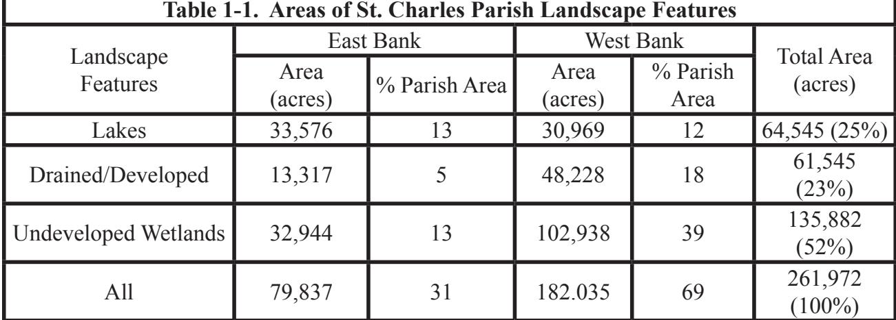

## Page 32 (printed 1-2)

> **Figure description (machine-generated, checked by a second model against the image):** Map titled 'Environmental Management Unit Boundaries - West Bank Community', on an aerial photograph with north at the top. Yellow outlines mark the Environmental Management Units (EMUs), and most are labelled. Units named include East LaPlace Wetland, Montz Urbanized Levee and Bonnet Carre' Floodway (top and upper left), LaBranche Wetland (upper centre-right), New Sarpy Swamp and Ormond Swamp, East Bank Community and West Bank Community along the river, Allemand Wetland (west), Davis Management Unit (east-south-east) and Salvador Management Unit (south), Lake Cataouatche (lower right, at the south-east edge), and Paradis Mitigation Area and Bayou Gauche Community (lower left). Red areas are above the 5 ft contour. They cluster on the ridges on both banks of the river. The legend lists Highways (blue line), Levees (black and white dashed line), EMU (yellow outline), Parish Boundary (gray fill with black dashed outline) and Above 5 ft Contour (red). St. John the Baptist (upper left), Jefferson (right edge) and Lafourche (left) are labelled at the map's edges. The scale bar, SCPDC block and locator inset are omitted.
>
> _Not readable or uncertain:_ Highway route numbers and some street names are too small to read. Lake Cataouatche is labelled inside its yellow outline, but the white patches next to it are unlabelled.

#### GEOLOGY

Land higher than five feet is confined to two strips ranging from 0.4 to 2.0 miles wide sloping away from the natural Mississippi River bank on either side (Figure 1-1). These strips are the tops of low ridges or “natural levees” that the river built over millennia as it repeatedly overflowed its banks. As the unconfined flow slowed, the heavier sand load dropped out on the bank while fine-grained silts and clays were carried farther into lower elevation swamps and marshes prior to artificial levee construction (Figure 1-2). The natural levee strips are wider in places where the river periodically broke out of its banks to build a splay of channels, called a “crevasse,” extending away from the bank.

Historical records show that the Mississippi crevassed in the vicinity of what is now the Bonnet Carré Spillway 25 times between 1718 and 1879, and at three other East Bank locations in 1892. Fewer crevasses affected the West Bank during the historic period, but in 1884 the Davis Crevasse scoured out a deep hole that is now referred to as Davis Pond 2.7 miles downstream of the Hale Boggs Bridge. Crevasses sometimes remained open for up to a decade at a time (Humphreys and Abbot 1867, Saucier 1963, Yakubic et al. 1986). The inlet for the Davis Pond Freshwater Diversion put into service by the USACE in 2002 is immediately downstream of the Davis Crevasse location (Figure 1-2).

## Page 33 (printed 1-3)

A 100,000 year old Pleistocene Prairie Terrace that was exposed at the surface until about 8,000 years ago underlies St. Charles Parish and all of the Holocene deltaic plain. It was at that time that sea level rose to close to near its present level following deglaciation. This Terrace formation is found at a depth of about 50 feet below current mean sea level (MSL) on the East Bank and slopes gently to the southeast. The modern Mississippi River is incised into the Pleistocene stratum in its deepest spots. Estuarine bay deposits up to 20 feet thick overly the Pleistocene surface, and attest to marine flooding as sea level rose. A natural levee deposit is found on the East Bank about 15 feet below MSL that indicates a Mississippi River channel was active in about its present location about 3,500 years ago (Saucier 1963, Hahn and Pearson 1987).

Most of the land that today makes up St. Charles Parish was deposited more than 3,500 years before present (BP), during the early (Metairie) stage of the St. Bernard delta building cycle (Figure 1-3). The branching channel system of a very large crevasse from this period is still evident in the splay of low ridges radiating from a breach zone more than 1.5 miles wide just downstream of Luling on the West Bank. This crevasse evidently developed into a sizable river distributary, now known as Grand Bayou (though the remnant channel no longer flows) that built south from the crevasse to create a north to south oriented ridge that today supports the LA 90 highway corridor and linear settlements extending to the towns of des Allemands and Bayou Gauche on the north bank of Bayou des Allemands at the southern boundary of the parish (Figure 1-2).

After swamp and marsh vegetation colonized new inter-distributary lands built high enough by the river to be in the intertidal zone, the channel that once supplied inorganic silt and clay sediments (mud) at some point was naturally abandoned by the river. Despite the loss of a river sediment supply, the wetlands were still able to grow upward as the land subsided, and sea level slowly rose, by creating organic-rich “peat” soils. It is this capacity for marshes and swamps to build upward or “aggrade” in response to “relative sea level rise” (RSLR = Subsidence + Sea Level Rise) that explains the continued presence of freshwater swamps and marshes on both banks of the parish for more than 3,000 years.

## Page 34 (printed 1-4)

> **Figure description (machine-generated, checked by a second model against the image):** Geologic map titled 'New Orleans 30 x 60 Minute Geologic Quadrangle', 2011, on a topographic base. Water is light blue, and blue cross-hatched symbols cover much of the marsh. The map has no legend. Boxed callouts name some areas: 'Natural Levees of Modern Mississippi River (Meander Belt)' (top centre, with leader lines running down to the gray levee ridges beside the river); '1884 Davis Crevasse' (centre-right, just below the river, with an arrow pointing down to a gray-blue patch); 'Modern Mississippi Crevasse Complex' (right of centre); 'St. Bernard Delta Crevasse Complex' (centre); 'Marsh Deposits of St. Bernard Delta' (two callouts, upper left of centre and lower right of centre); and 'Marsh Deposits of LaFourche Delta' (lower left). Printed water names are Lac des Allemands (upper left), Lake Cataouatche (right) and Mississippi River (along the river, top centre to top right). 'LAFOURCHE PARISH' is printed at the left. Olive-green fill covers most of the marsh, gray fill marks the river levee ridges on both sides of the river, and the crevasse complexes appear as dark branching shapes. Short map unit codes such as Hml, Hmm, Hds, Hdsl and Hdl are printed in small type. The scale bars and base-map credit text are omitted.
>
> _Not readable or uncertain:_ The olive-green and gray fills have no legend key, so they are unlabelled fills. The meaning of the unit codes (Hml, Hmm, Hds, Hdsl, Hdl) is not printed on the map and the small type is hard to read.

The main channel feeding the Lafourche Delta, which began to take shape 2,000 years BP, followed the route of a now much diminished Bayou Lafourche. The Mississippi experienced an avulsion through the west bank 45 miles upstream of St. Charles Parish at the location of Donaldsonville (Figure 1-3). The Lafourche channel and its distributaries built wetlands to the south of St. Charles Parish on top of wetlands dating from the older St. Bernard phase. Mud from the Lafourche delta undoubtedly found its way into the West Bank wetlands of St. Charles Parish and helped to sustain them above MSL until Bayou Lafourche was artificially severed from the Mississippi in 1904 to reduce flooding, and now receives only enough water pumped in to avoid stagnation and supply drinking water needs.

## Page 35 (printed 1-5)

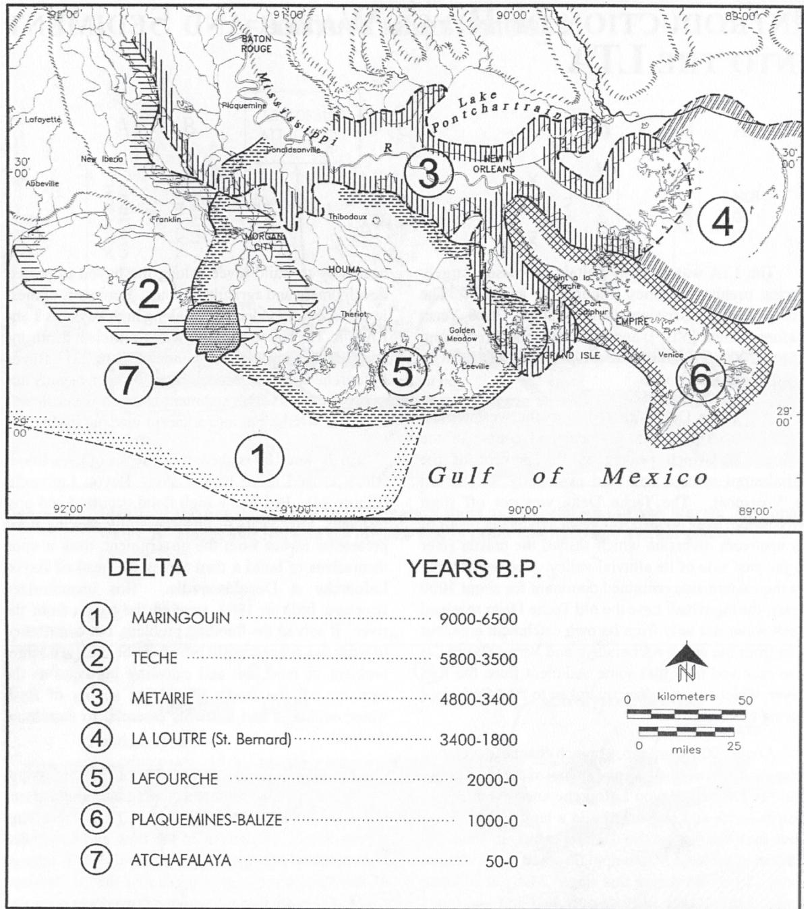

> **Figure description (machine-generated, checked by a second model against the image):** Map with a key. The map shows the Mississippi River delta and the adjacent Gulf coast of southeastern Louisiana, with latitude and longitude ticks along its edges (29 to 30 degrees north, 89 to 92 degrees west). Printed place names include Baton Rouge, Donaldsonville, Plaquemine, New Orleans, Lake Pontchartrain, Thibodaux, Houma, Golden Meadow, Leeville, Grand Isle, Port Sulphur, Empire, Point a la Hache, Venice, Lafayette, New Iberia, Abbeville, Franklin, Morgan City and Theriot, plus 'Gulf of Mexico' along the bottom. Seven numbered circles mark delta lobes over hatched, cross-hatched and stippled areas. The key below the map is headed DELTA and YEARS B.P. and lists: 1 MARINGOUIN, 9000-6500; 2 TECHE, 5800-3500; 3 METAIRIE, 4800-3400; 4 LA LOUTRE (St. Bernard), 3400-1800; 5 LAFOURCHE, 2000-0; 6 PLAQUEMINES-BALIZE, 1000-0; 7 ATCHAFALAYA, 50-0. The key gives numbers only and no symbol for each fill pattern, so each area is identified by its numbered circle. A north arrow and scale bars are printed and are omitted here.
>
> _Not readable or uncertain:_ The title printed at the top of the map is clipped and cannot be read. Small coastal place names are hard to read at this size.

#### WETLAND HABITAT

More than half of St. Charles Parish is in wetlands, but if land area alone is considered, leaving out the large slices of lakes included in the parish area (Figure 1-1), wetlands comprise 69 percent (Figure 1-4). This amounts to 136,000 acres, with a quarter on the East Bank (32,944 acres), and the remaining 75 percent on the West Bank (102,938 acres). These figures do not include wetland pockets scattered through developed zones that are either impounded and pumped or ditched for gravity drainage.

## Page 36 (printed 1-6)

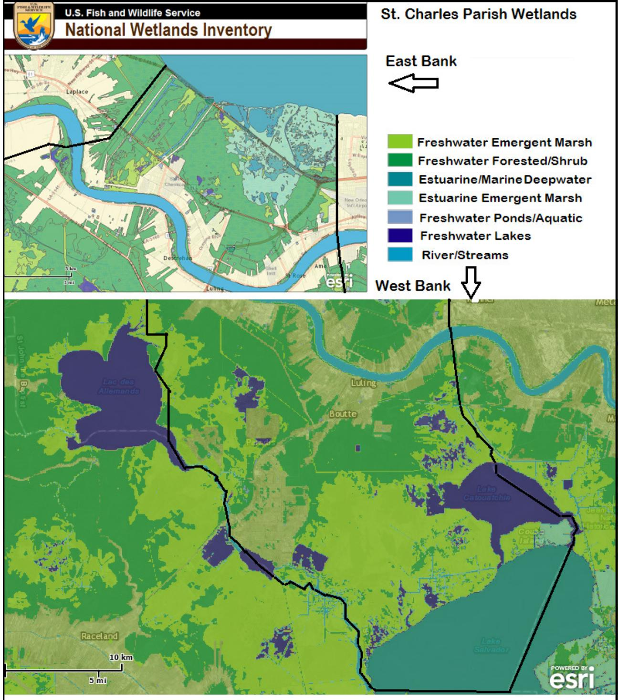

> **Figure description (machine-generated, checked by a second model against the image):** Two-panel colour map of St. Charles Parish wetlands, titled St. Charles Parish Wetlands at upper right, with a U.S. Fish and Wildlife Service National Wetlands Inventory header at upper left. The upper panel is marked by a left-pointing arrow labelled East Bank and shows Laplace and Destrehan along the river, with Luling and part of another label at the bottom edge; a large teal water body along its top is unlabelled. The larger lower panel is marked by a downward arrow labelled West Bank and shows the Mississippi River crossing the top, with Luling, Boutte and Raceland labelled. Lac des Allemands lies at the north-west, Lake Catouatchie lies to the east and Lake Salvador to the south-east, and Couba Island is beside Lake Catouatchie. A black line runs through both panels, apparently the parish boundary; it is not in the legend. Legend entries, as printed, each with its colour: Freshwater Emergent Marsh (light green); Freshwater Forested/Shrub (dark green); Estuarine/Marine Deepwater (dark teal); Estuarine Emergent Marsh (pale teal-green); Freshwater Ponds/Aquatic (grey-blue); Freshwater Lakes (dark navy); River/Streams (bright light blue). Labels cut off at the edges include St. John the Baptist and Jean Lafitte. Scale bars are omitted.
>
> _Not readable or uncertain:_ Some small labels, including Paradis, are partly hidden or faint. The exact colour of the Freshwater Ponds/Aquatic entry is hard to separate from River/Streams.

The U.S. Fish and Wildlife Service (USFWS) maintains a database of all wetlands of the United States, the National Wetlands Inventory, that includes maps and imagery upon which polygons of wetland types are overlaid (Figure 1-4). This information is available online through use of the “Wetlands Mapper” website (http://www.fws.gov/wetlands/data/mapper.HTML). The map tool is linked to look-up data with detailed descriptions of hundreds of wetland types, including the area of each wetland polygon, all identified by a Cowardin (1979) code (Table 1-2). A comprehensive list of plant species associated with each wetland type can be retrieved as well as a list of soil types with pedologic characteristics. More detailed wetland soil information is available from U.S. Department of Agriculture, Natural Resources Conservation Service (NRCS) on a similar web-based mapping tool, called the “Web Soil Survey” (http://websoilsurvey.nrcs.usda.gov/app/ WebSoilSurvey.aspx). The wetland soils reflect the flood frequency and duration that also governs the wetland vegetation assemblage (Table 1-2).

## Page 37 (printed 1-7)

**Table 2: Table 1-2. Predominant Wetland and Soils Types in St. Charles Parish from National Wetland Inventory (USFWS) and Natural Resources Conservation Service (NRCS)**

| Salinity Range (ppt) | Code | Wetland Description | Flooding Frequency | Soils | Where |
|---|---|---|---|---|---|
| 5-18 | E2EM1P5 | Mesohaline, intertidal, emergent marsh | Tidal, but less than daily | Lafite muck | East Bank, north I-10 in Labranche Wetlands at Lake Pontchartrain |
| 0.5 - 5 | E2EM1P6 | Oligohaline, intertidal, emergent marsh | Tidal, but less than daily | Kenner muck | East Bank, south I-10 in Labranche Wetlands |
| <0.5 | PEM1F | Palustrine, non-tidal emergent marsh | Semi-permanently flooded | Kenner muck; Allemands muck | Both banks, lowest elevation marshes, some floating |
| Freshwater | PFO2F | Palustrine, Forested, Needle-leaved deciduous (Cypress swamp) | Semi-permanently flooded | Barbary muck; Maurepas muck | Both banks, lowest portions of natural levee ridges |
| Freshwater | PFO1 | Palustrine, Forested, broad-leaved deciduous (Bottomland Hardwood) | Frequently flooded | Barbary muck; Fausse clay; Schriever clay | Both banks, lower portions of natural levee ridges |
| Upland | Non-Wetland | Non-Wetland | Not flooded | Cancienne silty clay loam; Gramercy silty clay; Harahan clay | Both banks, natural levees, urban, residential and agricultural |

_Table rebuilt from the PDF text layer; spellings as printed in the source._

Table snapshot (for checking): 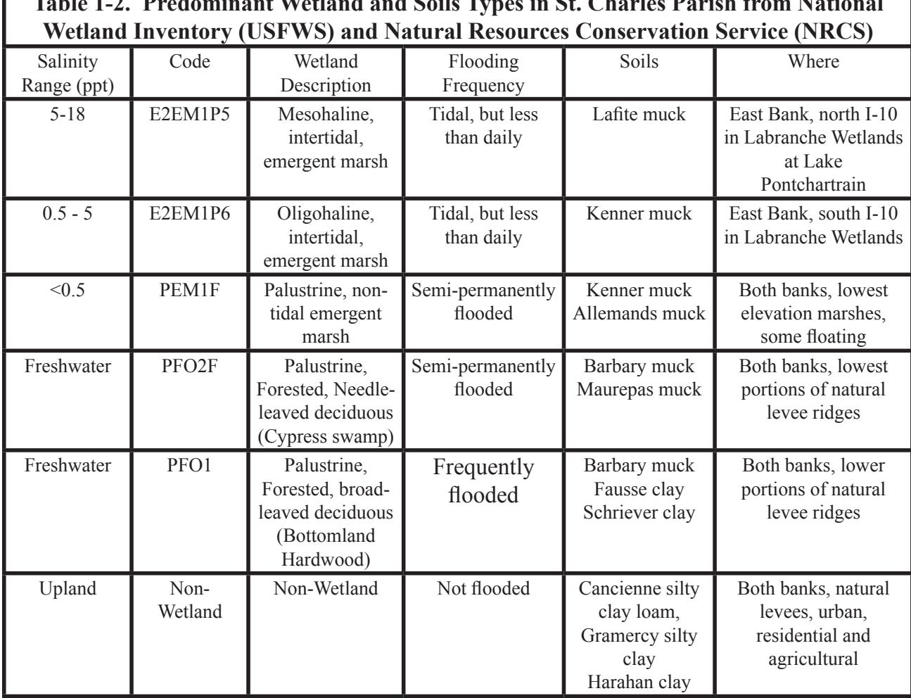

#### SOILS

All wetland soils underlying parish swamps and marshes are classified as “mucks,” composed of “dark, finely divided, well-decomposed organic soil material over fluid clayey alluvium” (McDaniel 1987). Kenner muck is most widespread soil type in the parish, covering nearly 40 percent of the land area (Table 1-3). It underlies marshes on both banks of the parish. Barbary muck is the second most common soil and supports forested wetlands, from cypress-tupelo swamps to bottomland hardwoods, depending on elevation and drainage. As elevation increases on flanks of the natural levees and crevasse deposits, soil types are more variable with the addition of mineral silts and clays, grading into loams. Such details will be discussed in the descriptions of each EMU. Lake Pontchartrain exhibits a wide range of salinities ranging from 0 to 15 parts per thousand (ppt.). For this reason, marshes on the north side of the East Bank are classified as intermediate marshes that experience salinities during droughts of up to 10 ppt. (Table 1-4). Intermediate marshes also occur on Couba Island and on the mainland immediately to the west of Lake Salvador in the southern part of the parish. About 56 percent of all wetlands in the parish are forested, either bottomland hardwood or cypress-tupelo swamps. Swamps on the East Bank have experienced salt stress and this has killed and stunted trees and created a savannah-like landscape with a fragmented marsh and shrub understory (Figure 1-5). Because this area has also been partially impounded by a railway causeway for over 100 years, it has been isolated from sediment input and has subsided to the point where today it experiences nearly continuous flooding, with little opportunity for swamp regeneration (Day et al. 2012).

## Page 38 (printed 1-8)

**Table 3: Table 1-3. St. Charles Parish Soils (McDaniel 1987 Soil Survey)**

| 1able 1-3. St. Charles Parish Soils (McDaniel 198/ Soil Survey) |  |  |  |
|---|---|---|---|
| Symbol | Soil Name | Acres | % Land Area |
| KE | Kenner muck | 74,718 | 37.8 |
| BB | Barbary muck | 30,630 | 15.5 |
| CR | Commerce and Commerce Soils, frequently flooded* | 8,703 | 4.4 |
| Cm | Commerce silty clay loam* | 8,340 | 4.2 |
| Ha | Harahan clay | 8,139 | 4.1 |
| Cc | Commerce silt loam* | 7,984 | 4.0 |
| LF | Lafitte muck | 7,936 | 4.0 |
| Sh | Sharkey clay, frequently flooded | 6,983 | 3.5 |
| FA | Fausse clay | 6,423 | 3.3 |
| Cn | Commerce silty clay loam, frequently flooded* | 5,046 | 2.6 |
| Se | Sharkey clay | 4,836 | 2.4 |
| MA | Maurepas muck | 4,369 | 2.2 |
| UR | Urban Land | 4,129 | 2.1 |
| AR | Allemands-Larose association | 3,891 | 2.0 |
| Sa | Sharkey silty clay loam | 3,240 | 1.6 |
| AE | Allemands muck | 2,250 | 1.1 |
| Am | Allemands clay, drained | 2,130 | 1.1 |
| Vc | Vacherie silt loam | 903 | 0.5 |
| Mp | Maurepas muck, drained | 570 | 0.3 |
| Ud | Udorthents | 430 | 0.2 |

_\*Since 1987 publication of the Soil Survey, Commerce is now called Cancienne (NRCS 2009)_

Table snapshot (for checking): 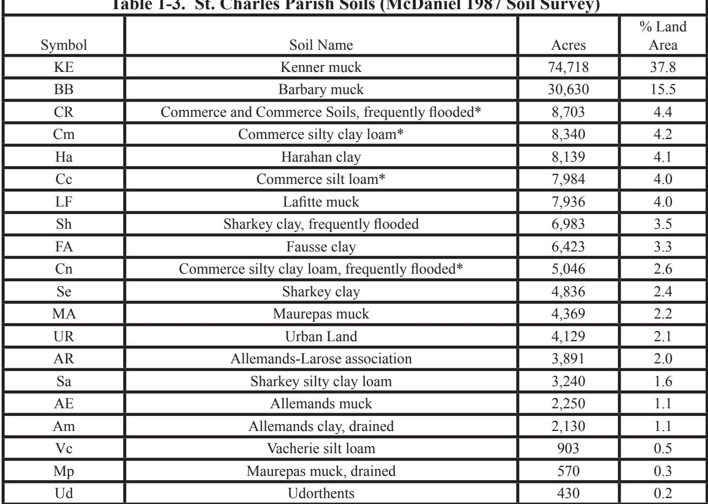

On the West Bank, an estimated 27 percent of the marsh is sufficiently buoyant that the living root mat detaches from an underlying clay substrate and floats more or less freely either seasonally or year around. Such marshes were called “flotant” by O’Neil (1949) who mapped them in the southern part of the parish between Lake Salvador and the Paradis impoundment, and less extensively along the shoreline of Lac des Allemands (Sasser et al. 1996).This is an adaptation to RSLR that is found in fresh, intermediate and brackish marshes in inland portions of interdistributary basins with little tidal influence that also lack a continuing source of alluvial sediments. The floating marshes of St. Charles Parish are excellent wildlife habitat and have proven to be durable even when affected by significant hurricane surges.

## Page 39 (printed 1-9)

**Table 4**

| Table 1-4. Wetlands of St. Charles Parish |  |  |  |
|---|---|---|---|
| Type | East Bank | West Bank | Total |
| Intermediate Marsh | 7,825 | 6,268 | 14,093 |
| Fresh Attached Marsh | 755 | 32,262 | 33,017 |
| Fresh Floating Marsh | 0 | 12,000 | 12,772 |
| Forested Wetlands | 25,119 | 51,653 | 76,772 |
| Total | 33,699 | 102,183 | 135,882 |

Table snapshot (for checking): 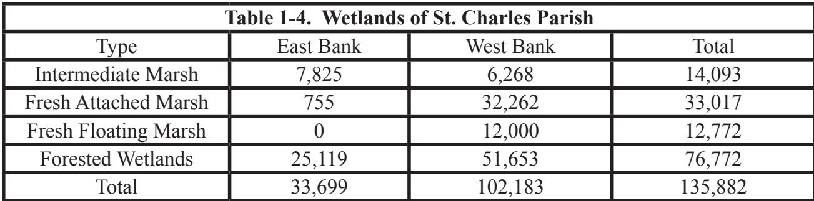

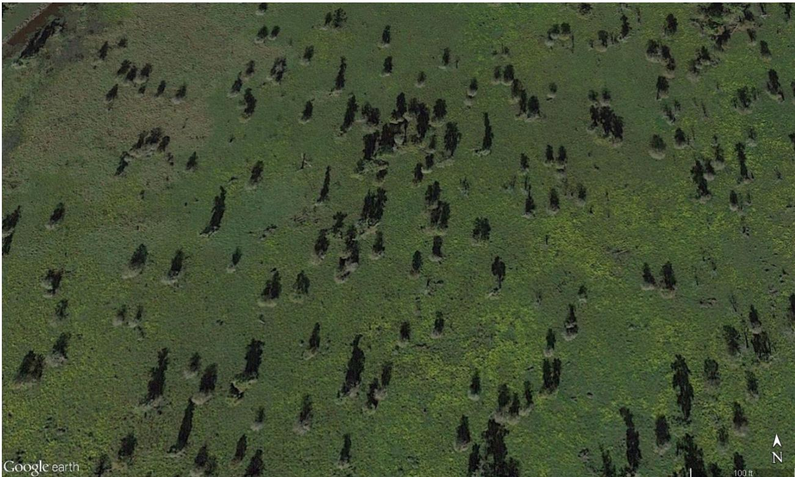

> **Figure description (machine-generated, checked by a second model against the image):** Aerial photograph from Google Earth of a low, grass-green wetland. Many dark, mostly individual tree or shrub crowns are scattered across the whole frame, each with a pale shadow beside it, over an open, mostly uniform ground surface. A brownish strip, perhaps open water or bare ground, appears in the upper-left corner. The Google Earth credit, a north arrow and a 100 ft scale bar are printed and are omitted here. There is no legend.
>
> _Not readable or uncertain:_ At this scale it is not clear whether any of the dark crowns are downed trees, as the caption describes; the image does not settle that.

#### WETLAND CHANGE

The indigenous peoples who inhabited the Mississippi River delta before it was settled by Europeans and Canary Islanders used to burn off the dry marsh grass to attract migratory waterfowl in the fall and winter when water levels were low. But they did not engage in projects to drain or irrigate crops as was done elsewhere in the New World.

From first arrival in what is now St. Charles Parish, the new settlers immediately began to change the environment in fundamental ways, clearing trees from the rich soils of the natural levees and putting in drainage ditches around fields of crops and pastures. Canals were dug for waterborne access and drainage, and when gravity drainage was not sufficient, steam-powered “drainage machines” were constructed with big iron paddlewheels to push water over a low sill (Hahn and Pearson 1988).

## Page 40 (printed 1-10)

The Swampland Act of 1849 spurred Louisiana to sell vast tracts of wetlands for pennies an acre to private investors who could initially do little but cut timber off them. After the Civil War, agricultural scientists travelled to Holland and the Fenlands of England, which had long been drained for farming using windmills, and were then converting to coal-fired steam pumps (Nesbitt 1885). They returned with reports extolling the natural fertility of peaty wetland soils generally, and that of coastal wetlands particularly. A “reclamation movement” began that lasted into the 1960s, eventually leading to drainage and conversion of half of the U.S. wetland inventory (National Research Council 1992).

Reclamation was particularly active in St. Charles Parish in the first decades of the 20th century, as was documented in 1918 by Charles Okey, an agricultural scientist who studied the subsidence and productivity of drained peat soils in Florida and Louisiana (Okey 1918). Okey arrived in Louisiana after most of the forested wetlands in St. Charles and other nearby parishes had been cut over to supply lumber to the rapidly growing city of New Orleans. He observed and described reclamation activities on a number of large wetland impoundments created on the East and West Banks (Figure 1-6). Project promoters sought to attract immigrant farmers to buy land in the agricultural “Eden” being created. On a hurricane prone coast, however, the elaborate levees and drainage schemes were expensive to maintain, while the fertility of wetland soils turned out to be short-lived, and the land surface tended to sink rapidly when drained. Many owners went bankrupt in the 1920s and 1930s.

Because of drainage induced subsidence, impoundments that breached and were not pumped out became the rectangular lakes that are still apparent in many places across the Louisiana coast. Those that are still in use today, as at Paradis (10,318 acres, drained in 1909) and Kenner (12,000 acres, drained in 1924), were saved by the discovery of oil in the first case, and by the demand for suburban land around New Orleans in the second. The 900 acre upscale Ormond subdivision on the East Bank is unusual in that it was not drained until 1975, and is one of the last wetland reclamation projects allowed after passage of the Clean Water Act. It is estimated that the total area affected by all reclamations in the parish is 18,965 acres, of which 13,758 remain fastlands and 5,207 have converted to open water.

Reclamations that failed are distributed along U.S. 90, Bayou des Allemands (Figure 1-6), and on the west bank of Lake Cataouatche (Figure 1-7). Some of the rectangular drainage units within them now are partially covered by flotant marsh. Okey reclamation 29, on Lake Pontchartrain in the LaBranche wetlands, however, has a new lease on life (Figure 1-9). A 300 acre portion of the open water created by drainage was filled with sediment dredged from the Lake in one of the earliest marsh restoration projects authorized under the Coastal Wetland Planning, Protection and Restoration Act of 1990 (CWPPRA).

## Page 41 (printed 1-11)

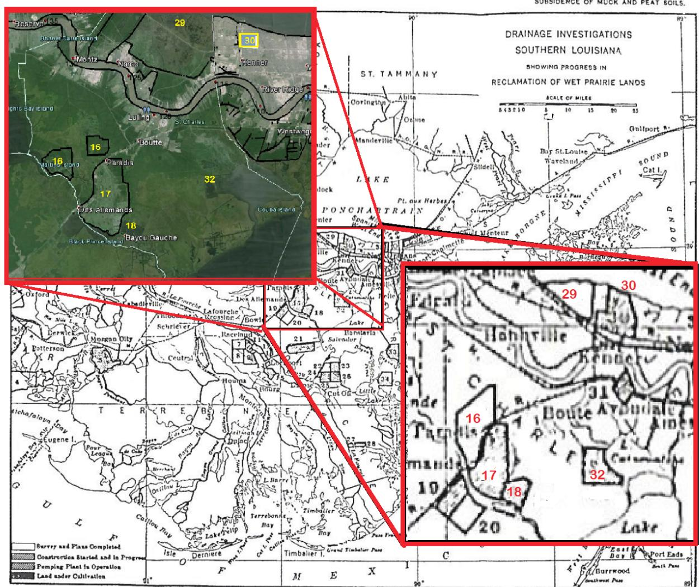

> **Figure description (machine-generated, checked by a second model against the image):** Composite map with a base map and two red-outlined inset panels. The base map has the title DRAINAGE INVESTIGATIONS SOUTHERN LOUISIANA SHOWING PROGRESS IN RECLAMATION OF WET PRAIRIE LANDS printed at upper right, and shows the southeastern Louisiana coast from Lake Pontchartrain and Mississippi Sound south to the Gulf of Mexico. Printed labels include St. Tammany, Terrebonne, Houma, Morgan City, Lake Pontchartrain and Gulf of Mexico. Numbered reclamation districts are printed across the map. A legend at lower left lists: Survey and Plans Completed (white); Construction Started and in Progress (diagonal hatching); Pumping Plant in Operation (a different hatching); Land under Cultivation (solid dark). The upper-left inset is an aerial photograph of the Luling, Boutte, Des Allemands and Bayou Gauche area, with black district outlines and yellow numbers 16, 17, 18, 29, 32, and 30 in a yellow box. Printed labels in this inset include Norco, Montz, Kenner, River Ridge, Westwego, Luling, St. Charles, Boutte, Paradis, Des Allemands and Bayou Gauche. The lower-right inset is an older map of the same area, with district numbers 16, 17, 18, 29, 30 and 32 in red. Scale bars are omitted.
>
> _Not readable or uncertain:_ The legend symbols, especially the two hatched ones (Construction Started and in Progress, Pumping Plant in Operation), are hard to tell apart. Some small labels in the insets are blurred and some district numbers in the base map cannot be read.

Figure 1-6. Map of early 1900s reclamation districts that were diked and drained using steam pumps to create agricultural and residential land (Okey 1918). Insets show enlargement of the St. Charles Parish impoundments and the footprint of these projects today.

## Page 42 (printed 1-12)

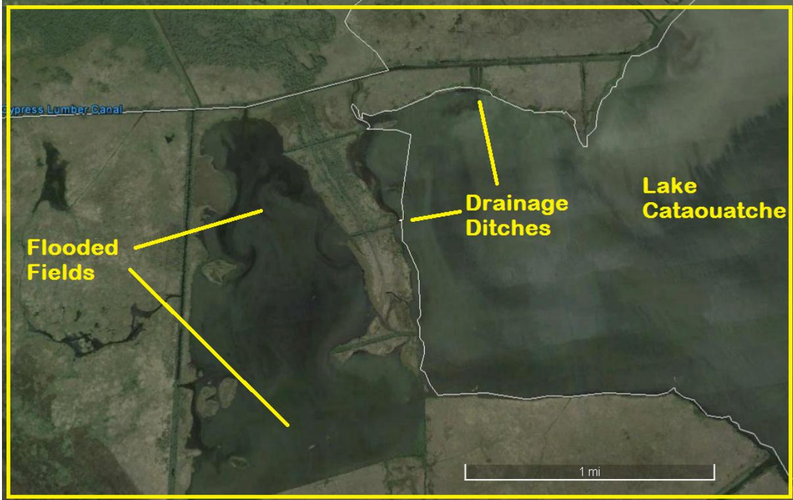

> **Figure description (machine-generated, checked by a second model against the image):** Aerial photograph of a flooded agricultural area on the shore of Lake Cataouatche, with yellow labels added and a yellow border around the image. The label 'Flooded Fields' has two leader lines, one to the large dark water area in the left centre of the image and one running down to the lower part of that dark area. 'Drainage Ditches' has two leader lines: one to the northern edge of the flooded area, near the top of the thin white line, and one to the east side of the narrow strip of straight linear ditches that runs down the middle, beside the white line. 'Lake Cataouatche' is written over the hazy, lighter open water on the right side. Partly cut-off blue text at the upper left reads '...ypress Lumber Canal' and sits above a straight line that runs across the upper left of the frame. A thin white line traces a boundary around the flooded area and the lake and is not labelled. A 1 mi scale bar is printed and is omitted here.
>
> _Not readable or uncertain:_ The partly cut-off canal name at upper left is incomplete. The meaning of the white line is not stated in the image.

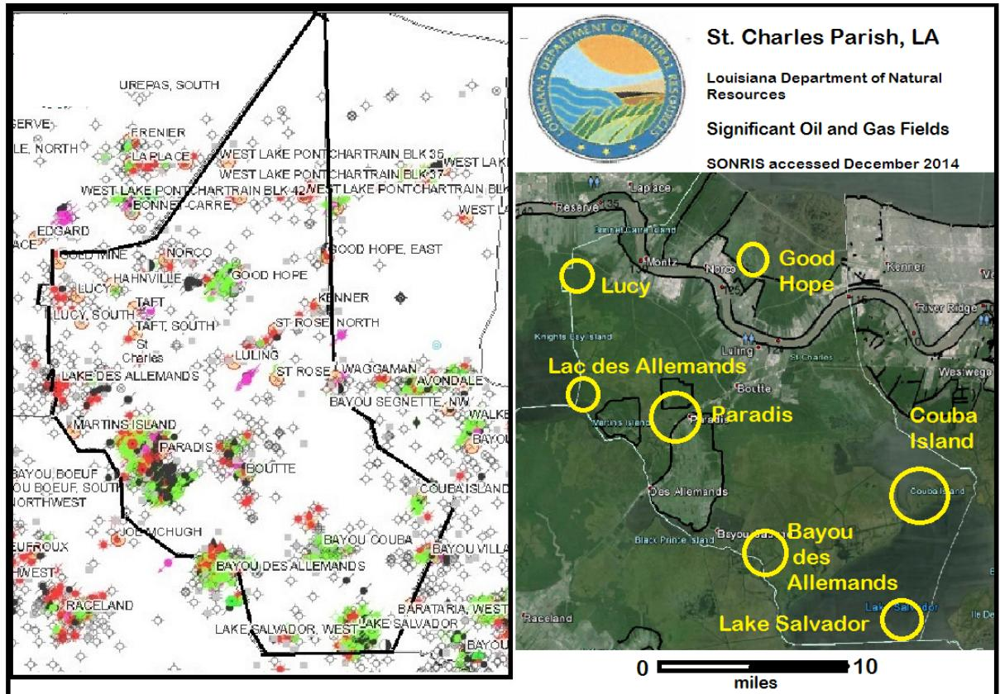

> **Figure description (machine-generated, checked by a second model against the image):** Two-panel map of oil and gas wells and fields, with the Louisiana Department of Natural Resources heading on the right panel. The left panel is an unlabelled regional map of St. Charles Parish, outlined in black, with many symbols: coloured dots and star shapes in red, green, orange, black and magenta, outlined diamonds, and small grey squares. It has no legend, so the symbols cannot be identified. Place names on it include La Place (printed as 'LA PLACE'), Norco, Good Hope, Kenner, Luling, Taft, Paradis, Boutte, Couba Island, Bayou des Allemands and Lake Salvador. The right panel is an aerial image under the headings 'St. Charles Parish, LA', 'Louisiana Department of Natural Resources', 'Significant Oil and Gas Fields' and 'SONRIS accessed December 2014'. Irregular black lines on the image are unlabelled. Seven yellow circles mark and label fields: Lucy (north-west), Good Hope (north), Lac des Allemands (west) and Paradis (centre), Couba Island (east), Bayou des Allemands (south) and Lake Salvador (south-east, at the bottom). The right panel has a scale bar in miles from 0 to 10.
>
> _Not readable or uncertain:_ The left panel has no legend, so the meaning of its symbols and colours is unknown. Some place names on the left panel are cut off at the edges. The black lines on the right panel are unlabelled, so what they mark is unknown.

## Page 43 (printed 1-13)

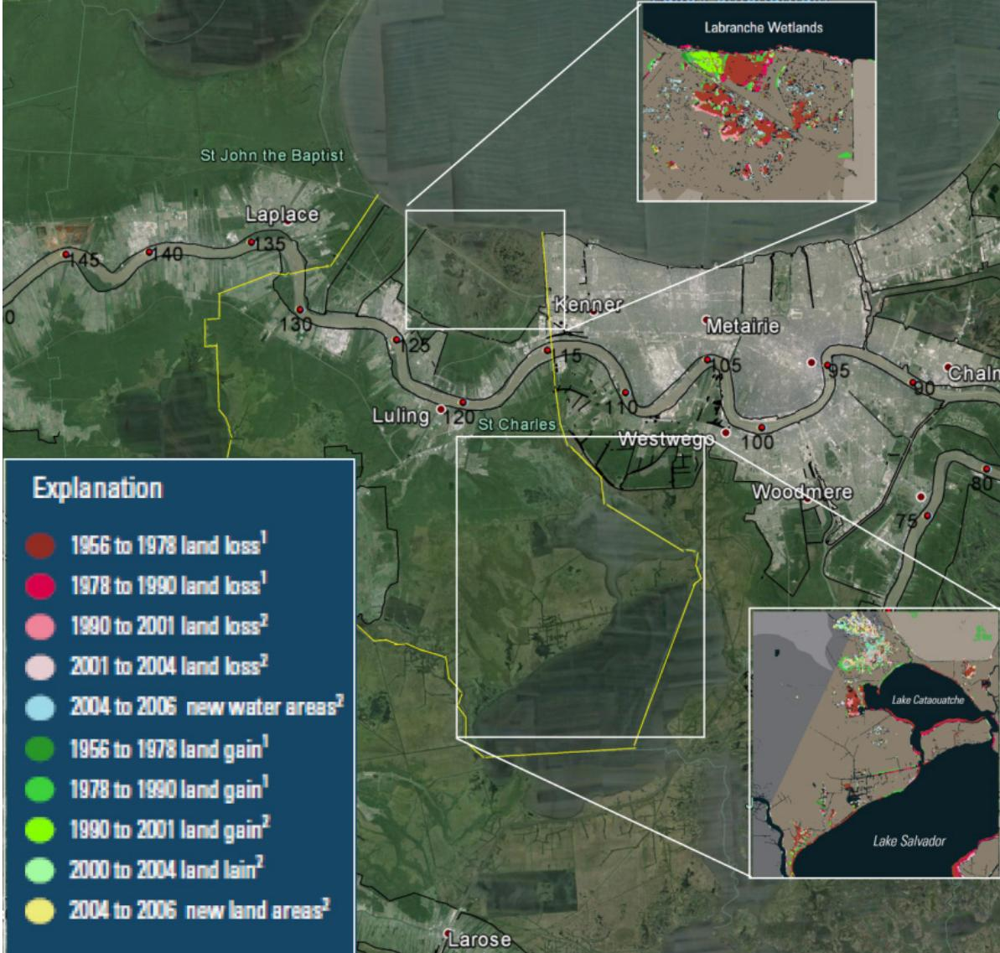

> **Figure description (machine-generated, checked against the image):** Aerial map of the Mississippi River corridor on both banks, from west of Laplace to the New Orleans area, with Larose at the bottom edge and two enlarged insets. The river runs through the map with red dots numbered along it, including 145, 140, 135, 130, 125, 120, 115 (printed partly hidden), 110, 105, 100, 95, 90, 80 and 75. Place names include Laplace, Luling, St Charles, Kenner, Metairie, Westwego, Woodmere, Chalmette (partly cut off), Larose and St John the Baptist. Yellow lines run north to south on each side of the St. Charles area; they have no legend entry. The top inset is labelled 'Labranche Wetlands' and has coloured fills. The bottom-right inset shows Lake Cataouatche and Lake Salvador. The legend is titled 'Explanation' and lists, from top to bottom: dark red 'land loss' 1956 to 1978 (superscript 1); crimson 'land loss' 1978 to 1990 (superscript 1); pink 'land loss' 1990 to 2001 (superscript 2); pale pink 'land loss' 2001 to 2004 (superscript 2); light blue 'new water areas' 2004 to 2006 (superscript 2); dark green 'land gain' 1956 to 1978 (superscript 1); green 'land gain' 1978 to 1990 (superscript 1); bright lime green 'land gain' 1990 to 2001 (superscript 2); pale green 'land lain' 2000 to 2004 (superscript 2); yellow 'new land areas' 2004 to 2006 (superscript 2). Superscripts 1 and 2 are not explained in the legend.
>
> _Not readable or uncertain:_ The legend prints 'land lain' for 2000 to 2004; this is copied as printed. The superscript footnotes 1 and 2 have no text in the image. Some river mile numbers near Kenner and Westwego are partly hidden.

Between 1935 and 1990, St. Charles Parish lost an additional 10,697 acres from all causes, for an average of 194 acres of wetlands per year (Dunbar et al. 1993). Oil was discovered at Paradis in 1938, and at a number of other parish locations in the 1940s and 1950s (Figure 1-8), but canal dredging during that period totaled only 1,610 acres. Between 1958 and 1974, canal dredging continued but conversion of wetlands to open water in the LaBranche wetlands on the East Bank was the most significant driver of parish land loss during that period (5,840 acres), in part because of construction of the I-10 interstate highway (Figure 1-8). Large lakes that opened up before 1974 in LaBranche have continued to grow. But the primary source of parish wetland loss since 1983 has been wave-induced retreat along the shorelines of Lakes Pontchartrain, Cataouatche and Salvador. (Barras et. al. 2008).

## Page 44 (printed 1-14)

St. Charles Parish and the Pontchartrain Levee District are building out segments of a shoreline armoring project along the four mile marsh coast of Lake Pontchartrain as funds become available. Approximately 2.3 miles of protection have been built so far along this coast that has been eroding at a rate of nine feet per year (Pontchartrain Levee District 2014).

Annual land-loss in the parish since 1990 has been less than 100 acres per year despite all of the hurricanes since 2005. Recent land-change has not all been loss. Wetland habitat in the “holding wetland” of the Davis Pond Freshwater Diversion has been undergoing rapid succession as river water, sediment and nutrients have boosted wetland productivity. This shows up in the land change map as an interspersed amalgam of loss and gain north of Lake Cataouatche (Figure 1-9). In some years, succession has also occurred beneath the waters of the receiving Lake, with lush growth of submerged aquatic vegetation that damps waves, clears the water and provides great habitat for freshwater fish species and bass fishermen.

#### CLIMATE

The climate of St. Charles Parish is humid subtropical (Köppen climate classification Cfa), with short, generally mild winters and hot, humid summers (World Meteorological Organization 2014). The monthly daily average temperature ranges from 53.4 °F (11.9 °C) in January to 83.3 °F (28.5 °C) in July and August (Figure 1-10A). The lowest recorded temperature was 6 °F (−14 °C) on February 13, 1899. The highest recorded temperature was 104 °F (40 °C) on June 24, 2009. The average precipitation is 62.7 inches (1,590 mm) annually. Summer months are the wettest, while October is the driest (Figure 1-10B).

Precipitation in winter usually accompanies the passing of a cold front. On average, there are 77 days of 90 °F (32 °C)+ highs, 8.1 days per winter where the high does not exceed 50 °F (10 °C), and 8.0 nights with freezing lows annually. In a typical year the coldest night will be around 30 °F (−1 °C). It is rare for the temperature to reach 100 °F (38 °C) or dip below 25 °F (−4 °C). Snow and sleet are rare, with the last significant snow fall on December 11, 2008. While precipitation is relatively evenly distributed throughout the year, evaporation and transpiration by plants is much higher in the heat of the summer than at other times, so that runoff is greater during the cool months.

Hurricanes pose a severe threat to the parish because of its low elevation, and because it is surrounded by large lakes on the north, east, and west, and is less sheltered than in the past on the south due to wetland loss. Portions of the parish have been flooded by the Grand Isle Hurricane of 1909, New Orleans Hurricane of 1915, 1947 Fort Lauderdale Hurricane, Hurricane Flossy in 1956, Hurricane Betsy in 1965, Tropical Storm Juan in 1985, Hurricanes Katrina and Rita in 2005, Hurricanes Gustav and Ike in 2008, and Hurricane Isaac in 2012. Flooding occurs both because of storm surge and heavy rainfall that hurricanes can bring. Maximum storm surges experienced by St. Charles Parish are up to 12 feet, with the largest surges originating in Lake Pontchartrain and having greatest effect on the East Bank (IPETF 2009).

## Page 45 (printed 1-15)

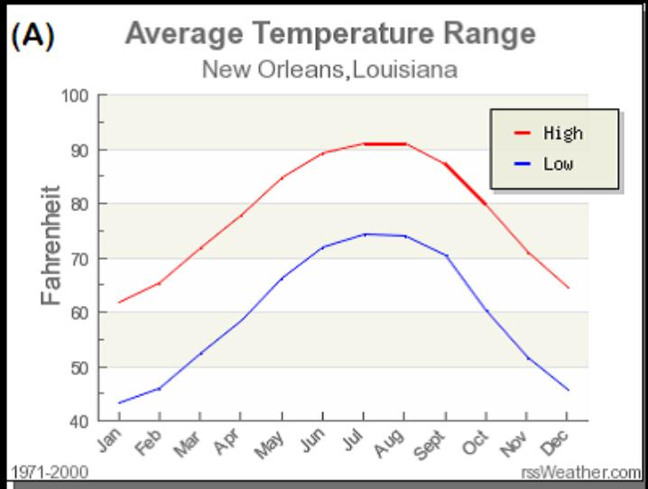

> **Figure description (machine-generated, checked by a second model against the image):** Line chart with two lines, titled 'Average Temperature Range' and subtitled 'New Orleans, Louisiana', with the panel label '(A)' at upper left. The vertical axis is labelled 'Fahrenheit' and runs from 40 to 100 with gridlines every 10. The horizontal axis shows the months Jan to Dec (Sept is printed for September); it has no axis title. The legend in a box at upper right names two series: 'High' in red and 'Low' in blue. The high line starts in January just above the 60 gridline, rises through spring, and peaks just above the 90 gridline in July and August. It falls through autumn and ends in December between the 60 and 70 gridlines. The low line follows the same shape, starting between the 40 and 50 gridlines in January, peaking in July and August about midway between the 70 and 80 gridlines, and ending in December between the 40 and 50 gridlines. Printed at lower left is the data period '1971-2000'.
>
> _Not readable or uncertain:_ No values are printed on the chart, so the exact figures are not given. Values are described only relative to the gridlines.

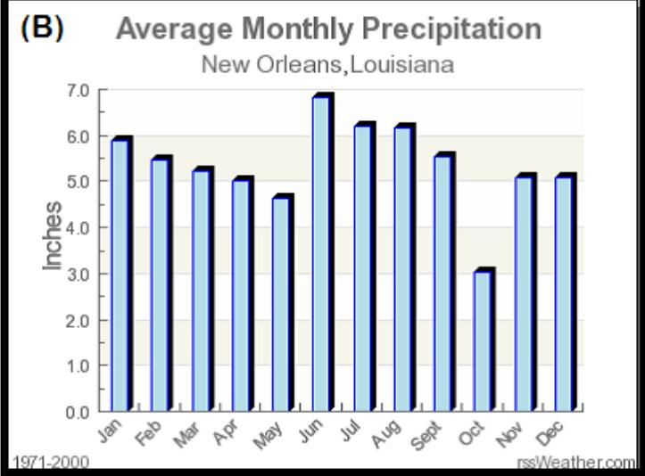

> **Figure description (machine-generated, checked by a second model against the image):** Bar chart of average monthly precipitation for New Orleans, Louisiana. The printed heading reads "(B) Average Monthly Precipitation" with the subtitle "New Orleans, Louisiana". Only panel B is shown; there is no temperature chart in the image. The vertical axis is labelled "Inches" and runs from 0.0 to 7.0 in steps of 1.0. The horizontal axis lists the months Jan to Dec (Sept is printed for September), with one light blue bar per month. The footnote in the lower left reads "1971-2000", the averaging period. June is the tallest bar, just under the 7.0 gridline. July and August are next, a little above the 6.0 gridline, and January is also near 6.0. September, February and March are roughly 5.2 to 5.6 inches. October is the lowest bar, at about the 3.0 gridline, and May is the next lowest, below the 5.0 gridline. April, November and December are at about the 5.0 gridline.
>
> _Not readable or uncertain:_ The bar values are read against gridlines only, so the figures in the description are approximate. The panel A caption text is not in the image.

#### HYDROLOGY

Under pre-settlement conditions, before levee building, the Mississippi River was an intermittent source of water and sediment to both banks of the parish. Overtopping of the natural levee banks occurred often. Less frequently, crevasses projected river influence throughout the parish, sometimes for decades, as has been discussed. Since 1931 on the East Bank and 2002 on the West Bank, controllable, artificial connections from the river have been constructed that partially replace the overbank and crevasse flow of the past. The Bonnet Carré Spillway on the East Bank was built by the USACE at the site of a former crevasse to shunt river water into Lake Pontchartrain during floods that threaten to overtop levees downstream in New Orleans (Figure 1-11). The spillway has been opened in 10 of the 83 years it has been operational, with four openings in the first 42 years, and six in the second half (Table 1-4). Sand is retained within the spillway between guide levees but silt and clay largely deposits in the lake, where storms can move sediment back into the adjacent marshes (Day et al. 2012).

## Page 46 (printed 1-16)

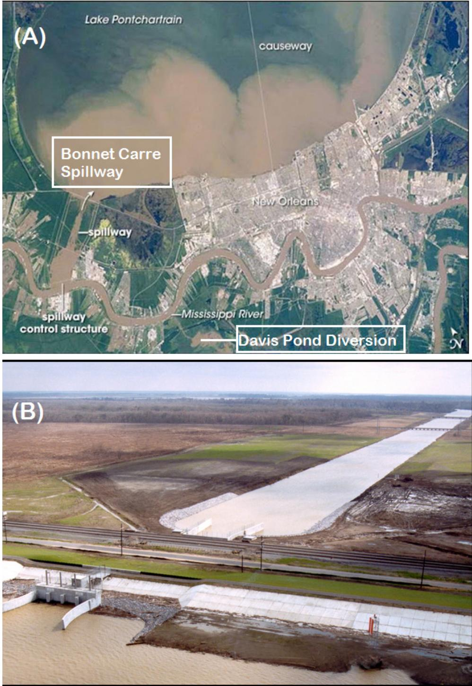

> **Figure description (machine-generated, checked by a second model against the image):** Two-panel image. Panel A is a satellite view, and panel B is an oblique aerial photograph. In panel A, printed labels read "Lake Pontchartrain" (top left), "causeway" (top, right of centre, beside a thin straight line across the lake), "New Orleans" (centre right), and "Mississippi River" (lower centre, along the river). Boxed callouts read "Bonnet Carre Spillway" (left centre, with a short arrow) and "Davis Pond Diversion" (lower right, with a line pointing left toward a small brown area). Smaller labels read "spillway" (left of centre) and "spillway control structure" (lower left, below the river). A brown, muddy plume fills the southern part of the lake along the shore; the northern lake is dark green. The river is brown. In panel B, a long, straight channel with pale grey-brown water runs diagonally toward the upper right, with a rock-lined rounded end at its lower left. A railway and a road run across the foreground between the channel and the river. A concrete structure with gates sits at the lower left on the river bank, beside muddy brown river water.

The Davis Pond Freshwater Diversion was put into operation in 2002 to counter saltwater intrusion into the Barataria Basin. The structure is located close to the site of the last major West Bank crevasse, as noted above, and flows through a conveyance channel into a ponding wetland, and from there into Lake Cataouatche and Lake Salvador (Figure 1-11).

## Page 47 (printed 1-17)

**Table 5**

| Table 1-5. Bonnet Carré Spillway Openings since Completion in 1931 |  |  |  |
|---|---|---|---|
| Year | Days Open | Bays Open out of 350 | Peak Discharge (cfs) |
| 1937 | 48 | 285 | 203,571 |
| 1945 | 57 | 350 | 250,000 |
| 1950 | 38 | 350 | 250,000 |
| 1973 | 75 | 350 | 250,000 |
| 1975 | 13 | 225 | 170,714 |
| 1979 | 45 | 350 | 250,000 |
| 1983 | 35 | 350 | 250,000 |
| 1997 | 31 | 298 | 212,857 |
| 2008 | 31 | 170 | 114,286 |
| 2011 | 42 | 330 | 235,714 |

Table snapshot (for checking): 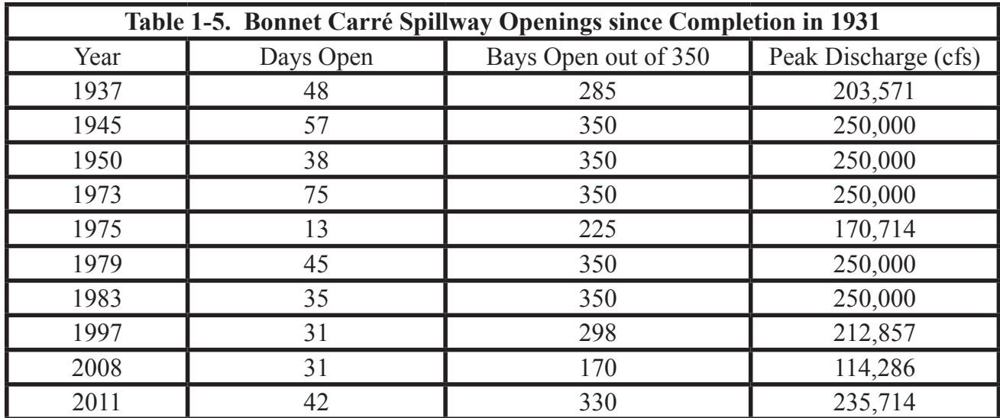

The astronomical tide range in Lakes Pontchartrain and Salvador is less than one foot, but water levels at the boundaries of the parish are strongly influenced by winds. Strongest winds are from the south to southeast during the spring, summer and fall, but switch to northerly during frontal passages in the winter. Cold fronts pass through southeast Louisiana every five to seven days during the winter and are typically preceded by strong southerly winds that switch to strong northers. These fronts tend to push water out of all of the deltaic estuaries, leading to some of the lowest water levels experienced through the year. Because St. Charles has a north facing shoreline on Lake Pontchartrain and one facing south and east along Lakes Cataouatche and Salvador, water levels can react differently to the same regional wind systems (Figure 1-12). This tendency is most clearly illustrated during hurricanes. Hurricanes Gustav (2008) and Isaac (2012) caused surges on the East Bank that were at least twice the magnitude of what was experienced in Bayou des Allemands, while Hurricane Ike (2008) had a greater surge in Lake Salvador and the Barataria estuary than in Lake Pontchartrain.

Prior to man’s alteration of the Pontchartrain and Barataria estuaries, it would have been rare that any wetlands in the parish were exposed to brackish conditions. Freshwater from rainfall on the natural levees as well as the wetlands would be retained in the upper parts of the interdistributary estuaries with little tidal exchange. But salinity rose to new levels in Lake Pontchartrain after dredging of the Mississippi River Gulf Outlet (MRGO) through St. Bernard Parish in 1963 (Shaffer et al. 2009). This deep-draft canal provided a new, artificial tidal pass for the Lake. On the Barataria side (West Bank), peak salinities also rose through the 1980s and 1990s as wetlands disappeared and artificial channels expanded providing more efficient connections to the Gulf. Salinity reached a peak of almost 15 parts per thousand (ppt.) during the drought of 2000 (Figure 1-13). This led to establishment of intermediate marsh on Couba Island and around oil field canals on the adjacent mainland.

## Page 48 (printed 1-18)

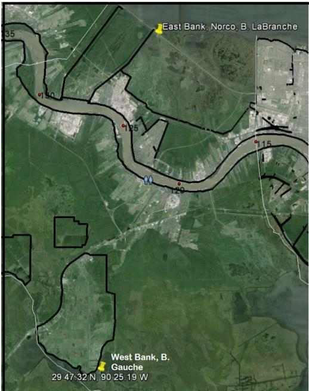

> **Figure description (machine-generated, checked by a second model against the image):** Map with no printed title, showing an aerial or satellite base. A river winds across the map from the upper left to the right edge, and the river is not labelled. A yellow pin at the top centre, on land north of the river, is labelled "East Bank, Norco, B. LaBranche". A yellow pin at the bottom, left of centre, is labelled "West Bank, B. Gauche" with the printed coordinates "29 47 32 N, 90 25 19 W". Small red dots along the river carry numbers: "135" at the far left edge (partly cut off), "130" or "150" at the upper left (the middle digit is partly covered by the outline; the sequence of the other numbers suggests 130), "125" in the centre left, "115" at the right, and a dot near the bottom centre of the river whose number is partly covered by the black outline and reads about "120" [uncertain]. Two small blue figure icons sit just south of the river near the centre. Thick black outlines trace the river itself and enclose irregular areas on both banks, most clearly on the lower left and along the right edge. These are outlines only, not fills. Thin white lines also cross the map, unlabelled. The map has no legend.
>
> _Not readable or uncertain:_ The number on the red dot near the bottom centre is partly covered by the outline; it may read 120. The black outlines and thin white lines have no legend or key, and their meaning is not stated on the image.

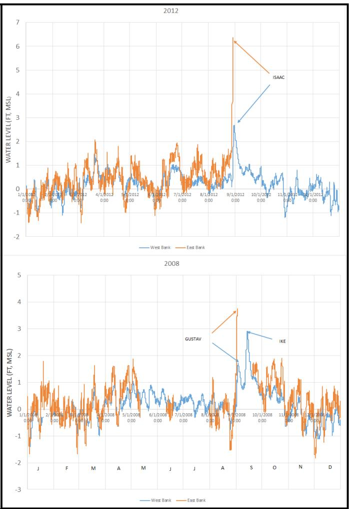

> **Figure description (machine-generated, checked by a second model against the image):** Two stacked line charts of water level. The upper panel is titled "2012" and the lower panel is titled "2008". Both vertical axes are labelled "WATER LEVEL (FT, MSL)". The upper axis runs from -2 to 7 ft and the lower axis runs from -3 to 5 ft, with gridlines at each whole foot. Both horizontal axes have date labels (for example 1/1/2012 0:00 and 1/1/2008 0:00, one per month, through 12/1), and the lower panel also has the month initials J to D beneath them. Each panel has a legend below it: "West Bank" in blue and "East Bank" in orange. In 2012, both lines fluctuate mostly between about -1 and 2 ft, and the East Bank line tends to rise higher in spring and mid-year. Both lines spike at the end of August or start of September. An orange arrow labelled "ISAAC" points to an East Bank spike above the 6 gridline, and a blue arrow points to a West Bank peak between the 2 and 3 gridlines. The orange East Bank line is not visible after that spike. In 2008, the lines also fluctuate mostly between about -1 and 2 ft. A sharp orange East Bank spike in late August or early September rises above the 3 gridline and is labelled "GUSTAV". A blue West Bank peak near 2 ft is also labelled "GUSTAV". A later blue West Bank peak in September, just under the 3 gridline, is labelled "IKE".
>
> _Not readable or uncertain:_ The date labels on both axes are small and partly overlapped, so exact dates of the peaks are not read. Peak heights are read against gridlines only and are approximate.

The salinity trend reversed in Lake Pontchartrain after 2008 when the Mississippi River Gulf Outlet (MRGO) was closed and dammed. Operation of the Davis Pond Freshwater Diversion at discharges ranging from 0 to 11,000 cubic feet per second (cfs.) has not prevented salinity from spiking in Lake Salvador during droughts in the summer and fall, particularly after hurricanes, but it has reduced the length of time that salinity rises above 10 ppt. (Figure 1-13). The diversion can flow only when water level in the river is high enough, and the Mississippi River stage is typically lowest during the summer which allows salinities in the coastal lakes and marshes to rise. Even if the diversion could flow at that time, discharge is typically lowered for fisheries purposes.

The diversion has been run more continuously since 2006 with a base discharge of 1,000 to 2,000 cfs., and this has resulted in better control of salinity spikes in Lake Salvador (Figure 1-13). Das et al. (2012) describe the Davis Pond diversion as the largest in the world, but note that it has limited effect on salinity in the upper and lower Barataria estuary, significantly lowering salinity only in the middle reach. This is because salinities are very low most of the time in the upper basin, the St. Charles Parish portion, while the open water of Barataria Bay at the Gulf end is so strongly influenced by tidal and wind forcing that flux from Davis Pond input is negligible in comparison.

## Page 49 (printed 1-19)

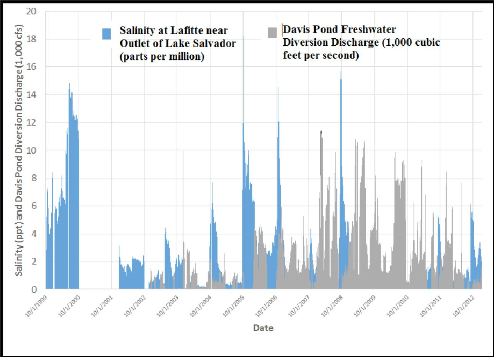

> **Figure description (machine-generated, checked against the image):** Bar chart with two series drawn as vertical bars on a shared date axis. No title is printed on the chart. The y-axis is labelled 'Salinity (ppt) and Davis Pond Diversion Discharge (1,000 cfs)' and runs from 0 to 20, with gridlines every 2 units. The x-axis is labelled 'Date' and is marked yearly from 10/1/1999 to 10/1/2012. The blue series is 'Salinity at Lafitte near Outlet of Lake Salvador (parts per million)'. The grey series is 'Davis Pond Freshwater Diversion Discharge (1,000 cubic feet per second)'. Blue salinity bars are tallest in mid-2000, before the 10/1/2000 tick, peaking between the 14 and 16 gridlines, and again near 10/1/2005, where a single spike reaches the 18 gridline. A second blue peak sits between the 14 and 16 gridlines near 10/1/2008. No blue salinity bars appear from about 10/1/2000 to early 2002. From 2002 to 2012 most blue bars stay under about 4, with short spikes. Grey discharge bars appear from about 2002 to 2012. Most stay below about 4, with frequent taller peaks from 2007 to 2010. The highest grey peak, around late 2007, sits between the 10 and 12 gridlines. The axis label gives salinity in ppt while the legend says parts per million, as printed.
>
> _Not readable or uncertain:_ Exact months of individual peaks are read against the year ticks and may be off by a few months. Values between gridlines are approximate.

Other modifications to the natural hydrology have largely been stimulated by man’s increasing desire to improve drainage from the natural levees and fastlands (Figure 1-14). As was touched on earlier, this was largely driven by technology. Initially, gravity drainage through field ditches was used to extend the area available for cultivation of cotton and sugarcane to lower elevations on the natural levees. Because the levees, like the entire Mississippi delta, are subsiding relative to sea level, keeping water from encroaching on developed land is a battle that never ends. Dokka et al. (2006) has provided an estimate of levee subsidence of 0.4 inches per year (10 mm/y) in the Mississippi River reach that includes St. Charles Parish (Kemp et al. 2014). One adaptation used by early farmers in the parish was to plant rice at the lower elevations so that they could take advantage of the seasonal availability of water they would otherwise have to drain.

Steam power came to St. Charles Parish, then the Cote des Allemands (German Coast), in 1828 when it was used to operate a sugarhouse on what later became the Waterford Plantation on the West Bank near the upstream parish line. After the Civil War, steam also was used by plantation owners to facilitate drainage using 17 to 20 foot diameter water wheels, called “drainage machines,” that pushed water over a low sill. Some of these machines were used into the first decade of the 20th century (Hahn and Pearson 1987).

## Page 50 (printed 1-20)

Steam pumps were little used for agricultural drainage, but became important to the previously discussed wetland reclamation movement of the first decades of the 20th century. A. Baldwin Wood, an engineer with the New Orleans Sewage and Water Board, invented a low-head, high-efficiency, high-volume screw pump in 1907 that revolutionized pumped drainage systems throughout the world (American Society of Mechanical Engineers 1974). With a wood pump, it was possible to lift water out of impoundments that would never drain by gravity.

Building and enlarging flood-control and drainage levees, largely to protect against hurricane driven surge has been very active since the disastrous hurricanes of 2005 (Figure 1-15). These projects are being funded with a mix of private, local (St. Charles Parish), state (Pontchartrain Levee District) and federal (USACE) monies. Because levees cut off natural drainage, and because of subsidence, forced drainage by pumps has become increasingly necessary for virtually all developed lands. In addition to the flood control levees, numerous highways and railways built on causeways restrict gravity drainage on both banks of the parish. Accordingly, the parish Department of Public Works currently maintains and operates 51 pump stations, including the massive new Cross Bayou pump station on the East Bank that has a maximum capacity of 1,300 cfs. (Pontchartrain Levee District 2014).

In addition to drainage and flood control infrastructure, the parish also operates a parish-wide sewer system connected to three wastewater facilities, including one 4.4 million gallon per day (MGD) plant on the East Bank, and two on the West Bank with a combined capacity of 4.9 MGD (Figure 1-16). Potable water is supplied by the Mississippi River after it is treated by an East Bank facility with a seven MGD capacity, and a nine MGD West Bank plant (Wallace Roberts & Todd LLC 2011).

While potable water is drawn from the Mississippi River, three groundwater aquifers are used primarily for industrial purposes (Hosman 1972):

1. Mississippi River Recent Sediments. This is a blanket of silt and clay that includes sandy natural levee and point-bar deposits that are hydraulically connected to the river. The water is very hard and high in iron, but has been used for watering livestock.

2. Gramercy or 200 foot Sand. This sand has a thickness of 100 to 175 feet. It receives recharge from the Mississippi through a point bar deposit near Hahnville and is also believed to be hydraulically connected to the underlying Norco Aquifer. The water is generally hard with some salt content, but has also been used in the past for limited domestic and livestock supply.

3. Norco or 400 foot Sand. This is an extensive aquifer 100 to 150 feet thick consisting of medium to coarse, well-sorted sand. Freshwater in the aquifer is very hard but more than 10 MGD are pumped for industrial purposes on the East Bank.

## Page 51 (printed 1-21)

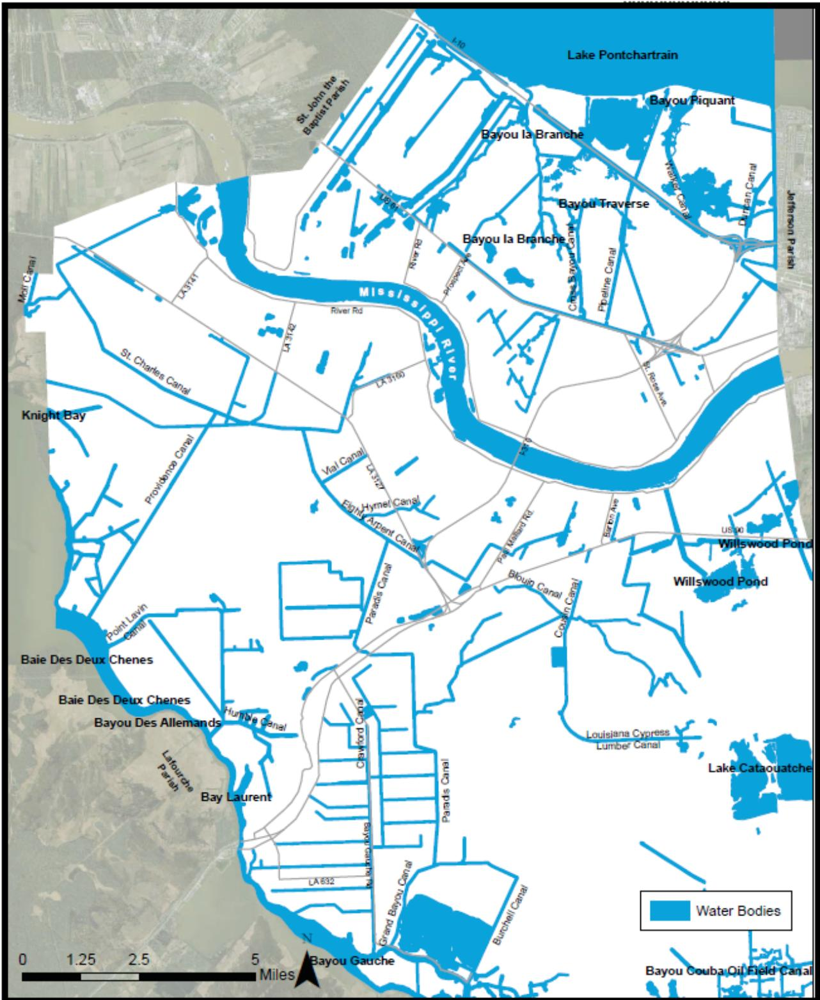

> **Figure description (machine-generated, checked by a second model against the image):** Map of natural and artificial waterways in St. Charles Parish, with no title printed on the map. Lake Pontchartrain lies across the top edge. The Mississippi River runs through the north half, curving from the upper left toward the right and labelled 'Mississippi River'. Parish names along the edges are St. John the Baptist Parish (upper left), Jefferson Parish (right edge) and Lafourche Parish (lower left). Filled blue areas are keyed in the legend as 'Water Bodies'. Thinner blue lines are canals and bayous. They have no separate legend entry. Readable water names include Bayou Piquant, Bayou la Branche, Bayou Traverse, Knight Bay, Bay Laurent, Bayou Des Allemands, Bayou Gauche, Baie Des Deux Chenes, Lake Cataouatche and Willswood Pond. Readable canal names include a canal at the west edge that reads Mott Canal, St. Charles Canal, Providence Canal, Point Lavin Canal, Vial Canal, Hymel Canal, Eight Arpent Canal, Paradis Canal, Crawford Canal, Grand Bayou Canal, Burchell Canal, Blouin Canal, Cousin Canal, Humble Canal and Louisiana Cypress Lumber Canal. Roads include I-10 and US 61 along the north, LA 3141, LA 3142, LA 3127 and LA 3160 in the west-centre, and US 90 and LA 632 to the south. Most of the south-east quadrant is white with few canals. The densest canal grid is in the south-west quarter, between Crawford Canal, Paradis Canal and Grand Bayou Canal near Bayou Gauche.
>
> _Not readable or uncertain:_ Small labels near the river bends and in the north-east are too small to read reliably. The west-edge canal label could be Mott or Moll Canal. Bayou Couba Oil Field Canal is cut off at the lower right edge.

## Page 52 (printed 1-22)

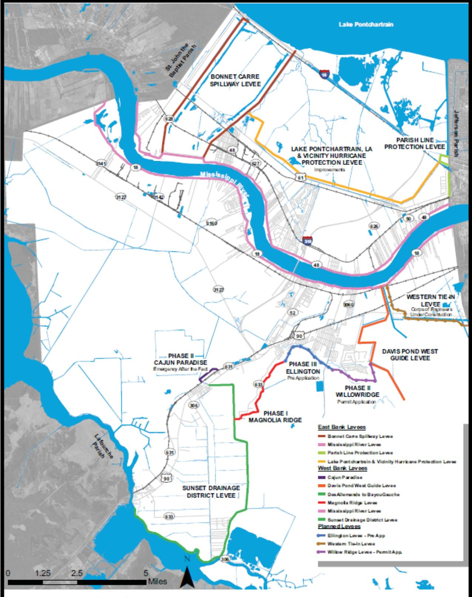

> **Figure description (machine-generated, checked by a second model against the image):** Map of existing and planned hurricane flood protection levees in St. Charles Parish, with no title printed on the map. The legend has three groups. East Bank Levees: Bonnet Carre Spillway Levee (dark red), Mississippi River Levee (pink), Parish Line Protection Levee (light green) and Lake Pontchartrain & Vicinity Hurricane Protection Levee (orange-yellow). West Bank Levees: Cajun Paradise (dark purple), Davis Pond West Guide Levee (orange-red), Des Allemands to Bayou Gauche (green), Magnolia Ridge Levee (red), Mississippi River Levee (pink) and Sunset Drainage District Levee (green). Planned Levees: Ellington Levee - Pre App (blue), Western Tie-In Levee (brown) and Willow Ridge Levee - Permit App. (purple). The map labels the Bonnet Carre Spillway Levee north of the river, the Lake Pontchartrain levee running east along US 61 to the parish line, and the Parish Line Protection Levee at the east edge. Phase II Cajun Paradise (marked Emergency After the Fact) lies beside LA 631. Phase I Magnolia Ridge lies south of US 90, with Phase III Ellington (Pre Application) and Phase II Willowridge (Permit Application) to its east. The Davis Pond West Guide Levee runs south from the river and then south-east. The Western Tie-In Levee is labelled Corps of Engineers Under Construction. The Sunset Drainage District Levee label sits inside a green levee line that runs along the east side of the LA 306 and LA 631 area and along the south-west shore. Pink Mississippi River Levee lines run along both banks.
>
> _Not readable or uncertain:_ The two green legend entries (Des Allemands to Bayou Gauche and Sunset Drainage District Levee) are close in colour and could not be told apart on the map. Some small labels are too small to read.

## Page 53 (printed 1-23)

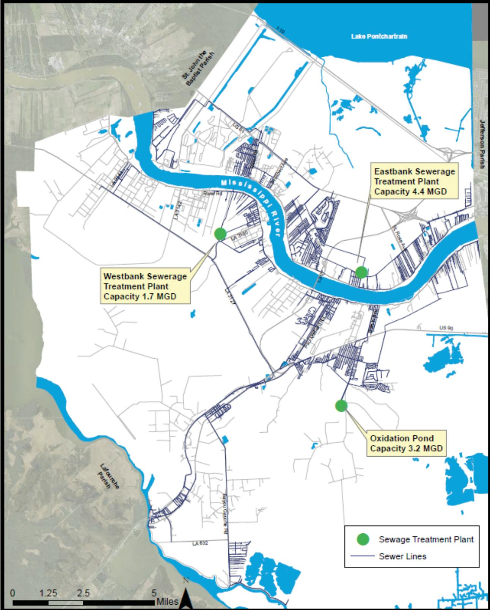

> **Figure description (machine-generated, checked by a second model against the image):** Map of wastewater treatment facilities and sewer lines in St. Charles Parish, with no title printed on the map. The legend has two entries: a green dot for 'Sewage Treatment Plant' and a dark blue line for 'Sewer Lines'. Blue filled areas for water bodies have no legend entry. Three plants are marked with green dots and yellow callout boxes. The Westbank Sewerage Treatment Plant (Capacity 1.7 MGD) is on the west side of the river, near LA 3160. The Eastbank Sewerage Treatment Plant (Capacity 4.4 MGD) is on the east side, on the river bank between the I-310 and St. Rose Ave labels. The Oxidation Pond (Capacity 3.2 MGD) is south of US 90, in the south-centre to south-east. Sewer lines are densest along both river banks, especially on the east bank toward the east edge. One dark line runs south-east from the west bank along LA 3127 to the US 90 corridor, and another follows US 90 south-west toward Bayou Gauche at the lower left. The south-west and south-east have sparse lines. Other labels are Lake Pontchartrain at the top, St. John the Baptist Parish at upper left, Lafourche Parish at lower left, Jefferson Parish at the right edge, and I-10 and US 61 near the north. The Mississippi River is labelled.
>
> _Not readable or uncertain:_ The exact sewer line routes in the crowded river-bend areas are hard to follow at this scale. Road labels at the south edge are small.

## Page 54 (printed 1-24)

#### VEGETATION

Plant cover in the parish has been touched on earlier, and ranges from natural levee hardwood forests and land cultivated primarily in sugarcane to intermediate marshes and submerged aquatic vegetation depending on elevation, drainage and salinity (Table 1-4). Most of the hardwood forest on the natural levees has been cleared and replaced by industrial facilities, residential developments, agricultural fields and pasture. Scattered remnants of second and third growth forest include live oak, hickory, pecan, sweetgum, American elm and green ash. For less well drained soils, water oak, sycamore and hackberry may dominate (Table 1-6). Depending on the canopy cover, the herbaceous layer may or may not be well developed (Table 1-7).

**Table 6: Table 1-6. Trees, shrubs and woody vines of the forested natural levee of St. Charles Parish (Louisiana Natural Heritage Program 2009)**

| | | | |
|---|---|---|---|
| *Acer rubrum var. drummondii* (Red Maple) | *Ampelopsis arborea* (Peppervine) | *Ampelopsis Cordata* (Heartleaf peppervine) | *Berchemia scandens* (Rattan vine) |
| *Bignonia capreolata* (Cross vine) | *Percea borbonia* (Red bay) | *Campsis radicans* (Trumpet Creeper) | *Carpinus caroliniana* (Iron wood) |
| *Celtis laevigater* (Hackberry) | *Planera aquatica* (Water elm) | *Carya ovata* (Shagbark Hickory) | *Carya illinoensis* (Pecan) |
| *Diospyros virginiana* (Persimmon) | *Gleditsia triacanthos* (Honey Locust) | *Froxinus pennsylvanica* (Green ash) | *Ilex decidua* (Deciduous holly) |
| *Ligustrum sinensis* (Chinese privet) | *Liquidambar styraciflua* (Sweetgum) | *Lonicera japonica* (Japanese honeysuckle) | *Crataegus viridis* (Green hawthorn) |
| *Morus rubser* (Red mulberry) | *Morella cerifera* (Wax myrtle) | *Platanus occidentalis* (Sycamore) | *Prunus serafina* (Black cherry) |
| *Quercus michauxii* (Cow oak) | *Quercus nigra* (Water oak) | *Quercus nutallii* (Nutall oak) | *Quercus falcata var. pagodaefolia* (Cherrybark oak) |
| *Quercus shumardii* (Shumard red oak) | *Quercus virginiana* (Live Oak) | *Rosa bracteata* (Macartney rose) | *Rubus SP* (Blackberry) |
| *Sabal minor* (Dwarf palmetto) | *Smilax rotundifolia* (Common greenbriar) | *Sambucus canadensis* (Elderberry) | *Sapium sebiferum* (Chinese tallow tree) |
| *Rubus trivialis* (Dewberry) | *Toxicodendron radicans* (Poison Ivy) | *Ulmus alata* (Winged elm) | *Acer negundo* (Box-elder) |

_Table rebuilt from the PDF text layer; spellings as printed in the source._

Table snapshot (for checking): 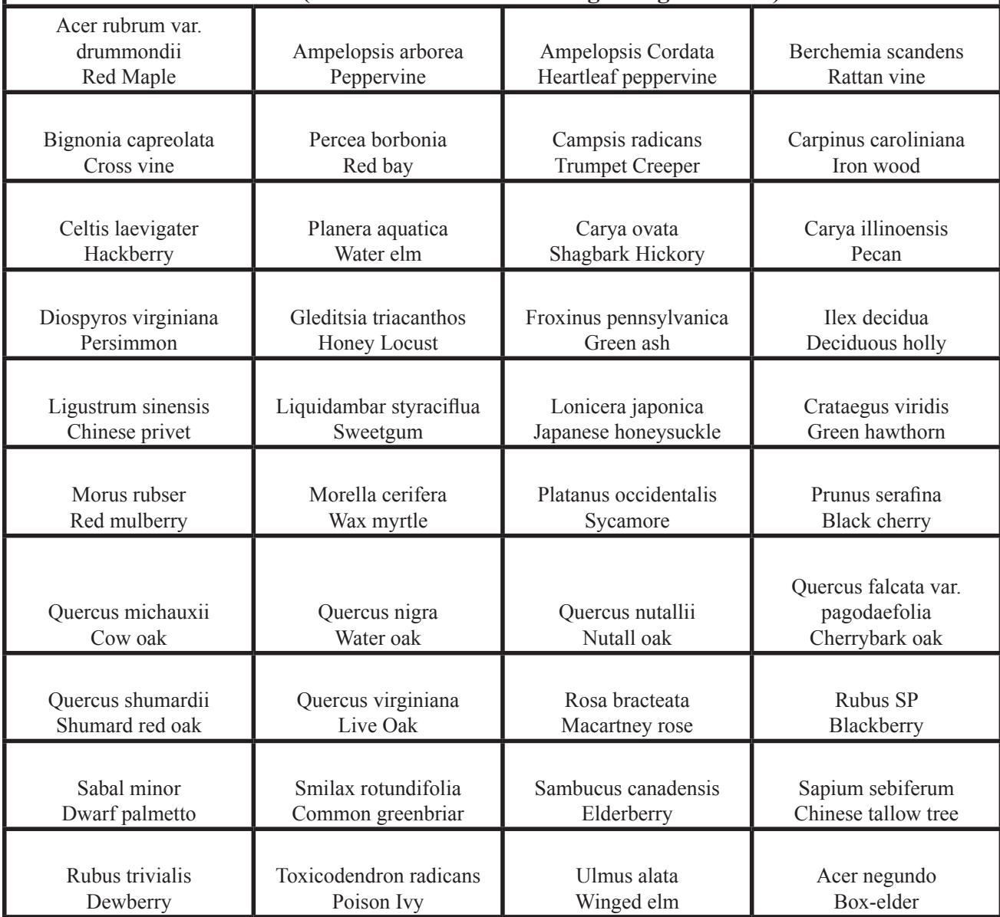

## Page 55 (printed 1-25)

**Table 7: Table 1-7. Common herbaceous plants of the forested natural levee of St. Charles Parish (Louisiana Natural Heritage Program 2009)**

| | | | |
|---|---|---|---|
| *Cocculus carolinianum* (Carolina Moonseed) | *Tradescantia spp.* (Spiderwort) | *Brunnichia ovater* (Ladies Ear-Drops) | *Salidago sempervirens* (Seaside goldenrod) |
| *Bignonia capreolata* (Cross vine) | *Samolus verlandieri* (Water pimpernel) | *Sanicula cadensis* (Snakeroot) | *Arisaema dracontium* (Green dragon) |
| *Nemophylla aphylla* (Baby Blue Eyes) | *Geum canadensis* (Geum) | *Hydrocotyle spp.* (Penny-wort) | *Eupatorium spp.* (Thoroughwort) |
| *Polygonum spp.* (Persimmon) | *Tovara virginica* (Jumpseed) | *Senecio glabellus* (Yellow-top) | *Panicum spp.* (Panic grass) |
| *Ligustrum sinensis* (Smartweed) | *Oplismenus hirtellus* (Basket grass) | *Thelypteris palustris* (Marsh fern) | *Mikania scandens* (Climbing hempvine) |
| *Tilandsia usneoides* (Spanish moss) | *Polypodium polypodioides* (Resurrection fern) | *Phoradendron tomentosum* (Mistle-toe) | *Lygodium japonicum* (Japanese climbing fern) |

_Table rebuilt from the PDF text layer; spellings as printed in the source._

Bottomland hardwood habitat grades into bald cypress-tupelo swamps on the lower parts of the natural levee. These swamps are not floristically diverse unless they are stressed or disturbed as in the LaBranche wetlands (Figure 1-5). If the dominant cypress-tupelo overstory is gapped or missing, then a shrub swamp develops (Louisiana Natural Heritage Program 2009). Since so many of the remaining swamps on both sides of the river have subsided too low to naturally regenerate (Shaffer et al. 2009, Conner et al. 1981), flora of the cypress-tupelo swamps and the shrub swamps that replace them will be listed together (Table 1-8).

**Table 8: Table 1-8. Freshwater swamp trees and shrubs of St. Charles Parish (Louisiana Natural Heritage Program 2009)**

| | | | |
|---|---|---|---|
| *Taxodium distichum* (Bald cypress) | *Nyssa aquatica.* (Tupelo gum) | *Nyssa sylvatica var biflora* (Swamp blackgum) | *Acer rubrum var. drummondii* (Red Maple) |
| *Salix nigra* (Black willow) | *Fraxinus profunda* (Pumpkin ash) | *Froxinus pennsylvanica* (Green ash) | *Planera aquatica* (Water elm) |
| *Gleditsia aquatica* (Water locust) | *Itea virginica* (Virgina willow) | *Cephalanthus occidentalis.* (Buttonbush) | *Forestiera acuminata* (Swamp privet) |
| *Morella cerifera* (Wax myrtle) | *Crataegus opaca* (Mayhaw) | *Sabal minor* (Dwarf palmetto) | *Iva frutescens* (Marsh elder) |

_Table rebuilt from the PDF text layer; spellings as printed in the source._

Table snapshot (for checking): 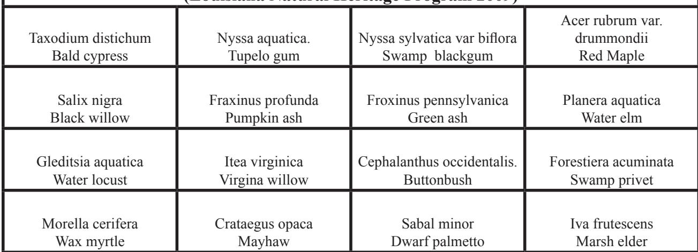

## Page 56 (printed 1-26)

Freshwater marshes have the greatest floristic diversity of any of the marshes found in the Mississippi River delta. They are unique in the extent to which they build their own soil from a mix of live roots and dead plant material that is resistant to decomposition under the perpetually flooded conditions that characterize these marshes (Figure 1-9).

**Table 9: Table 1-9. Common plants of the freshwater marshes of St. Charles Parish (Louisiana Natural Heritage Program 2009)**

| | | | |
|---|---|---|---|
| *Panicum hemitomon* (Maidencane) | *Eleocharis spp.* (Spikesedge) | *Sagittaria lancifolia* (Bull tongue) | *Alternanthera philoxeroides* (Alligator weed) |
| *Spartina patens* (Wire grass) | *Phragmites communis* (Roseaucane) | *Bacopa monnieri* (Coastal water hyssop) | *Ceratophyllum demursum* (Coontail) |
| *Cyperus odoratus* (Fragrant flatsedge) | *Eichhornia crassipes* (Water hyacinth) | *Pontederia cordata.* (Pickerelweed) | *Peltandra virginica* (Arrow arum) |
| *Hydrocotyle spp.* (Pennyworts) | *Lemna minor* (Common duckweed) | *Myriophyllum spp.* (Water milfoil) | *Nymphaea odorata* (White waterlilly) |
| *Typha latifolia* (Cattail) | *Utricularia spp.* (Bladderwort) | *Vigna luteola.* (Deer pea) | *Zizaniopsis miliacea* (Southern wild rice) |
| *Myrica cerifera* (Wax myrtle) | *Thelypteris palustris* (Marsh fern) | *Leersia oryzoides* (Cutgrass) | *Scirpus americana* (Common three-square) |
| *Panicum dichotomiflorum* (Fall panic grass) | *Scirpus validus* (Soft stem bulrush) | *Aster spp.* (Marsh daisy) | *Ptilimnium capillaceum* (Herbwilliam) |

_Table rebuilt from the PDF text layer; spellings as printed in the source._

Table snapshot (for checking): 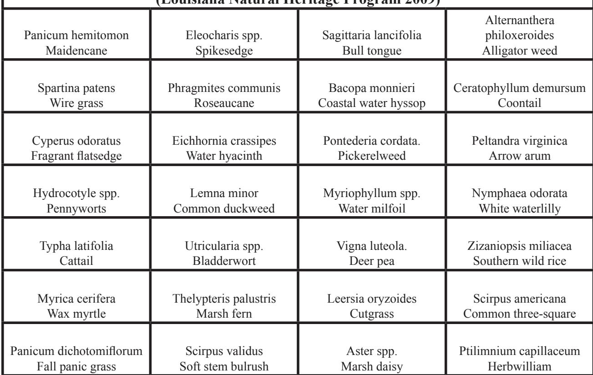

The largest single habitat type found in St. Charles Parish is the fresh marsh. As mentioned previously, significant portions of the fresh marsh on the West Bank west of Lake Salvador and east of Lac des Allemands float occasionally, seasonally or at all times (Sasser et al. 1996). Floating marshes of southern St. Charles Parish typically are dominated by bull tongue (Sagitaria lancifolia), but also include spikesedge (Eleocharis spp.), fall panicgrass (Panicum dichotomiflorum), coastal water hyssop (Bacopa monnieri), wire grass (Spartina patens) with scattered stands of cattail (Typha latifolia).

Some marshes adjacent to Lakes Pontchartrain and Salvador are affected by salinities between three and 10 ppt. Often enough that the vegetation contains species of both brackish and fresh marshes, though it is often dominated by Spartina patens, wire grass. This mix is discussed as intermediate marsh (Figure 1-13). Intermediate marsh experiences an irregular tidal regime and is dominated by narrow-leaved, persistent species (Louisiana Natural Heritage Program 2009).

## Page 57 (printed 1-27)

Since the Davis Pond Freshwater Diversion began operating in 2002, Lake Cataouatche has at times supported remarkable stands of rooted submerged aquatic plants. When these plants are present, they reduce wave action in the lake and cause the water to become very clear. These beds are greatly valued by recreational fishermen, but it is not known why the plants are present in some years and not others (Figure 1-12).

**Table 10: Table 1-10. Common plants of the intermediate marshes of St. Charles Parish (Louisiana Natural Heritage Program 2009)**

| | | | |
|---|---|---|---|
| *Panicum hemitomon* (Maidencane) | *Eleocharis spp.* (Spikesedge) | *Sagittaria lancifolia* (Bull tongue) | *Scirpus olneyi* (Three-cornered grass) |
| *Spartina patens* (Wire grass) | *Phragmites communis* (Roseaucane) | *Bacopa monnieri* (Coastal water hyssop) | *Scirpus californicus* (Giant bullrush) |
| *Scirpus americana* (Common three-square) | *Eichhornia crassipes* (Water hyacinth) | *Paspalum vaginatum* (Seashore paspalum) | *Panicum virgatum* (Switch grass) |
| *Leptochloa fascicularis.* (Bearded spangletop) | *Pluchea camphorata* (Camphor-weed) | *Echinonchloa wateri* (Water millet) | *Cyperus odoratus* (Fragrant flatsedge) |
| *Alternanthera philoxeroides* (Alligator weed) | *Najas guadalupensis* (Southern naiad) | *Vigna luteola.* (Deer pea) | *Spartina cynosuroides* (Big cordgrass) |

_Table rebuilt from the PDF text layer; spellings as printed in the source._

Table snapshot (for checking): 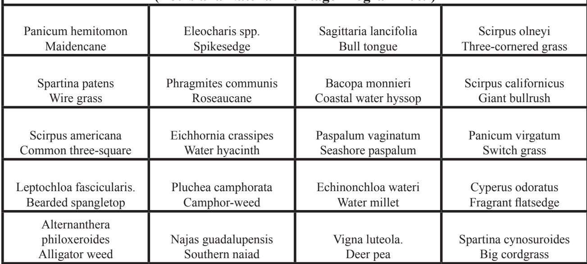

**Table 11: Table 1-11. Submerged aquatic plants of St. Charles Parish (Louisiana Natural Heritage Program 2009)**

| | | | |
|---|---|---|---|
| *Valisneria americana* (Wild celery) | *Ruppia maritima* (Widgeon grass) | *Najas guadalupensis* (Southern naiad) | *Zannichellia palustris* (Horned pondweed) |
| *Cymodocea filiformis* (Manatee grass) | *Displanthera spp.* (Shoal grass) | *Thalassia testudinum* (Turtlegrass) | *Alternanthera philoxeroides* (Alligator weed) |

_Table rebuilt from the PDF text layer; spellings as printed in the source._

Table snapshot (for checking): 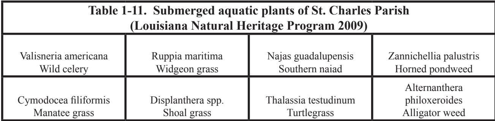

## Page 58 (printed 1-28)

#### WILDLIFE AND FISHERIES

The majority of the land area of St. Charles Parish is undeveloped wetlands that span the headwaters of both the Pontchartrain and Barataria estuaries. This fresh marsh and swamp habitat is extremely productive and supports a variety of resident and migratory wildlife species. Bald eagles (Haliaeetus leucocephalus) come to the parish in the winter to breed at nests that they use year after year, while other pairs are present year round. The majority of water fowl like the Lesser scaup (Aythya affinus), pintail duck (Anas gaita) and green-winged teal (Anas carolinensis) are migrants, breeding in the summer far to the north and spending winters feeding in Gulf coast wetlands. Many species of colonial wading birds like the snowy egret (Egretta thula) and Louisiana heron (Hydanassa tricolor) congregate in the swamps to feed on red swamp crayfish (Procambarus clarkii) and breed. Small Neotropical songbirds like the prothonotary warbler (Prothonotaria citrea) and American redstart (Setophaga ruticilla) pass through or stop to breed in the parish after flying across the Gulf of Mexico in the spring, and pass through again on the return to Central and South America in the fall (Fontenot and DeMay 2011).

Commercial hunters have trapped the American alligator (Alligator mississippiensis), the largest reptile in North America, for its hide and meat since hunting resumed in St. Charles Parish in 1979. Alligators are so sufficiently abundant in the fresh marshes and swamps of the parish that a tag is issued for every 65 acres of fresh and intermediate marsh, and for every 170 acres of swamp forest. The American alligator remains listed on Appendix II of the CITES (Convention on International Trade in Endangered Species of Wild Fauna and Flora) due to the similarity of its appearance to other alligators and crocodiles listed as threatened or endangered with extinction. But alligators are not “endangered” or even “threatened” within Louisiana, and population has increased consistently under management from 1970 to the present.

## Page 59 (printed 1-29)

### Table 1-12. Fish species of St. Charles Parish and Barataria Basin (Conner and Day, 1987)

FRESHWATER (31 species)

Acipenseridae Acipenser oxyrtynchus   
Lepisosteidae Lepisosteus oculatus L. osseus L. spatula   
Amiidae Amia calva   
Clupeidae Alosa alabamae A. chrysochloris Dorosoma cepedianum D. petenense   
Esocidae Esoxniger   
Cyprinidae Notemigonus crysoleucas   
Ictaluridae Ictalurus furcatus 1. punctatus Pylodictis olivaris   
Aphredoderidae Aphredoderus savanus   
Poecillidae Gambusia affinis Heterandria formosa Poecilia latipinna   
Percichthyidae Morona mississippiensis M. saxatilis   
Cenlrarchidae Elassoma zonatum Lepomis gulosus L. humilis L. macrochinus L. marginatus L. microlophus L. punctatus Micropterus salmoides Pomoxis annularis P. nigromaculatus   
Sciaenidae Aplodinotus gnunniens

Atlantic sturgeon

Spotted gar Longnose gar Alligatorgar

Bowlin

Alabama shad Skipjack herring Gizzard shad Threadfin shad

Chain pickerel

Golden shiner

Blue catlish Channelcatfish Flathead catflish

Pirate perch

Mosquitofish Least killifish Sailtin molly

Yellow bass Striped bass

Banded pygmy sunfish   
Wammouth   
Orangespotted sunfish   
Bluegill   
Dollar sunfish   
Redear sunfish   
Spotted sunfish   
Largemouth bass   
White crappie   
Black crappie

Freshwater drum

## Page 60 (printed 1-30)

#### Table 1-12. Fish species of St. Charles Parish and Barataria Basin (continued)

#### ESTUARINE (23 species)

Cyprinodontidae Adinia xenica Cyprinodon variegatus Fundulus grandis E. jenkinsi E. pulvereus E. similis Lucania parva

Atherinidae Membras martinica Menidia beryllina

Syngnathidae Synonathus scovell

Sparidae Lagodon homboides

Eleotridae Dormnitator maculatus Eleotris pisonis

Gobiidae Evorthodus lyricus Gobioides broussoneti Gobionellus boleosoma G. hastatus G. shufeldti Gobiosoma bosci G. robustum Microgobius gulosus

M. thalassinus Soleidae Trinectes maculatus

Diamond killifish Sheepshead minnow Gult killifish Saltmarshkillifish Bayou killifish Longnose killiflsh Rainwater killifish

Rough silverside Inland silverside

Gulf pipefish

Pinfish

Fat sleeper Spinycheek sleeper

Lyre goby Violet goby Dartergoby Sharptail goby Freshwater goby Naked goby Code goby Clown goby

Greengoby

Hogchoker

## Page 61 (printed 1-31)

#### Table 1-12. Fish species of St. Charles Parish and Barataria Basin (continued)

#### ESTUARINE-MARINE (26 species)

Elopidae Elops saurus Megalops atlanticus

Clupeidae Brevoortia patronus

Engraulidae Anchoa mitchillj

Aridae Arius felis Bagre marinus

Goblesocidae Gobiesox strumosus

Belonidae Strongylura marina

Syngnathidae Syngnathus florldae S. louisianae

Carangidae Oligoplites saurus

Gerreidae Eucinostomus argenteus

Sparidae Archosarous probatocephalus

Sciaenidae Bairdiella chrysoura Cynoscion arenarius C. nebulosus Leiostomus xanthurus Micropogonias undulatus Pogonias cromis Sciaenops ocellatus Stelliferlanceolatus

Ephippidae Chaetodidterus faber

MugilidaeMugil ceohalus

Bothidae Citharichthys spilopterus Paralichthys lethostigma   
Soleidae Achirus lineatus

Ladylish Tarpon

Gulf menhaden

Bay anchovy

Hardhead catfish Gafftopsail catlish

Skilletfish

Alantic needlefish

Duskypipefish Chain pipefish

Leatherjacket

Spotfin mojarra

Sheepshead

Silver perch   
Sand seatrout   
Spotted seatrout   
Spot   
Atlantic croaker   
Black drum   
Reddrum   
Stardrum

Atlantic spadefish

Striped mullet

Baywhiff Southem flounder

Lined sole

## Page 62 (printed 1-32)

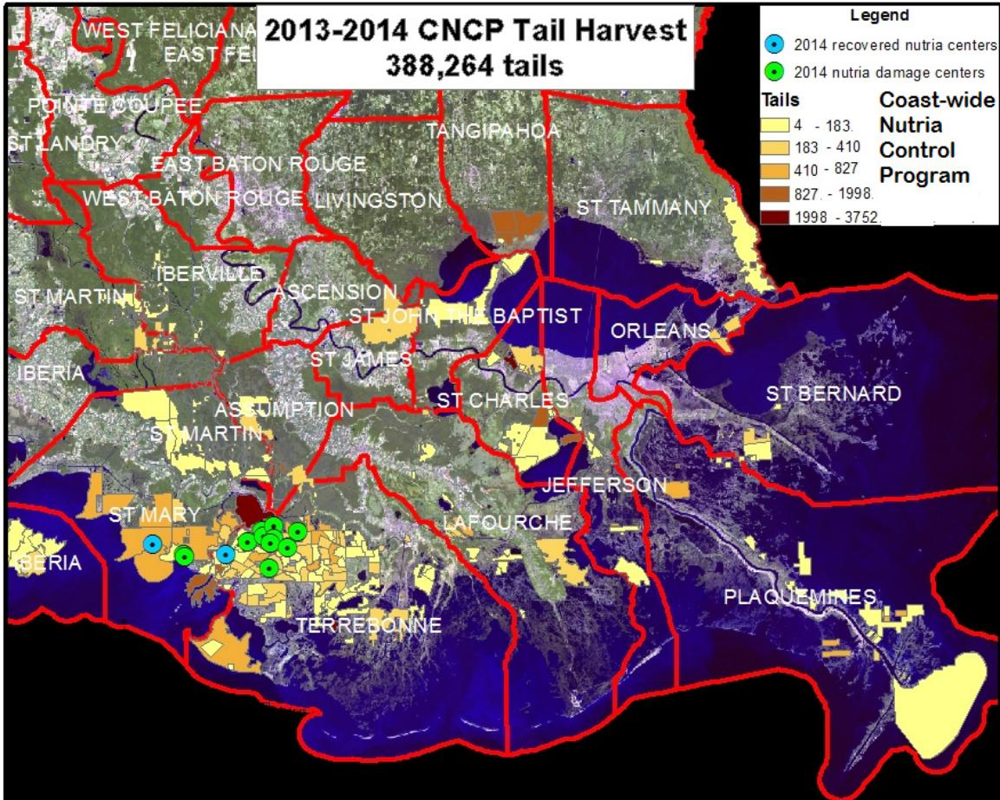

> **Figure description (machine-generated, checked by a second model against the image):** Map of coastal south-east Louisiana, titled '2013-2014 CNCP Tail Harvest 388,264 tails'. Parish names are printed in white capitals and parish boundaries are outlined in red, with Gulf of Mexico waters in dark blue along the bottom. The legend at upper right is headed 'Legend' and then 'Coast-wide Nutria Control Program'. It lists two symbols: a blue dot labelled '2014 recovered nutria centers' and a green dot labelled '2014 nutria damage centers'. A 'Tails' scale gives five fill colours: pale yellow for 4 - 183, light orange for 183 - 410, orange for 410 - 827, brown for 827 - 1998 and dark red for 1998 - 3752. The densest fills are in St. Mary and Terrebonne, in the south-west, where the blue and green symbols cluster; the darkest fill lies just north-east of the St. Mary label. Smaller pale yellow and orange fills are scattered across Lafourche, Plaquemines, St. Bernard, St. Tammany and the Iberia and St. Martin area. In the St. Charles and St. John the Baptist area, a small dark red fill lies north-east of the St. John the Baptist label, near the lake shore, and a brown fill lies just east of the St. Charles label; a further brown fill lies north-east of it near Jefferson.
>
> _Not readable or uncertain:_ The decimal points after '827.' and '1998.' are cut off, so those range values are read as printed. Small fills in St. Charles cannot be separated reliably, and the dark red and brown shades are close. The 'Iberia' label at lower left is partly cut off at the edge.

Mammals like white-tailed deer (Odocoileus virginianus), nearctic river otter (Lutra Canadensis) muskrat (Ondata zibethicus) and North American beaver (Castor Canadensis) are common in the swamps and marshes as well as along the natural levees while the Coyote (Canis latrans) has expanded its range into the parish over the past decade. Introduced species like the nutria (Melanocaster coypus) and feral pig (Sus scrofa) do much damage to marshes and artificial levees, respectively, despite bounties on both. Fur-bearers have been trapped in the marshes and swamps of the parish since settlement, but with the reduced market for skins, current efforts now focus on controlling the abundance of nutria by a controlled hunt and bounty program funded to reduce coastal land-loss.

## Page 63 (printed 1-33)

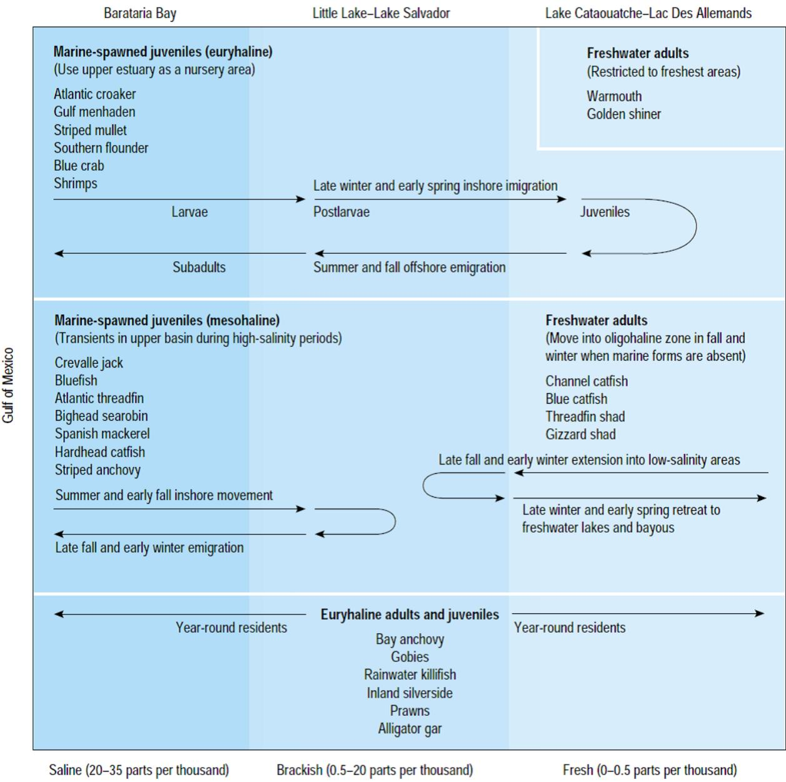

> **Figure description (machine-generated, checked by a second model against the image):** Flow diagram with no printed title, showing fish movement through three salinity zones. Column headings are Barataria Bay, Little Lake-Lake Salvador and Lake Cataouatche-Lac Des Allemands. Along the bottom, the zones are labelled Saline (20-35 parts per thousand), Brackish (0.5-20 parts per thousand) and Fresh (0-0.5 parts per thousand). 'Gulf of Mexico' is printed vertically at the left edge. The top band is 'Marine-spawned juveniles (euryhaline)', with the note '(Use upper estuary as a nursery area)' and the species Atlantic croaker, Gulf menhaden, Striped mullet, Southern flounder, Blue crab and Shrimps. Arrows run from larvae through postlarvae to juveniles, labelled late winter and early spring inshore immigration, then return as subadults and summer and fall offshore emigration. A box at upper right, 'Freshwater adults (Restricted to freshest areas)', lists Warmouth and Golden shiner. The middle band is 'Marine-spawned juveniles (mesohaline)', listing Crevalle jack, Bluefish, Atlantic threadfin, Bighead searobin, Spanish mackerel, Hardhead catfish and Striped anchovy, and 'Freshwater adults' at right, listing Channel catfish, Blue catfish, Threadfin shad and Gizzard shad. The bottom band, 'Euryhaline adults and juveniles', lists Bay anchovy, Gobies, Rainwater killifish, Inland silverside, Prawns and Alligator gar, with year-round resident arrows to each side.

St. Charles Parish enjoys a very large diversity of fish species because of its position at the freshwater or inland portions of both the Pontchartrain and Barataria estuaries (Conner and Day 1987). Many fish that spend part of their life cycles in the Gulf of Mexico can, at times, occur in the brackish and fresh water lakes of the parish.

## Page 64 (printed 1-34)

A number of marine species important to recreational and commercial fishermen of St. Charles Parish, like brown (Farfantepenaeus aztecus) and white shrimp (Litopenaeus setiferus), Gulf menhaden (Brevoortia patronus) and crab are also migratory, though over shorter distances (Figure 1-18). The blue crab (Calinectes sapidus), which are abundant in both the Pontchartrain and Barataria estuaries, mate from spring to fall in the fresh or slightly brackish waters of the parish. The females then separate from the males, extrude fertilized eggs into a “sponge” that they carry as they migrate out of the estuary into the nearshore Gulf where they spawn, releasing millions of larvae. These planktonic larvae then move with the tides and winds back into the estuaries, where they grow and molt many times in the shelter of marsh nursery grounds, finally transforming into juvenile crabs that become sexually mature in nine to 12 months. That is when the cycle starts again.

At the same time, because the wetlands of the parish are almost always fresh, fishing vessels operating out of des Allemands and Bayou Gauche may catch freshwater fish like channel catfish (Ictalurus punctatus), largemouth bass (Micropterus salmoides), sac-a-lait or crappie (Pomoxis nigromaculatus or P. annularis) and bream or sunfish (Leponis macrochirus) along with marine species. When operation of the Davis Pond Freshwater Diversion caused Lake Cataoutache to be colonized with dense stands of submerged aquatic vegetation in the 2006 to 2009 period, this previously muddy lake became one of the most productive places to fish largemouth bass. Since then, both the plant life and bass fishing have declined, but new beds of submerged aquatics are colonizing Lake Salvador to the south.

St. Charles Parish is fortunate to have an “eBird Hotspot” in the Bonnet Carré Spillway for which a real-time, online bird checklist (ebird.org) is maintained by trained volunteer birders who record the species and numbers of birds sighted and report the data to the Cornell Lab of Ornithology and the National Audubon Society. The spillway has cleared grassland, bottomland hardwood and swamp habitat and runs from the river to Lake Pontchartrain (Figure 1-1). Louisiana birders have reported sighting 283 species in the Bonnet Carré Spillway over the past decade. The Bonnet Carré Spillway checklist has 58 percent of all birds ever seen in Louisiana, though, of course, not the extinct Carolina parakeet and Ivory-billed woodpecker.

The eBird data document the presence of species, as well as bird abundance. Nationally, eBird engages tens of thousands of participants to submit their observations to, or view results via interactive queries of the eBird database. For our purposes, Bonnet Carré Spillway records for the 2004 to 2014 decade have been grouped by types of birds that are then ranked by relative abundance. Birds are grouped into Neotropical warblers (Figure 1-19a); sparrows (Figure 1-19b); swifts, swallows and martins (Figure 1-19c); woodpeckers and kingfishers (Figure 1-18d); songbirds (Figure 1-19e); gulls, terns and skimmers (Figure 1-19f); hawks, owls and vultures (Figure 1-19g); marsh and shorebirds (Figure 1-19h); colonial water birds (Figure 1-19i); ducks and geese (Figure 1-19j).

## Page 65 (printed 1-35)

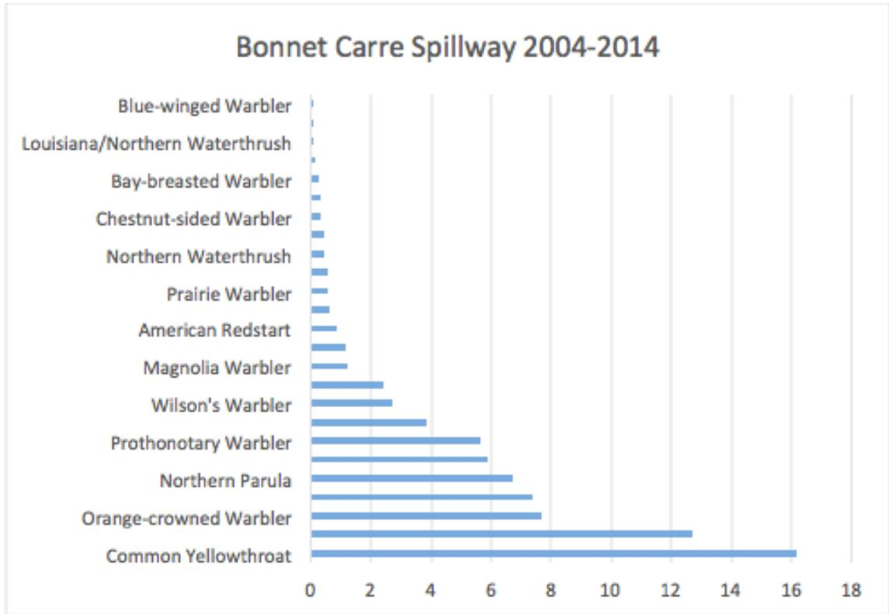

> **Figure description (machine-generated, checked by a second model against the image):** Horizontal bar chart titled 'Bonnet Carre Spillway 2004-2014', with species names on the vertical axis and bars extending right. The horizontal axis runs from 0 to 18 in steps of 2. Neither axis has a printed label or unit. Only alternate bars carry a species name, and the unnamed bars cannot be identified from the image. Named species, from top to bottom: Blue-winged Warbler, Louisiana/Northern Waterthrush, Bay-breasted Warbler, Chestnut-sided Warbler, Northern Waterthrush, Prairie Warbler, American Redstart, Magnolia Warbler, Wilson's Warbler, Prothonotary Warbler, Northern Parula, Orange-crowned Warbler and Common Yellowthroat. Bar length rises steadily toward the bottom. The longest named bar, Common Yellowthroat, ends just past the 16 gridline. The bars at the top are barely visible.
>
> _Not readable or uncertain:_ No axis label or unit is printed, so the measure behind the bar values is not stated. Unnamed bars sit between the named species and their names are not legible. Bar ends between gridlines are not read as numbers.

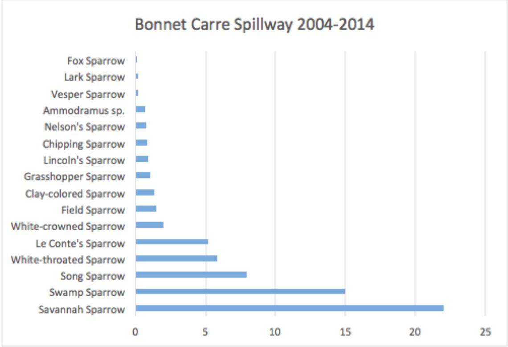

> **Figure description (machine-generated, checked by a second model against the image):** Horizontal bar chart titled 'Bonnet Carre Spillway 2004-2014', with sparrow species names on the vertical axis and bars extending right. The horizontal axis runs from 0 to 25 in steps of 5. Neither axis has a printed label or unit. Every bar has a species name. From top to bottom: Fox Sparrow, Lark Sparrow, Vesper Sparrow, Ammodramus sp., Nelson's Sparrow, Chipping Sparrow, Lincoln's Sparrow, Grasshopper Sparrow, Clay-colored Sparrow, Field Sparrow, White-crowned Sparrow, Le Conte's Sparrow, White-throated Sparrow, Song Sparrow, Swamp Sparrow and Savannah Sparrow. Bar length rises toward the bottom. Savannah Sparrow is the longest bar and extends past the 20 gridline. Swamp Sparrow ends at the 15 gridline. Song Sparrow ends between the 5 and 10 gridlines. The top three bars are almost zero.
>
> _Not readable or uncertain:_ The exact value of the Savannah Sparrow bar is between 20 and 25 and is not printed. No axis label or unit is printed, so the measure is not stated.

## Page 66 (printed 1-36)

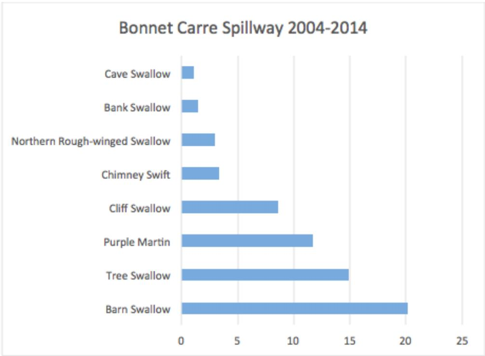

> **Figure description (machine-generated, checked by a second model against the image):** Horizontal bar chart titled Bonnet Carre Spillway 2004-2014, with eight swallow, martin and swift categories listed top to bottom: Cave Swallow, Bank Swallow, Northern Rough-winged Swallow, Chimney Swift, Cliff Swallow, Purple Martin, Tree Swallow and Barn Swallow. Bars are sorted with the longest at the bottom. Barn Swallow is the longest bar and ends just past the 20 gridline. Tree Swallow ends at the 15 gridline. Purple Martin and Cliff Swallow fall between the 5 and 15 gridlines, and the other four bars are each shorter than the 5 gridline. The horizontal axis runs from 0 to 25 with gridlines every 5. No axis title or units are printed, and the bars carry no value labels.
>
> _Not readable or uncertain:_ No axis title or units are printed. Values can be read only against the gridlines.

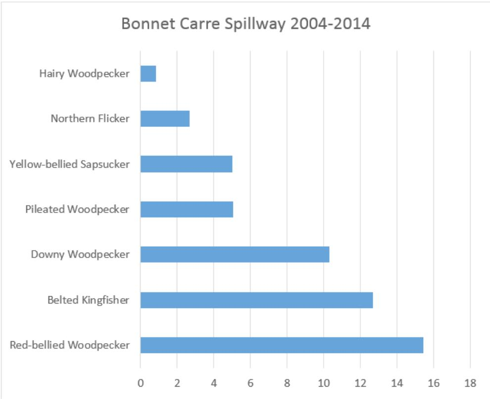

> **Figure description (machine-generated, checked by a second model against the image):** Horizontal bar chart titled Bonnet Carre Spillway 2004-2014, with seven woodpecker and kingfisher species listed top to bottom: Hairy Woodpecker, Northern Flicker, Yellow-bellied Sapsucker, Pileated Woodpecker, Downy Woodpecker, Belted Kingfisher and Red-bellied Woodpecker. Bars are sorted with the longest at the bottom. Red-bellied Woodpecker is the longest bar and extends past the 14 gridline. Belted Kingfisher and Downy Woodpecker are the next longest. Yellow-bellied Sapsucker and Pileated Woodpecker are nearly the same length, between the 4 and 6 gridlines. Northern Flicker lies between the 2 and 4 gridlines, and Hairy Woodpecker is the shortest, below the 2 gridline. The horizontal axis runs from 0 to 18 with gridlines every 2. No axis title or units are printed, and the bars carry no value labels.
>
> _Not readable or uncertain:_ The image shows only the woodpecker and kingfisher chart. The caption also names a swifts, swallows and martins chart (Figure 1-19c), which is not in this image. No axis title or units are printed.

## Page 67 (printed 1-37)

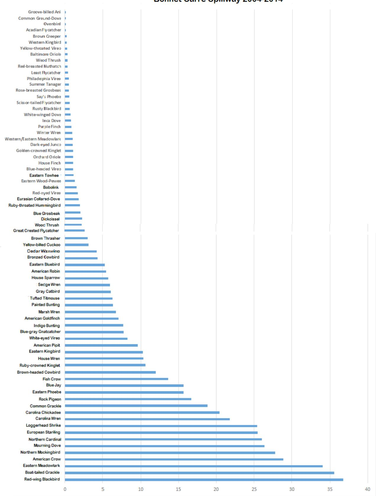

> **Figure description (machine-generated, checked by a second model against the image):** Very long horizontal bar chart in two stacked panels, with the title Bonnet Carre Spillway 2004-2014 cut off at the top edge of the image. Each row is one bird species, with its name printed at the left. The species run from Groove-billed Ani, with a barely visible bar, to Red-wing Blackbird, with the longest bar. Bars are sorted with the longest at the bottom. The top panel covers the shortest bars, from Groove-billed Ani down to Great Crested Flycatcher, whose bar ends a little short of the 5 gridline. The bottom panel runs from Brown Thrasher to Red-wing Blackbird. Red-wing Blackbird extends past the 35 gridline, Boat-tailed Grackle also ends just past it, and Eastern Meadowlark ends just short of it. The horizontal axis, printed under the bottom panel, runs from 0 to 40 with gridlines every 5. No axis title or units are printed.
>
> _Not readable or uncertain:_ The title is cut off at the top edge. Species labels are small, and some are clipped at the left edge. Wood Thrush appears twice near the panel break. No axis title or units are printed.

## Page 68 (printed 1-38)

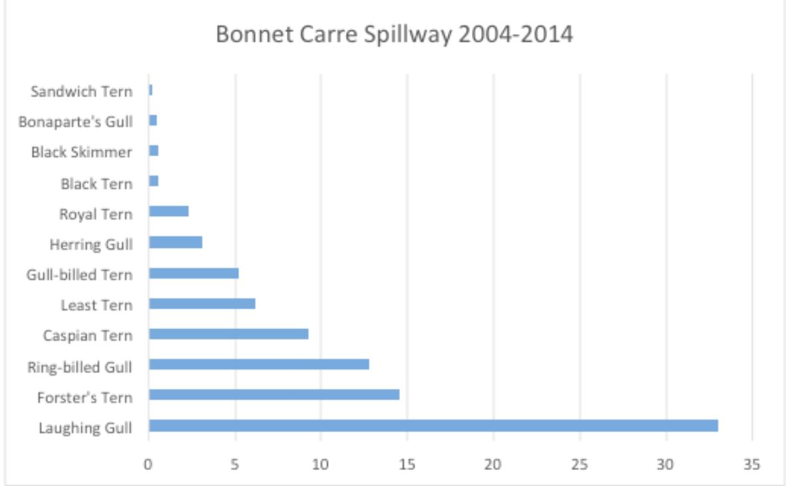

> **Figure description (machine-generated, checked by a second model against the image):** Horizontal bar chart titled Bonnet Carre Spillway 2004-2014, with twelve gull and tern species listed top to bottom: Sandwich Tern, Bonaparte's Gull, Black Skimmer, Black Tern, Royal Tern, Herring Gull, Gull-billed Tern, Least Tern, Caspian Tern, Ring-billed Gull, Forster's Tern and Laughing Gull. Bars are sorted with the longest at the bottom. Laughing Gull is far the longest bar, ending between the 30 and 35 gridlines. Forster's Tern and Ring-billed Gull are the next longest, and Caspian Tern ends just short of the 10 gridline. Sandwich Tern has a bar too short to read against the gridlines. The horizontal axis runs from 0 to 35 with gridlines every 5. No axis title or units are printed, and the bars carry no value labels.
>
> _Not readable or uncertain:_ No axis title or units are printed. Values can be read only against the gridlines.

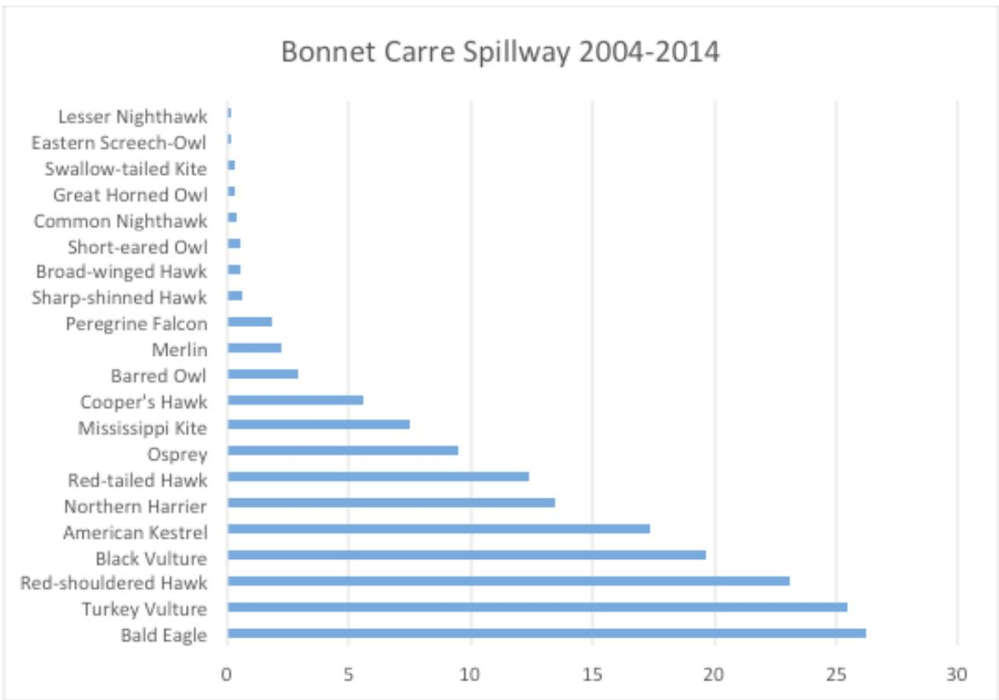

> **Figure description (machine-generated, checked by a second model against the image):** Horizontal bar chart titled "Bonnet Carre Spillway 2004-2014". It lists 21 bird species on the vertical axis, all bars in one blue, sorted so the longest bar is at the bottom. Bald Eagle is the longest, just past the 25 gridline, followed by Turkey Vulture and Red-shouldered Hawk, then Black Vulture, American Kestrel, Northern Harrier, Red-tailed Hawk and Osprey. Lesser Nighthawk and Eastern Screech-Owl have the shortest bars, close to zero. The horizontal axis runs from 0 to 30 with gridlines every 5 units. The chart has no axis title and no unit is printed. No bar carries a value label.
>
> _Not readable or uncertain:_ The axis unit is not printed, so the values are read against gridlines only. Bars of the smallest species are too short to rank with confidence.

## Page 69 (printed 1-39)

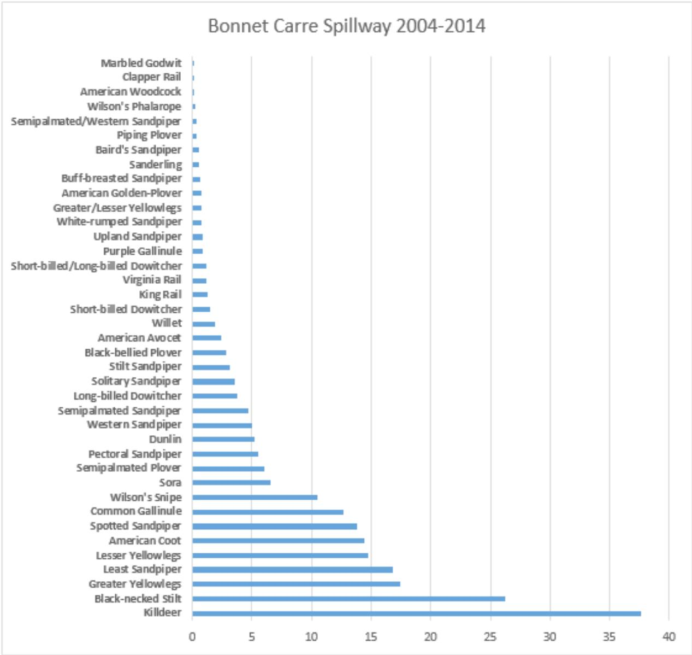

> **Figure description (machine-generated, checked by a second model against the image):** Horizontal bar chart titled "Bonnet Carre Spillway 2004-2014". It lists 39 shorebird, rail and related species on the vertical axis, all bars in one blue, sorted so the longest bar is at the bottom. Killdeer is the longest, between the 35 and 40 gridlines, followed by Black-necked Stilt (between 25 and 30) and Greater Yellowlegs (between 15 and 20). Least Sandpiper, Lesser Yellowlegs, American Coot and Spotted Sandpiper form the next group. Marbled Godwit, Clapper Rail and American Woodcock have the shortest bars, close to zero. The horizontal axis runs from 0 to 40 with gridlines every 5 units. The chart has no axis title and no unit is printed. No bar carries a value label.
>
> _Not readable or uncertain:_ The axis unit is not printed. Bars for the smallest species are too short to rank with confidence.

## Page 70 (printed 1-40)

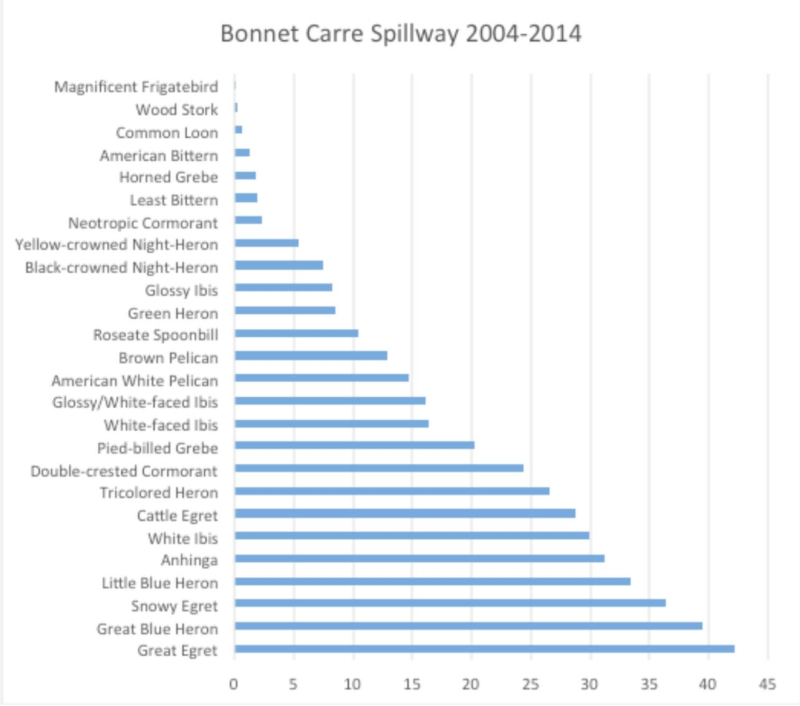

> **Figure description (machine-generated, checked by a second model against the image):** Horizontal bar chart titled "Bonnet Carre Spillway 2004-2014". It lists 26 wading bird, waterbird and related species on the vertical axis, all bars in one blue, sorted so the longest bar is at the bottom. Great Egret is the longest, just past the 40 gridline, followed by Great Blue Heron, Snowy Egret, Little Blue Heron, Anhinga, White Ibis and Cattle Egret. Brown Pelican, Roseate Spoonbill and the night-herons are in the middle. Magnificent Frigatebird and Wood Stork have the shortest bars, close to zero. The horizontal axis runs from 0 to 45 with gridlines every 5 units. The chart has no axis title and no unit is printed. No bar carries a value label.
>
> _Not readable or uncertain:_ The axis unit is not printed, so bar lengths are read against gridlines only. The tiny bars at the bottom are not certain to within a gridline.

## Page 71 (printed 1-41)

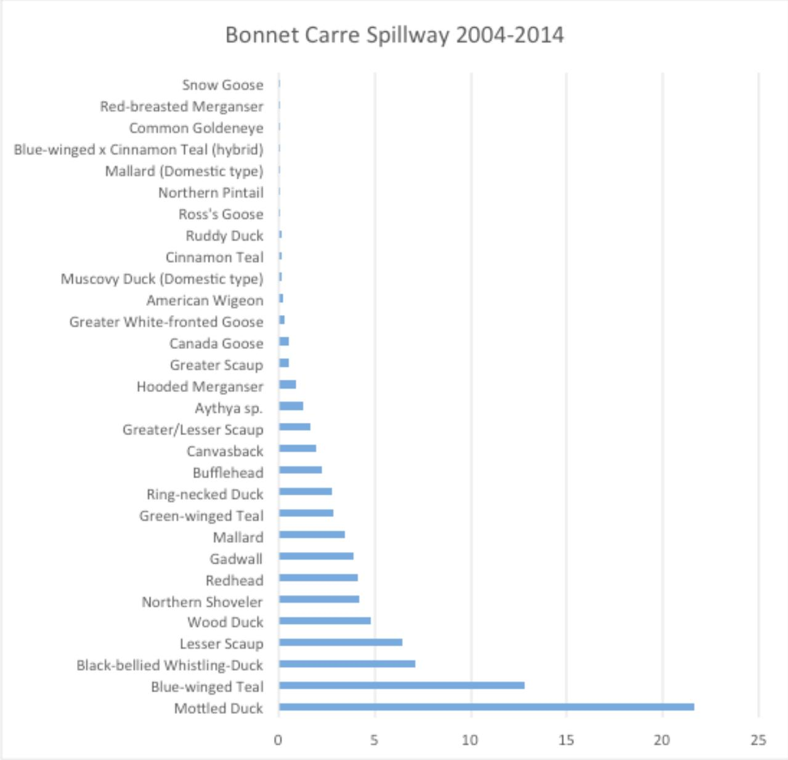

> **Figure description (machine-generated, checked by a second model against the image):** Horizontal bar chart titled "Bonnet Carre Spillway 2004-2014". It lists 30 duck, goose and merganser species on the vertical axis, all bars in one blue, sorted so the longest bar is at the bottom. Mottled Duck is the longest, between the 20 and 25 gridlines. Blue-winged Teal is next, between the 10 and 15 gridlines, followed by Black-bellied Whistling-Duck and Lesser Scaup. Several dabbling ducks, including Wood Duck, Northern Shoveler, Redhead, Gadwall and Mallard, sit in the middle. Snow Goose, Red-breasted Merganser and Common Goldeneye have the shortest bars, close to zero. The horizontal axis runs from 0 to 25 with gridlines every 5 units. The chart has no axis title and no unit is printed. No bar carries a value label.
>
> _Not readable or uncertain:_ The axis unit is not printed, so bar lengths are read against gridlines only. The bars for the rarest geese and ducks at the bottom are too short to rank with confidence.

## Page 72 (printed 1-42)

#### ENDANGERED AND THREATENED SPECIES

No federally listed endangered or threatened plant species are known to occur in St. Charles Parish, but seven rare plants (Table 1-13) are listed as being of state concern by the Louisiana Natural Heritage Program (LNHP 2014b). Two federally listed threatened or endangered animal species have been seen in St. Charles Parish (LNHP 2014a) but two more have “protected” status under state law (Table 1-14). The pallid sturgeon (Scaphirhynchus albus) formerly inhabited large rivers throughout the southeast United States and can be found currently only in the Mississippi and Atchafalaya Rivers and, after openings of the Bonnet Carré Spillway, in the Lake Pontchartrain Basin. Threats to the pallid sturgeon include the channelization of rivers and construction of reservoirs that eliminate spawning habitat, changes in habitat and water quality, and interbreeding with shovelnose sturgeon (LNHP 2014a).

**Table 12**

| Table 1-13. Rare Plant Species of St. Charles Parish(La. Natural Heritage Program 2014b) |  |  |
|---|---|---|
| Common Name | Scientific Name | State Status |
| Swamp Milkweed | Asclepias incarnata | S2, Imperiled |
| Golden Canna | Canna flaccida | S4, Rare but OK in LA |
| Floating Antlerfern | Ceratopteris pteridoides | S2, Imperiled |
| Marshland Flatsedge | Cyperus distinctus | S1, Critically imperiled |
| Western Umbrella Sedge | Fuirena simplex var. aristulata | S1, Critically imperiled |
| Square-stem Monkey Flower | Mimulus ringens | S2, Imperiled |

Table snapshot (for checking): 

The bald eagle (Haliaeetus leucocephalus) nests primarily in the southeastern coastal parishes of Louisiana, typically in the tops of cypress trees near open water as it feeds in open lakes. The numbers for the bald eagle are increasing annually and, because of this, they have been de-listed by the USFWS but are still protected under the Migratory Bird Treaty Act and the Bald and Golden Eagle Protection Act. In general, the bald eagle remains subject to threats including the loss of critical habitat, and disturbances by human activity to nesting pairs during the winter nesting season (LNHP 2014a). They have been recovering well from DDT caused eggshell thinning syndrome, and are the most common raptor sighted in the Bonnet Carré Spillway (Figure 1-19g).

## Page 73 (printed 1-43)

**Table 13**

| Table 1-14. Rare, Threatened and Endangered Animal Species of St. Charles Parish (La.Natural Heritage Program 2014a) |  |  |  |
|---|---|---|---|
| Common Name | Scientific Name | Federal Status | State Status |
| Pallid Sturgeon | Scaphirhynchus albus | E | E |
| Bald Eagle | Haliaeetus leucocephalus | D | E |
| Brown Pelican | Pelecamus occidentalis | D | E |
| Manatee | Trichechus manatus | E | E |
| Paddlefish | Polyodon spathula |  | Prohibited Possession |

_\*T – Threatened; E – Endangered; D – De-listed; PS – Partial status (only on portion of its range)_

Table snapshot (for checking): 

The brown pelican inhabits bays and tidal estuaries along the coast and nests commonly in shrub thickets within dunes of barrier islands. This species disappeared from the parish in the early 1970s as a consequence of DDT caused eggshell thinning syndrome, but was restocked by the LDWF and are now common around Lake Pontchartrain (LNHP 2014a). The USFWS has de-listed the brown pelican, but the state status remains endangered.

The manatee is found in open marine waters, bays and rivers with submerged aquatic beds or floating vegetation, but is uncommon in Louisiana. It has been known to visit the Pearl, Mermentau, Calcasieu, and Sabine Rivers and waterways of the Pontchartrain and Barataria basins. Major threats to the manatee include being struck by boats and barges, habitat loss and death due to flood control structures and extended periods of below freezing temperatures (LNHP 2014a).

The paddlefish is not listed as threatened or endangered by the federal government and is believed to be present in most of Louisiana’s large rivers, including the Mississippi. The paddlefish is, however, regarded as rare by the state. Harvest and possession of paddlefish is prohibited (LNHP 2014a.)

## Page 74

## Page 75 (printed 2-1)

#### CHAPTER 2 PRINCIPAL RESOURCES

#### INTRODUCTION

Knowledge of St. Charles Parish’s renewable and non-renewable resources is essential in achieving development goals and management practices which lead to long-term benefits for the environment as well as for the citizens of the parish. Renewable resources such as shrimp, crabs, fish, agricultural and forestry products, furs and hides, and the environment that produces them can be utilized by the residents and visitors of St. Charles Parish for many years if the harvesting of these resources is carefully managed and the environment supporting these resources is sustained. Non-renewable resources such as oil, gas, and other minerals contribute to the parish’s economic base and provide a net benefit to the parish when extracted in an environmentally appropriate manner. Extraction of non-renewable resources can negatively impact renewable resources and lead to their depletion or degradation through unwise exploitation, bad management practices, or environmental damage such as pollution, habitat degradation, and land loss, which affect renewable resource productivity. In many instances, the cause of these changes can be traced directly or indirectly to human activities in the wetlands. These activities often happen independently of each other, and their cumulative impacts are not always taken into consideration. Overall goals, policies and effective management programs and implementation procedures can help sustain renewable resources while allowing for multiple uses of the parish’s resources (Coastal Environments Inc. 2013).

> **Figure description (machine-generated, checked by a second model against the image):** Aerial photograph of a shoreline where marsh meets open water. An elevated twin-span highway with trucks crosses the middle of the image from lower left to upper right, and a straight, grass-covered embankment runs diagonally across the upper left, below a narrow winding waterway. Forest fills the top of the image. On the right, beyond the highway, a broad open body of water fills the lower right and lies beside a grassy shore with a small building and a short pier. In the lower left are grassy marsh and several shallow ponds, one with green algae. Two curved light-coloured stone breakwaters run from the marsh out into the water just left of the centre of the lower half.
>
> _Not readable or uncertain:_ The names of the waterway, the highway and the water body are not printed in the image and cannot be read.

## Page 76 (printed 2-2)

#### RENEWABLE RESOURCES

#### Biological

The Louisiana marshes and shallow estuarine water bodies are among the largest and most productive prime nursery grounds in the world for over 100 species of estuarine-dependent fish and shellfish. The extensive wetlands of St. Charles Parish are extremely productive for commercially and recreationally harvested shrimp, crabs, and fish and contribute to making Louisiana the premier state in the annual production of fisheries products (Coastal Environments Inc. 2013). According to

> **Figure description (machine-generated, checked by a second model against the image):** Photograph of a single blue crab lying on weathered grey wooden planks, seen from above. Its shell is dark brown and its claws and legs are blue-green with orange-brown tips, with the large claws spread out to the sides.

> **Figure description (machine-generated, checked by a second model against the image):** Photograph of a heap of shrimp seen from above. Many pale grey-brown shrimp are piled together, with their bodies, antennae and tails overlapping.

the LSU AgCenter, as of 2013, 4,274,051 lbs. of blue crab were harvested

in St. Charles Parish making crabs the number one seafood harvested in the parish, and behind that are finfish at 95,859 lbs. and shrimp at 77,844 lbs. An assessment of the magnitude of commercial harvesting of renewable resources and trends in the recent past can be derived from reviewing 2000 through 2013 Wildlife and Fisheries production data (Table 2-1).

**Table 14: Table 2-1. Resident Commercial License Sales, St. Charles Parish: 2000-2013 (LDWF)**

| Year | Commercial Fishermen | Vessel License | Shrimp Trawl | Crab Traps |
|---|---|---|---|---|
| 2000 | 437 | 397 | 264 | 172 |
| 2001 | 460 | 413 | 261 | 166 |
| 2002 | 462 | 424 | 264 | 170 |
| 2003 | 407 | 382 | 217 | 166 |
| 2004 | 361 | 338 | 171 | 161 |
| 2005 | 326 | 300 | 131 | 149 |
| 2006 | 287 | 291 | 124 | 144 |
| 2007 | 268 | 272 | 111 | 149 |
| 2008 | 238 | 241 | 98 | 138 |
| 2009 | 237 | 244 | 83 | 125 |
| 2010 | 267 | 268 | 80 | 149 |
| 2011 | 255 | 247 | 68 | 151 |
| 2012 | 242 | 242 | 58 | 140 |
| 2013 | 237 | 243 | 57 | 135 |

_http://www.wlf.louisiana.gov/licenses/statistics_

Table snapshot (for checking): 

## Page 77 (printed 2-3)

The relationship between fishing license sales and the amount of crab and shrimp produced in St. Charles Parish as of 2013 are shown, and the numerical data can be found on the LSU AgCenter website (Figure 2-1). Although shrimp trawl license sales are steadily decreasing, shrimp production is increasing (Figure 2-2). Crab trap license sales appear to be constant throughout the last fourteen years, but it is very slowly decreasing as the years go on. However, crab production is through the roof with millions of pounds produced yearly except in 2002 when only 162,009 pounds were produced (Figure 2-3).

> **Figure description (machine-generated, checked by a second model against the image):** Line chart titled "Commercial License Sales", printed in large bold type across the upper right of the plot area. The y-axis is labelled "Number of Licenses" and runs from 0 to 300 in steps of 50. The x-axis is labelled "Year" and has one point per year from '00 to '13. The legend, at right, has two series: "Crabs" (blue line with diamond markers) and "Shrimp" (orange line with square markers). Shrimp licenses start just above the 250 gridline in '00 to '02, fall to between the 200 and 250 gridlines in '03, to between the 150 and 200 gridlines in '04, and to between the 100 and 150 gridlines in '05. They keep falling, reaching just above the 50 gridline in '12 and '13. Crab licenses stay between roughly the 125 and 175 level throughout, starting between the 150 and 200 gridlines in '00, dipping to its lowest around '09, rising around '10 and '11, and ending between the 100 and 150 gridlines in '13. The two lines meet at about '04 to '05, after which shrimp licenses are fewer than crab licenses.
>
> _Not readable or uncertain:_ The values are read by eye against the gridlines because no data values are printed. The exact values are not shown.

> **Figure description (machine-generated, checked against the image):** Line chart with square markers. The title reads Pounds Produced, and the series label inside the plot reads Shrimp. The vertical axis is labelled Pounds (Thousands) and runs from 0 to 80, with horizontal gridlines at each 10. The horizontal axis is labelled Year and shows '00, '02, '04, '06, '08, '10 and '12. The line starts near 20 thousand pounds in 2000 and reaches its lowest values in 2003 and 2005, below the 10 gridline. It rises sharply after 2005 to about 40 thousand in 2007 and 2008, falls in 2009, rises to about 35 thousand in 2010, and dips slightly in 2011. It then climbs steeply to the highest point in 2013, which sits at the top of the scale near 80 thousand.
>
> _Not readable or uncertain:_ Point values are read by eye against the gridlines and are approximate.

> **Figure description (machine-generated, checked by a second model against the image):** Line chart with diamond markers. The title reads Pounds Produced, and the series label inside the plot reads Crabs. The vertical axis is labelled Pounds (Millions) and runs from -0.5 to 4.5, with tick labels at -0.5, 0.5, 1.5, 2.5, 3.5 and 4.5. The horizontal axis is labelled Year and shows '00, '02, '04, '06, '08, '10 and '12. The line starts at about 2.5 million pounds in 2000 and drops to its lowest point in 2002, which is labelled 162,009. It rises to about 2.8 million in 2003, then stays between roughly 3 and 4.5 million from 2005 to 2010, peaking around 2007. It falls to a low near 2.7 million in 2011 and rises again to a high near 4.3 million in 2013.
>
> _Not readable or uncertain:_ Only the 162,009 value is printed. The other points are read by eye against the gridlines and are approximate.

## Page 78 (printed 2-4)

#### Agriculture

After the Louisiana Purchase, American capital flowed into Louisiana, bringing about the consolidation of smaller land holdings into great plantations. However, the hard working farmers of the First German Coast did not sell out as did their Acadian neighbors on the Second German Coast and the Acadian Coast. Settlements remained small and, through inheritance, land holdings became progressively established.

Several plantations were established in St.

> **Figure description (machine-generated, checked by a second model against the image):** Photograph of a sugarcane harvest in a field. A green and yellow tractor with large yellow wheels is at the centre, pulling or running alongside a tall yellow cart with high sides at the left. A green harvester behind it discharges cut cane through a spout into the cart, and standing cane lies to the right under a clear blue sky, over a ploughed brown field in the foreground.

Charles Parish, the earliest of which was Destrehan, established in 1787. Etienne de Bore, son-inlaw of Jean Baptiste D’Estrehan, successfully cultivated the first crop of sugarcane in Louisiana, which matured sufficiently to allow for granulation. Trepagnier was another large plantation, and it later became the site of the town of Norco. The proximity of the Port of New Orleans and the demand for sugar stimulated the rapid development of sugar production.

> **Figure description (machine-generated, checked by a second model against the image):** Photograph of ripe red tomatoes packed in open cardboard boxes, arranged in two rows behind a black chalkboard sign. The sign reads LOUISIANA in white chalk above CREOLE TOMATOES in red chalk.

According to the LSU AgCenter, sugar cane was the number one commodity harvested in St. Charles Parish with 9,686,562 pounds of raw sugar and 291,171 gallons of molasses produced in 2013. Another notable crop harvested in St. Charles Parish is tomatoes with a total of 405,540 lbs. harvested in 2013. Overall, plant related enterprises rank first, animal enterprises second, and fish and wildlife enterprises rank third in the parish’s agriculture summary.

#### RENEWABLE/NON-RENEWABLE RESOURCES

#### Lumber

The 1890’s initiated a new period of development in St. Charles Parish. Technological advances enabled the commercial lumbering of cypress back-swamps and a large lumber industry developed on the West Bank. Several companies were located in Des Allemands and the first sawmill opened in Taft in 1907. While the industry would consider lumber to be a renewable resources, and while lumbering is still an ongoing enterprise in St. Charles Parish, its significance declined after 1930, by which time, most of the commercial cypress had been logged. Numerous acres of virgin swamp were deforested and there were no significant efforts made to replant relying on natural re-vegetation. This lack of effort has contributed to the present day problems of erosion and subsidence.

#### NON-RENEWABLE RESOURCES

## Page 79 (printed 2-5)

#### Oil and Gas

Agriculture activity dominated the parish’s economy until the development of oil and gas resources. The Mexican Petroleum Company established a refinery near the town of Destrehan in 1914. The Company’s name later was changed to the Pan American Refining Corporation. Between Sellers and Good Hope, the New Orleans Refinery Company constructed their marine terminal, and in 1925 the settlement there was named Norco after the company’s acronym. In 1928, Shell Oil Company took over the plant. St. Rose and Good Hope were the sites of the General American Transportation Corporation and Cities Services Company, which stimulated growth in these areas.

In the late 1930s, the discovery of oil fields on the West Bank of St. Charles Parish further boosted the economy. In 1938, the Bayou des Allemands field was opened; the Paradis Field opened in 1939; the Lake Salvador Field followed in 1940; and the Bayou Couba Field opened in 1942. The settlements which exist in these areas today have resulted from the oil related industries.

> **Figure description (machine-generated, checked by a second model against the image):** Photograph, a long panoramic image taken at dusk across open water. The foreground is a dark, still water surface with faint light reflections. Along the far shore runs a low, continuous line of lights and industrial structures. Taller towers and tanks are clustered on the left third, with a pale glow near the centre and a single stack right of centre emitting a pale plume of steam or smoke drifting to the left. A white building stands further right. Above is a dark blue-grey sky fading to a lighter purplish band at the horizon, with no visible text or legend.
>
> _Not readable or uncertain:_ Individual structures and the exact nature of the plume and glow are too small to identify with confidence.

The accelerated growth of St. Charles Parish can be directly linked to the explosion of Outer Continental Shelf (OCS) oil and gas exploration activity that occurred in south Louisiana. From the period of 1954 through 1974, 1,578 oil exploration leases were granted on Louisiana OCS: the total for the United States OCS was 2,384. The economic feasibility of developing a new source of raw materials stimulated industrial development. Much of the new investment in U.S. Petroleum Extraction and refining activities in the past three decades has been in Louisiana with the bulk located in state’s coastal zone. The coastal zone parishes are attractive to petrochemical industries because of water networks that allow bulk products to be removed economically.

#### Industrial Resources

The population and economy of the parish underwent substantial changes since 1950. St. Charles Parish had great potential for industrial development due to favorable location factors: the biggest being excellent transportation access. The availability of inexpensive land, the proximity to New Orleans and the natural asset of the river, made the area prime for development. In addition to the River, the parish was endowed with four railroad corridors, two major U.S. Highways and the River Roads.

## Page 80 (printed 2-6)

#### WATER RESOURCES

The presence of water is one of St. Charles Parish’s most significant natural features because at least 31 percent of the parish is covered or surrounded with water, and 49 percent of the parish is covered in wetlands. While wetlands can be a constraint to development, they are critical to the health of the parish’s ecosystems, reducing coastal land loss, protecting developed areas, and providing important habitat. The major bodies of water located in the parish are the Mississippi River, Lake Pontchartrain, Lac Des Allemands, Lake Salvador, and Lake Cataouatche (Roberts 2011).

#### Mississippi River

St. Charles Parish’s most prominent waterway is the Mississippi River. The river is home to the Port of South Louisiana, which stretches fifty-four miles along the Mississippi and is the largest tonnage port district in the western hemisphere. As of 2012, the facilities within St. Charles, St. John the Baptist, and St. James parishes handled over 278 million short tons of cargo brought to its terminals via vessels and barges (2014 PSL). Also, the Mississippi River Corridor provides petrochemical industries efficient transportation to bring in raw material and to transport finished goods to the national market

> **Figure description (machine-generated, checked by a second model against the image):** Oblique aerial photograph of a wide river that comes from the lower right foreground and curves away toward the upper centre. A bridge crosses the river left of centre. A few vessels or barges are on the water and along the right (far) bank. On the far bank at upper right is an industrial complex, with more industrial development further up the river at upper centre. In the lower centre is a dense industrial facility with tanks, piping and buildings, surrounded by flat agricultural fields in tan and brown on the left and below. Residential areas and roads appear along the lower edge and left side.
>
> _Not readable or uncertain:_ The names of the facilities and the bridge are not printed on the image. Small structures in the lower centre are hard to make out.

place. Large segments of the local and regional economy depend on the Mississippi River and other navigable waterways, and both the Port of S. La and the Port of New Orleans are designated a Foreign Trade Zone (Roberts 2011).

#### Lake Pontchartrain

The lake was created 2,600 to 4,000 years ago as the evolving Mississippi River Delta formed its southern and eastern shorelines. It covers an area of about 403,200 acres with an average depth of

> **Figure description (machine-generated, checked by a second model against the image):** True-colour satellite image of a large lake and the surrounding urban area. A large lake, dark blue shading to pale blue-green toward its middle and south, fills the upper centre, with a thin straight line crossing it from top to bottom just left of centre, likely a causeway or bridge. Along the lower centre a dense, pale grey-white grid of urban development sits on the lake's southern shore, with a tan-grey river winding through the city and across the lower left of the frame. A smaller dark water body is at the upper left, and a shallow, mottled blue water area is at the right, beyond the lake's eastern end. Further small dark water bodies are at the lower left and bottom centre. Green vegetation, including forest and marsh, covers the left and lower parts of the frame; the upper right is a mix of brown marsh and patchy farmland and settlement. No place names or legend are printed on the image.
>
> _Not readable or uncertain:_ Place names are not printed on the image, so the lakes and city are not named here. The thin straight line on the lake is clear but its nature is inferred from its shape.

twelve to fourteen feet. Lake Pontchartrain is not a true lake but an estuary connected to the Gulf of Mexico via the Rigolets Strait and Chef Menteur Pass into Lake Borgne, and therefore experiences small tidal changes. It receives fresh water from the many rivers, bayous, and canals that drain into the lake. Salinity varies from negligible at the northern cusp, west of Mandeville, up to nearly half the salinity of seawater at its eastern bulge near Interstate 10 (2014 LP). Combined with Lakes Maurepas, and Lake Borne, Pontchartrain is one of the largest estuaries in

## Page 81 (printed 2-7)

the Gulf Coast Region. The estuary drains the Pontchartrain basin, an area of over 4,633 square miles situated on the eastern side of the Mississippi River (Moretzsohn et al. 2014). The lake is located in parts of St. Tammany, Tangipahoa, St. John the Baptist, St. Charles, Jefferson, and Orleans parishes. The lake teems with game birds, fish, and aquatic birds, so Lake Pontchartrain provides the residents and visitors of St. Charles Parish opportunities for hunting, fishing, nature study, and boating as well as other recreational activities. Also, the lake functions as an area for flood waters to drain out of the parish.

#### Lac Des Allemands

Lac Des Allemands is a natural 12,000-acre lake located about twenty-five miles west of New Orleans. Lac Des Allemands is a shallow lake, with a maximum depth of ten feet and an average depth of five feet. Lac Des Allemands is located mostly in St. John the Baptist parish and partly in Lafourche and St. Charles Parishes (2014 LDA). Lac Des Allemands is fed by numerous bayous in the Barataria Basin, and is full of wildlife providing excellent hunting, fishing, and

> **Figure description (machine-generated, checked by a second model against the image):** Photograph of a calm, narrow waterway lined with cypress and deciduous trees in autumn colour, with orange, yellow and green foliage. The water is still and reflects the trees and the blue sky. Dark tree trunks frame the foreground at left and right. No people or buildings are visible.

recreational opportunities for the visitors and residents of St. Charles Parish.

#### Lake Salvador

Lake Salvador is a freshwater, almost 45,000 acre lake in southeastern St. Charles Parish that is located less than twenty miles south of New Orleans. The lake is shared with Jefferson Parish and Lafourche Parish, and it is the largest body of water, other than Lake Pontchartrain, found in St Charles Parish. Lake Salvador borders and is part of the Salvador Wildlife Management Area, and is known for its top-notch fishing.

#### Lake Cataouatche

Although not much can be said about Lake Cataouatche, it is considered to be another major body of water in St. Charles Parish. It is a 9,280 acre, freshwater lake located just north of Lake Salvador, and it is also connected to Lake Salvdor via Bayous Couba, Segnette and Bardeaux. Lake Catacouatche is partly shared with Jefferson Parish and is a great fishing location for St. Charles Parish residents and visitors.

#### Scenic Waterways

A natural or scenic river is a river, stream or bayou that is in a free-flowing condition and has not been altered by channelization or realignment. A stream can also be classified as scenic if it has been altered, but contains native vegetation and has little or no man-made structures along its bank (Coastal Environments Inc. 2013). St. Charles Parish has three designated scenic bayous in the Louisiana Natural and Scenic Rivers System. (Table 2-2)

## Page 82 (printed 2-8)

**Table 15: Table 2-2. General information on the scenic waterways in St. Charles Parish**

| Name | Location |
|---|---|
| Bayou Des Allemands | From Lac Des Allemands (partly in Lafourche parish) toLake Salvador |
| Bayou LaBranche | From its source to where it drains into Lake Pontchartrain |
| Bayou Trepagnier | From Norco to where it joins Bayou LaBranche |

_http://dnr.louisiana.gov/assets/docs/coastal/interagencyaff/nonpoint/forestry/page\_45-49.pdf_

Table snapshot (for checking): 

The Louisiana Department of Wildlife and Fisheries administers the scenic river system program and protects these streams from the effects of channelization, channel realignment, clearing and snagging projects, and reservoir construction projects. The scenic river system is designed to protect the overall ecology of the stream including the wildlife, vegetation, and hydrology. Scenic stream designation is also designed to preserve the wilderness qualities, scenic beauty, archaeological resources, and other features of the stream or bayou. All of these streams are used for recreational activities such as boating (which includes canoeing and kayaking), fishing, and nature study (Coastal Environments Inc. 2013).

#### RECREATION

All across St. Charles Parish there are many sources of recreation that can amuse people of any age. The many bayous, canals, and tributaries offer an endless variety of freshwater fishing, and lakes Pontchartrain and Maurepas offer both fresh and saltwater fishing opportunities. Also, most of these areas can be accessed by the eight public and private boat launches

> **Figure description (machine-generated, checked by a second model against the image):** Photograph of a person standing on a stand-up paddleboard in a calm, tree-lined waterway. The person holds a paddle, and large trees with buttressed trunks stand in the water and along both banks.

located throughout the parish. Along with fishing, airboat tours and recreational boating, canoeing, and now paddle boarding are popular among the residents and visitors of the parish.

> **Figure description (machine-generated, checked by a second model against the image):** Photograph of a sign reading "Wetland Watchers Park" in dark green lettering on a blue panel with a dark green strip along the bottom and a gold-brown frame, with a painted pine tree and a water scene above the text. A metal sculpture of stylised leaves stands to the left. Beyond the sign, a paved road and wooden railed fences run toward open water and a clear sky. A smaller sign at the lower left, attached to the railing, carries a phone number.
>
> _Not readable or uncertain:_ The text on the smaller lower-left sign is too small to read reliably.

St. Charles Parish is dotted with many exclusive sites that can be visited year-round. One of the most popular is the Bonnet Carré Spillway. The actual structure is itself an attraction, but between the guide levees is where all the fun occurs. Here hunting, fishing, nature observation, off-road vehicle riding, biking, camping, dog training, and even model airplane competitions can be enjoyed. Also, the Wetlands Watchers Park is located where the Bonnet Carré and Lake Pontchartrain meet, and includes a small beach and a nature trail. The park is a schoolbased service-learning project used by local students as a teaching tool for wetland conservation. There are three plantation homes located in the parish that attract visitors, these include: Destrehan Plantation, Ormond Plantation, and Home Place Plantation. Other major attractions include the three main festivals hosted in the parish which includes the Catfish Festival, Alligator Festival, and Destrehan Plantation Fall Festival.

## Page 83 (printed 2-9)

#### UNIQUE AND PARTICULAR AREAS

Louisiana’s coastal zone possesses a wide variety and diverse assemblage of natural resources that have many types of unique features. These potentially unique ecological features have been divided into zoological, botanical, and geological components. In addition to unique features, particular areas of concern may also be identified as areas requiring special management procedures (Coastal Environments Inc. 2013). These locations have been, and still are being studied to determine the levels of use, protection, restoration, and conservation required to maintain a proper ecosystem for each because these areas typically represent what is ecologically and economically important to St. Charles Parish.

#### Bonnet Carré Spillway

In 1874, the Bonnet Carré Crevasse opened one of the most extensive crevasses in the lower Mississippi River Valley. It took eight years to close, was responsible for extensive damage to lands on the east bank of St. Charles Parish, and the area was never resettled. It was not until the early 1900’s that the U.S. Army Corps of Engineers decided to build a structure, in the place of the original crevasse, that would divert Mississippi River flood waters and relieve pressure on the levee structures in southern Louisiana.

> **Figure description (machine-generated, checked by a second model against the image):** Aerial photograph of the Bonnet Carré Spillway control structure. A long concrete structure with a row of gate bays runs diagonally from the lower left toward the upper right, with a paved deck on top. Two red cranes stand on the structure. Brown floodwater lies on the left side, and on the right side a water-filled channel with concrete-lined banks runs alongside the structure, beside green grass with concrete paving blocks. A distant city skyline is visible on the left horizon.

The Bonnet Carré Spillway, operated by the U.S. Army Corps of Engineers, is located about thirty miles upriver from New Orleans, and is the southernmost flood way in the Mississippi River and tributaries system. Located on the East bank of the river, the Spillway is a flood control structure, in St. Charles Parish, designed to allow Mississippi River flood waters to flow into Lake Pontchartrain and the Gulf of Mexico, thereby passing New Orleans and other nearby communities. The Corps of Engineers initiated surveys and preliminary investigations for the Bonnet Carré Spillway in 1928 after the Great Floods of 1927. Construction of the spillway structure began in 1929 and was completed in 1931. The guide levees were completed in 1932 and highway and railroad crossings in 1936 (2012 USACE). General information about the Bonnet Carré Spillway can be found in Table 2-3.

## Page 84 (printed 2-10)

**Table 16**

| Table 2-3. General information about the Bonnet Carré Spillway |  |  |  |
|---|---|---|---|
| Project Statistics | Spillway Openings (as of 2011) |  |  |
| Distance above New Orleans...32.8 river miles Length of weir opening. .7,000 feet | Date | Days Open | Number of Bays Open |
| Number of bays. ..350 | 1937 | Jan. 28 - Mar. 16 | 285 |
| Width of bays. .20 feet | 1945 | Mar. 23 - May 18 | 350 |
| Creosoted timbers. .20 per bay | 1950 | Feb. 10 - Mar. 19 | 350 |
| Spillway design capacity. ..250,000 ft3/sec. | 1973 | Apr. 8 - June 21 | 350 |
| Length.. ..5.7 miles | 1975 | Apr. 14 - Apr. 26 | 225 |
| Width at river.. .7,700 feet | 1979 | Apr. 17 - May 31 | 350 |
| Width at lake. .12,400 feet | 1983 | May 20 - June 23 | 350 |
| U.S. lands. .7,623 acres | 1997 | May 17 - Apr. 17 | 298 |
| Frequency of operation.. ..every 8 years (avg.) | 2008 | Apr. 11 - May 8 | 160 |
| Total Project Cos .$14.2 million | 2011 | May 9 - June 20 | 330 |

_http://www.mvn.usace.army.mil/Portals/56/docs/Recreation/BCS/Brochures/BCspillwaybooklet.pdf_

Table snapshot (for checking): 

#### Davis Pond

Saltwater intrusion is causing major habitat changes, and as these habitats deteriorate, the area no longer has the capability to support an abundant and diverse wildlife population. To fight this threat, the U.S. Army Corps of Engineers have investigated several plans to divert fresh Mississippi River water through the wetlands to lower overall water salinity and revive the estuarine habitats

> **Figure description (machine-generated, checked by a second model against the image):** Aerial photograph of a concrete water control structure at the lower left, with curved concrete wing walls and brown water in front of it (below it in the image). A concrete-lined slope and a strip of green grass lie between the structure and a railroad track and road that run across the middle of the image, with a train on the track at the left edge. Beyond the tracks, a long pale concrete-lined channel runs toward the upper right, with a bridge crossing it near the far end. The land beyond is flat and partly cleared.
>
> _Not readable or uncertain:_ The structure's name and any printed text are not visible.

in the area. The original plan was to divert water flow into the Breton Sound Basin at Big Mar (St. Bernard Parish) and into the Barataria Estuary at Bayou Lasseigne (St. John Parish). Development at the Bayou Lasseigne site would have channeled river water through Lac Des Allemands, Bayou Des Allemands and Lake Salvador. This plan was halted by opposition from St. Charles Parish residents and elected officials because they feared the introduction of Mississippi

River water would destroy the area’s seafood industry. Because the St. Charles and St. John the Baptist Parish governments opposed the original plan the U.S.A.C.E. was forced to investigate other possible sites, and the site at Davis Pond, located in St. Charles Parish, was selected for the diversion (Coastal Environments Inc. 2013).

## Page 85 (printed 2-11)

Constructed in 2002, the Davis Pond Freshwater Diversion is located in St. Charles Parish on the west bank of the Mississippi River and is approximately fifteen miles upstream of New Orleans. The project consists of a gated, four barrel, 14’ x 14’ reinforced concrete culvert with corresponding inflow and outflow channels, approximately nineteen miles of guide levees, 1.8 miles of rock weir, a 570 cubic feet per second pumping station and a ponding area. The project sprawling over 10,084 acres (9,311 of which are in the ponding area) will divert fresh water, with its accompanying nutrients and sediments, from the Mississippi River into the Barataria Basin therefore reducing saltwater intrusion and establishing favorable salinity conditions, combating land loss, increasing commercial and recreational fish, shellfish, and wildlife productivity, and enhancing vegetated growth for a healthier estuarine ecosystem (Davis Pond).

#### LaBranche Wetlands

The LaBranche Wetlands, in northern St. Charles Parish, sits nestled between I-310, Airline Highway (US 61), the Bonnet Carré Spillway, and Lake Pontchartrain. The area is about 20,000 acres of mostly cypress swamp with fresh to intermediate waters. While these wetlands provide excellent grounds for hunting, fishing, nature study, and other recreational activities, LaBranche is also under siege by salt water intrusion and other factors like erosion, subsidence, and land/habitat loss. Many structures and projects are currently, or to be, in action to slow or fix these issues.

#### WILDLIFE MANAGEMENT AREAS (WMA)

#### Salvador

The Salvador Wildlife Management Area is located in and covers most of the southeastern portion of St. Charles Parish along the northwestern shore of Lake Salvador which is about twelve miles southwest of the New Orleans area. Salvador WMA was acquired by the Louisiana Department of Wildlife and Fisheries in 1968 and includes about 30,000 acres. The area is primarily freshwater marsh with several ponds and lakes scattered throughout the land, and access is limited to boat travel via three major routes: Bayou

> **Figure description (machine-generated, checked by a second model against the image):** Logo, a circular green seal of the Louisiana Department of Wildlife & Fisheries. The words LOUISIANA run across the top, WILDLIFE & FISHERIES run around the lower edge, and DEPARTMENT OF is printed in the centre. Inside the ring are a deer, two ducks in flight and a fish at left, on a cream background with reeds.

Segnette from Westwego into Lake Cataouatche, then west into the area; Sellers Canal to Bayou Verret into Lake Cataouatche, then west to area; or via Bayou Des Allemands. Accessibility into the interior marshes of the area is possible by way of many bayous, canals, and ditches (Salvador).

A large variety of wildlife species can be found in the Salvador WMA. Several large stands of cypress tender are found in the northern portions of the area, and these stands of trees grow on old natural stream levees which were once distributaries channels of the Mississippi River. Other common marsh plants found in the region include maiden cane, cattail, bull tongue, and other numerous aquatic plants. Game species found here include deer, rabbits, squirrels, and several species of waterfowl which include rails, gallinules, and snipe. Some fur-bearing found in the area are minks, nutria, muskrats, raccoons, opossum, and otters. Although commercial fishing is prohibited in the Salvador WMA, private freshwater fishing is allowed for the catching of bass, bream, crappie, catfish, freshwater drum, and garfish. Other forms of non-consumptive recreation such as boating, nature study, and picnicking are also allowed in the Salvador Wildlife Management Area. The Salvador WMA also supports a large population of alligators as well as providing nesting habitats for the endangered American bald eagle (Salvador).

## Page 86 (printed 2-12)

#### Timken/Couba Island

The Timken Wildlife Management Area, also known as Couba Island, is a 3000-acre marsh island that is leased by the Department of the City Park Commission of New Orleans. The area is identified as Couba Island on maps; however, it has been established in 1995 as the Timken WMA after the former landowner who donated the property to city of New Orleans. The area is located immediately east of the Salvador Wildlife Management Area, and like the Salvador WMA, the Timken WMA consists of fresh to intermediate marsh and provides an optimum habitat for waterfowl, fur-bearers, and alligators. Both the Salvador and Timken Wildlife Management Areas are operated by the Louisiana Department of Wildlife and Fisheries (Salvador).

## Page 87 (printed 3-1)

#### CHAPTER 3 SOCIOECONOMIC CHARACTERISTICS

#### SOCIOECONOMIC CHARACTERISTICS

The physiographic of St. Charles Parish has been the major factor influencing developmental patterns of growth. Historically, urbanization has occurred along the natural alluvial levees of the Mississippi River and along corridors later established by transportation facilities such as roads and railroads.

Within a relatively short period of time, St. Charles has been transformed from a rural agricultural area to the industrial hub of southeastern Louisiana.

#### 20TH CENTURY DEVELOPMENT

The 1890’s initiated a period of industrial development in St. Charles Parish. Technological advances enabled the commercial lumbering of Cypress back swamps and a large lumber industry developed on the West Bank. Several companies were located in Des Allemands and the first sawmill opened in Taft in 1907. Lumbering is still an industrial enterprise in St. Charles Parish, but its significance declined after 1930, by which time, most of the commercial cypress had been logged. Numerous acres of virgin swamp were deforested, contributing to the present day problems of erosion and subsidence.

In Addition to the historical activities on the land, the distinctive pattern of parcelization laid the foundation for development patterns that extend into present day. The development pattern was, and continues to be strongly influenced by the presence of the Mississippi River, which runs through the Parish in a generally east-west direction. Under both French and Spanish possession, land grants in the province of Louisiana were characteristically carved out in long, narrow slivers (referred to as “arpent tracts”) extending perpendicular to the river. (1) This system of parcel demarcation ensured that each grantee enjoyed some access to the waterway.

St Charles Parish 2030 Comprehensive Plan, Volume 1: Policy Document page 27

St. Charles Parish did not experience any significant urban growth prior to 1900. Agricultural activity dominated the parish economy until the development of oil and gas resources. The discovery of oil in this region opened up a new era of economic opportunity and prosperity. In 1914, the Mexican Petroleum Company purchased Destrehan Plantation as an oil field. Refineries, transport and related industries followed in the wake of extraction operations. In the late 1930s, the discovery of oil fields on the West Bank of St. Charles Parish further boosted the economy. In 1938, the Bayou des Allemands field was opened; the Paradis Field opened in 1939; the Lake Salvador Field followed in 1940; and the Bayou Couba Field opened in 1942. The settlements which exist in these areas today have resulted from the oil related industries.

The accelerated growth of St. Charles Parish can be directly linked to the explosion of Outer Continental Shelf (OCS) oil and gas exploration activity that occurred in south Louisiana. The economic feasibility of developing a new source of raw materials stimulated industrial development. Much of the new investment in U.S. Petroleum Extraction and refining activities in the past three decades has been in Louisiana with the bulk located in state’s coastal zone. The coastal zone parishes are attractive to petrochemical industries because of water networks that allow bulk products to be removed economically. The presence of these industries has provided stability in local government in the economy and attracted new residents. St. Charles Parish had great potential for industrial development due to favorable location factors: the biggest being excellent transportation access. The availability of inexpensive land, the proximity to New Orleans and the natural asset of the river, made the area prime for development. The Mississippi River Corridor provided petrochemical industries efficient transportation to the national market place. In addition to the River, the parish was endowed with four railroad corridors, two major U.S. Highways and the River Roads.

## Page 88 (printed 3-2)

Another consideration for industrial development is the ability to acquire large tracts of land which are suitable for industrial development. Acquiring developable land is a problem in the coastal zone because of the limited amount of easily developable land. Land for industrial development should be well drained, have stable soil conditions for building foundations and be free from flooding. By the time the boom in OCS activity was occurring, most of the developable land in New Orleans and its neighboring parishes was consumed by existing residential and commercial development. By contrast, abundant land suited for industrial development was available throughout St. Charles Parish. Many such areas were formerly plantations; therefore, land assemblage was not a problem

In recent years, the parish has become increasingly attractive for the development of “bedroom subdivisions” geared toward those working the surrounding urban centers, but looking for comparatively affordable housing, a first-class school system or a more rural lifestyle. … After the Hale Boggs Bridge was built, and as developable land became scarcer on the East Bank, the focus of developers started to shift to the West Bank. Along the river, the perpetuation of the arpent tract pattern raises significant challenges for today’s common development configurations, both residential and commercial. These include issues related to parcel assembly, connectivity, emergency access, and the cost of infrastructure.

St Charles Parish 2030 Comprehensive Plan, Volume 1: Policy Document page 27

for industrial concerns. The benefits of dealing with as few owners as possible represented great savings in terms of time and land cost. Additionally, the lack of a parish land use policy was open invitation to industries. Other parishes upriver had similar conditions of ownership and geographical assets as that of St. Charles, but the major difference was the parish’s proximity to New Orleans.

## Page 89 (printed 3-3)

The location of St. Charles Parish dictates that it has a substantial influence on the quality and environmental condition of the Barataria and Lake Pontchartrain basins. The intense pressure to develop residential and industrial sites along the river, coupled with this environmental sensitivity, creates a difficult and pressing need to manage and control future growth in the parish.

#### DEMOGRAPHY

#### Past Population Trends

Since 1960, the population and economy of St. Charles Parish have undergone substantial change. Population growth in St. Charles Parish during the past 60 years attributed to industrial development in the parish, regional transportation system improvements, and growth of the New Orleans metropolitan region. Population statistics for St. Charles Parish 1950 to 2010 are shown in Table 3-1. Parish population growth increased 58.8 percent between 1950 and 1960, 39.3 percent between 1960 and 1970, 26.1 percent between 1970 and 1980. Growth continued but at a declining rate down to 9.8 percent between 2000 and 2010.

**Table 17**

| Table 3-1: St. Charles Parish Population Statistics |  |  |  |  |  |  |  |
|---|---|---|---|---|---|---|---|
| Year | 1950 | 1960 | 1970 | 1980 | 1990 | 2000 | 2010 |
| Population | 13,363 | 21,219 | 29,550 | 37,259 | 42,437 | 48,072 | 52,780 |
| % Change* | 8.5% | 58.8% | 39.3% | 26.1% | 13.9% | 13.3% | 9.8% |

Table snapshot (for checking): 

There are fourteen U.S. Census Bureau-designated places in St Charles Parish: Ama, Bayou Gauche, Boutte, Des Allemands, Destrehan, Hahnville, Killona, Luling, Montz, New Sarpy, Norco, Paradis, St Rose, and Taft.

Factors that facilitate growth in St. Charles Parish include the short travel time between the parish and New Orleans and the excellent public educational system available to St. Charles Parish residents. Also, as the amount of developable land in Jefferson parish decreases, undeveloped land in St. Charles Parish can be expected to become more marketable to those seeking residential and business sites convenient to the New Orleans area. Growth briefly spiked between 2005 and 2006 as a result of people displaced from Orleans and Jefferson parishes, which were heavily damaged by Hurricanes Katrina and Rita.

#### EDUCATION

In 2014, St. Charles Parish had nine elementary schools, four middle schools and two high schools. Total enrollment was approximately 9,371 students (2014 St. Charles Parish Public School Board). There are three private schools in St. Charles Parish that provide alternatives for students not attending public schools. There are approximately 17 colleges and universities located within a few hours of St. Charles Parish, some of which are in the metropolitan area (Vision Internet 2015).

## Page 90 (printed 3-4)

#### ECONOMY

The St. Charles Parish economy changed significantly between 1950 and 2010. The 1950 economy was dominated by agricultural production, while the 2010 economy has an orientation toward manufacturing, service and retail trade. Much of the economic growth of St. Charles Parish during the past three decades has derived from development of the Petrochemical Industry along the Mississippi River.

Comparison of employment of St. Charles Parish residents to the national average percentage of employment by industry results in a measure of the degree of specialization or concentration of the local economy. St. Charles Parish, along with St. James and St. John parishes are located in the jurisdiction of the South Louisiana Port Commission. It is the third largest tonnage port in Louisiana. Due in part to the Port, high levels of specialization in the St. Charles Parish economy are found in petrochemical manufacturing, transportation (bulk terminals), utilities (Waterford III Nuclear Unit), mining (oil and gas extraction), and wholesale trade (warehousing). Below average concentrations are found in retail trade, service, finance, insurance, and real estate. This may be explained by the trend of these industries to concentrate in urban areas, while extending their market areas into surrounding rural areas. St. Charles Parish also has a smaller than average concentration in the agriculture/ forestry/ fisheries sector.

A majority of St. Charles Parish residents commute to jobs inside the parish with a large percent of residents commute to the New Orleans SMSA. St. Charles industry attracts a significant number of residents from the surrounding parishes of St. John the Baptist and St. James Parish.

#### Income

Selected socioeconomic statistics are shown in Table 3-2. Median family income in St. Charles Parish is significantly higher than regional, state and national levels. Per capita income, however, is more evenly distributed at the local regional levels. This is caused by the higher figure for persons per family in St. Charles Parish. The percentage of families living below the poverty level is less than the state and regional levels, yet higher than the national level.

#### Other Social Statistics

Selected economic and social statistics for St. Charles Parish are found in Table 3-2. The percent of parish population over 65 years of age is significantly less than regional, state, and national levels. The percent of high school graduates in the parish is slightly more than the state level, but is less than the regional level. Owner occupied housing units represent 77.3 percent of the housing units in St. Charles Parish. This is significantly higher than the regional, state and national levels. Structures built before 1970 account for 60.3 percent of total structures in the parish and 72.8 percent of the structures in the region. A large amount, nearly 40 percent of development in the parish occurred in the last intercensal period. The value of owner occupied units in the parish is less than the regional level, but more than the state level.

## Page 91 (printed 3-5)

**Table 18: Table 3-2 Selected Economic and Social Statistics For St. Charles Parish**

| Statistic | Value |
|---|---|
| 1990 Population | 42,437 |
| 2000 Population | 48,072 |
| 2010 Population | 52,780 |
| 2013 Population | 52,617 (estimate) |
| 2000-2013 Population Change | Percent: 9.5% |
| Population Forecast | 2020: 57,930; 2030: 60,580 |
| Percent of High School Graduates Entering College (2010) | 74% |
| 1990 Average Household Income | $35,124 |
| 2004 Average Household Income | $48,777 |
| 2010 Average Household Income | $54,553 |
| 2012 Average Household Income | $55,684 |
| 1991 Per Capita Personal Income | $16,917 |
| 2004 Per Capita Personal Income | $27,490 |
| 2010 Per Capita Personal Income | $36,398 |
| 2012 Per Capita Personal Income | $38,332 |
| Sales Tax | State: 4%; Local: 5% |
| Annual Sales Tax Collection | 2013: $35,144,274 |
| Annual Average Unemployment | 1998: 4.4%; 2010: 6.9%; 2014: 5.0% |
| Annual Labor Forced Average | 1998: 22,500; 2010: 25,259; 2014: 25,159 |

_Table transcribed from the page image (the PDF has no text layer for it); "Labor Forced" as printed._

_Source: St Charles Parish Department of Economic Development and Tourism, U.S. Census Bureau, State of Louisiana, St. Charles Herald Guide, St. Charles Parish Sales Tax, 2014._

Table snapshot (for checking): 

## Page 92 (printed 3-6)

#### Economic Sectors

St. Charles Parish has a rich variety of natural resources that form at stable economic base. The following is a description of the parish’s agriculture, forestry, wildlife, fisheries, subsurface minerals, and water resources. The Mississippi River natural levees are one of the most productive agricultural areas in the Louisiana Coastal Zone. The well drained, alluvial soils allow for a variety of agricultural uses. As industries located in the area, land use patterns changed dramatically. Agricultural lands were converted into industrial sites or residential developments. Total acreage in farmland was 60, 344 acres in 1950 and 19, 960 acres in 1980, a decrease of 67 percent (Dawson Engineering, Inc., 1981). The number of farm proprietors in St. Charles Parish remained fairly constant during the last half of the 1970’s, however the average acreage per farm decreased from 951 acres in 1974 to 502 acres in 1978.

St. Charles Parish contained a total of 82, 559 acres of forest lands in 1982, distributed among 199 owners. Nearly half of the forest land in the parish is owned by three land owners, each in control of over 10,000 acres. The remainder of the forest land is controlled by smaller land owners. Bottomland hardwood timber is an important commercial forest product in the parish. Cypress timber constitutes a significant proportion of the growing stock volume on commercial forest land in the area.

Primary wildlife resources in St. Charles Parish are rabbits, deer, nutria, and ducks. These animals are hunted for both recreational and commercial purpose. The wetlands bordering on Lake Pontchartrain in St. Charles Parish are a large nursery area for many important commercial fish species in Louisiana. Lakes Salvador, Cataouatche, and Des Allemands on the West bank are valuable parts of the Barataria estuarine system, one of the most productive fishing areas in the United States. Crawfish, catfish, crabs, and other finfish are the most significant species of economic value found in St. Charles Parish.

Subsurface minerals in St. Charles Parish include oil, gas, sand, shell, and salt. There are oil and gas fields in the parish. They are the Kenner, Good Hope, Norco, Lake Salvador, N.E. Lake Salvador, Bayou Villars, Couba Island, and Bayou Couba fields. Most of the sand mining in the parish is located in Lake Pontchartrain, the Mississippi River or in the Bonnet Carré Spillway. Five salt domes are located in the parish: Paradis, Good Hope, Bayou Des Allemands, Bayou Couba and Lake Salvador. St. Charles Parish has an abundance of water resources used for transportation, recreation, and public and industrial water supply.

#### LAND USE

#### Existing Land Use

St. Charles Parish consists of 261,972 acres. The majority of residential land on the East Bank of St. Charles Parish is located between the Mississippi River and Airline Highway (U.S. 61). Residential land on the West Bank is located on the natural levee of the Mississippi River and along the U.S. 90 corridor from Boutte to Des Allemands. Commercial land in the parish is generally limited to small pockets along main transportation arteries industrial sites are spread along the Mississippi River on both banks. Urban land uses comprise approximately 5.13 percent of the total parish area. When the water area taken up by Lakes Pontchartrain, Cataouatche, and Salvador (30.97 percent of parish area) is removed from the analysis, urban land uses comprise 7.4 percent of parish land. Nearly 7,000 acres of agriculture land exists in the parish, with approximately one-third dedicated to cultivation and two-thirds to grazing. The largest area for grazing is located on the West Bank, along LA 306 between U.S. 90 and Bayou Gauche, a large area of reclaimed wetlands. The two largest preserved open spaces in St. Charles Parish are the Mississippi River levee system and the Bonnet Carré Spillway. Deciduous forest land is relatively insignificant in St. Charles Parish. Most area tree species are wetland indicators and are classified in the forested wetlands category. Wetlands consist of 61.22 percent of the parish area (78 percent when water is removed from the analysis). Forested wetlands are twice as common as nonforested wetlands on the East Bank. Nonforested wetlands are more common on the West Bank. Large marsh areas border Lakes Pontchartrain, Cataouatche, Salvador, Des Allemands, and Bayou Des Allemands. Swamp areas are sandwiched between the marshes and the natural levees of the Mississippi River. The fact that nearly four-fifths of the parish’s “land area” is wetland accents the importance of coastal zone management in St. Charles Parish.

## Page 93 (printed 3-7)

> **Figure description (machine-generated, checked by a second model against the image):** Map of existing land use across St. Charles Parish. The map's own heading is not printed; the legend is headed Land Use. The Mississippi River winds from west to east through the centre. Lake Pontchartrain lies across the top right, Jefferson Parish is at the right edge, St. John the Baptist Parish is at the upper left, and Lafourche Parish is at the lower left. Legend entries, each with its colour as printed: Single Family Residential (yellow); Multi Family Residential (olive); Commercial (Retail and Services) (red); Industrial/Manufacturing (purple); Government (pale grey-green); Institutional (blue); Infrastructure and Utilities (black); Recreation (light green); Agriculture/Farming/Agro-industry (orange); Wetlands/Other Natural Resources (dark green); Vacant (grey); Wetlands Mitigation (black dashed outline). Dark green wetlands cover most of the west, the north-east and the areas between the developed strips. Orange agricultural blocks lie on the west bank, and a large orange block in the far south lies along LA 632 and Bayou Gauche Rd. Yellow residential parcels line both banks of the river and the roads. Purple industrial areas sit along the river on both banks. Blue water, including the river and lakes, has no legend entry and is labelled only where named. Two dashed outlines mark wetlands mitigation areas, a small one on the west side near the river and a large one in the south around the orange block. Labels read Lake Pontchartrain, Mississippi River, US 90, LA 632 and Bayou Gauche Rd.
>
> _Not readable or uncertain:_ The road numbers and small parish names are hard to read at this size. Only the labels listed here were confirmed.

## Page 94 (printed 3-8)

#### Physical and Institutional Constraint

Land use patterns for St. Charles Parish historically have been influenced by a number of physical, cultural, and institutional factors. These factors will continue to play a major role in the future development of the parish by restricting land use decisions. While constraints on development continue, socioeconomic factors and the influence of major government public works projects currently planned or underway in the parish will increase developmental pressures upon parish land use. The following is a summary of the constraints and developmental pressures which will affect the future land use patterns of the parish. An analysis is included which will project how these factors will affect the wetland resources of the parish.

Physical and institution constraints will continue to inhibit the complete development of the parish. Physical constraints such as poor soil conditions and flood hazards represent the greatest barrier to complete development. These constraints increase development costs, and make complete development economically unfeasible. According to official soil interpretations, marsh and swamp associations and drained marsh soils offer “very severe” limitations to urban and industrial developments. Reasons for this poor development potential include a permanently high water table, flooding hazards, and moderate to high soil subsidence potential (up to 51 inches in marsh associations). Development attempts in these wetlands soils associations have proven costly to the developer because of the initial pumping, infilling, and the need for developing expensive levee and pimp drainage systems. Urbanization ventures in wetland areas have also been known to severely affect the homeowner in many cases because of land loss due to soil subsidence.

Institutional constraints reinforce the improbability of complete development by imposing regulations and restrictions to areas where physical constraints already inhibit development. Aside from the Coastal Zone Management Program, the Federal Government has instituted a number of other institutional constraints that will continue to limit development in the wetland areas of the parish. The Federal Flood Plain Management guidelines are one such constraint. These regulations direct appropriate federal agencies to refrain from giving financial support to proposed developments in wetlands unless no practical alternative exists. In addition, St. Charles Parish is participating in the National Flood Insurance Program. Restrictions on the base elevation of housing imposing by the flood insurance program are currently making it economically unfeasible to justify residential and commercial development in low lying areas of the parish. The parish received a detailed soil survey prepared by the USDA Natural Resources Conservation Service. Part of this study includes the identification and rating of the parish’s soil potential developmental capabilities. The corrective treatments which are recommended prior to development will be incorporated into the building regulatory process. Such regulation will make it economically unfeasible to justify development in areas with marsh and swamp soil associations.

## Page 95 (printed 3-9)

#### Future Land Use

Demand for residential land in the parish should increase, taking into consideration the suitably analysis based on physical and institutional constraints and the development of the I-310 and LA 3127 corridors, the most logical areas for residential growth on the West Bank are located in the vicinity of Luling from just east of LA 52 and the area along U.S. 90 between Boutte and Willowdale bordered on the south by Blouin Canal and the north by U.S. 90. On the East Bank, again based upon the analysis indicated above, the most suitable areas for residential development are those agriculture lands north of LA 48 and south of the railroad track on either side of Bar None Subdivision and those agricultural lands east and west of Ormond Meadows Subdivision. Commercial land needs to be accessible to residential areas and will tend to locate along major transportation arterials and at major intersections (including I-310 interchanges).

The Future Land Use Map (FLUM) and the associated future land use designations identify the desired general pattern of future land use throughout St Charles Parish. The term “general” is emphasized because the map does not represent future land use at the scale of individual properties. The map does however, acknowledge the Parish’s existing development and zoning patterns as the basis for future uses, while indicating areas where these patterns will be modified over time to achieve the St Charles Parish 2030 Vision and the policies and actions of the Comprehensive Plan.

Industrial expansions are expected to occur on lands already under ownership by industrial corporations. New industrial sites are zoned on the western portions of the parish near existing industrial sites on the West Bank.

The FLUM does not replace the Parish’s current Zoning Map, nor do the future land use categories replace the zoning districts which currently exist. Rather, the Future Land Use Map – coupled with the related future land use goals, policies and actions - - is to be used as a guide in reviewing future requests for rezoning and development applications.

St Charles Parish 2030 Comprehensive Plan, Volume 1: Policy Document page 61

## Page 96 (printed 3-10)

> **Figure description (machine-generated, checked by a second model against the image):** Map of future land use categories across the parish, with the Mississippi River running through the centre. No title is printed on the map. Printed place names include St. John the Baptist Parish (upper left), Jefferson Parish (right edge), Lafourche Parish (lower left), Barton and Bayou Gauche Rd. Roads labelled include River Rd., La 3127, La 3141, La 3160, La 18, US 61 (Airline Hwy), I-10, I-310, US 90 and La 632, along with Airline, Prospect, Old Spanish Trail, Heather Dr., Willowdale Blvd. and Earhart Expwy Extension. Planned connections are labelled New N-S Connection and Judge Edward Dufresne Pkwy Extension. Legend entries, with the colour or symbol as printed: Residential: Rural Residential (pale yellow); Low Density Residential (yellow); Moderate Density Residential (gold); Manufactured Home / RV Park (tan); Residential/Mixed Use (salmon). Employment: Heavy Industrial (purple); Light Industrial (lilac); Riverfront Industrial (dark purple); Business Park (dusty rose). Commercial: General Commercial (red); Riverfront Commercial (rust red); Neighborhood Commercial (pink). Activity Centers: Regional Activity Center (purple with diagonal hatching); Mixed Use Corridor (red and white hatching); Civic / Town Center (blue hatching). Resources: Recreation / Open Space (light green); Wetlands (dark green); Wetland Mitigation Bank (green cross-hatching). Lines: Existing Roadways (solid black); Planned Roadways (dashed black); Railroads (crossed tick marks). A scale bar runs from 0 to 5 miles. The large dark green area covers the west, the south and the north-east and is wetlands; light green recreation / open space fills a large area in the north beside St. John the Baptist Parish. The Wetland Mitigation Bank cross-hatching covers the large southern area around Bayou Gauche Rd and La 632 and a small area at the far west. The Regional Activity Center hatching is an oval just south of the map centre near the US 90 junction. Mixed Use Corridor hatching appears in bands near Judge Edward Dufresne Pkwy Extension and US 90, along US 90 at the right edge, and in an oval at the lower left on US 90.
>
> _Not readable or uncertain:_ A planned road label near Old Spanish Trail appears to read Future I-49 but is small. The other small planned-road labels are hard to read at this size.

## Page 97 (printed 3-11)

[The Future Land Use Map] does not replace the Parish’s current Zoning Map, nor do the future land use categories replace the zoning districts which currently exist. Rather, the [map] … is to be used as a guide in reviewing future requests for rezoning and development applications.

> **Figure description (machine-generated, checked by a second model against the image):** Map of existing zoning districts across the parish, with the Mississippi River running through the centre. No title is printed on the map. Named places include Montz, Norco, New Sarpy, Destrehan, St. Rose, Ama, Luling, Boutte, Des Allemands, Bayou Gauche, Paradis, Taft and Killona. Named water bodies are Lake Pontchartrain (top), Lake Cataouatche and Lake Salvador (lower right). St. John the Baptist Parish lies at the upper left, Jefferson Parish at the right edge, and Lafourche Parish at the lower left. The legend entries, with the colour as printed, are: Batture-Industrial (teal); Batture-Non-Industrial (dark teal); General Commercial District-Retail Sales (red); General Commercial-General Offices (pale pink); Highway Commercial District (dark red); Residential-Commercial Transition District (rose); Historical District (maroon); Light Manufacturing District (pale lilac); Heavy Manufacturing District (mid purple); Heavy Manufacturing District (darker purple, a second entry with the same wording); Medical Service District (blue); Open Land district (light green); Single-Family Residential Detached District (yellow); Single-Family Residential Detached District - Allows Mobile Homes (light orange); Single-Family Residential Detached (cream); Single-Family Residential Detached Mobile Home Park (tan); Single-Family Residential - "Zero Lot Line" (yellow-green); Two-Family Residential District (orange); Multi-Family Residential District (brown); Wetland (pale blue). Mid-purple heavy manufacturing areas lie along the river in the upper left (around Killona and Taft), at Norco, and south of the river near Luling and St. Rose; Destrehan is mostly pale lilac light manufacturing. Pale blue wetland covers most of the north between Norco and Lake Pontchartrain, the west around Paradis, and the south and south-east around Bayou Gauche; the lakes themselves are drawn in a darker blue. Dashed black lines cross the map and are unlabelled.
>
> _Not readable or uncertain:_ The two Heavy Manufacturing District legend entries have the same wording and are distinguished only by shade, and the mid purple and darker purple are hard to tell apart on the map. Dark red (Highway Commercial) and maroon (Historical District) are close in colour, so large dark-red areas near Luling are assigned to Highway Commercial with some uncertainty.

## Page 98 (printed 3-12)

#### PARISH DEVELOPMENT

On the East Bank of the parish, the construction of the U.S. Army Corps of Engineers Hurricane Protection Levee on the south shore of Lake Pontchartrain from Jefferson Parish to the Bonnet Carré Spillway provides a boundary for many types of development. During hurricanes, the surrounding areas are susceptible to flooding up to 10 feet MSL as a result of wind-driven tides. The LaBranche Wetlands, the area from the south shore of Lake Pontchartrain to U.S. 61, are at approximately 1.5 feet MSL and are susceptible to inundation by storm surge. The primary reason I-10 is built on an elevated structure across the parish is due to extremely poor soil conditions. The pattern of urban growth into the wetlands on the West Bank is expected to be approximately parallel to that of the East Bank. Maximum development of the West Bank would be possible if a hurricane protection system and wetland reclamation project is implemented by the U.S. Army Corps of Engineers. Since Hurricane Katrina, the Western Tie-in of the HSDRRS was constructed to protect the West Bank of Orleans, Jefferson and St. Charles Parish, and is tied into the existing Davis Pond Diversion levees. The Donaldsonville to the Gulf comprehensive Levee System is under consideration and review and would connect the Greater New Orleans Levee system to the levees built in Lafourche and Terrebonne Parishes. Flood insurance costs and regulations will likely restrict and prevent additional development. What has emerged is a new realization of the parameters that control land use. In the past, physical and cultural constraints limited development. Today, these constraints have been supplemented by institutional restrictions that are leaving more drastic impact on land use.

The economy of the parish has changed in the last 60 years from one based on agriculture to one dominated by industry. The trends in land use indicate that the remaining vacant lands adjacent to the river and extending across the natural levees for a mile to a mile and a half will be developed as industrial sites. The higher and drier lands are desired by industry because of their location adjacent to the river and their good foundation conditions. The tracts sold to industry thus far and those promoted as industrial sites extend from the crest of the natural levee to the back swamp.

Locally stimulated development will be augmented by migration from Jefferson and Orleans Parishes when available land is exhausted; thereby, increasing residential development. The inability of residential development to compete with industries in the price of riverfront property (natural levees), and the proliferation of strip developments which land lock potential upland sites, have both accelerated urban encroachment into wetland areas of the parish. Therefore, residential and commercial uses are expected to continue to place developmental pressure on the wetland areas of the parish.

#### Growth Management

Growth management implies phased development of the parish to allow development of higher elevation lands first and more environmentally sensitive lands later, while preserving specified management units in perpetuity. Industrial development is consuming most of the natural levee lands on both sides of the river. Residential and commercial development is now occurring at the toe of the natural levees or is overflowing into the adjacent back-swamps. Examples of this development pattern are seen in the Willowdale and Willowridge Subdivisions on the West bank and in the Ormond Plantation on the East Bank. On the East Bank, the ultimate extent of development appears to be U.S. 61. The East Bank levee alignment has established a future and permanent growth line for the East Bank of the parish. Although the Alignment includes some 4,500 acres of cypress-tupelo swamp located in the New Sarpy and Ormond Swamp Management Unit South of Airline Highway, it will permanently protect some 24,000 acres of highly productive fresh to brackish marsh. The wetlands to be compromised (Ormond Swamp) are already in a serious state of decline. Modified from any drainage interchange by Airline Highway, this area has been impacted by urban encroachment and pollution from non-point sources and industrial discharges. Even with the construction of the Hurricane Protection Levee, a primary constraint on development in this area is soils, which are not very suitable for building. However, this constraint can be overcome by pumping sand into the area from the river as has been done at other sites in the same general area. Existing hydrological modifications between U.S. 61 and the river will enhance development in this area. The overland flow in the Point Bar back swamp has been disrupted by the Illinois and Arkansas Railroad embankment and the U.S. 61 embankment. The water that is exchanged between the LaBranche wetlands and the back swamp is restricted to passing through culverts under the highway and railroad.

## Page 99 (printed 3-13)

## Page 100

## Page 101 (printed 4-1)

#### CHAPTER 4

#### ENVIRONMENTAL ISSUES

The first three chapters in this report contain a physical and socioeconomic overview of St. Charles Parish. Growth in the parish has provided a strong local economy, but unfortunately, the environment has suffered during the same period of time. Natural processes, such as flooding, land loss and saltwater intrusion have caused environmental changes over the years. Resource usage and expansion has caused significant degradation to the coastal environment of St. Charles Parish. Many resources necessary for the continued economic growth of the Parish are located in areas of critical environment. This chapter will present environmental issues in St. Charles Parish, focusing on conflicts resulting from resource usage.

#### LAND LOSS

Land loss in St. Charles Parish can be attributed mostly to natural processes associated with a deteriorating delta mass. The loss is further complicated by man’s activities and modification of natural drainage patterns. The main causes of land loss are subsidence, saltwater intrusion, and coastal retreat.

1. Flood control measures such as levees eliminated the direct supply of sediment from the Mississippi River, which had historically balanced the effect of subsidence.

2. The dredging and spoil deposition associated with canal construction causes changes in hydrology that spread marsh deterioration.

Subsidence in a region is caused by base down warping from sedimentary loading. This compaction of sediment is caused by the following:

1. Differential consolidation associated with textural variability in the sediments (natural).

2. Consolidation from weight of features, such as beaches, and levees (natural and man-made).

3. Extended drought periods, oxidation and hydration, wind erosion, marsh burning and mash buggies can compact underlying materials.

4. Artificial lowering of water table through “reclamation” practices that employ diking, water control structures, and drainage of lands for agriculture and flood protection result in subsidence.

5. Extraction of minerals, hydrocarbons and water from salt domes and other subterranean reservoirs has resulted in subsidence (but the extent is not known).

Saltwater intrusion may cause land loss indirectly because the high salinity levels in the water kill vegetation at the water’s edge. As the vegetation dies, erosion occurs. Erosion may be so serious that no plant re-establishment can occur.

## Page 102 (printed 4-2)

Coastal erosion is a natural process. In the past, Mississippi River sediments were allowed to rebuild land claimed by coastal erosion. Historically, some balance occurred between coastal retreat and sediment build up. With levees and other flood control measures, this is no longer the case.

#### LEVEES/FLOOD PREVENTION

All lands external to the levee system in St. Charles Parish are subject to storm-related flooding. Under extreme circumstances, storm-related flooding is also a problem within leveed areas. Protection within leveed areas is accomplished by use of drainage canals and pumping facilities. Flooding caused by hurricanes or severe storm surges can lead to excessive shoreline retreat due to wave action, marsh losses due to saltwater intrusion, and property damage within leveed areas due to backwashes.

Nearly ninety percent (90%) of the Eastbank of the parish is protected by a federal levee constructed by the United States Army Corps of Engineers (USACE) and led by the Pontchartrain Levee District. The remaining ten percent (10%) of the eastbank is included in the Westshore Levee system which recently received a USACE Chief’s Report and is awaiting appropriations by Congress to begin construction. Alternatively, almost (95%) of the Westbank of the parish will be protected by a levee built by non-federal partners (St Charles Parish, Lafourche Basin Levee District, and the State of Louisiana). Five percent (5%) of the Westbank is protected by the Westbank and Vicinity Federal Levee system built following Hurricane Katrina. The Parish Flood Protection Plan, the financing of which was recently approved by the voters, consists of a closed system that extends west from the Westbank and Vicinity System to include the Willowridge, Ellington, and Magnolia Reaches that join the Sunset Levee and either closes the parish off from flood waters with a flood control structure and requisite pumping station at Bayou Des Allemands or extends the earthen levee system back towards the river along Hwy 3127 until a natural ridge meets the constructed system near the parish line.

Ring levees surrounding low-lying residential subdivisions in St. Charles Parish are generally inadequate, both in height and construction. The levees were constructed using sub-standard materials and inadequate height to width ratios. Other problems with storm-related flooding within the levee system are caused by obstructed drainage canals pump failures. Since the May 8, 1995 Flood, St. Charles Parish has made substantial improvements to the parish’s levee and pump systems, but there is still need for improvements.

#### WATER QUALITY

Pollution is the main cause of diminished water quality in St. Charles Parish. Three sources of pollution include urban, industrial, and agricultural uses.

#### Urban Uses

Storm water runoff is the main problem in any urbanized area. Urban areas are characteristically covered by expanses of concrete in the form of roadways, driveways, building footings and associated construction. As rainwater runs off of these surfaces, a variety of chemicals including pesticides, oil and gasoline, herbicides, and heavy metals, are picked up. Sanitary wastes may also cause diminished water quality in urban areas, with in the form of inadequately treated sewerage discharge of runoff from sanitary landfills.

## Page 103 (printed 4-3)

#### Industrial Uses

Pollutants, such as heavy metals and other industrial by-products cause water quality problems, mostly in the Mississippi River, but also in some minor bayous, or canals.

#### Agriculture Uses

The main pollutant from agricultural uses is pesticides, which either run off directly into canals, bayous and marshes, or seep into the water table through natural processes.

#### SALTWATER INTRUSION

Saltwater intrusion is a primary factor affecting fish and wildlife resources. This problem also causes habitat loss, erosion and vegetative changes. As saltwater intrudes into fresher areas, vegetation is gradually killed. Before more saline-tolerant plant species can re-vegetate the areas, open water is created due to the absence of a plant root system to hold the marsh together. As the marsh-water interface increases, more areas are susceptible to erosion. Salt water intrusion contributes indirectly to reduced wildlife productivity by converting the more desirable fresh and intermediate marshes to saline marshes, and directly, by causing the loss of wildlife habitat. Natural and manmade changes have reduced freshwater and detrital inputs to the estuarine-marsh areas. As a result, saltwater has intruded into the aquatic habitats. The fresh and brackish waters of the saline inland movement zone is significantly reducing the broad, brackish, low-salinity zones that are vital nursery grounds of important commercial and sport finfish and shellfish species.

Declines in fish and wildlife resources will result in the loss of jobs associated with the commercial and recreational fishing industries. The sport fishing experience will suffer qualitatively and the capacity of the fisheries to meet the demand for seafood will be diminished.

#### OIL AND GAS EXPLORATION AND PRODUCTION

#### Geologic Aspects

Some subsurface effects oil and gas exploration or production cause direct changes in surface morphology. Research is not extensive in this area of the country, but findings in other parts of the world show that massive oil and gas withdrawal accelerates the subsidence of land. There is a direct correlation between the area of maximum oil field concentration and the area of most rapid conversion of wetland to water due to marsh deterioration.

Canal dredging results directly in surface morphological changes. The random pattern of canal placement shows disregard for natural topography. Constant draining modifies the movement of water and sediments and may contribute to secondary topographic changes.

## Page 104 (printed 4-4)

Clearing of land for oil-related development results in increased runoff and associated soil erosion. Facility development frequently requires additional dredging, spoil disposal, levees for flood protection or navigation improvements.

#### Hydrology

The dredging of access canals, rig-cuts, and pipeline canals through wetlands, and the associated increase in water surface area, corresponds to topographic changes. Canals provide from additional and more rapid exchange of water among various components of the wetland system. When aligned in the direction of surface drainage, canals allow more rapid removal of water from the freshwater swamps and marshes to lakes and streams, through intermediate and brackish marshes into estuarine waters. This situation minimizes natural treatment of upland runoff and the function of the wetlands as a hydrologic buffer. Because of reduced retention time and bypassing of wetlands, nutrient exchange between the water and wetland systems is reduced, resulting in water quality changes. Together these conditions produce increased salinity conditions when compared with natural conditions. Additional water quality impacts include low level releases (as opposed to accidents) of oil, brine water, drilling mud, or other pollutants from normal oil and gas operations.

#### Vegetation Aspects

Impacts of oil and gas activities on vegetation fall into two categories. One is the loss of land and alteration of vegetation composition resulting from the channelization and dredging of navigation and pipeline canals. The other impact upon vegetation is contamination due to industrial spillage or leakage.

As a result of petroleum industry dredging, various ecological changes may occur that subsequently alter vegetative composition:

1. Disruption or interference with sheet flow through marshes

2. Changes in water cycling rates and water volume

3. Increased water salinities that result in the death of salt-intolerant vegetation and marsh erosion

4. Decreased marsh productivity by the presence of straight versus sinuous channels that accelerate removal of freshwater and in some instances confine water movement

5. Production of freshwater deficient areas

6. Eutrophication when runoff water is shunted through marsh into open water bodies

7. Accelerated erosion of barrier islands with resultant increased destruction of marsh

8. Accelerated erosion resulting from increased extent of land-water interface

9. Accelerated erosion from boat-generated wash along unstable canal banks

## Page 105 (printed 4-5)

Vegetation is permanently lost when rig cuts and access and pipeline canals are dredged in marsh and swamp environments. Additional loss occurs with widening of the canals due to bank erosion. Spoil disposal associated with the dredging produces loss, and depending on spoil elevation and location, the loss may be irreversible. In the case of high spoil banks, successional development from the former wetland ecosystem to bottomland hardwoods occurs on the spoil bank.

Processes causing vegetative changes are interdependent and usually occur concurrently. Alteration of marsh to open water by the construction of pipeline and navigation channels results in lower marsh productivity per unit area because benthic plants and phytoplankton are considered to be less productive than marsh grasses. Estuarine food chains in the Mississippi Deltaic Plain Region are detritus-based. A major source of detritus is marsh grasses; therefore, reduction of marsh grass production could have impacts on the consumer species of the system. When water flow volume is confined principally to man-made canals, water exchange with the marsh is reduced and marsh productivity may be lowered.

In addition to navigation and pipeline canal dredging and associated spoil disposal, the other primary source of impacts on vegetation from the petroleum industry is contamination from oil spillage and leakage. Several factors determine the extent of biological damage caused by oil spoils:

1. The type of oil spilled

2. The dose of oil

3. The physiography and hydrology of the spill site

4. The weather conditions at the time of the spill

5. The biota of the area

6. The season of the spill

7. Previous exposure of the area to oil

8. Exposure to other pollutants

9. The treatment of the spill

The complexity of these interrelating factors makes it difficult to predict the outcome of any spill and the extent of vegetative disruption.

#### Wildlife Aspects

The most direct impacts of oil and gas operations wildlife populations are related to pollution from oil spills and land loss resulting from channelization and dredging for oil navigation pipeline canals. Direct impacts from oil spills have been studied mainly in relation to birds. Seabirds, such as diving ducks are the species most susceptible to oil pollution. These species are among the most frequent casualties because they are common in areas of heavy traffic, occur in large numbers, spend a high percentage of time on the water, and dive to feed.

Changes in salinity characteristics of marsh areas alter vegetative composition. This, in turn, reduces fur production and lowers the value of waterfowl feeding and wintering areas. Ditching may act as a migrational and home range barrier for some terrestrial species. The necessity of crossing spoil banks may increase vulnerability to predators for some species.

## Page 106 (printed 4-6)

The response of birds to habitat change varies with the species: from no effects to complete abandonment or exclusion of the habitat. When drainage patterns and salinity are altered, the distribution of the food supply may be affected in such a way that the habitat is no longer adequate for a particular species. If changing the habitat removes the food source too great a distance from nesting sites, it may become too costly in a caloric sense to exploit the food source. In such cases, nesting sites are abandoned. Pelicans, herons, and cormorants show such responses. Long-term oil operations have been shown to reduce macrobenthic communities and lead to hydrocarbon accumulation in the marsh ecosystem. Food webs are usually complicated and dependent on a number of parameters. Evaluation of the influence of oil and gas operations upon food webs is difficult, but alteration of the availability of invertebrate prey of many birds seems inevitable.

#### Fisheries Aspects

The single most detrimental activity of the petroleum industry is generally considered to be dredging and associated spoil disposal. Besides the physical loss of habitat, canal dredging causes a series of disruptive events that eventually affect the fisheries. By changing the natural drainage patterns of coastal wetlands, newly created canals accelerate freshwater drainage during rainfall and low tides. Canals also increase flooding during high tides and storms, allowing saltwater intrusion. Fluctuation in the salinity conductivity regime is thereby imposed on an area that was relatively stable except during irregular weather phenomena. Moreover, as canal development increases, wave-wash from winds, tides, and boat traffic leads to increased wetland erosion and turbidity. Eventually, canals and the natural waterways they traverse begin to coalesce, producing new or enlarges lakes and bays. The end effect is an accelerating increase in open water habitats at the expense of marsh, swamp, or other productive wetlands.

Of the other detrimental activities related to oil and gas extraction, drilling operations are especially harmful to fisheries. Impact apparently diminishes with time, although some effects may last longer than others. Drilling activities overall are more damaging in marshes, swamps, and floodplains than in open water areas. In both types of areas, the most serious consequence of drilling is the overboard discharge of drilling mud solutions which compact on the bottom and virtually eliminate benthic animals, many of which serve as food for sport and commercial fishes. Some damage to fishery resources also occurs annually from spillage of crude or refined oil, but this is viewed as reversible. Other deleterious effects of oil and gas operations are those related to reductions in water quality. Fish kills due to dissolved oxygen depletions occur with some frequency in closed and semi-closed estuarine canals.

The least-known aspect of the petroleum industry impact on the aquatic environment concerns the fate of introduced metals and other toxic substances. Since these effects are not immediately felt or easily detected, they will probably be the most difficult to evaluate. One study has shown that higher values of zinc, lead, and cadmium occur in substrates closer to platforms than in areas remote from oil development. It is then suggested that these substances are harmful to the local fishery resource, but the extent of harm is not known.

## Page 107 (printed 4-7)

#### RESOURCE USE CONFLICTS

The physiology of St. Charles Parish is such that within the same geographic location, several different resources are available to different resource users. Exploration, extraction and/or production of one resource will often lead to a conflict with another resource user.

The following examples illustrate resource use conflicts in a general, parish-wide sense:

Resource: Agricultural Land

Resource Use: Cropland

Conflicts: The main conflicts arise when prime agricultural land is taken out of cropland production and developed for industrial or urban uses. The severity of conflict can be measured both quantitatively and qualitatively.

Quantitative evaluations can be made by comparing the economic value of the land as cropland to the economic value of the land if it were utilized for other purposes.

Social/environment value of the land as cropland can be measured qualitatively depending on needs of the parish and its goals and objectives.

Resource: Marshlands, Swamplands

Resource Use: Habitat for fish and wildlife, recreation, natural flood protection, natural effluent treatment system

Conflicts: Conflicts arise when the natural marshland/swampland habitat, which is necessary for the uses listed, deteriorates or is destroyed by urban/ industrial development and/or use of the land for oil and gas mining. The amount of habitat lost in a given location depends upon the severity of the development. Listed below are types of development which could be found in a St. Charles Parish marsh or swamp, listed in order of the most severe.

1. Hazardous Waste Disposal

2. Sanitary Landfill

3. Industrial Development

4. Commercial Development

5. Residential Development

6. Oil and Gas Mining

7. Transportation Right-of-Ways

8. Utility Right-of-Ways

9. Timber Production and Management

10. Commercial Fishing and Trapping

11. Compatible Recreation Development

## Page 108 (printed 4-8)

The severity of conflict deriving from loss of habitat depends on the use, and can be measured both qualitatively and quantitatively. Environmental productivity and human satisfaction are qualitative measures in most cases, although wetland productivity relates to economic factors. Recreation, as an industry, can be measured quantitatively, as can commercial fishing and hunting. Use of the land as an environmental buffer against, flooding and as natural effluent treatment can easily be measured in qualitative terms, but not as easily measured in quantitative terms.

When the severity of resource use conflicts in the marshes and swamps of St. Charles Parish cannot easily be measured, the human needs of parish residents are determined by weighing the goals and objectives of the parish in terms of quality of life. Quality of life is determined by the real or perceived importance of wetlands to the overall character and viability of the parish.

#### Resource: Swampland

Resource Use: Habitat for fish and wildlife, recreation, natural food protection, natural effluent treatment system.

Conflict: In addition to the types of resource use conflicts which occur in marshlands, swamplands are also utilized for the harvesting of lumber products. The methods of harvesting may cause deterioration of the swamp habitat or its destruction in some cases. The severity of the habitat loss can mainly be measured qualitatively and is based on parish goals and objectives dealing with the quality of life and the importance of a thriving swampland to that quality.

## Page 109 (printed 5-1)

#### CHAPTER 5 GOALS, OBJECTIVES, AND POLICIES

The wide Coastal Zone Management goals, objectives, and policies were developed through analysis of the environmental and socioeconomic conditions in St. Charles Parish. These goals are intended to further long-term plans for a soundly developed parish by providing management guidelines. These policies for achieving the goals are specific and will apply to any areas in the parish which meet the stated conditions. Site specific guidelines for individual Environmental Management Units (EMU) will be developed to assure that wide goals, objectives, and policies are observed.

#### EFFECT OF LOCAL COASTAL PROGRAM GOALS, OBJECTIVES AND POLICIES

Local Coastal Program (LCP) goals, objectives, and policies, which directly or indirectly affect uses of state concern shall not be construed as being regulatory or binding on either the permit applicant or the Office of Coastal Management (OCM) of the Louisiana Department of Natural Resources (LDNR), but are for the purpose of submitting the parish environmental review comments to the state on applications of uses of state concern. As and if policies lead to the creation of local policies they shall be considered as advisory by the parish, the OCM, and permit applicants in particular where they contain prohibitions, restrictions or performance standards beyond the scope of the Coastal Use Guidelines (CUG).

Parish comments to OCM on proposed Uses of State Concern shall be based on the goals, objectives, and policies of the LCP and may recommend specific project alternatives and conditions. Recommendations which reflect further detailing of the CUGs as they apply to the parish shall be given substantial consideration with the approved LCP. Recommendations which are not in conformance with the CUG shall not be considered by the OCM.

Local goals, objectives, and policies covering uses of local concern, because of parish permitting authority, have de facto more weight, since the power to permit resides with the same public body as the policies. However, the parish recognizes policies covering “local concern” as flexible and changeable, should new information or conditions warrant. It is in this light that the E.M.U. goals, objectives, and policies are offered.

Parish-wide goals, objectives, and policies are described below:

#### GOAL 1: TO MAINTAIN OR ENHANCE OVERALL ENVIRONMENTAL QUALITY OF THE PARISH

Objective 1: Water Quality

Policies:

1. Request maximum surveillance and enforcement of all water quality standards of the Environmental Protection Agency, Louisiana Department of

## Page 110 (printed 5-2)

Environmental Quality, and the Louisiana Department of Health and Human Resources.

2. Detrimental discharges of suspended solids into coastal waters, including turbidity resulting from dredging, should be minimized. Turbidity screens should be required where practicable.

3. Surface alteration sites and facilities should be designed, constructed, and operated using the best practical techniques to prevent the release of pollutants or toxic substances into the environment.

4. Confined and dead-end canals should be avoided to the maximum extent practicable. Approved canals must be designed and constructed, using the best practical techniques, to avoid water stagnation and eutrophication.

5. The creation of low dissolved oxygen conditions in the waters of the parish should be avoided to the maximum extent practicable.

6. The diversion of freshwater through siphons and controlled conduits and channels, and overland flow to offset saltwater intrusion and to introduce nutrients into wetlands should be encouraged and utilized whenever such diversion will enhance the viability and productivity of the outfall area. Such diversions should incorporate a plan for monitoring the reduction and/or improvements of the effects of pollutants present in the freshwater source.

7. The location and operation of waste storage, treatment, and disposal facilities should be avoided in wetlands to the maximum extent practicable, and the best practical techniques should be used to minimize adverse impacts that may result from such use.

8. The generation, transportation, treatment, storage, and disposal of hazardous wastes should be pursuant to the substantive requirements of the Department of Environmental Quality and the Environmental Protection Agency.

9. Waste facilities located in wetlands should be designed in accordance with the substantive requirements of the Louisiana Department of Environmental Quality and the U.S. Environmental Protection Agency in consideration of all expectable adverse conditions so as not to be releasing pollutants.

10. Waste facilities should be designed and constructed in accordance with the substantive requirements of the Louisiana Department of Environmental Quality and the U.S. Environmental Protection Agency using the best practical techniques to prevent leachate, control leachate production, and prevent the movement of leachate away from the facility.

11. The use of overland flow systems for non-toxic, biodegradable wastes, and the use of swamp lagoons and reservoirs utilizing aquatic vegetation to remove pollutants and nutrients should be encouraged and recommended.

12. All waste disposal sites should comply with substantive requirements of the Louisiana Department of Environmental Quality and the U.S. Environmental Protection Agency.

13. Waste facilities in wetlands with identifiable pollution problems that are not feasible and practical to correct should be closed and either removed or sealed, and should be properly re-vegetated using the best practical techniques.

14. Waste should be disposed of only at approved disposal sites.

## Page 111 (printed 5-3)

15. Radioactive wastes should not be temporarily or permanently disposed of in the coastal zone.

16. Upland and upstream water management to programs which affect coastal waters and wetlands should be designed and constructed to preserve or enhance existing water quality, volume, and rate of flow to the maximum extent practicable.

17. Runoff from developed areas should, to the maximum extent practicable, be managed in accordance with St. Charles’ Municipal Separate Storm Sewer System (MS4) Ordinance to simulate natural water patterns, quantity, quality, and rate of flow.

18. Runoff and erosion from agricultural lands should be minimized through the best practical techniques.

19. Drilling and production sites should be prepared, constructed, and operated using the best practical techniques to prevent the release of pollutants or toxic substances into the environment.

20. All drilling and production equipment, structures, and storage facilities should be designed and constructed utilizing the best practical techniques to withstand all expectable adverse conditions without releasing pollutants.

21. The use of dispersants, emulsifiers, and other similar chemical agents on oil spills is discouraged without the prior approval of the Coast Guard or Environmental Protection Agency On-Scene Coordinator, in accordance with the National Oil and Hazardous Substances Pollution Contingency Plan.

22. Mineral exploration and production sites should be cleared, re-vegetated, detoxified and otherwise restored as near as practicable to their original condition upon termination of operations.

23. All sources contributing to reduced water quality, such as urban and agricultural runoff, inadequately treated sewage and industrial waste discharge should be investigated, and methods should be found to mitigate any problems.

Objective 2: Air Quality.

Policy:

1. Request maximum surveillance and enforcement of all air quality standards of the Louisiana Department of Environmental Quality and the Environmental Protection Agency.

#### GOAL 2: TO CONSERVE THE INTEGRITY OF PRODUCTIVE WETLAND AREAS

Objective 1: To maintain or manipulate natural hydrologic patterns.

Policies:

1. The leveeing of unmodified or biologically productive wetlands should be

## Page 112 (printed 5-4)

avoided or mitigated to the maximum extent practicable.

2. Hurricane and flood protection levee systems should be designed, built, and thereafter operated and maintained utilizing best practical techniques to minimize disruptions of hydrologic patterns, and the interchange of water, beneficial nutrients, and aquatic organisms between enclosed wetlands and those outside the levee system. Dredging or filling should be restricted in wetlands and estuarine areas to the maximum extent practicable.

3. Access should be permitted only through existing corridors, rights-of-way, canals, streams, and transacts. The multiple uses of existing canals shall be utilized to the maximum extent practicable to minimize changes of natural systems and to minimize adverse impacts on natural areas, and wildlife and fisheries habitat.

4. When dredging of existing canals is required, spoil should be deposited utilizing the best practical techniques to avoid disruption of water movement, flow, circulation, and quality. Spoil should not be disposed of in a manner that could result in the impounding or draining of wetlands.

5. Runoff from developed areas should, to the maximum extent practicable, be managed to simulate natural water patterns, quantity, quality, and rate of flow. Runoff and erosion from agricultural lands should be minimized through the best practical techniques.

6. Mineral exploration and production facilities should be, to the maximum extent practicable, designed, constructed and maintained in such a manner to maintain natural water flow regimes, avoid blocking surface drainage, and avoid erosion.

7. In the construction of linear facilities; bridges, culverts or other structures should be located where streams, sloughs, and wetlands are crossed by existing roadway embankments and at newly developed roadways to promote or maintain sheet flows. The openings of the culverts must be maintained so as to allow for free water flow.

8. The use of surface effect vehicles (air-cushion vehicles and hovercraft) along with helicopters to transport oil field equipment and personnel through wetlands should be encouraged.

9. Drilling ring levees should, to the maximum extent practicable, be replaced with smaller production levees or removed entirely.

#### Objective 2: Maintain or restore natural salinity levels.

#### Policies:

1. Natural drainage systems supplying freshwater into the wetlands should be maintained and protected.

2. The diversion of freshwater through siphons and controlled conduits and channels, and overland flow to offset saltwater intrusion and to introduce nutrients into wetlands shall be encouraged and utilized whenever such diversion will enhance the viability and productivity of the outfall area.

## Page 113 (printed 5-5)

Such diversions shall incorporate a plan for monitoring and reduction and/or amelioration of the effects of pollutants present in the freshwater source.

3. Withdrawal of surface and ground water should not result in saltwater intrusion or land subsidence.

4. When existing artificial canals are utilized for access by permitted oil and gas exploration, and/or extraction activities, the canals should be plugged upon abandonment using earthen plugs, rip-rap, or other stabilizing material.

5. When dredging of existing canals and/or slips is required, dredge material should be used beneficially where applicable.

6. Protective actions should be taken to prevent discharge of brine solution resulting from mineral exploration or extraction in open water or wetland areas.

7. Weirs and similar water control structures to prevent saltwater intrusion should be designed and built using the best practical techniques to prevent cut arounds, permit tidal exchange in tidal areas, and minimize obstruction of the migration of aquatic organisms.

Objective 3: Improve or restore wetland areas which have deteriorated due to rapid erosion and subsidence.

#### Policies:

1. Stabilizing material should be used on areas of severe erosion along the length of canals.

2. Dredged material from permitted dredging operations should be utilized as fill to restore natural grade level conditions to subsided areas of the wetlands.

3. Suitable areas should be selected as sites for wetland restoration. These areas should include abandoned oil-well access canals, heavily subsided areas, and freshwater marsh areas where saltwater has impacted the natural vegetation.

4. The diversion of freshwater and sediment from the Mississippi River should be seriously considered as a possible solution for wetland restoration.

5. All filled areas should be accompanied by re-vegetation with appropriate native materials.

6. Shoreline modification structures should be designed and built using best practical techniques to minimize adverse environmental impacts.

7. Shoreline modification structures should be lighted or marked in accordance with U.S. Coast Guard regulations, should not interfere with navigation, and should foster fishing, recreational opportunities and public access.

8. All permitted uses and activities should be planned, sited, designed, constructed, operated, and maintained to avoid to the maximum extent practicable:

a. Destruction or adverse alterations of streams, wetlands, tidal passes, inshore waters and water-bottoms, beaches, dunes, barrier islands, and other natural biologically valuable areas or protective coastal features.

b. Detrimental changes in existing salinity regimes.

## Page 114 (printed 5-6)

c. Detrimental changes in littoral and sediment transport processes.

d. Reductions or blockage of water flow or natural circulation patterns within or into an estuarine system or a wetland forest.

e. Land loss, erosion and subsidence.

9. Areas dredged for linear facilities should be backfilled or otherwise restored to the pre-existing conditions upon cessation of use for navigation purposes to the maximum extent practicable.

10. The best practical techniques for site restoration and re-vegetation should be utilized for all linear facilities.

11. Spoil should be used beneficially to the maximum extent practicable to improve productivity or create new habitat, reduce or compensate for environmental damage done by dredging activities, or prevent environmental damage. Otherwise, existing spoil disposal areas or upland disposal should be utilized to the maximum extent practicable rather than creating new disposal areas.

12. Spoil disposal areas should be designed and constructed and maintained using the best practical techniques to retain the spoil at the site, reduce turbidity, and reduce shoreline erosion.

13. The controlled diversion of sediment-laden waters to initiate new cycles of marsh building and sediment nourishment should be encouraged and utilized whenever such diversion will enhance the viability and productivity of the outfall area. Such diversions should incorporate a plan for monitoring and reduction and/or amelioration of the effects of pollutants present in the freshwater source.

14. Sediment deposition systems may be used to offset land loss, to create or restore wetland areas or enhance building characteristics of a development site. Such systems shall only be utilized as part of an approved plan. Sediment from these systems should only be discharged in the area that the proposed use is to be accomplished.

Objective 4: Maintain or improve the environmental quality of the wetlands.

#### Policies:

1. Permitted oil and gas activities should utilize existing linear facilities and employ directional drilling within or along existing corridors.

2. Turbidity screens should be required during all permitted dredging operations.

#### GOAL 3: ENHANCE PARISH-WIDE OPPORTUNITIES FOR RECREATIONAL USEOF SUITABLE LANDS

Objective 1: Provide and encourage access to suitable recreation lands both existing and as defined in the St. Charles Parish Comprehensive Plan.

## Page 115 (printed 5-7)

#### Policy:

1. Develop funding sources for land acquisition and facilities to include operation and maintenance.

Objective 2: Protect unique wetland areas for natural recreational uses.

#### Policies:

1. Encourage adoption of any unique areas as national wildlife refuges, state wildlife management areas, or local special area designation, in that order of priority.

2. Encourage distribution of material that would inform the public about the environment and its need for protection.

#### GOAL 4: MINIMIZE ADVERSE EFFECTS OF TRANSPORTATION,INDUSTRIALIZATION AND URBANIZATION ON ENVIRONMENTAL QUALITY

Objective 1: Encourage urban and industrial development only in areas that are suitable.

#### Policies:

1. Public and private works projects such as levees, drainage improvements, roads, airports, ports, and public utilities which are necessary to protect and support needed development should be encouraged. Such projects should, to the maximum extent practicable, take place only when:

a. They protect or serve those areas suitable for development.

b. They are consistent with the other coastal use guidelines.

c. They are consistent with all relevant adopted state, local, and regional plans.

2. Foster a pattern of development that makes beneficial use of a coastal zone location while minimizing adverse impacts of development (See Future Land Use Map (FLUM) in Chapter 3, Page 10)

Objective 2: Only minimal disruption of the natural physical state of the land should occur during the planning, construction, and completion of any development.

#### Policies:

1. Site clearing should be limited to those areas immediately required for physical development.

2. Areas modified by surface alteration activities should be re-vegetated, refilled, cleaned and restored to their pre-development condition.

## Page 116 (printed 5-8)

Objective 3: Any permitted development which occurs within or adjacent to a wetland area should be designed, constructed, and operated in a manner which will allow minimal adverse impacts.

#### Policies:

1. Enact vegetated buffer and setback requirement to protect wetlands and other surface water.

2. Require/encourage storm-water management practices that minimize impacts on surface water, groundwater, and other natural resources.

3. When a development is permitted which will cause detrimental impacts upon the environment, mitigation should be required equivalent to the damage construed, as determined by the Local Administrator in accordance with state and federal guidelines.

4. Surface alteration sites and facilities should be designed, constructed, and operated using the best practical techniques to prevent the release of pollutants or toxic substances into the environment and minimize other adverse impacts.

5. Preserve forested wetlands in existing urban or industrial settings for recreational parks and park-like developments to the maximum extent practicable.

#### GOAL 5: BALANCE THE RESOURCE NEEDS TO MAINTAIN PRODUCTIVEWETLANDS AND AG-LANDS

Objective l: Consider the resource needs of agriculture and their implication on wetlands.

#### Policies:

1. Inventory existing agricultural land and anticipate future development.

2. Develop best use scenarios that balance the resources needs of wetlands and agriculture.

3. Encourage sound agricultural practices that enhance the productivity of the soil.

#### Objective 2: Protect and enhance potable water reserves.

#### Policies:

1. Inventory existing wells, calculate the current withdrawal rate, and recommend alternate sources for agricultural and industrial water use.

2. Ground water drawdown should be regulated for conservation purposes. Aquifer recharge, if feasible, should be encouraged.

3. Industrial and agricultural usage of ground water should be inventoried for the following:

a. Ground water withdrawal.

## Page 117 (printed 5-9)

b. Discharge of wastes into ground water.

c. Leaching of pesticides and fertilizers into ground water.

4. Sanitary and/or hazardous waste dumps should be monitored and regulated for possible leaking of wastes into ground water resources.

#### GOAL 6: PROTECT RENEWABLE RESOURCES WITHIN THE PARISH

Objective 1: Protect and enhance commercial and recreational fishery, waterfowl, and furbearing mammal resources.

#### Policies:

1. Water management practices and techniques, prior to implementation, should be assessed to determine their effects upon the commercial and recreational fishery, waterfowl, and furbearing mammal resources.

2. Water management practices should meet the following objectives:

a. Establish new nursery grounds.

b. Develop ponding areas for sport fishing.

c. Enhance primary and secondary production for enhancement of desirable species.

3. Closer coordination by local authorities with state and federal wildlife management agencies should be encouraged.

4. Protect and enhance vegetation food sources by reestablishment of plant species, water management practices and conservation techniques.

Objective 2: Protect and enhance critical wildlife habitats.

#### Policies:

1. Request restriction of any use within a two-mile radius of a known endangered species nesting place (e.g., eagle nests), and uses within a one-mile radius of a known critical wildlife habitat (e.g., nursery or spawning area).

#### Objective 3: Control harvesting of forestry resources.

#### Policies:

1. Develop a forestry conservation program.

2. Discourage clear-cutting of any species.

3. Encourage helicopter retrieval methods of fallen trees.

4. Protect existing cypress, tupelo, and gum stands from saltwater.

## Page 118 (printed 5-10)

#### GOAL 7: MINIMIZE EFFECTS OF MINING NON-RENEWABLE RESOURCES WITHIN THE PARISH

Objective 1: Minimize detrimental impacts of oil and gas exploration.

#### Policies:

1. Geophysical surveying should utilize the best practical techniques to minimize disturbance or damage to wetlands, fish and wildlife and other coastal resources as follows:

a. Pre-exploration activities should be performed during season of minimum waterfowl or wildlife activity.

b. Shot holes drilled during seismic measurements should be adequately filled so as not to cause drainage problems.

c. Vibrating equipment is preferred over dynamite for seismic measurements and should be required in areas of wildlife concentration.

d. Seismic activities should not be permitted in critical wildlife nesting and feeding areas.

e. Travel by foot or helicopter is recommended to minimize physical damage.

f. Use existing roadways whenever possible, minimal total number of trips, travel over naturally high areas rather than depressions and greatly limit marsh vehicles from crossing unprotected functional levees, are recommended.

g. The number of vehicle trips over the same trails should be regulated depending on conditions; in particularly soft areas. Retracing of trails should be avoided.

h. Balloon-tired vehicles are preferable to tracked vehicles.

i. Geophysical surveys should be planned and conducted to avoid wildlife and waterfowl concentrations.

j. Alignments for seismic lines should avoid small water bodies that serve as nesting and feeding areas for wildlife and waterfowl.

k. To the maximum extent practicable, the number of mineral exploration and production sites in wetland areas requiring floatation access should be held to the minimum number. Directional drilling, multiple use of existing access canals and other practical techniques should be used to the maximum extent practicable to minimize adverse impacts on wetlands.

2. Use of airboats over marsh surfaces rather than the use of marsh buggies is recommended.

3. To the maximum extent practicable, exploration, production and refining activities should be located away from critical wildlife areas. Mineral operations in wildlife preserves and management areas should be conducted in strict accordance with the requirements of the wildlife management body.

## Page 119 (printed 5-11)

#### Objective 2: Minimize detrimental effects of oil and gas extraction and production.

#### Policies:

1. To the maximum extent practicable, mineral exploration and production facilities should be designed and constructed to maintain natural water flow regimes, avoid blocking surface drainage, and avoid erosion.

2. To the maximum extent practicable, access routes to mineral exploration, production and refining sites should be designed and aligned so as to avoid adverse impacts on critical wildlife and vegetation areas considering the following criteria:

a. Align roads to avoid critical wildlife areas and sensitive vegetation; develop mitigation measures where possible and keep vehicles within these rights of way.

b. Avoid crossing drainage ways where possible and include adequate culverts, bridges, and bulk-heading to maintain water flow and prevent erosion.

c. Minimize area affected by keeping materials, vehicles, and activities within the right-of-way.

d. Incorporate present and future land uses in the design and alignment of access routes.

e. Directional drilling should be considered when planning alignments and access routes.

f. Minimize disruption of water regimes and disturbance of wildlife and waterfowl by judicious alignment of roads.

g. Stagger borrow pits to prevent formation of long continuous ditches along roadways; care must be taken to keep staggered pits from joining.

h. As the orientation of canals may greatly affect impacts; design channels so as to prevent water stagnation where possible and avoid natural creeks and swales.

i. Spoil-disposal sites and techniques should be carefully considered: retaining structures, turbidity control, broadcast versus distinct mounds and levees, etc.

j. Marsh surface traffic should be minimized and speed limits kept low to minimize erosion.

3. Drilling and production sites should be prepared, constructed, and operated using the best practical techniques to prevent the release of pollutants or toxic substances into the environment.

4. Drilling ring levees should, to the maximum extent practicable, be replaced with smaller production levees or removed entirely.

5. All drilling and production equipment, structures, and storage facilities should be designed and constructed utilizing best practical techniques to withstand all expectable adverse conditions without releasing pollutants.

## Page 120 (printed 5-12)

6. Well-site construction should adhere to the following criteria:

a. Locate well-site so as to avoid critical wildlife areas and sensitive vegetation; consider directional drilling and mitigation measures.

b. Avoid blocking surface drainage and employ adequate erosion control measures.

c. Minimize area affected by restricting all equipment and activities to within the easement; design alignment of pits and storage areas to use space efficiently.

d. Directional drilling should be considered on all applications.

e. Stripping surface vegetation prior to construction of ring levee to help prevent seepage at base of levee should be required.

f. Excavating surface vegetation separately for replanting on fresh spoil helps prevent erosion and is encouraged.

g. Potential release of toxic or noxious substances into environment is restricted to the maximum extent practicable.

h. Displacement of sensitive wildlife due to constant noise and activity should be ameliorated.

7. Mineral exploration, production and refining facilities should, be designed and constructed using best practical techniques to minimize adverse environmental impacts.

8. Effective environmental protection and emergency or contingency plans should be developed and complied with for all mineral operations.

9. Drilling activities should adhere to the following criteria:

a. Store supplies, drilling mud, cuttings, and wastes in impervious containers or lined pits; dispose of all harmful wastes offsite.

b. If activity, supplies and equipment are confined to barges, impacts are less severe than if stored on land; care must be taken to avoid practices that result in materials entering the water.

c. Minimize release of pollutants to the environment. Skim oil from wash water and sump water; replace worn, faulty, or leaking equipment.

d. Drilling activities should be performed during season of minimum waterfowl and wildlife activity.

e. Activities should be scheduled to avoid seasonal wildlife and waterfowl concentrations.

f. Booms may be strategically placed to control flotsam.

g. Total volume and speed of boat traffic affects the turbidity load and wetland erosion, and should be minimized to the maximum extent practicable.

h. Drill cuttings and other by-products discarded in the area should be cleaned and pollution-free.

10. Production facilities and activities should adhere to the following criteria:

a. These facilities should be located in less ecologically desirable or previously disturbed areas when possible.

b. Avoid blocking surface drainage and employ adequate erosion-control measures.

## Page 121 (printed 5-13)

c. Space should be used efficiently to minimize disturbed area; dangerous and heavy construction equipment should be fenced in.

d. Petroleum wastes (scrapings of paraffin and tar) should be properly stored and discarded.

e. Care should be taken to, prevent discharge of saltwater brine onto unaltered areas.

f. Breaching or removing the ring levee system is desirable; the levee should be reduced in size when possible.

g. The access road should be made permanent and adequately maintained.

h. Re-vegetation and erosion-control techniques may be very beneficial, especially in maintaining a functional ring levee and will be considered where applicable.

11. Pipeline installation techniques should adhere to the following criteria:

a. Avoid permanently blocking surface drainage during installation.

b. Locate pipelines in ecologically less desirable areas; attempt to confine cumulative installations to a “pipeline corridor”.

c. Request restriction of all equipment and activities to the right-of-way easement.

d. Rapid and comprehensive site restoration minimizes erosion and accelerates use by wildlife; vegetative cover can be manipulated to favor preferred species; only approved herbicides should be used for vegetation control; right-of-way should be mowed or bush hogged instead of using herbicides.

e. The “double-ditching” technique (topsoil and vegetation removed first and replaced last) should be used wherever practicable. This promotes more rapid restoration of vegetation.

f. Following installation, the pipeline right-of-way should be restricted to the width of the pipeline.

g. Flow lines should be adequately supported when crossing water bodies; burial should begin well behind the canal or waterway edge.

h. Containment of large pipelines in a “pipeline corridor” will minimize the total area disturbed; light-impact excavation equipment should be used.

i. The push method of pipeline installation disturbs much less area than the flotation method and should be utilized to the maximum extent practicable.

j. Any pipeline ditch should be backfilled as soon as possible.

k. Plugs should be placed at intersections with waterways and designed and maintained to withstand all abuses for the duration of the pipeline. Plugs may need surface and/or longitudinal reinforcement to withstand damage due to animal movement (cows, alligators, etc.).

12. In the event of spills, the following precautions and techniques should be adhered to:

a. Knowledge and implementation of an efficient contingency plan by all involved parties is a must; primary action should be taken to contain materials and prevent the entrance into open waterways.

## Page 122 (printed 5-14)

b. Low-impact, clean-up techniques should be used. Avoid the use of dispersants, emulsifiers, and other chemical agents.

c. Dispersal techniques may be requested to discourage use of the area by wildlife and waterfowl (gas-operated horns, etc.).

d. Adequate site restoration will accelerate the return of wildlife and waterfowl to the area.

e. Low-impact vehicles (skiffs, boats, airboats) and techniques should be utilized. Alteration of land surfaces is more persistent (perhaps irreversible), and may be more detrimental than the effects of the spill.

f. Artificial restoration may be difficult or impossible in some marsh types; efforts may be limited to seeding and planting, or postponed until dry conditions prevail.

13. Mineral exploration and production sites should be cleared, re-vegetated, detoxified, and otherwise restored as near as practicable, to their original condition upon termination of operations adhering to the following criteria:

a. Burial of drilling mud and other wastes should be; carefully monitored.

b. Restoration of land contours, water-flow, and soil characteristics will speed recovery of area and should be encouraged.

c. Construction of nests and/or denning may be helpful in encouraging wildlife to return.

d. Removal of concrete or other impervious surfaces is beneficial and should be encouraged.

e. Mineral exploration sites should be evaluated for use as an enhancement to waterfowl and wildlife habitat. Modifications, such as creation of impoundments and scattered high areas are encouraged.

f. To restore water flows, it may be necessary to request total backfilling of borrow areas.

g. Re-vegetation of exposed soil will speed restoration and reduce erosion and should be encouraged.

h. Turbidity-control techniques should be employed wherever practicable.

#### GOAL 8: MINIMIZE DETRIMENTAL EFFECTS OF COASTAL DEPENDENCY ON WETLAND AREAS

Objective 1: Adhere to all the policies set forth under the parish-wide goal to minimize detrimental effects of oil and gas exploration and extraction.

Objective 2: Control camping activities.

Policies:

1. Adhere to sanitary health codes related to sewage and solid waste disposal.

## Page 123 (printed 5-15)

2. Development should occur within restrictions of the Flood Damage Prevention Ordinance.

3. Weirs and docks should be designed and constructed so as not to interfere with navigation and using the best techniques so as not to disturb the natural environment.

Objective 3: Control recreational activities and allow them only in permitted areas.

#### Policies:

1. Sanitary health codes related to sewage and solid waste disposal should be adhered to.

2. Litter ordinances should be enforced.

3. The discharge of petroleum products from recreational boating activities should be prohibited and ordinances stringently enforced.

## Page 124

## Page 125 (printed 6-1)

#### CHAPTER 6 ENVIRONMENTAL MANAGEMENT UNITS

The Louisiana Coastal Resources Guidelines (Louisiana Department of Natural Resources. 2015) require that the parish delineate and map three categories of land: (1) fastlands, (2) uplands, and (3) wetlands. The legal definitions of fastlands, uplands, and wetlands, along with other terms related to coastal management programs, are included Appendix A. More generally, fastlands are areas surrounded by publicly maintained levees or high natural ground that are artificially drained. Uplands are areas above +5 feet relative to mean sea level (MSL) that may or may not be artificially drained and do not normally require permitting under the CZMA. While land elevations within fastlands are generally lower than +5 feet MSL, fastlands are legally considered to be equivalent to uplands and are also exempted from permitting. An important provision of the CZMA, however, calls for review, and possibly permitting, of activities in fastlands and uplands that have the potential to negatively affect wetlands and coastal waters. Such effects may include water quality impairment of waters that drain or are discharged to wetlands.

The Mississippi River divides St. Charles Parish into East Bank and West Bank communities and wetland areas that are connected by the Hale Boggs Bridge, with 23 percent of the land on the East Bank and the remaining 77 percent on the West Bank. Virtually all of the 52,780 parish residents recorded in the 2010 census live within the combined 60,000 acres of uplands and fastlands (Wallace Roberts & Todd, LLC 2011). Despite the difference in land area between the two banks, in 2010 the populations on both sides were roughly equivalent, with 26,000 on the East Bank and 27,000 on the West Bank (Wallace Roberts & Todd, LLC 2011).

The designation of Environmental Management Units (EMUs) in building local coastal programs is central to the administration of the Louisiana Coastal Resources Program. The EMU concept is based on dividing a parish’s land and water environments into distinct management zones on the basis of characteristics such as habitat, hydrology, land use or other natural resource uses relevant from a planning and decision-making perspective, particularly with respect to permitting (Figure 6-1).

#### DESIGNATION AND ORGANIZATION OF ENVIRONMENTAL MANAGEMENT UNITS

St. Charles Parish has chosen to divide the entire parish, including the portions that extend into Lakes Pontchartrain, Cataouatche and Salvador, into 17 Environmental Management Units (EMU). The names and areas of each EMU are given in Table 6.1. Each also has been given a unique number. Except where truncated by the parish political boundary, which may not follow any landscape feature, each EMU is a distinct hydrologic unit with boundaries defined by the drainage and flood protection levee systems. Lake areas are given EMU numbers (15, 16 and 17) which are place holders, such that they will be discussed no further here. It is recognized, however, that management goals and strategies may be developed for one or more of the lake EMUs at a future time.

## Page 126 (printed 6-2)

**Table 19**

| Table 6-1. St. Charles Parish Environmental Management Units |  |  |  |  |
|---|---|---|---|---|
| Number | EMU Name | Bank | Landscape Code | Area(acres) |
| 1 | East Bank Community | E | EDI+R | 10,933 |
| 2 | Montz Urbanized Levee | E | EDI+A+R | 2,384 |
| 3 | East LaPlace Wetland | E | EWF | 1,120 |
| 4 | Bonnet Carré Floodway | E | EWF | 7,697 |
| 5 | New Sarpy Swamp | E | EWF | 359 |
| 6 | Ormond Swamp | E | EWF | 4,192 |
| 7 | LaBranche Wetland | E | EWF+M1+M2 | 19,576 |
| 8 | West Bank Community | W | WDI+A+R | 39,428 |
| 9 | Bayou Gauche Community | W | WDI+A+R | 1,242 |
| 10 | Paradis Mitigation Area | W | WDI+A+R | 7,793 |
| 11 | Allemand Wetland | W | WWF+M1 | 36,501 |
| 12 | Salvador Management Unit | W | WWF+M1 | 52,115 |
| 13 | Couba Island Wetland | W | WWM1+M2 | 3,213 |
| 14 | Davis Management Unit | W | WWF+M1 | 11,109 |
| 15* | Lake Pontchartrain | E | EL | 33,575 |
| 16* | Lake Cataouatche | W | WL | 8,447 |
| 17* | Lake Salvador | W | WL | 27,756 |

_\*Lake EMUs are not currently active._

Table snapshot (for checking): 

EMUs are given a descriptive code (Table 6.1). They are first designated by their location on either the East (E) or West (W) Banks, and then by landscape-based characteristics, namely, as Lake (L), Developed Community (D), or Wetland (W). Developed Communities may be primarily industrial (I), agricultural (A) or residential (R), while Wetlands may be forested (F), fresh (M1) or intermediate marsh (M2). In this way, the Bonnet Carré Floodway EMU is designated as an East Bank Forested Wetland (EWF), while the Bayou Gauche Community EMU is coded as a West Bank Developed Residential Community (WDR). The complex mixed use development on the natural levees along both banks of the Mississippi River and extending south on the Grand Bayou ridge are each treated as a two EMUs, namely as the East Bank Community (EDI+A+R) and West Bank Community (WDI+A+R). We provide information relevant to coastal zone management on each EMU in the following section, beginning with those on the East Bank.

## Page 127 (printed 6-3)

#### EAST BANK EMUS

Seven EMUs are on the East Bank, including two that have been developed, four that are undeveloped wetlands, and 33,575 acres of Lake Pontchartrain (Table 6.1).

> **Figure description (machine-generated, checked against the image):** Map on an aerial photograph base, titled 'Environmental Management Unit Boundaries - West Bank Community'. Legend: Highways (thin blue line); Levees (black and white dashed line); EMU (yellow outline); Parish Boundary (grey box outline); Above 5 ft Contour (red fill). Labelled places: East LaPlace Wetland and Bonnet Carre' Floodway (north, along the top edge); Montz Urbanized Levee (north-west); St. John the Baptist (outside the parish, upper left); LaBranche Wetland (north-east); New Sarpy Swamp (centre-north, along the river) and Ormond Swamp (centre-right, south of New Sarpy Swamp); East Bank Community (east, at the river's east end); West Bank Community (centre); Allemand Wetland (west); Lafourche (south-west) and Jefferson (east), both outside the parish; Davis Management Unit (south-east); Salvador Management Unit (south); Lake Cataouatche (south-east, near the right edge); Paradis Mitigation Area and Bayou Gauche Community (south-west). Red fill lies mainly on both banks of the river, from the north-west to the east end. The printed title says 'West Bank Community', but the map shows all fourteen units.
>
> _Not readable or uncertain:_ Small labels on the south-west and south-east edges are hard to read; the exact boundary of the red fill in those areas is not clear.

## Page 128 (printed 6-4)

#### EMU-1. EAST BANK COMMUNITY

The East Bank Community 10,933 acre EMU is the most intensively developed part of St. Charles Parish. At 2.4 persons per acre on the 2010 census, it is also the most densely populated, housing nearly half of parish residents with population centers in Destrehan, St. Rose and Norco (Figure 6-2 (a)). EMU-1 is completely surrounded by USACE levees. The levees were constructed as part of the Mississippi River & Tributaries Project (MR&T) to contain the Mississippi River and Bonnet Carré Floodway. The levees connect to those rebuilt since Hurricane Katrina as part of the Lake Pontchartrain & Vicinity (LPV) Hurricane and Storm Damage Risk Reduction System (HSDRRS) and extend south of the wetlands stretching north to the shore of the lake. The Pontchartrain Levee District (2014) plans to build two to three more pump stations in the St. Rose area, but with completion of the Bayou Trepagnier Station near Norco, and the Cross-Bayou pump station north of Destrehan since Hurricane Katrina, all of the East Bank Community EMU is now effectively under pumped drainage.

#### Geomorphology

EMU-1 follows the natural levee ridge of the Mississippi River for 12 miles, from river mile 115 upstream to mile 127 above Head of Passes. It was created by overbank flooding during St. Bernard delta progradation and during later floods when layers of sediment were deposited adjacent to the main channel. Natural levee elevations reach about 15 feet along the southern boundary of the unit closest to the man-made MR&T levee, but elevation drops off to the north,

> **Figure description (machine-generated, checked by a second model against the image):** Aerial photograph with an overlay outlining EMU-1, with towns labelled. No map title is printed. Legend (upper right): Federal Levees, a red line; EMU 1 Outline, a thick yellow line. Labelled places: Norco (upper left, north of the river); Destrehan (centre-left, just below a small hooked part of the outline); St. Rose (right, near the east end). The yellow outline follows the river's curve across the lower half of the image as a thick band, and also encloses a large unfilled wooded area in the centre. Red federal levee lines run along the river on both banks, one runs east from Norco across the middle of the image toward St. Rose, and a short one crosses the far upper-left corner.
>
> _Not readable or uncertain:_ No map title, so the 'terrain and towns' purpose is taken from the caption. The levee lines on the far left edge are cut off.

away from the river. This EMU also contains periodically exposed “batture” land between the Mississippi River channel and the MR&T levee. Prior to the advent of forced drainage, farming and residential development was generally confined to the space between the river levee and the +5 foot contour line (Figure 6-1). That contour extends north almost two miles in the Norco area where the land was built up by multiple crevasses, but the width narrows to about 0.6 miles for the rest of the EMU-1 area downriver.

#### Soils

EMU-1 contains a wider variety of soil types than most other areas of St. Charles Parish, because the river brought in sediments ranging up to sand size, and because these soils experienced a range of drainage conditions once they were deposited, from fertile, well-drained upland loams to frequently inundated marsh mucks (Figure 6-2 (b)). Three soil types predominate on the natural levee, namely Cancienne silt loam (Cc), Sharkey clay (Sh) and Harahan clay (Ha). Historically, the loams were well suited for sugarcane, cotton and other row crops, while soils with higher clay content were often used to produce rice (Davis et al. 1982).

## Page 129 (printed 6-5)

> **Figure description (machine-generated, checked by a second model against the image):** Map on a base of soil-type colours, titled 'Environmental Management Unit Boundaries - East Bank Community'. The legend is headed 'Soils' and lists soil codes, each with a coloured swatch: AE, AQ, AR, Am, BB, CR, Cc, Cm, Cn, Co, FA, GrA, Ha, KE, LF, LV, MA, Mp, Sa, Se, Sh, Tu, UR, Ud, Vc and W. Other legend entries: Highways (thin blue line); Levees (black and white dashed line); EMU (yellow outline); Parish Boundary (grey box outline). Labelled places: East LaPlace Wetland, Montz Urbanized Levee and Bonnet Carre' Floodway (top left); LaBranche Wetland (upper centre-right); New Sarpy Swamp (centre-left, north of the river's bend) and Ormond Swamp (centre); East Bank Community (right, by the river); West Bank Community and Allemand Wetland (lower left); Davis Management Unit (lower right). Roads labelled include I-310, I-10, Airline Hwy, Spillway Rd, the I-10 and I-310 ramps and Hwy 90 along the bottom edge. A wide unlabelled river channel curves through the middle of the map, with the yellow EMU outline running along its banks.
>
> _Not readable or uncertain:_ The many soil colours are close to one another, so individual soil areas cannot be matched to legend codes with confidence. Small labels along the bottom edge are hard to read.

#### Hydrology

Natural drainage in EMU-1 would have followed the slope of the natural levee away from the Mississippi River (Figure 6-2(a)). During floods with higher than average stages, overtopping would have caused flow over low spots in the natural levee, while seepage would recharge the levee aquifer. During the greatest floods, crevasses might breach the natural levee, building channels to Lake Pontchartrain. Because of flood protection works, virtually all drainage is now accelerated by perimeter pumping stations located along Airline Highway (US 61). According to the Interagency Performance Evaluation Team established by the USACE after Katrina (IPETF 2009) the current HSDRRS levee system that parallels US 61 on the north side has been accepted by the Federal Emergency Management Agency (FEMA) as providing protection with minimal overtopping from a storm-driven surge and waves with a one percent chance of occurrence in any year. One of two Illinois Central Railroad (ICRR now owned by Canadian National Railway) rights-of-way on the parish East Bank follows the former upland/wetland boundary. This boundary serves as a low levee that is the northern boundary of EMU-1 where it surrounds the Ormond and New Sarpy swamps.

## Page 130 (printed 6-6)

#### Vegetation and Wildlife

All of the hardwood forests that once covered the natural levee were cleared first for crops and pastureland, and then for residential or industrial development. The remaining forests are on the lower-lying, poorly drained base of the natural levee and consist of trees such as live oak, pecan, American elm, hickory, and green ash. Fauna native to this habitat include deer; small mammals such as Virginia opossum, squirrels, and raccoons; and a variety of song birds and wading birds. EMU-1 surrounds, but does not include, two wetlands management units that will be discussed below, namely the New Sarpy and Ormond Wetlands. The EMU-1 boundary there follows the ICRR tracks, which are built on a raised earth causeway. While wetland vegetation remains within these areas, and they provide important wildlife habitat, they are part of the EMU-1 forced drainage system and are within the federal HSDRRS.

> **Figure description (machine-generated, checked by a second model against the image):** Land-use map at a larger scale, with no map title printed. The caption identifies it as future land use for EMU-1. Legend, left side, by heading: Residential: Rural Residential, Low Density Residential, Moderate Density Residential, Manufactured Home / RV Park, Residential/Mixed Use. Employment: Heavy Industrial, Light Industrial, Riverfront Industrial, Business Park. Commercial: General Commercial, Riverfront Commercial, Neighborhood Commercial. Activity Centers: Regional Activity Center (purple hatching), Mixed Use Corridor (red hatching), Civic / Town Center (blue hatching). Resources: Recreation / Open Space, Wetlands, Wetland Mitigation Bank, then one further entry cut off at the bottom edge. Map labels: US 61 (Airline Hwy), I-310, I-10, Airline (upper left), Prospect (road), La 18, Earhart Expy Extension, New N-S Connection (two places), River (twice) and a partly cropped label at the right edge. A large dark green area north of US 61 and extending east of I-310 matches the Wetlands entry. Civic / Town Center symbols (blue hatched circles) sit beside the river, one at the left and one at the bottom centre. Red-and-white hatching (Mixed Use Corridor) appears at the upper left near Airline, and hatched patches also appear along the bottom edge; their colours are too small to tell apart reliably. The far right edge is a grey aerial photograph rather than land-use colours.
>
> _Not readable or uncertain:_ The legend is cut off at the bottom, so its last entry is unreadable. The right-edge road label is partly cropped. The image is low-resolution, so small labels and the hatching colours along the bottom edge are uncertain.

#### Land Use

As noted above, land within the East Bank Community EMU was largely cleared of the natural levee forest for plantation agriculture in the 18th century, while wetland forests were cut in the first two decades of the 20th century after a saw mill was built in 1907. Until the 1960s, sugarcane occupied more than half the upland area, but today very little of EMU-1 is in crops of any type with the exception of small vegetable gardens. The St. Charles Parish 2030 Comprehensive Plan (Wallace Roberts & Todd 2011) anticipates that large-scale commercial agriculture will soon disappear completely from the East Bank (Figure 6-2 (c)). Instead, the land area has been, and will continue to be divided about equally among industrial, residential and commercial uses. The industrial land designation includes everything from oil refining and chemical production to port operations, leather goods manufacture and business parks. Parish planners expect that industrial and residential land use will stay within its current footprint, while commercial development expands along the Airline Highway (US 61) corridor on the north side of EMU-1.

## Page 131 (printed 6-7)

#### Transportation

St. Charles Parish supports east-west transport in and out of the New Orleans metropolitan area on roads, railroads and the river. Air travel could be included if we were to count the new runway extension to Louis Armstrong New Orleans International Airport that protrudes into St. Charles Parish and EMU-1 across the Jefferson Parish line (Figure 6-2 (a)). The most intensively used route, US Interstate-10 (I-10) is an elevated highway built across the LaBranche Wetlands north of EMU-1. The I-10 is connected to EMU-1 and the West Bank of St. Charles Parish by the I-310, also an elevated part of the interstate system, which crosses the Mississippi on the Hale Boggs Bridge between Destrehan and Luling to link with U.S. Highway 90 on the West Bank.

US Highway 61 (US 61), the Airline Highway, is the second busiest road in the parish (Wallace, Roberts & Todd, LLC 2011), and was built through wetlands in the 1930s on a raised earthen causeway, as is the Kansas City-Southern Railroad bed that parallels this highway on the south side. This route cuts off a bend in the Mississippi followed by all older roads in EMU-1. Many pipelines and other utilities have also been built in rights-of-way that follow the Airline Highway corridor.

The ICRR operates two track systems (for Canadian National) traversing the St. Charles Parish East Bank. The most direct route parallels the I-10, though it was built on an earthen embankment a century before the interstate highway. The line that services local shippers is within EMU-1 and follows the river at about the five foot contour near the original upland/wetland boundary, with spurs to serve riverside terminals.

Louisiana Highway 48 (LA 48), also called River Road, closely parallels the Mississippi River levee, and is the oldest route. Unlike the other east-west transportation infrastructure, River Road is built on the highest land in the parish and is not a barrier to natural drainage.

#### Environmental Considerations

EMU-1 is the first part of the parish to have been settled by European immigrants, many of German extraction, which gave St. Charles, St. James and St. John the Baptist Tri-parish region its French name of Cote des Allemands. Plantation agriculture began to give way to industrial petrochemical development in 1914, long before oil was discovered in the parish in 1938. That was when the Mexican Oil Company of Louisiana, later Pan-American Southern Refining and finally BP-Amoco, built the first oil refinery in St. Charles Parish on the old Destrehan Plantation just downstream from the I-310 bridge. That refinery built housing for workers and operated until 1958 when it was dismantled. After a decade-long cleanup, the site was finally sufficiently cleared of hazardous materials in 2008 that the Louisiana Department of Environmental Quality (LDEQ) approved its reuse for industrial purposes (M.S. Hinkle, St. Charles Herald, March 8, 2008).

## Page 132 (printed 6-8)

Similarly, the New Orleans Refining Company (NORCO) bought plantation land in St. Charles Parish, giving the town of Norco both its name and the parish its second oil refinery, less than a decade after Standard Oil (now Exxon-Mobil) built the first one in Baton Rouge. The Norco industrial complex has grown over nearly a century to include co-located operations by Shell Chemical, a Motiva Enterprises refinery, and a Dow Chemical specialty chemical unit. When all the jobs provided by these three companies together are considered (2,124 in 2010), the Norco petrochemical complex is the largest parish employer (Wallace Roberts & Todd 2011). Another refinery in EMU-1 operated by Valero is about half a mile downstream of the I-310 bridge in Destrehan. It was built in the 1980s—which makes it one of the youngest refineries in the United States—and employs 555 people.

A vast expansion of refining and petrochemical manufacturing that occurred along the lower Mississippi River during and after World War II began from nodes in Baton Rouge, Norco and Chalmette. Discovery of toxic chemicals in New Orleans drinking water spurred the U.S. Congress to pass the Safe Drinking Water Act in 1974 (Colten 2012). From a coastal management perspective, protection of surface and groundwater quality from contamination with dangerous or toxic materials is a continuing source of concern. A major project was recently required to restore Bayou Trepagnier which drains the Norco industrial sites in EMU-1 into Bayou LaBranche and then into Lake Pontchartrain.

These bayous parallel the east guide levee of the Bonnet Carré Floodway and are designated Natural and Scenic Rivers by the Louisiana Department of Wildlife and Fisheries pursuant to the authority of the Louisiana Scenic Rivers Act (R.S. 56: 1840, et seq.). St. Charles Parish residents along with The Coalition to Restore Coastal Louisiana, discovered in 1991, however, that much of the bottom of Bayou Trepagnier within EMU-1 was covered with a two to four foot thick layer of petroleum sludge containing lead and other toxic metals (M. Scallan, Times-Picayune, July 20, 2010). As part of \$10 million settlement with the LDEQ, Motiva Enterprises moved its storm water discharge to the Mississippi River, and then removed sludge in some places and capped the contaminated sediments in others in a project that was completed in 2012, twenty years after the problem was found (M. Scallan, Times-Picayune, January 20, 2012).

Portions of two significant oil and gas fields first developed in the 1940s include wells in EMU-1, but most wells drilled in the Norco and Good Hope fields are in wetlands north of the hurricane protection levee.

Because industrial development goes back more than a century in EMU-1, and because of all the truck and railroad traffic of hazardous materials that moves through it, the quality of water pumped off this management unit into adjacent wetlands will need to be monitored carefully to prevent damaging effects on receiving wetlands. Emergency plans for spills of petroleum and hazardous materials should be assessed regularly for adequacy in protecting water and groundwater from pollution.

## Page 133 (printed 6-9)

#### Specific Goals and Objectives

In addition to overall goals established for the entire parish, the East Bank Community Environmental Management Unit should adhere to the following specific objectives:

1. Consider/encourage MS4 permit compliance.

2. Consider alternative routes for municipal and industrial discharges that would flow into the LaBranche Environmental Management Unit utilizing the wetlands as a filtration system.

3. Monitor air particulate emissions from area grain elevators.

4. Monitor and enforce permitting where appropriate the expansion of development into the few remaining wetland areas of this E.M.U.

5. Encourage open space set asides when residential and commercial development takes place within bottomland hardwood areas.

6. Minimize adverse effects of transportation, industrialization, and urbanization.

7. Discourage industrial and commercial development within the wetland upland transitional zone.

8. Recommend and encourage ring levees around any industrial facility which develops within a wetland/upland transitional zone.

9. Preserve and enhance existing highly productive agricultural lands.

## Page 134 (printed 6-10)

#### EMU-2. MONTZ URBANIZED LEVEE

This 2,384 acre strip of St. Charles Parish is between the upper guide levee of the Bonnet Carré Spillway and the St. John the Baptist Parish line. It extends from the Mississippi River to the US-61 embankment. It has the most diversified land use pattern on the East Bank, reflecting its higher elevation relative to the rest of the parish (Figure 6-3 (a)). Montz has a population of 1,319 residents, all living in single family homes and a trailer park on the natural levee. The Entergy Little Gypsy power plant was built in 1960 and enlarged in 1965 and 1969. It is the largest industrial facility in EMU-2. A \$1 billion renovation that would allow it to burn coal and petroleum coke sourced from nearby oil refineries was cancelled in 2011 as the price of natural gas dropped.

EMU-2 is currently protected by USACE levees from the river and to the east by the upper guide levee of the Bonnet Carré Spillway, both constructed as part of the MR&T project. The Lake Pontchartrain & Vicinity (LPV) Hurricane and Storm Damage Risk Reduction System (HSDRRS) currently ends at the lower guide levee of the Bonnet Carré Spillway, and so only local levee protects EMU-2 from Lake Pontchartrain to the north, though a local levee serves this purpose. A West Shore extension of the LPV project that would provide 100 year protection is in planning,

> **Figure description (machine-generated, checked by a second model against the image):** Aerial photograph with yellow and red line overlays. The legend at lower right has two entries: 'Federal Levees' (red line) and 'EMU 2 Outline' (yellow line). Labels read 'Montz' (upper middle), 'Entergy Little Gypsy Powerplant' (lower middle) and 'Bonnet Carre Spillway' (right). The yellow outline encloses the river channel along its west and south sides, shown as wide water at left, together with the land strip containing Montz to the east of it. A red federal levee follows the outline's eastern side diagonally from the north-east corner down toward the south, then runs east and west along the lower edge. A second red levee line runs down the west side of the Montz development inside the outline. Developed areas with house patterns lie inside the outline near Montz. A 1-mile scale bar is at the bottom right.

and is expected to follow the Airline Highway corridor when it is funded (Pontchartrain Levee District 2014). EMU-2 drains naturally without pumps.

#### Geomorphology

EMU-2 follows the natural levee ridge of the Mississippi River for three miles, from river mile 129 upstream to mile 132 above Head of Passes. It was created by overbank flooding during St. Bernard delta progradation and during later floods when layers of sediment were deposited adjacent to the main channel. Natural levee elevations reach up to 20 feet along the southern boundary of the unit closest to the man-made MR&T levee, so that Montz is higher than the rest of St. Charles Parish, but elevation drops off to the north, away from the river. This EMU also contains periodically exposed “batture” land between the Mississippi River channel and the MR&T levee. The +5 foot contour line (Figure 6-1) reaches north more than 2.5 miles to the Airline Highway where the land was built up by multiple crevasses.

## Page 135 (printed 6-11)

> **Figure description (machine-generated, checked by a second model against the image):** Map titled 'Environmental Management Unit Boundaries - Montz Urbanized Levee', with a locator inset at lower right and a 0 to 0.6 Miles scale bar. The legend lists, as printed: 'Highways' (blue line), 'Levees' (black and white dashed line), 'EMU' (yellow line), and 'Parish Boundary' (grey outlined box). A 'Soils' key follows with colour swatches for codes AE, AQ, AR, Am, BB, CR, Cc, Cm, Cn, Co, FA, GrA, Ha, KE, LF, LV, MA, Mp, Sa, Se, Sh, Tu, UR, Ud, Vc and W. The map is filled with soil colours. The largest areas are purple, across the Bonnet Carre' Floodway on the right and along the west side, and light green over the Montz Urbanized Levee in the centre. A dark teal band covers the river. Smaller maroon, olive and dark teal patches also appear, and a tan patch at the top near East LaPlace Wetland. Labels: 'St. John the Baptist' (upper left, unshaded), 'East LaPlace Wetland' (top right), 'Montz Urbanized Levee' (centre), 'Bonnet Carre' Floodway' (right), 'West Bank Community' (lower left) and 'East Bank Community' (lower right). Road names include Airline Hwy (upper right), Hollywood Park Dr (along the north edge) and River Rd (lower left). The yellow EMU line runs along the northern edge of the unit, down the west side and along the bottom. A black and white dashed levee line follows the river side and the Bonnet Carre' side of the Montz unit.
>
> _Not readable or uncertain:_ Soil colours are matched to legend codes by eye, so the codes for the purple, light green, tan and teal fills are approximate. Small legend text and the inset are hard to read.

#### Soils

EMU-2 is dominated by Cancienne silt loam (Cc) soils that show signs of increasingly frequent inundation moving away from the river (Figure 6-3 (b)). These relatively high lands are among the most fertile and well-drained in the parish. Historically, the loams were well suited for sugarcane, cotton and other row crops, while soils with a higher clay content were often used to produce rice (Davis et al. 1982). The Montz Urbanized Levee is the only EMU on the East Bank where significant sugar cane acreage is still cultivated.

#### Hydrology

Natural drainage in EMU-2 follows the slope of the natural levee away from the Mississippi River (Figure 6-3 (a)). During floods with higher than average stages, overtopping would have caused flow over low spots in the natural levee, while seepage would recharge the levee aquifer. During the greatest floods, crevasses might breach the natural levee, building channels to Lake Pontchartrain. Flooding from the Mississippi River last occurred in 1927 when a crevasse developed just upstream of Montz. While levee protection has improved, the Montz community has fought a continual battle with the Mississippi River and USACE. The MR&T levee has been moved back, most recently after the 1973 flood, causing loss of much of the old riverfront town.

## Page 136 (printed 6-12)

US-61 and the tracks of the Kansas City Southern and Illinois Central Railroad (ICRR now owned by Canadian National Railway) are each elevated on separate east-west oriented earth causeways built through bottomland hardwood wetlands and serve as low levees that, along with the forest, offer some protection from hurricane surge.

#### Vegetation and Wildlife

All of the hardwood forests that once covered the natural levee were cleared first for crops and pastureland, and then for residential or industrial development. The remaining forests are on the lower-lying, poorly drained base of the natural levee and consist of trees such as live oak, pecan, American elm, hickory, and green ash. Fauna native to this habitat include deer; small mammals such as Virginia opossum, squirrels, and raccoons; and a variety of song birds and wading birds. About half of EMU-2 consists of second- or third-growth bottomland hardwood forest or scrubshrub wetlands which provide important wildlife habitat. A strip of land 500 feet wide extending from the Entergy power plant to Lake Pontchartrain is kept cleared of trees under high voltage power transmission lines supported by towers.

#### Land Use

As noted above, land within the Montz Urbanized Levee EMU was largely cleared of the natural levee forest for plantation agriculture in the 18th century, while wetland forests were cut in the first two decades of the 20th century after a saw mill was built in 1907. Until the 1960s, sugarcane occupied more than half the upland area, but today much less of EMU-2 is in crops of any type with the exception

> **Figure description (machine-generated, checked by a second model against the image):** Map titled 'Proposed Land Use 2030 Comprehensive Plan', with a 'FUTURE LAND USE' legend at upper right. Legend categories as printed: Residential (Rural Residential, Low Density Residential, Moderate Density Residential, Manufactured Home / RV Par[cut off], Residential/Mixed Use); Employment (Heavy Industrial, Light Industrial, Riverfront Industrial, Business Park); Commercial (General Commercial, Riverfront Commercial, Neighborhood Commercial); Activity Centers (Regional Activity Center, Mixed Use Corridor, Civic / Town Center, all hatched); Resources (Recreation / Open Space and Wetlands as solid fills, Wetland Mitigation Bank hatched); then line keys for Existing Roadways and Planned Roadways, with Railroads cut off. The map fills parcels in these colours: yellow Low Density Residential at upper left with a gold Moderate Density Residential strip inside it, a purple Heavy Industrial wedge through the centre-left, dark purple Riverfront Industrial along the river edge, a pale cream Rural Residential diagonal strip between the yellow and purple areas, light green Recreation / Open Space across the large right-hand area, a dark green Wetlands band running diagonally across the upper right, a small red General Commercial block at the top right, and a pink Neighborhood Commercial circle at the lower left of the yellow area, on the river edge. No place names, road labels or scale appear. A blue area at left and a grey area at top have no legend key.
>
> _Not readable or uncertain:_ The legend is cut off at the right edge and at the bottom, so 'Manufactured Home / RV Par' and 'Railroads' are incomplete. The blue and grey areas are unlabelled fills. The area shown is not named on the image.

of small vegetable gardens. The St. Charles Parish 2030 Comprehensive Plan (Wallace Roberts & Todd 2011) anticipates that large-scale agriculture will soon disappear completely from the East Bank (Figure 6-3(c)). Instead, the land area has been divided about equally among industrial and residential uses.

## Page 137 (printed 6-13)

The heavy industrial designation is limited today to the land occupied by the Entergy power plant, but light industries that provide engineering and fabrication services to the refineries and chemical plants have become established in Montz. One of the largest of these is Cembell Industries, Inc., which moved upriver after the original facility in Chalmette was destroyed by Hurricane Katrina in 2005. Cembell today employs more than 200 engineers, machinists and other skilled personnel at its facility in Montz.

Parish planners expect that industrial and residential land use will stay within its current footprint, while commercial development expands along the Airline Highway (US 61) corridor on the north side of EMU-2 (Wallace Roberts & Todd 2011).

#### Transportation

US Highway 61 (US 61), the Airline Highway, is the second busiest road in the parish (Wallace, Roberts & Todd, LLC 2011), and was built through wetlands in the 1930s on a raised earthen causeway, as is the Kansas City-Southern Railroad bed that parallels this highway on the south side (Figure 6-3(a)). Many pipelines and other utilities have also been built in rights-of-way that follow the Airline Highway corridor. Construction of the Bonnet Carré Spillway in the early 1930s isolated Montz from the rest of St. Charles Parish. Airline Highway is the only connection between Montz and the rest of the St. Charles Parish East Bank when the Spillway is in operation.

Louisiana Highway 48 (LA 48), also called River Road, closely parallels the Mississippi River levee, and is the oldest route. Unlike the other east-west transportation infrastructure, River Road is built on the highest land in the parish and is not a barrier to natural drainage.

The ICRR operates two track systems (for Canadian National) traversing the St. Charles Parish East Bank. The most direct route parallels the I-10, though it was built on an earthen embankment a century before the interstate highway. The line that services local shippers is within EMU-2 and follows the river at about the five foot contour near the original upland/wetland boundary, with spurs to serve riverside terminals.

#### Environmental Considerations

EMU-2 has not experienced the petrochemical and refining industry impacts and benefits that have affected the rest of the East Bank of the parish. Concerns for water quality remain centered around the heavy truck and railroad traffic of hazardous materials that moves through Montz. Water still drains naturally toward Lake Pontchartrain through bottomland hardwood and swamp forest wetlands and will need to be monitored carefully to prevent damaging effects on receiving wetlands. Emergency plans for spills of petroleum and hazardous materials should be assessed regularly for adequacy in protecting water and groundwater from pollution.

## Page 138 (printed 6-14)

#### Specific Goals and Objectives

In addition to overall goals established for the entire parish, the Montz Urban Levee Environmental Management Unit should adhere to the following specific objectives:

1. Consider/encourage MS4 permit compliance.

2. Monitor air particulate emissions from area grain elevators.

3. Monitor and enforce permitting where appropriate the expansion of development into the few remaining wetland areas of this E.M.U.

4. Encourage open space set asides when residential and commercial development takes place within bottomland hardwood areas.

5. Minimize adverse effects of transportation, industrialization, and urbanization.

6. Discourage industrial and commercial development within the wetland upland transitional zone.

7. Recommend and encourage ring levees around any industrial facility which develops within a wetland/upland transitional zone.

8. Preserve and enhance existing highly productive agricultural lands.

## Page 139 (printed 6-15)

#### EMU-3. EAST LAPLACE WETLAND

This 0.5 mile wide 1,120 acre strip of St. Charles Parish is north of EMU-2 between the upper guide levee of the Bonnet Carré Spillway and the St. John the Baptist parish line. It extends 3.3 miles from the US-61 embankment northeast to Lake Pontchartrain (Figure 6-4 (a)). It is uninhabited swamp and bottomland hardwood forest and shrub/scrub habitat. A 500 foot wide strip that has been cleared of trees marks the right-of-way for Entergy power transmission lines suspended on towers that continue into Lake Pontchartrain. The northwestern point of EMU-

> **Figure description (machine-generated, checked by a second model against the image):** Aerial photograph with yellow and red line overlays. The legend at lower right has two entries: 'Federal Levees' (red line) and 'EMU 3 Outline' (yellow line). Labels read 'St. John the Baptist Parish' (upper left, outside the outline) and 'Bonnet Carre Spillway' (right). The yellow outline is a long, narrow rectangle running diagonally from the upper right down to the lower left, enclosing wooded land. A red federal levee runs inside the outline along its south-east side, parallel to the spillway channel, and continues beyond the outline at both ends. Outside the outline to the west are wooded areas, a cluster of houses, and cleared fields at the far upper left. A wide water body (the lake) is at the upper right.

3 is traversed by the twin elevated bridge structures supporting the I-10 interstate highway where it enters the Lake, while the ICRR embankment runs along the Lake shoreline (Figure 6-4 (a)).

#### Geomorphology

EMU-3 slopes slightly from an elevation of about +3 feet MSL to the Lake Pontchartrain shoreline. It was created by overbank flooding during St. Bernard delta progradation and during later floods when layers of clay sediment were deposited in a back swamp environment. There are no modern or discernible older stream channels in this strip. The Lake Pontchartrain shoreline is erosional with a thin, discontinuous shell and sand beach and over wash zone. The western half of the shoreline is stabilized by the ICRR embankment.

#### Soils

The southern half of EMU-3, closest to the river, is dominated by frequently flooded Cancienne silty clay loam (Cn) soils. The soils grade into Fausse clay (FA) and finally Barbary muck (BB) closest to Lake Pontchartrain (Figure 6-4 (b)).

## Page 140 (printed 6-16)

> **Figure description (machine-generated, checked by a second model against the image):** Map titled 'Environmental Management Unit Boundaries - East LaPlace Wetland', showing soil types in the EMU strip. The legend lists Highways (blue line), Levees (black and white dashed line), EMU (yellow outline), Parish Boundary (grey outlined box), and Soils, with colour swatches for AE, AQ, AR, Am, BB, CR, Cc, Cm, Cn, Co, FA, GrA, Ha, KE, LF, LV, MA, Mp, Sa, Se, Sh, Tu, UR, Ud, Vc and W. The strip runs diagonally from the Lake Pontchartrain shoreline at the upper right to the lower left. A light green BB area lies along the northern end, a pink FA area sits in the middle, and a tan Cn area covers the southwest part. A brown Cm area is at the lower left near Montz Urbanized Levee. The levee runs along the southeast edge of the strip, and the Bonnet Carre' Floodway (purple CR) lies beyond it. Labels: Lake Pontchartrain (upper right, yellow EMU outline along the shore), St. John the Baptist (white area at the left, outside the parish), East LaPlace Wetland (on the tan area), Bonnet Carre' Floodway (lower right), Montz Urbanized Levee (lower left), LaBranche Wetland (bottom right corner), and Airline Hwy (lower left).
>
> _Not readable or uncertain:_ Small road labels and the rotated name along the levee are [illegible]. Some soil colours are close in shade, so the colour-to-code matches are approximate.

#### Hydrology

Natural drainage in EMU-3 is from south to north toward Lake Pontchartrain but is not channelized. Water that drains off the Mississippi River natural levee can enter EMU-3 through infrequent culverts under the Airline Highway embankment. Flooding from the Mississippi River last occurred in 1927 when a crevasse developed just upstream of Montz. The only levee that affects the East LaPlace Wetland EMU is the upper guide levee of the Bonnet Carré Spillway which cuts off water exchange to the east. There is no barrier to the west, however, there is free exchange with similar wetlands in adjacent St. John the Baptist parish. The primary influence on the forested wetlands of EMU-3 are tidal and wind forced fluctuations of water levels in Lake Pontchartrain, but these effects are muted by the presence of the ICRR embankment that follows the shoreline. Because Lake Pontchartrain ranges from fresh to brackish, the swamp forest closest to the Lake shows signs of salt stress, but freshwater input from rainfall and drainage from the natural levee ensure that most of EMU-3 is affected by brackish water only during hurricanes and strong southeasterly winds that raise the water level of the Lake for days at a time.

## Page 141 (printed 6-17)

#### Vegetation and Wildlife

EMU-3 consists of second or third growth bottomland hardwood forest or scrub-shrub wetlands that grade into salt-stressed cypress-tupelo swamp inside the Lake Pontchartrain rim. As was discussed in Chapter 1, these forested wetlands provide excellent habitat for more than 200 migratory and resident birds, as well as seasonally for deer; small mammals such as Virginia opossum, squirrels, and raccoons. A strip of land 500 feet wide extending from the Entergy power plant to Lake Pontchartrain is kept cleared of trees under towers supporting high voltage power transmission lines, which attracts birds and other animals that prefer open habitat.

> **Figure description (machine-generated, checked by a second model against the image):** Map titled 'Proposed Land Use 2030 Comprehensive Plan', with the legend headed 'FUTURE LAND USE'. Legend entries, as printed: Residential: Rural Residential, Low Density Residential, Moderate Density Residential, Manufactured Home / RV Park, Residential/Mixed Use. Employment: Heavy Industrial, Light Industrial, Riverfront Industrial, Business Park. Commercial: General Commercial, Riverfront Commercial, Neighborhood Commercial. Activity Centers: Regional Activity Center, Mixed Use Corridor, Civic / Town Center. Resources: Recreation / Open Space (light green), Wetlands (dark green), Wetland Mitigation Bank (cross-hatched green). Lines: Existing Roadways (solid black), Planned Roadways (dashed), Railroads. The map shows a large grey area in the upper left and centre labelled St. John the Baptist Parish. A dark green band of Wetlands runs diagonally from the lower left to the upper right, with the grey area to its west and a large light green Recreation / Open Space area to its east. A small solid red parcel (General Commercial) and a pale lilac parcel sit on the west side of the band, where a pale cream strip (likely Rural Residential) runs along it; a thin black line runs from the red parcel south-east across the green area toward Airline, which is labelled at the lower right. Yellow Low Density Residential areas lie at the lower left, with a small purple patch and a pink patch at the bottom left edge. A solid purple area (Heavy Industrial) lies at the lower right beside Airline, with a small red and yellow patch below it. Blue water appears at the upper right corner and along the left edge.
>
> _Not readable or uncertain:_ The legend is cut off at the bottom edge after Railroads, so any later entries are not shown. The grey area is a fill with no legend key. Its label is printed on it, but the fill itself is not in the legend. The pale lilac parcel is closest to Light Industrial but could be mistaken for a pale Neighborhood Commercial. The pale cream strip is very close to Rural Residential. The black line is unlabelled. The blue areas have no legend key.

#### Land Use

The East LaPlace Wetlands are privately owned and are hunted for deer and small game, and have been logged in the past, though little timbering appears to have taken place in the past 50 years. Otherwise, the only other human use of EMU-3 is by Entergy to keep the central strip used for power transmission clear of trees, and by the ICRR to maintain the embankment at the Lake shore. (Figure 6-4 (c))

## Page 142 (printed 6-18)

#### Transportation

The I-10 interstate highway is the most heavily trafficked transportation route in St. Charles Parish. It crosses the northwestern corner of EMU-3 on elevated concrete bridge structures before heading into the Lake. The ICRR is built on a century old embankment that follows the Lake shoreline as has been noted.

US Highway 61 (US 61), the Airline Highway, is the second busiest road in the parish (Wallace, Roberts & Todd, LLC 2011), and was built through wetlands in the 1930s on a raised earthen causeway, with widely spaced and often clogged culverts to permit water flow. Construction of the Bonnet Carré Spillway in the early 1930s isolated the East LaPlace Wetlands from the rest of St. Charles Parish.

#### Environmental Considerations

EMU-3 is entirely in wetlands, though with some disturbance by Entergy and earlier by logging of the cypress-tupelo and bottomland hardwood wetlands. Concerns for water quality remain centered around the heavy truck and railroad traffic in hazardous materials that moves across these wetlands on the two busiest roads in the parish, and on ICRR tracks. Water still drains naturally toward Lake Pontchartrain through bottomland hardwood and swamp forest wetlands and will need to be monitored carefully to prevent damaging effects on receiving wetlands. Emergency plans for spills of petroleum and hazardous materials should be assessed regularly for adequacy in protecting water and groundwater from pollution. A secondary concern is for loss of swamp habitat as erosion and retreat of the Lake Pontchartrain shoreline continues without abatement.

#### Specific Goals and Objectives

In addition to overall goals established for the entire parish, the East LaPlace Wetlands Environmental Management Unit should adhere to the following specific objectives:

1. Consider/encourage MS4 permit compliance.

2. Monitor air particulate emissions from area grain elevators.

3. Minimize adverse effects of transportation, industrialization, and urbanization.

4. Recommend and encourage ring levees around any industrial facility which develops within along Airline Hwy.

## Page 143 (printed 6-19)

#### EMU-4. BONNET CARRÉ FLOODWAY

> **Figure description (machine-generated, checked by a second model against the image):** Aerial photograph of the EMU-4 area, with no title or place names printed. The legend lists 'Federal Levees' (solid red line) and 'EMU 4 Outline' (thick yellow line). A yellow outline encloses a long diagonal area of forest, running from a narrow top near the lake shore at the upper right down to a wider base at the bottom. Red federal levees run inside the yellow outline along its north-west (left) side and its south-east (right) side. The upper right edge follows the lake shore and is yellow only, with a short red stub at its top. At the bottom, the yellow outline drops below a red levee to enclose a rectangular box over the grey-green river, and further red levee lines run along the river at the bottom and at the lower left and lower right. Dense dark green tree cover fills most of the enclosed area, with open fields and cleared strips in the lower centre. Developed residential areas appear at the left edge, and developed and industrial areas lie along the lower right outside the outline. Open water (the lake) lies at the upper right and along the right edge, and the river runs along the bottom.
>
> _Not readable or uncertain:_ No place names are printed on the image. Some features in the lower left cannot be identified at this scale.

The Bonnet Carré Floodway is managed by the USACE as an artificial flood outlet opened whenever the water level at the Carrollton gauge threatens to go higher than +15 feet MSL. It extends 5.6 miles from the Mississippi River to Lake Pontchartrain (Figure 6-5 (a)). EMU-4 is 1.6 miles wide at the inlet but expands to 2.2 miles wide at the lake, and covers 7,697 acres. It is uninhabited and supports a variety of wetland habitats including freshwater marshes, bottomland hardwood and cypress-tupelo swamp. It also

contains numerous small ponds created by sand mining and larger linear lakes where sediment was borrowed to build the upper and lower guide levees. As was discussed in Chapter 1, the floodway has been opened ten times since it was constructed in 1931 as part of the MR&T project (Table 1.5), most recently in the record flood of 2011 when it passed a maximum flow of more than 300,000 cfs. to the lake (Kemp et al. 2014).

#### Geomorphology

EMU-4 slopes from an elevation of about +13 feet MSL to the Lake Pontchartrain shoreline. It was created by overbank flooding during St. Bernard delta progradation and during later floods when layers of clay sediment were deposited in a back swamp environment. The floodway was built at a location that was prone to crevassing, and it is, in effect, a controllable crevasse. A great volume of sand moves into the floodway when it is opened but this sand deposits before reaching Airline Highway (Figure 6-5 (a)). Smaller silt and clay-sized particles are deposited throughout the floodway, but the majority of these sediments make it to Lake Pontchartrain (Figure 1-11).

## Page 144 (printed 6-20)

#### Soils

The Natural Resources Conservation Service has classified all of the soils in the floodway as Cancienne (CR) soils with varying fractions of sand, silt and clay, but representing mixed deposits from the suspended sediment load of the Mississippi River(Figure 6-5 (b)). Because of the periodic openings of the control structure, all of these soils experience flooding, but at the lake end of the floodway are lower elevation swamps that are inundated most of the time. The river sand south of Airline Highway is opened to companies after each opening that mine it and sell it, but this excavation also serves a purpose of reducing the sand buildup that would otherwise reduce the conveyance of the floodway.

> **Figure description (machine-generated, checked by a second model against the image):** Map titled 'Environmental Management Unit Boundaries - Bonnet Carre' Floodway', showing soils within the floodway and the adjacent units. The legend lists Highways (blue line), Levees (black and white dashed line), EMU (yellow outline), Parish Boundary (grey outlined box), and Soils, with colour swatches for AE, AQ, AR, Am, BB, CR, Cc, Cm, Cn, Co, FA, GrA, Ha, KE, LF, LV, MA, Mp, Sa, Se, Sh, Tu, UR, Ud, Vc and W. The Bonnet Carre' Floodway is filled in purple (CR) across the centre of the map. A tan Cn strip lies along the upper left edge beside East LaPlace Wetland. A pink FA area runs along the east side, and a light green BB area covers LaBranche Wetland on the right. A brown Cm patch sits near Montz Urbanized Levee on the left. Labels: St. John the Baptist (upper left, outside the parish), Lake Pontchartrain (top right), East LaPlace Wetland (upper left), Montz Urbanized Levee (left), East Bank Community (lower centre), West Bank Community (bottom left, along the river), New Sarpy Swamp (bottom right), and ST. CHARLES PARISH and LOUISIANA at the bottom corners. A highway crosses the floodway diagonally from upper left to lower right, and Airline Hwy runs along the lower right.
>
> _Not readable or uncertain:_ Small road and levee labels, including the names along the upper levees, are [illegible]. The light green fill around Montz and the olive fill in East Bank Community cannot be matched to a single soil code by eye.

#### Hydrology

Natural drainage in EMU-4 is from south to north toward Lake Pontchartrain but is not channelized except when floodwaters reach the linear borrow pits that parallel the guide levees (Figure 6-5 (a)). A central strip about 0.5 miles wide is kept free of large trees to improve conveyance. All of the roads and railroads that cross the floodway are elevated on trestles so that water can flow without impedance. Because the floodway is opened only occasionally, a primary influence on the marshes and forested wetlands of EMU-4 are tidal and wind forced fluctuations of water levels in Lake Pontchartrain. Because Lake Pontchartrain ranges from fresh to brackish, the swamp forest closest to the lake shows signs of salt stress, but freshwater input from rainfall and drainage from the natural levee ensure that most of EMU-4 is affected by brackish water only during hurricanes and strong southeasterly winds that raise lake level for days at a time.

## Page 145 (printed 6-21)

#### Vegetation and Wildlife

EMU-4 consists of second or third growth bottomland hardwood forest or scrub-shrub wetlands that grade into cypress-tupelo swamp closer to the Lake Pontchartrain rim. Freshwater marshes also occur around borrow pits south of Airline Highway and in the central strip going toward the lake. As was discussed in Chapter 1, St. Charles Parish is fortunate to have an “eBird Hotspot” in the Bonnet Carré Spillway for which a real-time, online bird checklist (ebird.org) is maintained by trained volunteer birders who record the species and numbers of birds sighted and report the data to the Cornell Lab of Ornithology and the National Audubon Society. Louisiana birders have reported sighting 283 species in the Bonnet Carré Spillway over the past decade. The Bonnet Carré Spillway checklist has 58 percent of all birds ever seen in Louisiana, though, of course, not the extinct Carolina parakeet and Ivory-billed woodpecker. Because the USACE does not permit hunting in the floodway, it is a refuge for game animals that are hunted almost everywhere else. Freshwater fishing from the banks of the numerous small ponds and lakes within the floodway is allowed and greatly enjoyed by those who do not have access to boats.

> **Figure description (machine-generated, checked by a second model against the image):** Legend (key) image for a future land use map, with the printed title 'FUTURE LAND USE'. It contains no map area. Entries are grouped under headings. Residential: 'Rural Residential' (pale yellow), 'Low Density Residential' (bright yellow), 'Moderate Density Residential' (gold), 'Manufactured Home / RV Park' (tan brown), 'Residential/Mixed Use' (salmon orange). Employment: 'Heavy Industrial' (purple), 'Light Industrial' (light lilac), 'Riverfront Industrial' (dark indigo), 'Business Park' (dusty rose). Commercial: 'General Commercial' (red), 'Riverfront Commercial' (brick red), 'Neighborhood Commercial' (pink). Activity Centers, shown as hatched patterns: 'Regional Activity Center' (purple diagonal hatch), 'Mixed Use Corridor' (red diagonal hatch), 'Civic / Town Center' (blue diagonal hatch). Resources: 'Recreation / Open Space' (bright green), 'Wetlands' (dark green), 'Wetland Mitigation Bank' (dark green cross-hatch). Lines: 'Existing Roadways' (solid line), 'Planned Roadways' (dashed line), 'Railroads' (short plus-sign dashes).
>
> _Not readable or uncertain:_ Colour swatches are small and were matched by eye.

> **Figure description (machine-generated, checked by a second model against the image):** Map titled 'Proposed Land Use 2030 Comprehensive Plan', showing a wetland and open-space area near the parish line with St. John the Baptist Parish. The label 'St. John the Baptist Parish' sits over an uncoloured grey area in the upper left, outside the mapped parish. A large light green area fills the centre. A dark green band runs diagonally along its north-west edge, and dark green also covers the right side of the map. Blue water is at the top right and along the bottom edge. Purple areas lie along the lower right and lower centre. A small red patch sits at the left edge of the green area, about a third of the way down, and another red patch is at the lower right. A pale yellow and yellow residential area is at the lower left and in the lower centre. A red and white hatched strip runs steeply, close to north-south, through the label 'Apple Rd.' in the lower centre. Printed road labels are 'Airline', running diagonally from the centre toward the lower right along a thin black line, 'Apple Rd.' and 'Prospect', both running steeply near the lower right, and a partly visible 'Rd' at the bottom left. Where the colours are matched to the legend in Figure 6-5 (a separate legend image, p145-f75), the light green is Recreation / Open Space, the dark green is Wetlands, the hatched strip is Mixed Use Corridor, the purple is Heavy Industrial, and the yellows are residential.
>
> _Not readable or uncertain:_ Legend colour matches are by eye from the separate legend image. The red patches are not labelled and are probably a commercial colour. The small road and place labels at the bottom edge are partly cut off.

## Page 146 (printed 6-22)

#### Land Use

The Bonnet Carré’ Floodway is owned and operated by the USACE which supports a wide variety of recreational activities when it is not in use to pass floodwaters from the river to the lake. The only commercial activity permitted is the sand mining described above (Figure 6-5 (c)).

#### Transportation

Three roads and three railroad lines cross the Bonne Carré Floodway E.M.U. The Mississippi River Road crosses at grade near the lock structures, and traffic is allowed access whenever the floodway is not in use. Airline Highway (U.S. 61) crosses about a third of the way into the floodway. It is built on an embankment and carries a considerable amount of traffic. Interstate 10 crosses the floodway at the northern border and is built on piers. One railroad line, crosses the floodway between the river and Airline Highway. One railroad runs parallel to Airline Highway another runs parallel to the interstate.

#### Environmental Considerations

The control of EMU-4 is completely in the hands of the USACE and its use is relative to the balancing environmental concerns of both the Mississippi River and Lake Pontchartrain. The floodway is used extensively for recreational purposes. With USACE authority, the parish manages boat launches and the area is used as a regional park allowing boating, fishing, camping motorcycle and all-terrain vehicle riding.

#### Specific Goals and Objectives

Because this management unit is under federal jurisdiction and its use affects state and national interests, the recommended policy for this area is to initiate a cooperative agreement between the U.S. Army Corps of Engineers and St. Charles Parish. This agreement would insure that policies for the management of the E.M.U would be consistent with the St. Charles Parish CZM plans.

The St. Charles Parish Coastal Zone Advisory Committee recommends that the following land use priorities be considered by the U.S. Army Corps of Engineers when instituting management objectives:

1. Consider occasional use as Freshwater Siphon;

2. Maximize Recreational use when not open;

## Page 147 (printed 6-23)

#### EMU-5. NEW SARPY SWAMP

The New Sarpy Swamp is a privately owned 359 acre wetland tract that was inadvertently impounded by levees and embankments constructed for different purposes at different times (Figure 6-6 (a)). It is one of two wetland EMUs that are surrounded by the large East Bank Community EMU. A raised road bisects EMU-5 and has allowed development of a few mixed commercial and residential sites, but the rest of the New Sarpy Swamp is in forested scrub/shrub and cypress-tupelo wetlands. The southern boundary is provided by a low levee built in the 1960s to facilitate pumped drainage of subdivisions then planned on the lowest part of the natural Mississippi River levee. To the east, EMU-5 is bounded by the levee that surrounds the large, upscale Ormond Estates subdivision (discussed with other forced drainage projects in Chapter 1). Two pump stations discharge storm water from the adjacent subdivisions into the two halves of EMU-5. EMU-5 crosses the Kansas

City Southern Railroad and Airline Highway embankments before reaching the toe of the federal HSDRRS levee. An old much smaller levee on the west side appears to be a surviving remnant of a field drainage system from when the New Sarpy Swamp was cultivated for sugarcane or other crops. The western half of EMU-5 is almost always flooded, while the eastern half of the unit is either higher or receives less storm water.

> **Figure description (machine-generated, checked by a second model against the image):** Aerial photograph of forested and cleared land with a yellow outline marking EMU 5. The outline has two long lobes running diagonally from the lower left toward the upper right and encloses mostly wooded land. A red line follows the Federal Levees along the upper right, running diagonally down to the right edge, with a dark waterway beside it. A highway-like road crosses the upper part of the image diagonally. Developed areas lie along the lower right and lower left, with rows of houses. A cluster of large commercial buildings is at the right edge, outside the outline, and a smaller group of buildings is at the upper left, also outside the outline. A key in the lower right reads 'Federal Levees' (red line) and 'EMU 5 Outline' (yellow line). A scale bar reads '0.5 Miles'.

#### Geomorphology

EMU-5 is back swamp with a history of human modification that stretches back more than a century. It was created by overbank flooding during St. Bernard delta progradation and during later floods when layers of clay sediment were deposited downslope and adjacent to the Mississippi River natural levee. It was cleared and farmed after installation of a field drainage ditch system. After cultivation ceased, the drainage system was abandoned and bottomland hardwood and swamp forest regrew while levees were built over time that at some point resulted in impoundment.

#### Soils

The soils of EMU-5 are all clays subject to increasingly frequent inundation from south to north (Figure 6-6 (b)). Sharkey clay (Sh) is found along the southern boundary, but grades into Fausse clay (FA) and finally Barbary muck (BB) near Airline Highway.

## Page 148 (printed 6-24)

> **Figure description (machine-generated, checked by a second model against the image):** Map titled 'Environmental Management Unit Boundaries - New Sarpy Swamp', with 'ST. CHARLES PARISH' and 'LOUISIANA' printed at the bottom corners. It is a soil map in which each colour is a soil unit. The labelled areas are 'New Sarpy Swamp' (centre left), 'LaBranche Wetland' (upper right) and 'East Bank Community' (lower right, a dark green area with a street grid). Yellow outlines mark the EMU boundaries, and the legend calls this line 'EMU'. A dark slate-blue area fills most of the New Sarpy Swamp outline, and pink fills the area around it. Light green covers the upper-right and middle-right area. A light blue-grey area lies along the lower left. Olive green is at the upper left of centre, along the top of the pink area. A bright green area with a street grid is at the lower left corner. Highways are shown as blue lines inside a dark teal band running from top centre to the right edge, labelled 'Airline Hwy', and levees as a black dashed line to the north of it in the upper right. The key on the right has a 'Legend' section listing Highways, Levees, EMU and Parish Boundary, and a 'Soils' section with codes and swatches: AE, AQ, AR, Am, BB, CR, Cc, Cm, Cn, Co, FA, GrA, Ha, KE, LF, LV, MA, Mp, Sa, Se, Sh, Tu, UR, Ud, Vc and W. An inset in the lower right shows the parish outline with a red dot. Street names are small and mostly unreadable.
>
> _Not readable or uncertain:_ Soil colours were matched to the printed swatches by eye. The dark slate-blue fill is likely Sh and the pink is likely FA, but the swatches are close in colour. Street labels are [illegible].

#### Hydrology

Natural drainage in EMU-5 would have been from south to north draining the natural levee. This water would have followed small channels through the bottomland hardwoods and swamp, but human activities have since obscured the natural drainage pattern. The swamp is now completely impounded by levees and the Airline Highway embankment, and is fed water that is pumped in from a much larger area surrounding EMU-5. As a result, water tends to stand and stagnate particularly in the western portion of the unit (Figure 6-6 (a)).

#### Vegetation and Wildlife

EMU-5 consists of second or third growth bottomland hardwood forest or scrub-shrub wetlands that grade into cypress-tupelo swamp in the western half which is almost continuously flooded. Freshwater floating plants like duckweeds are found under the broken canopy in this swamp. While the forested wetlands that make up this management unit are valuable habitat, the surrounding levees prevent access to aquatic fauna, while continuous flooding reduces the likelihood of tree regeneration and limits forest productivity.

## Page 149 (printed 6-25)

#### Land Use

The New Sarpy Swamp is a largely neglected wetland tract that is used as a forested sump and unintended treatment area for storm water drainage pumped from neighboring residential subdivisions. Habitat quality would improve with better drainage under the Airline Highway. The St. Charles Parish 2030 Comprehensive Plan calls for a swath of EMU-5 on both sides of Airline Highway to be elevated with fill and used to extend the US-61 commercial corridor (Figure 6-6 (c)) (Wallace Roberts & Todd LLC. 2011). This would further obstruct drainage of the New Sarpy Swamp.

> **Figure description (machine-generated, checked by a second model against the image):** Map of proposed future land use from the 2030 Comprehensive Plan, cropped to the New Sarpy Swamp area. The title printed at top left reads 'Proposed Land Use 2030 Comprehensive Plan'. A legend titled 'FUTURE LAND USE' is at right, with these entries as printed: Residential: Rural Residential, Low Density Residential, Moderate Density Residential, Manufactured Home / RV Park, Residential/Mixed Use. Employment: Heavy Industrial, Light Industrial, Riverfront Industrial, Business Park. Commercial: General Commercial, Riverfront Commercial, Neighborhood Commercial. Activity Centers: Regional Activity Center, Mixed Use Corridor, Civic / Town Center. Resources: Recreation / Open Space, Wetlands. Most of the upper and right side is dark green, which matches the Wetlands swatch. A yellow area (Low Density Residential) fills the lower half. A black dashed line labelled 'New N-S Connector' runs diagonally across it, with a salmon strip (Residential/Mixed Use) along it. A red band (General Commercial) follows the top edge, partly labelled 'US'. A pink circle (Neighborhood Commercial) sits in the lower middle, and a purple area at the left edge matches Heavy Industrial, with a pale lavender block beside it matching Light Industrial.
>
> _Not readable or uncertain:_ The map is cropped on the right and bottom. The legend is cut off after Wetlands, and 'Manufactured Home / RV Park' is clipped at the edge. Small labels near the lower left are [illegible]. The dark green fill is matched to the Wetlands swatch by colour only.

Ironically, in the 1900s, this area was subdivided with the intention that individual lots would be sold and developed. Presently a street/industrial park (considered within the East Bank Community EMU) bisects the swamp. Together with Airline Highway, this industrial development provides the greatest threat of commercial development in this EMU.

#### Transportation

U.S. Highway 61 (Airline Highway), which is built on an embankment, is located just inside of the northern boundary. Harding Street bisects the EMU and may develop into a major throughway. A railroad travels east/west, south of and parallel, to Airline Highway.

## Page 150 (printed 6-26)

#### Environmental Considerations

The EMU serves as a drainage basin receiving water from the naturally higher land along the Mississippi River. Running counter to the natural flow of water, railroads and a parish levee form barriers to the natural flow even though they have bridges and conduit allow some water to flow. These cross barriers serve to slow down the rate of water exchange. Standing water occurs for one or more months of the growing season limiting the variety of vegetation that might naturally occur. Other general problems within this EMU are lack of nutrient exchange, impounded water and the effects of industrial and urban runoff.

#### Specific Goals and Objectives

The U.S. Army Corps of Engineers has constructed a hurricane protection levee to the north of the right-of-way for U.S. Highway 61. The general policy for this area is to discourage development within this area beyond Comprehensive Plan Future Land Use Maps guidance. This E.M.U. provides a natural buffer to hurricane surge and serves as a sump area for runoff from heavy rainfall. Many areas of this management unit are still vigorous and worthy of limited preservation.

In addition to overall goals established for the entire parish, the Ormond Swamp Environmental Management Unit should adhere to the following specific objectives:

1. Protect healthy vigorous bald cypress stands.

2. Maintain areas of open space with native vegetation where development occurs.

3. Discourage industrial encroachment.

4. Employ water control management practices that would return the vigor of the existing vegetation and minimize flooding of residential development.

5. Coordinate compliance with parish MS4 requirements.

6. Encourage future development within this E.M.U. to maintain a natural sump areas for floodwater runoff.

7. Protect healthy and vigorous bald cypress stands.

## Page 151 (printed 6-27)

#### EMU-6. ORMOND SWAMP

The Ormond Swamp is a contiguous, privately owned 4,192 acre wetland tract that has been impounded by levees and embankments constructed for different purposes at different times (Figure 6-7 (a)). Like the much smaller New Sarpy Swamp EMU, EMU-6 is surrounded on three sides by the developed East Bank Community EMU. The southern boundary (riverside) is provided by the embankment of the ICRR tracks that service local industries and port facilities on the Mississippi River natural levee (owned by Canadian National Railway). The levee of the Ormond Estates subdivision forms the western boundary. A pump station that helps drain this forced drainage development discharges into the Ormond Swamp EMU. The eastern edge of EMU-6 is defined by a low levee constructed when much of the southern, slightly higher, part of the EMU was planted in sugar cane. The field drainage ditch system is still visible even though the fields have grown up in bottomland hardwood trees. The federal HSDRRS levee on the north side of the Airline Highway embankment is the northern boundary of EMU-6.

#### Geomorphology

EMU-6 is back-swamp with a history of human modification that stretches back more than a century. It was created by overbank flooding during St. Bernard delta progradation and during later floods when layers of clay sediment were deposited downslope and adjacent to the Mississippi River natural levee. The southern half of the Ormond Swamp was cleared and farmed after installation of a field drainage ditch system.

> **Figure description (machine-generated, checked by a second model against the image):** Aerial photograph of forested land with a bold yellow outline marking EMU 6. The legend box at upper right reads 'Federal Levees' (red line) and 'EMU 6 Outline' (yellow line). Inside the outline the canopy is dense forest, with a few straight lines crossing it and a curved road or ramp sweeping from lower left toward the interchange at upper right. A red federal levee line runs along the north side of the outline and continues east to a highway interchange at upper right, where several ramps meet. Another red levee line runs outside the lower left and lower right corners. The yellow label 'Ormond Estates' sits on the left, outside the outline, over a residential area. Industrial tanks are visible just outside the south-east corner of the outline.
>
> _Not readable or uncertain:_ Roads and ramps at the interchange are hard to trace. The compass rose and scale bar are omitted.

What is now the ICRR embankment was built for the Louisville New Orleans & Texas Railroad in the 1880s and roughly followed the +5 foot contour. Cultivation of EMU-6 had ceased by the late 1930s except in the St. Rose area, where it continues to a limited degree today. The Airline Highway embankment was built in the early 1930s. Most of the agricultural drainage system was abandoned and bottomland hardwood and swamp forest regrew while levees were built over time that caused impoundment.

## Page 152 (printed 6-28)

#### Soils

Gramercy (GrA) and Cancienne (Cn) silty clay loams extend from the natural levee of the Mississippi River across the southern boundary of EMU-6 in the eastern and western parts of the unit (Figure 6-7 (b)). These more fertile soils were cleared of bottomland hardwood forest and farmed beginning no later than the mid-19th century. The rest of the Ormond Swamp has always been swamp, so Sharkey clay (Sh) grades into Fausse clay (FA) and finally Barbary muck (BB) with increasingly frequent inundation going toward the lake and Airline Highway.

> **Figure description (machine-generated, checked by a second model against the image):** Map titled 'Environmental Management Unit Boundaries - Ormond Swamp', showing soil units, highways, levees and unit boundaries. The legend has four line and outline entries: 'Highways' (blue line), 'Levees' (black dashed line), 'EMU' (yellow outline) and 'Parish Boundary' (black outline box). A 'Soils' legend lists codes in two columns, each with a colour swatch: left column AE, AQ, AR, Am, BB, CR, Cc, Cm, Cn, Co, FA, GrA, Ha; right column KE, LF, LV, MA, Mp, Sa, Se, Sh, Tu, UR, Ud, Vc, W. Airline Hwy and I-310 run diagonally from the upper left to the right edge across the top of the unit, with a black dashed levee line alongside. Map labels include 'New Sarpy Swamp' (upper left), 'LaBranche Wetland' (upper right of centre, north of the highway), 'Airline Hwy' (along the top), 'I-310' (upper right interchange), 'Ormond Swamp' (centre), 'St. Rose Ave.' (small label along a road running from the upper centre toward the lower right), 'East Bank Community' (bottom centre), 'West Bank Community' (bottom right), and 'ST. CHARLES PARISH' and 'LOUISIANA' (bottom corners). The yellow EMU outline encloses the Ormond Swamp, with a long straight edge along the highway at the top and a curving edge along the south. The large pale yellow-green area filling most of the unit matches the BB swatch. Pink patches (FA) lie along the south edge of the BB area at left and centre-right. A dark slate-blue band (Sh) lies south of the BB area and pink patches, curving across the unit and extending up the east side toward the I-310 interchange. Bright green (Cc) fills the south-west and south-east, and aqua (GrA) fills the bottom centre. A dark green area (Ha) covers the subdivision at upper left.
>
> _Not readable or uncertain:_ Many street names and small labels are too small to read. The compass at upper left is too small to confirm the map's orientation. Soil colours are matched to swatches by eye, so some boundaries may be off.

#### Hydrology

Natural drainage in EMU-6 would have been from south to north draining the natural levee. This water would have followed small channels through the bottomland hardwoods and swamp, but human activities have since obscured the natural drainage pattern. The ICRR embankment is a barrier on the south boundary, but several more east-west oriented levees interrupt flow toward the lake, and divide the Ormond Swamp into compartments. Water moving north toward the Lake will encounter a “back levee” built in the 1960s to facilitate development, and sequentially, the Kansas City Southern and Airline Highway embankments, and finally the federal LPV hurricane protection levee. Straight, north-south drainage channels have been dredged through the Ormond Swamp that link to water control gates in the federal levee so that EMU-6 appears to suffer less from standing water than the New Sarpy EMU. Finally, the massive Cross-Bayou Pump Station has recently been brought online at the northwest corner of the Ormond Swamp EMU, so the potential now exists to lower water level if that is desired.

## Page 153 (printed 6-29)

#### Vegetation and Wildlife

EMU-6 contains some of the healthiest bottomland hardwood and cypress-tupelo swamp on the East Bank. Judging from USGS topographic maps going back to 1891, it appears that much of the second-growth bottomland hardwood or swamp may be over 100 years old. The cypress-tupelo swamp on the north side of EMU-6 was probably clear-cut in the first decades of the 20th century. Freshwater floating plants like duckweeds are visible under the broken canopy of this swamp near the eastern edge near where the I-310 crosses from the LaBranche Wetlands into EMU-6. The cypress there may have been cut later and failed to regenerate. While the forested wetlands that make up this management unit are valuable habitat, the surrounding levees prevent access to aquatic fauna, while continuous flooding in the eastern half of the unit reduces the likelihood of tree regeneration and limits tree productivity. An additional station to pump water over the LPV levee has been proposed for this reach but has not yet been constructed.

#### Land Use

The Ormond Swamp is a large wetland tract that is used as a forested sump for storm water drainage pumped from neighboring residential subdivisions. The Pontchartrain Levee District (2012) has proposed two new pump stations that will add additional storm water from the St. Rose community (Figure 6-7 (c)). As was mentioned above, a pump drainage structure through Airline Highway and the LPV levee is also on the drawing board.

The Valero refinery stretches from the river across the ICRR tracks into former sugar cane fields that are part of EMU-6. Construction began in 2011 on the largest wastewater treatment plant in the parish on cane fields adjacent to the Valero tank farm. This plant is now in operation and is also contained within EMU-6. These two industrial facilities within the Ormond Swamp EMU raise the potential for spills into the unit.

The I-310 interstate connecting I-10 with US-90 on the West Bank was constructed across the Ormond Swamp EMU in the early 1990s and was opened in 1993. Except for St. Rose Avenue, a single two-lane surface road unsuited for heavy traffic, I-310 is one of the few north-south roads on the East Bank. The road is on an elevated concrete bridge structure that was built using the then novel “end-on construction” technique which caused minimal damage to the wetlands below. Today, motorists are treated to a unique tree canopy level view as they pass over the swamp.

The number of busy roads and railroads that cross the Ormond Swamp from east to west on earth embankments raises concerns for spills of hazardous materials. Emergency plans for spills of petroleum and hazardous materials should be assessed regularly for adequacy in protecting the water and wetlands in EMU-6 from contamination.

## Page 154 (printed 6-30)

The St. Charles Parish 2030 Plan calls for some limited residential development east of St. Rose Avenue in an area that is now agricultural, and for additional commercial development along the Airline Highway corridor east of the I-310. Otherwise, EMU-6 is expected to remain wetlands, though the completion of the Cross-Bayou pump station will make it possible to lower water levels in the impoundment.

> **Figure description (machine-generated, checked by a second model against the image):** Map of proposed future land use from the 2030 Comprehensive Plan for the Ormond Swamp area, with the title 'Proposed Land Use 2030 Comprehensive Plan' at top left and a legend titled 'FUTURE LAND USE' at right. Legend entries are the same as in the other land use map, with one more under Resources: Recreation / Open Space, Wetlands, Wetland Mitigation Bank. Labels on the map include 'US 61 (Airline Hwy)' along the top, 'I-310' curving diagonally across the middle, and 'St. Rose Ave.' running from the top toward the lower right. A large dark green area (Wetlands swatch) fills the centre. Yellow (Low Density Residential) lies at left and in the lower right, with a darker yellow-orange patch (Moderate Density Residential) at right. Red (General Commercial) lies along Airline Highway at the top, including a strip at upper left and a larger area at right. Pink circles (Neighborhood Commercial) sit near the lower right. A purple area (Heavy Industrial) lies at the bottom centre, and a blue hatched circle (Civic / Town Center) is at lower left.
>
> _Not readable or uncertain:_ Labels cut off at the edges, including a word beginning 'ector' at top left, 'iver' at lower left and 'Riv' at lower right, are [illegible]. The legend is cut off at the bottom right. Fill colours are matched to swatches by eye.

#### Transportation

U.S. Highway 61 (Airline Highway), which is built on an embankment, is located just inside of the northern boundary. A railroad travels East/West south of and parallel to Airline Highway. Louisiana Highway 626 is built on an embankment and runs through the eastern portion of the EMU in a northwesterly direction. The Illinois Central Gulf Railroad forms the southern boundary.

#### Environmental Considerations

The Ormond Swamp has been modified by man through the addition of roads, canals, railroads, industrial and agricultural development. The unit represents the densely vegetated area east of the Ormond Subdivision. The EMU serves as a drainage basin receiving water from the naturally higher land along the Mississippi River. Running counter to the natural flow of water, railroads and development along the river form barriers to the natural flow. These cross barriers serve to slow down the rate of water exchange. Standing water occurs for one or more months of the growing season limiting the variety of vegetation that might naturally occur. Other general problems within this EMU are a lack of water control structures, impoundments, lack of nutrient exchange and the effects of urban runoff.

## Page 155 (printed 6-31)

#### Specific Goals and Objectives

The U.S. Army Corps of Engineers has constructed a hurricane protection levee to the north of the right-of-way for U.S. Highway 61. The general policy for this area is to discourage development within this area beyond Comprehensive Plan Future Land Use Maps guidance. This E.M.U. provides a natural buffer to hurricane surge and serves as a sump area for runoff from heavy rainfall. Many areas of this management unit are still vigorous and worthy of limited preservation.

In addition to overall goals established for the entire parish, the Ormond Swamp Environmental Management Unit should adhere to the following specific objectives:

1. Protect healthy vigorous bald cypress stands.

2. Maintain areas of open space with native vegetation where development occurs.

3. Discourage industrial encroachment.

4. Employ water control management practices that would return the vigor of the existing vegetation and minimize flooding of residential development.

5. Coordinate compliance with parish MS4 requirements.

6. Encourage future development within this E.M.U. to maintain a natural sump areas for floodwater runoff.

7. Protect healthy and vigorous bald cypress stands.

## Page 156 (printed 6-32)

#### EMU-7. LABRANCHE WETLANDS

> **Figure description (machine-generated, checked by a second model against the image):** Aerial photograph with a boundary overlay. It shows the EMU 7 wetland (the LaBranche Wetland) south of Lake Pontchartrain, with the Bonnet Carre Spillway at upper left. Printed labels: 'Lake Pontchartrain' along the top, 'Bonnet Carre Spillway' at upper left, 'I-10' running diagonally across the middle, and 'I-310' at lower right. The legend at lower left has two entries: 'Federal Levees', a red line, and 'EMU 7 Outline', a yellow line. The yellow outline follows the lakeshore along the north side and runs down the east side. A red line, with the yellow outline along it, follows the west, south and south-east edges of the unit; short red segments also appear outside the outline at the left and lower right. Inside the outline the land is shown as forest and marsh with open-water ponds. The compass and scale bar are omitted.

The LaBranche Wetland, at 19,576 acres, is by far the largest wetland EMU on the East Bank (Figure 6-8 (a)). It extends 5 miles north from the LPV hurricane protection levee to Lake Pontchartrain where it includes 5.5 miles of coast from the Jefferson parish line to the lower guide levee of the Bonnet Carré Floodway. It is a privately owned, undeveloped wetland tract bounded on three sides by federal levees, but remains tidal and open to storm surge. Exchange with the Lake is strongly influenced by tidal

and particularly by wind-driven water level fluctuations that at times bring in brackish water with salinities greater than 10 parts per thousand (ppt.). Freshwater enters EMU-7 from all of the land to the south extending to the MR&T levee along the Mississippi River, so that an estuarine salinity gradient is established that is found nowhere else on the East Bank of the parish. Bayou LaBranche is a natural tidal stream that receives water from its tributary, Bayou Trepagnier, before it enters Lake Pontchartrain at the northwest corner of the unit. All of the other waterways in EMU-7 are canals dredged for a variety of purposes, most recently for the construction of the I-10 interstate. The LaBranche Wetland is experiencing the highest rate of land-loss of any St. Charles Parish EMU (Figure 6-9).

#### Geomorphology

EMU-7 was created when the Mississippi River introduced large volumes of sediments as the delta front prograded toward the east. The modern channel is not the only one the river has occupied over the past 3,800 years, but it has repeatedly returned to it (Saucier 1963). Whenever it has done so, a new period of frequent crevassing and overbank flooding has occurred. Bayous Trepagnier and LaBranche are believed to be relict crevasse channels that connected the Mississippi River to a Lake Pontchartrain delta splay about 2,000 years ago (Hahn and Pearson 1988). They are wetland streams that appear not to originate on the natural levee of the River. But the natural levee silts and clays that they deposited built up the adjacent land surface elevation slightly and have conferred some strength to the soils on the western side of EMU-7.

A sequence of USGS 7.5 minute topographical quadrangles has been arranged to show land and vegetation change in the LaBranche Wetlands over time (Figure 6-9). Although swamp forest follows the major stream banks in 1938, these trees are missing in the 1892 quadrangle, suggesting that early loggers used the natural channels first to get at virgin cypress. Also, in 1892, elevation contours turn perpendicular to the River and run to the Lake shore in the area that is now the Bonnet Carré Floodway. This higher land to the west of Bayou Trepagnier is presumably of relatively recent origin as it is shown as devoid of trees. The Mississippi River levee is set back and “Bonnet Carré Crevasse” is labeled on the river side. So, it is evident that the LaBranche Wetland was periodically deluged from the river side as well as by storm surge from Lake Pontchartrain. While the Bayou LaBranche watershed is much larger, Bayou Piquant is shown as a tidal marsh stream entering Lake Pontchartrain on the eastern side of EMU-7.

## Page 157 (printed 6-33)

> **Figure description (machine-generated, checked by a second model against the image):** Six map excerpts from USGS 7.5-minute quadrangles, arranged in a two-by-three grid in time order. Each panel shows a printed year in its upper-right corner: 1892 and 1938 on the top row, 1952 and 1967 in the middle row, and 1992 and 2012 on the bottom row. There is no legend and no overall title. A long diagonal line runs from upper left to lower right in every panel. The lake shore runs along the top of each panel. The 1892 panel is a pale, hatched, hand-drawn-looking map. Marsh and swamp shading (green and blue stipple) is heavier in the 1938 to 1992 panels. The 2012 panel has a label 'CWPPRA Restoration Project' at upper left, and it shows more small open-water patches in the marsh than the earlier panels, with orange grid or contour lines drawn over it. Place names are too small to read in most panels.
>
> _Not readable or uncertain:_ Place-name labels on the 1892 panel are faint; only spaced letters in the middle of that panel are visible, and the rest is [illegible]. Labels in the 1938 to 1992 panels are too small to read. The diagonal line is not labelled in the excerpts I could read.

## Page 158 (printed 6-34)

#### Soils

The LaBranche Wetland surface soils consist entirely of clays or organic-rich mucks (Figure 6-8(b)). Fausse clay (FA) is found on the western margins of EMU-7 adjacent to Norco and the lower guide levee of the Bonnet Carré Floodway but also on the natural levees of Bayous LaBranche and Trepagnier. These mineral soils were delivered by the frequent crevasses on the Bonnet Carré bend before the MR&T project put a stop to them after the great flood of 1927 (Humphries and Abbot 1867). The Mississippi River turns north going downstream from Destrehan toward St. Rose so that it is closer in this reach to the eastern side of the LaBranche Wetland. As a result, Sharkey clay (Sh), a mineral soil derived from overbank flow, occurs on the eastern margin of EMU-7. These are the only areas in the LaBranche Wetland that have ever supported gravity drained agriculture. The highest land in EMU-7 are two capped landfills (Ud) that extend a mile into the swamp from the I-310 interchange at Airline Highway and rise 10 to 20 feet above the swamp floor (Figure 6-8(b)).

Barbary muck (BB) is found south of the I-10 in a band about a mile wide on the eastern and western margins and half a mile wide in the middle. This organic soil typically develops in a swamp forest setting. Emergent fresh marshes have encroached on these soils on the Lake side as they have subsided and the trees have died. Kenner muck (KE), a fresh marsh soil, occurs in a semi-circle south of the I-10. The remainder of EMU-7 that is not yet open water is dominated by the Lafitte muck soil typical of brackish or intermediate marshes.

> **Figure description (machine-generated, checked by a second model against the image):** Soil and boundary map titled 'Environmental Management Unit Boundaries - LaBranche Wetland'. Its area is the LaBranche Wetland in the north-east of St. Charles Parish, with 'Lake Pontchartrain' labelled along the top, the 'Bonnet Carre' Floodway' at upper left, and 'Jefferson' printed at the right edge. Printed place labels include 'LaBranche Wetland' in the centre, 'Ormond Swamp' at lower centre, 'New Sarpy Swamp' at lower left, and 'East Bank Community' (lower left and lower right) and 'West Bank Community' (lower left). Roads labelled include I-10, I-310 and 'Airline Hwy'. The legend has three line entries: Highways (blue), Levees (black dashed), and EMU (yellow); plus a grey-outlined 'Parish Boundary' box. A soils key lists 26 codes in two columns: AE, AQ, AR, Am, BB, CR, Cc, Cm, Cn, Co, FA, GrA and Ha on the left; KE, LF, LV, MA, Mp, Sa, Se, Sh, Tu, UR, Ud, Vc and W on the right. The largest fills are light green (BB) across the centre-west and the south, pink (FA) along the western edge, brick red (KE) as a semicircle in the centre, and a slate teal (probably LF) across the north-east marsh. Lake Pontchartrain at the top is a darker green-teal, probably W, which is close to the LF colour. Purple (CR) fills the Bonnet Carre' Floodway. The data-source box at upper right and the scale and compass are omitted.
>
> _Not readable or uncertain:_ Colours of similar soil codes, such as AR and Sh, LF and W, and of small patches are hard to tell apart at this size. Legend swatches for some codes are light and may be misread.

## Page 159 (printed 6-35)

#### Hydrology

Natural drainage in EMU-7 would have been from south to north away from the natural levee. This water would have followed small channels through the bottomland hardwoods and swamp, and made its way to Bayou LaBranche through its numerous tributaries, but human activities have long ago modified this pattern. The ICRR embankment was first constructed in 1852 and it is not clear from the 1892 map whether it originally had openings anyplace but at the Bayou LaBranche crossing or whether, indeed, it was elevated on a timber trestle (Figure 6-9). It is clear, however, that the marsh and swamp wetlands were uninterrupted by the lakes and canals that are now so prominent. Surprisingly, in 1892, a railroad station is depicted at the Bayou LaBranche crossing that could be reached only by train or boat.

By 1938, the marsh is still unbroken and it appears that the swamp has regrown along the bayous, but has given way to marsh in places south of the ICRR in the center of the unit. Bayou Piquant that previously drained the marsh near the Lake has been closed by spoil deposited on the banks of a large east-west canal dredged about 1,000 feet inland from the shoreline that extends from the Jefferson Parish line to Bayou LaBranche. This canal does not connect directly with drainage canals in Jefferson Parish because a continuous levee has been built along the parish line. A number of small canals, including the Cross Bayou Canal, have been dredged from south to north that connects the natural levee to Lake Pontchartrain or to Bayou LaBranche to improve drainage. By this time, US-61 has been built along the south side of EMU-7, and these canals pass through the railroad embankment and the Airline Highway causeway.

A marsh polygon east of the LaBranche station has been ringed with canals that is further compartmentalized with canals extending into the interior. Although the levees built on the outside of the polygon are not called out on the 1938 topo sheet, this is the LaBranche Drainage District (#29 on Figure 1-6) mapped by Okey (1918). Although this reclamation had been drained and farmed about 30 years earlier, the 1938 map shows that it has been abandoned. The marsh is depicted as unbroken inside or outside of the reclamation. The federal guide levee of the Bonnet Carré Floodway is in place by this time, meeting Lake Pontchartrain just west of the mouth of Bayou LaBranche, so drainage from the west had been cut off.

By 1952, most of the marsh within the reclamation project had been lost to open water. A profusion of small tranasses, or pirogue ditches, have been dug by fur trappers through the marsh, as this industry was in its heyday (Figure 6-9). Marsh has displaced swamp almost to Airline Highway in the center of EMU-7. A large canal has been dredged along the Jefferson Parish line to Airline Highway. Finally, the first signs of oilfield activity are visible in a large location canal near the Lake on the eastern side of the EMU, and in a small network of canals in the swamp in the southwest at the Good Hope field.

Dramatic change is evident in the 1967 topo sheet (Figure 6-9). About half of the marsh north of the ICRR track and east of a large pipeline canal has converted to open water. That pipeline canal goes from the lake to a terminal on the river. Bayou Piquant has been dredged into a large canal used during construction of the I-10 interstate which was built from barge borne equipment in a massive access canal that crosses Bayou LaBranche on the west and the parish line (Duncan) canal on the east, creating new routes for influx and circulation of brackish water from the lake. The Good Hope Oil and Gas Field canal network has expanded north of Norco, while a new gas field is being developed on the east side just north of the interstate. The two landfills in the swamp north of US-61 near Almedia are in operation. The fresh marsh south of the ICRR track and just east of Bayou LaBranche has begun to break up into coalescing ponds. At the coast, the shoreline has retreated so that the south bank of the coastal canal is now exposed to waves from the lake.

## Page 160 (printed 6-36)

The I-310 interstate connector is under construction in 1992 and appears to have caused little wetland loss except at the I-10 interchange where it begins because the clover-leaf was not built using the end-on technique (Figure 6-9). The swamp along the southern boundary of EMU-7 has been displaced by marsh all the way to Airline Highway, but this marsh is opening up into large lakes. The northern limit of the swamp is retreating to the south of the ICRR track on the east side and to the natural levee of Bayou LaBranche on the west side. Wetlands in the oil and gas fields on the east and west sides of EMU-7 are also opening up into water bodies.

The 2012 topo sheet looks similar to the 1992 map and shows the same trends of retreating swamp and amalgamation of many small water bodies into a smaller number of large lakes. There is now marsh on both sides of Bayou LaBranche near its mouth where there was swamp before. At the coast, however, 487 acres of open water within the Okey reclamation site have been turned into the firmest brackish marsh in the parish. This restoration was accomplished in 2000 with \$4.3 million in funding by the Louisiana Coastal Wetlands Conservation and Restoration Task Force in one of the first projects (PO-17) authorized under the Coastal Wetlands Planning, Protection and Restoration Act (CWPPRA). The USACE built the project by pumping sediment dredged from Lake Pontchartrain (Louisiana Coastal Wetlands Conservation and Restoration Task Force 2010).

The LaBranche Wetland has experienced the most serious land loss in the parish in a place where wetlands are greatly needed to improve the resiliency and effectiveness of the newly rebuilt LPV HSDRRS levee which also protects the western border of heavily populated Jefferson parish. Accordingly, the parish and Pontchartrain Levee District (2014) have targeted EMU-7 for further restoration efforts to include both lake shoreline stabilization and efforts to restore the original hydrology and sediment inputs.

#### Vegetation and Wildlife

EMU-7 is one of the few management units that is fully estuarine in character, containing a gradient of wetland types ranging from cypress-tupelo swamp and fresh emergent marsh to brackish marshes. Judging from USGS topographic maps going back to 1891, it appears that much of the surviving second-growth swamp may be over 100 years old. Both the marsh and swamp are stressed both by subsidence (Day et al. 2012) and salinity intrusion into the Lake after 1963 when the Mississippi River Gulf Outlet (MRGO) deep-draft navigation canal was built through the marshes of St. Bernard to create a new tidal inlet and avenue for storm surge transmission (Shaffer et al. 2009). The MRGO was permanently closed in 2009 after it was implicated in the flooding of New Orleans in 2005 during Katrina (Freudenburg et al. 2009), and salinities have since been returning to pre-MRGO levels. This should improve the success of restoration efforts in the LaBranche Wetland.

## Page 161 (printed 6-37)

> **Figure description (machine-generated, checked by a second model against the image):** Future land use map of the LaBranche Wetland area, with a legend at upper left. The legend groups categories under headings: Residential (Rural Residential, Low Density Residential, Moderate Density Residential, Manufactured Home / RV Park, Residential/Mixed Use), Employment (Heavy Industrial, Light Industrial, Riverfront Industrial, Business Park), Commercial (General Commercial, Riverfront Commercial, Neighborhood Commercial), Activity Centers (Regional Activity Center, Mixed Use Corridor, Civic / Town Center, shown as hatched fills), and Resources (Recreation / Open Space, Wetlands, Wetland Mitigation Bank, which is hatched). Line entries are Existing Roadways (black) and Planned Roadways. Most of the map is dark green, which the legend keys as Wetlands. A light green area at the upper left matches Recreation / Open Space, a blue area at the top and right is an unlabelled fill with no legend key, and a grey area at the right edge is labelled 'Jefferson Parish'. Purple is Heavy Industrial at the left, and a red strip of General Commercial runs along US 61 (Airline Hwy). A muted pink-mauve area at the lower right, near Earhart Expwy, matches Business Park. The map labels I-10 diagonally from upper left to the right edge, 'Earhart Expwy Extension' at lower right, and 'US 61 (Airline Hwy)' along a line sloping down to the right across the lower part of the map.
>
> _Not readable or uncertain:_ The caption field is blank in the task file. The title 'Figure 6-8(c). EMU-7 LaBranche Wetland showing future land use' is printed on the image. The Planned Roadways legend symbol is cut off at the bottom edge. The blue area is an unlabelled fill, presumably water, and the legend does not key it.

The LaBranche Wetland is today primarily managed for duck hunting and fishing. It is heavily used by wintering waterfowl and the raptors that follow the ducks south on their annual migrations. Recently, a number of Bald Eagle nests have been established in EMU-7, some of which are visible to passing motorists on the I-10. These birds are most plentiful when they are breeding during the winter, and today it is not uncommon to see them in the LaBranche Wetland going through spectacular aerial acrobatics during courtship. The fact that 283 species of birds have been sighted in the Bonnet Carré Floodway is, no doubt, due in part to the proximity of the LaBranche Wetland.

#### Land Use

The LaBranche Wetland is the largest remaining wetland tract on the East Bank. Though privately owned and managed, it serves a public purpose as a storage basin for storm water pumped and drained from the East Bank Community EMU on the natural levee of the Mississippi River. The Pontchartrain Levee District (2012) has proposed two new pump stations that will add additional storm water from the St. Rose community (Figure 6-8(a)).

While thousands of individual lots were cut out “on paper” in subdivision. the St. Charles Parish 2030 Plan calls for no development outside of the LPV levee (Figure 6-8(c)). EMU-7 is expected to remain privately managed wetlands that provide unique recreation opportunities within a few minutes of downtown New Orleans. Recent work by the parish and Pontchartrain Levee District (2014) to restore the LaBranche Wetland are also evidence of the important public service provided by EMU-7 in containing and slowing hurricane surge propagation

## Page 162 (printed 6-38)

The number of busy roads and railroads that cross the LaBranche Wetland from east to west on earth embankments raises concerns for spills of hazardous materials. Emergency plans for spills of petroleum and hazardous materials should be assessed regularly for adequacy in protecting the water and wetlands in EMU-7 from contamination.

#### Transportation

The LaBranche marsh is bisected by the elevated I-10 roadway which is paralleled by the railroad which is mostly built on an embankment. On the eastern end of the EMU, Interstate 310 exits to the south on an elevated roadway meeting the Hale Boggs Mississippi River Bridge.

#### Environmental Considerations

The LaBranche Wetland fringes Lake Pontchartrain and serves as a highly productive nursery ground for marine life in the lake. The wetland acts as a buffer zone between the urbanized uplands, the backwater swamp and the lake. The marsh retains flood waters, which provide nesting ground for migratory bird species and a nutrient sink for runoff from urbanized areas. Threats to this management unit come from both natural and manmade sources. East winds and the overflow of Lake Pontchartrain in flood events pour salt water onto the normally brackish and fresh water marsh/swamp. And while the neighboring (Kenner/New Orleans) urban communities will not likely cross into LaBranche wetlands, the one possible exception would be a runway expansion of the Louis Armstrong International Airport. While this is not planned, urban pressures may one day prevail.

#### Specific Goals and Objectives

In addition to overall goals established for the entire parish, the LaBranche Wetland Environmental Management Unit should adhere to the following specific objectives:

1. The construction of fresh water siphons should be encouraged from the adjacent Bonnet Carré Spillway.

2. Industrial and municipal waste discharges into area waterbodies should be closely monitored.

3. Shoreline stabilization projects shall be considered and vigorously maintained at the interface of Lake Pontchartrain.

4. Projects should be considered to reduce or reverse the effects of saltwater intrusion in storm and/or flood events.

5. The creation of new marsh should be encouraged in the subsided areas.

6. Encourage the adoption of this area as a National Wildlife Refuge or state Wildlife Management Area.

7. Manage and control water in the Wisner Reclamation Project for freshwater fishing and duck hunting.

8. Forestry activities should be discouraged in virgin cypress stands.

9. Ownership of abandoned camps should be identified and measures taken to remove structures and return sites to natural condition.

## Page 163 (printed 6-39)

#### WEST BANK EMUS

Seven EMUs are on the West Bank, including three that have been developed, four that are undeveloped wetlands, and 36,203 acres of lakes Cataouatche and Salvador (Table 6.1).

#### EMU-8. WEST BANK COMMUNITY

This 39,428 acre EMU is the largest in St. Charles Parish, and includes Luling, the most populous town in the parish with more than 12,000 residents (Figure 6-10(a)). St. Charles Parish together with the Pontchartrain and Lafourche Basin Levee Districts are seeking to provide 100 year (return frequency) protection for all of EMU-8, but this will take time. Currently, residents and industry have greater than 100 year protection from the Mississippi River, but do not yet have “back” levees high enough and robust enough to resist overtopping by hurricane driven surge and waves from Lake Salvador. The 100 year West Bank HSDRRS back levee, built since Hurricane Katrina by the USACE joins with the eastern (lower) guide levee of the Davis Pond Diversion to provide a higher degree of flood protection for the village of Ama than for any other part of the West Bank (Figure 6-10). A parish goal is to build up existing levees between the west (upper) Davis Pond guide levee and Bayou Gauche, as has been discussed earlier (Figure 1-15). The southern boundary of EMU-8 is defined by LA-3127 west of the I-310 interchange, and by US-90 east of this point (Figure 6-10).

> **Figure description (machine-generated, checked by a second model against the image):** Map on an aerial photograph base, with no title printed on the map. The legend reads: 'Local Levees' (blue line), 'Federal Levees' (red line), and 'EMU 8 Outline' (thick yellow line). Labelled places, from upper left to lower left, are Killona, Taft, Hahnville, Luling, Ama, Boutte, Paradis and Des Allemands. The Mississippi River is not labelled; it is mostly hidden under the yellow and red lines, which follow a band curving from Killona at the upper left eastward past Taft and Hahnville to Ama at the right, with the river visible in open water at the right edge. The thick yellow EMU 8 outline runs along that river band from Killona to Ama. From the west end at Killona a second yellow line runs south-east, past Taft and Hahnville, to the Paradis area, then south-west to Des Allemands at the lower left. On the right the outline encloses a rectangle around Ama, then runs south-west to a small loop east of Boutte. Red federal levees run along the river band at Killona, Taft and Hahnville, along the south and east side of the Ama enclosure, and in several lines north of the river, in the upper centre and upper right. Blue local levees run from the small loop east of Boutte west and south-west past Paradis, then south to the bottom edge of the map, with a short blue segment at Des Allemands.
>
> _Not readable or uncertain:_ Road names are not printed. Some levee lines near Taft and Paradis were traced at low resolution and their exact courses are approximate.

## Page 164 (printed 6-40)

#### Geomorphology

EMU-8 follows the natural levee ridge of the Mississippi River for 12 miles, from river mile 115 upstream to mile 127 above Head of Passes (Figure 6-10). It was created by overbank flooding during St. Bernard delta progradation and during later floods when layers of sediment were deposited adjacent to the main channel. Natural levee elevations reach above 15 feet near the man-made MR&T levee, but elevation drops off to the south, away from the river. This EMU also contains periodically exposed “batture” land between the Mississippi River channel and the MR&T levee. Prior to the advent of forced drainage, farming and residential development was generally confined to the space between the river levee and the +5 foot contour line (Figure 6-1). That contour bends south about 2.5 miles between Luling and Boutte where the land was built up by multiple crevasses, but the width narrows to about 0.6 miles for the rest of the EMU-8 area downriver to Ama. A low distributary ridge extends about 8 miles from Luling to the village of Des Allemands (Figure 6-11). This ridge was used as a transportation corridor by aboriginal peoples (Davis et al. 1982) as it provided a short route between the two branches of the Mississippi then active (main stem and Lafourche channel). It is called the Grand Bayou ridge by geologists and archaeologists to distinguish it from Bayou Petit, a younger distributary ridge immediately to the east that also served as an early trade route (Figure 6-11). The channel of Grand Bayou had already filled in almost completely when the area was surveyed by the USGS in 1890. Most of the ridge between Boutte and Des Allemands has now subsided below MSL, leaving the built-up railroad and US-90 roadbeds as the only parts above +5 feet, with the remainder as fastlands under forced (pumped) drainage as part of the Sunset Drainage District, a direct descendent of the St. Charles Municipal Drainage District No. 1 mapped by Okey (1918) (No. 17 on Figure 1-6). In 2011, the state legislature passed an act permitting the St. Charles Parish Government to dissolve the Sunset Drainage District and assume responsibility for managing its levees and pumps (Linderman 2013).

## Page 165 (printed 6-41)

> **Figure description (machine-generated, checked by a second model against the image):** Historic topographic sheet, tan-coloured, with blue-grey stippled marsh and wetland patterns, hatched ridges, thin blue water lines and a faint grid of section lines. It has no legend and no printed map title. Printed names include the Mississippi River, which curves across the top of the map; Hahnville and St. Charles near the upper left; Madisonville at the upper right; Boutte at the centre; and Des Allemands and Little Lake at the lower left. Parish names in spaced capitals include ST CHARLES (centre), JEFFERSON (right edge, vertical) and LAFOURCHE (lower left). Railroads are labelled Southern Pacific Railroad, running diagonally from the upper right through Boutte toward Des Allemands, and a second line in the upper part of the map. Other waterways include Bayou Des Allemands, Bayou Black Prince, Round Bay and another small bay at the lower left, Lake Cataouatche (right) and Lake Salvador (lower right). Two small bayou names on the right near Lake Cataouatche are too small to read. 'Grand Prairie' is printed vertically along the left edge, and 'Des Allemands' is also printed vertically near it. Dark blue-grey stippling covers the marsh areas; no key explains it.
>
> _Not readable or uncertain:_ Several small labels were hard to read, including the names of the bayous on the right and the names of the small bays near Black Prince Island. The names of the other railroads in the upper part are not legible.

## Page 166 (printed 6-42)

#### Soils

EMU-8 contains a wider variety of soil types than most other areas of St. Charles Parish, because the river brought in sediments ranging up to sand size, and because these soils have experienced a range of drainage conditions since they were deposited, from fertile, well-drained upland loams to frequently inundated mucks (Figure 6-10 (b)). Silty loams and silty clay loams predominate on the natural levee, namely Cancienne silt loam (Cc), Cancienne silty clay loam (Cn), Sharkey silty clay loam (Sa), and Tupelo silt loam (Tu). Sharkey clay (Se) and Harahan clay (Ha) and Udorthents (Ud) are found where natural levee soils have been drained excessively. The most fertile soils from an agricultural standpoint are in the western or upriver portion of the West Bank Community around Taft and Killona (Figure 6-10). Historically, the loams were well suited for sugarcane, cotton and other row crops, while soils with a higher clay content were often used to produce rice (Davis et al. 1982). Soils in the Grand Bayou corridor are less fertile Sharkey silty clay loams (Sa) and Sharkey clay (Se).

> **Figure description (machine-generated, checked by a second model against the image):** Map titled 'Environmental Management Unit Boundaries - West Bank Community', with soil polygons filled in many colours. The legend has four line keys, 'Highways' (thin blue line), 'Levees' (black dashed line), 'EMU' (yellow outline) and 'Parish Boundary' (black dashed line in a grey box), plus a 'Soils' key of 26 soil codes, each with a colour swatch: AE, AQ, AR, Am, BB, CR, Cc, Cm, Cn, Co, FA, GrA and Ha in the left column; KE, LF, LV, MA, Mp, Sa, Se, Sh, Tu, UR, Ud, Vc and W in the right column. Labelled units are East LaPlace Wetland, Montz Urbanized Levee and Bonnet Carre' Floodway along the top, LaBranche Wetland at the top right, New Sarpy Swamp, Ormond Swamp and East Bank Community on the north side of the river at the right, West Bank Community on the south side of the river, Allemand Wetland at the left, Davis Management Unit and Lake Cataouatche on the right, Salvador Management Unit at the bottom centre, and Paradis Mitigation Area and Bayou Gauche Community at the bottom left. Parish names printed are St. John the Baptist (upper left), Jefferson (right) and Lafourche (left). Highway 90 and I-310 are labelled, as is I-10 at the top; 'Airline Highway' is printed on the east bank. The Mississippi River is not labelled; it is the dark teal band curving through the north of the map. A small inset map of the parish at the lower right, with the study area outlined in red, and 'St. Charles Parish' and 'Louisiana' at the bottom are also printed.
>
> _Not readable or uncertain:_ Individual soil swatch colours are not described. The small road labels in the south-west were hard to read. The 'Airline Highway' label is small and its exact text is uncertain.

#### Hydrology

Natural drainage in EMU-8 followed the slope of the natural levee away from the Mississippi River (Figure 6-10(a)). During floods with higher than average stages, overtopping would have caused flow over low spots in the natural levee, while seepage would recharge the levee aquifer. During the greatest floods, crevasses would commonly breach the natural levee on both banks of St. Charles Parish. The MR&T levee along the Mississippi River has effectively prevented flooding from the river for almost a century. Now the greatest hazard is from hurricane surges that can build in Lakes Salvador, Cataouatche and Des Allemands, and by the intense rainfall that often accompanies tropical cyclones (FEMA 2008). The communities of Bayou Gauche and Des Allemands are at greatest surge risk because they are located on Bayou des Allemands which connects Lac des Allemands and Lake Salvador, and so will transmit surge developed in either lake. The Federal Emergency Management Agency (2008) flood insurance study of St. Charles Parish found, however, that little additional risk is posed by waves because of the extensive wetland buffer between developed areas and the large lakes.

## Page 167 (printed 6-43)

Almost all drainage for the West Bank Community is now accelerated by 27 pump stations scattered along relatively low back levees (Wallace Roberts & Todd 2011). In contrast to the East Bank, the USACE HSDRRS, built around New Orleans since Hurricane Katrina, extends to the West Bank of St. Charles Parish protecting the community of Ama. The state and parish are, however, committed to upgrading the patchwork of drainage levees into a system that will also keep out the 100-year storm surge. Levee raising is well underway on the West Bank under the auspices of the St. Charles Parish Government and the Lafourche Basin Levee District, but is expected to take a decade to complete (Figure 1-15). At the same time, the parish is steadily modernizing and increasing capacity and reliability of the pump stations that will evacuate water more quickly from the protected areas.

LiDAR land elevation data compiled by the St. Charles Parish GIS branch shows that the US-90 corridor from Boutte south to Des Allemands, with the exception of the US-90 roadbed itself, is almost entirely below MSL and has been managed as a polder by the Sunset Drainage District and now by St. Charles Parish Government and Lafourche Basin Levee District (St. Charles Parish Government 2015a).

#### Vegetation and Wildlife

All of the hardwood forests and cane thickets that once covered the natural levee were cleared first for crops and pastureland, and then for residential or industrial development. The remaining forests are on the lower-lying, poorly drained base of the natural levee and consist of trees such as live oak, pecan, American elm, hickory, and green ash. Fauna native to this habitat include deer; small mammals such as Virginia opossum, squirrels, and raccoons; and a variety of song birds and wading birds. EMU-8 includes within its boundaries about 4,000 acres of forested wetlands, primarily bottomland hardwoods, which together make up about 10 percent of the EMU area. These wetlands are primarily located on the riverside of the LA-3127 highway that follows the River on the back side of the developed strip, except where EMU-8 extends south along the Grand Bayou ridge (Figure 6-10(a)). The EMU-8 boundary there follows the Burlington Northern Santa Fe railroad tracks, which are built on a raised earth causeway. Some fragments of wetland vegetation remains in the polder between the railroad and US-90, and provide limited wildlife habitat similar to that on the Mississippi River natural levee.

## Page 168 (printed 6-44)

#### Land Use

As noted above, land within the West Bank Community EMU was largely cleared of the natural levee forest for plantation agriculture in the 18th century, while wetland forests were cut in the first two decades of the 20th century after a saw mill was built in 1907. Until the 1960s, sugarcane occupied more than half the upland area. Today, sugarcane agriculture is still an important land use in EMU-8 upriver from the Hale Boggs Bridge (I-310) crossing but suburban subdivisions and industrial facilities have largely displaced crops elsewhere along the Mississippi River. Much undeveloped land in the Grand Bayou-US 90 corridor remains in pasture.

> **Figure description (machine-generated, checked against the image):** Map titled 'FUTURE LAND USE', showing planned land use on a base map with a grey shaded background and a blue river band. The legend, under 'Residential', lists Rural Residential, Low Density Residential, Moderate Density Residential, Manufactured Home / RV Park and Residential/Mixed Use. Under 'Employment' it lists Heavy Industrial, Light Industrial, Riverfront Industrial and Business Park. Under 'Commercial' it lists General Commercial, Riverfront Commercial and Neighborhood Commercial. Under 'Activity Centers' it lists Regional Activity Center (purple hatching), Mixed Use Corridor (red hatching) and Civic / Town Center (blue hatching). Under 'Resources' it lists Recreation / Open Space (light green), Wetlands (dark green) and Wetland Mitigation Bank (green cross-hatching). A final entry, Existing Development, is cut off at the bottom edge. Heavy industrial and riverfront industrial purple fills lie along the river, and red general commercial runs in bands along the US 90 and La 3127 corridors and along the west edge of the La 3160 wedge. A single purple-hatched Regional Activity Center ellipse sits south of the river near the Judge Edward Dufresne Parkway and US 90, with red-hatched Mixed Use Corridor strips beside it. Labelled roads include River Rd., La 3127, La 3160, US 61 (Airline Hwy), I-310, US 90, Bayou Gauche Rd. and La 632. The Wetlands fill covers the west and south of the map and its north-east corner.
>
> _Not readable or uncertain:_ Several small road and development labels, including the ones on the right edge and the extensions near the centre, are too small to read. The legend entry Existing Development is cut off.

The St. Charles Parish 2030 Comprehensive Plan (Wallace Roberts & Todd 2011) anticipates that large-scale commercial agriculture will disappear completely from the West Bank by 2030 and be replaced west of Hahnville by heavy industry (Figure 6-10(c)). Another significant change in land use is to promote commercial development along the LA-3127 corridor which is currently flanked by forested wetlands from its junction with US-90 west to the parish line. Sugarcane fields as well as wetlands that occur between the current limits of development and the LA-3127 commercial strip would be developed for residential use between Hahnville and Luling.

## Page 169 (printed 6-45)

Another significant mixed use corridor is proposed for wetlands adjacent to US-90 east of the Davis Pond diversion channel to Jefferson Parish. The area of wetlands between the community of Ama and US-90 is subject to development, but it will be noted that a great portion of that area is jurisdictional wetland. The 2030 plan does not envision much change in land use for the Grand Bayou corridor (Wallace Roberts & Todd 2011).

If the planned development occurs as shown (Figure 6-10(c)), it seems likely that most new residential, commercial and industrial development in St. Charles Parish will occur on the West Bank where it will not be as constrained as on the East Bank by the location of the LPV hurricane protection levee. Though the 100 year protection on the East Bank is conducive to further development in the protected area, there is relatively little undeveloped land there. Since the completion of the Hale Boggs I-310 bridge across the Mississippi River, the West Bank has seen more population increase than the East Bank, and this trend is expected to continue. One factor that may, however, slow further expansion on the West Bank is an expected rise in National Flood Insurance premiums, at least until 100-year levee protection is certified (Linderman 2013). A second may be the relatively high cost of mitigating wetland loss.

#### Transportation

St. Charles Parish supports east-west transport in and out of the New Orleans metropolitan area on roads, railroads and the river. The Mississippi River was the first transportation route and was initially more practical than River Road (LA-18) for any lengthy journey. The railroads were in place early, building tracks parallel to the river and a second south along the Grand Bayou ridge during the mid-19th century (Figure 6-11). Today, the Union Pacific operates the railroad on the Mississippi natural levee, while the Burlington Northern Santa Fe line branches to the south from a common corridor at the Jefferson parish line.

The road system in EMU-8 carries far less traffic than that on the East Bank. US-90 is the most heavily used (Wallace Roberts & Todd 2011), particularly on the stretch between Jefferson parish and the I-310 interchange. What is now LA 631 was paved in the early 1930s as part of the Old Spanish Trail and still has that name through the Grand Bayou corridor. US-90 followed in the 1950s and is now slated to become part of the US interstate system (I-49), with a connection to I-10 via the I-310 route across the Mississippi River. The US-90 corridor carries many pipelines and utilities and has also given rise to one of Louisiana’s classic linear settlements, lined with an eclectic mix of commercial establishments.

The LA-3127 route from the I-310 interchange to the west is an important route for workers heading to and from industrial facilities in the Taft and Killona areas (Figure 6-10(a)). It is otherwise lightly travelled, but figures significantly in future plans for the parish when it is expected to anchor a corridor of commercial development (Wallace Roberts & Todd 2011).

#### Environmental Considerations

Plantation agriculture gave way to industrial petrochemical development on the West Bank almost 50 years after the first refineries were established on the East Bank. One of the first facilities began in 1952 as the Lion Oil Company at a site in Luling. A few years later it was absorbed into the Monsanto Corporation. In 1966, Hooker Chemical, now Occidental Chemical, and Dow Chemical (Dow St. Charles Operations) bought plantations in Taft, along with Chemtura Corporation a year later, establishing a major chemical manufacturing center on the West Bank comparable to the NORCO industrial hub across the Mississippi River. Beginning in the early 1970s, Taft also became a center for electrical power production beginning with two oil plants at the former Waterford Plantation. This capacity was enlarged in a major way by construction of the Waterford 3 nuclear power station in 1985. Dow St. Charles is the second largest employer in the parish, while Monsanto and Entergy are third and fourth, respectively.

## Page 170 (printed 6-46)

The West Bank Community is the part of the parish most likely to grow and expand out of its present development footprint, as was discussed above. This will require significant mitigation because much of the area proposed for development is currently forested wetland. Because industrial development goes back 50 years in EMU-8, and because of all the truck and railroad traffic in hazardous materials that moves through it, the quality of water pumped off this management unit into adjacent wetlands will need to be monitored carefully to prevent damaging effects on receiving wetlands. Emergency plans for spills of petroleum and hazardous materials should be assessed regularly for adequacy in protecting water and groundwater from pollution.

#### Specific Goals and Objectives

In addition to overall goals established for the entire parish, the West Bank Community Environmental Management Unit should adhere to the following specific objectives:

1. Ensure MS4 permit compliance.

2. Consider alternative routes for municipal and industrial discharges that would flow into the Allemand Environmental Management Unit utilizing the wetlands as a filtration system.

3. Monitor air particulate emissions from area grain elevators.

4. Monitor and enforce permitting where appropriate; with emphasis on the expansion of development into the few remaining wetland areas of this E.M.U.

5. Encourage open space set asides when residential and commercial development takes place within bottomland hardwood areas.

6. Minimize adverse effects of transportation, industrialization, and urbanization.

7. Discourage industrial and commercial development within the wetland upland transitional zone.

8. Recommend and encourage ring levees around any industrial facility which develops within a wetland/upland transitional zone.

9. Preserve and enhance existing highly productive agricultural lands.

10. Minimize industrial and landfill contamination of wetland areas.

11. Protect existing agricultural lands.

12. Encourage the planning and development of hurricane protection levees along the outward boundaries of this E.M.U.

## Page 171 (printed 6-47)

#### EMU-9. BAYOU GAUCHE COMMUNITY

At 1,242 acres, the Bayou Gauche Community is one of the smallest EMUs on the West Bank, but it is quite densely populated with 2,771 residents in 2010, up 17 percent since 2000 (Wallace Roberts & Todd 2011). This population actually lives on only 60 percent of the total area, so the density is between three and four people an acre, the highest of any EMU (Figure 6-12(a)). This is a unique community and one of the most remote. It was first reached by a road in the 1920s. EMU-9 is the southeast portion of a large tract of wetlands drained for intensive agriculture in the first decade of the 20th century and mapped by Okey (1918), as has been discussed.

> **Figure description (machine-generated, checked by a second model against the image):** Aerial photograph of the Bayou Gauche Community with two overlays. A blue line marks the local levees and a thick yellow outline marks the EMU 9 boundary. The yellow outline has a straight west side running north to south. Its north side runs east along the upper part of the image, then steps up near the northeast so that a narrow section extends further north, where it meets the top edge of the image at the levee line. Its east side follows the levee diagonally from the northeast down to the south. Dense residential development fills the strip between the west boundary and the levee, from about the middle of the image to near the bottom edge. Cleared fields and grassland lie to the west and north of the settled strip, and a large irregular water body lies to the southeast, outside the outline. The blue levee line runs down the east edge of the settled area, bends west near the bottom, and crosses the bottom of the image, with a second blue section entering from the left edge at lower left. The legend at lower right reads 'Local Levees' (blue line) and 'EMU 9 Outline' (yellow fill outline). No place names are printed on the photograph.

EMU-9 is defined on the east by the levee of the Sunset Drainage District, built a century ago. Because the Bayou Gauche Community has been under forced drainage for so many years, the land elevation has dropped below sea level, which is approximately the elevation of the fresh marsh on the other side of the levee. The rectangular lake east of the community, Simoneaux Ponds, was originally drained at the same time and was used to grow corn and other crops. It experienced the same subsidence as Bayou Gauche, and filled with water when the levee breached and was not repaired.

#### Geomorphology

The Bayou Gauche village is situated on the natural levees of Bayou Petit that have subsided below the marsh surface outside of the Sunset Drainage District polder. As a result, the land has not sunk as low as it has in the remainder of the polder, and is only one to two feet below MSL, and the sands of the former channel banks offer a firmer foundation for building.

## Page 172 (printed 6-48)

> **Figure description (machine-generated, checked by a second model against the image):** Map titled 'Environmental Management Unit Boundaries - Bayou Gauche Community', showing soil types as coloured fills with the EMU boundary drawn over them. Labels on the map read Paradis Mitigation Area (west), Bayou Gauche Community (centre, inside a yellow outline) and Salvador Management Unit (southeast, over a red-orange fill). Lafourche is labelled at lower left, and 'ST. CHARLES PARISH' and 'LOUISIANA' appear in the bottom corners. Street names inside the map include Grand Bayou Rd along the north side of the EMU, a north-south road on the west side labelled in very small print, and Pleasant Valley Dr, Michael Dr, Warren Dr and Beau Place Blvd further south. The legend lists Highways (thin blue line), Levees (black-and-white dashed line), EMU (yellow outline) and Parish Boundary (grey box with black outline), then soil codes with their fill colours: AE blue, AQ mauve, AR purple, Am pale aqua, BB pale yellow-green, CR violet, Cc light green, Cm dark maroon, Cn tan-orange, Co pale lilac, FA pink, GrA aquamarine and Ha dark green. The right-hand soil column is cut off at the edge, so its codes are only partly readable (K, L, L, M, M, S, S, S, T, U, U, V, W). Most of the community is green, with a dark maroon patch through its middle. A black-and-white dashed line, matching the Levees symbol, runs along the EMU's east edge and along the lower left. An inset locator map at lower right shows the parish's position.
>
> _Not readable or uncertain:_ The right-hand soil codes are cut off at the image edge. The green fills in the community and the Paradis area are close in shade, so their soil codes are not separated. Street names are small, and the name of the west-side road is not clearly legible.

Figure 6-12(b). EMU-9 Bayou Gauche Community showing soils.

EMU-9 is dominated by Cancienne silt loam (Cc) and Cancienne silty clay loam (Cm) (Figure 6-12(b)). On the east, across the Sunset levee, undrained wetland soils that were once continuous with the drained soils inside the levee were Kenner muck (KE) and frequently flooded Cancienne silty clay loam (Cn), respectively. The effect of drainage has been to oxidize the organic matter, leaving a more mineral soil.

#### Hydrology

Whatever natural drainage existed prior to the poldering of EMU-9 no longer occurs. The lines of the regularly spaced field drainage canals are apparent and direct water to a main pump station located at the south end of a larger boundary canal on the west side of the EMU that empties into Bayou des Allemands (Figure 6-12(a)).

#### Vegetation and Wildlife

The design of the original polder in the first decade of the 20th century took advantage of the natural ridges along Grand Bayou and Bayou Petit as hydrologic boundaries to the marsh that was to be reclaimed. These are apparent in the USGS quadrangle from 1891 (Figure 6-11). These natural levee ridges would have been forested, but the remainder of the poldered marsh would not have supported trees. Residents of Bayou Gauche have planted trees in their neighborhoods and scrub-shrub vegetation has regrown in lower areas within the EMU that remain vacant. The Bayou Gauche Community, like the remainder of the polder, is no longer farmed, though much of the village is built on former cropland. While EMU-9 is separated from productive freshwater marsh habitat only by the width of the artificial levee, the drained land within the polder contains little habitat or cover for wildlife.

## Page 173 (printed 6-49)

#### Land Use

About 60 percent of the land within EMU-9 is developed into residential neighborhoods of relatively large, modern homes built slab on grade. Most intense development is in the central portion of the EMU, but clusters of homes on larger lots are also being built at the northern and southern ends. Little commercial infrastructure exists today within the Bayou Gauche Community and little is planned for the future (Figure 6-12(c)). Now, because of changes proposed to the NFIP, concern is high on the entire West Bank and particularly in low-lying areas like Bayou Gauche most exposed to storm surge that federally subsidized flood insurance will become unaffordable or unavailable. Presently, FEMA modeling of the 100-year surge in Bayou Gauche would require structures to be elevated six to twelve feet above ground level (St. Charles Parish Government 2015b). Most commercial and recreational fishing is based along Bayou des Allemands southeast of the EMU-9 polder, outside of any levees.

> **Figure description (machine-generated, checked by a second model against the image):** Map of the area along US 90, La 632 and Bayou Gauche Rd, coloured by future land use. No title is printed on the image. A dark green solid fill covers the surrounding land on the north, east, west and south sides. A green crosshatched area runs north to south through the centre. Bayou Gauche Rd runs north to south through it, forming the crosshatch's east edge in the lower half, while in the upper half the crosshatch extends east of the road. The La 632 label sits in the centre of the crosshatch and the US 90 label sits just east of a red-and-white diagonal hatched oval on the west side, where the highway crosses it. Yellow fill lies east of the road in the lower half, with thin lot lines drawn inside it. A pale pink strip runs north-east from the highway along the road, a pale pink square sits in the crosshatch at the top, a purple block sits at the top, and small gold, red, pink and light green areas appear near the highway and the lower yellow area. Bright blue water lies along the left and lower edges, with grey basemap land at the far left and lower left. The image has no legend of its own. The fill meanings are taken from the Future Land Use legend in the next figure: the crosshatch matches Wetland Mitigation Bank, the red-and-white hatch matches Mixed Use Corridor, the purple block matches Heavy Industrial and the dark green matches Wetlands.
>
> _Not readable or uncertain:_ The yellow fill matches the Low Density Residential swatch in the next figure by eye, but the match is not certain. The pale pink strip and square look pale lilac to pink and could be Light Industrial or Neighborhood Commercial. The partial word at the far left edge is part of the basemap and is cut off. Solid and dashed black lines are not identified by type.

> **Figure description (machine-generated, checked by a second model against the image):** Legend titled 'FUTURE LAND USE', with symbols grouped under headings. Residential: Rural Residential (pale yellow), Low Density Residential (bright yellow), Moderate Density Residential (gold), Manufactured Home / RV Park (tan) and Residential/Mixed Use (salmon). Employment: Heavy Industrial (purple), Light Industrial (pale lilac), Riverfront Industrial (dark indigo) and Business Park (mauve-rose). Commercial: General Commercial (red), Riverfront Commercial (red-orange) and Neighborhood Commercial (pink). Activity Centers, shown with hatching: Regional Activity Center (purple hatch), Mixed Use Corridor (red and white hatch) and Civic / Town Center (blue-violet hatch). Resources: Recreation / Open Space (light green), Wetlands (dark green) and Wetland Mitigation Bank (green crosshatch). Line symbols are Existing Roadways (solid line), Planned Roadways (dashed line) and Railroads (line with cross ticks).
>
> _Not readable or uncertain:_ The image is small and the right edge is cropped tightly, so the last letter of 'Manufactured Home / RV Park' is at the edge. Swatch colours are approximate.

## Page 174 (printed 6-50)

#### Transportation

Small two-lane roads provide access to the Bayou Gauche Community from the US-90 corridor and the town of Des Allemands. Because of its exposure to storm surge, Bayou Gauche is one of the first communities to be evacuated at the approach of a storm, because the road infrastructure may not have the capacity to evacuate all residents at the same time.

#### Environmental Considerations

EMU-9 is composed entirely of fastland that was once marsh but has been drained and managed as a polder for 100 years. There is no industry but the Bayou Gauche Community is one of the fastest growing in the parish, so it will be necessary to accommodate this growth by upgrading sewer systems and other critical infrastructure.

#### Specific Goals and Objectives

In addition to overall goals established for the entire parish, the Paradis Mitigation and the Bayou Gauche Environmental Management Units should adhere to the following specific objectives:

1. Monitor and reduce water quality problems.

2. Encourage funding for canal and road stabilization programs.

3. Encourage aquaculture activities.

4. Encourage soil conservation practices.

5. Encourage enhanced MS4 and Sewer/Septic System compliance and monitoring.

## Page 175 (printed 6-51)

#### EMU-10. PARADIS MITIGATION AREA

The Paradis Mitigation Area covers 7,793 acres, of which Chevron Corporation owns 7,100 acres, or 91 percent (Figure 6-13(a)). It consists of former wetlands that were drained for intensive agriculture in the first decade of the 20th century and mapped by Okey (1918), as has been discussed. Because it has been drained for so long, the surface of the land inside the levees has subsided up to 6 feet below the surrounding marsh elevation which is roughly MSL. No one currently lives on the lands Chevron acquired in the Paradis polder during the time that it operated the very productive Paradis oil and gas field beginning in the early 1940s. By 2001, company geologists determined that the field was no longer economically viable and Chevron began considering what to do with the land within the Sunset Drainage District, EMU-10, which it paid to prevent flooding. A decision was made to create a 7,100 acre wetland mitigation bank, a for-profit enterprise that would plant the drained pasture with bottomland hardwood and swamp trees to recreate valuable wetland habitat. Measured improvement in habitat quality earns “wetland mitigation credits” that can be sold to developers and others to offset unavoidable wetland damage (Kenny 2005). Chevron, the USACE and other resource agencies agreed on a Mitigation Banking Instrument in 2006 that would allow Chevron to restore wetlands to be maintained in perpetuity in the Paradis polder, thereby establishing one of the largest mitigation banks in the country.

> **Figure description (machine-generated, checked by a second model against the image):** Aerial photograph map of the EMU 10 area. The legend at lower right has two entries: a blue line labelled 'Local Levees' and a thick yellow line labelled 'EMU 10 Outline'. The map has no printed title. Place labels are 'Paradis' at the top, 'Des Allemands' at the left edge and 'Bayou Gauche' at the lower right. The yellow outline encloses mostly open, farmed fields between Paradis in the north and Bayou Gauche in the south, with a darker forested patch in its north-centre part and its western edge running along the Des Allemands side. The Bayou Gauche label sits outside the outline, east of its south-eastern section. The blue Local Levees line runs down the east side of the outlined area and then along its south and south-west edges. Forested land lies east of the blue line. Dark water appears at the lower left and lower right. The scale bar at lower right is labelled 3 and Miles.
>
> _Not readable or uncertain:_ The scale bar's zero mark is hidden behind the legend, so only 3 and Miles are visible.

#### Geomorphology

The Paradis Mitigation Area is an interdistributary basin bounded on the east by the natural levee of Bayou Petit and on the west by the Grand Bayou ridge. Organic-rich fresh marsh soils have oxidized as they have been drained to progressively lower water table elevations over a century (Kemp and Mashriqui 1996). As a result, the land surface has sunk as much as six feet below MSL and marsh level. The mineral residue of the peat soil is retained and concentrated at the surface.

## Page 176 (printed 6-52)

#### Soils

EMU-10, like the adjacent Bayou Gauche Community is dominated by Harahan clay (Ha) with Cancienne silty clay loam (Cm) where former levee deposits have been drained (Figure 6-13(b)). East and west, outside the Paradis polder, undrained wetland soils that were once continuous with the drained soils inside the levee were Kenner muck (KE) and frequently flooded Cancienne silty clay loam (Cn), respectively. The effect of drainage has been to oxidize the organic matter in the marsh muck, leaving a more mineral soil.

> **Figure description (machine-generated, checked by a second model against the image):** Soil map titled 'Environmental Management Unit Boundaries - Paradis Mitigation Area', with a colour-coded soil legend at right. The large central green area is labelled 'Paradis Mitigation Area'; its fill matches the bright green 'Ha' soil code. Other labels are 'Allemand Wetland' (upper left), 'West Bank Community' (along the river at top), 'Bayou Gauche Community' (lower centre), 'Salvador Management Unit' (east) and 'Lafourche' (white area to the west, across the water). Yellow lines outline the EMU boundaries and a black dashed line marks the levees. The legend also lists Highways (blue line), Levees, EMU and Parish Boundary. Soil legend, two columns of 13 codes, each with its colour: left column AE (blue), AQ (mauve), AR (purple), Am (pale aqua), BB (pale yellow-green), CR (violet), Cc (light green), Cm (dark maroon-brown), Cn (peach), Co (pale lilac), FA (pink-red), GrA (mint), Ha (bright green). Right column KE (brick red), LF (dark teal), LV (magenta), MA (olive), Mp (light blue), Sa (lavender-blue), Se (salmon pink), Sh (dark navy), Tu (dark purple), UR (dark olive), Ud (grey-blue), Vc (sage), W (dark teal). A scale bar in miles is at lower left, and a locator inset at lower right shows the parish highlighted in red.
>
> _Not readable or uncertain:_ Road labels are too small to read. Shades of similar soil colours, such as Cc, Ha and Vc, and of the purples, are approximate.

#### Hydrology

Whatever natural water routing existed prior to the poldering of EMU-10 no longer occurs, but the forced drainage does expose the courses of small distributary channels that were buried by the marsh. The lines of the regularly spaced field drainage canals are also apparent and direct water to two pump stations that discharge into Bayou des Allemands (Figure 6-13(a)).

## Page 177 (printed 6-53)

#### Vegetation and Wildlife

The design of the original polder took advantage of the natural ridges along Grand Bayou and Bayou Petit as hydrologic boundaries to the marsh that was to be reclaimed. These are apparent in the USGS quadrangle from 1891 (Figure 6-11). These natural levee ridges would have been forested, but the remainder of the poldered marsh would not have supported trees. Today, bottomland hardwood trees have regrown where slightly higher portions of the Grand Bayou ridge extends into the polder along the US-90 corridor (Figure 6-13(a)). Elsewhere, trees including cypress and tupelo have become established in the bottoms of larger field ditches while live oaks and other natural levee species are growing on low internal levees and spoil banks. For the most part, however, the old agricultural fields remain as open pasture, which is inviting to grassland and wading birds but otherwise the polder is a degraded habitat with little forage or cover for wildlife. Degraded habitat is a good start condition for a mitigation bank, as wetland credits are accrued based on habitat improvement, rather than on merely preserving good habitat.

#### Land Use

When Chevron was considering options for commercially developing EMU-10, they quickly found out that they had relatively few options. Foundation conditions were poor for building homes and would make it difficult to maintain the road and utility networks required. The biggest problem, however, is that the land elevation of much of the polder has subsided to as much as six feet below sea level and the century old Sunset Drainage District ring levee does not meet post-Katrina risk reduction standards (Figure 6-13(c)). Uncertified levees are no longer recognized as effective for flood protection under the National Flood Insurance Program (NFIP). Accordingly, structures would have to be elevated more than 14 feet off the ground to qualify for flood insurance in EMU-10 (St. Charles Parish Government 2015b). St. Charles Parish government, which has now assumed drainage responsibility for the polder from the Sunset Drainage District, plans to build a levee that can meet FEMA requirements for certification along the eastern margin of the property, but it is not clear when funding will be available for this purpose (Figure 1-15).

The concept of mitigation banking has been around since the 1980s as a consequence of Clean Water Act passage in the 1970s. A business model for privately owned wetland mitigation banks to make a profit was slow to develop and attract investors. But the outlook has changed in the past 10 years as regulations have evolved to require mitigation of the same type of wetland within the same watershed as that to be developed or unavoidably degraded. This has allowed local markets in wetland mitigation credits to respond more freely to supply and demand. The advent of carbontrading markets and the expectation that they will become compulsory in the future has further enhanced the appeal of wetland mitigation banks. Under the right conditions flourishing wetlands can remove carbon from the atmosphere and immobilize it in trees or soils. Chevron expects that the Paradis mitigation bank will soon be able to sell carbon credits to other carbon emitting industries. Today, 126 mitigation banks have been approved by the USACE in Louisiana, but none is as large as the Paradis Mitigation Area (Buchanan 2014). Size is not all-important, however, as credits become available for sale only as they are accrued on the basis of measurements of the extent and degree of wetland habitat improvement.

## Page 178 (printed 6-54)

The USACE has approved the Paradis Mitigation Area only for mitigation of wetlands that are, like those within the polder, also impounded and drained. The primary reason for this limitation is that the quality of such wetlands is dependent upon perpetual maintenance of the levees and pumps that control water level. The USACE approved Chevron’s application contingent upon the commitment of a public entity like the St. Charles Parish government that has the capacity and willingness to take on this responsibility in perpetuity.

> **Figure description (machine-generated, checked against the image):** Future land use map, with a legend headed 'FUTURE LAND USE' at upper right. The map has no printed title. Legend entries, with colours: Residential: Rural Residential (pale yellow), Low Density Residential (yellow), Moderate Density Residential (dark yellow), Manufactured Home / RV Park (tan), Residential/Mixed Use (salmon). Employment: Heavy Industrial (purple), Light Industrial (pale lilac), Riverfront Industrial (dark purple), Business Park (dusty rose). Commercial: General Commercial (red), Riverfront Commercial (rust), Neighborhood Commercial (pink). Activity Centers: Regional Activity Center (purple hatch), Mixed Use Corridor (red hatch), Civic / Town Center (blue hatch). Resources: Recreation / Open Space (light green), Wetlands (dark green), Wetland Mitigation Bank (green cross-hatch). The cross-hatched Wetland Mitigation Bank covers most of the lower centre of the map, on both sides of the road labelled 'Bayou Gauche Rd' and extending to the south edge. Dark green Wetlands fill the north, east and west of the map around it. A strip of yellow, red and purple uses runs from the upper right down the left side of the map along the highway, labelled 'Old Spanish Trail' in the upper part and 'US 90' at the lower left, with a purple Heavy Industrial patch on it and a red-hatched Mixed Use Corridor patch at its south-west end. 'La 632' is labelled inside the hatched area. 'Lafourche Parish' is on the west side across blue water, over grey aerial imagery. A dashed line, labelled 'Future I-49', runs from the upper right of the strip south-west along the edge of the hatched area and then south through it.
>
> _Not readable or uncertain:_ The label on the dashed future route is small; it reads 'Future I-49' but could not be read with certainty. The small 'N' at the bottom was left out as a north arrow.

#### Transportation

The Louisiana Department of Transportation and Development is expected to be among the first customers for the Paradis Mitigation Area, as it starts construction in St. Charles Parish on the I-49 interstate highway that will parallel and in some places replace US-90. The selected route goes through the eastern part of EMU-10 (Figure 6-13(a)).

#### Environmental Considerations

EMU-10 is composed entirely of fastland that was once marsh but has been drained and managed as a polder for 100 years. Since farming in the Sunset Drainage District ceased, the only commercial activity pursued there has been exploration and production of oil and gas. Oil and gas extraction in the EMU-10 polder has ceased and all oil field infrastructure has been removed. There are few buildings on the property and no residents.

## Page 179 (printed 6-55)

Chevron’s plan for EMU-10 is to “enhance, restore and protect 7,100 acres of diverse and important palustrine emergent marsh and forested wetlands in the Lower Mississippi Valley” (Kantor 2013). Specific objectives are:

Provide linkages with the Partners in Flight, U.S. Shorebird Conservation Plan, North American Waterbird Conservation Plan and the North American Waterfowl Management Plan;

• Provide breeding, migration and wintering habitat for mid-continental populations of neotropical songbirds, shorebirds and waterfowl species;

• Increase the assimilative capacity of the watershed by increasing the moisture gradient throughout the project area;

Create overland flows to enhance water storage and water quality by naturally filtering sediments and human-related nutrient loading from upstream sources;

• Increase edge to area ratios for ecotones and biological diversity;

• Sequester carbon (approximately 3 million tons) to offset production of greenhouse gases.

#### Specific Goals and Objectives

In addition to overall goals established for the entire parish, the Paradis Mitigation and the Bayou Gauche Environmental Management Units should adhere to the following specific objectives:

1. Monitor and reduce water quality problems.

2. Encourage funding for canal and road stabilization programs.

3. Encourage aquaculture activities.

4. Encourage soil conservation practices.

5. Encourage enhanced MS4 and Sewer/Septic System compliance and monitoring.

## Page 180 (printed 6-56)

#### EMU-11. ALLEMAND WETLAND

The Allemand Wetlands covers 36,501 acres, second only to the Salvador Management Unit in size. It is all freshwater wetlands, either forested or marsh (Figure 6-14(a)). It is bounded on the west by Lac des Allemands, on the south by Bayou des Allemands, and on the north and east by the West Bank Community (EMU-8). Except where canals have been cut through it, or where it has been impounded and drained in the past, much of the wetlands of EMU-11 are unfragmented and without ponds or other natural openings.

> **Figure description (machine-generated, checked by a second model against the image):** Aerial photograph map of the EMU 11 area. The legend at lower right has three entries: a blue line 'Local Levees', a red line 'Federal Levees' and a thick yellow line 'EMU 11 Outline'. The map has no printed title. Place labels are 'Taft' and 'Hahnville' along the top right of the outline, 'Boutte' at the lower right, 'Paradis' at the lower right edge of the outline, and 'Lac Des Allemands' at the left edge. A wide river channel curves across the top right of the map between red Federal Levees lines. The yellow outline encloses a large, mostly forested area with open marsh patches. Its north-east edge runs in a long straight line from the top left, along the south-west side of the river and Taft and Hahnville, south-east to the Paradis and Boutte area, and its western edge follows the shore of Lac Des Allemands. From Paradis the outline turns south-west and then south to a narrow point at the bottom. Outside the outline, settled land with blue Local Levees lines lies to the south-east, near Boutte. The scale bar at lower right is labelled 5 Miles.
>
> _Not readable or uncertain:_ The start of the scale bar is hidden behind the legend.

## Page 181 (printed 6-57)

> **Figure description (machine-generated, checked by a second model against the image):** Map of land-area change near LaPlace, drawn over a dark grey base with coloured patches. LaPlace is the only place name legible, printed near the top. A river channel curves across the top of the map, with red and pink land-loss patches along its edge at upper right. A white rectangle at centre-right marks the inset enlarged in Figure 6-16 and encloses a dense cluster of green and light-green patches. The large black area at centre-left and the grey and tan fills elsewhere have no legend key, so they are unlabelled fills. The legend is in a box at lower left with a yellow border and the heading 'Explanation'. Its entries, each with a colour swatch, are: 1978 to 1990 land loss (red); 1990 to 2001 land loss (pink); 2001 to 2004 land loss (pale pinkish grey); 2004 to 2006 new water areas (light blue); 1978 to 1990 land gain (green); 1990 to 2001 land gain (bright yellow-green); 2000 to 2004 land lain (pale green); 2004 to 2006 new land areas (yellow).
>
> _Not readable or uncertain:_ The legend entry reads 'land lain' as printed; it may be a misprint for 'land gain'. Footnote numbers after the legend labels are left out. The map has no other legible labels.

#### Geomorphology

EMU-11 is in the interior of the vast Barataria inter-distributary basin that has not been invaded by significant Mississippi River distributaries for 2,000 to 3,000 years (Kosters 1989). It received only the finest clays from both the Mississippi and Lafourche sides in a protected, quiescent freshwater setting that has encouraged formation of organic rich peaty soils. Lac des Allemands, which forms much of the western boundary of the Allemand Wetlands is a very stable landscape feature with a shoreline that has changed very little since 1807 when St. Charles and St. John the Baptist parishes were carved out of the earlier Cote des Allemands province. Since 1978, while other lake and bay

shorelines in the Mississippi deltaic plain have experienced substantial retreat, the lake shoreline of EMU-11 has not moved (Figure 6-15). Furthermore, recent change to wetland area in the

Allemand Wetland has generally been positive, as floating marsh has invaded a formerly open water area in the center of the EMU (Figure 6-16).

> **Figure description (machine-generated, checked by a second model against the image):** Aerial photograph of marshland seen from above. Irregular tan and grey-brown vegetated patches sit among dark open water, with green vegetation at the edges of the water in the centre. A dark forested strip runs along the bottom edge of the image, from about the centre-left to the right edge.
>
> _Not readable or uncertain:_ The image has no legend or place labels, so the vegetation types cannot be confirmed from it.

## Page 182 (printed 6-58)

#### Soils

Soils in the Allemand Wetlands are influenced by the elevation gradient of the Mississippi River natural levee (Figure 6-15). From north to south, Fausse clay (FA) found in the bottomland hardwood forest gives way to Barbary Muck (BB) which underlies a large area of cypress-tupelo swamp. Lowest elevation freshwater marshes are established on Kenner muck (KE), with Maurepas muck (MA) in perpetually flooded swamp islands. Some marsh tracts in EMU-11 are, or have been drained in the past. Whether they have filled with water or continue to be pumped, once soils have been drained, they lose organic matter relative to the natural marsh or swamp mucks.

> **Figure description (machine-generated, checked by a second model against the image):** Map titled 'Environmental Management Unit Boundaries - Allemand Wetland', with a locator inset at lower right showing the parish in outline. Its main area is a soil map in many colours, with the soil codes keyed to the legend. Printed place names include 'St. John the Baptist' and 'Lafourche' outside the parish boundary to the west and south-west, and 'ST. CHARLES PARISH' at lower left. Inside the map are 'Allemand Wetland' (centre-left), 'West Bank Community' (centre-right), 'East Bank Community' and 'Bonnet Carre' Floodway' (top), 'Montz Urbanized Levee' (top left), 'LaBranche Wetland', 'New Sarpy Swamp' and 'Ormond Swamp' (top right), 'Salvador Management Unit' (lower right), and 'Paradis Mitigation Area' and 'Bayou Gauche Community' (bottom). The legend has these entries: Highways (solid blue line); Levees (black dashed line); EMU (yellow outline); Parish Boundary (grey outline); and Soils, with 26 codes in two columns, each with a colour swatch. Left column: AE, AQ, AR, Am, BB, CR, Cc, Cm, Cn, Co, FA, GrA, Ha. Right column: KE, LF, LV, MA, Mp, Sa, Se, Sh, Tu, UR, Ud, Vc, W.
>
> _Not readable or uncertain:_ Small road and highway labels are too small to read and are not described. Several soil colours are close to each other, so individual soil fills are not matched to codes.

#### Hydrology

Natural drainage in EMU-11 is from north to south toward Bayou des Allemands, was not channelized under natural conditions, and remains so today even though numerous canals have been dredged for pipelines and well locations (Figure 6-14). Overland flow may occur above the marsh surface, or under the root mat in flotant. Precipitation and water that runs, or is pumped off the Mississippi River natural levee tends to be stored by the swamp and marsh, only draining slowly into the bayou. FEMA modeling of the 100-year storm surge projects that wetlands in EMU-11 would be inundated by two to four feet during such an event (St. Charles Parish Government 2015b).

## Page 183 (printed 6-59)

#### Vegetation and Wildlife

EMU-11 is roughly a third freshwater marsh and two thirds cypress-tupelo swamp with some bottomland hardwood forest around the basin margins. It is some of the best wildlife habitat of its type in the Mississippi River deltaic plain if not the entire state. Over time, as sea level rises, it is expected that the marsh will expand as the swamp retreats, while the swamp will advance closer to the River gradually displacing bottomland hardwood forest. The greatest fear for EMU-11 from the habitat standpoint has been that brackish water will intrude as marshes in the lower Barataria Basin disappear. That seems less likely now that the Davis Pond diversion is operating, and that other river diversions are under design below New Orleans. It must be remembered, however, that the critical condition for salinity intrusion into the Allemand Wetland might still happen even with this diversion infrastructure in place. The rare confluence of a local drought during the summer combined with very low river discharge could allow high salinity to propagate inland while low stage on the River prevents for the diversions from operating effectively.

Freshwater wetlands with the contiguous expanse, and relative inaccessibility (to humans) of those in EMU-11, coupled with the proximity of Lac des Allemands, make the Allemand Wetland one of the best remaining places in the delta for wildlife adapted to this watery environment to prosper, including alligators, turtles, snakes, frogs and furbearers. A myriad of colonial wading birds nest in the swamp feasting on crawfish but also foraging for other delicacies in the marsh. Migratory waterfowl appreciate the open water and shallow ponds. An array of freshwater fish, including ancient species like the Alligator gar and bowfin thrive in the placid, low-oxygen waterways, while larvae of marine species like the blue crab hide and feed in the marshes waiting to get big enough to survive a journey to the lower estuary or coastal ocean.

#### Land Use

The Allemand Wetland has gone through all of the cycles of logging and canal dredging that have destroyed other parts of the Mississippi River delta, but has shown more resilience. After the virgin cypress were removed in the first two decades of the 20th century, the second growth swamp forest that has regrown appears to be thriving. Canals dredged through the swamp and marsh do not appear to have a big influence on hydrology and are not avenues for salt water intrusion. The most lasting impact appears to have been caused by the reclamation efforts of the early 20th century which have left behind a number of the typical rectangular lakes. Those who look closely at the EMU-11 terrain will notice a number of very small canals that curve around as well as large black patches that look a lot like open water (Figure 6-14). These are places where waterfowl hunters and trappers have burned the marsh in the fall to attract foraging geese, muskrat and nutria to the delicate sprouts of new vegetation. The meandering ditches are trails, tranasses, cut for pirogues (a Cajun canoe) to pass through the marsh.

## Page 184 (printed 6-60)

> **Figure description (machine-generated, checked by a second model against the image):** Map titled 'FUTURE LAND USE', showing planned land uses along River Road, La 3127, La 3160 and US 90 near the Allemand Wetland. Most of the west and south of the map is dark green, keyed as Wetlands. Legible labels include 'River Rd', 'La 3127', 'La 3160', 'La 18', 'US 90', 'Bayou Gauche Rd', 'Judge Edward Dufresne Pkwy Extension' and 'New N-S Connector', which is printed several times (upper centre, centre and upper right), plus 'Lafourche Parish' on the grey area at lower left. The legend at upper right has these groups. Residential: Rural Residential, Low Density Residential, Moderate Density Residential, Manufactured Home / RV Park, Residential/Mixed Use. Employment: Heavy Industrial, Light Industrial, Riverfront Industrial, Business Park. Commercial: General Commercial, Riverfront Commercial, Neighborhood Commercial. Activity Centers: Regional Activity Center (purple hatched), Mixed Use Corridor (red hatched), Civic / Town Center (blue hatched). Resources: Recreation / Open Space, Wetlands, Wetland Mitigation Bank (dark green cross-hatched). Lines: Existing Roadways (solid), Planned Roadways (dashed), Railroads. Each residential, employment, commercial and resource entry has a matching colour swatch.
>
> _Not readable or uncertain:_ The legend is cut off at the right and bottom edges, so 'Moderate Density Residentia', 'Manufactured Home / RV Par' and the 'Railroads' entry are incomplete as printed. Several road labels near the centre are overprinted and illegible. Small labels along the planned roads are not described.

#### Transportation

Little of the Allemand Wetland is accessible from roads, and much is unreachable in a skiff with an outboard motor (Figure 6-14). This is partly because there are relatively few canals or natural waterways, but it is also because narrow channels are often blocked by impassable rafts of floating vegetation. The only sure way to navigate EMU-11 is in an airboat or mud boat.

#### Environmental Considerations

The Allemand Wetland is sufficiently healthy from an environmental standpoint that the primary management challenge is to keep it intact for future generations. A primary concern is to control salinities which got as high as five parts per thousand (ppt.) in Lac des Allemands during the drought of 2000 (Visser et al. 2002). The Davis Pond Diversion was not yet operational at that time but now can be expected to ensure that salinities are quickly reduced after hurricanes (Figure 1-13). The St. Charles 2030 plan calls for no new activities in this area, except creation of a commercial corridor along LA-3127, the River parishes Highway, which could lead to more pollution (Figure 6-15). An opportunity exists, if privately owned swamps can be protected from a new round of clear-cutting, to make the Allemand Wetland a greater attraction for nature-based tourism than is currently the case.

## Page 185 (printed 6-61)

#### Specific Goals and Objectives

In addition to overall goals established for the entire parish, the Allemand Wetland Environmental Management Unit should adhere to the following specific objectives:

1. Allow the continuation of oil and gas activity, but minimize detrimental impacts to the environment.

2. Encourage the strict monitoring and control of cypress lumbering activities.

3. Employ water management control projects which would:

a. Reduce impounded standing water

b. Regain natural sheet flow and nutrient exchange

c. Reduce subsidence and erosion rates

## Page 186 (printed 6-62)

#### EMU-12. SALVADOR MANAGEMENT AREA

The Salvador Management Area covers 52,115 acres and is the largest EMU in St. Charles Parish. The eastern half of EMU-12 falls within the borders of the Salvador Wildlife Management Area (WMA) owned by the Louisiana Department of Wildlife and Fisheries. This WMA was acquired in 1968 and is maintained for public recreational hunting and fishing (Figure 6-15(a)). Like the Allemand Wetland across the Grand Bayou ridge to the west, it is all freshwater wetlands, but the marsh makes up a much larger portion in EMU-12 at 80 percent. A fringe of forested wetlands on the north end is divided evenly between bottomland hardwoods on the crevasse ridges and cypress-tupelo swamp in the depressions between them (Figure 6-15(a)). EMU-12 is bounded on the east by Lakes Cataouatche and Salvador, and by Bayou des Allemands. One of the unique features of EMU-12 is that much of the fresh marsh floats all or part of the year (Carpenter et al. 2007, Sasser et al. 1996, Russell 1942).

> **Figure description (machine-generated, checked by a second model against the image):** Map drawn over an aerial photograph; no map title is printed. The legend reads, with the symbol for each entry: green line “Salvador WMA”; blue line “Local Levees”; red line “Federal Levees”; thick yellow line “EMU 12 Outline”. Printed place labels are “Boutte” at the top left, “Paradis” on the left, “Bayou Gauche” at the lower left, and “Salvador WMA” in green across the centre. The yellow EMU 12 outline encloses the whole area: it runs along the north, west and south-west edges, and along the east and south-east sides next to the lakes. A blue local levee line runs just inside it on the north-west and west, with a small blue outline near Boutte. The green Salvador WMA outline covers the central and north-east part of the area, and a short red federal levee segment runs along the top edge. The large dark water bodies to the east and south-east are not labelled. The scale bar reads 5 Miles.
>
> _Not readable or uncertain:_ The water bodies are unlabelled in the image, and the caption's source credit is omitted.

## Page 187 (printed 6-63)

> **Figure description (machine-generated, checked by a second model against the image):** Land change map with a legend titled “Explanation”; no map title is printed. Legend entries, copied as printed, with their colours: dark red “1956 to 1978 land loss¹”; crimson “1978 to 1990 land loss¹”; pink “1990 to 2001 land loss²”; pale pink “2001 to 2004 land loss²”; light blue “2004 to 2006  new water areas²”; dark green “1956 to 1978 land gain¹”; bright green “1978 to 1990 land gain¹”; lime green “1990 to 2001 land gain²”; pale green “2000 to 2004 land lain²”; yellow “2004 to 2006  new land areas²”. The superscripts ¹ and ² are printed on the legend with no footnotes shown. Printed labels are “Lake Cataouatche” in the upper centre and “Lake Salvador” in the centre, and a partly cut-off label ending “coastal Waterway” at the bottom edge. Both lakes are shown in black. Red and pink bands trace most of the shorelines of both lakes, and small patches of green, light blue and yellow are scattered in the marsh to the north and west. The tan fill over most of the land and the grey areas to the left and top have no legend entry, so they are unlabelled fills.
>
> _Not readable or uncertain:_ The legend entry “2000 to 2004 land lain²” is copied as printed; “lain” may be a typo for “gain”. The cut-off label at the bottom edge is partly unreadable.

#### Geomorphology

EMU-12 is in the interior of the vast Barataria interdistributary basin that has not been invaded by significant Mississippi River distributaries for 2,000 to 3,000 years (Kosters 1989). Most mineral sedimentation in the Salvador Management Area has been associated with large Mississippi River crevasses that continued to affect the area into the early 20th century. Otherwise, it has received only the finest clays in a protected, quiescent freshwater setting that has encouraged formation of organic rich peaty soils. One important adaptation to subsidence in the Mississippi River delta is seen in the capacity for fresh and brackish marshes that receive little or no mineral sediment to become buoyant so that the root mat detaches from the bottom and floats all or part of the year (Russell 1942). Detritus shed by the mat over time and deposited in anaerobic, low oxygen conditions tends to build peat deposits (Kosters 1989). Shoreline erosion and retreat has occurred around the perimeters of Lakes Cataouatche and Salvador, but has been most significant along the south shore of Lake Cataouatche and the eastern and southern coast of Lake Salvador (Figure 6-16). The eastern shore of the Salvador Management Area has, in contrast, seen relatively little retreat.

## Page 188 (printed 6-64)

#### Soils

The dominant soil type in the Salvador Management Area is Kenner muck (KE) developed under the fresh marsh (Figure 6-15(b)). At the northern end of EMU-12 are soils associated with large crevasse splays of different ages that extend east and south from the Luling/Boutte area. These have soils that grade from Cancienne silty clay loam (Cn) to Fausse clay (FA) and support bottomland hardwood forest. Between the crevasse channels, Barbary muck (BB) and Maurepas muck (MA) underlie the swamp forest.

> **Figure description (machine-generated, checked by a second model against the image):** Map titled “Environmental Management Unit Boundaries - Salvador Management Unit”, with a South Central Planning & Development Commission logo box at upper right. Legend entries: blue line “Highways”; black dashed line “Levees”; thick yellow outline “EMU”; grey-bordered box “Parish Boundary”. A “Soils” key lists 26 codes with colour swatches. The left column is AE, AQ, AR, Am, BB, CR, Cc, Cm, Cn, Co, FA, GrA and Ha; the right column is KE, LF, LV, MA, Mp, Sa, Se, Sh, Tu, UR, Ud, Vc and W. Printed labels are “Allemand Wetland” (upper left), “West Bank Community” (top centre), “Davis Management Unit” (upper right), “Paradis Mitigation Area” and “Bayou Gauche Community” (left), “Salvador Management Unit” (centre), “Lake Cataouatche” and “Couba Island Wetland” (right), “Lake Salvador” (lower right), “Lafourche” (lower left) and “Jefferson” (twice on the right side, once at the upper right and once at the lower right). Most of the Salvador Management Unit is brick red, matching the KE swatch. Both lakes are dark teal. Bright green fills the Paradis and Bayou Gauche areas, and pale green fills the West Bank area. The scale bar reads 0, 0.75, 1.5 and 3 Miles. An inset locator map at lower right shows the parish.
>
> _Not readable or uncertain:_ The dark teal used for the lakes is close to the LF and W swatches, so the exact soil code is uncertain. The bright green and pale green fills are matched by eye to the Ha and BB swatches.

#### Hydrology

The natural drainage in EMU-12 is little modified by man, flowing south off the higher crevasse deposits through the floating fresh marsh toward Bayou des Allemands. A slightly higher lake shoreline rim prevents flow to the east. There are few natural channels as flow largely takes place slowly under the marsh root mat (Figure 6-15(a)). Precipitation and water that runs, or is pumped off subdivisions on the natural levee tends to be stored by the swamp and marsh, only draining slowly into the bayou. Small ponds are numerous in the floating but are often choked with aquatic vegetation, both rooted and flotant, particularly in the southern part of EMU-12. A network of oilfield canals occurs in the southeastern part of the Salvador Management Area, but most of these are quite old, apparently dredged before 1956 when Barras et al. (2008) begin their analysis (Figure 6-19). They appear to have relatively stable banks but the network is open to Lake Salvador which periodically becomes brackish during hurricanes even when the Davis Pond Diversion is operating (Figure 1-13). The modeled FEMA 100-year flood depth for the Salvador Management Area diminishes from eight to ten feet at the Lake Salvador shoreline to six to eight feet in the marsh outside of the Sunset Drainage District levee (St. Charles Parish Government 2015b).

## Page 189 (printed 6-65)

#### Vegetation and Wildlife

EMU-12 is about 80 percent freshwater marsh, 10 percent cypress-tupelo swamp, and 10 percent bottomland hardwood forest (Figure 6-18). Most of the freshwater marsh is flotant in that it lifts off the bottom when water level gets high enough (Russell 1942). Three types of buoyant fresh marsh are found in the Salvador Management Area (Visser et al. 2002). The most widespread is dominated by maidencane (Panicum hematomon) with bull tongue (Sagitaria lancifolia) as a sub-dominant species. Fresh marshes in which bull tongue is dominant over maidencane occur in the northeastern part of EMU-12 near Lakes Cataouatche and Salvador while fresh spike rush (Eleocharis spp.) marshes occur in a few locations in the central part of the EMU.

This marsh is some of the best wildlife habitat of its type in the Mississippi River deltaic plain. Over time, as sea level rises, it is expected that the marsh will expand as the swamp retreats, while the swamp will retreat toward the river, gradually displacing bottomland hardwood forest. The greatest fear for EMU-12 from the habitat standpoint has been that brackish water will intrude as marshes in the lower Barataria Basin disappear. That seems less likely now that the Davis Pond diversion is operating, and that other river diversions are under design below New Orleans. It must be remembered, however, that the critical condition for salinity intrusion into the Salvador Management Area might still happen even with this diversion infrastructure in place. The rare confluence of a local drought during the summer combined with very low river discharge could allow high salinity to propagate inland while low stage on the river does not allow for the diversions to operate effectively. It is still common for salinity in Lake Salvador to get to between four and six ppt. during dry summers, and for hurricanes to drive it briefly to 14 to 18 ppt. (Figure 1-13). Visser et al. (2002) have shown, however, that while the prolonged drought of 2000 pushed salinity in Lake Salvador to above 10 ppt. for over six months, EMU-12 marshes were able to survive, though with some species shifts.

Freshwater wetlands with the contiguous expanse, and the protection from commercial activities afforded by the WMA, coupled with the proximity of Lakes Cataouatche and Salvador, make the Salvador Management Area one of the best remaining places in the delta for wildlife adapted to this watery environment to prosper, including alligators, turtles, snakes, frogs and furbearers. A myriad of colonial wading birds nest in the swamp feasting on crawfish and also foraging for other delicacies in the marsh. Migratory waterfowl appreciate the open water and shallow ponds. An array of freshwater fish, including ancient species like the Alligator gar and bowfin thrive in the placid, low-oxygen waterways, while larvae of marine species like the blue crab hide and feed in the marshes waiting to get big enough to survive a journey to the lower estuary or coastal ocean.

## Page 190 (printed 6-66)

#### Land Use

The Salvador Management Area has gone through all of the cycles of logging and canal dredging that have destroyed other parts of the Mississippi River delta, but has shown more resilience. After the virgin cypress were removed in the first three decades of the 20th century, the second growth swamp forest that has regrown adjacent to subdivisions in the northern fringe appears to be thriving. The eastern part of EMU-12 within the WMA is laced with oilfield canals dredged through the marsh in the 1940s and 1950s that are avenues for salt water intrusion (Figure 6-16). Some oil and gas collection and processing facilities remain in the EMU as oil continues to be extracted. The Salvador Management Area sustained lasting impact from the reclamation efforts of the early 20th century. This impact is seen in the square lakes just west of Lake Cataouatche and east of the Bayou Gauche Community (Simoneaux Ponds).Those who look closely at the EMU-12 terrain will notice a number of very small canals that curve around as well as large black patches that look a lot like open water (Figure 6-18). These are places where waterfowl hunters and trappers have burned the marsh in the fall to attract foraging geese, muskrat and nutria to the delicate sprouts of new vegetation. The meandering ditches are trails, tranasses, cut by fur trappers for pirogues (a Cajun canoe) to pass through the marsh. The St. Charles Parish 2030 plan calls for no new development in EMU-12, and for its continued management as an open space recreational asset (Figure 6-15(c)).

> **Figure description (machine-generated, checked by a second model against the image):** Future land use map with a legend titled “FUTURE LAND USE”; no map title is printed. The image shows only this map. No soils panel is visible, although the caption refers to one. Legend entries, copied as printed: under Residential, “Rural Residential” (pale yellow), “Low Density Residential” (yellow), “Moderate Density Residential” (gold), “Manufactured Home / RV Park” (tan) and “Residential/Mixed Use” (orange-tan). Under Employment, “Heavy Industrial” (purple), “Light Industrial” (lilac), “Riverfront Industrial” (dark purple) and “Business Park” (mauve). Under Commercial, “General Commercial” (red), “Riverfront Commercial” (dark orange-red) and “Neighborhood Commercial” (pink). Under Activity Centers, “Regional Activity Center” (purple diagonal hatch), “Mixed Use Corridor” (red diagonal hatch) and “Civic / Town Center” (blue diagonal hatch). Under Resources, “Recreation / Open Space” (light green) and “Wetlands” (dark green). Printed labels include “US 90” (several places), “La 632”, “Bayou Gauche Rd”, “Barton”, “Heather Dr”, “Judge Edward Dufresne Parkway”, small labels near Barton that appear to read “Willowdale Ext.” and “Willowdale Blvd”, and “Lafourche Parish” on the grey aerial-photo area at left. US 90 runs from the top centre south-west to the lower left. Commercial, industrial and mixed-use strips follow US 90, with a red hatched Mixed Use Corridor near the top and near the lower left where La 632 is labelled. Yellow residential areas lie east of US 90 around Barton and Heather Dr and along Bayou Gauche Rd in the south. Dark green wetlands cover most of the map, and light green Recreation / Open Space fills the right side. The scale bar reads 1.25, 2.5 and 5 Miles.
>
> _Not readable or uncertain:_ The legend is cut off at the right edge, so “Manufactured Home / RV Park” is partly cut off. The Wetlands entry is at the bottom edge and is only partly visible. The road name at the top is partly obscured. The small labels near Barton are hard to read. The blue water areas and the cross-hatched green along Bayou Gauche Rd have no legend entry, so they are unlabelled fills.

## Page 191 (printed 6-67)

#### Transportation

Little of the Salvador Management Area is accessible from roads, but the network of oilfield canals makes it possible for boaters to explore it to a greater extent than is true for the Allemand Wetland (Figure 6-15(a)). Most access to the WMA involves a trip across Lake Cataouatche, which, in some years since the Davis Pond Diversion began operating in 2004, supports vast beds of rooted aquatic vegetation in the summer that are great for fishing, but can easily foul a propeller.

#### Environmental Considerations

The Salvador Management Area is in an excellent and sustainable condition from an environmental standpoint so that the primary management challenge is to keep it intact for future generations. EMU-12 is critical to protection of the growing population of the West Bank Community from hurricane surge. The St. Charles 2030 plan calls for no new activities in this area, except for enhancement of its recreational usage (Figure 6-15(c)). Since about half of EMU-12 is privately owned, it is important that these swamps and marshes are not subject to clear-cutting or more canal dredging, and that continuing oilfield operations be conducted so as to avoid spills.

#### Specific Goals and Objectives

In addition to overall goals established for the entire parish, the Salvador Environmental Management Unit should adhere to the following specific objectives:

1. Implement structural and non-structural solutions for the control of saltwater intrusion, wave wash, and subsidence.

2. Studies should be funded that would examine methods of reducing marsh stress caused from canal impoundments. Vegetation changes should be explained and methods to retain marsh grass species employed.

3. Funding for the study, planning, and implementation of shoreline stabilization for the Lake Salvador shoreline should be actively sought. Both structural and non-structural methods should be employed.

4. Methods of stabilizing the old reclamation areas at Lake Cataouatche should be explored/continued.

5. Coordinate continuing levee alignment/development encouraging recreational facilities and opportunities balanced with conservation management of the wetlands and estuarine areas of the Barataria Basin consistent with parish and state guidelines.

6. There is a need to provide access for small recreational boats into Lake Cataouatche and Lake Salvador.

7. Protect healthy bald cypress stands.

8. Maintain areas of open space with native vegetation where development occurs.

9. Coordination of policies one through three should be made with the Louisiana Department of Wildlife and Fisheries to insure consistency with goals and objectives of the Salvador Wildlife Management Area.

## Page 192 (printed 6-68)

#### EMU-13. COUBA ISLAND WETLAND

The Couba Island Wetland covers only 3,213 acres, making it the smallest of the West Bank EMUs (Figure 6-17(a)). Couba Island is now called the Timken Wildlife Management Area by the Louisiana Department of Wildlife and Fisheries which manages it under a long-term lease with the City Park Commission of New Orleans. Like the Salvador WMA, it is intended to be used for recreational hunting and fishing with no commercial activity permitted. The island is uninhabited and accessible only by boat. The only structures are half a dozen fishing camps on Bayou Couba, the western pass. It is surrounded by public property that will be preserved in a natural state, namely the Salvador WMA on the west and the Jean Lafitte National Historical Park to the east. Couba Island divides Lake Cataouatche to the north from Lake Salvador on the south.

> **Figure description (machine-generated, checked by a second model against the image):** Aerial-photograph map of the Timken Wildlife Management Area and the EMU 13 outline, with the Salvador WMA to the west and the Jean Lafitte National Historical Park to the east. The wetland is an elongated island surrounded by water. Legend entries as printed: 'Timken WMA' (green line), 'Federal Levees' (red line), and 'EMU 13 Outline' (yellow line, drawn as a thick band). No red line appears on the map, so the Federal Levees entry has no matching feature. The green Timken WMA boundary follows the yellow EMU outline along the north and south sides. At the east end the green line cuts inward, so a yellow loop lies outside it, with a yellow spur pointing north. On the southwest, the green line also cuts inward in a rectangular notch, so a strip of the yellow outline lies outside it. The green label 'Timken WMA' is printed across the centre of the wetland. Place labels are 'Salvador WMA' at the left and 'Jean Lafitte National Historical Park' at the right. A scale bar marked in miles appears at the lower right.
>
> _Not readable or uncertain:_ The water bodies to the north and south are not named on the map. The thin dark lines inside the wetland are not labelled.

## Page 193 (printed 6-69)

#### Geomorphology

The geologic origin of Couba Island has not been studied. It is interesting to note that the island separates two tidal passes on the north end of Lake Salvador because this lake also has two southern outlets, Bayous Rigolettes and Perot. The island appears to be a durable feature though both passes have expanded and the Lake Cataouatche shoreline is retreating (Figure 6-16).

#### Soils

The only soil type in the Couba Island Wetland is Kenner muck (KE) usually found in fresh marsh (Figure 6-17(b)). There is no evidence of relict geomorphic features or any accumulation of shell or sand in beaches along the shorelines. The marsh extends to the water’s edge.

> **Figure description (machine-generated, checked by a second model against the image):** Map titled 'Environmental Management Unit Boundaries - Couba Island Wetland', with each area filled by soil type. Place labels are 'Lake Cataouatche' (north), 'Lake Salvador' (south), 'Jefferson' (upper right, the neighbouring parish), 'Couba Island Wetland' (centre), and 'Salvador Management Unit' (lower left). 'ST. CHARLES PARISH' and 'LOUISIANA' are printed along the bottom edge. The wetland interior is filled in rust red, matching the legend swatch KE. The surrounding water and shoreline are filled in dark green-teal, which matches the W swatch; the LF swatch is a different, bluer slate teal. A yellow line marks the EMU boundary and follows the edge of the rust red area, with an extension along the right side toward the Jefferson label. Narrow channels of the same dark green-teal cut through the red area, unlabelled. A small locator inset at lower right shows the parish outline with a red area at the southeast. Legend entries as printed: 'Highways' (blue line), 'Levees' (black line), 'EMU' (yellow line), 'Parish Boundary' (grey outlined box), and a Soils list with a colour swatch for each code, from AE to W.
>
> _Not readable or uncertain:_ The Soils legend codes are small; the codes were read as AE, AQ, AR, Am, BB, CR, Cc, Cm, Cn, Co, FA, GrA, Ha, KE, LF, LV, MA, Mp, Sa, Se, Sh, Tu, UR, Ud, Vc, W. The narrow channels inside the wetland are not identified. The Parish Boundary swatch does not obviously correspond to any line on the map.

## Page 194 (printed 6-70)

#### Hydrology

Couba Island is flooded by even small storms, and FEMA modeling predicts that the 100-year surge would cause six to eight feet of inundation (St. Charles Parish Government 2015b). It is not known to what degree the marshes are attached or floating, but early maps do show tidal channels that developed before canals and tranasses were dug. This may indicate that at least some of the marsh is flotant. A small number of stable interior ponds are now connected by tranasses typically used by fur trappers and duck hunters.

The island divides two lakes which will have different water levels at the same time. Strong north winds that cause wave erosion on the Cataouatche shoreline will tend to raise the water elevation there, while lowering it at the north end of Lake Salvador. This sets up a wind-induced pumping that can drive sheet flow across the island. It is also possible that one of the two tidal passes at the ends of Couba may be flood dominant, passing more flow from Lake Salvador into Lake Cataouatche than the reverse, while the other pass may be ebb dominant. A reason to suspect this is that the US Fish and Wildlife Service has classified the vegetation of the eastern half of the island as a slightly brackish marsh and the western half as fresh marsh.

The spoil banks of a large oil access canal that runs from south to north and comes within 300 feet of bisecting the island divides the different marsh types (Figure 6-17(a)). Because the brackish marsh is on the east side, it is likely that the eastern pass is flood dominant while the Couba Bayou, the western pass is ebb dominant. The canal banks appear to prevent free exchange of flow between the east and west halves of the island and is the type of destructive alteration that would never be permitted today, but was common prior to enactment of the CZMA. Since the Davis Pond Diversion came online in 2004, it has freshened Lake Cataouatche and increased net outflow of water to Lake Salvador, primarily through Couba Bayou, the western pass.

#### Vegetation and Wildlife

EMU-13 is, as was discussed, home to two slightly different marsh types, fresh marsh on the western half and a slightly brackish marsh commonly described as “intermediate” or “oligohaline” on the eastern half. These marshes actually share much of the same plant species assemblage dominated by bull tongue (Sagitaria lancifolia), but with different co-dominant species, maidencane (Panicum hemitomon) in the fresh marsh and wiregrass (Spartina patens) in the intermediate marsh. Both of these variants are common in flotants, and Visser et al. (2002) found that these marsh types could shift back and forth without negative effect depending upon relatively short-term changes in ambient salinity.

Trees are absent on Couba Island though tallow and bushes that provide roosting sites for colonial wading birds are found on the spoil banks of canals which are the highest elevation features. This is excellent habitat for alligators, turtles, snakes, frogs and furbearers. Couba Island has been the source of hundreds of thousands of nutria tails collected under the Coast-wide Nutria Control Program (Figure 1-17). The greatest fear for EMU-13 from the habitat standpoint has been that brackish water will intrude more frequently as marshes in the lower Barataria Basin disappear. That seems less likely now that the Davis Pond diversion is operating, and that other river diversions are under design below New Orleans.

## Page 195 (printed 6-71)

Freshwater and intermediate wetlands with the contiguous expanse, and the protection from commercial activities afforded by the WMA, coupled with the proximity of Lakes Cataouatche and Salvador, make the Couba Island Wetland one of the best remaining places in the delta for wildlife adapted to this watery environment to prosper. Migratory waterfowl appreciate the open water and shallow ponds. An array of freshwater fish, including ancient species like the Alligator gar and bowfin thrive in the placid, low-oxygen waterways, while larvae of marine species like the blue crab hide and feed in the marshes waiting to get big enough to survive a journey to the lower estuary or coastal ocean.

#### Land Use

The Couba Island Wetland has survived the unregulated canal dredging that has destroyed other parts of the Mississippi River delta, but has shown more resilience. The St. Charles Parish 2030 plan calls for no new development in EMU-13, and for its continued management as an open space recreational asset.

#### Transportation

The Couba Island Wetland is only 12 miles from the downtowns of both New Orleans and Luling “as the crow flies”, but remains remote and accessible only by boat. Most access to the WMA involves a trip across Lake Cataouatche, which, in some years since the Davis Pond Freshwater Diversion began operating in 2004, supports vast beds of rooted aquatic vegetation in the summer that are great for fishing, but can easily foul a propeller.

#### Environmental Considerations

EMU-13 is in an excellent and sustainable condition from an environmental standpoint so that the primary management challenge is to keep it intact for future generations. EMU-13 is important to breaking up the distance over water, or fetch, that affects the magnitude of the surge and waves that can be developed in shallow estuarine lakes during hurricanes. One major concern is to reduce the potential for shoreline retreat on the Cataouatche side that could cause a breach of the lake rim so that the central canal becomes a new pass connecting to Lake Salvador.

#### Specific Goals and Objectives

In addition to overall goals established for the entire parish, the Couba Island Wetland Environmental Management Unit should adhere to the following specific objectives:

1. Monitor and control brine discharges into Lake Salvador that contribute to salinity increases and a decline of water quality.

2. Implement structural and non-structural solutions for the control of saltwater intrusion, wave wash, and subsidence.

## Page 196 (printed 6-72)

#### EMU-14. DAVIS MANAGEMENT UNIT

The 11,109 acre Davis Management Unit is made up of a conveyance channel from the Mississippi River (Figure 1-11) as well as all wetlands and ponds and guide levees that are a part of, or are directly affected by the Davis Pond Freshwater Diversion (DPFD). EMU-14 is bordered on the east by the Jefferson parish line which cuts just inside the east guide levee of the DPFD project (Figure 6-18(a)). The intake channel of the diversion separates the village of Ama from the rest of the St. Charles Parish West Bank Community. The Davis Management Unit extends southeast to the northern shoreline of Lake Cataouatche and consists entirely of uninhabited wetlands. A restoration project to protect the Lake Cataouatche northern shoreline from erosion predates the DPFD and has effectively stopped retreat. This project shows up as a sliver of green (built land) on the Barras et al. (2008) land change map (Figure 6-19).

> **Figure description (machine-generated, checked by a second model against the image):** Map of EMU 14, the Davis Management Unit, over an aerial photograph of wetland, cleared land and a waterbody at the lower right. Legend entries as printed: 'Local Levees' (blue line), 'Federal Levees' (red line), and 'EMU 14 Outline' (yellow line, drawn as a thick band). A red federal levee line runs along the top edge at the upper left, beside a river. A second red federal levee line branches south-east from that one near the top left of the outline, then runs east across the upper part of the map, ending a little right of the centre. The yellow outline follows it. A blue local levee outlines a residential area at the left edge, in the upper half of the map. The yellow EMU outline starts at the top edge near the upper left, runs down the west side, then south-east on a long diagonal, then straight south to a lobe at the bottom. Its east side runs from the end of the east-west red levee south-east down to the shoreline of the waterbody at the lower right, then follows that shoreline south-west. The interior is undeveloped marsh and wetland with ponds. A scale bar marked in miles, with 3 printed, appears at the lower right. No place names are printed on the map.
>
> _Not readable or uncertain:_ The waterbody at the lower right, the river at the top left and the residential area at the left are not named. The map does not show which side of the federal levee the EMU lies on.

## Page 197 (printed 6-73)

> **Figure description (machine-generated, checked by a second model against the image):** Photograph set of four aerial images in a 2 by 2 grid. Each panel carries a letter and date in yellow text: (A) February 3, 1998; (B) September 1, 2005; (C) March 22, 2010; (D) March 5, 2013. Panel A is black and white and the other three are colour. In A, a large dark area of open water is surrounded by lighter grey marsh with pale patches. In B, the dark water is bordered by pale, light-toned areas, and a channel enters from the upper left. In C and D, a broad pale tan area of shallow water extends from the centre of the panel, with a channel entering from the upper left and marsh along the upper edge. C and D look broadly similar. The image shows no scale bar, legend or north arrow.
>
> _Not readable or uncertain:_ The panels may not share a scale or extent, so their sizes cannot be compared. It cannot be determined from the image whether the pale tan areas are open water or sediment.

#### Geomorphology

Land building in the DPFD outfall or ponding area began, as is true for all of St. Charles Parish, with crevasses dating from the St. Bernard delta progradation episode beginning about 3500 years BP (Britsch and Dunbar 1993, Jones et al. 1994). Four distributary channel systems prograded into the western side of EMU-14, all stemming from crevassing in what is now the vicinity of Luling. These are labeled from north to south on the 1891 US Coast and Geodetic Survey topographic sheet (Hahnville) as bayous Verret, des Soules, Bois Piquant and Cypriere Longue. Britsch and Dunbar (1993) obtained a radiocarbon date of 2500 to 2200 years before present (BP) from below the natural levee of Bayou Verret. Other radiocarbon dates from below the natural levee indicate that it may have remained an active distributary until about 600 years BP. A cultural resources survey conducted prior to the construction of the DPFD conveyance channel and guide levees turned up little indication of prehistoric occupation of the natural levees on the west side of EMU-14 (Jones et al. 1994). The waterways today are almost entirely filled, but natural levees associated with portions of these channels are visible in aerial images as linear peninsulas of bottomland hardwood forest separated by pockets of cypress-tupello swamps (Figure 6-18(a)). The ridges have subsided below the land surface in the central part of the Davis Management Unit, and freshwater marshes, mostly floating, contribute much of the “land” area. With the diversion in operation since 2003, deltaic islands have appeared where the conveyance channel enters a shallow pond in the northern part of the unit (Figure 6-19)

## Page 198 (printed 6-74)

#### Soils

The soils of EMU-14 follow the geomorphology (Figure 6-18(b)). The highest, best drained soil, Cancienne silty clay loam (Cn) is found on the exposed natural levee ridges radiating from the Luling crevasse zone. An apron of cypress-tupelo swamp with Barbary muck soil (BB) extends from the west over about a third of the Davis Management Unit. Pockets of Allemand-Larose Association soils (AR) occur where the fingers of swamp forest disappear into scrub/shrub and fresh marsh. The remainder of EMU-14, about two-thirds of the unit, is composed of Kenner muck (KE) wherever the fresh marsh has not been displaced by open water. Soils of the newly formed deltaic islands have not yet been classified.

> **Figure description (machine-generated, checked by a second model against the image):** Map titled 'Environmental Management Unit Boundaries - Davis Management Unit', with soil types shown as coloured fills across the Davis Management Unit and the land around it. Legend at right, in order: Highways (blue line); Levees (black dashed line); EMU (yellow outline); Parish Boundary (grey outlined box); then Soils, each with a colour swatch: AE, AQ, AR, Am, BB, CR, Cc, Cm, Cn, Co, FA, GrA, Ha in the left column, and KE, LF, LV, MA, Mp, Sa, Se, Sh, Tu, UR, Ud, Vc, W in the right column. The Davis Management Unit is outlined in yellow in the centre and east. The Salvador Management Unit lies to the south-west, and Lake Cataouatche, labelled, lies in the south-east with a yellow outline. Labelled areas are East Bank Community at the top left, West Bank Community at the upper left, and Jefferson to the east beyond the parish boundary (white area). Highway 90 (blue line) runs west to east across the upper part of the map, rising slightly toward the east, beside a dashed levee line along the north edge of the unit; another dashed levee line runs along the top beside East Bank Community. Brick-red fill (KE in the legend) covers much of the south and east of the unit. Light green (BB) covers the west and centre-west of the unit and the area north of it. Purple-magenta fill (AR) appears in streaks in the centre-north and centre-west of the unit, with darker purple-blue fills in the north-east corner. Dark teal fill in patches in the centre of the unit, and the lake fill, match LF or W.
>
> _Not readable or uncertain:_ Street names in the West Bank Community are too small to read. Soil polygons carry no codes, so each colour is matched to the legend by eye only. LF and W look alike and are not separated. The olive-khaki band south-west of the unit could be MA or UR, which are also hard to tell apart. The dark purple-blue fills in the north-east could be Sh or Tu.

## Page 199 (printed 6-75)

#### Hydrology

The Davis Management Unit is dominated by operations of the DPFD project (Figure 6-18(b)). Construction by the USACE was complete in 2002, but additional work was required before DPFD became fully functional in 2006. Although the diversion is rated for a maximum discharge of 10,650 cubic feet per second (cfs), flow rarely reaches this level because the river stage is too low to drive that much water through the 4 gated culverts (Figure 1-11), or salinities in the Barataria estuary are already at or below target levels. The diversion was ranged up to the maximum during the large flood of 2008, and reached close to this level in 2009 and 2010. In 2010, it was opened to pass the highest discharge possible to limit movement of oil from the Deepwater Horizon blowout into the Barataria Basin and to flush out what did enter during that disaster. Although the Mississippi reached a record discharge during the flood of 2011, the diversion was operated at much lower than full capacity that year because the estuary was already nearly fresh.

In 2012, on the other hand, Mississippi River stage was so low for most of the year that water at times flowed from the estuary into the river. The multi-agency committee that manages the diversion now rarely closes the gates completely, but has released about half the volume to the estuary between 2012 and 2015 as it did in the 2008 to 2011 period, generally keeping discharge below 5,000 cfs (USGS 2015).

#### Vegetation and Wildlife

The freshwater marsh that was present in the Davis Management Unit prior to installation of the DPFD was largely flotant that was tending to open up into larger water bodies (Figure 6-19). The Barras et al. (2008) land change analysis shows that loss and gain occurred simultaneously during the first years of diversion operation as higher velocities cleared a central flow path which would close up with floating vegetation when discharge ceased (Figure 6-19). Although the diversion was designed to convey water with as little sediment as possible, a small delta splay has formed at the end of the conveyance channel that now supports willows and attached marsh on islets arrayed in chevron patterns. Downstream of this delta deposit, flow from the River has cleared an apron of open water, while new, larger deltaic islands formed of attached marsh are capturing clay sediments farther south.

Dissolved inorganic nitrogen enters the holding area at river water concentrations of one to two parts per million (ppm.), but is largely stripped from transiting water by plants and denitrifying bacteria (GEC 2011). The nutrients stimulate growth of tall cattail and bullwhip reeds in the diversion ponding area, and this productivity continues offshore in Lake Cataouatche where massive beds of submersed aquatic vegetation (SAV) became established during the summer of 2006 and reached its greatest expanse in 2007 (Figure 6-21).

## Page 200 (printed 6-76)

> **Figure description (machine-generated, checked by a second model against the image):** Line chart of diversion discharge against date, with a smoothed line over daily values. The vertical axis, 'DIVERSION DISCHARGE (CFS)', runs from 0 to 12,000 with gridlines every 2,000. The horizontal axis, 'DATE', runs from 1/1/2003 to about early 2015, with a vertical line at each 1 January. The thin light-blue line shows daily values and the heavy black line the smoothed series. No legend is printed, so colour and line weight are the only keys. From 2003 to 2005 flows are mostly under about 2,000 cfs, with one spike to about 10,000 in late 2003, just before 1/1/2004, and several near-zero periods. From early 2006 flows are higher and more variable. The highest peaks, above the 10,000 gridline, occur in 2008 and 2009, with further peaks near 10,000 in 2010. Peaks drop after 2011. From 2012 to 2015 the peaks are lower, roughly between 3,000 and 8,500, and the smoothed line falls close to zero in several periods.
>
> _Not readable or uncertain:_ No peak values are printed, so the peaks are described only against the 10,000 gridline and the later peak heights are approximate. The dates of the near-zero periods are not precise.

Porrier et al. (2010) found seven native SAV species: Green Cabomba (Cabomba caroliniana), Coon’s Tail (Ceratophyllum demersum), Water Stargrass (Heteranthera dubia), Southern Naiad (Najas guadalupensis), Slender Pondweed (Potamogeton pusillus), Water Celery (Vallisneria americana), and Horned Pondweed (Zannichellia palustris). They also found three non-native or invasive species: Brazilian Waterweed (Egeria densa), Hydrilla (Hydrilla verticillata), and Eurasian water-milfoil (Myriophyllum spicatum). The stems and leaves of the SAV damped wave action on the lake allowing sediment to deposit and improving light penetration, though boat passage became difficult (Figure 6-21).

The presence of the SAV greatly improved fishing, particularly for Largemouth black bass (Micropterus salmoides). During a Bassmaster Classic tournament in 2011, the winning professional angler caught 69 pounds of bass in three days of competition to set a Bassmaster Classic record (Barnett 2013). Since then, however, after six years of abundant SAV, the vegetation has largely disappeared from the lake, and fishing has declined as the lake has turned muddy again. The reason for this ecological shift is not understood, but may be related to the reduced diversion discharge since 2011 (Figure 6-20).

## Page 201 (printed 6-77)

> **Figure description (machine-generated, checked by a second model against the image):** Aerial photograph of Lake Cataouatche, a large irregular lake filling the centre of the image, labelled 'Lake Cataouatche' in blue, with the yellow date 'October 11, 2007' at the top left. Couba Island is labelled with a small island marker at the lower centre-right, and a levee or road runs along the top edge through green forest. The lake water looks grey-brown, with lighter pale patches around the darker central water, mainly along its northern, eastern and southern sides. A thin unlabelled pale line crosses the lake diagonally.
>
> _Not readable or uncertain:_ The lighter patches cannot be identified from the image alone, so the image does not show whether they are vegetation or sediment. The thin diagonal line is unlabelled.

GEC (2011) reported that alligator nesting in EMU-14 increased 40 percent between 2005 and 2010. Damage to marsh by nutria declined significantly during this same period, but this may be because 250,000 nutria were removed from the Davis Management Area between 2003 and 2009 (GEC 2011). Naturalist and nature photographer CC “Cactus Clyde” Lockwood described a December 2003 visit to the DPFD ponding area when 2,500 cfs was flowing in from the river (Lockwood and Gary 2005):

We entered the pond to see some measuring devices that John monitored. At each location he had one gauge to check on the overall water level, and another was in the flotant to measure its vertical movement relative to the overall water level. Generally, the thick stemmed Sagittaria-dominated marsh tends to sink, while that of the lighter, thinner grasses is more buoyant. The water was surprisingly clear, and we could see the organic material on the water’s shallow bottom. We stopped at one flotant mass that was literally covered with a pod of preening nutria, and we walked on it. It was indeed “trembling earth,” for it wiggled as if we were walking on the surface of a big bowl of Jell-O. A few finger ridges with bald cypress attractively decorated the western side of the pond; the tree leaves were a bright rusty red… Obviously the birds like their new environment, for we saw many avian species. Thousands of American Coots flushed ahead of us, and egrets, herons, ibis, shorebirds, vultures, gulls, and hawks flew nearby. Best of all was seeing a pair of airborne bald eagles lock talons and tumble out of the sky in their mating ritual.

## Page 202 (printed 6-78)

#### Land Use

Old growth timber in the Davis Management Unit was logged off between 1890 and 1915, within the period of operation of the Louisiana Cypress Lumber Company (Jones et al. 1994). A lack of canals on the 1891 topographic sheet suggests that initially the logging was land, rather than waterbased. A few relatively small, straight canals show up in EMU-14 in the 1932 map, but appear to be for drainage and navigation. Tranasses dug by trappers are numerous, however, marking the growth of that industry in the area. Though a few wells were drilled in the forest at the northern end, the oil and gas industry appears to have largely bypassed the Davis Management Unit and no fields occur within it, or include it.

On the natural levee, sugar cane agriculture on the Davis and Louisa Plantations was suspended for a number of years by the Davis Crevasse of 1884 that flooded EMU-14 from the River for the last time. The Davis Crevasse broke through a one year old state constructed river levee on March 8, 1884, and reached a width of 700 feet and a depth up to 40 feet by March 31 (Jones et al. 1994). Eventually the crevasse flooded west bank communities from St. Charles Parish to Myrtle Grove except for Belle Chasse and Alliance, with water encroaching in Gretna to within seven blocks of the river front. The Mississippi River Commission sternwheeler Patrol was swept through the crevasse and ran aground on the submerged railroad track a half mile inland. Rice cultivation occurred on the Davis and Louisa Plantations until the 1890s when sugar cane cultivation resumed. These properties were purchased in 1985 by Archer-Daniels-Midland for construction of the grain elevator and terminal that is in operation today. The cane fields were converted to pasture for cattle.

EMU-14 is a prototype for diversion-driven swamp and fresh marsh restoration, but has received far less study than brackish marsh in the outfall of the Caernarvon Diversion. This diversion was built about a decade earlier, has a similar diversion structure, and is about the same distance downstream of New Orleans as the DPFD is upstream. The swamps and marshes of EMU-14 have always been used primarily for recreational hunting and fishing, and that usage continues today. The St. Charles Parish 2030 plan calls for no new development in EMU-14, and for its continued management as an open space recreational asset. At some point St. Charles Parish might develop nature tourism opportunities in the holding area as it is currently very difficult to see what a healthy river-influenced freshwater wetland looks like anywhere in the Mississippi River delta outside of the Atchafalaya River basin and the deltas in Atchafalaya River Basin.

#### Transportation

The Davis Management Unit is relatively remote though only four miles from Luling “as the crow flies”. EMU-14 is roadless and accessible only by boat from Lake Cataouatche.

#### Environmental Considerations

EMU-14 is changing quickly as it enjoys the positive effects of the DPFD. Because it is part of a federal floodway, it is unthreatened today by development, so that the primary management challenge is to keep the privately owned bottomland hardwood and swamp forests intact and uncut

## Page 203 (printed 6-79)

for future generations. The DPFD gates have to be carefully tended to avoid admitting oil and toxic chemicals from spills on the Mississippi into the Barataria Basin.

#### Specific Goals and Objectives

In addition to overall goals established for the entire parish, the Davis Environmental Management Unit should adhere to the following specific objectives:

1. Coordinate with Jefferson parish for the control of leaching from Jefferson parish landfills adjacent to this site.

2. Encourage public participation and awareness with state and federal officials in the management of the Davis Pond Freshwater Diversion.

3. Encourage regular monitoring and reporting of the benefits and/or negative impacts of the diversion.

4. Implement structural and non-structural solutions for the control of saltwater intrusion, wave wash, and subsidence.

5. Protect healthy, vigorous bald cypress stands.

## Page 204

## Page 205 (printed 7-1)

#### CHAPTER 7 LOCAL COASTAL PROGRAM ADMINISTRATION

#### INTRODUCTION

The St Charles Parish Coastal Zone Management Plan (CZMP) recognizes the value of the natural coastal ecosystems. The purpose of the CZMP is to protect, preserve, restore and enhance the parish coastal zone as:

A secondary storm barrier, an important part of the areas flood control system, a water filtration system and an area feeling early signs of the effects of salt water intrusion;

• A habitat for wildlife, an aquatic resource, an aesthetic resource, and a historical cultural resource;

• A legacy to future generations.

Many Coastal-dependent commercial, residential, and recreational activities requiring public access occur in St Charles Parish. To overcome these sometimes potentially conflicting uses, the plan promotes coordinated development through permitting where interested parties and the public can have open discussion. Balancing the diverse values allows current and future residents the opportunity to enjoy the multiple benefits and cultural values associated with a healthy coastal zone while fostering the public safety, health and welfare of its residents.

In the event that sections of this plan may be subject to multiple interpretations, they must be read to further the purposes stated above utilizing fair and impartial judgement to all parties. Should any provision of this process be deemed contrary to law, it shall be severed from the remainder and shall not affect other provisions that may remain applicable, irrespective of the invalid provision. This process shall be read and construed as a whole and in accord with the Louisiana Coastal Zone Management Program and words and phrases in this process shall be read as commonly used to give this process its most reasonable application except where words are specifically defined in this document and in the St Charles Coastal Zone Management Ordinance. The goals, policies and objectives of the St. Charles Parish Local Coastal Zone Management Program are consistent with the goals, policies and objectives of the State and Local Coastal Resources Management Act (SLCRMA), amended, and the state guidelines; the local program shall be interpreted and administered consistently with such goals, policies, objectives, and guidelines specifically, Louisiana Revised Statutes Sections 49:214:21 to 214:42 and Louisiana Administrative Code, Title 43, NATURAL RESOURCES, Part I, Office of the Secretary, Subpart 1, Chapter 7, Coastal Management.

The St. Charles Parish Coastal Zone Management Program (CZMP) administration is the responsibility of the Department of Planning and Zoning. The Coastal Zone Management Administrator (Local CZM Administrator or CZM Administrator) together with staff handle the daily business of administering the overall CZMP including grant matters, developing and negotiating contracts, accounting for expenditures, and, in general, performing such duties as are necessary for the efficient implementation of the program. The local CZM Administrator processes applications for local coastal use permits and serves as a liaison between St. Charles Parish and all state and federal coastal wetlands regulatory agencies.

## Page 206 (printed 7-2)

#### DUTIES OF THE CZM ADMINISTRATOR

Within the parish, the local CZM Administrator is the professional charged with implementing and administering the local CZMP in accordance with the conditions specified in the CZMP and “an Ordinance Implementing the Coastal Zone Management Program for St. Charles Parish and providing for the regulation and control of coastal Uses of Local Concern,” hereafter referred to as “the Ordinance” (Appendix B). The responsibilities of the local CZM Administrator include assisting applicants, where necessary, to submit coastal use permit (CUP) applications to the Louisiana Department of Natural Resources, Office of Coastal Management (LDNR-OCM) for determination if the activity or use is of local concern, processing the CUP applications at the local level, presenting the applications to the Coastal Zone Advisory Committee (CZAC), notifying applicants of decisions, and reviewing field monitoring for compliance. Monitoring of permitted activities is performed by the local CZM Administrator and staff during the course of their normal duties. Monitoring helps ensure that permit conditions are being followed and that the conditions actually result in lowered adverse environmental impacts. A detailed itemization of the duties of the local CZM Administrator is included in Section 19-53 of the Ordinance (Appendix B).

#### DUTIES OF THE ST. CHARLES PARISH COASTAL ZONE ADVISORY COMMITTEE

The St. Charles Coastal Zone Advisory Committee (CZAC) is a group of designated individuals representing coastal area user groups and possessing a knowledge of the parish’s coastal resources, environmental conditions and potential conflicts. The CZAC members are appointed by the St. Charles Parish Council. There are no term limits for the CZAC.

Local CUP applications are advertised and presented to the CZAC for comment. The CZAC, in its advisory capacity, provides assistance to the St Charles Parish CZM Administrator by reviewing and commenting on CUP applications and other matters of concern to the parish’s CZMP. The CZAC may recommend additional performance standards for the purpose of placing special conditions on local permits. While the CZM administrator is not legally bound to strictly adhere to the CZAC’s recommendations or decisions, the committee’s purpose is to serve as a sounding board for, and provide input to, the administrator particularly on complex or technical issues. Local Coastal Use Permit decisions and recommendations are ultimately made by the local CZM Administrator, but are solidified by CZAC guidance and support. The duties of the CZAC are presented in detail in Section 19-54 of the Ordinance for Implementation of the CZMP (Appendix B).

#### COASTAL USE PERMIT ADMINISTRATION

The administration of the local CUP process is a major element of the state and local CZMP and is detailed beginning at Section 19-56 of the Ordinance. It includes the timely review and evaluation of local CUP applications and determination that proposed activities are consistent with the goals and objectives of EMU’s in which they are located. The local CZM Administrator must also determine the appropriateness of special conditions being added to the permit and the possible use of variances as detailed in Section 19-56 and after-the-fact permit authorizations as described in Section 19-57.

## Page 207 (printed 7-3)

#### General

Authority for the issuance of local CUP derives from the Ordinance (Appendix B) and the State and Local Coastal Resources Management Act of 1978 (Act 361 of 1978 as amended).

Permits are required for uses of local concern that occur in areas below the five-foot topographic contour, and certain activities inside leveed areas and/or above the five-foot contour if they are deemed to have impacts to coastal waters outside of the upland or fastland area as defined in the State and Local Coastal Resources Management Act of 1978 (Act 361 as amended) and by the state program (See Appendix A for “Definitions”). As referenced in Section 19-56 of the Ordinance and in accordance with LA R.S. 49 214.25(A), uses of local concern include, but are not limited to:

• Privately funded projects that are not uses of state concern

• Publicly funded projects that are not uses of state concern

• Maintenance of uses of local concern

• Jetties or breakwaters

• Dredge or fill projects not intersecting more than one water body

• Bulkheads

• Piers

• Camps and cattle walks

• Maintenance dredging

• Private water control structures less than \$15,000 in cost

• Uses on cheniers, salt domes, or similar land forms

Any other coastal uses which directly and significantly affect coastal waters, and are in need of coastal management but are not uses of state concern and which should be regulated primarily at the local level. The St. Charles Parish Council shall have the power to add other coastal uses to this list as recommended by the Advisory Committee and the CZM Administrator, subject to the approval of the Secretary.

Activities listed under L.A.C. 43:I,723(B) et.seq. and LA R.S. 49:214.34(A) are exempt from this ordinance, except when that particular activity would have direct and significant impact on coastal waters.

L.A.C. 43:I,723(B) also referred to as LA R.S. 49:214.34(A)

A. Activities Not Requiring Permits

1. General

a. The following activities normally do not have direct and significant impacts on coastal waters; hence, a coastal use permit is not required, except as set forth in the following clauses:

## Page 208 (printed 7-4)

i. agricultural, forestry, and aquaculture activities on lands consistently used in the past for such activities;

ii. hunting, fishing, trapping, and the preservation of scenic historic, and scientific areas and wildlife preserves;

iii. normal maintenance or repair of existing structures including emergency repairs of damage caused by accident, fire, or the elements;

iv. construction of a residence or camp;

v. construction and modification of navigational aids such as channel markers and anchor buoys;

vi. activities which do not have a direct and significant impact on coastal waters.

b. Uses and activities within the special area established by R.S. 49:214.29(c) which have been permitted by the Offshore Terminal Authority in keeping with its environmental protection plan shall not require a coastal use permit.

2. Activities on Lands 5 Feet or More above Sea Level or within Fastlands

a. Activities occurring wholly on lands 5 feet or more above sea level or within fastlands do not normally have direct and significant impacts on coastal waters. Consequently, a coastal use permit for such uses generally need not be applied for.

b. However, if a proposed activity exempted from permitting in Subparagraph a, above, will result in discharges into coastal waters, or significantly change existing water flow into coastal waters, then the person proposing the activity shall notify the secretary and provide such information regarding the proposed activity as may be required by the secretary in deciding whether the activity is a use subject to a coastal permit.

c. Should it be found that a particular activity exempted by Subparagraph a, above, may have a direct and significant impact on coastal waters, the department may conduct such investigation as may be appropriate to ascertain the facts and may require the persons conducting such activity to provide appropriate factual information regarding the activity so that a determination may be made as to whether the activity is a use subject to a permit.

d. The secretary shall determine whether a coastal use permit is required for a particular activity. A coastal use permit will be required only for those elements of the activity which have direct and significant impacts on coastal waters.

e. The exemption described in this Section shall not refer to activities occurring on cheniers, salt domes, barrier islands, beaches, and similar isolated, raised land forms in the coastal zone. It does refer to natural ridges and levees.

## Page 209 (printed 7-5)

#### 3. Emergency Uses

a. Coastal use permits are not required in advance for conducting uses necessary to correct emergency situations.

i. Emergency situations are those brought about by natural or manmade causes, such as storms, floods, fires, wrecks, explosions, spills, which would result in hazard to life, loss of property, or damage to the environment if immediate corrective action were not taken.

ii. This exemption applies only to those corrective actions which are immediately required for the protection of lives, property, or the environment necessitated by the emergency situation.

b. Prior to undertaking such emergency uses, or as soon as possible thereafter, the person carrying out the use shall notify the secretary and the local government, if the use is conducted in a parish with an approved local program, and give a brief description of the emergency use and the necessity for carrying it out without a coastal use permit.

c. As soon as possible after the emergency situation arises, any person who has conducted an emergency use shall report on the emergency use to the approved local program or to the administrator. A determination shall be made as to whether the emergency use will continue to have direct and significant impacts on coastal waters. If so, the user shall apply for an after-the-fact permit. The removal of any structure or works occasioned by the emergency and the restoration of the condition existing prior to the emergency use may be ordered if the permit is denied in whole or in part.

#### 4. Normal Maintenance and Repair

a. Normal repairs and the rehabilitation, replacement, or maintenance of existing structures shall not require a coastal use permit provided that:

i. the structure or work was lawfully in existence, currently serviceable, and in active use during the year preceding the repair, replacement or maintenance; and

ii. the repair or maintenance does not result in an encroachment into a wetland area greater than that of the previous structure or work; and

iii. the repair or maintenance does not involve dredge or fill activities; and

iv. the repair or maintenance does not result in a structure or facility that is significantly different in magnitude or function from the original.

b. This exemption shall not apply to the repair or maintenance of any structure or facility built or maintained in violation of the coastal management program.

c. Coastal use permits will normally authorize periodic maintenance including maintenance dredging. All maintenance activities authorized by coastal use permits shall be conducted pursuant to the conditions established for that permit. Where maintenance is performed which is not described in an applicable coastal use permit, it shall conform to this Section.

## Page 210 (printed 7-6)

#### 5. Construction of a Residence or Camp

a. The construction of a residence or a camp shall not require a coastal use permit provided that:

i. the terms shall refer solely to structures used for noncommercial and nonprofit purposes and which are commonly referred to as “single family” and not multiple family dwellings;

ii. the terms shall refer solely to the construction of one such structure by or for the owner of the land for the owner’s use and not to practices involving the building of more than one such structure as in subdividing, tract development, speculative building, or recreational community development.

b. The exemption shall apply only to the construction of the structure and appurtenances such as septic fields, outbuildings, walk-ways, gazebos, small wharves, landings, boathouses, private driveways, and similar works, but not to any bulkheading or any dredging or filling activity except for small amounts of fill necessary for the structure itself and for the installation and maintenance of septic or sewerage facilities.

#### 6. Navigational Aids

a. The construction and modification of navigational aids shall not require a coastal use permit.

b. The term shall include channel markers, buoys, marker piles, dolphins, piling, pile clusters, etc.; provided that the exemption does not apply to associated dredge or fill uses or the construction of mooring structures, advertising signs, platforms, or similar structures associated with such facilities. All navigational aids constructed pursuant to this section shall conform to United State Coast Guard standards and requirements.

#### 7. Agricultural, Forestry and Aquacultural Activities

a. Agricultural, forestry and aquacultural activities on lands consistently used in the past for such activities shall not require a coastal use permit provided that:

i. the activity is located on lands or in waters which have been used on an ongoing basis for such purposes, consistent with normal practices, prior to the effective date of SLCRMA (Act 361 of 1978);

ii. the activity does not require a permit from the U.S. Army Corps of Engineers and meets federal requirements for such exempted activities; and

iii. the activity is not intended to, nor will it result in, changing the agricultural, forestry, or aquacultural use for which the land has been consistently used for in the past to another use.

#### b. The exemption includes but is not limited to normal agricultural, forestry, and aquacultural activities such as:

i. plowing;

ii. seeding;

iii. grazing;

iv. cultivating;

## Page 211 (printed 7-7)

v. insect control;

vi. fence building and repair;

vii. thinning;

viii. harvesting for the production of food, fiber and forest products;

ix. maintenance and drainage of existing farm, stock, or fish ponds;

x. digging of small drainage ditches; or

xi. maintenance of existing drainage ditches and farm or forest roads carried out in accordance with good management practices.

8. Blanket Exemption. No use or activity shall require a coastal use permit if:

a. the use or activity was lawfully commenced or established prior to the implementation of the coastal use permit process;

b. the secretary determines that it does not have a direct or significant impact on coastal waters; or

c. the secretary determines one is not required pursuant to §723.G of these rules.

Uses or activities occurring in areas five feet or more above mean sea level or in fastlands do not require a coastal use permit unless it is determined that the uses or activities have a direct and significant impact on coastal waters. These exceptions must be described in a completed permit application to allow a determination of whether they have a direct and significant impact on coastal waters.

An applicant can apply for a local CUP online using the LDNR SONRIS online permit application system or equivalent application system in place at the time of the permit application. Currently, the LDNR SONRIS online permit application system serves as a Joint Permit Application with the U.S. Army Corps of Engineers 404 Permitting requirement. The CZM Administrator can advise the applicant on how to apply for the local CUP and what information is required for the “Joint Permit Application” form.

Applications may be submitted to either the local CZM Administrator or the State Administrator. Applications must include material required by L.A.C. Title 43, Section I-723(C)(2), including, but not limited to, the following:

Maps showing actual location, size and dimensions of the real property proposed as the use site. Maps shall be the latest available (e.g., earth imaging infrared, coast and geodetic survey maps or equivalent).

• Plans showing the exact location, size, and height of the buildings or structures to be developed;

• A list of all applications, approvals and/or denials already made concerning the development by federal, state or local agencies;

A description of the extent to which any watercourse or natural drainage will be altered or relocated as a result of the proposed coastal use;

• A description of how the projects impacts may be tracked in the future;

• If the development involves dredging, a description of the type, quantity and composition of the dredged material, the method of dredging and disposal;

## Page 212 (printed 7-8)

The information on total project cost and wetland acreage impacted is also required for processing a local CUP because this information determines the permit application fee which shall be established, prepared and posted by the CZM Administrator. The local CUP fee is assessed by the CZM Administrator at the time of their review of the permit application.

Applicants may be requested to provide supplemental material upon determination of need by the local CZM Administrator.

The CUP application is reviewed by the State Administrator (LDNR-OCM) who works with the permit applicant to ensure that the application is substantially complete pursuant to Section 19- 55 of the Ordinance. If the State Administrator determines that the proposed activity or use is of local concern, the substantially complete application is forwarded to the local CZM Administrator for processing at the local level and to the U.S. Army Corps of Engineers, New Orleans District. The local CZM Administrator notifies the applicant upon receipt of the local CUP application and publishes the notice of the application in the local official newspaper. There is a 25-day comment period for local CUP applications.

A local CUP shall contain conditions described in L.A.C. 43:I.723(C)(9) and any other conditions designated in the Ordinance and by the local CZM Administrator in compliance with the local CZMP, the guidelines and the Act. The permit holder has two (2) years to initiate the non-continuing use from the date of issuance with five (5) years for completion from date of issuance. The local CZM Administrator may extend the permit term for initiation for an additional two (2) years. The term for a CUP for a continuing use shall be five (5) years from the date of issuance. Renewal of the permit will require a new application. The terms of compliance for a local CUP are described in Sections 19-56 and 19-58 of the Ordinance.

#### Uses of Local Concern

For uses of local concern, the local CZM Administrator and staff will conduct an environmental review of the permit application and process the permit application. The permit review procedure, pursuant to Section 19-56 of the Ordinance, requires actions to be taken within specified time frames:

• Publish notice of pending local CUP within 10 days of receipt of complete application from State Administrator;

Determine whether there is a need for a public hearing on the application and if so, holding Public Hearing within 30 days of publication of public hearing notice in official journal publication;

Review of application by local CZM Administrator, and the CZAC and allow the public to comment on the proposal for 25 days;

Notify permit applicant of decision, within 30 days of public notice or 15 days of closing of record of public hearing;

• Assess mitigation consistent with Louisiana Coastal Resources Programs and the attendant regulations and guidelines.

## Page 213 (printed 7-9)

In general, a local CUP permit application can be processed within 40 to 50 days. Having a public hearing on the application can add fifty to seventy days to the time required to obtain a decision on the application.

The permit review will also be in accordance with the local CZMP and will ensure that the activity represented by the permit application is consistent with all pertinent parish policies, goals (including environmental management unit goals for the site of the proposed activity or use), and performance standards. The CZAC reviews and makes recommendations on local CUP applications to the local CZM Administrator. The local CZM Administrator shall then grant, deny, or grant with conditions, the permit based on the recommendations of the staff and CZAC. An appeal of the final decision to approve, approve with conditions, or deny a permit application for use of local concern can be made by any person adversely affected by the decision, any landowner in, or resident of St. Charles Parish and any government authority may request an administrative appeal of the local CZM Administrator’s decision.

#### Uses of State Concern

Upon receipt of a CUP application from the Secretary (i.e., State Administrator) for a use of state concern, the local CZM Administrator will review the proposed activity for consistency with the parish’s CZMP, including the goals and policies on a parish-wide basis and within the environmental management unit where the proposed activity is located. The local CZM Administrator may solicit additional input from appropriate parish officials and the local CZAC. The local CZM Administrator may also request that the State Administrator hold a public hearing where there is significant opposition to a proposed activity, the elective representatives or other local authorities request a hearing or where there are significant economic, social or environmental issues. Based on the results of the permit application review with regard to the local program and comments received, the local CZM Administrator may submit comments to the State Administrator on behalf of St. Charles Parish. These actions will constitute a basis for determination of consistency with the approved St. Charles Parish CZMP as required by Act 361 as amended.

Uses of state concern include, but are not limited to (R.S. 49:214.25):

• Any dredge or fill activity that intersects with more than one water body

• Projects involving use of state owned lands or water bottoms

• State publicly funded projects

• National interest projects

• Projects occurring in more than one parish

All mineral activities, including exploration for, and production of, oil, gas and other minerals, all dredge and fill uses associated therewith, and all other associated uses

All pipelines for the gathering, transportation or transmission of oil, gas and other minerals

• Energy facility siting and development

Uses of local concern that may significantly affect interests of regional, state, or national concern

## Page 214 (printed 7-10)

#### MITIGATION

Mitigation is an additional element associated with issuance of a CUP. Mitigation is defined as “all actions taken by a permittee to avoid, minimize, restore, and compensate for ecological values lost due to a permitted activity.”

The Parish will require mitigation for coastal wetland losses, caused by permitted activities, consistent with the requirements of the Louisiana Coastal Resources Program (LCRP) and the attendant regulations and guidelines. The St. Charles Parish CZMP requires that the determination of mitigation requirements for permitted activities, as well as the appropriateness of mitigation proposals to offset losses, be based on loses/gains of wetland habitat values, measured by the same method utilized by the Louisiana Department of Natural Resources. The CZM Administrator shall advise the applicant that the U.S. Army Corps of Engineers also has a mitigation requirement and that the applicant will be required to comply with both the Corps requirement and the State/ Local requirement and that the mitigation requirements may not be the same.

#### ADMINISTRATIVE APPEAL OF LOCAL COASTAL USE PERMIT DECISIONS

#### Scope

The regulations given in this section, and detailed in Section 19-59 of the Ordinance, shall govern the administrative appeals process for decisions of the local CZM Administrator regarding Permit Applications for uses of local concern. Decisions of the State Administrator regarding Permit Applications for uses of state concern shall be subject to appeal pursuant to the provisions of Act 361 as amended (LA R.S. 49.214.35(B)), and the regulations adopted pursuant thereto. The appeals process provided for herein is limited to uses of local concern regulated by the parish’s approved CZMP.

#### Notice of Appeal

The applicant for a local coastal use permit; the owner of the property affected by a local coastal use permit decision; any affected federal, state, or local agency; or any other person who perceives himself or herself to be adversely affected by a local coastal use permit decision may request an Administrative Appeal of a permit decision made by the local CZM Administrator. A permit decision shall be subject to appeal/reconsideration by the St. Charles Parish Coastal Zone Management Program Appeals Committee (hereafter referred to as the CZMP Appeals Committee), if Notice of Appeal is filed in writing within ten (10) calendar days following public notice of a permit decision by the local CZM Administrator.

The party requesting any appeal shall provide to all parties of record and to the local CZM Administrator a copy of the notice. The party requesting an appeal shall include in the submission to the local CZM Administrator a copy of the permit decision being appealed and a copy of the permit application.

## Page 215 (printed 7-11)

#### An appellant may appeal a notice by:

• identifying how the permit decision of the CZM Administrator is contrary to law and any issues providing grounds for appeal;

• stating sufficient facts regarding the proposed project to allow adequate analysis of whether or not the local CZM Administrator’s decision was supported by fact;

• including the name, address, and phone number of the party requesting review and, if applicable, the party’s legal representative;

• providing a short statement indicating how the party requesting the appeal would like the appeals panel to remedy the situation;

including a statement that the party requesting an appeal has read the notice and believes the contents to be true, followed by the party’s signature and that of the party’s representative, if any;

• stating that issues raised during the application process constitute the sole grounds for appeal, except for allegations of any of the following:

• providing new evidence pertinent to the key issues upon which the permit decision was based that may not have been discovered before or during the application review process by using due diligence, or

• alleging fraud, as defined by state law, or corruption in the application process, or

presenting other good grounds for further consideration in the public interest. Good grounds include, but are not limited to, a failure to consider pertinent issues or facts in the initial review process.

Upon receipt of a completed appeals packet, containing proper notice as defined above, a copy of the decision, and a copy of the application, the local CZM Administrator shall notify the appellant and applicant of its receipt by mail.

The local CZM Administrator shall schedule an appeal within 10 working days of receiving a completed appeals packet. The local CZM Administrator shall promptly send each party of record the date, time, and location of the appeal by registered mail. The local CZM Administrator shall publish the date, time, and location of any appeal in the official journal of St. Charles Parish of the proposed site for the project at issue.

The local CZM Administrator shall require the applicant to post notification of the upcoming appeal on the proposed site of the activity at issue. Interested parties may appear personally or be represented by counsel at the appeal to produce any competent evidence on their behalf.

An appeals panel may administer oaths, examine witnesses, and issue notices of hearings or subpoenas requiring the testimony of witnesses and production of books, records or other relevant documents. An appeals panel may admit and give probative effect to evidence that possesses probative value commonly accepted by reasonably prudent men in the conduct of their affairs. An appeals panel may exclude evidence they find incompetent, irrelevant, immaterial, or unduly repetitive. The appeals panel shall give effect to the rules of privilege recognized by law. Objections may be made and considered, and shall be noted in the record.

## Page 216 (printed 7-12)

An appeals panel may take notice of judicially cognizable facts, as requested by interested parties. Such facts include, but are not limited to, recognized technical or scientific facts. Depositions may be taken in accord with provisions governing the taking of depositions for civil court proceedings and admitted in the appeal. Discovery may occur in accord with provisions governing discovery for civil court proceedings in the twenty-ninth (29th) District Court of St. Charles Parish. A verbatim transcript of testimony at the appeal shall be prepared and, in addition to exhibits and documents introduced, constitute the record.

An appeals panel shall make findings of fact and a decision based upon the record and on any of the following:

-written submissions from interested parties prepared for purposes of appeal, the original permit application and associated documentation, and any legislative filets (such as scientific studies) or documented communications the panel deems trenchant relative to material issues in the permit.

An appeals panel shall issue a written decision of a length and depth to enable a court to evaluate the rationale and fundamental facts underlying the decision. A copy of the appeals panel’s decision shall be provided to each of the interested parties by the local CZM Administrator.

Interested parties may review the documentation prepared for and by the appeals panel upon written request to the local CZM Administrator. The party requesting an appeal bears the burden of presenting a prima facie case, as state law for civil trials determines that standard. The standard for review of the local CZM Administrator’s decision by the appeals panel is whether the decision on the permit application was supported by substantial evidence, as defined in state law. See L.R.S. 49:964. Appeals panel decisions are subject to judicial review. Nothing in this provision shall impede other authorized means for rev1ew.

#### Fees for Appeals

The CZM Administrator may establish a fee system to cover administrative costs associated with implementing the appeals process, including, but not limited to, reasonable charges for copies and postage.

#### PERFORMANCE STANDARDS FOR USES OF STATE AND LOCAL CONCERN

Performance standards are designed to minimize impacts and utilize best management practices and do not specifically prohibit activities. Performance standards for uses of state concern, in addition to applicable LDNR-OCM standards, are among the criteria St. Charles Parish may request the state to consider in making decisions on permit applications for uses of state concern. It is these standards, in conjunction with the parish’s goals, policies and permissible uses identified for the parish and its environmental management units, which the staff will use when submitting their environmental review comments to the state on application for uses of state concern.

## Page 217 (printed 7-13)

#### AREAS OF JURISDICTION

#### Exempted Uses – Activities not requiring a coastal use permit (La RS 214.34)

The secretary maintains maps to assist in depicting the areas within the coastal zone that posses a reasonable probability of being in a fastland or above the five foot contour. These maps shall be readily accessible to the public for inspection and self-service comparison to proposed project footprints to aid in an applicant’s self-determination whether the applicant’s activity is subject to the exemption provided in this Section. The applicant, however, shall maintain the liability for the correctness of the determination.

(1)The secretary shall adopt rules for the implementation of this Section and may, by such rules, specify such other activities not requiring a coastal use permit as are consistent with the purposes of this Subpart. (2)Nothing in this Section shall be construed as otherwise abrogating the lawful authority of agencies and local governments to adopt zoning laws, ordinances, or rules and regulations for those activities within the coastal zone not requiring a coastal use permit and to issue licenses and permits pursuant thereto. Individual specific uses legally commenced or established prior to the effective date of the coastal use permit program shall not require a coastal use permit.

• Blanket Exemption

No use or activity shall require a coastal use permit if:

1. The use or activity was lawfully commenced or established prior to the implementation of the coastal use permit process;

2. The Secretary determines that it does not have a direct or significant impact on coastal waters, or

3. The Secretary determines that a permit is not required pursuant to L.A.C. 43:I.723.G..

#### • Excluded Federal Lands

In accordance with Section 304(a) of the Coastal Zone Management Act of 1972, all federal lands owned, leased, held in trust or whose use is otherwise subject solely to the discretion of the federal government are excluded from the Louisiana coastal zone. However, any activities or projects which are conducted within these excluded lands that have direct effects on the lands or water of Louisiana is coastal zone are subject to the consistency provisions of the federal Coastal Zone Management Act (CZMA).

## Page 218 (printed 7-14)

#### ENFORCEMENT

#### General

Section 19-60 through 19-63 of the Ordinance details the procedures for monitoring and enforcement of the conditions of a permitted activity of local concern and for notifying the State Administrator regarding actions of state concern. Enforcement of permit requirements under the local CZMP would also include activities that are being undertaken without the required permit or that are in violation of the conditions of the permit. The local CZM Administrator has primary authority under the ordinance for monitoring and enforcement of uses of local concern and strives to correct deficiencies in site compliance whenever possible through this procedure. Inspectors from St Charles Parish inspect permitted operations to determine that the activity is being conducted in accordance with the permit and any conditions that are part of the permit. The St. Charles Department of Planning and Zoning (DPZ) staff assists by reviewing activities encountered during the course of their normal duties. Observations regarding activities that directly impact coastal waters are reported to the CZM Administrator for verification as to whether the activity is permitted and whether it is a state or local concern. Possible violations may also be reported to the CZM Administrator by other agencies, individuals or groups.

If the observed activity affecting coastal waters is a suspected state concern, the violation is reported to state and federal agencies for action. A non-permitted activity of local concern or a local CUP noncompliance issue is addressed by the CZM Administrator as defined in Article 10 (Enforcement) and then Article 7 (After the fact Permits) of the Ordinance. The CZM Administrator is required to issue warnings as outlined within the Ordinance and when warranted has the authority, to issue a cease and desist orders. The CZM Administrator may revoke or suspend permits; order a permittee to cease all activities; and may assess any and all appropriate fines for violations of a local CUP.

The recipient of a cease and desist order may challenge the validity of the order in the St. Charles Parish District Court. The CZM Administrator, the Parish President, the Parish Council or the CZM Committee can refer violations to the parish’s District Attorney for prosecution. Consequences for violating the State and Local Coastal Zone Management Programs are set forth in La. R.S. 49:214.36(E)-(N) and Article 10 of the Ordinance.

#### IMPLEMENTATION

#### General

Although the permit procedure outlined above constitutes a major means of implementation of the goals and objectives of the parish program, there are other avenues that will be pursued by the CZM Administrator and St Charles Parish staff.

#### Consistency

Another means for CZMP implementation lies in the use of consistency (as contained in the state and federal CZM Acts) to require that state and federal activities and projects, as well as proposed activities under permit review by state and federal agencies, be consistent with the goals and policies of the LCRP Consistency review will, at a minimum, require notice to the Local CZM Administrator by the lead state or federal agency as to how the proposed project or activity has achieved consistency. A copy of the consistency statement submitted to the state should be forwarded by the State Administrator to the local CZM Administrator.

## Page 219 (printed 7-15)

#### SPECIAL AREAS

#### Introduction

Special Areas are defined by the Louisiana Coastal Zone Management Program at section R.S 49:214.29(A) as:

“...areas within the coastal zone which have unique and valuable characteristics requiring special management procedures. Special areas may include important geological formations, such as beaches, barrier islands, shell deposits, salt domes, or formations containing deposits of oil, gas or other minerals; historical or archaeological sites; corridors for transportation, industrialization or urbanization; areas subject to flooding, subsidence, salt water intrusion or the like; unique, scarce, fragile, vulnerable, highly productive or essential habitat for living resources; ports or other developments or facilities dependent upon access to water; recreational areas; freshwater storage areas; and such other areas as may be determined pursuant to this Section.”

Guidelines provide that any person or government body can nominate a Special Area in the coastal zone providing that it can be demonstrated that the area has unique and valuable characteristics that require special management procedures (NOAA & LA Coastal Resources Program-LDNR 1980: Appendix C4). These guidelines allow for an administrative review of proposed Special Areas by the local CZM Administrator. At the request of the CZAC, the Parish Council may, after public hearings, determine whether or not to designate an area as a Special Area. The guidelines and priorities of uses adopted by the CZM Administrator for a designated Special Area must be sent to the LDNR-OCM for review. In the event the Parish Council and the LDNR-OCM are unable to agree on a set of guidelines and priorities of uses for a designated Special Area, final resolution will be determined by the Governor.

An incentive for the designation of Special Areas lies in Section 214.29(E) of the Act that states:

The secretary is authorized to assist approved local programs and state and local agencies carrying out projects consistent with the guidelines, related to the management, development, preservation, or restoration of specific sites in the coastal zone or to the development of greater use and enjoyment of the resources of the coastal zone by financial, technical, or other means, including aid in obtaining federal funds.

## Page 220 (printed 7-16)

#### St. Charles Parish Designation Procedure

Any person, organization, political subdivision or agency may nominate an area for designation as a Special Area by sending to the CZM Administrator a statement in writing giving the area to be nominated, along with a map, the reasons for nomination, and how the area should be managed. The Local CZM Administrator or CZMP may also nominate an area.

Upon receipt of a nomination, the CZAC will determine the following:

• Is the area in the coastal zone?

• Does the area have unique and valuable characteristics?

• Does the area require special management procedures different from the normal coastal management process?; and

• Is the area to be managed for a purpose of regional, state, or national importance?

If the responses to items one through four is affirmative, the local CZM Administrator will develop a concise statement containing the following:

• Discussion of the area nominated; including, for example, its unique and valuable characteristics; its existing uses; the environmental setting; its history; and the surrounding area

• Reasons for the nomination; such as any problems needing correction, anticipated results, need for special management, and need for protection or development

• Social, economic, and environmental impacts of the nomination

• A map showing the area nominated

• Reasons why the area nominated was delineated as proposed and not greater or lesser in size or not in another location

• Proposed guidelines and procedures for management of the area, including priorities of uses

• Explanation of how and why the proposed management program would achieve the desired results

• How and why the designation of the area would be consistent with the state coastal management program and any affected local programs

• Why and how the designation would be in the best interest of the state.

The statement on the proposed Special Area, with nomination and the recommendation of the local CZM Committee, will be sent to the Parish Council for their consideration. Notice of the Parish Council’s consideration of the nomination will be published ten (10) days prior to the Parish Council meeting. If the Parish Council approves the nomination, it will be to Special Area Guidelines (Appendix C4 of the Louisiana Coastal Resources Program Final EIS) by the local CZM Administrator.

St. Charles Parish does not have any designated Special Areas at this time. The parish reserves the right to nominate a Special Area in the future.

## Page 221 (printed 7-17)

#### PROCEDURES FOR THE CONSIDERATION OF USES OF GREATER THAN LOCAL BENEFIT OR IMPACTS

#### Introduction

Many activities and uses that occur in St. Charles Parish are of a magnitude such that they are of interest and concern to regional, state, and federal governmental entities. These activities have benefits or impacts which extend beyond parish boundaries and which may have overlapping local, regional, state, and/or federal jurisdiction and responsibilities.

While parish governing bodies will require full consultation and consideration in the implementation of such uses and activities, they recognize other agency responsibilities and jurisdictions.

The uses being discussed here generally fall into three categories: national interest, state interest, and uses of regional benefit (URB).

National interests are expressed in congressional legislation and are thoroughly defined in Chapter VI of the Louisiana Coastal Resources Program (LCRP) Final Environmental Impact Statement (EIS). These interests are generally expressed in terms of the affected resource and are:

• Air and Water Quality

• Wetlands and Endangered Species

• Flood Plains and Barrier Islands

• Historic and Cultural Resources

• Fisheries and Other Living Marine Resources

Uses of state concern are clearly expressed Louisiana’s State and Local Coastal Resource Management Act (Act 361 of 1978, as amended). Examples of uses of state concern are presented in a previous subsection on “Uses of State Concern.”

Uses of Regional Benefit are those that affect more than one parish or state and generally include the following facilities or activities:

• Flood Control Projects

• Interstate natural gas transmission pipelines

• Major state or federal transportation facilities such as highways and expressways

• Major state or federal transportation facilities such as deep-water ports and navigation projects

• Public wildlife and fisheries management projects

• Public utility or cooperative energy generating plants

• State parks and beaches and other state-owned recreational facilities

#### Requirements

Act 361, as amended, requires that local programs have “special procedures and methods for considering uses within special areas, uses of greater than local benefit, and uses affecting the state and national interest”(Section 214.28C(3)(c)). The purpose of the requirement can be traced to a goal of the Act, “...to ensure that appropriate consideration is given to uses of regional, state, or national importance, energy facility siting and the national interest in coastal resources” (Section 214.27C(12)). The requirement also has roots in the Federal Coastal Zone Management Act (CZMA) which states, “Prior to granting approval, the Secretary will also find that the program provides...for a method of assuring that local land and water use regulations within the coastal zone do not unreasonably restrict or exclude land and water uses of regional benefit” (Section 306(d)(12).

## Page 222 (printed 7-18)

The intent of this requirement is to ensure that local programs have procedures that give adequate consideration to regional, state, and federal activities and not arbitrarily restrict such uses. This does not mean that local governments must acquiesce to regional, state, or federal entities, but rather they give objective and comprehensive consideration to the proposed activities or use before arriving at a decision.

#### INTERAGENCY COORDINATION

The appropriate local, state, and federal public agencies review public works and other projects proposed by the parish prior to issuance of the appropriate regulatory authorizations. It is the intent of the St. Charles CZMP to coordinate, as early as possible, in agency planning to ensure that parish concerns are addressed at an early stage of project planning. In this manner, consistency of an agency’s proposed activity with the St. Charles Parish Coastal Zone Management Program and the St Charles Parish 2030 Comprehensive Plan will be much easier to achieve than later in the review process.

To achieve this goal of early coordination of multi-agency jurisdictions and projects, the Local CZM Administrator hereby requests that all agencies undertaking activities which may affect or impact St. Charles Parish notify the CZM Administrator of their intentions, uses, or projects, and actively involve the parish in agency planning.

#### COASTAL ZONE MANAGEMENT ACT CONSISTENCY

The Federal Coastal Zone Management Act of 1972 (the “Act”) (16 U.S.C. 33 § 1451, 1989) was enacted to promote coastal wetland protection and restoration within the United States coastal zone and to encourage states to be proactive in managing natural resources for their benefit and the benefit of the nation. The Act enables states and local governments (i.e., parishes) to develop their own coastal zone management program, subject to federal approval.

Prior to enacting a coastal zone management program, a state government must submit a management program to the Secretary of the United States Department of Commerce for approval. The Act states that “any coastal state which has completed the development of its management program shall submit such program to the Secretary for review and approval pursuant to section 1455 of this title” (16 U.S.C. 33 § 1454, 1989). In 1978, Louisiana enacted the State and Local Coastal Resources Management Act (SLCRMA), and created the Louisiana Coastal Zone Management Program, which received federal approval in 1980.

## Page 223 (printed 7-19)

Parishes also have authority to create a coastal zone management plan pursuant to the Act (16 U.S.C. 33 § 1455, 1989). Plans created by local governments must be approved by a federally authorized state program, and the local plan is subject to periodic review to ensure that its procedures are consistent with the state plan.

In order to obtain a federal permit for activities affecting coastal wetlands, the applicant must ensure that proposed activities will be consistent with the state and local program possessing jurisdiction. Federal law requires that “any applicant for a required federal license or permit to conduct an activity, in or outside of the coastal zone, affecting any land or water use or natural resource of the coastal zone of that state shall provide in the application to the licensing or permitting agency a certification that the proposed activity complies with the enforceable policies of the state’s approved program and that such activity will be conducted in a manner consistent with the program” (16 U.S.C. 33 § 1456 (c)(3)(A), 1989). The state must notify the federal permitting agency whether they will allow or deny the applicant’s certification. The federal agency must not grant a permit until the application has been approved by the state.

Should a state find that a proposed activity is inconsistent with its state plan, an applicant may be granted an exemption if the Secretary of the U.S. Department of Commerce finds the proposed activity consistent with the objectives of the Act or otherwise necessary in the interest of national security.

To find that a proposed activity is consistent with the objectives of the Federal Act, the Secretary of the U.S. Department of Commerce must make several determinations, which include:

1. The activity furthers the national interest as articulated in §302 or §303 of the Act, in a significant or substantial manner,

2. The national interest furthered by the activity outweighs the activity’s adverse coastal effects, when those effects are considered separately or cumulatively, and

3. There is no reasonable alternative available which would permit the activity to be conducted in a manner consistent with the enforceable policies of the management program. The Secretary may consider, but is not limited to, considering previous appeal decisions, alternatives described in state objection letters and alternatives and other information submitted during the appeal. The Secretary shall not consider an alternative unless the state agency submits a statement in a brief or other supporting material, to the Secretary that the alternative would permit the activity to be conducted in a manner consistent with the enforceable policies of the management program (15 C.F.R. 930.121, 65 FR 77154, Dec. 8, 2000, as amended at 71 FR 829, Jan. 5, 2006).

A permit activity is considered to be, “Necessary in the interest of national security if a national defense or other national security interest would be significantly impaired were the activity not permitted to go forward as proposed” (15 C.F.R. 920.122,). The term “national security interest” is not defined in any statute or regulation, and such ambiguity may lead to uninhibited federal agency interpretation.

## Page 224 (printed 7-20)

The Act also allows a state, pursuant to its federally approved coastal zone management program, to regulate “federal agency activity within or outside the coastal zone that affects any land or water use or natural resource of the coastal zone” and such activity “shall be carried out in a manner which is consistent to the maximum extent practicable with the enforceable policies of approved state management programs” (16 U.S.C. 33 §1456 (c)(l)(A), 1989). Federal agency activities governed by this provision may become exempt if the President of the United States finds that such activity is in the paramount interest of the United States. However, the President can make this determination only after a federal court issues a final judgment, decree, or order that a federal agency activity is not in compliance with a state plan, and the Secretary of the Department of Commerce declares that mediation is not likely to result in compliance (16 U.S.C. 33 § 1456 (c)(l)(B), 1989).

Any exemptions identified within the Act can be challenged by a state or local government in a court of law, notwithstanding the Act’s mediation provisions. Judicial review is always an option pursuant to the Code of Federal Regulations, which states that “the availability of the mediation services provided in this subpart is not intended expressly or implicitly to limit the permitees’ use of alternate forums to resolve disputes. “Specifically, judicial review, where otherwise available by law, may be sought by any party to a serious disagreement without first having exhausted the mediation process…”(15 C.F.R. 930.116, 1990). Therefore, if the federal government grants an exemption to an applicant or activity, the state or local authority will have an opportunity to challenge the exemption within the judicial system.

It is important to recognize over which activities state and local authorities have jurisdiction. Coastal use activities are regulated by the state or local government depending on the type of activity. State governments have jurisdiction over “uses of state concern” (R.S. 49:214.25(A)(l), which include but are not limited to: any dredge or fill activity which intersects with more than one water body; projects involving use of state owned lands or water bottoms; state publicly funded projects; national interest projects, projects occurring in more than one parish; all mineral activities, including exploration for, and production of oil, gas, and other minerals, all dredge and fill uses associated therewith, and all other associated uses; all pipelines for the gathering, transportation or transmission of oil, gas and other minerals; energy facility siting and development; and uses of local concern which may significantly affect interests of regional, state or national concern.

Local governments have jurisdiction over “uses of local concern” (R.S. 49:214.25[A][2]) which include, but are not limited to: privately funded projects which are not uses of state concern; publicly funded projects which are not uses of state concern; maintenance of uses of local concern; jetties or breakwaters; dredge or fill projects not intersecting more than one water body; bulkheads; piers; camps and cattle walks; maintenance dredging; private water control structures of less than \$15,000 in cost; uses on cheniers, salt domes, or similar land forms.

Once a local coastal program has been approved by the Secretary of the Louisiana Department of Natural Resources, uses of local concern within the parish’s coastal zone must be consistent with the parish coastal zone management plan and shall be subject to the issuance of coastal use permits by the local government (R.S. 49:214.28[H]). This oversight authority enables parishes to modify, suspend, revoke, or enforce (civil or criminal relief) coastal use permits for activities deemed local use (L.A.C. 43:1.723D). Such control enables a parish to only permit activities it deems beneficial, so long as it is in harmony with its coastal zone management plan. Parishes with a state approved coastal zone management plan can significantly impact how activities occurring within the parish boundaries affect the parish’s economy, natural resource conservation, development, and stability. With this approved document, St. Charles Parish has an opportunity to shape and modify its own coastal resources, social and economic identity, and direction for economic development and growth.

## Page 225 (printed 7-21)

With regard to proposed federal actions, section 930.38(a) of the Code of Federal Regulations states that consistency determinations are required for “ongoing federal agency activities other than development projects initiated prior to management program approval, which are governed by statutory authority under which the federal agency retains discretion to reassess and modify the activity” and for “major, phased federal development project decisions described in §930.36(d) which are made following management program approval and are related to development projects initiated prior to program approval” (15 C.F.R.930.38, 1990). However, the code addresses the latter determination requirement by stating that “this provision shall not apply to phased federal decisions which were specifically described, considered and approved prior to management program approval (e.g., in a final environmental impact statement issued pursuant to NEPA).” Therefore, activities subject to NEPA and activities initiated prior to a state or local coastal zone management plan shall be deemed exempt from consistency determinations. Because the State of Louisiana has an approved coastal management programs, proposed federal actions must be consistent with the programs.

Louisiana and St. Charles Parish have the ability to modify or amend their coastal zone management plans to better address issues and needs that developed after their plan’s initial enactment or subsequent revision(s). This provision becomes paramount when considering changes over time in economies, social and natural environments, and the needs of the state or local government. The ability to modify a plan enables a government to adapt, thereby making governments better equipped to accomplish the Act’s goals and objectives.

In Summary, states with approved coastal management plans may, within their respective jurisdictions, approve or disapprove the issuance of federal permits and agree or disagree with a federal agency’s determination that their activity is consistent with the state program. Notwithstanding certain exceptions to this general rule, this grant of authority to the states from the federal government gives them a position from which to strongly influence the activities that will be allowed within their coastal zone.

#### CONSISTENCY WITH STATE PROGRAM

The parish’s CZMP is designed to enable the parish and its CZAC to review projects of local concern that could negatively impact wetlands and water bodies in the parish, as well as comment on permit applications for projects of greater than local concern (e.g., state and federal projects). Activities in wetlands EMUs and fastlands/uplands and transition EMUs that have the potential to impact wetlands and coastal waters are reviewed under the local CZMP. The parish relies on federal, state, and local laws and regulations to achieve its goals and objectives. Implementation of

## Page 226 (printed 7-22)

the St. Charles CZMP will be consistent with the policies and objectives of the Louisiana State and Local Coastal Resources Management Act (SLCRMA), as amended, and the state guidelines and the local program shall be interpreted and administered consistently with such policies, objectives and guidelines. The following sections contain descriptions of the 13 EMUs (17 including water bodies) and their associated goals and permissible uses. Chapter 6 summarizes environmental data that may be useful in the decision-making process.

#### CONSISTENCY WITH ST. CHARLES’ 2030 COMPREHENSIVE PLAN (VOLUME 1: POLICY DOCUMENT)

In 2011, St Charles Parish Planning Commission and Council passed a Comprehensive Plan that will help development and future land-use decision making. While the 2030 Comprehensive Plan may be considered a guide for “development” and some may consider it to have a purpose contrary to the purposes of the CZMA and the SLCRMA, the 2030 Plan Document recognized St Charles’s presence in the Coastal Zone and called for the parish to complete its Coastal Zone Program and Plan Document. In a manner consistent with the CZMPs Goals and Objectives Chapter and Sections within EMUs, the Comprehensive Plan Document should be considered in the environmental review process recognizing that it shall not be construed as being regulatory or binding on coastal zone permit applications. For purposes of “Local Consistency”, however it may be considered advisory and Goals/Objectives referenced as a recommendation for specific project alternatives and suggested conditions.

## Page 227 (printed 8-1)

#### CHAPTER 8 PUBLIC PARTICIPATION

#### INTRODUCTION

St. Charles Parish has been active in coastal resource planning since the Coastal Zone Management Section was formed in 1980. At that time, a CZM Administrator has overseen coastal activities in St. Charles Parish, and has acted as technical advisor to the St. Charles Parish Coastal Zone Advisory Committee (CZAC). The CZAC consists of private citizens concerned with the parish’s coastal environment, and has regularly met in open session to review coastal use permits, coastal activity proposals, and the Local Program document drafts. The CZAC has been instrumental in securing support from the parish council on several coastal projects in St. Charles Parish, and in obtaining several State and federal grants such as the Coastal Energy Impact Program (CEIP) grant, the Federal Emergency Management Agency Restoration grant, funds from the Governor’s Trust Fund for Coastal Erosion, and the Coastal Wetlands Planning, Protection, and Restoration Act.

The CZAC meetings are open to the public, and have received extensive news coverage throughout the years. The parish council has looked to the CZAC for review and recommendations of coastal projects. Recommendations from the CZAC take into account all conservation and development aspects of coastal projects.

The CZAC continues to function as if under an approved Local Coastal Management Program. Review of all coastal planning activities, development plans, and grant proposals will begin with the CZAC. The St. Charles Parish Planning Commission as well as the parish council will incorporate CZAC recommendations into all coastal related projects to the greatest extent possible. The public will continue to be welcome at all meetings and public hearings.

The CZAC and the CZM Administrator report regularly to the parish council on efforts in the coastal zone and the Local Coastal Management Program. Periodic reports will be distributed to the public through meetings, public hearings, newspaper reports, public documents available through the Planning and Zoning Office, and presentations to various groups.

#### COOPERATION WITH SCPDC

In April of 2014, St. Charles contracted with South Central Planning & Development Commission to update prior draft versions of the St Charles Plan Document developed in at least three attempts beginning in the 1980s. The Regional Economic Development Administrator for SCPDC, Cullen Curole, met with Earl Matherne, the local CZM Administrator, to discuss the goals and objectives related to the updating of the document. The group discussed major infrastructure projects that had occurred in the parish that would have caused major changes in the Plan Document. Projects included the completion of the Davis Pond project and the construction of I-310 and levees on both the East and Westbank of St. Charles Parish.

## Page 228 (printed 8-2)

In June of 2014, SCPDC (Curole) met again with the CZM Administrator (Matherne) to review and discuss proposed changes to the Environmental management Units reflective of noted major infrastructure and environmental projects that may have affected hydrology. The group discussed the parishes 2030 Comprehensive Plan that was approved and adopted by the parish council in June 2011 and formed a framework for development. Special mention was made of the plan’s call for the completion of the CZM Plan Document and the need to seek program approval. The plan offers support to the protection and value of wetland areas within the parish and offered some goals and objectives along the line of wetland protection.

SCPDC met with the CZM Committee at their public meetings again in August and December discussing draft goals, objectives, and revisions to the previously proposed management units.

In February of 2015, St. Charles officially notified the LDNR of its intent to complete a draft program document for submittal.

In April of 2015, a “First Draft” was emailed to St. Charles CZM staff, Committee members and to the Louisiana Department of Natural Resources Office of Coastal Management for a preliminary review. Committee review continued with content discussion at public meetings in May and June of 2015.

In August 2015 the document was sent out to relevant natural resource agencies and made available at the parish offices and parish libraries in St. Charles, at the LDNR office and the State Library in Baton Rouge and on the St. Charles and SCPDC websites. The 30 day public comment period solicited comments and provided some measure of response to those who offer their comments.

## Page 229 (printed 8-3)

#### PUBLIC COMMENT PERIOD

During the week of August 27th, copies of the “Draft” St. Charles Parish Coastal Zone Management Program Document and Ordinance were delivered to the Louisiana Department of Natural Resources and the State Library in Baton Rouge and also delivered to St. Charles Parish Government and its East and West Regional Libraries. Additional copies were delivered to the St. Charles Coastal Advisory Committee members and to smaller branch libraries.

An electronic copy of the document/ordinance was uploaded and linked onto the websites of both South Central Planning and Development Commission and St. Charles Parish Government with the following instruction:

South Central Planning and Development Commission and St. Charles Parish have produced an update of the St. Charles Local Coastal Program Document. This notice describes the opportunities for public comment on the updated document.

Please email all typed comments to Brooke Bergeron, South Central Planning and Development Commission Intake Assistant, at brooke@scpdc.org.

Include your contact information along with comments. While general comments are acceptable, comments should state the page number in which you are commenting on and identify clearly what is the suggested change.

For further information contact:

• Cullen Curole – cullen@scpdc.org

• Brooke Bergeron – brooke@scpdc.org

• (985) 655-1051

Thank you for taking the time out to review this document. Your comments and efforts are appreciated.

Sincerely,

South Central Planning and Development Staff

#### Advertising Public Comments

On August 27TH and September 3RD St. Charles, Herald Guide, and Baton Rouge, The Advocate, ran the public comment notice. Advertisements read as follows:

## Page 230 (printed 8-4)

### PUBLIC COMMENTS NOTICE

#### ST CHARLES PARISH GOVERNMENTCOASTAL ZONE MANAGEMENT PROGRAM DOCUMENT

St Charles Parish Government along with its Coastal Management Advisory Commitee is preparing a Coastal Zone Management Program Document and Ordinance for consideration and approval. In recognition of the importance of, and need for conservation and management of coastal resources, the Parish along with its Coastal Zone Advisory Commitee is requesting input from the public regarding this proposed program/document.

Copies of the Coastal Zone Management Program Documents and draft Ordinance are available for review at the St Charles Parish Department of Planning and Zoning ofice, 14996 River Road, Hahnville, LA 70057 and at the State and Parish Libraries. It can also be viewed electronically at htp:// www.scpdc.org/?p=4885

Any individual, group, or agency may submit writen comments on the proposed St. Charles Parish local Coastal Zone Management Program Document to either the St. Charles Parish Department of Planning and Zoning, 14996 River Road, PO Box 302, Hahnville, LA 70057 ematherne@stcharlesgov.net OR to South Central Planning and Development Commission PO Box 1870, Gray, LA 70359 brooke@scpdc.org OR cullen@scpdc.org All comments received by September 28, 2015 will be considered by the St Charles Coastal Zone Advisory Commitee in the development of the program document.

### PUBLIC NOTICE

PUBLIC COMMENTS NOTICE

#### ST CHARLES PARISH GOVERNMENTCOASTAL ZONE MANAGEMENT PROGRAM DOCUMENT

St Charles Parish Government along with its Coastal Management Advisory Committee is preparing a Coastal Zone Management Program Document and Ordinance for consideration and approval. In recognition of the importance of, and need for conservation and management of coastal resources, the Parish along with its Coastal Zone Advisory Committee is requesting input from the public regarding this proposed program/document.

Copies of the Coastal Zone Management Program Doeuments and draft Ordinance are available for review at the St Charles Parish Department of Planning and Zoning office, 14996 River Road, Hahnville, LA 70057 and at the State and Parish Libraries. It can also be viewed electronieally at impal/www.scpidc.org/7p-4ss5

Any individual, group. or ageney may submit written comments on the proposed St. Charles Parish local Coastal Zone Management Program Document to either the St. Charles Parish Department of Planning and Zoning. 14996 River Road, POBox 302, Hahnville, LA 70057 emathemc@stchariesgov net OR to South Central Planning and Development Commission PO Box 1870, Gray, LA 70359 brookelarscpde,orgOR cullenlarscpadc.org All comments received by September 28, 2015 will be considered by the St Charles Coastal Zone Advisory Committee in the development of the program document.

#### Publish: August 27 & September3, 2015

St Charles Parish Government along with its Coastal Manegement Advisory Committeeens preparing a Coastal Zone Management Program Document and Ordinance for consideration and approval. In recoonition o the importance ofand need for conservation and management of coasta resources, the Parish along with its Coastal Zone Advisory Committeeis requesting input from the public regarding this pro posed program/document.

Capies of the Coastal Zone Management Program Documents and draft Ordinancé are avail. able for reyiew at the St Charies Parish Department of Planning and zoning office. 14996 River Road. Hahnville, LA 70057 and at the State and Parish Libraries. It can also be viewed electronically at

http://www.scpec.org/ 70=4885

Any individual, group, or agency may subimit wnitten comments on the proposed St. Charles Parish local Coastal Zone Management ProgramDocumentto either the St. Charles Parish Departmęnt of Planning and Zoning, 14996 Rive Roed Blox 302 rville. LA\_70057

DR South Central Planning and Developmen ommission pO Box 1870 0359

OR cullenscodc.org All commenes recerved by September 28, 2015 will considered by the St Charles Ccastal Zone Advisory Committee in the develcpment of the pro gram document

## Page 231 (printed 8-5)

#### Addressing Public Comments

As of Monday September 28th, four sets of Comments have been received and were addressed by SCPDC in preparation for a Public Hearing and meeting of the St. Charles Parish Coastal Zone Advisory Committee. The four commenters are Commenter 1, of the LSU AgCenter, Commenter 2, Commenter 3 and Commenter 4, of Dow Chemical Company.

The following reflects SCPDC staff’s review and addressing of the comments.

Commenter 1’s Comments were captured from a meeting of the St. John Coastal Zone Advisory Committee. The comments were relative to a St. John Document being prepared, but were relevant to the St. Charles Document/Ordinance. Commenter 1 pointed to the inconsistent references to the LSU AgCenter (LSU Agriculture Center) in multiple places within Chapter Two of the document.

Staff Addressed Comments by proofing the document and replacing all similar references to read LSU AgCenter.

Commenter 2’s Comments were captured in an email to SCPDC staff dated September 24th 2015.   
Commenter 2’s comments dealt with specific data and detail within the document.

Staff Addressed Comments by Commenter 2 by reviewing the data and its source.

Landscape Features/Land Use - Staff found and corrected inconsistencies in the Acreage References in text and in a chart within Chapters One and Three.

Water Resource – a few sentences were added in Chapter Two referencing Lake Cataouatche to be consistent with other water resources noted within the existing text.

\- Parish Development – The word Immigration was properly corrected as migration.

\- Levee/Flood Protection – A dated reference “(include if millage passes)” was removed.

West Bank Community – A community mislabeled on a map is correctly labelled.

Hydrology – Staff met with St Charles Parish CZM staff and determined that there was an error in the statement and made the correction.

Land Use – Staff met with St. Charles Parish CZM staff and was reminded that the FLUM does not reflect all jurisdiction requirements.

SCPDC staff met with St. Charles parish CZM staff to review the levee maps within the document and corrections were made.

Commenter 3’s Comments were captured in correspondence to St. Charles CZM Administrator Earl Matherne dated September 27th, 2015. Commenter 3 broke his comments into Observations, Suggestions and Questions.

## Page 232 (printed 8-6)

#### Staff Addressed Comments as follows:

#### Observations:

Report should be condensed to make more readable – The Executive Summary and Introduction with the specific intent of providing a summarized “condensed” version. It is correct that some data is then repeated and expanded within the Chapters.

The Hale Boggs Bridge’s southern end is at Luling not Hahnville – Good catch and this was corrected.

Plan should differentiate between actual built Hurricane levees and proposed levees.

Staff reviewed maps and determined that they needed to be updated/changed.

St Charles Parish 2030 Comprehensive Land Use plan is flawed - The comprehensive plan was approved in 2012 and is in the CZM document merely as a reference and it was adopted for information purposes.

Does not like references to Jefferson Parish Levee and questions the stated location. – Staff reviewed reference to location.

The map (page 6-39) shows the town of Taft in eastern part of St. Charles – Staff corrected map labelling

#### Suggestions:

Commenter 3’s suggestions are well noted and reflect an admirable level of support for environment protection and restoration.

#### Questions:

Commenter 3’s question is to the value of the Coastal Zone Program. St. Charles’ purpose of formalizing its place within the Federal and State program will speak to its views of the program.

Commenter 4’s Comments were received via email dated September 28, 2015. Commenter 4’s proposed revisions offer more specificity regarding three Goal/Objective/Policies that deal with waste water disposal.

#### Goal 1: to Maintain or Enhance overall Environmental Quality

#### Objective 1: Water Quality

Policy #9 – Waste facilities located in wetlands should be designed in accordance with the substantive requirements of the Louisiana Department of Environmental Quality and the U.S. Environmental Protection Agency in consideration of all expectable adverse conditions so as not to be releasing pollutants.

#### Staff recommends this revision

## Page 233 (printed 8-7)

#### Goal 1 to Maintain or Enhance overall Environmental Quality

Objective 1: Water Quality

Policy #10 – Waste facilities should be designed and constructed in accordance with the substantive requirements of the Louisiana Department of Environmental quality and the U.S. Environmental Protection Agency using the best practical techniques to prevent leachate, control leachate production and prevent the movement of leachate away from the facility.

Staff recommends this revision

#### Goal 1 to Maintain or Enhance overall Environmental Quality

Objective 1: Water Quality

Policy # 12 – All waste disposal should comply with the substantive requirements of the Louisiana Department of Environmental Quality and the U.S. Environmental Protection Agency.

Staff recommends this revision.

#### Approval of Public Comments

On October 1, 2015 the St. Charles Coastal Zone Advisory Committee met and discussed noted comments received during the 30 day comment period. A public hearing was then called and two additional comments were made. Committee-member S. Thigpen suggested that the document be dated and reference be made noting that unless specifically stated, otherwise data for the document was researched, gathered and cited in 2015.

A second comment was made by Commenter 3 again expressing his concerns about components of the St. Charles 2030 Comprehensive Plan document cited within the CZM Plan Document. Commenter 3 also suggested that local governments should be exempt from mitigation requirements so as to better afford restoration and/or infrastructure activity. Louisiana Department of Natural Resources and St. Charles staff responded explaining that while Commenter 3’s comments were noted and appreciated the document could not override federal law.

After the public hearing was closed the CZM Advisory Committee approved two motions recommending:

1) that the St. Charles Parish Council adopt the St. Charles Local Coastal Program document as presented in August subject to the insertion of comments/edits presented earlier at the meeting in response to written and oral public comments made; and

2) That the St. Charles Parish Council also specifically approve the proposed Coastal Zone Ordinance presented as appendix B to take effect upon the subsequent approval of the Program Document and Ordinance by the State (LDNR) and the Federal government (NOAA).

## Page 234 (printed 8-8)

#### DOCUMENT APPROVAL PROCESS

In August and September of 2015 the document and relevant staff was available at a formal public hearing to hear comments regarding the proposed CZM document. Once comments were addressed and necessary changes made, the parish offered a resolution of its intent to implement the program as submitted and as approved. At a monthly parish meeting which was held on September 16, Earl Matherne and Cullen Curole made a presentation to the St. Charles Parish Economic Development Council reporting the status of a few chapters in the CZM document.

On October 19, 2015 the St. Charles Parish Council considered the Coastal Zone Management Plan document and ordinance in advance of the ordinances at a public hearing. Commenter 3 offered a complement to the document and he repeated his previous comments in regards to changing mitigation law (which is not part of this CZM document). After the hearing council members discussed and voted unanimously to approve the document and ordinance, and it was approved for SCPDC to make non-substantive edits as they are found during the finalization of the document.

In February 2016, the CZM plan document was be submitted to the Louisiana Department of Natural Resources (LDNR) for formal review and consideration. The State coordinated with Parish officials to host a State public hearing on the plan document.

On May 5, 2016, and after full publication the Public Hearing was held at the LDNR Building

## Page 235 (printed 8-9)

Notice is hereby given that the Louisiana Department of Natural Resources, Office of Coastal Management will conduct a public hearing to receive comments on the proposed Local Coastal Management Program for St. Charles Parish. State and federal program approval will authorize St. Charles Parish to regulate coastal resources uses of local concern in accordance with Louisiana Revised Statues (L.R.S.) 49:214.25 (A)(2) et. seq. Copies of the proposed St. Charles Parish Local Coastal Program programmatic document are available for review at:

• The Louisiana Department of Natural Resources, Office of Coastal Management: 10th Floor LaSalle Building, 617 North Third Street, Baton Rouge, LA • 70802

• St. Charles Parish Department of Planning and Zoning, 14996 River Road, P.O. Box 302, Hahnville, LA 70057

• St. Charles East Regional Library, 160 West Campus Drive, P.O. Box 759, Destrehan, LA 70047

• St. Charles West Regional Library, 105 Lakewood Drive, P.O. Box 949, Luling, LA 70070

• St. Charles Parish Courthouse, 15045 River Road, P.O. Box 302,

Hahnville, LA 70057

• State Library of Louisiana, 701 North Fourth St., Baton Rouge, LA 70802

The public hearing will be held at 1:00 PM on Thursday, May 5th in the first floor Griffon Room of the LaSalle Building, 617 North Third Street, Baton Rouge, LA 70802, as required by the Louisiana Administrative Code (L.A.C.) 43:I.725.D. Interested parties are invited to submit written or oral comments during this hearing. In addition, written comments regarding the proposed local program may be submitted to the Office of Coastal Management through close of business April 29, 2016.

Written comments and/or requests for additional information on the proposed program or regarding the public hearing should be directed to Mr. Jon. A. Truxillo, Coastal Resources Scientist, Office of Coastal Management, Louisiana Department of Natural Resources, P.O. Box 44487 Baton Rouge, LA 70804, phone 225.342.3394, FAX 225.342.9439 E-Mail jon. truxillo@la.gov.

## Page 236 (printed 8-10)

In attendance were representatives of LDNR, St. Charles and St. John the Baptist Parish Coastal Zone (Planning Dept.) staff along with SCPDC. Participants presented an overview of the document and called for public comment. Other than the above noted officials offering their appreciation for the effort, there were no official comments regarding the document.

On May 20th, the Secretary approved the plan document.

#### PUBLIC NOTICE

NOTICE OF   
PUBLIC HEARING   
MEETING   
CITY OF BAKER   
MUNICIPAL   
CIVIL SERVICE BOARD

There will be a public hearing meeting of the Municipal Civil Service Board on Tuesday, March 15, 2016 at 9:30 a.m. The meeting will be held in City of Baker Council chambers located at 3325 Groom Road, Baker City Hall. For questions concerning this meeting

The LDNR will submit the document and the resolution to the U.S. National Oceanic and Atmospheric Administration recommending approval. NOAA may again place the CZM Plan Document and Ordinance on public notice.

Once the LDNR receives approval from NOAA, the parish must place the approved coastal management ordinance in effect.

Parish. State and federal program approval will authorize St. Charles Parish to regulate coastal resources uses of local concern in accordance with Louisiana Revised Statues (L.R.5.) 49:214.25, (A)(2) et. seq. Copies of the proposed St. Charles Parish Local Coastal Program programmatic document are available for review at:

The Louisjana Department of Natural Resources, Of fice of Coastal Management: 10th Floor LaSalle Building. 617 North Third Street, Baton Rouge, LA o 70802

St. Charles Parish Department of Planning and Zoning. 14996 River Road, P.O. Box 302, Hahnville, LA 70057

St. Charles East Regional Library, 160 West Campus Drive, P.O. Box 759, Destrehan, LA 70047

St. Charles West Regional Library, 105 Lakewood Drive, P.O. Box 949, Luling. LA 70070

St. Charles Parish Courthouse, 15045 River Road, P.O. Box 302. Hahnville. LA 70057

State Library of Louisiana, 701 North Fourth St., Baton Rouge, LA 70802

The, public hearing will be held at 1:00 PM on Thursday, May 5th in the first floor Griffon Room of the LaSalle Building. 617 North Third Street, Baton Rouge, LA 70802. as reguired by the Louisiana Administrative Code (LA.C.) 43:1.725.D. Interested parties are invited to submit written or oral comments during this hearing. In addition, written comments regarding the proposed local program may be submitted to the Office of Coastal Management through close of business April 29, 2016.

Written comments and/or requests for additional information on the proposed program or regarding the public hearing should be directed to Mr. Jon. A. Truxillo, Coastal Resources Scientist, Office of Coastal Management, Louisiana Department of Natural Resources, P.O. Box 44487 Baton Rouge. LA 70804, phone 225.342.3394, FAX 225,342.9439E-Mail jon.truxilloala.gov

53307-mar 10-1t

## Page 237 (printed A-1)

#### APPENDIX A DEFINITIONS

The following words, terms and phrases, when used in this article, shall have the meanings ascribed to them in this section, except where the context clearly indicates a different meaning:

Act-means the Louisiana State and Local Coastal Resource Management Act (SLCRMA), R.S.   
49:214.21 et seq.

Administrator (See also State Administrator-means the administrator of the Office of Coastal Management within the Louisiana Department of Natural Resources.

Affected Landowner-means the owner of the land on which a proposed activity, which would result in an unavoidable net loss of ecological value, is to occur.

Affected Parish-means the parish in which a proposed activity, which would result in an unavoidable net loss of ecological value, is to occur.

After-the fact permit-means a coastal use permit issued after the commencement of an activity or use.

Aggrieved party-means any person who receives a decision adverse to their interests or proposed objectives.

Agricultural, forestry and aquaculture activities-means those activities:

(1) That are common practice and incident to agriculture, forestry and aquaculture, provided that the activity is one of an on-going basis for a period of at least ten years, including the year previous to the activity in question;

(2) That do not require a permit from the U.S. Army Corps of Engineers; and

(3) That do not result in a new or changed use of the land.

Examples include seeding, fence building and harvesting.

Alterations of Waters Draining in Coastal Waters-means those uses or activities that would alter, change, or introduce polluting substances into runoff and thereby modify the quality of coastal waters. Examples include water control impoundments, upland and water management programs, and drainage projects from urban, agricultural and industrial developments.

Applicant-means the owner of the property for which a use requiring a coastal use permit is requested, an agent, or someone specifically authorized in writing by the owner to make an application. No “unknown owner” applicants will be allowed.

Approved Local Program-a local coastal management program which has been and continues to be approved by the secretary pursuant to 214.28 of the State and Local Coastal Resources Management Act (SLCRMA).

## Page 238 (printed A-2)

Average Annual Habitat Unit-is a unit of measure of ecological value; average annual habitat units are calculated by the formula: (sum of cumulative habitat units for a given project scenario)/ (project years).

Beneficial Use of Dredged Material-means use of dredged material excavated and not replaced pursuant to a proposed activity for which a coastal use permit is required, so as to protect, create, or enhance wetlands; use of material dredged pursuant to an alternative dredging activity to protect, create, or enhance wetlands, so as to offset failure to use the dredged material from the proposed activity to protect, create, or enhance wetlands; or contribution to the Coastal Resources Trust Fund to replace, substitute, enhance, or protect ecological values, so as to offset failure to use the dredged material from the proposed activity to protect, create, or enhance wetlands.

Beneficial Use of Dredged Material Plan (BUDM Plan)-a document submitted to the secretary for approval as part of an application, specifying the beneficial use of dredged material proposed by the applicant.

Best Practical Techniques-means those methods or techniques which would result in the greatest possible minimization of the adverse impacts listed in §701.0 and in specific guidelines applicable to the proposed use. Those methods or techniques shall be the best methods or techniques which are in use in the industry or trade or among practitioners of the use, and which are feasible and practical for utilization.

Buffer zone-means a strip of land adjoining a wetland mitigation site to protect the wetland habitat and wildlife within the bank from the impact of an activity outside the buffer zone. The term includes a strip of land composed primarily of water or a strip of land that includes a fence, wall, or screen of vegetation when these visual barriers also provide functional protection for the wetland.

Camp-means a structure built and used for noncommercial and nonprofit purposes and commonly referred to as single-family, not multiple-family dwellings and shall apply only to such structure built singly, not as part of a subdivision, tract development, speculative building, or recreational community development and intended for periodic occupancy.

Closely related actions means those actions that:

(1) Automatically trigger other actions which may require permits;

(2) Cannot proceed unless other actions are taken previously or simultaneously; or

(3) Are interdependent parts of a larger action and depend upon the larger action for their justification.

Coastal Use Permit (CUP) or permit-means those permits required by R.S. 49:214.30.

Coastal Water Dependent Uses-means those which must be carried out on, in or adjacent to coastal water areas or wetlands because the use requires access to the water body or wetland or requires the consumption, harvesting or other direct use of coastal resources, or requires the use of coastal water in the manufacturing or transportation of goods. Examples include surface and subsurface mineral extraction, fishing, ports and necessary supporting commercial and industrial facilities, facilities for the construction, repair and maintenance of vessels, navigation projects, and fishery processing plants.

## Page 239 (printed A-3)

Coastal waters-means bays, lakes, inlets, estuaries, rivers, bayous and other bodies of water within the boundaries of the coastal zone.

Coastal zone-means that area described in R.S. 49:214.24.

Coastal Zone Management Program-means the applicable laws, regulations, policies and guidelines developed by federal, state and local government to implement the coastal zone management act.

Compensatory mitigation-means replacement, substitution, enhancement or protection of ecological values to offset anticipated losses of those values caused by a permitted activity.

Conservation Servitude-as defined at R.S. 9:1272(1), means a non-possessory interest of a holder in immovable property imposing limitations or affirmative obligations the purposes of which include retaining or protecting natural, scenic, or open-space values of immovable property, assuring its availability for agricultural, forest, recreational, or open-space use, protecting natural resources, maintaining or enhancing air or water quality, or preserving the historical, archaeological, or cultural aspects of unimproved immovable property.

Contaminant-means an element causing pollution of the environment that would have detrimental effects on air or water quality or on native floral or faunal species.

Continuing Uses-are activities which by nature are carried out on an uninterrupted basis, examples include shell dredging and surface mining activities, projects involving maintenance dredging of existing waterways, and maintenance and repair of existing levees.

Corps-means the U.S. Army Corps of Engineers (USACE).

CRMA (see also SLCRMA)-the Coastal Resource Management Act (of 1978, Act 361, as amended)

Cumulative Habitat Unit-a unit of measure of ecological value; for each time interval within the project years. Cumulative habitat units are calculated by a formula that is determined by the Louisiana Department of Natural Resources.

Cumulative impacts-means the influence on the environment resulting from the incremental effects of the activity when added to other past, present, and reasonably foreseeable future activities regardless of what agency or person undertakes those activities. Cumulative impacts may result from individually minor but collectively significant activity taking place over a period of time. Secondary impacts caused or enabled by a particular project are considered cumulative, including, but not limited to increased development in an area where new sewers, roads, and other infrastructure have been built, whether plans exist for this area at the time the infrastructure is built or not. Cumulative impacts to coastal zone resources may result from activity outside the coastal zone or from activity exempt under coastal zone permitting.

CZM Administrator (See also Local Administrator)-means the parish professional charged with implementing and administering this article and the local coastal zone management plan.

Department or DNR-means the Louisiana Department of Natural Resources.

Development Levees-those levees and associated water control structures whose purpose is to allow control of water levels within the area enclosed by the levees to facilitate drainage or development within the leveed areas. Such levee systems also commonly serve for hurricane or flood protection, but are not so defined for purposes of these guidelines.

## Page 240 (printed A-4)

Direct and significant impact-means an impact that perceptibly or measurably alters the physical, hydrological, chemical, or biological characteristics of coastal waters as a result of an action or series of actions undertaken by man.

Dredge or Dredging-(verb) means the removal by excavation or any other means of native material, including soil, sand, mud, clay, and semi-solid sediment, regardless of whether the material supports or is supporting vegetation, from any lands or water bottoms in the coastal zone of Louisiana.

Dredged Material-means soil, mud, and/or other sediment that will be dredged pursuant to a proposed activity for which a coastal use permit or other authorization is required.

Ecological Value-means the ability of an area to support vegetation and fish and wildlife populations.

Emergency-means a situation that poses an immediate threat to public safety, life, health or property and action in response to the threat cannot await the permitting process. Declaration of an emergency must come from a governmental body with authority to make such declarations and continues for the time that body specifies.

Endangered Species-as defined in the Endangered Species Act, as amended, any species which is in danger of extinction throughout all or a significant portion of its range other than a species of the Class Insecta determined by the Secretary of the U.S. Department of Interior to constitute a pest whose protection under the provisions of the Endangered Species Act, as amended, would present an overwhelming and overriding risk to man.

Environmental Management Unit (EMU)-means an area with certain distinguishing physical, hydrological, chemical, biological or cultural characteristics.

Exempted use-means any use specifically listed in this article as not requiring a permit.

Expectable Adverse Conditions-means natural or man-made hazardous conditions which can be expected or predicted to occur at regular intervals. Included are such events as 125 mile per hour hurricanes and associated tides, 100 year floods and reasonably probable accidents.

Fastlands-Lands surrounded by publicly-owned, maintained, or otherwise validly existing levees or natural formations as of January 1, 1979, or as may be lawfully constructed in the future, which levees or natural formations would normally prevent activities, not to include the pumping of water for drainage purposes, within the surrounded area from having direct and significant impacts on coastal waters.

Feasible and Practical-means those locations, methods and/or practices which are of established usefulness and efficiency and allow the use or activity to be carried out successfully.

Federal Advisory Agencies-include, but are not limited to, the U.S. Fish and Wildlife Service, the U.S. National Marine Fisheries Service, the U.S. Environmental Protection Agency, and the U.S.

## Page 241 (printed A-5)

Natural Resources Conservation Service.

Force Majeure-means an act of God, war, blockade, lightning, fire, storm, flood, and any other cause which is not within the control of the party claiming force majeure.

Future with Project Scenario-means a portrayal of anticipated changes to ecological values (i.e., habitat values and wetland acreage) throughout the project years in a situation where a given project would be implemented.

Future without Project Scenario-means a portrayal of anticipated changes to ecological values (i.e., habitat values and wetland acreage) throughout the project years in a situation where a given project would not be implemented.

Geologic Review Procedure-a process by which alternative methods, including alternative locations, for oil and gas exploration are evaluated on their environmental, technical, and economic merits on an individual basis; alternative methods, including alternative locations, of oil and gas production and transmission activities which are specifically associated with the proposed exploration activity shall also be evaluated in this process. These alternative methods, including alternative locations, are presented and evaluated at a meeting by a group of representatives of the involved parties. A geologic review group is composed, at a minimum, of representatives of the applicant, a petroleum geologist and a petroleum engineer representing the Coastal Management Division and/or the New Orleans District Corps of Engineers, and a representative of the Coastal Management Division Permit Section, and may include, but is not limited to, representatives of the Louisiana Department of Wildlife and Fisheries, the Louisiana Department of Environmental Quality, the U.S. Army Corps of Engineers, the U.S. Fish and Wildlife Service, the U.S. National Marine Fisheries Service, and the U.S. Environmental Protection Agency.

Governmental Body-any public department, agency, bureau, authority, or subdivision of the government of the United States or the state of Louisiana and shall include parishes and municipalities and subdivisions thereof and those governmental agencies constitutionally established.

Guidelines-means L.A.C. title 43, chapter 7, entitled “Coastal Management.”

Habitat-the natural environment where a plant or animal population lives.

Habitat Types-means the general wetland vegetative communities which exist in the Louisiana Coastal Zone, including fresh marsh, intermediate marsh, brackish marsh, saline marsh, fresh swamp, and bottomland hardwoods.

Hurricane or Flood Protection Levees-means those levees and associated water control structures whose primary purpose is to prevent occasional surges of flood or storm generated high water. Such levee systems do not include those built to permit drainage or development of enclosed wetland areas.

Hydrologic and Sediment Transport Modifications-means those uses and activities intended to change water circulation, direction of flow, velocity, level, or quality or quantity of transported sediment. Examples include locks, water gates, impoundments, jetties, groins, fixed and variable weirs, dams, diversion pipes, siphons, canals, and surface and groundwater withdrawals.

Hydrologic Basin-means one of the nine general drainage areas within the Louisiana Coastal

## Page 242 (printed A-6)

Zone as delineated on pages A-2 and A-3 of the Louisiana Coastal Wetlands Conservation and Restoration Plan, April 1990.

Impoundment Levees-means those levees and associated water control structures whose primary purpose is to contain water within the levee system either for the prevention of the release of pollutants, to create fresh water reservoirs, or for management offish or wildlife resources.

Infrastructure-means those systems which provide needed support for human social institutions and developments, including transportation systems, public utilities, water and sewerage systems, communications, educational facilities, health services, law enforcement and emergency preparedness.

In-kind mitigation-Identical to same-kind mitigation.

In-Lieu Permit-means those permits issued in-lieu of coastal use permits pursuant to 214.31 of the SLCRMA.

Interested person-means any of the following:

(1) Any applicant, an agent or an employee of the applicant, or a person receiving consideration for representing the applicant, or a participant in a proceeding on the matter.

(2) Any person with a financial interest in a matter before the appeals panel, or an agent or employee of the person with a financial interest, or a person representing the person with a financial interest.

(3) A representative acting on behalf of any civic, environmental, neighborhood, business, labor, trade, or similar organization who intends to influence the decision of the appeals panel on a matter before the appeals panel.

Levee-means an embankment to control, retain or prevent movement of water or other material.

Linear Facilities-means those uses and activities which result in creation of structures or works which are primarily linear in nature. Examples include pipelines, roads, canals, channels, and power lines.

Local administrator (See also CZM Administrator)-means the parish professional charged with implementing and administering this article and the local coastal zone management plan.

Local coastal program advisory committee or committee-means the group of nine individuals representing coastal area user groups.

Local government-means the parish council and/or the parish administration.

Local Program-same as approved local program.

Marsh-wetlands subject to frequent inundation in which the dominant vegetation consists of reeds, sedges, grasses, cattails, and other low growth.

Master Plan-Integrated Ecosystem Restoration and Hurricane Protection: Louisiana’s Comprehensive Master Plan for a Sustainable Coast, promulgated by the Coastal Protection and Restoration Authority pursuant to R.S. 49:213.1, et seq., as in effect on the date of submission of a

## Page 243 (printed A-7)

complete application.

Minerals-oil, gas, sulfur, geothermal, geopressure, salt, or other naturally occurring energy or chemical resources which are produced from below the surface in the coastal zone. Not included are such surface resources as clam or oyster shells, dirt, sand, or gravel.

Mitigation-means all actions taken by an applicant to avoid, minimize, restore and compensate for loss of an area’s ability to support vegetation, fish and wildlife populations due to a permitted activity.

Mitigation bank-means a parcel of land that has undergone or is proposed to undergo a physical change necessary to enhance, restore or create wetland habitat on the parcel expressly to offset an adverse impact to another wetland caused by an approved or future projects. Timing distinguishes a bank from off-site mitigation. Off-site mitigation is usually created concurrent with or subsequent to the project rather than before a project. Mitigation credits, as valued under L.A.C. title 43, part I, section 724E.1.b. and defined in this section, may be donated, sold, traded, or otherwise used for the purpose of compensating for ecological values lost due to a permitted activity.

Mitigation credit-means a unit of measured area that supports wetland habitat, wetland habitat value, and wetland function that did not exist at the mitigation bank site before the bank was developed. Credits are determined in accordance with L.A.C. title 43, part I, section 724.

Navigational aids-means buoys, marker piles, dolphins, piling, and/or pile clusters when in conformance with U.S. Coast Guard standards and do not involve dredge and fill activity.

Non-Continuing Uses-are activities which by nature are done on a one-time basis, examples include dredging access canals for oil and gas well drilling, implementing an approved land use alteration plan and constructing a new port or marina facility.

Normal maintenance and repair-means activity taken to reasonably preserve the utility of a lawfully existing structure in active use for the year preceding the proposed activity. It does not include expanding an existing structure, dredging and filling, or altering the magnitude or function of the original structure.

Off-Site-meaning not within or adjoining the area directly modified by the permitted activity and not directly related to implementation of the permitted activity.

Oil, Gas and Other Mineral Activities-means those uses and activities which are directly involved in the exploration, production, and refining of oil, gas, and other minerals. Examples include geophysical surveying, establishment of drill sites and access to them, drilling, on site storage of supplies, products and waste materials, production, refining, and spill cleanup.

On-site mitigation-means all measures that may be taken to offset or eliminate damage or destruction to the functional characteristics and processes of a wetland, changing the operational characteristics of the proposed activity, or creating or enhancing wetland functions or values at the project site.

Out-of-kind mitigation-means the creation of habitat functions and types at the mitigation site substantially different from those that existed at the project site; restoration of a bottomland hardwood site as mitigation for a project in a salt marsh is one example.

## Page 244 (printed A-8)

Overriding public interest-means that the public interest benefits of a given activity clearly outweigh the public interest benefits of compensating for wetland values lost as a result of the activity, as in the case of the construction of flood protection facilities critical for protection of existing infrastructure.

Parish Council-means the legislative authority of general jurisdiction at the parish level.

Particular Areas-areas within the coastal zone of a parish with an approved local program which has unique and valuable characteristics requiring special management procedures. Such areas shall be identified, designated, and managed by the local government following procedures consistent with those for special areas.

Permit-means a Coastal Use Permit, or an in-lieu permit.

Permitting Body-means either the Department of Natural Resources or a local government with an approved local program with authority to issue, or that has issued, a coastal use permit authorized by the SLCRMA.

Person-means any individual, partnership, association, trust, corporation, or government body.

Project years-means the anticipated number of years that the proposed activity would have a negative or positive impact on the ecological value of the site. Project years shall be 20 years for marsh habitats and 50 years for forested habitats, unless it is clearly demonstrated by the applicant and accepted by the secretary to be shorter in duration.

Public hearing-means any hearing announced to the public at least 30 and no more than 60 days in at least two newspapers covering the parish. Hearings will be held in the closest available site to the permit site or local community. All interested persons shall be afforded a reasonable opportunity to make written or oral submissions on the subject of the meeting.

Residence-means a structure built and used for noncommercial and nonprofit purposes and commonly referred to as single-family dwellings, not multiple-family dwellings and shall apply only to such structures built singly, not as part of a subdivision, tract development, speculative building, or recreational community development and intended as a primary residence.

Residential Coastal Use-means any coastal use associated with the construction or modification of one single family, duplex, or triplex residence or camp. It shall also include the construction or modification to any outbuilding, bulkhead, pier, or appurtenance on a lot on which there exists a single-family, duplex, or triplex residence or camp or on a water body which is immediately adjacent to such lot.

Residents-means both real persons and entities whose occupancy in parish is intended to be on an ongoing, primary nature. These include, but are not limited to civic, environmental, neighborhood, business, labor, trade, or similar organizations or a legally recognized business entity.

Same-kind mitigation-means the creation of habitat functions and types at the mitigation site substantially similar to those that existed at the project site; restoration of a bottomland hardwood site as mitigation for a project in a bottomland hardwood site is one example.

Secondary impact-an impact which would:

## Page 245 (printed A-9)

1. Result from the proposed activity;

2. Causing significant modifications or alterations to the physical characteristics of acreage beyond the limit of the area depicted as being altered in the accepted permit application drawings; and

3. Be identified and quantified by the secretary based on an evaluation of similar and previously implemented activities.

Secretary-means the secretary of the department of natural resources or designee.

Sediment Deposition Systems-means controlled diversions of sediment-laden water in order to initiate land building or sediment nourishment or to minimize undesirable deposition of sediment in navigation channels or habitat areas. Typical activities include diversion channels, jetties, groins, or sediment pumps.

Shoreline Modifications-means those uses and activities planned or constructed with the intention of directly or indirectly changing or preventing change of a shoreline. Examples include bulk-heading, piers, docks, wharves, slips, short canals, and jetties.

SLCRMA-the State and Local Coastal Resources Management Act of 1978, Act 361 of 1978 as amended, R.S. 49:214.21-49:214.42.

Special Areas-means those portions of the coastal zone within the parish that require special management procedures due to certain unique and valuable characteristics. Examples include barrier islands, shell deposits, salt domes, archaeological sites, transportation corridors, endangered species habitat, ports, and recreational sites among others. These areas may be designated by the parish council and recommended by the committee.

Spoil Deposition-the deposition of any excavated or dredged material.

State Administrator (See also Administrator)-means the administrator of the Office of Coastal Management within the Louisiana Department of Natural Resources.

State Advisory Agencies-include, but are not limited to, the Louisiana Department of Wildlife and Fisheries and the Louisiana Department of Environmental Quality.

Supplemental material-means any of the following or other, unlisted material deemed appropriate by the local administrator:

(1) A description of the physical, chemical, hydrological, biological and cultural environment in which the activity is proposed to take place;

(2) A list of alternatives to the proposed activity including a status quo alternative;

(3) A complete description of expected consequences to the physical, chemical, hydrological, biological and cultural environment;

(4) How any such impacts will be mitigated or offset including when these environmental benefits will be achieved, evidence to support the proposal’s intended results and how the projected results, both positive and negative, may be monitored in the future.

## Page 246 (printed A-10)

Surface Alterations-means those uses and activities which change the surface or usability of a land area or water bottom. Examples include fill deposition, land reclamation, beach nourishment, dredging (primarily areal), clearing, draining, surface mining, construction and operation of transportation, mineral, energy and industrial facilities, and industrial, commercial, and urban developments.

Third Party Right of Enforcement-as defined at R.S. 9:1272.(3), means a right provided in a conservation servitude to enforce any of the terms granted to a governmental body, charitable corporation, charitable association, or charitable trust, which, although eligible to be a holder, is not a holder.

Toxic Substances-those substances which, by their chemical, biological or radioactive properties, have the potential to endanger human health or other living organisms or ecosystems, by means of acute or chronic adverse effects, including poisoning, mutagenic, teratogenic, or carcinogenic effect.

Unavoidable Net Loss of Ecological Values-means the net loss of ecological value that is anticipated to occur as the result of a permitted/authorized activity, despite all efforts, required by the guidelines, to avoid, minimize, and restore the permitted/authorized impacts.

Uplands-means land that is five feet or more above sea level.

Use-means any use or activity within the coastal zone which has a direct and significant impact on coastal waters.

Waste-means any material for which no use or reuse is intended and which is to be discarded.

Waste Disposal-means those uses and activities which involve the collections, storage and discarding or disposing of any solid or liquid material. Examples include littering; landfill; open dumping; incineration; industrial waste treatment facilities; sewage treatment; storage in pits, ponds, or lagoons; ocean dumping and subsurface disposal.

Water or Marsh Management Plan-a systematic development and control plan to improve and increase biological productivity, or to minimize land loss, saltwater intrusion, erosion or other such environmental problems, or to enhance recreation.

#### Wetland-means

1. for the purpose of this Ordinance except for Section 724 of SLCRMA open water areas or areas that are inundated or saturated by surface or groundwater at a frequency and duration sufficient to support, and under normal circumstances, do support a prevalence of vegetation typically adapted for life in saturated soil conditions;

2. for the purpose of Section 724 (as defined in R.S. 49:214.41), an open water area or an area that is inundated or saturated by surface or ground water at a frequency and duration to support, and that under normal circumstances does support, a prevalence of vegetation typically adapted for life in saturated soil conditions, but specifically excluding fastlands and lands more than 5 feet above sea level which occur in the designated coastal zone of the state. Wetlands generally include swamps, marshes, bogs, and similar areas.

## Page 247 (printed A-11)

Wetland functions-means a service that wetlands perform, including floodwater storage, floodwater conveyance, groundwater discharge, erosion control, wave attenuation, water quality protection, scenic and aesthetic use, food chain support, and habitat for fish, wildlife, invertebrates, and plants, among others.

## Page 248

## Page 249 (printed B-1)

### APPENDIX BST CHARLES PARISHCODE OF ORDINANCECHAPTER 26 – PLANNING AND DEVELOPMENTCOASTAL ZONE MANAGEMENT IMPLEMENTATION ORDINANCE

INTRODUCED BY: V. J. ST. PIERRE, JR. PARISH PRESIDENT (DEPT. OF PLANNING & ZONING)

ORDINANCE NO. 15-10-13

An Ordinance to amend the St. Charles Parish Code Of Ordinance by adding Chapter 26, the St Charles Parish Local Coastal Program.

WHEREAS, St. Charles Parish has been engaged in a Coastal Zone Management program since the early 1970’s; and,

WHEREAS, there have been several attempts to adopt a Local Coastal Program that can be recognized by both the Louisiana Department of Natural Resources and the National Oceanic and Atmospheric Administration; and,

WHEREAS, approval of a Local Coastal Program will increase our parish’s say in the management of our coastal resources; and,

WHEREAS, the St. Charles Parish Coastal Zone Advisory Committee has worked since the early 1970’s toward this goal; and,

WHEREAS, the public was engaged throughout the development of the Plan; and,

WHEREAS, the Council entered into a contract with South Central Planning and Development Commission to lead the Parish in the development of the Local Coastal Program; and,

WHEREAS, the Local Coastal Program ordinance is a part of the Local Coastal Plan and when adopted makes the plan part of St. Charles Parish law; and,

WHEREAS, the ordinance was presented to the Coastal Zone Advisory Committee with comments and corrections on October 1, 2015; and,

WHEREAS, the Coastal Zone Advisory Committee has forwarded the ordinance to the St. Charles Parish Council with a recommendation to be approved as amended.

THE ST. CHARLES PARISH COUNCIL HEREBY ORDAINS:

SECTION 1. The ordinance to amend the St. Charles Parish Code of Ordinance by adding Chapter 26, the St. Charles Parish Local Coastal Program shall read as follows:

## Page 250 (printed B-2)

#### SECTION 26-1. – PURPOSES AND CONSTRUCTION

(a) This article is hereby enacted for the purpose of:

(1) Recognizing the value in natural coastal ecosystems.

a. Protect, restore and enhance the coastal zone as a natural storm barrier, flood control system, and water infiltration system;

b. Protect, restore and enhance the coastal zone as a habitat for wildlife, an aquatic resource, an aesthetic resource, a parish, state and national resource, and an historic cultural resource;

c. Protect, restore and enhance the coastal zone as a legacy to future generations.

(2) Recognizing the value in coastal-dependent commercial activity.

a. Promote coordinated development within the coastal zone.

b. Promote conflict resolution arising from multiple, competing uses.

c. Promote recreational uses (respect private property) and monitor public access within the coastal zone.

(3) Balancing these values in the parish to allow current and future residents the opportunity to enjoy the multiple benefits and cultural values associated with a healthy coastal zone.

(4) Fostering the public safety, health and welfare of parish residents.

(5) In the event that sections of this article may be subject to multiple interpretations, they must be read to further the purposes stated above and to be consistent with the state coastal resources program.

(6) All exceptions shall be construed narrowly.

(7) This article applies to all local uses defined in R.S. 49:214.25A (2).

(8) Should any provision herein be deemed contrary to law, it shall be severed from the remainder and shall not affect other provisions that may remain applicable, irrespective of the invalid provision.

(9) This article shall be read and construed as a whole and in accordance with this chapter.

#### SECTION 26-2. – DEFINITIONS

(a) The following words, terms and phrases, when used in this article, shall have the meanings ascribed to them in this section, except where the context clearly indicates a different meaning:

(1) Act means State and Local Coastal Resources Management Act (SLCRMA), R.S. 49:214.21 et. seq.

(2) Administrator (See also State Administrator) means the administrator of the Office of Coastal Management within the Louisiana Department of Natural Resources.

(3) After-the fact permit means a coastal use permit issued after the commencement of an activity or use.

## Page 251 (printed B-3)

(4) Aggrieved party means any person who receives a decision adverse to their interests or proposed objectives.

(5) Agricultural, forestry and aquaculture activities means those activities:

a. That are common practice and incident to agriculture, forestry and aquaculture, provided that the activity is one of an on-going basis for a period of at least ten years, including the year previous to the activity in question;

b. That do not require a permit from the U.S. Army Corps of Engineers; and

c. That do not result in a new or changed use of the land.

d. Examples include seeding, fence building and harvesting.

(6) Applicant means the owner of the property for which a use requiring a coastal use permit is requested, an agent, or someone specifically authorized in writing by the owner to make an application. No “unknown owner” applicants will be allowed.

(7) Buffer zone means a strip of land adjoining a wetland mitigation site to protect the wetland habitat and wildlife within the bank from the impact of an activity outside the buffer zone. The term includes a strip of land composed primarily of water or a strip of land that includes a fence, wall, or screen of vegetation when these visual barriers also provide functional protection for the wetland.

(8) Camp means a structure built and used for noncommercial and nonprofit purposes and commonly referred to as single-family, not multiple-family dwellings and shall apply only to such structure built singly, not as part of a subdivision, tract development, speculative building, or recreational community development and intended for periodic occupancy.

(9) Closely related actions means those actions that:

a. Automatically trigger other actions which may require permits;

b. Cannot proceed unless other actions are taken previously or simultaneously; or

c. Are interdependent parts of a larger action and depend upon the larger action for their justification.

(10) Coastal use permit (CUP) or permit means those permits required by R.S. 49:214.30.

(11) Coastal waters means bays, lakes, inlets, estuaries, rivers, bayous and other bodies of water within the boundaries of the coastal zone.

(12) Coastal zone means that area described in R.S. 49:214.24.

(13) Coastal zone management program means the applicable laws, regulations, policies and guidelines developed by federal, state and local government to implement the coastal zone management act.

(14) Compensatory mitigation means replacement, substitution, enhancement or protection of ecological values to offset anticipated losses of those values caused by a permitted activity.

(15) Continuing Uses are activities which by nature are carried out on an uninterrupted basis, examples include shell dredging and surface mining activities, projects involving maintenance dredging of existing waterways, and maintenance and repair of existing levees.

## Page 252 (printed B-4)

(16) Cumulative impacts means the influence on the environment resulting from the incremental effects of the activity when added to other past, present, and reasonably foreseeable future activities regardless of what agency or person undertakes those activities. Cumulative impacts may result from an individually minor but collectively significant activity taking place over a period of time. Secondary impacts caused or enabled by a particular project are considered cumulative, including, but not limited to increased development in an area where new sewers, roads, and other infrastructure have been built, whether plans exist for this area at the time the infrastructure is built or not. Cumulative impacts to coastal zone resources may result from activity outside the coastal zone or from activity exempt under coastal zone permitting.

(17) CZM Administrator (See also Local Administrator) means the parish professional charged with implementing and administering this article and the local coastal zone management plan.

(18) Department or DNR means the Louisiana Department of Natural Resources.

(19) Direct and significant impact means an impact that perceptibly or measurably alters the physical, hydrological, chemical, or biological characteristics of coastal waters as a result of an action or series of actions undertaken by man.

(20) Ecological Value means the ability of an area to support vegetation and fish and wildlife populations.

(21) Emergency means a situation that poses an immediate threat to public safety, life, health or property and action in response to the threat cannot await the permitting process. Declaration of an emergency must come from a governmental body with authority to make such declarations and continues for the time that body specifies.

(22) Environmental management unit (EMU) means an area with certain distinguishing physical, hydrological, chemical, biological or cultural characteristics.

(23) Exempted use means any use specifically listed in this article as not requiring a permit.

(24) Fastlands Lands surrounded by publicly-owned, maintained, or otherwise validly existing levees or natural formations as of January 1, 1979, or as may be lawfully constructed in the future, which levees or natural formations would normally prevent activities, not to include the pumping of water for drainage purposes, within the surrounded area from having direct and significant impacts on coastal waters.

(25) Guidelines means L.A.C. title 43, chapter 7, entitled “Coastal Management.”

(26) In-kind mitigation means providing goods, services, or funds in an amount valued equally to the fair market value of creating a mitigation site; it is similar in concept to barter trade.

(27) Interested person means any of the following:

## Page 253 (printed B-5)

a. Any applicant, an agent or an employee of the applicant, or a person receiving consideration for representing the applicant, or a participant in a proceeding on the matter.

b. Any person with a financial interest in a matter before the appeals panel, or an agent or employee of the person with a financial interest, or a person representing the person with a financial interest.

c. A representative acting on behalf of any civic, environmental, neighborhood, business, labor, trade, or similar organization who intends to influence the decision of the appeals panel on a matter before the appeals panel.

(28) Levee means an embankment to control, retain or prevent movement of water or other material.

(29) Local administrator (See also CZM Administrator) means the parish professional charged with implementing and administering this article and the local coastal zone management plan.

(30) Local coastal program advisory committee or committee means the group of nine individuals representing coastal area user groups.

(31) Local government means the parish council and/or the parish administration.

(32) Mitigation means all actions taken by an applicant to avoid, minimize, restore and compensate for loss of an area’s ability to support vegetation, fish and wildlife populations due to a permitted activity.

(33) Mitigation bank means a parcel of land that has undergone or is proposed to undergo a physical change necessary to enhance, restore or create wetland habitat on the parcel expressly to offset an adverse impact to another wetland caused by an approved or future projects. Timing distinguishes a bank from off-site mitigation. Off-site mitigation is usually created concurrent with or subsequent to the project rather than before a project. Mitigation credits, as valued under L.A.C. title 43, part I, section 724E.1.b. et al. and defined in this section, may be donated, sold, traded, or otherwise used for the purpose of compensating for ecological values lost due to a permitted activity.

(34) Mitigation credit means a unit of measured area that supports wetland habitat, wetland habitat value, and wetland function that did not exist at the mitigation bank site before the bank was developed. Credits are determined in accordance with L.A.C. title 43, part I, section 724.

(35) Navigational aids means buoys, marker piles, dolphins, piling, and/or pile clusters when in conformance with U.S. Coast Guard standards and do not involve dredge and fill activity.

(36) Non-Continuing Uses are activities which by nature are done on a one-time basis, examples include dredging access canals for oil and gas well drilling, implementing an approved land use alteration plan and constructing a new port or marina facility.

(37) Normal maintenance and repair means activity taken to reasonably preserve the utility of a lawfully existing structure in active use for the year preceding the proposed activity. It does not include expanding an existing structure, dredging and filling, or altering the magnitude or function of the original structure.

## Page 254 (printed B-6)

(38) On-site mitigation means all measures that may be taken to offset or eliminate damage or destruction to the functional characteristics and processes of a wetland, changing the operational characteristics of the proposed activity, or creating or enhancing wetland functions or values at the project site.

(39) Out-of-kind mitigation means the creation of habitat functions and types at the mitigation site substantially different from those that existed at the project site; restoration of a bottomland hardwood site as mitigation for a project in a salt marsh is one example.

(40) Overriding public interest means that the public interest benefits of a given activity clearly outweigh the public interest benefits of compensating for wetland values lost as a result of the activity, as in the case of the construction of flood protection facilities critical for protection of existing infrastructure.

(41) Parish Council means the legislative authority of general jurisdiction at the parish level.

(42) Permit means a Coastal Use Permit.

(43) Person means any individual, partnership, association, trust, corporation, or government body.

(44) Public hearing means any hearing announced to the public at least 30 and no more than 60 days in at least two newspapers covering the parish. Hearings will be held in the closest available site to the permit site or local community. All interested persons shall be afforded a reasonable opportunity to make written or oral submissions on the subject of the meeting.

(45) Residence means a structure built and used for noncommercial and nonprofit purposes and commonly referred to as single-family dwellings, not multiple-family dwellings and shall apply only to such structures built singly, not as part of a subdivision, tract development, speculative building, or recreational community development and intended as a primary residence.

(46) Residents means both real persons and entities whose occupancy in parish is intended to be on an ongoing, primary nature. These include, but are not limited to civic, environmental, neighborhood, business, labor, trade, or similar organizations or a legally recognized business entity.

(47) Same-kind mitigation means the creation of habitat functions and types at the mitigation site substantially similar to those that existed at the project site; restoration of a bottomland hardwood site as mitigation for a project in a bottomland hardwood site is one example.

(48) Secretary means the secretary of the department of natural resources or designee.

(49) Special areas means those portions of the coastal zone within parish that require special management procedures due to certain unique and valuable characteristics. Examples include barrier islands, shell deposits, salt domes, archaeological sites, transportation corridors, endangered species habitat, ports, and recreational sites among others. These areas may be designated by the parish council and recommended by the committee.

## Page 255 (printed B-7)

(50) State Administrator (See also Administrator) means the administrator of the Office of Coastal Management within the Louisiana Department of Natural Resources.

(51) Supplemental material means any of the following or other, unlisted material deemed appropriate by the local administrator:

a. A description of the physical, chemical, hydrological, biological and cultural environment in which the activity is proposed to take place;

b. A list of alternatives to the proposed activity including a status quo alternative;

c. A complete description of expected consequences to the physical, chemical, hydrological, biological and cultural environment;

d. How any such impacts will be mitigated or offset including when these environmental benefits will be achieved, evidence to support the proposal’s intended results and how the projected results, both positive and negative, may be monitored in the future.

(52) Uplands means land that is five feet or more above sea level.

(53) Use means any use or activity within the coastal zone which has a direct and significant impact on coastal waters.

#### (54) Wetland means:

a. for the purpose of this Ordinance except for Section 724 of SLCRMA open water areas or areas that are inundated or saturated by surface or groundwater at a frequency and duration sufficient to support, and under normal circumstances, do support a prevalence of vegetation typically adapted for life in saturated soil conditions;

b. for the purpose of Section 724 (as defined in R.S. 49:214.41), an open water area or an area that is inundated or saturated by surface or ground water at a frequency and duration to support, and that under normal circumstances does support, a prevalence of vegetation typically adapted for life in saturated soil conditions, but specifically excluding fastlands and lands more than 5 feet above sea level which occur in the designated coastal zone of the state. Wetlands generally include swamps, marshes, bogs, and similar areas.

(55) Wetland functions means a service that wetlands perform, including floodwater storage, floodwater conveyance, groundwater discharge, erosion control, wave attenuation, water quality protection, scenic and aesthetic use, food chain support, and habitat for fish, wildlife, invertebrates, and plants, among others.

#### SECTION 26-3. – LOCAL CZM ADMINISTRATOR

(a) The local Coastal Zone Management (CZM) Administrator shall manage the local coastal zone management program based upon the local coastal zone management plan, as adopted by the parish council and perform the following duties:

## Page 256 (printed B-8)

(1) Manage the local Coastal Zone Management Program based upon the approved Local Coastal Zone Management Program.

(2) Issue, deny or modify CUPs consistent with the coastal zone management plan for parish.

(3) Adopt any rules and regulations that are reasonable and necessary to carry out this article in conformance with the generally established procedures for parish rulemaking.

(4) Conduct any investigation necessary to ascertain compliance with this article.

(5) Act as liaison for parish to the U.S. Army Corps of Engineers, other parishes, and other state and local governmental entities relative to projects governed by this article or the Act which are proposed to take place in or impact the coastal zone of parish.

(6) Review and comment upon uses of state concern, as defined in R.S. 49:214.25A(1).

(7) Determine whether a proposed project has direct and significant impacts and whether a proposed project is a local use.

a. Should the local administrator determine that direct and significant impacts on coastal waters may result from the proposed activity, the local administrator will forward the application materials and any supplemental materials to the secretary for an authoritative determination. Concurrently, the local administrator will notify the project proponent of the referral to the secretary.

b. If the secretary determines that direct and significant impacts will result from the proposed project, the finding and application will be returned to the local administrator to continue the permit process.

c. If the secretary determines that direct and significant impacts will not result from the proposed project, the finding will be returned to the local administrator who will then notify the project proponent that the activity may proceed without a CUP.

(8) Maintain and hold open for public inspection records pertaining to this article and activities governed by this article.

(9) Regularly update the committee on actions taken by the local administrator and seek their advice on future actions.

(10) Enforce this ordinance/Code Article and the Act.

(11) Request and receive the assistance of other officers and employees of the parish when necessary to carry out these duties.

(12) Consider written requests from parish residents to add, modify, or delete local rules implementing this article.

#### SECTION 26-4. – LOCAL COASTAL ZONE MANAGEMENT ADVISORY COMMIT-TEE

(a) The committee shall include representatives from various interest groups or government agencies to encourage full use of the coastal resources recognizing that it is in the public interest of the people to establish a proper balance between development and conservation. Its membership shall be appointed by a majority vote of the parish council.

## Page 257 (printed B-9)

(b) A member shall be removed by the parish council only for good cause during their fouryear term. Within the first six months of each term, the Council may remove or replace Committee members without cause. With no action on the part of the Council, Committee members shall remain in their seats as there are no express term limits. The committee chairperson is to be selected by standing members.

(c) Committee activities shall be coordinated by the CZM Administrator.

(d) The seven-member advisory committee will be appointed by the parish council with a member appointed by each council member.

(e) The committee shall review and comment upon any proposed rules and regulations impacting the coastal zone.

(f) The committee shall recommend to the parish council any modifications to this ordinance.

(g) The committee shall review and comment upon any coastal use permit at the request of the local CZM administrator.

(h) The committee shall nominate representatives to hear appeals in accordance with this article.

(i) The committee shall assist the CZM Administrator in submitting a regular report describing the activity of parish’s coastal zone management program to the DNR secretary as required and make copies available to the public. The report shall include the number, type and characteristics of the CUP applications, decisions, appeals, variances, enforcement actions, and problem areas in the parish coastal zone management program for the past year and proposed changes in the state or local coastal zone management program.

(j) The committee shall enforce this Ordinance and the Act.

#### SECTION 26-5. – COASTAL USE PERMIT APPLICATONS

(a) Undertaking a local or state use in the St Charles Parish coastal zone without a Coastal Use Permit or in violation of permit terms is unlawful. Activities listed under L.A.C. 43:1,723(B) et al. and LA R.S. 49:214.34(A) are exempt from this ordinance, except when that particular activity would have direct and significant impact on coastal waters. These exceptions noted in the revised statutes must be described in a completed permit application to allow a determination of whether they have a direct and significant impact on coastal waters. The following procedure shall be followed in applying for a coastal zone use permit:

(1) All applications shall be made on the forms prescribed by the secretary, available at the parish coastal zone management office or online at the Louisiana Department of Natural Resources, Office of Coastal Zone Management’s Website

(2) Applications may be submitted to either the local CZM Administrator or the State Administrator.

(3) Applications must include material required by L.A.C. title 43, section 723(C)(2), including, but not limited to, the following:

## Page 258 (printed B-10)

a. Maps showing actual location, size and dimensions of the real property proposed as the use site. Maps shall be the latest available (e.g., earth imaging infrared, coast and geodetic survey maps or equivalent).

b. Plans showing the exact location, size, and height of the buildings or structures to be developed;

c. A list of all applications, approvals and/or denials already made concerning the development by federal, state or local agencies;

d. A description of the extent to which any watercourse or natural drainage will be altered or relocated as a result of the proposed coastal use;

e. A description of how the projects impacts may be tracked in the future;

f. If the development involves dredging, a description of the type, quantity and composition of the dredged material, the method of dredging and disposal;

(4) Applicants may be requested to provide supplemental material upon determination of need by the local CZM Administrator. If after 30 days an applicant should fail to respond to the request for supplemental material, the application will be deemed withdrawn. The local administrator shall notify the applicant in writing of the withdrawal and include a copy of the request for supplemental material;

a. Processing will be stopped pending receipt of necessary changes or information from the applicant and the processing periods will be interrupted.

b. If the applicant fails to respond within 30 days to any request or inquiry of the local CZM Administrator or the State Administrator, the permitting body may advise the applicant that his application will be considered as having been withdrawn unless and until the applicant responds within 15 days of the receipt of the letter requesting changes or information.

c. Upon receipt of the required changes or information a new processing period will begin.

(5) Assistance and consultation will be provided to any applicant so requesting;

(6) Separate applications shall be made for each unrelated, single action. Actions that are closely related should be included in a single permit application;

(7) Application fees may be assessed according to a schedule prepared and posted by the local CZM Administrator;

(8) Each application may be required to include an acceptable surety bond of \$5,000.00 to ensure adjustment, alteration or removal should the CZM administrator, or the committee, determine it to be appropriate for compliance with this article, the guidelines, and the Act.

a. If required, the bond shall be returned to the applicant promptly when:

1. The applicant withdraws the application;

2. The permit application is denied; or

3. The completed project has been inspected and determined to be in compliance

## Page 259 (printed B-11)

with the terms of the permit.

b. After demonstrating repeatedly the good faith compliance with all permit terms and conditions, an applicant may request that the local CZM Administrator waive the bond requirement or reduce the amount.

(9) After following due notice to comply with all permit terms and conditions in the past six months, the local CZM Administrator may enhance the bond requirement or cause the forfeiture of the bond by the owner.

#### SECTION 26-6. – PERMIT REVIEW PROCESS

(1) Upon receipt of a complete application packet, the local CZM Administrator shall make an initial review to determine whether the activity fits within the exempted activities or whether the activity would not have a direct and significant impact on the coastal waters.

(2) If the activity is exempt or upon a finding of no impact(s), the local CZM Administrator forward to the OCM for an authoritative concurrence. If the activity is not exempt or upon a finding that direct and significant impacts(s) will result from the proposed activity, the CZM Administrator shall assign it a number, acknowledge receipt, and ascertain whether the application is for a state or local use in accordance with R.S. 49:214.25 et. al.

(3) Application processing will begin when an application that is apparently complete is accepted by the local CZM Administrator or the State Administrator. When received by the local CZM Administrator, the local CZM Administrator shall assign it a number, acknowledge its receipt and make an initial determination of whether the proposed activity is a state or local concern in accordance with La R.S. 49;214.25(A). Copies of all applications submitted to St Charles Parish CZM Administrator along with the local CZM Administrator’s initial determination shall be submitted to the Secretary within two (2) days of receipt.

(b) When it is determined to be a Local Use/Concern:

(1) Upon the determination that a permit application is a local concern either by the State Administrator, the local CZM Administrator shall make public notice of the pending local use application made in accordance with LAC 43:I,723(C)(5).

(2) Notice of a pending application shall include the permit number, the location of the proposed activity, and information allowing members of the public to comment on the proposal for 25 days.

(3) Before expiration of the applicable public comment period, the local CZM Administrator shall:

a. Forward copies of the local concern application to the local Coastal Zone Committee and appropriate parish officials

b. Solicit comment(s) both the Coastal Zone Committee, appropriate parish officials and as appropriate other agencies with expertise.

c. Make a determination regarding the appropriateness of calling a public hearing on the proposed local use based on the same requirements noted for state concerns or at the request of the applicant or a majority of the coastal advisory committee. To be considered, the request must be received within 25 days of the official journal publication. A decision to call a public hearing shall interrupt the timeline for deciding the appropriateness of issuing or denying the permit application, however, the hearing shall be scheduled in a prudent manner. Any documents, studies or other data in the applicant’s possession relevant to the proposed use must be made available to the public for review, study, and duplication at least five (5) days prior to the hearing. As additional materials are developed, they must also be made available. When appropriate, the local CZM Administrator shall hold a public hearing in accordance with the St Charles Parish’s procedures governing public hearing. After expiration of the applicable public comment period, the local CZM Administrator shall take one of the following actions:

## Page 260 (printed B-12)

1. Consider and address in writing each comment received on the application in the final permit decision.

2. Include a short, plain statement explaining the basis for decision on each final permit decision.

#### 3. Either

i. Issue the local use permit, based on this article, the guidelines and the Act;

#### OR

ii. Issue the local use permit with conditions, based on the parish coastal zone management plan, the guidelines and the Act.

·	 send a draft permit to the applicant for acceptance and signature or send notice of denial to the applicant within 30 days of the giving of public notice or within 15 days after the closing of the record of a public hearing, if held, whichever is later and in accordance with LAC 43:I.723(C)(8).

#### 4. Or

i. Deny the local use permit, based upon the parish coastal zone management plan, the guidelines, and the Act.

#### (c) When it is determined to be a State Use/Concern:

(1) Upon the determination that a permit application is a use of state concern, concern, the local administrator shall review the proposed activity for consistency with their program guidelines and with the goals, objectives and policies developed for the environmental management units(s) in which the proposed activity would take place. Based on this review the local administrator shall:

a. Forward copies of the state concern application to appropriate parish officials,

b. Solicit comments from the local program committee and parish officials,

c. Request a public hearing when there is significant public opposition to a proposed use, or when there have been requests from legislators or local governments or other local authorities, or in controversial cases involving significant economic, social, or environmental issues.

d. Follow the guidelines for public hearing for a local concern and then after expiration of the applicable public comment period, the local CZM Administrator shall take one of the following actions:

## Page 261 (printed B-13)

i. Comment upon a state use application.

ii. Solicit comment upon a state use application from the committee.

e. The local CZM Administrator may submit comments to the State Administrator regarding the application within 25 days from the date of the official journal publication of the notice.

(2) Note: General permits have a shorter window of review time and the local administrator should forward comments in accordance with the general permit timelines.

(d) Any person may obtain a copy of the permit application and supporting documents by making a request to parish office of coastal zone management and providing reasonable costs of copying, postage, and handling.

#### (e) Terms and acceptance of permits

(1) Term of issued permits. A CUP shall remain valid for two years after the date of issuance. Should a project proponent desire more time, they may seek to either:

a. Have the permit renewed based on a demonstration that diligent efforts have been made to complete the project within the allotted time but that events beyond the proponent control delayed completion; or

b. Have the permit issued for a longer period up to three years based upon conclusive evidence demonstrating that the use will extend beyond a year under ordinary circumstances. After three years, a new permit application must be made.

(2) The local CZM Administrator has discretion to grant an applicant more time under either of the circumstances in subsection 6.6.1. of this section.

(3) By accepting the permit, the applicant agrees to the following:

a. To act in accordance with the plans and specifications as contained in the approved application;

b. To comply with permit conditions imposed to ensure compliance with this article;

c. To adjust, alter or remove any structure or physical alteration if the local CZM Administrator and a majority of the committee determine such action is necessary to achieve compliance with this article;

d. To provide an acceptable surety bond, in an appropriate amount as posted by the CZM Administrator, to ensure adjustment, alteration, or removal should the applicant fail to take such action when requested;

e. To hold the state, the parish and all officers and employees thereof harmless from any injury to persons or property resulting from actions undertaken to carry out the permit;

f. To certify that the permitted activity has been completed in accord with permit or, upon request of the local administrator, provide certification from a licensed professional to that effect;

## Page 262 (printed B-14)

g. To allow reasonable inspection of the project for purposes of monitoring and compliance inspections.

#### SECTION 26-7. - AFTER THE FACT PERMITS.

(a) A CUP may be issued as an after-the-fact permit under one of the following circumstances:

(1) The activity taken was undertaken in response to an emergency and the parish official was notified of the activity;

(2) The activity taken was in violation of this article but would likely have been permitted if the applicant had applied for a permit;

(3) The activity taken was in violation of this article but would likely have been permitted if the applicant had accurately described the project as completed in the application materials.

(b) An after-the-fact permit may be limited in duration at the discretion of the local administrator but shall not exceed the time allocated for issuance of similar CUPs obtained through the normal process.

(c) An after-the-fact permit must be requested within 15 days of the activity subject to permit ting, at which time the application will proceed as any other application.

(d) When an after-the-fact permit is issued as part of an enforcement action, additional terms and conditions may be included at the discretion of the local administrator or committee as consideration of circumstances unique to the particular applicant, including, but not limited to fines, posting of larger bonds to assure compliance and reporting requirements to monitor the project. Increased mitigation requirements may be required on or off site over normal permit requirements.

(e) An applicant for an after-the-fact permit may be required to fulfill conditions in the permit despite completion of the activity or return the area to its pre-emergency state if the application is denied.

(f) For purposes of this article, an after-the-fact permit shall be treated as any other permit after it is issued.

#### SECTION 26-8. - MITIGATION

(a) Applicability; requirements

(1) Provisions on mitigation shall be read and construed as a whole and in accordance with applicable state regulations, L.A.C. title 43, part I, chapter 7, section 724, which designate the secretary of the Louisiana Department of Natural Resources (LDNR) as the authority responsible for all decisions respecting mitigation.

a. In accordance with R.S. 49:214.41(C), compensatory mitigation is not required in a CUP for an activity that does not have direct and significant coastal zone impacts:

1. In a wetland existing in a fastland;

2. In a wetland more than five feet above mean sea level; or

3. When an applicant has satisfactorily demonstrated to the secretary that the required mitigation would render impracticable an activity proposed to be permitted and that such activity serves a clearly overriding public interest, and the provisions of R.S. 49:214.41(C) are met.

## Page 263 (printed B-15)

b. Projects exempt from the compensatory mitigation requirements may still be required to include other forms of mitigation or to mitigate for other types of impacts under regulations promulgated in accordance with R.S. 49:214.41, such as L.A.C. title 43, section 724(B)(1)(a) and (b).

(2) The local CZM Administrator shall implement mitigation activities in accordance with the directives of Louisiana’s Coastal Resources Program (LCRP).

(3) Actions of the local administrator respecting mitigation - Actions by the local administrator respecting wetlands mitigation may include the following:

a. Authorizing or making a continuing study of wetland areas and wetland mitigation programs;

b. Consulting with, providing information to, and entering into an agreement with a federal agency, state agency, or private entity to identify and publish information about wetland areas;

c. Cooperating with a federal or state agency in connection with a study or investigation regarding the adequacy of a local measure with respect to a federal or state wetland program;

#### SECTION 26-9. - APPEALS

(a) Any person adversely affected by a permit decision, any landowner in, or resident of parish and any government authority may request an administrative appeal of the local CZM Administrator’s decision by filing a written notice to the local CZM appeals panel within 15 days from the date the decision was issued. The party requesting any appeal shall provide:

(1) A copy of the notice shall be provided to all parties of record and to the local CZM Administrator by the party requesting any appeal.

(2) The party requesting an appeal shall include in the submission to the local CZM Administrator a copy of the permit decision being appealed and a copy of the permit application.

#### (b) Notice of appeal shall:

(1) Identify how the permit decision of the local CZM Administrator is contrary to law and any issues providing grounds for appeal;

(2) State sufficient facts regarding the proposed project to allow adequate analysis of whether or not the local administrator’s decision was supported by fact;

(3) Include the name, address, and phone number of the party requesting review and, if applicable, the party’s legal representative;

(4) Provide a short statement indicating how the party requesting the appeal would like the appeals panel to remedy the situation;

(5) Include a statement that the party requesting an appeal has read the notice and believes the contents to be true, followed by the party’s signature and that of the party’s representative, if any.

## Page 264 (printed B-16)

(6) Not include issues not raised during the application process constitute except for allegations of any of the following:

a. New evidence pertinent to the key issues upon which the permit decision was based that may not have been discovered before or during the application review process by using due diligence;

b. Fraud, as defined by state law, or corruption in the application process; or

c. Other good grounds for further consideration in the public interest. The term “good grounds” includes, but is not limited to a failure to consider pertinent issues or facts in the initial review process.

(c) Upon receipt of a completed appeals packet, containing proper notice as defined above, a copy of the decision and a copy of the application, the local CZM Administrator shall notify the appellant of its receipt by mail.

(d) A public appeal may be held upon the request of ten or more residents of parish or any parish in which impacts of the project may be realized or a combination thereof.

(1) The request for public appeal must be made in writing to the local CZM Administrator:

a. Within ten days of the notice for administrative appeal or within ten days of the local administrator’s decision; and

b. Contain the names, signatures, address of legal residence, and phone numbers of each resident requesting a public appeal and of their legal representative, if any.

(2) The public appeal shall replace the form of the administrative appeal described in this article, when properly requested. All provisions applicable to the administrative appeal shall be equally applicable to the public appeal unless clearly contradictory, impossible, or specifically expected.

(e) The local CZM administrator shall schedule an administrative appeal or public appeal within ten days of receiving a completed administrative appeals packet or proper request for a public appeal.

(1) The local CZM Administrator shall promptly send each party of record the date, time, and location of the administrative appeal by registered mail.

(2) The local CZM Administrator shall publish the date, time and location of any public appeal in a newspaper of general circulation in the parish of the proposed site for the project at issue.

(3) The local CZM Administrator shall require the applicant to post notification of the upcoming appeal on the proposed site of the activity at issue.

(f) Interested parties may appear personally or be represented by counsel at the public appeal to produce any competent evidence on their behalf.

(g) The panel may administer oaths, examine witnesses, and issue notices of hearings or subpoenas requiring the testimony of witnesses and production of books, records or other relevant documents.

## Page 265 (printed B-17)

(1) The appeals panel may admit and give probative effect to evidence that possesses probative value commonly accepted by reasonably prudent men in the conduct of their affairs. The appeals panel may exclude evidence they find incompetent, irrelevant, immaterial or unduly repetitive.

(2) The appeals panel shall give effect to the rules of privilege recognized by law.

(3) Objections may be made and considered, and shall be noted in the record.

(4) The appeals panel may take notice of judicially cognizable facts, as requested by interested parties. Such facts include, but are not limited to, recognized technical or scientific facts.

(5) Depositions may be taken in accordance with provisions governing the taking of depositions for civil court proceedings and admitted in the public appeal or administrative appeal.

(6) Discovery may occur in accordance with provisions governing discovery for civil court proceedings in the district court of parish.

(h) A verbatim transcript of testimony at the public appeal shall be prepared and, in addition to exhibits and documents introduced, constitute the record.

(i) The appeals panel shall make findings of fact and a decision based upon the record when a public appeal is held. When an administrative appeal is held, the findings of fact and decision shall be based upon the following:

(1) Written submissions from interested parties prepared for purposes of administrative appeal;

(2) The original permit application and associated documentation; and

(3) Any legislative facts (such as scientific studies) or documented communications the panel deems trenchant relative to material issues in the permit.

(j) The appeals panel shall issue a written decision of a length and depth to enable a court to evaluate the rationale and fundamental facts underlying the decision. A copy of the appeals panel’s decision shall be provided to each of the interested parties by the local administrator.

(k) The appeals panel hearing appeals of permit decisions on applications for a CUP in parish shall be composed of three, unbiased members as follows:

(1) The parish council shall appoint three local representatives to an ad hoc hearing panel.

(2) The parish council shall appoint a local representative from the committee to serve as an appeals officer for purposes of this section. This representative can be removed only for cause. Local representatives shall be available on a rotating basis to hear administrative appeals and public appeals.

(3) In addition to definition by pertinent state law, bias may include, but is not limited to interest in the outcome of the appeal, prior commitment, or individual prejudice towards

## Page 266 (printed B-18)

an interested party.

(4) Each member of the appeals panel has an equal vote and decisions shall be determined by majority rule.

(5) The three member composition shall be used for both administrative appeals and public appeals.

(l) Members of the appeals panel shall have no outside contact with any interested party regarding a fact in issue without prior notice to the other interested parties.

(m) Members of the appeals panel shall not communicate privately with anyone outside the department of natural resources regarding the merits of the appeal without documenting such communication.

(1) Documentation shall include:

a. The date, time, form and location of the communication;

b. The identity of the persons initiating and receiving the communication; and

c. A description of the content of the communication.

(2) Interested parties may review the documentation upon written request to the appeals panel.

(n) No appeals panel member shall make, participate in making, or attempt to use in any other way, the position of appeals panel member to influence a decision about which he has knowingly had communications required to be documented but that were not documented. In addition to any other applicable penalty, an appeals panel member who violates this provision shall be subject to a civil fine and be barred from participation in the current appeal and all future appeal decisions.

(o) Any appeals panel member shall withdraw from any adjudicative proceeding in which he cannot accord a fair and impartial hearing or consideration.

(1) The parish president may request the disqualification of an appeals panel member based on the inability of the member to make a fair and impartial decision by filing an affidavit, upon discovery of the alleged grounds for disqualifications. The affidavit shall state with particularity the grounds upon which it is claimed that a fair and impartial hearing cannot be accorded.

(2) The issue of disqualification shall be heard and determined promptly by the parish president or a designee.

(3) Upon the disqualification of a member of the appeals panel, a substitute shall be obtained from the pool of local representatives in accord with the rotation schedule when the disqualified member is a local representative.

(p) The party requesting an appeal bears the burden of presenting a prima facie case, as that standard is determined by state law for civil trails.

(q) The standard for review of the local administrator’s decision by the appeals panel is whether the decision on the permit application was supported by substantial evidence, as defined in

## Page 267 (printed B-19)

#### state law. (See R.S. 49:964.)

(r) Review of the decision of the appeals panel by a competent court shall be provided if the following criteria are met:

(1) Written request is made;

(2) The request is filled within 15 days of the appeals panel’s final decision in the district court in the parish of the proposed project location;

(3) The request is made by any interested party who participated in the process before the appeals panel.

(s) Judicial review of the appeals panel’s decision shall be based on the substantial evidence standard, as defined by state law. (See R.S. 49:964.)

(t) Nothing in this provision shall impede other authorized means for review.

(u) The local CZM Administrator may establish a fee system to cover administrative costs associated with implementing the appeals process, including, but not limited to reasonable charges for copies and postage.

(v) Good faith efforts to reach a resolution through mediation or another alternative dispute resolution process recognized by the state shall stop the running of the timeline for filing a request for either an administrative appeal or a public appeal.

(1) Using an alternative dispute resolution process as a delay tactic constitutes bad faith and may subject that party to a penalty equal to five percent of the cost of the proposed project for each calendar day of delay.

(2) Any interested party who believes alternative dispute resolution processes are being used in bad faith, as defined above and in state law, may request a determination by the district court in which the proposed project site exists.

a. The court will determine whether bad faith exists and may issue penalties.

b. Finding of bad faith by a court begins the running of the time for filing a request for an administrative or a public appeal, among such other consequences defined by state law and that the judge may find appropriate.

#### (w) Reconsiderations, judicial review

(1) A decision or determination shall be subject to reconsideration if a petition for reconsideration is filed in writing with the CZM Administrator within ten days following public notice of a final coastal use permit or receipt of written notice of a determination.

(2) Any person authorized by the Subpart to appeal a coastal use permit decision or any local government aggrieved by a final decision on approval of a local program may seek judicial review of that decision whether or not a petition for reconsideration has been filed under this Section. A preliminary, procedural, or intermediate action by the secretary or a determination of local or state concern under R.S. 49:214.30(C)(1) or of direct and signif icant impact under R.S. 49:214.34 is immediately reviewable if review of the secretary’s final permit decision or action would not provide an adequate remedy or would inflict irreparable injury.

## Page 268 (printed B-20)

(3) Proceedings for review may be instituted by filing a petition in the district court of the parish in which the proposed use is to be situated within thirty days after mailing of notice of the final decision by the secretary or, if reconsideration is requested, within thirty days after the decision thereon.

(4) Judicial review shall otherwise be pursuant to the Louisiana Administrative Procedure Act, provided that all such cases be tried with preference and priority. Trial de novo shall be held upon request of any party.

#### SECTION 26-10. - ENFORCEMENT IN GENERAL

(a) After a written request sent to the committee upon which no action is taken within 15 days, any person may commence a civil action on his own behalf to enforce this article:

(1) Against any person (including parish officials in their capacity as government agents and the parish government) who is alleged to be in violation of this article or an order issued pursuant to this article; or

(2) Against the local administrator where there is alleged a failure of the local CZM Administrator to perform any act or duty under this article which is not discretionary.

(b) Upon a prima facie showing of a violation of this article, the person shall be granted preliminary equitable relief to restrain any further violation.

(c) Each violation of an individually named condition of a permit or order and each day a violation continues shall constitutes a separate violation. A fine of \$2,000.00 per offense per day may be assessed by the parish coastal zone management administrator, subject to coastal zone management committee approval. Such fines will be in addition to fines imposed by other government agencies.

(d) Enforcement may be initiated in any of three ways:

(1) Investigation and monitoring as a matter of course under R.S. 49:214.36(A);

(2) Referrals from other agencies; or

(3) Complaints from individuals or groups.

(e) Every effort is made to use the investigation and monitoring to correct deficiencies in site compliance whenever possible.

(1) The inspection shall include a routine check-list, examination of specialized provisions in the permit, photographs, and notes or other documentation developed during the permit process.

(2) Should compliance fail to be achieved or if the inspecting official deems a violation serious enough to warrant enforcement; considering the gravity of the violation and the actor’s compliance history; the violation may be deemed either noncompliance or significant noncompliance:

a. Significant noncompliance exists when the violation poses an imminent threat to the public welfare, is egregious in nature or results from action by a person that has been in violation of this article within the preceding two years; in these instances, a cease and desist order shall be issued promptly by the local CZM Administrator.

## Page 269 (printed B-21)

b. Noncompliance exists when the violation is of a minor nature or can be remedied without significant hardship; in these instances, a letter of warning shall be issued promptly by the local CZM Administrator.

1. letter of warning describes the observations of the inspector, identifies the corrective actions that may be taken to come into compliance, provides a date by which the actions must be made, identifies the provisions of this article in violation and is signed by the inspector.

2. A letter of warning must be sent by certified mail to the permit applicant or record owner of the property when no permit exists.

(3) The inspector shall investigate the response. After examining the timeliness, completeness, documents, and any meetings or interviews necessary, the inspector determines whether or not compliance has been achieved.

(4) When compliance has not been achieved, the local CZM Administrator shall issue a cease and desist order or, when a cease and desist order has been issued previously, undertake proceedings to enforce the cease and desist order.

#### SECTION 26-11. – REFERRALS FROM OTHER AGENCY OFFICIALS

(a) When state or local officials become aware of a possible violation of this article, they are to contact the local CZM administrator.

(b) After receiving a referral, the local CZM Administrator shall promptly take whatever investigatory actions are necessary in order to ascertain whether or not a violation does in fact exist.

(c) When a violation does not exist, the local administrator informs the agency official who made the referral of such in writing.

(d) If the inspecting official deems a violation serious enough to warrant enforcement considering the gravity of the violation and the actor’s compliance history, the violation may be deemed either noncompliance or significant noncompliance.

(1) Significant noncompliance exists when the violation poses an imminent threat to the public welfare, is egregious in nature or results from action by a person that has been in violation of this article within the preceding two years; in these instances, a cease and desist order shall be issued promptly by the local administrator.

(2) Noncompliance exists when the violation is of a minor nature or can be remedied without significant hardship; in these instances, a letter of warning shall be issued promptly by the local administrator.

a. A letter of warning describes the observations of the inspector, identifies the corrective actions that may be taken to come into compliance, provides a date by which the actions must be made, identifies the provisions of this article in violation, and is signed by the inspector.

b. A letter of warning must be sent by certified mail to the permit applicant or record owner of the property when no permit exists.

(e) The inspector shall investigate the response to any notice of violation. After examining the timeliness, completeness, documents, and any meetings or interviews necessary, the inspector determines whether or not compliance exists.

## Page 270 (printed B-22)

(f) When compliance does not exist, the local CZM Administrator shall issue a cease and desist order. If a cease and desist order has already been issued, the local administrator may suspend, revoke, or modify a coastal use permit or bring injunctive, declaratory or other actions necessary to enforce the ordinance.

#### SECTION 26-12. – COMPLAINTS FROM CONCERNED CITIZENS OR OTHERS

(a) All complaints will be directed to a parish official to determine whether or not a violation exists or make a referral.

(b) If the inspecting official deems a violation serious enough to warrant enforcement; considering the gravity of the violation and the actor’s compliance history, the violation may be deemed either noncompliance or significant noncompliance:

(1) Significant noncompliance exists when the violation poses an imminent threat to the public welfare, is egregious in or results from action by a person that has been in violation of this article within the preceding two years; in these instances, a cease and desist order shall be issued promptly by the local administrator.

(2) Noncompliance exists when the violation is of a minor nature or can be remedied without significant hardship; in these instances, a letter of warning shall be issued promptly by the local administrator.

a. A letter of warning describes the observations of the inspector, identifies the corrective actions that may be taken to come into compliance, provides a date by which the actions must be made, identifies the provisions of this article in violation, and is signed by the inspector.

b. A letter of warning must be sent by certified mail to the permit applicant or record owner of the property when no permit exists.

(c) The inspector shall investigate the response. After examining the timeliness, completeness, documents, and any meetings or interviews necessary, the inspector determines whether or not compliance exists.

(d) When compliance does not exist, the local administrator shall issue a cease and desist order. If a cease and desist order has already been issued, the local administrator may suspend, revoke, or modify a coastal use permit or bring injunctive, declaratory or other actions necessary to enforce the ordinance.

#### SECTION 26-13. – CONTENTS OF CEASE AND DESIST ORDER

(a) In addition to any other information required by parish or state law, a cease and desist order shall contain the following:

(1) A concise statement of the facts alleged to constitute a violation;

(2) A statement of the amount of the potential penalties for violating the cease and desist order;

(3) A copy of the regulation, permit, order, statute or other legal provision applicable;

## Page 271 (printed B-23)

(4) Information enabling the recipient to contact the local administrator; and

(5) Information on how the recipient may obtain a hearing to contest the cease and desist order.

(b) A recipient of a cease and desist order may challenge the validity of the order in the parish district court.

#### SECTION 26-14. – CONDITIONS FOR ENTERING PROPERTY FOR EXAMINATION

(a) To perform the duties required under this article, parish personnel may enter upon any land and make examinations in accordance with R.S. 49:214.36(A) and SECTION 19-60 et. Seq. provided that:

(1) A warrant is obtained or the examinations do not interfere with the use of the land by its owners or possessors; and

(2) Prior to inspection, the owner or possessor of the land is informed that an inspection is to take place and allowed to accompany the inspector if he so desires.

#### SECTION 26-15. – USE OF FUNDS

(a) Funds collected for violations in parish shall be maintained in a coastal monitoring enforcement fund. These monies, including interest accruing thereon, shall be used by parish for the cost of providing aircraft over-flights or boat use for coastal monitoring and similar surveillance and enforcement activities conducted by parish.

#### SECTION 26-16. – MITIGATION TRUST FUND

(a) A mitigation trust fund is hereby created as the depository of monies collected in accordance with R.S. 49:214.36(J), which states that 25 percent of the monies collected for violations relating to minimal wetland impacts shall be forwarded to local government whereby 100 percent of the monies received shall be placed in local government mitigation bank and can only be used for mitigation projects. All monies to be spent on mitigation projects will be for coastal restoration projects as approved by the governing authority.

(b). If the coastal parishes do not have a local mitigation bank, the 25 percent of the monies collected are placed into the Wetland Conservation and Restoration Fund (WCRF).

## Page 272 (printed B-24)

YEAS: SCHEXNAYDRE, LEWIS, WILSON, TASTET, HOGAN, COCHRAN, FLETCHER, FISHER-PERRIER

NAYS: NONE

ABSENT: BENEDETTO

And the ordinance was deelared adopted this 19thday of October, 2015, to become effective five (5) days after publication in the Official Journal.

CHAIRMAN SECRETARY:

DLVD/PARISHPRESIDENT:02

APPROVED:DISAPPROVED!

PARIH PRESIDENT L

RETD/SECRETARY:

AT:05SRECD BV:

CERTIFIED TRUE & CORRECT AS PER

MINUTES DATED 0t. 19, 2015

ST. CHARLES PARISH COUNCIL

## Page 273 (printed B-25)

> **Figure description (machine-generated, checked by a second model against the image):** Handwritten signature; not transcribed. Printed text above reads 'CERTIFIED TRUE & CORRECT AS PER MINUTES DATED', followed by a handwritten date. Beneath the signature are the printed words 'SECRETARY' and 'ST. CHARLES PARISH COUNCIL'.
>
> _Not readable or uncertain:_ The date after 'MINUTES DATED' is handwritten and was not transcribed. The image is low resolution and speckled.

2015-0367

INTRODUCED BY: V.J. ST. PIERRE, JR., PARISH PRESIDENT (COASTAL ZONE MANAGEMENT)

ORDINANCENO.15-10-12 An ordinance to adopt the St. Charles Parish Local Coastal Program.

WHEREAS, St. Charles Parish has been engaged in a Coast Zone Management program since the early 1970's; and,

WHEREAs, there have been several attempts to adopt a Local Coastal Program that can be recognized by both the Louisiana Department of Natural Resources and the National Oceanographic and Atmospheric Administration and; and,

WHEREAs, approval of a Local Coastal Program will increase our parish's say in the management of our coastal resources; and,

WHEREAS, the St. Charles Parish Coastal Zone Advisory Committee has worked since the early 1079's toward this goal; and,

WHEREAS, the public was engaged throughout the development of the Plan; and,

WHEREAS, the Council entered into a contract with South Central Planning and Development to lead the Parish in the development of the Local Coastal Program; and,

WHEREAS, the plan was presented to the Coastal Zone Advisory Committee with comments and correction on October 1, 2015; and,

WHEREAS, the Coastal Zone Advisory Committee has forwarded the plan to the St. Charles Parish Council with a recommendation to approved as amended.

THE ST. CHARLES PARISH COUNCIL HEREBY ORDAINS:

SECTION I. The St. Charles Parish Local Coastal Program as amended by the Coastal Zone Advisory Committee on October 1, 2015, is adopted.

SECTION II. All Public Comments heard at the St. Charles Parish Council Meeting in consideration of this document shall be included on the Public Comments Section of this document.

SECTION IlI, A final document shall be printed and filed with the St. Charles Parish Clerk of Courts and in the records of the St. Charles Parish Council.

The foregoing ordinance having been submitted to a vote, the vote thereon was as follows:

YEAS: SCHEXNAYDRE, LEWIS, WILSON, TASTET, HOGAN, COCHRAN,

FLETCHER, FISHER-PERRIER

NAYS: NONE

ABSENT: BENEDETTC

And the ordinance was declared adopted this 19th\_day ofOctober 2015, to become effective five (5)-days after publication in the Official Journal.

CHAIRMAN: SECRETARY

DLVD/PARISHPRESIDENT:0

APPROVED:DISAPPROVED:

PARISH PRESIDENT: PARISH PRESIDENT:

RETD/SECRETARY: 10/2-1115

AT: 10:SRECDBY:O

RECORDED IN THE ST. CHARLES PARISH CLERK OF COURT OFFICE

ON Jan 15, 2016

AS ENTRY NO. 4/2009

IN MORTGAGE/CONVEYANCE BOOK

NO. 160SO FOLIO 74S

## Page 274 (printed B-26)

### NOTICE OF PLAN

### ORDINANCE NO. 15-10-12

### ST. CHARLES PARISH LOCAL COASTAL PROGRAM

STATE OF LOUISIANA

PARISH OF ST. CHARLES

PLEASE TAKE NOTICE that by virtue of a written Local Coastal Program dated October 1, 2015, St. Charles Parish, 15045 River Road, P. O. Box 302, Hahnville, LA 70057, through its then Parish President, V.J. St. Pierre, Jr., duly authorized by Ordinance No. 15-10-12 adopted by the St. Charles Parish Council on October 19, 2015 shall serve as a guiding document containing goals, policies, and actions that define and support a common vision for the comprehensive management of natural resources in St. Charles Parish. Said Local Coastal Program was authorized for commencement by the adoption of Ordinance No. 14-5-5, a Cooperative Endeavor Agreement between St. Charles Parish and South Central Planning and Development. The Public participated in four meetings of the Coastal Zone Advisory meeting discussing the details of the Program. The CZAC passed a resolution supporting the Program on October 15, 2015. The Program contains discussions of ,the Environmental Setting, Principal Resources, Socio-Economic Characteristics, Environmental Issues and Goals and Objectives. The Program contains a map of the Environmental Management Units which graphically represents the Parish's differing environmental areas to assist the Parish in prioritizing projects and to implement the policies of the Program for each area and the challenges each face. The complete St. Charles Parish Local Coastal Program Document may be reviewed at the Records Office of the St. Charles Parish Council, Parish Courthouse, 15045 River Road, Hahnville, LA.

## Page 275 (printed B-27)

The plan upon which the above described actions support shall serve as a guiding document containing goals, policies, and actions that define and support a common vision for the comprehensive management of natural resources in St. Charles Parish.

2016, in the presence of the undersigned.

WITNESSES:

> **Figure description (machine-generated, checked by a second model against the image):** Handwritten signature; not transcribed.

ST. CHARLES PRISH

> **Figure description (machine-generated, checked by a second model against the image):** Handwritten signature; not transcribed.

BY: Larry Cochran

PARISH PRESIDENT

## Page 276 (printed B-28)

## Page 277 (printed C-1)

#### APPENDIX C PUBLIC PARTICIPATION DOCUMENTATION

#### PUBLIC NOTICE

The St. Charles Parish Coastal Zone Advisory Committee will meet on Thursday May 28, 2015 at 6:30 p.m. The meeting will be held in the Council Chambers on the second floor of the St. Charles Parish Courthouse in Hahnville. The following topic will be discussed:

Update of the St. Charles Parish Local Coastal Program By Cullen Curole, South Central Planning

Please Publish on:05/21/2015 & 05/28/2015

Thanks

## Page 278 (printed C-2)

#### PUBLIC NOTICE

The St. Charles Parish Coastal Zone Advisory Committee will meet on Thursday June 25, 2015 at 6:30 p.m. The meeting will be held in the Council Chambers on the second floor of the St. Charles Parish Courthouse in Hahnville. The following topic will be discussed:

Public Hearing of the St. Charles Parish Local Coastal Program By Cullen Curole, South Central Planning

Please Publish on:06/25/2015

Thanks

## Page 279 (printed C-3)

#### PUBLIC NOTICE

The St. Charles Parish Coastal Zone Advisory Committee will meet on Thursday August 28, 2014 at 6:30 p.m. The meeting will be held in the Council Chambers on the second floor of the St. Charles Parish Courthouse in Hahnville. The following topic will be discussed:

Update of the St. Charles Parish Local Coastal Program By Cullen Curole, South Central Planning

Please Publish on: 08/27/2014

Thanks

## Page 280 (printed C-4)

### PUBLIC NOTICE

The St. Charles Parish Coastal Zone Advisory Committee will meet on Thursday, December 18, 2014 at 6:30 p.m. The meeting will be held in the Council Chambers on the second floor of the St. Charles Parish Courthouse in Hahnville. The following topics will be discussed:

Permits on review

Applicant: HOUSTON ENERGY OPERATING, LP c/o Tim Morton & Associates, Inc.

Location: Saint Charles Parish, LA; Riverbend Prospect Well @ Lat. 29° 53 56.4' Long. -90° 19' 52.2" Section 43, T13S-R21E. From the intersection of U.. 90 and Willowdale Boulevard in Boutte, LA. Approximately 1.27 miles south on Willowdale Boulevard to the entrance to the project area located on the east side of the road.

Activity: Propose to clear, grade and fill to construct an access road and construct a 250-foot by 340' ring leveed area for the purpose of preparing a well site to place a drilling rig on location to drill the Riverbend Prospect. Approval for this proposed activity is requested under Programmatic General Permit – Category II from the Corps of Engineers. A total of 89,074 cubic yards of material will be hauled in and used for construction of the ring levee and widening the road levee. Approximately 2.97 acres of wooded wetlands may be impacted as a result of the proposed project.

Plese publish.ra1/14.121/18114

Thanks! Danielle Honoi-Young

## Page 281 (printed D-1)

#### APPENDIX D

#### REFERENCES CITED

\*\*\*This document is an update of the St. Charles Parish Local Coastal Resources Program Environmental Inventory Draft Copy that was prepared by St. Charles Parish Department of Planning & Zoning Coastal Zone Management Section.
(2012). Bonnet Carré Spillway. U.S. Army Corps of Engineers. [Online]. Available: http://www.mvn.usace.army. mil/Portals/56/docs/Recreation/BCS/Brochures/BCspillwaybooklet.pdf. [2014, December 16]
(2014). Lac Des Allemands, Louisiana, USA. Lake Lubbers. [Online]. Available: http://www.lakelubbers.com/lacdes-allemands-697/. [2014, December 17].
(2014). Lake Pontchartrain. Wikipedia. [Online]. Available: http://en.wikipedia.org/wiki/Lake\_Pontchartrain. [2014, December 17].
(2014). Overview of the Port. Port of South Louisiana Transportation center for Americas. [Online]. Available: http://www.portsl.com/overview.htm. [2014, December 17].
(2014). St. Charles Parish School Board. (985) 783-5000.
American Society of Mechanical Engineers. 1974. The A.B. Wood Low Head High Volume Screw Pump: a National Historic Mechanical Engineering Landmark. Ceremony held at No. 1 Pumping Station. June 11, 1974. Accessed April 15, 2015 at https://www.asme.org/getmedia/94a2269e-d50a-4dba-924b-65b3c843eb91/3- ABWood-Screw-Pump.aspx.
Barnett K. (October 7, 2013). Lake Cataouatche bass fishing falls off hard with disappearance of hydrilla. Louisiana Sportsman [Online] Available: http://www.louisianasportsman.com/details.php?id=5748. [2015, March 30]
Barras JA, Bernier JC, Morton RA (Cartographers). (2008). Land Area Change in Coastal Louisiana: a Multidecadal Perspective from 1956 to 2006. U.S. Geologic Survey Scientific Investigations Map 3019. Washington D.C.
Batker D, Mack SK, Sklar FH, Nuttle WK, Kelly ME, Freeman AM. (2014) The importance of Mississippi delta restoration on the local and national economies. IN Day JW, Kemp GP, Freeman AM, Muth DP (eds.) Perspectives on the Restoration of the Mississippi Delta. Estuaries of the World Springer Science+Business Media Dordrecht.
Britsch LD, Dunbar JB. (1993). Land loss rates: Louisiana coastal plain. Journal of Coastal Research 9(2): 324-338.
Buchanan S. (July 21, 2014). Mitigation banks multiply as the state’s coast shrinks. The Louisiana Weekly [Online] Available: http://www.louisianaweekly.com/mitigation-banks-multiply-as-the-states-coast-shrinks/. [2015, March 30].
Carpenter K, Sasser CE, Visser JM, DeLaune RD. (2007) Sediment input into a floating freshwater marsh: effects on soil properties, buoyancy and plant biomass. Wetlands 27(4): 1016-1024.
Chambers DG. (1980). An Analysis of Nekton Communities in the Upper Barataria Basin. Unpublished MS Thesis, Louisiana State University, Baton Rouge. 286pp.
Coastal Enviroments Inc. (2013). St. Bernard Parish Coastal Zone Management Program. Chapter 3, Principle Resources. pp 3.1-3.8
Coastal Enviroments Inc. (2013). St. Bernard Parish Coastal Zone Management Program. Chapter 7, Program Administration. pp 7.1-7.31
Colten CE, Hay J, Giancarlo A. (2012) Community resilience and oil spills in coastal Louisiana. Ecology and Society 17(3): 5.

## Page 282 (printed D-2)

Conner WH, Day JW, Jr. (1987) The Ecology of Barataria Basin, Louisiana: an Estuarine Profile. Biological Report 85 prepared for U.S. Fish and Wildlife Service and National Park Service. Coastal Ecology Institute, Louisiana State University, Baton Rouge.
Conner WH, Gosselink JG, Parrondo RT. (1981). Comparison of the vegetation of three Louisiana swamp sites with different flooding regimes. American Journal of Botany, 68, 320-331.
Cowardin LM, Carter V, Golet FC, LaRoe ET. (1979). Classification of Wetlands and Deepwater Habitats of the United States. U.S. Department of the Interior, Fish and Wildlife Service. Washington D.C.
Das A, Justic D, Inoue M, Hoda A, Huang H, Park D. (2012). Impacts of Mississippi River diversions on salinity gradients in a deltaic Louisiana estuary: ecological and management implications. Estuarine, Coastal and Shelf Science, 111(1 October 2012), 17-26.
Davis DD, Giardino JM, Carpenter V, Jones K. (1982) Archaeological Survey of St. Charles Parish, Louisiana. Final Report to Louisiana Department of Culture, Recreation and Tourism by Tulane University Department of Anthropology. New Orleans, Louisiana 136pp.
Davis Pond Freshwater Diversions. U.S. Army Corps of Engineers. [Online]. Available:http://www.mvn.usace. army.mil/About/Projects/DavishPondFreshwaterDiversion.aspx.[2014, December 15].
Dawson Engineering, Inc. (1981) Saint Charles Parish (La.) St. Charles Parish, Louisiana, subdivision regulations of 1981: Ordinance 81-8-2. Baton Rouge: Dawson Engineers.
Day JW Jr., Hunter R, Keim RF, DeLaune R, Shaffer G, Evers E, Reed D, Brantley C, Kemp GP, Day J, Hunter M. (2012). Ecological response of forested wetlands with and without large-scale Mississippi River input: implications for management. Ecological Engineering, 46, 57-67.
Dokka RK, Sella GF, Dixon TH. (2006). Tectonic control of subsidence and southward displacement of Southeast Louisiana with respect to stable North America. Geophysical Research Letters, 33(L23308).
Dunbar JB, Britsch LD, Kemp EB III. (1992). Land Loss Rates: Louisiana Coastal Plain. Technical Report GL-90- 20 U.S. Army Engineer Waterways Experiment Station Vicksburg, Mississippi. 28pp
eBird. (2014). Bird Observations in the Bonnet Carre Spillway Hotspot near Laplace, Louisiana. Retrieved 12/10/2014, http://ebird.org/ebird/GuideMe?cmd=decisionPage&getLocations=hotspots&hotspots=L72720 5&yr=all&m=
Federal Emergency Management Agency (2008) Preliminary Flood Insurance Study: St. Charles Parish, Louisiana, Unincorporated Areas (October 30, 2008) Flood Insurance Study Number 22055CV008. U.S. Department of Homeland Security, Washington DC. 22pp.
Fontenot W, DeMay R. (2011). Louisiana Breeding Wood Warblers. Barataria-Terrebonne National Estuary Program, Thibodaux, LA. 50 pp. Retrieved 12/10/2014 from http://birds.btnep.org/Libraries/Publications/LouisianaBreedingWoodWarblers\_\_LowRes.sflb.ashx.
Freudenburg WR, Gramling R, Laska S, Erikson KT. (2009) Catastrophe in the Making: The Engineering of Katrina and the Disasters of Tomorrow. Island Press, Washington DC. 209pp.
GEC (2011). Assessment of Lessons Learned from the Operations of Existing Freshwater Diversions in South Louisiana. Final Report for Coastal Protection and Restoration Authority of Louisiana, Baton Rouge. 10 pp. [Online] Available: http://biotech.law.lsu.edu/blog/2011-diversions-Lessons-Learned-Final.pdf. [2015, March 30].
Hahn T III, Pearson CE. (1988). A Cultural Resources Survey of the St. Charles Parish Hurricane Protection Levee, St. Charles Parish, Louisiana. In U.S. Army Corps of Engineers (Ed.), Cultural Resources Series. New Orleans, Louisiana 89pp.
Hinkle MS (March 8, 2008). Clearing the way for progress: old Amoco Refinery site cleaned up and ready for business. The St. Charles Herald [Online]. Available: http://www.heraldguide.com/details.php?id=181 [2015, March 29]

## Page 283 (printed D-3)

Hosman RL. (1972). Ground-Water Resources of the Norco Area, Louisiana. Water Resources Bulletin 18, Baton Rouge, Louisiana. 61pp
Humphreys A, Abbot H. (1867). Report upon the Physics and Hydraulics of the Mississippi River. Washington, D.C.
Interagency Performance Evaluation Task Force. (2009). A General Description of Vulnerability to Flooding and Risk for New Orleans and Vicinity: Past, Present and Future. U.S. Army Corps of Engineers, New Orleans, Louisiana Retrieved from http://biotech.law.lsu.edu/katrina/ipet/SimpleRisk%20FINAL%20 23jun09%20mh.pdf.
Jones KE, Franks HA, Kidder TR. (1994) Cultural Resources Survey and Testing for Davis Pond Freshwater Diversion, St. Charles Parish, Louisiana. 2 Volumes. Final Report by Earth Search, Inc., to U.S. Army Corps of Engineers, New Orleans, Louisiana
Kantor M. (2013). Banking on the Impossible: the Political Life of Wetlands in Southern Louisiana. MA Thesis. Maxwell School of Citizenship and Public Affairs, Syracuse University, Syracuse, New York. 142pp. [Online] Available: http://surface.syr.edu/cgi/viewcontent.cgi?article=1004&context=geo\_thesis [2015, March 30]
Kemp GP, Mashriqui HS. (1996) Forced Drainage in the Mississippi River Delta Plain Compared to the Sacramento-San Joaquin Delta and Everglades. Final Report to U.S. Geological Survey, Contract No. 14-08-0001- 23411. Louisiana State University, Natural Systems Modeling Group, Baton Rouge, Louisiana. 61pp.
Kemp GP, Willson CS, Rogers JD, Westphal KA, Binselam SA. (2014). Adapting to change in the Lowermost Mississippi River: implications for navigation, flood control and restoration of the delta ecosystem. In Day JW, Kemp GP, Freeman AM, Muth DP (Ed.), Perspectives on the Restoration of the Mississippi Delta (pp. 51-84). Springer Science and Business Media Dordrecht, The Netherlands.
Kenny A. (March 30, 2005). Chevron opens mitigation bank in Paradis(e). Ecosystem Marketplace [Online] Available: http://www.ecosystemmarketplace.com/pages/dynamic/article.page.php?page\_id=4255&section=home [2015, March 30]
Kosters EC. (1989). Organic-clastic facies relationships and chronostratigraphy of the Barataria interlobe basin, Mississippi River delta plain. Journal of Sedimentary Petrology 59(1): 98-113.
Linderman J. (April 5, 2013). In St. Charles Parish, it’s the end of an era for the Sunset Drainage District. The Times-Picayune, [Online]. Available: http://www.nola.com/hurricane/index.ssf/2013/04/the\_end\_of\_an\_ era\_for\_the\_suns.html. [2015, March 29].
Lockwood CC, Gary R. 2005. Marsh Mission: Capturing the Vanishing Wetlands. LSU Press. Baton Rouge.
Louisiana Coastal Wetlands Conservation and Restoration Task Force. 2010. Bayou LaBranche Wetland Creation (PO-17): n. pag. LaCoast.gov. U.S. Army Corps of Engineers and Coastal Protection and Restoration Authority, Mar. 2010. Web. 10 May 2015. <http://lacoast.gov/reports/gpfs/PO-17\_hq.pdf>.
Louisiana Department of Natural Resources. (2014). Significant Oil and Gas Fields of St. Charles Parish. SONRIS. Retrieved 12/10/2014 from http://sonris.com/dataaccess.asp.
Louisiana Department of Natural Resources. (2015). A Coastal User’s Guide to the Louisiana Coastal Resources Program. Office of Coastal Management. Baton Rouge. 129pp. Accessed on April 15, 2015 at http://data. dnr.louisiana.gov/LCP/LCPHANDBOOK/FinalUsersGuide.pdf.
Louisiana Department of Wildlife and Fisheries. (2013). Louisiana’s Alligator Management Program: 2012-2013 Annual Report. Baton Rouge, Louisiana. 29 pp. Retrieved 12/10/2014 at http://www.wlf.louisiana.gov/ sites/default/files/pdf/page\_wildlife/32693-Alligator%20Program%20Annual%20Reports/ldwf\_-\_la.s\_alli gator\_mgmt\_program\_-\_dec\_2013.pdf
Louisiana Department of Wildlife and Fisheries. (2014). Louisiana Coastwide Nutria Control Program. Baton Rouge, Louisiana. Retrieved December 10, 2014, from http://nutria.com/site10.php

## Page 284 (printed D-4)

Louisiana Geologic Survey (Cartographer). (2011). New Orleans 30 x 60 Minute Geologic Quadrangle. Baton Rouge, Louisiana
Louisiana Natural Heritage Program. (2009). The Natural Communities of Louisiana. Retrieved 12/10/2014 from http://www.wlf.louisiana.gov/sites/default/files/pdf/page\_wildlife/6776-Rare%20Natural%20Communities/ LA\_NAT\_COM.pdf. 46pp.
Louisiana Natural Heritage Program. (2014a). Rare Animal Species. Retrieved 12/10/ 2014 from http://www.wlf. louisiana.gov/wildlife/species-parish-list?tid=256&type\_1=fact\_sheet\_animal.
Louisiana Natural Heritage Program. (2014b). Rare Plant Species. Retrieved 12/10 2014, from http://www.wlf. louisiana.gov/wildlife/species-parish-list?tid=256&type\_1=fact\_sheet\_plant
LSU AgCenter and the LSU College of Agriculture. (2014). Louisiana Summery of Agriculture and Natural Resources. LSU AgCenter. [Online]. Available: http://www.lsuagcenter.com/agsummary/Data.html. [2014, December 15].
McDaniel D. (1987). Soil Survey of St. Charles Parish, Louisiana. U.S. Department of Agriculture, Soil Conservation Service Washington, D.C. 115pp.
Mitsch WJ, Day, Jr., JW. (2006). Restoration of wetlands in the Mississippi—Ohio—Missouri (MOM) River Basin: experience and needed research. Ecological Engineering 26: 55-69.
Moretzsohn, F., J.A. Sanchez Chavez, J.W. Tunnel Jr., Editors. 2014. Lake Pontchartrain.GulfBase: Resources Database for Gulf of Mexico Research. [Online]. Available: http://www.gulfbase.org/bay/view. php?bid=lake. [2014, December 29].
National Research Council. (1992) Restoration of Aquatic Ecosystems. National Academy Press. Washington D.C. 552p.
Natural Resources Conservation Service. (2014) Web Soil Survey. U.S. Department of Agriculture, Washington D.C. Accessed 12/10/2014 at http://websoilsurvey.nrcs.usda.gov/app/WebSoilSurvey.aspx
Nesbit DM. (1885). Tide Marshes of the United States. U.S. Government Printing Office. Washington D.C. 259pp.
Okey CW. (1918). The subsidence of muck and peat soils in southern Louisiana and Florida. Transactions of the American Society of Civil Engineers, 82, 396-422.
O’Neil T. (1949). The Muskrat in the Louisiana Coastal Marshes. Report to Louisiana Wildlife and Fisheries Commission New Orleans, Louisiana. 159pp.
Poirrier MA, Burt-Utley K, Utley JF, Spalding EA. Submersed aquatic vegetation of the Jean Lafitte National Historical Park and Preserve. Southeastern Naturalist 9(3): 477-486.
Pontchartrain Levee District. (2014). 2014 Progress Report. Lutcher, Louisiana. 28pp.
Roberts, W. 2011. St. Charles Parish 2030 Comprehensive Plan. Volume 1: Policy Document. Burk-Kleinpeter, Inc. and LSA Associates, Inc.
Russell RJ. 1942. Flotant. Geographical Review 34: 74-98.
Salvador/Timken WMA. Louisiana Department of Wildlife and Fisheries. [Online]. Available:http://www.wlf. louisiana.gov/wma/2765. [2014, December 15].
Sasser CE, Gosselink JG, Swenson EM, Swarzenski CM, Leibowitz NC. (1996). Vegetation, substrate and hydrology in floating marshes in the Mississippi River delta plain wetlands, USA. Vegetatio, 122, 129-142.
Saucier, RT. (1963). Recent Geomorphic History of the Pontchartrain Basin, Louisiana. Coastal Studies Institute, Technical Report No. 16. Louisiana State University, Baton Rouge, Louisiana.

## Page 285 (printed D-5)

Scallan M. (July 20, 2012) Bayou Trepagnier to Begin Next Year. The Times-Picayune [Online] Available: http:// www.nola.com/environment/index.ssf/2010/07/cleanup\_of\_bayou\_trepagnier\_in.html. [2015, March 29].
Scallan M. (January 20, 2012) Cleanup of Bayou Trepagnier in Norco is complete, DEQ says. The Times-Picayune [Online] Available: http://www.nola.com/environment/index.ssf/2012/01/cleanup\_of\_bayou\_trepagnier\_in-.html. [2015, March 29].
Shaffer GP, Day JW Jr., Mack S, Kemp GP, van Heerden ILl, Poirrier MA, Westphal KA, Fitzgerald D, Milanes A, Morris CA, Bea RG, Penland PS. (2009). The MRGO navigation project: a massive human-induced environmental, economic and storm disaster. Journal of Coastal Research, Special Issue 54, 225-243.
St. Charles Parish Department of Planning & Zoning Coastal Zone Management Section. St. Charles Parish Local Coastal Resources Program. Volume 1: Environmental Inventory. [Draft Copy]. (pp. 1.1-4.8).
St. Charles Parish Department of Planning & Zoning Coastal Zone Management Section. St. Charles Parish Local Coastal Resources Program. Volume 2: Coastal Zone Management Plan. [Draft Copy]. (pp. 5.1-9.1).
St. Charles Parish Government. 2015a. St. Charles Parish Geographic Information Systems. LIDAR data. Available at: http://www.stcharlesgov.net/departments/geographic-information-systems-gis [2015, March 29]
St. Charles Parish Government. 2015b. St. Charles Parish Geographic Information Systems. Flood Maps data. Available at: http://www.stcharlesgov.net/departments/geographic-information-systems-gis [2015, March 29]
Tiner, RW Jr. (1984). Wetlands of the United States: Current Status and Recent Trends. U.S. Fish and Wildlife Service. Newton Corner, MA. 59pp.
U.S. Fish and Wildlife Service (2014). Wetlands Mapper. Washington D.C. [Online]. Available: http://www.fws.gov/ wetlands/data/mapper.HTML. December 10, 2014
U.S. Geological Survey (2015) Davis Pond Freshwater Diversion near Boutte, LA, Station 295501090190400 [Online] Available: http://waterdata.usgs.gov/la/nwis/uv/?site\_no=295501090190400&PARAmeter\_ cd=00065,72020,63160,00060. [2015, March 30]
Vision Internet. (2015), Education. ST. CHARLES PARISH LOUISIANA. [Online]. Available: http://www. stcharlesgov.net/departments/economic-development-and-tourism/information-for-businesses/education. [2015, January 15].
Visser JM, Sasser CE, Chabreck RH, Linscombe RG. (2002) The impact of a severe drought on the vegetation of a subtropical estuary. Estuaries 25(6A): 1184-1195.
Wallace Roberts & Todd, LLC. (2011). St. Charles Parish 2030 Comprehensive Plan: Policy Document (Vol I). Hahnville, Louisiana. Retrieved 12/10/2014 at http://www.stcharlesparish-la.gov/ftp/finalplan(adopted)\_ completeplandoc.pdf. 199pp.
Weinstein RA, Gagliano SM. (1985). The Shifting Deltaic Coast of the Lafourche Country and its Prehistoric Settlement. In Uzee PD. (Ed.), The Lafourche Country: The People and the Land (pp. 122-149). Center for Louisiana Studies, University of Southwestern Louisiana, Lafayette, Louisiana
Wilkins, J.G., Emmer, R.E., Hwang, D., Kemp, G.P., Kennedy, B., Mashriqui, H.S., and B. Sharky. 2008. Louisiana Coastal Hazard Mitigation Guidebook. Louisiana Sea Grant College Program, Louisiana State University, Baton Rouge 246 pp.
World Meteorological Organization. (2014). New Orleans, Louisiana, Climatological Information. Retrieved 12/10/2014, from http://worldweather.wmo.int/en/city.html?cityId=795
Yakubic J-K, Franks HA, Goodwin RC, Poplin CJ. (1986). Cultural Resources Inventory of the Bonnet Carre Spillway, St. Charles Parish, Louisiana. U.S. Army Corps of Engineers, Cultural Resources Series. New Orleans District, New Orleans, Louisiana.
