# St. Charles Parish 2030 Comprehensive Plan Update (adopted 2022-11-03)

Source: `scp-2030-comprehensive-plan-update.pdf`, St. Charles Parish. Pages are PDF page numbers (1-185); printed page numbers differ.

## Page 1

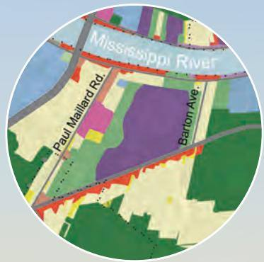

> **Figure description (visual reading, not stated in the plan's text):** Circular cover graphic: a zoomed, color-filled land-use map of the Mississippi River with Paul Maillard Rd. and Barton Ave. labeled. It has no legend and no caption; it is decorative and cannot be used to read a category.

#### ST. CHARLES PARISH 2030 C O M P R E H E N S I V E P L A N U P D AT E

## Page 2

### 2022-1-RES St. Charles Parish Planning and Zoning Commission

A resolution adopting St, Charles Parish 2030 Comprehensive Plan Update the 10-year update to St. Charles Parish 2030 Comprehensive Plan

WHEREAS. St, Charles Parish 2030 Comprehensive Plan (Plan 2030), the Parish's comprehensive land use plan adopted by the Planning Commission on June 2, 2011 and supported by Ordinance No. 11-6-11, states "the Planning and Zoning Department...should conduct a thorough review, revision, and update of the Comprehensive Plan at least every five (5) years” (pg. 161); and,

WHEREAS, the first update, containing changes to the Future Land Use Map of P/an 2030 shown on a digital map referred to as, “St. Charles Parish Future Land Use Map 2016," was approved by the Planning and Zoning Commission on September 1, 2016, and supported by Ordinance 16-9-16; and,

WHEREAS, in 2020, the Planning and Zoning Department recognized the need to update Plan 2030 further considering “growth trends, completed projects, and other factors," as Plan 2030 requires (pg. 162); and,

WHEREAS. Ordinance 21-1-3 authorized the execution of a Professional Services Agreement between the Center for Planning Excellence, Inc. and St. Charles Parish to complete a comprehensive, 10-year update to Plan 2030; and,

WHEREAS, the Planning and Zoning Commission finds that the update prepared by The Center for Planning Excellence, Inc. meets the stated objectives for a plan update expressed on page 162 of Plan 2030 in that it:

Updates the Comprehensive Plan base data regarding growth trends. completed projects, and other factors experienced since the adoption of Plan 2030

Documents plan effectiveness and implementation efforts identifving constraints upon implementation, and summarizing trends and challenges which have emerged or changed in the period since plan adoption

Revises goals. strategies and actions to reflect changing circumstances, emerging needs and opportunities, and expressed citizen priorities

• Revises the Future Land Use Map

NOW, THEREFORE, BE IT RESOLVED THAT THE ST. CHARLES PARISH PL ANNING AND ZONING COMMISSION adopts St. Charles Parish 2030 Comprehensive Plan Update, an update to St. Charles Parish 2030 Comprehensive Plan including a Future Land Use Map in digital form, available on the Parish website, as well as updates to all elements of Plan 2030, and forwards the update to the Parish Council for resolution in support.

The resolution having been submitted to a vote, the vote thereon was as follows:

The resolution was declared adopted this day

Carmine Frangella, Chairman

St. Charles Parish Planning and Zoning Commission

## Page 3

#### Acknowledgments

Thank you to the citizens of St. Charles Parish for their engagement and contributions.

#### Parish Council

Beth A. Billings, Councilwoman-at-Large, Division A   
Holly Fonseca, Councilwoman-at-Large, Division B   
La Sandra Darensbourg Gordon, Councilwoman, District I   
Mary K. Clulee, Councilwoman, District II   
Dick Gibbs, Councilman, District III   
Nicky Dufrene, Councilman, District IV   
Marilyn B. Bellock, Councilwoman, District V   
Bob Fisher, Councilman, District VI   
Julia Fisher-Cormier, Councilwoman, District VII

#### Parish Administration

Matthew Jewell, Parish President Mike Palamone, Chief Administrative Officer Darrin Duhe, Chief Operating Officer

Parish Staff   
Michael Albert Luis Martinez Danielle Badeaux Earl Matherne Corey Faucheux Jessica Netto\*\* Donya Hebert Chris Welker Marny Stein

#### Center for Planning Excellence

Camille Manning-Broome   
Janet Tharp   
Lyneisha Jackson   
David Whitley   
Kate Muspell

#### Fregonese and Associates

Scott Fregonese Julia Reisemann Cassandra Dobson

#### Vectura Consulting Services, LLC

Laurence Lambert Brin Fertilo Kristen Farrington

#### Comprehensive Plan Stakeholder Committee

Michael Albert Alana Lumar Daniel Badeaux Rondey Madere Gary Bruzeau, Jr. Luis Martinez Troy Carter Earl Matherne Greg Champagne Garrett Monti Mary Clulee Michelle O’Daniels Kristen Farrington Randy Petit Jr. Reanda Fields Keren Peymani Carmine Frangella Reanda Pierre La Sandra Tammy Prine Darensbourg Gordon Hannah Rawls Megan Harms Billy Raymond Julie Herbert Brittany Roberts Jamaica Hawkins Marilyn Ross

Debra Dufresne Vial   
Cory Savoie   
Tommy Scott   
Donald Smith   
Kenneth Smith   
Marny Stein   
Katina Summers   
Chris Walker   
Jay Webb   
Terrell Wilson

## Page 4

#### Table of Contents

Executive Summary. .. 5   
Introduction .. 13   
Context. .. 19   
Vision.. ..25   
Plan Elements   
Land Use, Housing and Community Character. ..27   
Economic Development. ...69   
Transportation ... 83   
Infrastructure ...115   
Community Facilities ..129   
Natural and Cultural Resources and Resilience ..139   
Implementation Framework. ...151

## Page 5

This page left intentionally blank

## Page 6

### Executive Summary

In 2011, the Parish Planning Commission and Council adopted the St. Charles Parish 2030 Comprehensive Plan to:

Provide an assessment of the parish’s present conditions and future trends.

Articulate citizens’ values and aspirations and catalyze community consensus in a vision of what the parish will be in 20 years, based on public input received during the planning process.

Provide a guide for decisions by Parish leaders, officials, and stakeholders to direct future growth and make other decisions that impact the parish’s future.

Define the community’s 20-year “to-do” list as a series of short-, mid-, and longterm actions to be taken to make the vision of parish’s future come to fruition.

#### Comprehensive Plan Updates Address Major Changes since 2011

Since adoption of the St. Charles Parish 2030 Comprehensive Plan, the Parish has used the Plan’s policies and actions to inform decision making in land use, development, transportation, and public infrastructure investments. However, over the last 10 years, a number of major events have occurred underscoring the need for a Plan update. These include natural disasters and crises such as the 2016 floods, Hurricane Ida and the COVID-19 pandemic— all of which have changed the course of growth and development trends in the Parish. There are also new federal and state programs that have become available to address issues arising out of these changing conditions. And lastly, the Parish has completed numerous recommended actions and initiated new programs to address these changing conditions.

## Page 7

#### Continuing Trends

Overall, trends identified in the St. Charles Parish 2030 Comprehensive Plan have continued, including:

» The pace of growth has continued to slow with the parish’s 2020 population (52,549) slightly lower than the 2010 population (52,780). The New Orleans Regional Planning Commission has estimated that the parish will gain less than 5,500 residents by the year 2040—a 0.5 percent annual population growth. This is equivalent to approximately 2,000 new households, which will require approximately 500 acres of land for new housing units. However, the development trends show new housing being built to replace housing that is lost through storm events, age, or homes removed by industry to create buffer zones.

» While the population is continuing to age and grow more diverse, the impact of these changes will increase demand for a wider variety of housing types and services. However, at the moment, there continues to be a strong demand for single-family houses on large lots.

» The modest population increase will continue to pose challenges in attempts to revitalize and expand the local retail sector, as threshold populations required to attract retail businesses desired by residents are not reached.

» The parish remains dependent on heavy industry for jobs and services and needs to continue efforts to diversify its economy.

» Many in the local labor force continue to work outside of the parish, with 54 percent in 2000, 56 percent in 2010 and 55.5 percent in 2020 commuting 29 minutes to get to work.

### Key Challenges and Issues Remain

Based on these trends, the key challenges and issues identified in the St. Charles Parish 2030 Comprehensive Plan remain relevant and should continue to guide the policies and actions needed to achieve the community’s vision.

#### Major Challenges from the St. Charles Parish 2030 Comprehensive Plan

From the St. Charles Parish 2030 Comprehensive Plan Executive Summary, page iv:

» Given the projected growth, how does the Parish protect the existing economic base, and how does it prevent the economy from stagnating?

» What needs to be done to attract the types of growth the citizens want, while enhancing the lives of current and future residents?

» How should this need be balanced with the desire, expressed through the vision statement, to preserve a small-town way of life and character?

#### Additional Challenges Identified During the Plan Update Process

» How does St. Charles Parish adapt to the increasing impacts of climate events, including direct physical, mental, and financial tolls from extreme weather and indirect impacts to social systems and infrastructure that is struggling to cope with the increasing prevalence and severity of natural disasters?

» What are the implications of the National Flood Insurance Program’s (NFIP) risk rating 2.0 methodology to housing stability and security?

## Page 8

#### Plan Element Goals and Priority Recommendations

Together, the six plan elements in this document provide an update of existing conditions and include goals, strategies and actions to help the Parish continue to move toward its vision statement. Each element also includes a status update of the 2030 Comprehensive Plan actions, documenting implementation efforts since 2011.

#### Land Use, Housing and Community Character

The goals in this element aim to provide a diversity of housing choices that serve all residents of the parish, while reducing development vulnerability to storms and other disasters, and preserving the small town feel and rural character of St. Charles Parish.

The Future Land Use Map incorporates these overarching goals, community desires, reduced population projections, as well as zoning and development changes since 2010 in order to guide long-range future development of the parish.

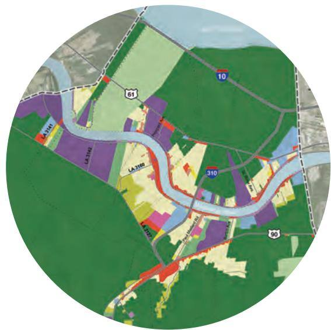

> **Figure description (visual reading, not stated in the plan's text):** Circular thumbnail of the parish on an aerial base with colored land-use fills and labeled roads (I-10, US 61, US 90, LA 3141, LA 3142, LA 3160, LA 3127). It has no legend of its own; the page text introduces it as the Future Land Use Map. Use Figure LU-8 (p. 42) for the legend.

> **Text-layer supplement (text on this page that the layout parse did not capture; reading order approximate, taken from the PDF text layer):**
>
> “The needs of the people of the parish have evolved, so should the Parish” – Public meeting attendee
>
> ST. C H A R L E S PA RISH C OMPREH ENS I V E PL A N UPDATE

## Page 9

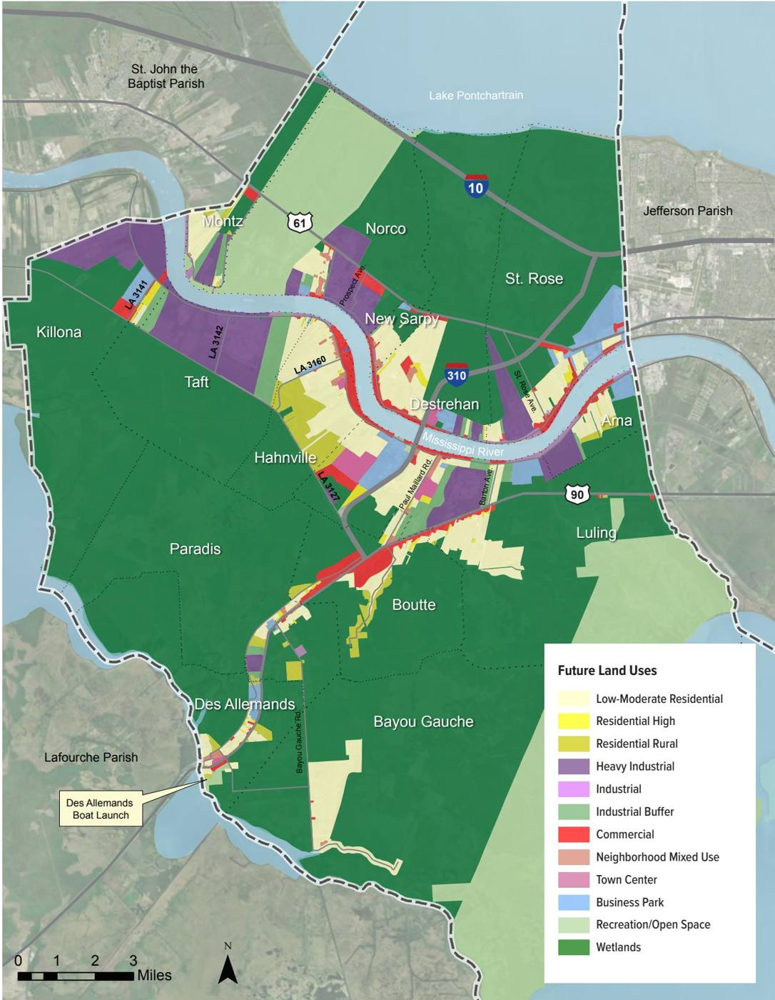

> **Figure description (visual reading, not stated in the plan's text):** Smaller copy, in the Update's summary section, of Figure LU-8 (Future Land Use, 2022). Map of the whole parish titled by the legend heading "Future Land Uses"; source line "St. Charles Parish/CPEX May 2022". Legend, as printed (12 categories): Low-Moderate Residential, Residential High, Residential Rural, Heavy Industrial, Industrial, Industrial Buffer, Commercial, Neighborhood Mixed Use, Town Center, Business Park, Recreation/Open Space, Wetlands. Communities labeled on the map: Montz, Norco, St. Rose, Killona, Taft, New Sarpy, Destrehan, Ama, Hahnville, Paradis, Luling, Boutte, Des Allemands, Bayou Gauche; a Des Allemands Boat Launch call-out; neighboring St. John the Baptist, Jefferson and Lafourche parishes; Lake Pontchartrain; the Mississippi River; roads I-10, I-310, US 61, US 90, LA 3141, LA 3142, LA 3160, LA 3127, LA 632. This is the current map (see STATUS.md). Read a parcel's category from the zoom insets on Update pp. 47-50 or from the parish GIS layer, not from this overview.

## Page 10

Priority actions are intended to be catalytic in moving toward the vision and are doable within a short timeframe. These actions should begin or be completed within one to four years of plan adoption.

#### PRIORITY ACTIONS

1. Use the Comprehensive Plan policies and the Future Land Use Map to evaluate zoning changes and development requests.

2. Update the zoning ordinance to implement the St. Charles Parish Comprehensive Plan and the Future Land Use Map:

• Consolidate zoning districts.

• Create a new Mixed Use zoning district to promote quality, walkable town centers and mixed-use development.

• Require mixed-use and town center development to install walkable features such as street trees, wider sidewalks, pedestrian lighting and other amenities.

Adopt development standards to address landscaping, access management, and siting for new development along the US 90 corridor.

Review commercial and nonresidential aesthetic standards to improve facades and the view from the street.

• Include incentives for permeable surfaces.

3. Support opportunities for on-farm energy production techniques (e.g., methane, wind, solar, and other forms of power) as a way to enhance economic viability.

4. Remove inadvertent impediments to sustainable development, such as existing restrictions on uses or development standards, that may prevent the use of renewable energy production technologies. Review regulations that allow or encourage excessive impervious coverage.

5. Promote mixing of various types of housing (e.g., single-family detached and attached homes) in mixed-residential developments (consistent with the Future Land Use Map).

6. Prioritize creating a connected street network when reviewing development plans.

#### Economic Development

Economic Development goals focus on promoting a healthy, diverse economy by leaning on the Parish’s competitive advantages and fostering local enterprise that serves local residents, workers, and businesses. It also addresses investing in the Parish’s human capital and strengthening regional collaboration and partnerships.

#### PRIORITY ACTIONS

1. Brand and market the Parish, capitalizing on the community’s natural advantages: its location, proximity to urban centers, superior public education, natural setting and quality of life.

2. Establish a Small Business Division inside the Economic Development office that focuses on assisting small- to medium-sized businesses with opening in St. Charles Parish.

3. Establish the Parish as a go-to resource for expertise in the areas of emergency planning, disaster recovery, coastal zone management, and education for riverine and maritime industries.

4. Continue prioritizing connecting with and supporting parish businesses during emergency events.

## Page 11

5. Evaluate and identify actions to improve the appearance of Airline Highway in St. Rose, between I-310 and the parish line.

6. Target the following core industry sectors: Alternate and Renewable Energy; Micro-Manufacturing; Petrochemical and Plastics; Trade, Logistics, and Distribution.

7. Explore and support additional industries which ofer significant job opportunities, quality of life benefits, and growth potential: Food Processing, Tourism, Entertainment, and Healthcare and Medical Services.

8. Assist existing core industries in implementing strategies to develop appropriate complementary uses in large buffer areas.

#### Transportation

The goals of the Transportation element prioritize coordinating transportation with land use planning, providing a variety of transportation options for residents and visitors, improving coordination between the Parish, LA DOTD, and the private sector, increasing connectivity between parish destinations and applying a “livable community” approach when addressing transportation needs.

#### PRIORITY ACTIONS

#### 1. Implement these capital improvements:

• Complete construction of the West Bank levee multi-use path from Elm Street to the St. John line. (LA DOTD/USACE project)

• Make improvements to US 90 in the Willowdale Boulevard area.

Reconstruct LA 52 (Paul Maillard Road) including road, stormwater and sidewalk improvements consistent with recommendations in the Paul Maillard Corridor Revitalization Plan, 2014).

• Complete the extension of Judge Edward Dufresne Parkway to LA 3127.

Revitalize/maintain the arterial and collector access roads into major subdivisions, including the Lakewood Rehab project, the Willowdale Rehab project, and raising of Evangeline Road between US 61 (Airline Hwy) and the KCS Railroad Tracks.

• Continue the annual asphalt pavement maintenance program.

• Extend Deputy Watson Drive to Ashton Plantation Boulevard.

## Page 12

2. Coordinate a US 90 beautification project with the State and relevant stakeholders.

• Improve the look and feel of the corridor through enhanced landscaping, street lighting and pedestrian striping; access management; bioswales; and installation of a multi-use path.

Adopt development standards to require landscaping, access management and potential building standards for new development adjacent to US 90.

3. Create pedestrian and bicycle connections between the multi-use path and existing and proposed bicycle and pedestrian facilities to enhance local and regional mobility.

4. Develop an inventory and ranking of sidewalk construction or reconstruction with priority given to areas surrounding schools and parks.

5. Reserve land for rights-of-way adequate to accommodate sidewalks and or bicycle facilities to enhance a parish-wide mobility network.

6. Identify opportunities to eliminate existing railroad crossings (public and private) to allow for additional crossings in strategic locations.

7. Continue to maintain a street maintenance rating database and program to equitably prioritize streets that are in the worst condition.

8. Work with the state to extend LA 3127 to improve evacuation routes.

#### Infrastructure

Infrastructure goals seek to resolve the existing system deficiencies within the Parish, prioritize infrastructure investment, provide comprehensive flood protection to developed and developable areas of the Parish and encourage regional collaboration to ensure access to resources, maximize efficiency and increase the Parish’s influence on infrastructure related decisions that impact the Parish.

#### PRIORITY ACTIONS

1. Implement recommendations in ongoing East and West Bank drainage studies, including measures to improve drainage conveyance and assess additional pumping needs.

2. Continue and expand the maintenance program, including ditch cleaning, debris removal and other improvements needed to maintain an efficient drainage system.

3. Develop strict enforcement protocols to ensure that existing development adheres to established drainage standards and regulations.

4. Complete and implement the East and West Bank Sewer Master Plan to identify current deficiencies, plan for necessary upgrades to accommodate future growth in the parish and update the location of the future sewer system.

## Page 13

5. Establish a Capital Improvements Plan that draws from the ongoing drainage and sewer studies’ recommendations, and sets project priorities through a five-year window.

6. Consider the Future Land Use Map in the planning of future water extensions, to support the desired land use pattern.

7. Consider potential for growth when replacing water lines to promote proper sizing of the lines for future, as well as current usage.

8. Continue replacement of water meters to automate collections and improve transparency.

9. Study the feasibility of adopting a water system development capacity fee structure.

10. Develop emergency shelters on the East and West Bank yards.

#### Community Facilities

Community Facilities goals are to provide equal access and fair distribution of facilities to all parish residents, coordinate with other public and private providers to avoid duplications and reduce costs, and maximize the lifespan and use of existing and future facilities by ensuring adequate flexibility and adaptability.

#### PRIORITY ACTIONS

1. Prepare a government facilities master plan. Evaluate the parish’s space needs, functions, and interdepartmental relationships to eliminate deficiencies, improve efficiencies, and control costs.

2. Explore development of enhanced literacy and job training programs through the school districts, the River Parishes Community College St. Charles Campus and other partners.

3. Continue partnerships through the Early Childhood Community Network and childcare centers to meet the child care needs of low-income families and to serve as a means for providing comprehensive job training and employment referral classes to parents. Consider revising the Zoning Regulations to allow these types of uses in areas where they may be most needed.

## Page 14

#### Natural and Cultural Resources and Resilience

Natural and Cultural Resources and Resilience goals work to minimize the loss of and avoid adverse impacts of the Parish’s natural, historic, and cultural resources, while protecting the natural resources from scattered development. They also seek to promote these natural resources and outdoor recreation opportunities in a sensitive and responsible manner for economic development and minimize the parish’s risk and vulnerabilities.

#### PRIORITY ACTIONS

1. Prepare a biodiversity and environmental resource inventory and incorporate it into the Parish’s GIS, including, but not limited to wildlife habitats, wetlands, and floodplains and endangered species habitats.

2. Revise the Zoning Code to include an environmental protection section that incorporates requirements to protect water resources, wetlands, existing tree canopy and other resources on an individual site and areawide basis.

3. Prepare a historic resource inventory. Include the full range of historic resources (cemeteries, landscapes, trees, archeological sites, etc. in addition to individual buildings and districts).

#### Implementation

The Implementation Framework chapter includes a summary of the goals and priority, short-term actions for each plan element as well as an updated Action Plan (Table IF-2). The Action Plan provides a detailed matrix for each plan element with a complete list of existing and revised actions, including responsible entity, and timeframe. Actions fall into one of three timeframes:

» Ongoing: Actions in this category require ongoing coordination and planning.

» Priority Actions (1-4 years): These actions should be completed as soon as possible.

» Mid- and Long-Term Actions (over 5 years): Actions in this category include measures that will require additional study, coordination, funding resources, etc.

## Page 15

This page left intentionally blank

## Page 16

### Introduction

This document provides a 10-year update to the St. Charles Parish 2030 Comprehensive Plan. It does not replace it, but serves as a companion document that summarizes changes to existing conditions and trends, and describes how major external factors, as well as shifts in population and development, impacted the parish over the last decade. This 2030 Plan Update identifies completed actions since 2010 for each plan element, and includes a complete matrix of all remaining and new actions, providing an updated Action Plan to guide Parish decision-making through the next 10 years

#### Plan Structure

This plan update is divided into five major chapters, similar to the 2030 Comprehensive Plan document. Each area only updates changing data, trends, policies or actions. If no updates are provided, the data in the 2030 Comprehensive Plan should be considered still relevant to decision making.

» This Introduction provides an update to the planning background and need for the comprehensive plan update, an acknowledgement of the Plan’s major themes, and a summary of the plan update process.

» The Context chapter summarizes changes in the last 10 years and the parish’s place within the region.

» The Vision, which remains consistent with the St. Charles Parish 2030 vision statement, presents a 20-year image of the parish’s future.

» The Plan Elements update the topical subsections in the 2030 Comprehensive Plan document.

» The Implementation Framework updates the 2030 Comprehensive Plan Action Plan and summarizes all of the Plan's actions, including timeframe and responsible entity(ies).

## Page 17

#### Key Plan Themes: The "Big Issues"

The 2030 Comprehensive Plan is organized and focused around five broad themes or principles, which will help the Parish succeed in attaining the Vision and positioning itself to thrive in the 21st century. During the planning process participants provided input into how the Parish is doing in addressing these big issues.

**Table 1**

| Key Themes from 2030 Plan | Public Comments: Have we moved forward? |
|---|---|
| Diversify the economy to provide jobs and tax revenue should there be changes within the existing industrial sector. | Comments ranged from “some improvement" to “ the industrial sector has grown, and is the primary sector, while the service sector, retail, hospitality, and leisure, has stalled." |
| Complete and improve the parish's basic infrastructure, road network, government services, and, perhaps most important, the storm protection and flood hazard mitigation systems. | Comments ranged from “yes, there has been progress” to “in some cases the 2030 Plan has been ignored and additional problems with growth have been created” to “there have been improvements in storm protection but drainage needs addressed." |
| Promote sound, efficient, fiscally responsible growth by introducing new types of development and new development patterns with higher design standards. | Comments included “need more diversity of uses” and “most of the smaller developments use outdated design features with limited green space and landscaping," however we also heard that “there are too many hoops to jump through to develop." |
| Increase housing diversity and the availability of quality housing affordable to all parish residents. | Comments included “available housing has increased for middle and high income units, with limited low income options. In addition, comments supported higher density housing and others thought there is too much density in the new developments. |
| Target revitalization efforts and property upkeep in established commercial and residential areas. | Comments included “some parts of the parish have improved greatly, while others lag behind and more emphasis has been placed on new construction over revitalization. |
| What is missing from these key themes? | • Continue referencing the Future Land Use Map when issuing guidance and making re-zoning district changes. • Enhancing citizen access to nature for unstructured recreation • Encouraging development for a thriving local business economy. • Increasing opportunities for social, cultural, and recreational engagement for all citizens in an effort to improve quality of life • Transparency with the process and accessibility |

Table snapshot (for checking): 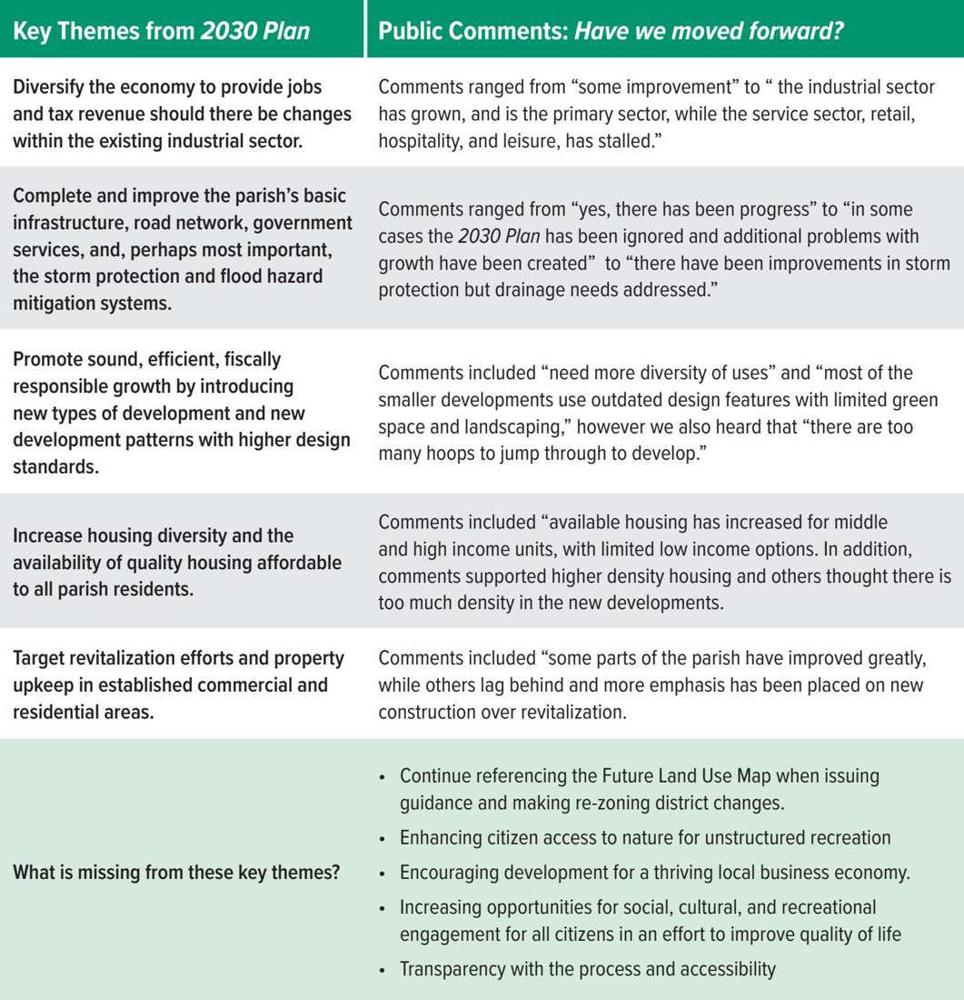

## Page 18

#### Plan Update Process

This Plan update was shaped by early and continuous involvement by Parish leadership, stakeholders and parish residents over a one year process beginning in February 2021. The policies, strategies, and actions recommended in the 2030 Comprehensive Plan have been updated based on the extensive input received throughout this process.

#### Background Analysis and Desired Outcomes for the Plan Update

The planning process began with a review of background information and analysis to understand what changes have occurred since 2010, where the parish is today and if the Vision or any of the Plan’s goals needed to be amended.

The project team conducted 20 interviews with Parish leadership, department heads and stakeholders to understand their vision for the parish, what they consider to be the parish’s most important assets, the most significant issues facing the parish today, and their desired outcomes for this Plan update. The results of these interviews are summarized in the table on the previous page.

The project team also met with the stakeholder committee to present demographic, housing, economic, and land use trends and collect feedback on key themes and desired Plan outcomes. The committee participated in a survey to share what kind of development (housing types, commercial activity, and streetscape improvements) they would like to see in the parish.

The project team also presented an existing land use map to the stakeholder committee and asked them to identify specific locations in the parish where they would like to see different types of development.

The input received through engagement was used to inform the Future Land Use Map as well as update plan element goals and action items.

#### Assessment

To gain a detailed understanding of the 2030 Comprehensive Plan’s Action Plan implementation progress and challenges, the project team met with the departments tasked with Plan implementation and assessed the progress of each Plan Element’s immediate, short-term and mid-term action items.

Land use and population data was also extensively reviewed and analyzed to determine the capacity and type of development that would accommodate the parish’s population in the future. Analysis included the amount of vacant and developable land available within each community in the parish, existing zoning, and population projections through 2040.

Potential future scenarios were developed to analyze the impacts of future development. These were presented to the Stakeholder committee and after review and discussion, the project team agreed that the scenario approach would be used to develop the revised Future Land Use Map.

## Page 19

Draft Plan shared for public review and comment

Address public comments

Adoption by Planning and Zoning Commission

Adoption by Parish Council

#### Public Engagement

This process included two public meetings and a parishwide survey to engage residents in the Plan update process. The public meetings were held in February 2022 on the East and West Banks of the parish, which were attended by 38 people. Additionally, a survey was developed to share information provided at the public meetings and to also collect input and feedback on housing, growth, and development preferences, and any other additional considerations for the Plan Update. The survey received 96 responses.

#### Stakeholder Committee

The stakeholder committee was developed to represent a variety of interests in the parish. Committee members were recommended by the Parish Department of Planning and Zoning and included planning commissioners, council members, Parish staff, business and industry leaders, and civic and homeowner association representatives. Additionally, residents were invited to join the stakeholder committee through posts on the Parish website and Facebook page. Fifteen residents responded to this call. Overall, the stakeholder committee had 43 members and met four times, both in-person and virtually throughout this process.

## Page 20

This section discusses the parish's key driving factors since 2010, as well as demographic changes over the last ten years.

#### Parish Overview Update

#### Key Driving Factors Since 2010

St. Charles Parish continues to enjoy the economic opportunity and prosperity largely attributed to the presence of industry in the parish. Four of the state’s 19 refineries are located in the parish (three in Norco and one in St. Rose) and the chemical, electricity and other processing operations are some of its largest employers. Most recently, in 2021, the Luling Business Park and Enterprise Center, a one million square foot distribution facility, which will continue to support economic diversification and job opportunities for residents, was announced.1

The presence of industry has been able to support and maintain the parish’s economy and contribute to key quality of life elements—notably the parish's regional access, a nationally recognized public school system, a stable economy, and strong culture.

Testing the parish's economic and cultural strengths, the last 10 years brought major storms that St. Charles (figuratively and literally) had to weather. Most recently, in 2021, Hurricane Ida, a Category 4 storm, was the worst storm to hit St. Charles Parish. Impacts from the storm

> **Text-layer supplement (text on this page that the layout parse did not capture; reading order approximate, taken from the PDF text layer):**
>
> Flooding in Destrehan, August 2016.
>
> Parish President Matthew Jewell Annual Report 2021
>
> ST. C H A R L E S PA RISH C OMPREH ENS I V E PL A N UPDATE

## Page 21

included power outages, disruption in residential water service, boil water advisories, wind damage, debris (the parish surpassed 1 million cubic tons of debris) and incalculable damages to homes and businesses. Before Ida, one of the largest disasters to impact the state was the Great Floods of 2016, where much of southeast Louisiana experienced historic flooding due to prolonged rainfall in a short period of time. These severe weather events within a short span of time point to a future with increased risk which will force relocation for some. St. Charles is positioned to be a “receiver community” as communities begin to move to less flood-prone areas.

St. Charles is still desirable for the development of subdivisions. Since 2010, the Parish has issued 1,059 new residential unit permits for new construction, largely for single-family homes.

**Table 2: Table CON-1: Historic Decennial Growth Source: St. Charles Parish 2030 Comprehensive Land Use Plan and U.S. Census Bureau, 2020 DEC Redistricting Data (PL - 94141); 2020 growth rates for 2020calculated by CPEX**

| Year | Population | % Growth |
|---|---|---|
| 1920 | 8,586 | -23% |
| 1930 | 12,111 | +41% |
| 1940 | 12,321 | +<1% |
| 1950 | 13,363 | +8% |
| 1960 | 21,219 | +59% |
| 1970 | 29,550 | +39% |
| 1980 | 37,259 | +26% |
| 1990 | 42,437 | +14% |
| 2000 | 48,156 | +14% |
| 2010 | 52,780 | +10% |
| 2020 | 52,549 | -<1% |

Table snapshot (for checking): 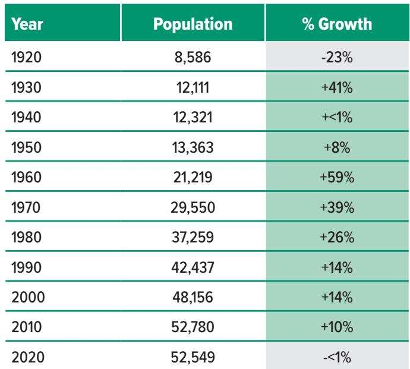

Comparatively, 784 housing units have been constructed during the same period. This gap in permits and construction is likely due to new construction replacing older housing, or rebuilding homes lost in storm events.

Additionally, Risk Rating 2.0, an update to FEMA’s flood risk maps is concerning to residents, as some may see significant increases in their flood insurance rates, subsequently affecting their ability to insure their homes and ultimately afford to continue to live in the parish.

As the 2030 Plan horizon year moves closer, careful planning will be needed to continue to accommodate growth in the parish while ensuring that infrastructure keeps pace with development.

#### Demographic Characteristics and Trends Update

The 2020 Decennial Census reported a population of 52,549, representing a 0.44 percent population decline since 2010. This is the first population decrease the parish has seen since 1920, afterwhich, there has been steady growth, averaging approximately 30,000 residents or a 23.3 percent population increase per decade between 1930 and 2010 (Table CON-1).

Census data indicates the parish is continuing to age. The median age increased from 34.1 in 2000 to 36 in 2010, to 37.9 in 2020. The age pyramid (Figure CON-1) shows a continuation of trends assessed in the 2030 Comprehensive Plan, where Baby Boomers concentrate population growth within the cohorts into which they age. The Baby Boom cohort, now 56 to 74 years old, comprise 22.7 percent of the parish’s

## Page 22

Housing stock within the parish remains predominantly single-family detached dwellings (77.2%), although less so than in 2010 (80%). The share of multifamily units increased from 11 to 12 percent and mobile homes remain the same at approximately nine percent of housing in the parish.

National trends for housing choices outside of single-family detached homes for various demographics have not changed (smaller, more social housing environments and more walkable neighborhoods2). Although the the parish is not yet losing its younger and older populations, (Figure CON-2 shows increases in the 20 to 34 and 55 to 84 age cohorts) demand for housing variety will likely impact these trends if older residents find it challenging to age in place, or if the parish is not able to continue to attract or retain younger residents.

#### Race and Ethnicity

Based on the 2019 ACS 5-year estimates, the parish continues to grow more racially and ethnically diverse. Comparing 2010 census and 2019 ACS data, the proportion of the population that is white decreased from 69 percent to 65 percent, the Black or African American population increased from 25 percent to 26 percent and the Hispanic or Latino population increased from five percent to six percent of the parish population.

> **Text-layer supplement (text on this page that the layout parse did not capture; reading order approximate, taken from the PDF text layer):**
>
> population, making even more urgent the need
>
> for community level services related to housing, transportation and social services.
>
> 2 National Association of REALTORS Research Group, 2021 Home Buyers and Sellers Generational Trends Report https://www.nar.realtor/sites/default/files/documents/2021home-buyers-and-sellers-generational-trends-03-16-2021.pdf
>
> ST. C H A R L E S PA RISH C OMPREH ENS I V E PL A N UPDATE

## Page 23

#### Regional Position

Within the seven parish New Orleans-Metairie-Kenner Metropolitan Statistical Area (MSA), St. Charles Parish is the fourth most populous. As seen in Table CON-2, over the past decade, parishes within the MSA experienced uneven population changes where some had population loss, moderate growth, or significant population increases.

Between 2010 and 2020 Jeferson Parish grew just 1.9 percent and St. John the Baptist Parish declined by 7.5 percent, both of which are immediately adjacent to St. Charles Parish, which also had population decline. All other parishes within the MSA saw population growth during this period. Overall, the population of the MSA grew by 83,889 persons or 7.2 percent.

Compared to other southern parishes in the MSA, St. Charles has the highest median income and its population is among the most highly educated. The median household income in the parish (\$69,019) surpasses all others in the MSA and is 40 percent higher than the statewide median household income (\$49,469).

St. Charles Parish has the lowest combined percentage of people over 25 with less than a highschool diploma (10%) and ties with New Orleans for the highest proportion of persons with a Bachelor’s degree (22%). The parish however lags behind Jeferson and Orleans Parishes in proportion of persons with a graduate or professional degree.

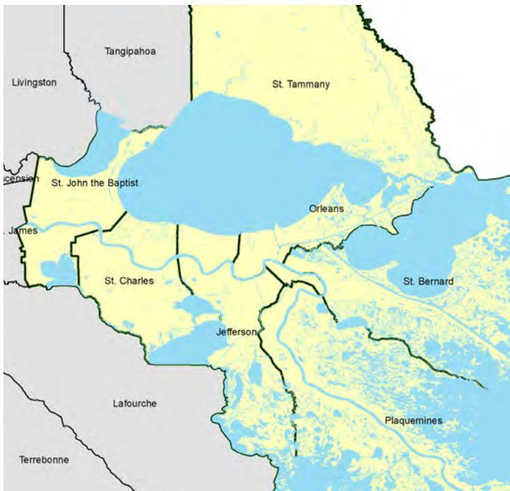

> **Figure description (visual reading, not stated in the plan's text):** Locator map of southeast Louisiana in yellow and light blue showing parishes labeled Tangipahoa, Livingston, St. Tammany, St. John the Baptist, Orleans, St. Charles, Jefferson, St. Bernard, Lafourche, Plaquemines, Terrebonne, Lake Pontchartrain and parts of Ascension, James. No land use is shown.

**Table 3: Table CON-2: Regional Population Change Source: U.S. Census Bureau, 2010 Summary File 1 and 2020 DEC Redistricting Data (PL 94-171)**

| Parish | 2010 Population | 2020 Population | % Change |
|---|---|---|---|
| St. Charles | 52,780 | 52,549 | -<1% |
| Jefferson | 432,552 | 440,781 | +2% |
| Orleans | 343,829 | 383,997 | +12% |
| Plaquemines | 23,042 | 23,515 | +2% |
| St. Bernard* | 35,897 | 43,764 | +22% |
| St. Tammany | 233,740 | 264,570 | +13% |
| St. John the Baptist | 45,924 | 42,477 | -8% |
Table snapshot (for checking): 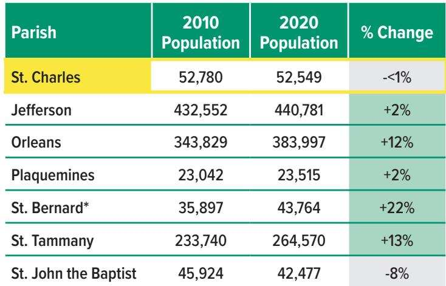

\*Based on 2020 Census data, St. Bernard was Louisiana’s fastest growing parish. This growth is largely due to recovery efforts post Hurricane Katrina, which included Parish Government initiatives like “Sold on St. Bernard”, which provided home builders with access to lots to redevelop neighborhoods and other community investments.

## Page 24

> **Text-layer supplement (text on this page that the layout parse did not capture; reading order approximate, taken from the PDF text layer):**
>
> Figure CON-3: Median Household Income Comparison $80,000
>
> Plaquemines St. Bernard St. Charles Parish Parish Parish
>
> St. John the Baptist Parish
>
> Source: U.S. Census Bureau, 2020 ACS 5-year estimates
>
> * St. Tammany is not included in the comparison due to its location on the north shore and significant difference in values compared to the south shore parishes.
>
> Figure CON-4: Educational Attainment 100% 80%
>
> Graduate or professional degree
>
> Bachelor's degree Associates degree
>
> Some college, no degree High school graduate (includes equivalency)
>
> Source: U.S. Census Bureau, 2019 ACS, 5-year estimates
>
> 9th to 12th grade, no diploma Less than 9th grade 38%
>
> St. John the Baptist Parish
>
> * St. Tammany is not included in the comparison due to its location on the north shore and significant difference in values compared to the south shore parishes.
>
> ST. C H A R L E S PA RISH C OMPREH ENS I V E PL A N UPDATE

## Page 25

This page left intentionally blank

## Page 26

### Parish Vision

Vision statements built on a robust amount of public input should not substantially change throughout the planning horizon since shared community values, needs and desires do not dramatically shift over a twenty-year period However, what does change are the existing conditions and trends impacted by outside forces, and refinements are made to policies, actions and tools used to achieve the desired vision.

During the 2030 Plan Update process the Comprehensive Plan Committee and the general public reviewed and provided input on the St. Charles Parish 2030 Vision. The consensus of this input is that the 2020 vision statement and five major themes continue to represent the citizens’ desires for their community and express a shared vision of where their community should be in 2030. The vision is written from the perspective of 2020.

#### 2030 Vision

In the year 2030, St. Charles Parish is a vibrant, friendly community, proud of its heritage and surrounded by unspoiled nature. We are a community that has taken advantage of its strategic location, and wisely managed growth and change to achieve…

A strong, diversified economy that ofers ample, challenging job opportunities for all, allowing the parish to retain its talented youth.

A “small-town” way of life, but enriched with a full array of educational, cultural and recreational opportunities.

A sound infrastructure system that ofers reliable protection from natural disaster, provides for optimum mobility in a variety of modes of travel, and supports sound growth.

A balanced development pattern that ofers a range of housing choices in livable neighborhoods, and commercial and civic activities and services that are needed by our resident population.

A character of development that reflects the value we place on our scenic natural beauty and our culture, heritage and community identity.

A community of educated, engaged and caring citizens with diverse backgrounds, but sharing a common identity and commitment to serve.

## Page 27

#### Making Progress Toward the Vision

During the planning process participants provided input into how the Parish is doing in achieving the Vision. The table below highlights some of these comments as well as what participants think could be missing from the Vision.

#### Desired Outcomes

During the planning update process, participants generally supported the major themes and desired outcomes identified in the 2030 Comprehensive Plan–although there was input that some have not been addressed to the extent needed.

**Table 4**

| Achieving the 2030 Vision | Public Comments |
|---|---|
| Has the parish has moved forward towards the Vision in the last 10 years? | • Yes, our community has become more diverse in the past 10 years and continues to be. Our Council is more diverse than it has ever been. • For the most part, yes, but we have ignored the 2030 Plan's preservation ideal by allowing residential close to historical structures thus disrupting the plan with a cascade of potential issues for the residents and businesses • Some progress, but the action item list is very long, with a long way to go. And some ideas will be very hard to implement. For example, the goal of maintaining a "small town" way of life and character seems inconsistent with being a community with a full array of educational, cultural and recreational services. • I fully support the ideas and goals stated here—but no, unfortunately I have not seen enough progress in this direction. • We've made plans to, but they have not been implemented. • The Parish has plenty of goals and desired outcomes, but seems to be lacking in the tactical solutions to make these into realities. Better prioritization is suggested, to make better use of limited resources. • My biggest hope is to see the Parish protect the atmosphere that draws people to the area and to enhance the quality of life here so that we aren't just a bedroom community but really offer more to life. |
| What is missing from the vision statement? | • The rest of the world is including planning for global climate change in their future outlooks, but it seems lacking in this 30-year plan. • Our parish's cane production is about to be nonexistent due to housing developments and I feel we are on the verge of becoming Kenner. • The vision statement is not missing anything; implementation of the vision statement sometimes misses the mark (but that happens!) |
Table snapshot (for checking): 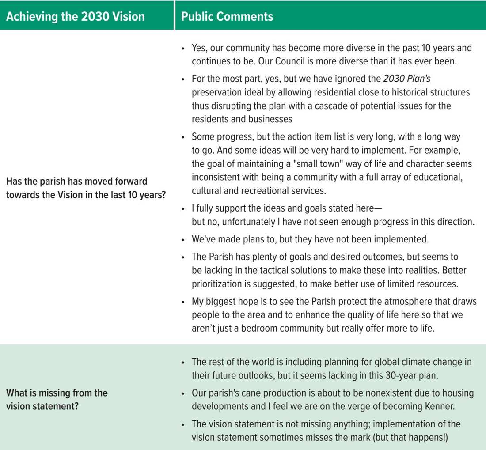

## Page 28

### Plan Element Land Use, and Housing and Community Character

#### Existing Land Use

As part of this 2030 Comprehensive Plan Update, the Parish completed an extensive, detailed land use analysis and inventory of vacant lands. This inventory resulted in some shifts in classification of existing land uses, especially related to vacant land, wetlands and vacant agricultural land.

St. Charles Parish has a relatively small land area available for development, as nearly 31 percent of the parish is open water and 61 percent is wetlands. When assessed in the 2030 Plan, approximately 11 percent or 20,000 acres was potentially developable. Today, eight percent or 14,756 acres are available for development. During the eleven year period, land has been developed into subdivisions, business parks or is under the stewardship of industry.

Agriculture is no longer the most prevalent land use in the parish since the 2030 Comprehensive Plan, being surpassed by industrial and residential development. The agricultural sector in the parish has continued to decline, as agricultural acreage has since reduced by 22 percent (Table LU-1) and the number of jobs in this sector has dropped to under 300.3 The availability of large agricultural tracts is one of the reasons industry continues to locate in the parish. The parcel assemblage usually needed in more urbanized environments is not required. The amount of land used for commercial activity also decreased, while industrial, single-family residential, institutional, and multifamily land uses all increased in acreage.

## Page 29

since reduced by 22 percent (Table LU-1) and the number of jobs in this sector has dropped to under 300.3 The availability of large agricultural tracts is one of the reasons industry continues to locate in the parish. The parcel assemblage usually needed in more urbanized environments is not required. The amount of land used for commercial activity also decreased, while industrial, single-family residential, institutional, and multifamily land uses all increased in acreage.

**Table 5**

| Table LU-1: Existing Land Use Breakdown | Comprehensive Plan at Adoption (2011) |  | Comprehensive Plan Update (2022) |  |
|---|---|---|---|---|
| Existing Land Use | Area (acres) | % of land area | Area (acres) | % of land area |
| Wetlands/Other Natural Resources/Open Space and Parks | 160,701.99 | 88.69% | 148,451 | 82.4% |
| Undeveloped/Vacant Land | 427.18 | 0.24% | 7,894 | 4.3% |
| Industrial/Manufacturing | 4,846.24 | 2.67% | 9,773 | 5.4% |
| Single Family Residential | 5,427.60 | 3.00% | 6,695 | 3.7% |
| Agriculture/Farming/ Agro-industry | 7,047.20 | 3.89% | 5,511 | 3.1% |
| Institutional (public, education) | 569.45 | 0.31% | 1,084 | 0.6% |
| Commercial (retail and services) | 739.31 | 0.41% | 673 | 0.4% |
| Multi-Family Residential | 84.96 | 0.05% | 103 | 0.1% |
| Government | 28.84 | 0.02% |  | Included in institutional |
| Recreation | 239.15 | 0.13% |  | Included in other natural resources |
| Infrastructure and Utilities | 1,086.89 | 0.60% |  | Included in each zoning district |
| Subtotal | 181,198.81 | 100% | 180,184 | 100% |
| Open Water | 81,280 | - | 82,294 | – |
| Total Area | 262,478.81 | - | 262,478 | – |

_Source: 2030 Comprehensive Land Use Plan and CPEX 3 The 2030 Comprehensive Plan cited over 300 jobs in the Agriculture, Forestry, Fishing, and Hunting sector, based on 2004 census data. 2020 ACS reported 299._
Table snapshot (for checking): 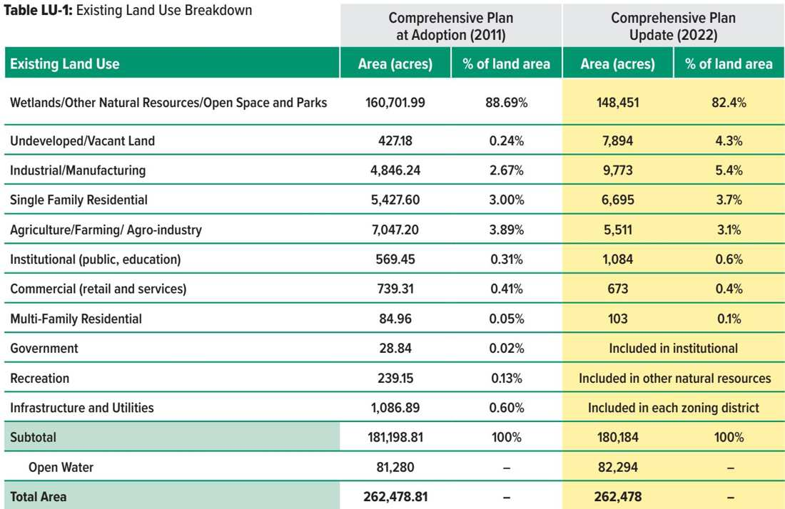

## Page 30

**Table 6: Table LU-2: Quick Land Use and House Facts Comparison**

| Quick Facts | Comprehensive Plan at Adoption (2011)* | Comprehensive Plan Update (2022)** | Key Takeaways |
|---|---|---|---|
| Total Area | 410 square miles St. Charles Parish GIS | No change |  |
| Land Area | 283 square miles St. Charles Parish GIS | No change |  |
| Open Water | 127 square miles St. Charles Parish GIS | No change |  |
| Predominant Land Use | Agriculture = 7,047 acres 2030 Plan | Industrial = 9,773 acres CPEX | Industry has become the predominant land use. |
| Predominant Development Type | Residential = 5,428 acres 2030 Plan | Residential = 6,798 acres CPEX | Residential development has increased. |
| Residential Units | 19,490 | 20,806 2020 Census | The number of residential units has increased 6.8%. |
| Average Residential Density Residential acreage only | 3.5 housing units/acre 2030 Plan | 3.06 housing units/acre CPEX | Density is decreasing. |
| Occupied Units | 18,180 | 19,308 |  |
| Owner-Occupied vs. Renter-Occupied Units | 82% to 18% | 80.1% to 19.5% | Renter housing occupancy has slightly increased. |
| Vacant Units | 1,460 | 1,498 | Slight increase in vacant units. |
| Median Year Housing Structure Built | 1980 not sourced | Largest proportion of homes (38%) built between 1980 and 1999 |  |
| Median Value of Owner-Occupied Homes | $160,500 | $205,600 |  |
| Section 8 Vouchers | 300 (Waiting List = 1,200) SCPDCS | 373 (Waiting List = 24) St. Charles Public Housing Authority | The number of vouchers has increased and the waiting list has significantly reduced, which means more people are being housed. |
| Public Housing Units | 129 (Waiting List: 500+) SCPDCS | 129 (Waiting List: 300) St. Charles Public Housing Authority | Available public housing remains the same, however, there are less people on the waitlist. |
| Median Household Size | 2.7 | Owner-Occupied = 2.7 Renter-Occupied = 2.72 |  |
| Median Family Size | 3.1 | 3.18 |  |
| Housing Unit Mix |  |  |  |
| Single-Family Detached | 78% | 78% |  |
| Single-Family Attached | 1% | 1.5% |  |
| Semi-Detached (2-4 units) | 7% | 7% |  |
| Multifamily (5+ units) | 4% | 4.3% |  |
| Mobile Homes | 10% | 9.1% |  |
| Cost-Burdened Households |  |  |  |
| Owner-Occupied | 44% | 17.5% with and without a mortgage | Very low cost burden for homeowners. |
| Renter-Occupied | 46% | 51% | More cost burdened renters. Need more affordable rental housing. |

_\* Unless noted otherwise, data source is 2005-2009 ACS \*\* Unless noted otherwise, data source is 2020 ACS 5-Year Estimates_
Table snapshot (for checking): 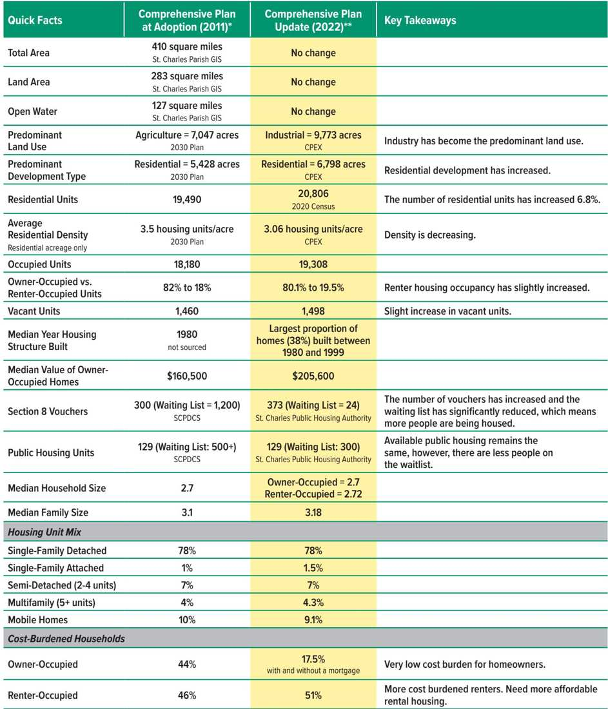

## Page 31

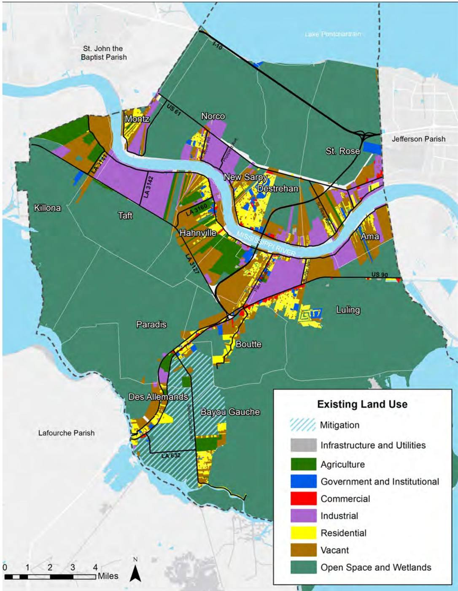

> **Figure description (visual reading, not stated in the plan's text):** Existing Land Use map (Update Figure LU-1). Legend, as printed: Mitigation (hatched), Infrastructure and Utilities, Agriculture, Government and Institutional, Commercial, Industrial, Residential, Vacant, Open Space and Wetlands. Communities labeled: Montz, Norco, St. Rose, New Sarpy, Destrehan, Killona, Taft, Hahnville, Ama, Paradis, Luling, Boutte, Des Allemands, Bayou Gauche; roads I-10, US 61, US 90, LA 3141, LA 3142, LA 3160, LA 3127, LA 632. Open Space and Wetlands covers most of the parish outside the river corridor; Industrial parcels lie along both banks of the river. Scale bar 0 to 4 miles.

## Page 32

#### Development Trends

New development in the parish is still geared toward single-family homes, although at a slower pace than the previous decade. Since 2010, according to the census, 7844 housing units have been constructed, compared to 2,500 between 2000 and 20105. Between 2016 and 2020, 673 new residential permits were issued, while just five were issued for multi-family residences. Additionally, 236 permits were issued for mobile homes, and 99 were issued for commercial, institutional, or industrial activity. Figure LU-2: Building Permits (next page) shows the locations where permits were issued.

In recent years, construction of new housing units created development-related pressures, such as increased traffic and flooding for residents, which was exacerbated by a series of significant rainfall events. As a result, in August 2020, the Parish enacted an 18-month moratorium on major subdivision development to allow for parishwide drainage studies to determine infrastructure capacity.

Population on the West Bank now accounts for 52 percent of the parish population, down from 55 percent in 2011 (50 percent in 2000). In 2020, approximately 129 acres on two sites on the East Bank were rezoned for potential residential subdivisions. The location of these new subdivisions may suggest less availability of vacant land and a slowing down of development on the West Bank.

Although new homes are being constructed, they are not meeting existing demand for all parish residents. Residential vacancies have increased since 2010 by 280 units, similar to the 300-unit vacancy increase between 2000 and 2010. These rates can suggest either newly built homes waiting for buyers or a softening of the market for homes in these price ranges, or homes left vacant from storm events and homes left vacant after industrial uses have purchased adjacent residential units for future buffer zones.

> **Text-layer supplement (text on this page that the layout parse did not capture; reading order approximate, taken from the PDF text layer):**
>
> 4 U.S. Census Bureau, 2020 ACS, 5-year estimates 5 St. Charles Parish 2030 Comprehensive Land Use Plan
>
> ST. C H A R L E S PA RISH C OMPREH ENS I V E PL A N UPDATE

## Page 33

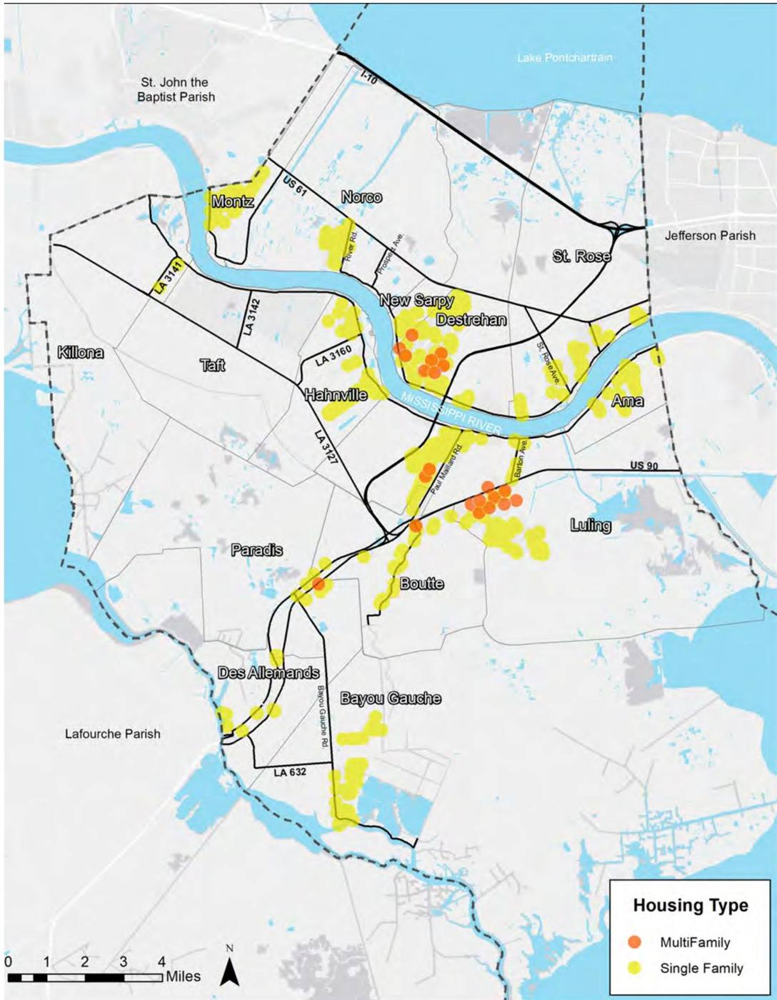

> **Figure description (visual reading, not stated in the plan's text):** Map captioned Figure LU-2 (Building Permits) showing dots by housing type; legend heading "Housing Type": MultiFamily (orange dots) and Single Family (yellow dots). Dots cluster around Montz, Norco, New Sarpy/Destrehan, St. Rose, Hahnville, Luling and Boutte and along Bayou Gauche Rd. Communities and roads are labeled as on the other Update base maps.

## Page 34

While Montz and St. Rose experienced the greatest population growth between 2000 and 2010 on the East Bank, Montz was the only community to continue this trajectory between 2010 and 2020. On the West Bank, only Luling and Bayou Gauche saw increases (Table LU-3). Luling particularly saw a high volume of development activity, with 536 new housing units being built since 2010, while 75 were built in Bayou Gauche.6

Multifamily housing has continued to be concentrated in Luling (11 units), Destrehan (8 units) and Boutte (1 unit), since 2010. As previously mentioned, the construction of multifamily housing significantly lags behind single-family homes, although the 2030 Comprehensive Plan underscored the importance of the Parish accommodating more multifamily housing as the population shift and preferences continue to favor it. As a step in the right direction however, the Parish has since reviewed its subdivision regulations to accommodate multiple housing types, including accessory dwelling units (ADUs) and garden homes.

The Parish has begun revitalization and reinvestment efforts for some of its older, declining communities. In 2014, the Parish developed the Paul Maillard Road (LA 52) Corridor Revitalization Plan, which seeks to restore Paul Maillard to a place of prominence. A Paul Maillard Road Community Development Corporation was incorporated in December 2015 and Parish staff are engaged with the New Orleans Regional Planning Commission as safety enhancements for the roadway are being designed.

> **Text-layer supplement (text on this page that the layout parse did not capture; reading order approximate, taken from the PDF text layer):**
>
> Railroad crossing along Paul Maillard Road.
>
> 6 St. Charles Parish Planning and Zoning
>
> ST. C H A R L E S PA RISH C OMPREH ENS I V E PL A N UPDATE

## Page 35

#### Projected Population and Demographics

State projections initially indicated that the parish would experience modest growth, adding between 5,000 and 10,000 new residents by 2030. However, the 2010 Census showed the parish’s growth was beginning to slow, falling short of projections for that year by 1,000 residents. Growth in the parish has continued to slow to the point of the parish losing population, with the 2020 Census count at 52,549, 231 residents less than in 2010. This is likely the combined result of natural disasters, industry buy-outs and declining household size. The New Orleans Regional Planning Commission estimates that over the next 20 years, the parish will modestly grow by 0.5 percent annually, which will add approximately 5,500 new residents by 2040.

**Table 7: Table LU-2: Population and Household Projections Sources: St. Charles 2030 Comprehensive Land Use Plan, U.S. Census Bureau, 2015 ACS and 2020 DEC Redistricting data (PL 94-171); New Orleans Regional Planning Commision; CPEX (household conversion)**

|  | Comprehensive Plan at Adoption (2011) |  | Comprehensive Plan Update (2022) |  |
|---|---|---|---|---|
| Year | Population | Households | Population | Households |
| 2000 | 48,072 | 16,422 | 48,072 | 16,422 |
| 2005 | 50,600 | 17,631 | 50,600 | 17,631 |
| 2010 | 52,780 | 18,739 | 52,780 | 18,460 |
| 2015 | 56,050 | 19,530 | 52,639 | 20,209 |
| 2020 | 57,930 | 20,185 | 52,549 | 20,806 |
| 2025 | 59,540 | 20,746 | 58,404 | 22,738 |
| 2040 | – | – | 58,060 | 23,224 |
Table snapshot (for checking): 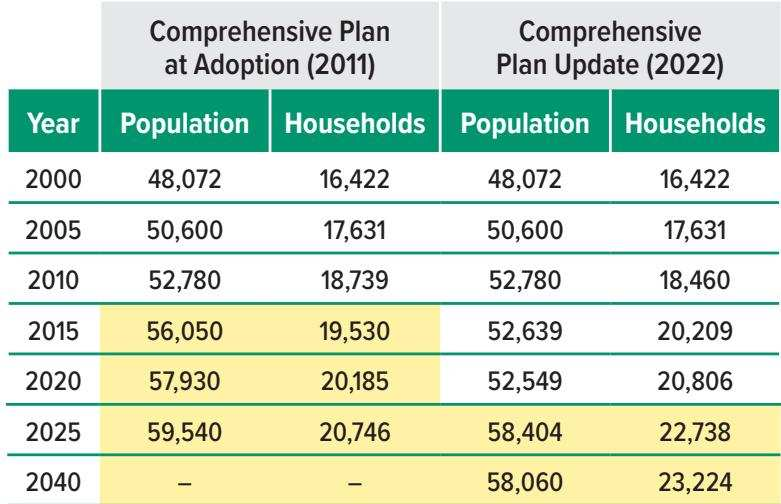

## Page 36

While the parish as a whole lost population since the 2010 Census, Bayou Gauche, Luling and Montz continued to grow (Table LU-3) with the latter two experiencing the most significant growth, largely due to development of new subdivisions.

Based on these trends and availability of land for development (Figure LU-3), it is likely that growth will continue in Luling and may slow in Bayou Gauche and Montz. However, other external factors such as industry buy-outs may affect these outcomes.

**Table 8: Table LU-3: Population Change by Community, 2010-2020**

| Community | 2010 Population | Change +/- since 2000 | % Change | 2020 Population | Change +/- since 2010 | % Change |
|---|---|---|---|---|---|---|
| Ama | 1,316 | +31 | +2% | 1,290 | -26 | -2% |
| Bayou Gauche | 2,071 | +301 | +17% | 2,161 | +90 | +4% |
| Boutte | 3,075 | +894 | +41% | 3,054 | -21 | -1% |
| Des Allemands | 2,505 | +5 | +<1% | 2,179 | -326 | -13% |
| Destrehan | 11,535 | +275 | +2% | 11,340 | -195 | -2% |
| Hahnville | 3,344 | +552 | +20% | 2,959 | -385 | -12% |
| Killona | 793 | -4 | -1% | 724 | -69 | -9% |
| Luling | 12,119 | +607 | +5% | 13,716 | +1,597 | +13% |
| Montz | 1,918 | +798 | +71% | 2,106 | +188 | +10% |
| New Sarpy | 1,464 | -104 | -7% | 1,169 | -295 | -20% |
| Norco | 3,074 | -523 | -14% | 2,984 | -90 | -3% |
| Paradis | 1,298 | +46 | +4% | 1,242 | -56 | -4% |
| St. Rose | 8,122 | +1,582 | +24% | 7,504 | -618 | -8% |
| Taft | 63 | +63 | + | 61 | -2 | -3% |
| Total | 48,156 | 52,780 | +10% | 52,549 | -231 | -0.4% |

_Source: Source: U.S. Census Bureau, 2010 and 2020 DEC Redistricting data (PL 94-171)_
Table snapshot (for checking): 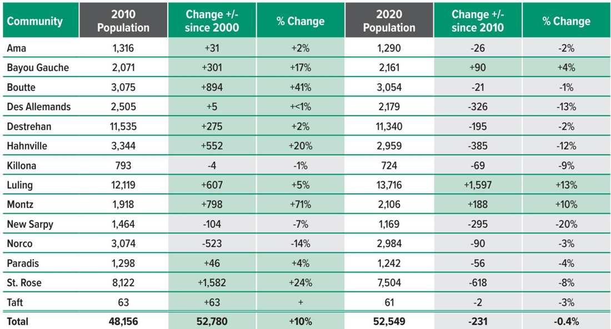

## Page 37

As noted in the previous Plan, shifting demographics within the parish will influence development patterns for housing demand and community amenities and services. The parish’s median age is now 387 (compared to 34 and 36 in 2000 and 2010 respectively), currently, 55 to 59 years is the largest age cohort and one in five residents is 60 years and over. Additionally, household sizes are continuing to get smaller, dropping to 2.7 from 2.81\* in 2010.

Stakeholder and public input indicated that residents would like to see more mid-to-large lot residential and smaller, compact housing with low yard maintenance to meet residents’ desires to remain in St. Charles Parish as they age and to provide housing affordable to young professionals just starting out. More mixed-use and main street commercial activity were also noted as types of development residents would like to see.

> **Text-layer supplement (text on this page that the layout parse did not capture; reading order approximate, taken from the PDF text layer):**
>
> Source: U.S. Census Bureau, 2020 ACS 5-year estimates
>
> Source: State of Louisiana Projections (low series growth projections)
>
> 7 U.S. Census Bureau, 2020 ACS, 5-year estimates * Note: While the previous Plan states average household size as 2.7 using data from the 2005-2009 ACS, the 2010 U.S. Census lists household size for the parish as 2.81.
>
> ST. C H A R L E S PA RISH C OMPREH ENS I V E PL A N UPDATE

## Page 38

#### Existing Development Capacity and Future Land Demand

Using population projections from the New Orleans RPC, the new population would require around 500 acres to be developed for residential use at average residential densities. The parish has approximately 7,894 acres of land that is either classified as vacant or agricultural in current use, which encompass 6,570 vacant parcels. (See Figure LU-5, next page.) The table below estimates the capacity of this vacant land by by potential residential, commercial and industrial land uses.

#### Existing Zoning Capacity

Existing zoning shows how land is currently zoned, and the type of development currently allowed. Figure LU-6 (page 39) shows the current zoning, with the large majority of the land in open land or wetlands. The 21,772 acres are currently zoned for residential (8,876 acres/40.8% ), commercial (3,212 acres/1.7%) and manufacturing (9,684 acres/44.5%).

**Table 9: Table LU-4: Summary of Buildable Land Capacity and Needs**

|  | Comprehensive Plan at Adoption (2011) | Comprehensive Plan Update (2022) |
|---|---|---|
| Total Net Developable Land (acres) | 16,978 | 9,591 |
| Residential (includes mixed-use) |  |  |
| Net Developable Acres | 7,017 | 1,646 |
| Residential Units | 34,455 | 8,082 |
| Commercial |  |  |
| Net Developable Acres | 2,422 | 1,755 |
| Net Developable Square Feet | 27,590,219 | 19,992 |
| Industrial |  |  |
| Net Developable Acres | 8,613 | 3,113 |
| Net Developable Square Feet | 22,760,143 | 8,226,207 |
| Projected Growth |  |  |
| Projected Population (by 2030 and 2040 respectively) | 60,580 | 58,060 |
| Additional Residents | 8,000 | 5,511 |
| Average Household Size | 2.8* | 2.7** |
| New Residential Units Needed (by 2030 and 2040 respectively) | 2,857 | 2,041 |
| Land Needs |  |  |
| Additional Residential Acres Needed (at current average zoned densities) | 400-950 | 300-750 |
| Additional Non Residential Acres Needed (at current average FAR densities) | 300-400 | 300-400 |

_Source: CPEX, \*ACS 2005-2009, \*\*2020 Census_

Table snapshot (for checking): 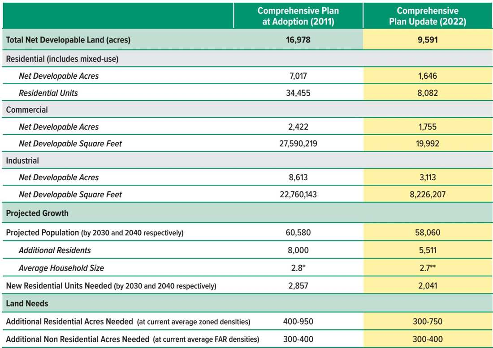

## Page 39

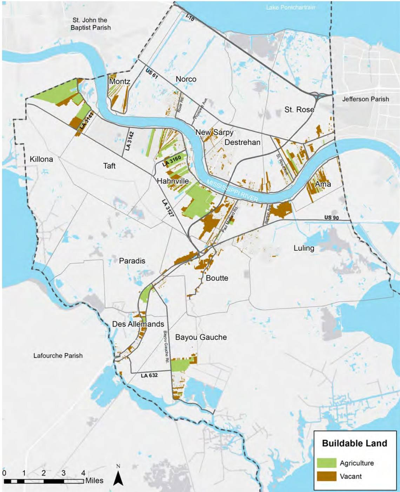

> **Figure description (visual reading, not stated in the plan's text):** Map captioned Figure LU-5 (Land Available for Development); legend heading "Buildable Land": Agriculture (light green) and Vacant (brown). Parcels appear mainly along the river corridor between Killona and Ama and along the US 90 and Bayou Gauche corridors. Communities and roads are labeled as on the other Update base maps.

> **Text-layer supplement (text on this page that the layout parse did not capture; reading order approximate, taken from the PDF text layer):**
>
> Source: CPEX, November 3, 2022
>
> This map shows land that can accommodate new development–and is currently vacant or in agricultural use. Wetlands, water and other constrained land that is not developable is excluded.
>
> ST. C H A R L E S PA RISH C OMPREH ENS I V E PL A N UPDATE

## Page 40

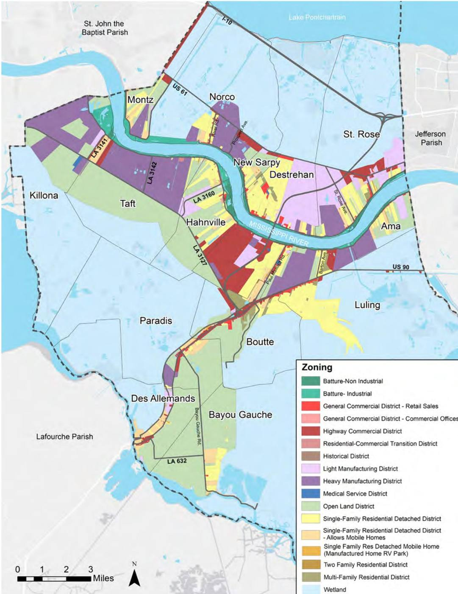

> **Figure description (visual reading, not stated in the plan's text):** Existing Zoning map (Update Figure LU-6), source line "St. Charles Parish Planning and Zoning, November 3, 2022". Legend heading "Zoning", as printed: Batture-Non Industrial, Batture-Industrial, General Commercial District - Retail Sales, General Commercial District - Commercial Offices, Highway Commercial District, Residential-Commercial Transition District, Historical District, Light Manufacturing District, Heavy Manufacturing District, Medical Service District, Open Land District, Single-Family Residential Detached District, Single-Family Residential Detached District - Allows Mobile Homes, Single Family Res Detached Mobile Home (Manufactured Home RV Park), Two Family Residential District, Multi-Family Residential District, Wetland. The legend runs to the bottom edge of the image and the Commercial Offices entry is cut off at the right edge. Communities labeled: Montz, Norco, St. Rose, Killona, Taft, New Sarpy, Destrehan, Hahnville, Ama, Paradis, Luling, Boutte, Des Allemands, Bayou Gauche.

## Page 41

#### Future Land Use

The 2030 Comprehensive Plan Update Future Land Use Map takes into consideration zoning and development changes since 2010, as well as reduced population projections. In addition, the land use categories have been streamlined, and policy recommendations have been incorporated in applying the future land use categories.

#### Future Land Use Categories

Land uses identified on the Future Land Use Map fall into three categories: residential, employment, and buffers, wetlands and open space. Zoning districts compatible with each land use are also provided.

**Table 10: Table LU-5: Residential Future Land Use Descriptions and Recommended Zoning Districts**

| Category | Description | Recommended Zoning Districts |
|---|---|---|
| Rural Residential | Low-density large lot residential development and agricultural land. The rural residential land use is the least intensive in terms of density and is intended to help preserve the Parish's rural character. Neighborhood retail, services, offices and institutions are also permitted in appropriate locations such as along transportation corridors or at intersections. (less than one dwelling unit per acre) | • O-L (open land) • CR-1 (residential/commercial transitional) |
| Low-to- Moderate Residential | Single-family detached dwellings; attached dwellings such as duplexes, patio/zero-lot line homes and townhomes; and accessory units. Neighborhood retail, services, offices and institutions are also permitted in appropriate locations such as along transportation corridors or at intersections. (over six dwellings per acre) | • R-1A (6,000 sf min. lot size) • R-1B (10,000 sf min. lot size) • R-1AM (accessory units and individual mobile homes) |
| High-Density Residential | Appropriately located semi-attached and attached multifamily dwelling units, townhomes, duplexes and small lot detached houses. Neighborhood retail, services, offices and institutions are also permitted in appropriate locations such as along transportation corridors or at intersections. | • R-2 (two-family residential district) • R-3 (multi-family residential district) • C-1 (commercial office) • R-1M (single-family residential detached mobile home/manufactured home/ recreational vehicle park) |
| Neighborhood Mixed Use | This category applies in areas appropriate for mixed walkable developments where the predominant use is residential, with a variety of housing types at varying densities, as well as compatible, local-serving commercial, retail, office and service uses. | Create a new mixed-use district consistent with the Paul Mallard overlay recommendations. |

Table snapshot (for checking): 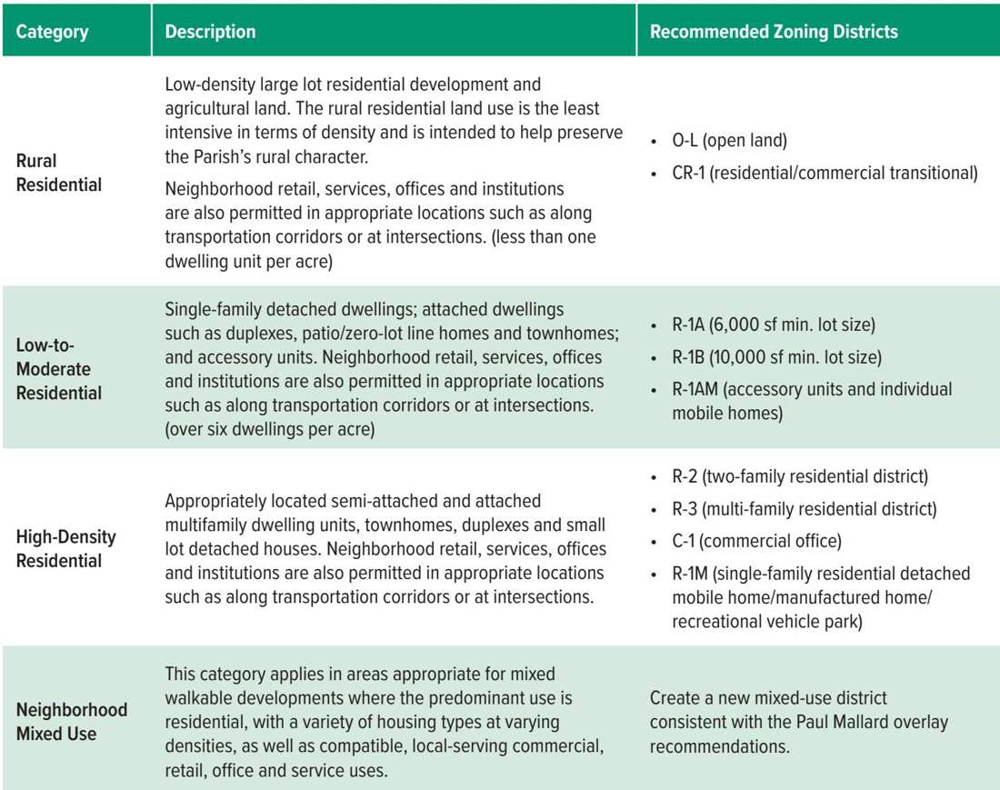

## Page 42

> **Figure description (visual reading, not stated in the plan's text):** Update Figure LU-8, the Future Land Use map. Map of the whole parish titled by the legend heading "Future Land Uses"; source line "St. Charles Parish/CPEX May 2022". Legend, as printed (12 categories): Low-Moderate Residential, Residential High, Residential Rural, Heavy Industrial, Industrial, Industrial Buffer, Commercial, Neighborhood Mixed Use, Town Center, Business Park, Recreation/Open Space, Wetlands. Communities labeled on the map: Montz, Norco, St. Rose, Killona, Taft, New Sarpy, Destrehan, Ama, Hahnville, Paradis, Luling, Boutte, Des Allemands, Bayou Gauche; a Des Allemands Boat Launch call-out; neighboring St. John the Baptist, Jefferson and Lafourche parishes; Lake Pontchartrain; the Mississippi River; roads I-10, I-310, US 61, US 90, LA 3141, LA 3142, LA 3160, LA 3127, LA 632. This is the current map (see STATUS.md). Read a parcel's category from the zoom insets on Update pp. 47-50 or from the parish GIS layer, not from this overview.

> **Text-layer supplement (text on this page that the layout parse did not capture; reading order approximate, taken from the PDF text layer):**
>
> Mis siss ippi R iver
>
> ST. C H A R L E S PA RISH C OMPREH ENS I V E PL A N UPDATE
>
> * For illustration purposes only.

## Page 43

**Table 11: Table LU-6: Employment Future Land Use Descriptions and Recommended Zoning Districts**

| Category | Description | Recommended Zoning Districts |
|---|---|---|
| Commercial | This category includes single-use commercial, retail, office and service uses. Commercial areas should seek to strengthen existing retail and service uses, encourage the introduction of new uses, and introduce complementary adjoining uses such as public facilities and moderate-density residential, to reinforce the retail base and support the continued health of these uses. Commercial uses must be consistent with the surrounding area and compatible with adjacent uses. | CR-1 (residential/commercial transitional) • C-1 (commercial office) zoning • C-2 (general commercial retail) • C-3 (highway commercial) • MS (medical service) • B-1 (batture, non-industrial) |
| Town Center | Mixed-use development concentrated around employment uses. Uses include retail, office, services, restaurants, and residential. The town centers are envisioned as walkable districts and are anticipated to range in scale and density. The highest density uses and activity would take place near high access major corridors. | Mix of... • R-2 (two-family residential) • R-3 (multi-family residential) • CR-1 (residential/commercial transitional) • C-1 (general commercial office) • C-2 (general commercial retail) |
| Business Park | This category provides for the development of planned business, office, technology, warehouse and research activities, as well as related ancillary uses, such as shipping offices, office supply, services, hotels and restaurants. Business parks should incorporate design standards such as screening, landscaping and site location criteria. | Create a new zoning district that allows some M-1 uses, and C-1, C-2 and C-3 uses with development standards. |
| Industrial | This designation includes uses such as warehouse and distribution activities, as well as office uses, repair facilities, light assembly and light manufacturing activities that do not involve emissions of odors, dust, fumes or excessive noise. | M-1 (light manufacturing and industrial) Batture (industrial) |
| Heavy Industrial | This land use category includes large heavy manufacturing, such as oil refineries, petrochemical plants and other uses with similar impacts such as noise, dust, odors or fumes and related safety and health factors. Buffering is recommended to help screen and transition between surrounding residential and mixed-use areas and industrial areas. | • M-2 (heavy manufacturing) • M-3 (heavy manufacturing) |

Table snapshot (for checking): 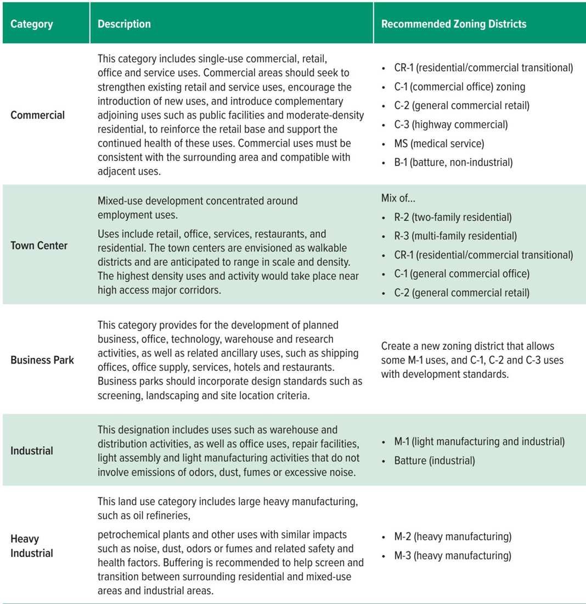

## Page 44

**Table 12: Table LU-7: Buffers, Wetlands and Open Space Future Land Use Descriptions and Recommended Zoning Districts**

| Category | Description | Recommended Zoning Districts |
|---|---|---|
| Industrial Buffer | Private or public land separating heavy industry from residential uses. This land should be used for parks, trails, and institutional and public uses. Neighborhood retail, services, and offices are also permitted in appropriate locations when compatible with adjacent uses. | • CR-1 (residential/commercial transitional) • C-1 (commercial office) • C-2 (general commercial retail) • MS (medical service) |
| Recreation and Open Space | Large parks, protected public natural and recreational resources and private recreational facilities (such as golf courses and shooting ranges). | • O-L (open land) |
| Wetlands | Constrained lands due to wetlands and flood zones. Allowable land uses in areas designated as wetlands are limited to low impact uses, such as eco-tourism and recreation (e.g., boating, hiking, hunting, fishing), wildlife observation, environmental education, environmental research, compatible agriculture (e.g., periodic haying and grazing), managed timber harvest, and other uses that may be permitted by special exception or special permit by the Louisiana Department of Natural Resources, the U.S. Army Corps of Engineers or the St. Charles Parish Coastal Zone Advisory Council. | • W (wetland district) |

Table snapshot (for checking): 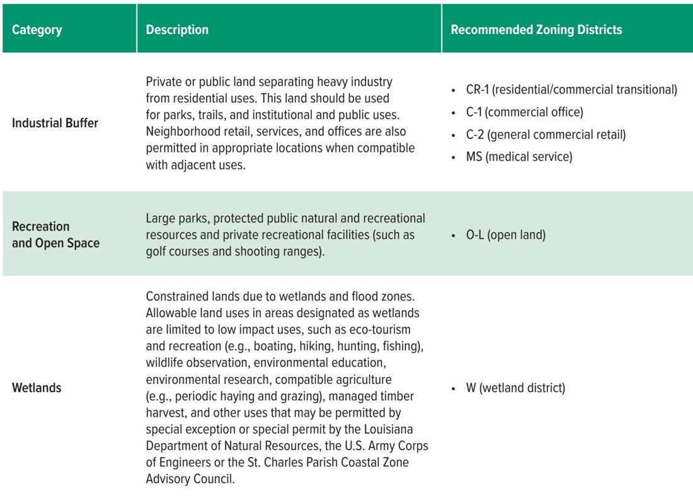

## Page 45

This section compares how existing land use, current zoning and the Future Land Use Map impact elements of future growth, including future land needs, future housing options, and employment opportunities. Analyzing these potential impacts helps to inform decision-makers how current zoning supports desired land uses and what additional adjustments might be required to achieve greater consistency with the policies of the Plan.

#### Future Land Use Analysis

Overall, zoning ordinance revisions (along with other land use policies and programs implemented) in the last 10 years have helped the Parish make strides toward protecting more sensitive lands, promoting the economy, and supporting more pedestrian and bike-friendly transportation facilities. And for the most part, existing zoning represents a close alignment to the Future Land Use Map.

> **Text-layer supplement (text on this page that the layout parse did not capture; reading order approximate, taken from the PDF text layer):**
>
> Impervious Surface (Acres) 15,000 10,000 5,000 -
>
> Mobile/Manufactured Homes
>
> ST. C H A R L E S PA RISH C OMPREH ENS I V E PL A N UPDATE

## Page 46

#### ANALYSIS HIGHLIGHTS

The updated Future Land Use map indicates a few additional refinements that could be made.

» The Future Land Use Map accommodates substantially more population and employment than existing zoning.

» Current zoning allows more mixed-use development, while the Future Land Use Map strikes a balance with current land use and emphasizes other employment opportunities apart from retail.

» The Future Land Use Map allows for the most diverse housing stock, accommodating more townhome/duplex and multi-familly development100% than both existing zoning and current land use.

» Both current zoning and the Future Land Use Map concentrate the majority of new housing and employment on the westbank.

» New growth under current zoning requires a40% similar amount of land and impervious surface as the Future Land Use Map—both greatly20% reduce current developable acres.

> **Text-layer supplement (text on this page that the layout parse did not capture; reading order approximate, taken from the PDF text layer):**
>
> New Employment Only Exiting
>
> ST. C H A R L E S PA RISH C OMPREH ENS I V E PL A N UPDATE

## Page 47

#### Montz Future Land Use

Montz has a 2020 population of 2,106, an increase of 10 percent over the past 10 years. Montz land uses include a mix of residential as well as a neighborhood mixeduse center along River Road. The Entergy St. Charles Power Station is surrounded by industrial buffers on industrial-owned as well as privately owned land. The industrial buffer allows for existing development but discourages future residential uses in proximity to heavy industrial uses.

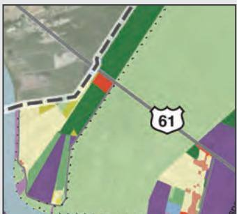

> **Figure description (visual reading, not stated in the plan's text):** Zoom inset of the 2022 Future Land Use Map (Update Figure LU-8). It has no legend of its own; its fill colors are those of the Figure LU-8 legend and are not keyed here. Labels printed in the inset: a US 61 shield; the parish boundary as a dashed line on the upper left; the river on the left edge.

#### Norco Future Land Use

Norco has a 2020 population of 2,984, a three percent decrease from the 2010 population. Norco land uses include a mix of residential as well commercial along Airline Highway and River Road and mixed-use within the existing residential neighborhoods. Industrial uses include Hexicon Chemicals, WR Grace & Company, Shell Norco, and Norco Refining company, as well as several support businesses. Industrial buffers are provided adjacent to some industrial areas. Neighborhood nodes provide for existing active commercial sites to encourage increased daily activity such as restaurants and small offices with residents living close to jobs. Development patterns are intended to make the river accessible to residents.

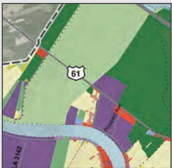

> **Figure description (visual reading, not stated in the plan's text):** Zoom inset of the 2022 Future Land Use Map (Update Figure LU-8). It has no legend of its own; its fill colors are those of the Figure LU-8 legend and are not keyed here. Labels printed in the inset: US 61, Prospect Ave., LA 3142, Mississippi River.

#### New Sarpy Future Land Use

New Sarpy, with a 2020 population of 1,169, experienced a 20 percent reduction. The community is oriented toward the Mississippi River with new mixed-use neighborhoods ofering community-serving retail and services. Allowing for slightly higher densities close to these mixed-use areas will increase population to support local businesses. Commercial land and a business park along Airline Highway connect New Sarpy to the wider region.

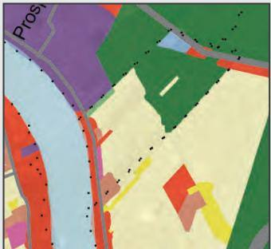

> **Figure description (visual reading, not stated in the plan's text):** Zoom inset of the 2022 Future Land Use Map (Update Figure LU-8). It has no legend of its own; its fill colors are those of the Figure LU-8 legend and are not keyed here. Labels printed in the inset: a partly cut-off "Prosp[ect]" street label; Mississippi River; a dotted levee-type line along the river.

#### Destrehan Future Land Use

Destrehan has a 2020 population of 11,340, a two percent decrease from 2010. Several public and private school sites are located within the residential areas, and commercial and industrial uses (including Valero-St. Charles and ADM-Destrehan) are located along the river frontage. Town center development along I-310 will provide higher density housing and easily accessible commercial, retail and services.

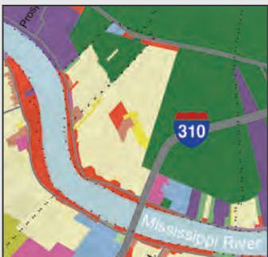

> **Figure description (visual reading, not stated in the plan's text):** Zoom inset of the 2022 Future Land Use Map (Update Figure LU-8). It has no legend of its own; its fill colors are those of the Figure LU-8 legend and are not keyed here. Labels printed in the inset: an I-310 shield; Mississippi River.

## Page 48

#### St. Rose Future Land Use

St. Rose had a population of 7,504 in 2020, a 7.6 percent decrease. Future land uses include residential development east of St. Rose Avenue and north of the railroad tracks. Some of this area is in wetlands or in agricultural uses. Light industrial and business park uses are located in the eastern part of the community with land available for commercial use such as hotels and community services. An International Matex tank terminal facility is located along River Road.

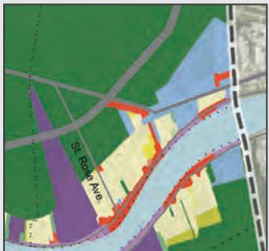

> **Figure description (visual reading, not stated in the plan's text):** Zoom inset of the 2022 Future Land Use Map (Update Figure LU-8). It has no legend of its own; its fill colors are those of the Figure LU-8 legend and are not keyed here. Labels printed in the inset: St. Rose Ave.; the parish boundary as a dashed line on the right; the river.

#### Killona Future Land Use

Killona, with a 2020 population of 724 experienced a 8.7 percent decrease between 2010 and 2020. Currently primarily in agricultural use, with two available industrial sites, including the St. Charles Intermodal and Glendale Hymelia, Killona is anticipated to be primarily heavy industrial with some commercial and institutional land in the future. The elementary school is being demolished by the school district. Residential uses in Killona are buffered by industrial buffers, institutional and commercial uses, and wetlands.

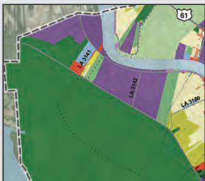

> **Figure description (visual reading, not stated in the plan's text):** Zoom inset of the 2022 Future Land Use Map (Update Figure LU-8). It has no legend of its own; its fill colors are those of the Figure LU-8 legend and are not keyed here. Labels printed in the inset: LA 3141, LA 3142, a US 61 shield; the parish boundary as a dashed line on the left; the river.

#### Taft Future Land Use

With a 2020 population of 61 people in one neighborhood area in the eastern portion of the parish, Taft is primarily industrial (Entergy Waterford, Occidental Chemical, Chemtura Corporation, Dow St. Charles, and Galata Chemicals) with buffers protecting adjacent uses. Residential densities are higher along river road, and decrease in density to the south. A limited amount of commercial development is found along River Road.

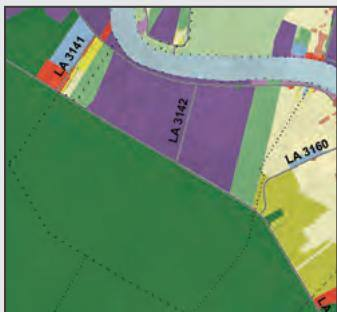

> **Figure description (visual reading, not stated in the plan's text):** Zoom inset of the 2022 Future Land Use Map (Update Figure LU-8). It has no legend of its own; its fill colors are those of the Figure LU-8 legend and are not keyed here. Labels printed in the inset: LA 3141, LA 3142, LA 3160.

#### Hahnville Future Land Use

With a population of 2,959 in 2020, Hahnville experienced a 11.5 percent decrease between 2010 and 2020. Hahanville’s town center is centered around the Courthouse, Parish offices, and other public agencies, and is adjacent to singlefamily homes, higher density residential, and townhouses. Infill housing in this area will create additional population to support desired commercial and service uses. Industrial uses include Arkema and the SoLaPort Railyard. Available industrial areas include the Pelican-Occidental industrial site and the SoLaPort area.

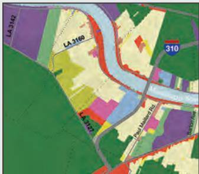

> **Figure description (visual reading, not stated in the plan's text):** Zoom inset of the 2022 Future Land Use Map (Update Figure LU-8). It has no legend of its own; its fill colors are those of the Figure LU-8 legend and are not keyed here. Labels printed in the inset: LA 3142, LA 3160, an I-310 shield, LA 3127, Paul Maillard Rd. and Barton Ave. (partly cut off), Mississippi River.

## Page 49

#### Luling Future Land Use

Luling’s 2020 population was 13,716, a 13 percent increase from 2010’s population. Luling has a wide variety of land uses, and includes Paul Mallard Road as a walkable mixed-use corridor and a town center centered around the school and hospital. Luling has several Main Street areas that could be enhanced to attract retail and restaurants to serve adjacent neighborhoods. The Esperanza site has the potential to combine employment and residential uses in a walkable area, with a Town Center connecting business park uses with adjacent residential. Monsanto is located on a large tract surrounded by industrial buffers. Extension of the Judge Edward Dufresne parkway will give access to future retail, offices and business park uses.

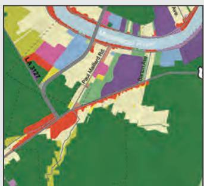

> **Figure description (visual reading, not stated in the plan's text):** Zoom inset of the 2022 Future Land Use Map (Update Figure LU-8). It has no legend of its own; its fill colors are those of the Figure LU-8 legend and are not keyed here. Labels printed in the inset: LA 3127, Paul Maillard Rd., Barton Ave., Mississippi River.

#### Boutte Future Land Use

With a 2020 population of 3,054, Boutte population slightly decreased by 0.7 percent. A regional commercial hub is emerging at the intersection of Interstate 310 and US 90. As new commercial development occurs care should be given to protecting adjacent wetlands.

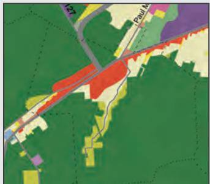

> **Figure description (visual reading, not stated in the plan's text):** Zoom inset of the 2022 Future Land Use Map (Update Figure LU-8). It has no legend of its own; its fill colors are those of the Figure LU-8 legend and are not keyed here. Labels printed in the inset: a partly cut-off "Paul M[aillard]" label and "127"; the US 90 corridor runs diagonally across the inset.

#### Ama Future Land Use

With a 2020 population of 1,290, Ama experienced a two percent decrease between 2010 and 2020. A commercial center located along River Road will serve the local community and will grow as higher density housing is located around the commercial uses. Rural housing with larger lots continues closer to the wetlands, south of Ama. ADM–Ama is located on River Road. This site has availability for additional light industrial, warehousing and small manufacturing plants within a business park environment.

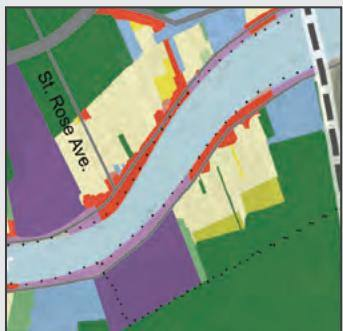

> **Figure description (visual reading, not stated in the plan's text):** Zoom inset of the 2022 Future Land Use Map (Update Figure LU-8). It has no legend of its own; its fill colors are those of the Figure LU-8 legend and are not keyed here. Labels printed in the inset: St. Rose Ave.; the parish boundary as a dashed line on the right; Mississippi River.

## Page 50

#### Paradis Future Land Use

Paradis’ 2020 population was 1,242, a 4.3 percent decrease from 2010. Centered around US 90, the community has commercial uses along the highway frontage with adjacent residential. The entire area is surrounded by wetlands. Over the long term, as a new interstate is, mixed-use development should be oriented toward major roadways and support adjacent residential uses.

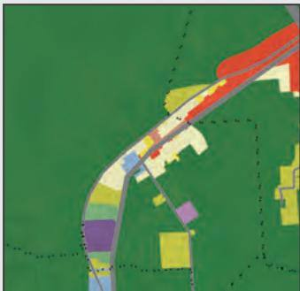

> **Figure description (visual reading, not stated in the plan's text):** Zoom inset of the 2022 Future Land Use Map (Update Figure LU-8). It has no legend of its own; its fill colors are those of the Figure LU-8 legend and are not keyed here. Labels printed in the inset: no text labels; the US 90 corridor runs diagonally.

#### Des Allemands Future Land Use

Des Allemands had a 2020 population of 2,179, a 13 percent decrease from 2010. Focusing mixed-use development along Bayou Des Allemands and around the U.S. Postal Service and other existing nearby services will create a revitalized waterfront area. Residential development is slightly more dense in the area between Old Spanish Trail and US 90. New low-density attached apartments and townhomes, as well as detached family homes on smaller lots, will support adjacent jobs, retail and services.

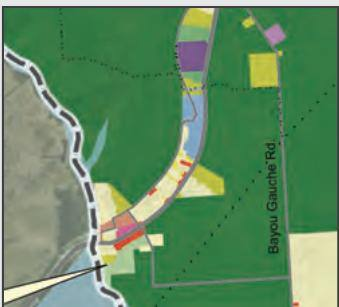

> **Figure description (visual reading, not stated in the plan's text):** Zoom inset of the 2022 Future Land Use Map (Update Figure LU-8). It has no legend of its own; its fill colors are those of the Figure LU-8 legend and are not keyed here. Labels printed in the inset: Bayou Gauche Rd.; the parish boundary as a dashed line on the left; a call-out pointer at lower left with no readable text.

#### Bayou Gauche Future Land Use

With 2,161 people Bayou Gauche saw a 4.3 percent population increase. This area will remain a residential neighborhood with a mix of housing and limited supporting services.

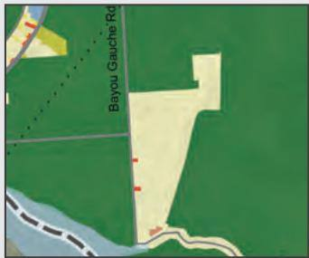

> **Figure description (visual reading, not stated in the plan's text):** Zoom inset of the 2022 Future Land Use Map (Update Figure LU-8). It has no legend of its own; its fill colors are those of the Figure LU-8 legend and are not keyed here. Labels printed in the inset: Bayou Gauche Rd.; the parish boundary as a dashed line and open water at lower left.

## Page 51

#### Sustainable Growth Desired Outcomes

» Plan our limited developable land area for optimum land use balance, providing for healthy economic diversification and improving quality of life with an array of housing types, commercial activities and civic uses.

» Re-tool zoning and development standards to raise the bar of quality, while removing impediments to sound growth through greater flexibility and consistent enforcement with:

• A wider variety of housing choices

• Neighborhood livability, walkability and roadway connectedness

• Open space and greenway corridor retention

• Accommodating civic activities, neighborhood commercial uses and recreation

• Compatibility with historic character and context

• Safe access management » Plan for the commercial and employment opportunities that will be created by new Interstate 49 (I-49) interchanges in a careful, appropriate manner, while mitigating potential negative impacts to existing business along US Highway 90 (US 90).

» Encourage reinvestment and revitalization of abandoned and neglected properties through a variety of regulatory tools and incentives.

» Expand resources for affordable and subsidized housing throughout targeted areas of the parish.

> **Text-layer supplement (text on this page that the layout parse did not capture; reading order approximate, taken from the PDF text layer):**
>
> Credit: Sizeler Thompson Brown Architects
>
> Edward Dufresne Community Center
>
> ST. C H A R L E S PA RISH C OMPREH ENS I V E PL A N UPDATE

## Page 52

### Goals for Land Use, and Housing and Community Character

1. Provide for an orderly and cost-effective redevelopment and growth pattern.

2. Minimize incompatibilities between different types of uses.

3. Enhance community livability, historical value, appearance and visual character.

4. Provide a diversity of well-designed, affordable, safe, and sanitary housing choices to serve all residents of the parish.

5. Recognize and respect the sense of place, history, and identity of established communities and neighborhoods.

6. Protect and maintain rural character.

7. Reduce development vulnerability to storms and other disasters.

#### Priority Actions

Stakeholders identified the following priority actions that work to achieve the Land Use and Housing and Community Character goals and should be completed as soon as possible.

1. Use the Comprehensive Plan policies and the Future Land Use Map to evaluate zoning changes and development requests.

2. Update the zoning ordinance to implement the St. Charles Parish Comprehensive Plan and the Future Land Use Map:

• Consolidate zoning districts.

Create a new Mixed Use zoning district to promote quality, walkable town centers and mixed-use development.

• Require mixed-use and town center development to install walkable features such as street trees, wider sidewalks, pedestrian lighting and other amenities.

Adopt development standards to address landscaping, access management, and siting for new development along the US 90 corridor.

• Review commercial and nonresidential aesthetic standards to improve facades and the view from the street.

• Include incentives for permeable surfaces.

3. Support opportunities for on-farm energy production techniques (e.g., methane, wind, solar, and other forms of power) as a way to enhance economic viability.

4. Remove inadvertent impediments to sustainable development, such as existing restrictions on uses or development standards, that may prevent the use of renewable energy production technologies. Review regulations that allow or encourage excessive impervious coverage.

5. Promote mixing of various types of housing (e.g., single-family detached and attached homes) in mixed-residential developments (consistent with the Future Land Use Map).

6. Prioritize creating a connected street network when reviewing development plans.

## Page 53

### Updated Policy Recommendations and Implementation Strategies

This section provides a summary of completed and updated actions for Land Use, Housing and Community Character. The implementation matrix in the Implementation Framework chapter provides a complete update of all plan actions with responsibility, status and recommended timeframe.

#### Updated Land Use Actions

The following priority, ongoing, mid-term and long-term land use actions are organized into four groups: LU 1, LU 2, LU 3 and LU 4. Recommended timing and lead agencies for each action are provided in the Implementation Framework.

LU 1 Using the Future Land Use Map and corresponding land use categories as a guide, amend the Parish’s regulatory tools as necessary to provide for the range of residential, business, industrial, and community-serving mixed uses needed to meet residents’ present and future needs.

LU 1.1 Prepare area plans for mixed-use and town center areas. (updated)

LU 1.2 Update the zoning ordinance to implement the comprehensive plan and the Future Land Use Map. (updated and consolidated from LU 1.2, 1.3, 1.4, 1.5, 1.6)

• Consolidate zoning districts and review uses permitted in districts to bring the use list up-todate; incorporate use charts and development standard tables for ease of use.

#### Organizing Groups for Land Use Recommendations

LU 1 Using the Future Land Use Map and corresponding land use categories as a guide, amend the Parish’s regulatory tools as necessary to provide for the range of residential, business, industrial, and community-serving mixed uses needed to meet residents’ present and future needs.

LU 2 Preserve productive farmland and promote economically viable and compatible agricultural uses in the parish.

LU 3 Continue to improve the user-friendliness and consistency in application of the Parish’s land development regulations and review and approval procedures for applicants, citizens, and staff.

LU 4 Reduce the overall environmental impact of buildings and encourage more hazardresilient development.

## Page 54

LU 1.1 Create Regional Activity Center, Mixed Use Corridor, and Civic/Town Center Overlay Zoning Districts.

✓ Approved Paul Maillard Road Overlay District.

✓ Identified tools needed to achieve walkable, sustainable development.

LU 1.2 Review and broaden the existing R-1A, R-1B, R-2 and R-3 (residential) districts to accommodate multiple housing types, as may be appropriate.

✓ Updated the subdivision ordinance to allow a broader range of housing types.

✓ Amended ordinances to allow accessory dwelling units and home occupations.

✓ Amended ordinances to allow garden homes, higher densities and clustering, and open space requirements.

LU 1.8 Monitor the levels of development according to land use type, to periodically adjust estimates of future land demand and amend the Future Land Use Map as appropriate.

✓ Converted the Parish zoning maps, regulations and land use data to digital format to monitor the levels of development according to land use type.

✓ Completed existing land use map.

✓ Analysis of development by land use type ongoing.

LU 1.9 Prepare, adopt, and implement a capital improvement program to coordinate the expansion of infrastructure, facilities, and services with the occurrence of new development, or to upgrade capacity concurrent with redevelopment.

✓ Capital improvement program developed and adopted. Process for regular updates established.

LU 1.10 Ensure consistency of plans, land divisions, rezonings or development proposals with the intent of the Future Land Use Map or the Comprehensive Plan’s policies.

✓ Have institutionalized the review and reporting of plans, land divisions, rezonings, and development proposals to ensure consistency with the Comprehensive Plan’s policies.

LU 2.4 Promote and facilitate the establishment of agri-tourism, community supported agriculture (CSAs), farm stands and farm markets, greenhouse operations, equine operations, and accessory farm businesses. Support the development of agricultural management practices for these activities, as needed, to reduce Right-to-Farm conflicts and incompatibilities.

✓ Provided numerous locations for the German Coast Farmers Market throughout the parish.

✓ Allowed roadside vending of locally grown, seasonal produce, with a safe site design on private property.

✓ Implemented a food truck ordinance.

LU 3.2 Increase the transparency, predictability and consistency of the development approval process.

✓ Digitally converted zoning maps, ordinances, and plans and currently maintains an online library to provide transparent access to the public.

✓ Permitting is now available through an online portal, as long as a pre-application meeting is not required.

✓ There have been numerous and ongoing revisions to the zoning ordinance, as well as continuous changes to internal policies to implement this item

✓ Encouraged and in some cases required preapplication meetings to assist applicants in obtaining efficient review.

Continued on the next page… • Create a new mixed-use zoning district to promote quality walkable town centers and mixed-use development.

## Page 55

• Promote mixing of various types of housing (e.g., single-family detached and attached homes) in mixed-residential developments (consistent with the Future Land Use Map).

• Require mixed-use and town center development to install walkable features such as street trees, wider sidewalks, pedestrian lighting and other amenities.

• Incorporate lighting standards.

Review commercial and nonresidential aesthetic standards to improve facades and the view from the street.

• Include incentives for permeable surfaces.

LU 1.11 Continue to use the policies and the Future Land Use Map in the Comprehensive Plan to evaluate zoning changes and development requests. Include this analysis in all reporting associated with development requests to the Planning and Zoning Commission and Council. (new)

LU 1.12 Adopt administrative guidance to be used in evaluating how requests comply with the adopted Plan. See the Rezoning and Development Decision Policy Guidance section on page 44-45. (new)

LU 1.13 As small area plans are adopted, consider revising zoning to accommodate future land use recommendations in those areas. (PMLU2) (new)

LU 1.14 Adopt development standards to address landscaping, access management building siting for new development adjacent to US 90. (new)

Continued from previous page…

LU 3.3 Adopt regulatory incentives to attract and retain small/locally owned business.

Amended ordinances to make it easier to open home occupations with application through the Planning and Zoning Dept.

Eliminated regulatory hurdles, permitting many home occupations to be reviewed and permitted administratively.

LU 4.2 Remove or adjust inadvertent impediments to sustainable development (e.g. existing restrictions on uses, or dimensional standards) that may prevent the use of renewable energy production technologies; or regulations that allow or encourage excessive impervious coverage.

Reviewed and updated ordinances to enhance the building code and increase the security and safety of buildings in the parish.

LU 4.4 Encourage maximum protection of wetlands in all development.

Obtained a Building Code Effectiveness Grading Schedule to assess the Parish’s building codes, enforcement, and measures to mitigate losses from natural hazards.

✓ Completed the coastal master plan and continue to provide ongoing implementation and monitoring.

✓ Worked to improve the Parish’s Community Rating System to reduce flood impacts and flood insurance costs.

> **Text-layer supplement (text on this page that the layout parse did not capture; reading order approximate, taken from the PDF text layer):**
>
> • Create a new mixed-use zoning district to

## Page 56

#### LU 2 Preserve productive farmland and promote economically viable and compatible agricultural uses.

LU 2.1 Update the zoning ordinance to implement the comprehensive plan and the future land use map (updated and consolidated from LU 2.1, 2.2, 2.3)

• Incorporate the needs of farming and agriculture uses in the zoning districts.

• Support opportunities for on-farm energy production techniques (e.g., methane, wind, solar, and other forms of power) as a way to enhance economic viability.

Adopt a solar energy ordinance based on the State of Louisiana’s model solar ordinance. (new)

LU 3 Continue to improve the user-friendliness and consistency in application of land development regulations and procedures.

LU 3.1 Review existing zoning districts for consistency with Table LU-3. Simplify and modernize the current zoning classification, consolidating overlapping districts, and eliminating districts that may be rendered unnecessary by the application of other policies in this Plan (e.g., MS and H zoning districts). (updated)

#### LU 4 Reduce the overall environmental impact of buildings and encourage more hazard-resilient development.

LU 4.1 Encourage developers and builders to use sustainable land development practices such as low-impact development, construction, and adaptive reuse to reduce costs, waste, and environmental impacts. (updated)

LU 4.2 Remove or adjust inadvertent impediments to sustainable development (e.g. existing restrictions on uses, or dimensional standards) that may prevent the use of renewable energy production technologies; or regulations that allow or encourage excessive impervious coverage. (updated)

LU 4.3 Identify and incorporate possible incentives for the application of sustainable development practices in new development and retrofits. (updated)

LU 4.4 Encourage maximum protection of wetlands in all development.

LU 4.5 Review the Louisiana Climate Action Plan to identify measures to address impacts of a changing climate. (new)

## Page 57

#### Rezoning and Development Decision Policy Guidance (Action LU 1.4)

Land use policies guide the development of private property. The updated Future Land Use Map is one of several tools used in making zoning and development-related decisions. Existing Parish standards for land use decision-making include verifying consistency with the Comprehensive Plan, the Future Land Use Map, and compatibility of the request with surrounding land uses. Development and related transportation decisions should also consider maximizing walking and biking opportunities.

#### Considerations for Evaluating Development Proposals

The following policies provide guidance to property owners, staff, the Planning and Zoning Commission, the St. Charles Parish Council and other interested parties when considering future land use changes and other development and transportation-related decisions. This guidance should be used to evaluate development requests for consistency with the Comprehensive Plan, and compatibility with current development trends and surrounding land uses, including the built and natural environment. These policies also provide guidance for Parish decisions regarding infrastructure and services.

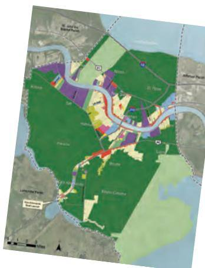

> **Figure description (visual reading, not stated in the plan's text):** Rotated thumbnail of the parish Future Land Use map with community names in small print (not all legible) and a scale bar. It has no legend; use Figure LU-8 (p. 42).

These policies are intended to enhance (and not replace) the land use and transportation goals and recommendations in the Comprehensive Plan.

#### Policy 1: General Guidance for Mixed-Use Centers (Neighborhood Mixed-Use and Town Center).

Determine the characteristics of appropriate locations for mixed-use centers.

» Is the proposal for vacant or underutilized land?

» If the proposed project is on underutilized land, is there an existing informal land use taking place that needs to be considered?

» If the proposal is a redevelopment site, is it currently not serving the community to its capacity, such as development that is underperforming with a low occupancy rate?

» Are surrounding land uses compatible, such as mixed-density and transitional residential uses?

» Are there adequate sidewalks, road connectivity and block lengths to access surrounding neighborhoods?

» Is a public facility, a religious institution, or a park located in the vicinity?

» Does the proposed site have good visibility and is it located on a street that is suitable for additional commercial development?

» Is there a current lack of neighborhood services nearby?

» Are current traffic signals and crosswalks Americans with Disabilities Act (ADA) compliant?

» Can parking needs be met with rear lots to retain active sidewalks that contribute to quality-of-life for residents?

## Page 58

**Table 13**

| »The area is physically appropriate (i.e., size, shape, etc.) for residential use. |
|---|
| »The area is adjacent to a residential neighborhood and is not separated from the neighborhood by a major thoroughfare (or larger), or the residential use is a part of a mixed-use development. |
| » The rezoning will not result in a shortage of land designated for non-residential development. |
| » The rezoning does not leave a residual tract of non-residential zoned property that does not conform to the Future Land Use Map, or that negatively affects the proposed residential use. |
| » The rezoning provides for an appropriate transition between residential and non-residential uses through separation by distance, screening, or land use (i.e., creek, four-lane roadway, etc.), if integration of residential and non-residential land uses into a mixed-use environment is not achievable. |
| »The current non-residential uses can be more appropriately relocated to a major thoroughfare or other nearby non-residential area. |
| »Nearby residents are not left underserved as a result of any loss of services. |
| »The scale of existing development adequately fits in with adjacent residential areas. |
Table snapshot (for checking): 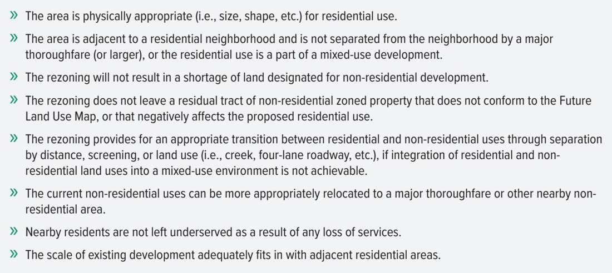

#### Policy 2: If an area that is designated and/or developed as residential desires to transition to a nonresidential use, the Parish should use the following policies while considering the request:

» The area is physically appropriate (i.e., size, shape, etc.) for non-residential use.

» The area is adjacent to non-residential zoning and not separated from other non-residential zoning by a major thoroughfare (or larger), or the non-residential use is part of a mixed-use development.

» Traffic will not negatively impact established and proposed future neighborhoods, schools, and/or parks. This includes increases in speed limits that may make residential roadways less safe for pedestrians.

» The rezoning does not leave any residual tracts of residentially zoned property or an area designated for residential uses on the Future Land Use Map that cannot be developed for residential uses.

» The rezoning provides for an appropriate transition between non-residential and residential uses or between a major thoroughfare and residential uses through separation by distance, screening, or land use, if positive integration of residential and non-residential land uses cannot be accomplished.

» The non-residential use is the same intensity or is compatible in density and intensity with the existing or adjacent/ surrounding land uses.

» The non-residential use is free from “dead walls” and street facing businesses are designed with appropriate setbacks and active storefronts.

» Appropriate pedestrian or bicycle infrastructure adequate to support any increases in foot or bicycle traffic is accounted for (including ADA compliance).

#### Policy 3: If an area that is designated and/or developed as non-residential desires to transition to residential, the Parish should require:

## Page 59

#### Policy 4: If an area that is designated and/or developed as non-residential desires to transition to a different non-residential use, the Parish should require:

» If new construction, the development conforms to new use standards and concepts.

» The new use is compatible with adjacent uses.

» The rezoning does not have any negative impacts on adjacent uses.

» The use is on a roadway that has the capacity to support expected increases in traffic.

» Appropriate pedestrian or bicycle infrastructure adequate to support any increases in foot or bicycle traffic is accounted for (including ADA compliance).

#### Policy 5: If an area that is designated and/or developed as residential desires to transition to a different residential use (such as from low density to medium density), the Parish should require:

» The area is physically appropriate (i.e., size, shape, etc.) for the proposed residential use.

» The area has adequate access, connectivity, and parking capacity for the proposed development.

» The rezoning does not create any foreseeable negative impacts on the adjacent uses.

» The area has adequate services and amenities to support the new density.

» The scale of new development adequately fits in with adjacent residential areas.

» Appropriate pedestrian and bicycle infrastructure adequate to support any increases in foot or bicycle traffic is accounted for (including ADA compliance).

## Page 60

#### ADDITIONAL EVALUATION POLICIES

Policy 6: Segregate land use designated for commercial and industrial along major corridors, highways, or adjacent to existing industrial to prevent residential encroachment and account for buffers as needed.

Policy 7: When locating heavy industrial land uses, consideration should be given to buffering, to minimize impacts on neighboring uses; access for vehicular and truck traffic to the local and regional road network; and the minimization of visual impacts on the major road corridors.

Policy 8: Focus development and redevelopment efforts on creating well-designed centers, corridors and connections that link housing, jobs, and services.

» Plan for mixed-use “centers” with a cohesive and well-connected mix of uses supported by a combination of streets, trails, and sidewalks for vehicular, pedestrian, and bicycle circulation.

» Prepare a sample center plan to establish guidelines for developing and enhancing new centers.

» Enhance streetscape character of pedestrian connections through continuous sidewalks, active street fronts, protection from travel lanes, enhanced amenities, lighting and landscaping.

Policy 9: Protect commercial and industrial areas from incompatible encroachment.

» Identify and designate truck access to major highways, National Highway Freight Network (NHFN) corridors, and Freight Analysis Framework (FAF) roadways and assure adequate parking and rest stop accommodations.

» Review development decisions to ensure that incompatible land uses such as detached single family neighborhoods are not developed adjacent to existing industrial uses or along corridors with speeds that are expected to remain unsafe for the types of pedestrian traffic expected in single family neighborhoods.

Policy 10: Prioritize infrastructure improvements that support walking, biking and better connectivity to transit such as repairing sidewalks, improving streetscapes, and installing bike facilities such as designated or protected lanes, road markings, signage and bike racks.

## Page 61

#### Updated Housing Actions

The following priority, ongoing, mid-term and long-term housing recommendations will guide future decision making and are organized into four groups: HOU 1-HOU 4. Recommended timing and lead agencies for each action are provided in the Implementation Framework.

HOU 1 Promote the diversification of the housing stock.

HOU 1.1 Update development code to ensure mixed-use regulations are effective in attracting mixed uses in desired locations.

HOU 1.4 Evaluate the need to require the provision of affordable housing for future developments of a certain land area, number of units, or within a certain distance of the existing and future parish’s employment centers (as identified in the Future Land Use Map).

HOU 1.6 Conduct a parish housing study to identify strategies to address affordable housing and neighborhood reinvestment programs. (new)

HOU 2 Ensure the provision of decent, affordable housing opportunities to all income groups and household types.

HOU 2.7 Explore resources for the development of HUD 202 Senior Housing.

HOU 2.9 Improve the condition, availability, and diversity of housing stock. (PMLU6) (new)

#### Organizing Groups for Housing Recommendations

HOU 1 Promote the diversification of the housing stock.

HOU 2 Ensure the provision of decent, affordable housing opportunities to all income groups and household types.

HOU 3 Improve the functionality and visual character of new residential subdivisions.

\* HOU 4 Promote the preservation, enhancement, and revitalization of existing residential neighborhoods.

## Page 62

HOU 1.1 Adopt Accessory Unit regulations applicable to existing residential zoning districts to facilitate the provision of legal accessory units. These types of units ofer an alternative form of housing for families with aging parents, among others.

✓ Adopted accessory dwelling unit regulations.

✓ Provided for housing in mixed-use projects.

✓ Block length limited to 1,500' which is consistent with the historic pattern.

HOU 1.5 Promote mixing of various types of housing (e.g., single family detached and attached homes) in mixedresidential developments consistent with the Future Land Use Map.

✓ Identified opportunities for mixing of various types of housing in mixed-residential developments on future land use map.

HOU 2.1 Implement guidelines to ensure the quality of new housing (livable community design, quality construction, energy efficiency, etc.)

✓ Updated ordinances to enhance housing development.

✓ Reviewed and updated the building code to increase the security and safety of all buildings in the parish.

HOU 2.3 Continue to promote and provide affordable ownership opportunities for first-time homebuyers through assistance programs.

✓ Developed a partnership with the Jeferson Finance Authority to create the Southern Mortgage Assistance Program to provide down payment grants.

HOU 2.4 Identify resources to bring homes that do not initially qualify for existing programs up to Code.

✓ Launched the Section 504 Rural Housing Repair Program in Partnership with USDA to assist residents with applications for grant funding and low interest loans.

✓ The DCS provides clients with the Pre-application and document verification.

HOU 2.5 Allocate a targeted number of existing units for emergency placement for those in immediate need of housing.

✓ Identified emergency and transitional housing resources and established a safe house.

HOU 2.6 Expand the development of affordable units through the use of USDA Rural Development Funds.

✓ Launched the Section 504 Rural Housing Repair Program in Partnership with USDA to assist residents with applications for grant funding and low-interest loans.

HOU 2.8 Develop a shelter/transitional living facility.

✓ Safe house established.

HOU 3.1 Introduce or revise the following as Subdivision Regulations to improve the functionality and visual character of new subdivisions. Updated the subdivision ordinance to:

✓ (a.) Consider pedestrian, bike path and roadway connectivity between housing, shopping and workplaces. Adopted the Bike/Ped Master Plan.

Continued on the next page…

> **Text-layer supplement (text on this page that the layout parse did not capture; reading order approximate, taken from the PDF text layer):**
>
> Completed Actions, 2011–2022 Housing action numbers from the 2011 Comprehensive Plan.
>
> ST. C H A R L E S PA RISH C OMPREH ENS I V E PL A N UPDATE

## Page 63

Initiate a home rehabilitation program targeted at single family units owned by low- and moderateincome homeowners, including elderly and disabled.

• Utilize an infill housing program to decrease vacancy on buildable lots within existing neighborhoods.

• Prioritize physical areas from list of vacant/ underperforming subdivided properties (with street frontage and utilities access) for a targeted infill development program.

• Identify properties owned by the parish that are located within R-1AM districts and/or in priority zones. Look to pool these parcels for disposition to qualified non-profit developers.

• Identify public and privately-owned vacant properties suitable for redevelopment.

Direct property owners to available technical resources which can assist them in addressing succession/title issues with legacy properties.

• Provide homeownership counseling and education services targeted to the Paul Maillard area.

#### HOU 3 Improve the functionality and visual character of new residential subdivisions.

#### HOU 3.1 Update the subdivision ordinance to require:

• Review and revise tree planting requirements in ordinance update.

Develop and adopt a tree ordinance requiring the planting of street trees in new residential communities, with an approved tree list and standards for spacing and maintenance.

• Include standards requiring new subdivisions to provide a connected street network. Incorporate a requirement for multiple points of entry for subdivisions over a certain size.

#### Continued from previous page…

✓ (d.) Specify appropriate types of locations, necessary degree of accessibility to, and required amounts of land for public amenities and facilities such as schools, parks, playgrounds, open space, pedestrian paths and bicycle trails. Established and codified as part of the development review process.

✓ (e.) Make sure that all dedicated public open space and recreation areas (except for environmental open space) provide direct access from public streets, are visible and easily accessible, have multiple points of entry, and are well buffered from moving vehicles. Established and codified as part of the development review process.

✓ (f.) Ensure that each phase of a phased development meets minimum requirements for open space and recreational areas. Established and codified as part of the development review process.

HOU 4.4 Research resources for community revitalization through federally-funded home renovation programs in targeted neighborhoods.

✓ DCS constantly researching and applying for funding to support targeted neighborhoods in need.

✓ Successful examples include receiving additional HUD HOME funding through the parish’s partnership with Jeferson Parish and exploring funding opportunities and programming through NeighborWorks.

## Page 64

• Provide for the reservation of land for rightsof-way adequate to accommodate sidewalks and where appropriate bike facilities to enhance a parishwide mobility network (see Transportation Element).

#### HOU 4 Promote the preservation, enhancement, and revitalization of existing residential neighborhoods.

HOU 4.1 Identify housing tools, programs and potential funding sources for rehabilitating, restoring and repairing existing deteriorated housing. Examples of possible tools include creating a Housing Finance and Community Development Department, Community Development Corporation, and/or a Parish Housing Council.

Establish a corridor-based group to facilitate and monitor plan implementation. (PMED1) Consider reactivating the Paul Maillard Road Community Development Corporation to provide leadership in corridor improvements.

HOU 4.2 Designate Neighborhood Conservation Areas (NCAs) or Neighborhood Fight-Back Areas (NFBAs) and establish conservation strategy.

Support civic groups and landowners to establish routine code enforcement support and reporting.

• Establish the area west of LA 52 to the canal from the UP Railroad south to the BNSF Railroad as a Neighborhood Fight Back Area (NFBA). (PMLU4)

HOU 4.3 Work with communities to create small area plans that address community goals and needs and identify neighborhood revitalization strategies.

HOU 4.4 Research resources for community revitalization through federally-funded home renovation programs in targeted neighborhoods.

HOU 4.5 Target programming and resources to implement housing and neighborhood revitalization programs detailed in the Paul Maillard Road Corridor Revitalization Plan. (new)

HOU 4.6 Maintain the residential character of neighborhoods by allowing more flexibility in residential building types within certain areas. (PMLU5)

• Create a Housing Trust Fund.

• Request technical assistance from organizations such as the Center for Community Change.

## Page 65

#### Updated Community Character Policies and Actions

The following priority, ongoing, mid-term and long-term housing recommendations will guide future decision making and are organized into six groups: CC 1–CC 6. Recommended timing and lead agencies for each action are provided in the Implementation Framework.

CC 1 Improve the functionality and visual character of non-residential development.

CC 1.4 Review transitional buffers and streamlining of commercial and industrial districts in zoning ordinance update.

CC 1.5 Address design standards for business parks and industrial areas in zoning ordinance update.

CC 1.7 Conduct a corridor plan for Highway 90 to address design standards for the corridor. In the longterm conduct corridor plans for other major corridors.

#### CC 2 Support and facilitate the revitalization and redevelopment of areas that are undergoing decline and obsolescence.

CC 2.1 Apply a targeted code enforcement strategy to areas where simple private investment in upgrades, repair and maintenance will stem further deterioration.

• Continue to target areas needing more attention.

• Make strategic adjustments in code enforcement practices to address blight and unkept properties (PMLU3).

#### Organizing Groups for Community Character Recommendations

CC 1 Improve the functionality and visual character of nonresidential development.

CC 2 Support and facilitate the revitalization and redevelopment of areas that are undergoing decline and obsolescence.

CC 3 Increase community livability through development form and quality.

CC 4 Maintain and improve the visual character of publicly owned and maintained landscapes within St. Charles Parish.

CC 5 Continue to increase community beautification efforts, both to improve visual character and enhance safety and security.

CC 6 Maintain critical environmental resource areas as open space.

## Page 66

CC 1.1 Create and adopt special development standards and design guidelines for Overlay Zoning districts (LU Action 1.1).

#### ✓ Completed

CC 1.2 Adjust zoning requirements for commercial development to be consistent with the corresponding land use district character (Future Land Use Map).

#### ✓ Completed

CC 1.3 Adopt building design guidelines to improve the aesthetics of commercial development (building massing, parking/building relationship, façade appearance, materials, site lighting, signage).

#### ✓ Completed

CC 1.6 Revise existing standards for industrial development to include criteria for the provision of minimal landscaping and open space; open storage screening; on-site employee and truck parking; loading, maneuvering and storage.

#### ✓ Completed

CC 2.3 Evaluate the practicability of re-submitting a application to the HUD/DOT Planning Challenge Grant program, if continued, for the revitalization of the Paul Maillard Road Mixed Use Corridor. Also consider alternative assistance, such as EPA’s Smart Growth Implementation Assistance program.

✓ Obtained funding for the Paul Maillard Corridor Study.

CC 2.6 Remove regulatory impediments that may exist for infill and redevelopment projects, including parking, storm water, setback or other site requirements that older sites may not be able to meet.

✓ Site Development standards were revised to allow for an administrative waiver process for redevelopment and infill projects.

CC 3.4 Require the provision of sidewalks and bicycle paths, along with pedestrian and bicyclist amenities St. Charles 2030 Comprehensive Plan 85 (bike racks, etc.) to provide opportunities for active, healthy lifestyles.

✓ Bike and Pedestrian Master Plan was adopted.

## Page 67

#### CC 2.1 continued…

• Establish process for hauling of derelict vehicles from public or private property to recover actual costs incurred.

Consider establishing a formal administrative hearing process for code enforcement issues following a model used by Lafourche or Jeferson Parishes and the need for additional personnel to address community enforcement issues.

• Establish link between residents facing code enforcement penalties without funds to address, to future funding for commercial façade improvements, housing rehabilitation funds and other general assistance (including from non-profit organizations and volunteer groups).

• Review options for using the International Property Maintenance Code.

CC 2.2 Continue to conduct and maintain a parishwide inventory of potential infill/ redevelopment sites.

CC 2.5 Continue preparing small area plans to address specific community challenges and opportunities.

CC 2.7 Address impediments to infill development and redevelopment in zoning ordinance update.

\* CC 3 Increase community livability through development form and quality.

CC 3.1 When locating parish and other public services, prioritize location in underserved communities.

CC 3.2 Encourage planners of new residential/ mixed-use communities to establish neighborhood commercial nodes at central locations (consistent with the Future Land Use Map). Continue to evaluate development proposals for compliance with the Future Land Use Map.

CC 3.3 Review mixed-use zoning provisions in zoning ordinance rewrite. Adopt development standards to encourage the horizontal and vertical mixed-use development.

## Page 68

#### CC 4 Maintain and improve the visual character of publicly owned and maintained landscapes within St. Charles Parish.

CC 4.1 Continue to make landscaping, lighting, signage, streetscape and public art improvements to highly visible locations in the parish, such as gateway entrances, major corridors, public buildings and grounds, and parks.

CC 4.2 Establish a high standard of design quality in new public improvement projects (buildings, landscapes, and infrastructure).

#### \* CC 5 Continue to increase community beautification efforts, both to improve visual character and enhance safety and security.

CC 5.1 Continue to promote neighborhood and business participation in community clean- ups (roads, parks, waterfront lands, etc.). Establish clean-up programs for cleaning drainage facilities.

CC 5.2 Study the feasibility of and potential funding sources for removing overhead utilities that detract from the quality of the community’s visual character and may even pose potential safety problems in selected locations, such as narrow rights of way of mixed-use corridors and activity centers.

#### CC 6 Maintain critical environmental resource areas as open space.

CC 6.2 Review and consider additional ordinance amendments addressing existing open space dedication standards to ensure the protection of floodplains, wetlands, and other environmentally sensitive resource areas.

CC 6.3 Consider provisions for cluster and/or conservation subdivision design, to encourage the protection of sensitive environmental resources, to reduce storm vulnerability, and to maximize hazard resiliency.

## Page 69

This page left intentionally blank

## Page 70

### Plan Element

### Economic Development

#### Existing Conditions and Trends

#### Industry and Employment

The parish has continued to maintain a strong economy due to the presence of industry. As seen in Table ED-1, industry plays an important role in sustaining the parish’s economy.

Despite an increase in labor force and decrease in jobs in the parish since 2010, unemployment has remained low, see Table ED-2. In March 2022, the parish’s unemployment rate was 3.4 percent, lowest among the MSA (4.4 percent), and lower than the state (3.8 percent) and nationwide (3.8 percent) during this period.8 The current unemployment rate reflects economic recovery in the parish from the height of the COVID-19 pandemic. In December 2020, unemployment in the parish was 6.6 percent.9

#### Industry Projections

Industry projections for the 1st Regional Labor Market Area, New Orleans, which includes St. Charles Parish, show the largest long-term employment increases between 2016 and 2026 for the following industries: Accommodation and Food services (8,660 additional employees, 12 percent change); Retail Trade (5,199 additional employees, 8 percent change); and Professional, Scientific and Technical Services (4,745 additional employees, 15 percent change).10

Industries projected to experience the slowest growth include: Public Administration (13 fewer employees, –2.7 percent change); and Agriculture, Forestry, Fishing and Hunting (265 additional employees, 25 percent change).11

## Page 71

**Table 14: Table ED-1: St. Charles Parish’s Major Employers, 2010 and 2020**

| Business / Industry | Comprehensive Plan at Adoption (2011)* | Comprehensive Plan Update (2022)** | Product / Service |
|---|---|---|---|
|  | Approx. # of Employees |  |  |
| St. Charles Parish Schools | 1,747 | 1,723 | Education |
| Shell Norco Manufacturing Complex | - | 1,200 | Oil Refinery |
| Dow St. Charles | 1,000 | 991 | Chemicals and Plastics |
| Motiva | 866 | - | Oil Refinery; Taken over by Shell in 2017, now Shell Norco |
| Bayer | - | 703 | Chemical Manufacturer |
| Monsanto | 698 | - | Chemical Manufacturer; Acquired by Bayer in 2018 |
| Entergy - Waterford 3 | 650 | 800 | Electricity Provider |
| St. Charles Parish Government | 564 | 630 | Government |
| Valero St. Charles | 555 | 602 | Oil Refinery |
| St. Charles Parish Hospital | 500 | 437 | Medical Facility |
| St. Charles Parish Sheriff's Office | 435 | 381 | Law Enforcement |
| Southern Glazer's Wine and Spirits | 322 | 328 | Liquor Distribution |
| Wal-Mart | 320 | 155 | Retail Sales |
| Shell Chemical | 258 | - | Petrochemical Manufacturer; Now Shell Norco Manufacturing Complex |
| Randa Corporation | 249 | 211 | Manufacturer and Distributor of Men's Accessories |
| Occidental Chemical Corp. | 215 | 196 | Chemical Manufacturer |
| ADM / Growmark | 185 | Not provided | Grain Export |
| International Matex Tank Terminals | 165 | 165 | Bulk Liquid Handling |
| Bunge North America | 150 | 158 | Grain Export and Soybean Processing |
| Winn-Dixie | 100 (Luling) 115 (Destrehan) | 95 (Luling) 180 (Destrehan) | Retail Sales |

_Source: 2030 Comprehensive Plan and St. Charles Parish, LA Economic Development and Tourism Department_
Table snapshot (for checking): 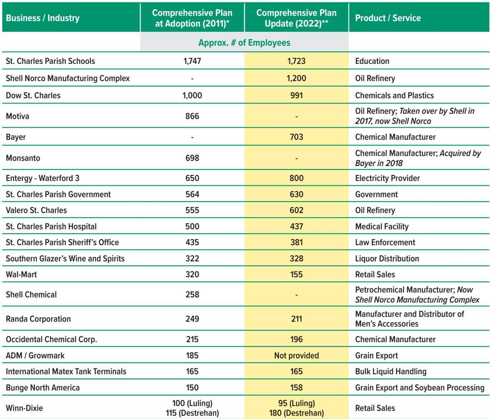

## Page 72

#### Implementing the Plan

Since 2010, the Parish has undertaken several key initiatives to implement the goals of the 2030 Comprehensive Plan to encourage economic diversity and resilience. These include:

» Coordinating with the Louisiana Economic Development, GNO Inc. and other economic driver and local businesses to participate in business retention and expansion programs.

» Developing an annual local industry survey that includes local businesses in the parish to track and monitor anticipated changes.

» Partnering with LED, PSL, GNO Inc. and Entergy to support additional industries, which ofer significant job opportunities, quality of life benefits, and growth potential.

» Facilitating a new River Parishes Community College campus.

» Partnering with St. Charles Parish schools to become a certified work ready community, where students are trained for positions in the local workforce. This partnership will be formalized in fall 2022.

A full list of completed 2030 Comprehensive Plan actions related to economic development is included at the end of this chapter.

**Table 15: Table ED-2: Quick Economic Development Facts Comparison**

| Quick Facts | Comprehensive Plan at Adoption (2011) | Comprehensive Plan Update (2022) | Key Takeaways |
|---|---|---|---|
| Labor force | 23,876A | 24,861B | Increase in the labor force since 2010. |
| People employed in parish (includes non-parish residents) | 23,126C | 22,684D | Fewer people working in the parish today. |
| Total jobs in the parish | 24,152E | 23,844F | Fewer jobs in the parish today. |
| Total establishments* | 1,199G | 1,336H | Increase in number of establishments in parish. |
| Unemployment rate | 8% I | 3.4% J | Significantly lower unemployment rate today. |
| Percent of labor force working outside the parish | 56% (13,400) K | 55.5 % (13,473) L | Approximately the same volume of workers commutes into the parish. |
| Destination for most workers commuting out of the parish to work | Jefferson ParishM | Jefferson Parish (20%) Orleans Parish (7%)N |  |
| Mean time to work (includes in and out of the parish) | 28 minutesO | 28.7 minutesP |  |

_\* An establishment is an economic unit, such as a factory or store, which produces goods or services. A Louisiana Department of Labor (LA DOL), Louisiana Occupations Information System/ Scorecard, January 2011 B Louisiana Workforce Commission (LWC), Louisiana Occupational Information System, May 2022 C LWC, Labor Market Statistics, Quarterly Census of Employment and Wages Program D LWC, Labor Market Statistics, Quarterly Census of Employment and Wages Program, 2021 Q-3 E Louisiana Economic Development (LED), Parish and Community Profiles, October 2010 Estimate F 2019, Louisiana Employer-Household Dynamics (LEHD) G LWC, Labor Market Statistics, Quarterly Census of Employment and Wages Program H LWC, Labor Market Statistics, Quarterly Census of Employment and Wages Program I LA DOL, Louisiana Occupational Information System/Scorecard, as of January 2011 J LWC, Local Area Unemployment Statistics, as of March 2022 K 2005-2009 ACS L 2020 ACS 5-Year Estimates Subject Tables_
Table snapshot (for checking): 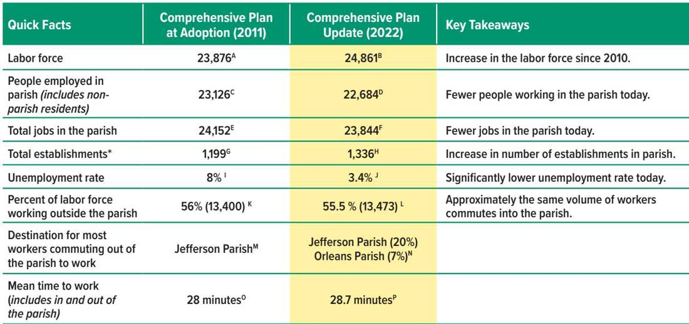

M Greater New Orleans, “Post-Katrina Commuter Patterns–Based on 2008 Local Employment Dynamics data from the U.S. Census Bureau,” by Allyson Plyer, Elaine Ortiz, and Kathy Petit. January 15, 2010.

N 2019 Louisiana Employer-Household Dynamics

P 2020 ACS 5-Year Estimates Subject Tables

## Page 73

#### Regional Development Strategy

The South Central Planning Commission (SCPC) regularly develops a Comprehensive Economic Development Strategy (CEDS), which is mandated by the U.S. Economic Development Administration. The CEDS provides regional information to local economic development stakeholders to strengthen competitiveness, economic resilience, and quality of life in the region (seven parishes are included in the SCPC’s geographic jurisdiction).

For traded clusters in the parish, the Draft 2021 CEDS Report identified business services and water transportation as emerging clusters in the parish, while oil and gas production and transportation, upstream chemical products, and food processing and manufacturing show stagnation or decline. Meanwhile, growth is expected across all local clusters.12

#### LOCAL CLUSTERS

» Logistical services (transportation and warehousing)

» Hospitality establishments

» Personal services

» Financial services

» Education and training

» Community and civic organizations

» Retailing of clothing and general merchandise

» Food and beverage processing and distributions

» Motor vehicle products and services

» Household goods and services

» Commercial services

» Health services

The Draft 2021 CEDS Report also recommends diversifying the parish’s workforce by encouraging local officials and business owners to consider research and investment into clusters that are related to the parish’s specialized clusters—specifically, distribution and e-commerce. This specialization is strongly related to many other clusters where job growth is expected, providing the Parish with many opportunities for diversification.

#### SPECIALIZED CLUSTERS

» Water transport

» Upstream chemicals

» Electric power

» Distribution and e-commerce

» Construction

» Transportation

> **Text-layer supplement (text on this page that the layout parse did not capture; reading order approximate, taken from the PDF text layer):**
>
> ST. C H A R L E S PA RISH C OMPREH ENS I V E PL A N UPDATE

## Page 74

#### Recommended Tools and Incentives

The following programs and funding sources are designed to encourage economic growth and development. These opportunities should be considered to achieve development goals and improvements throughout the parish.

#### Federal Opportunity Zones

Parts of the West Bank are designated as an Opportunity Zone. The Federal Opportunity Zone program was established by Congress in the Tax Cuts and Jobs Act of 2017 as a community and economic development tool to drive long-term private investment into low-income communities. The program encourages investors with recently realized capital gains to invest in local businesses, real estate, or development projects within Qualified Opportunity Zones in exchange for a reduction in tax obligations.

The opportunity zones incentivize private investment by providing certain capital gains tax incentives. For example, “an investor can defer tax on any prior eligible gain to the extent that a corresponding amount is timely invested in a Qualified Opportunity Fund (QOF). The deferral lasts until the earlier of the dates on which the investment in the QOF is sold or exchanged, or December 31, 2026.” Opportunity zone incentives can be used in combination with other incentives.

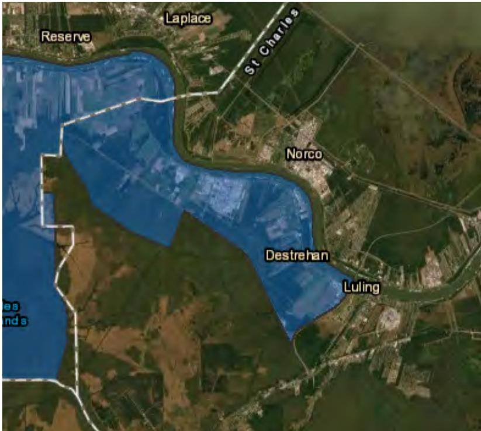

> **Figure description (visual reading, not stated in the plan's text):** Aerial-photo map with a blue shaded area following the river bend between Reserve/Laplace (labeled at upper left) and Luling (labeled at lower right); Norco and Destrehan are also labeled, and a "St Charles" label runs along a parish-boundary line at the top. There is no legend or caption in the image, so what the blue shading represents is not stated in it; read the surrounding page text.

> **Text-layer supplement (text on this page that the layout parse did not capture; reading order approximate, taken from the PDF text layer):**
>
> Opportunity Zones, shown as blue highlighted areas, have been selected from qualifying tracts that were designated by the U.S. Treasury's CDFI Fund as Low Income Community (LIC) tracts.
>
> ST. C H A R L E S PA RISH C OMPREH ENS I V E PL A N UPDATE

## Page 75

#### Federal Infrastructure Funding

The Bipartisan Infrastructure and Investment and Jobs Act (IIJA) will “rebuild America’s roads, bridges and rails, expand access to clean drinking water, ensure every American has access to highspeed internet, tackle the climate crisis, advance environmental justice, and invest in communities that have too often been left behind. This legislation will help ease inflationary pressures and strengthen supply chains by making long overdue improvements for our nation’s ports, airports, rail, and roads.”13

The IIJA will distribute funds through a combination of formula grants for states (amounts will be determined based on factors such as population or state size) and competitive grants (cities, towns and municipalities can compete or directly apply to receive funds).

#### Louisiana Digital Interactive Media and Software Program

This incentive program is open to companies that produce digital interactive media products or platforms in Louisiana, including digital media and games, web-based apps, software, and more. The program provides a 25 percent tax credit on qualified payroll for in-state labor and 18 percent for qualified production expenses.

> **Text-layer supplement (text on this page that the layout parse did not capture; reading order approximate, taken from the PDF text layer):**
>
> 80 Arpent Canal pumping station, St. Charles Parish
>
> 13 The White House, Fact Sheet: The Bipartisan Infrastructure Deal, November 2021: https://www.whitehouse.gov/briefing-room/statements-releases/2021/11/06/fact-sheet-thebipartisan-infrastructure-deal/
>
> ST. C H A R L E S PA RISH C OMPREH ENS I V E PL A N UPDATE

## Page 76

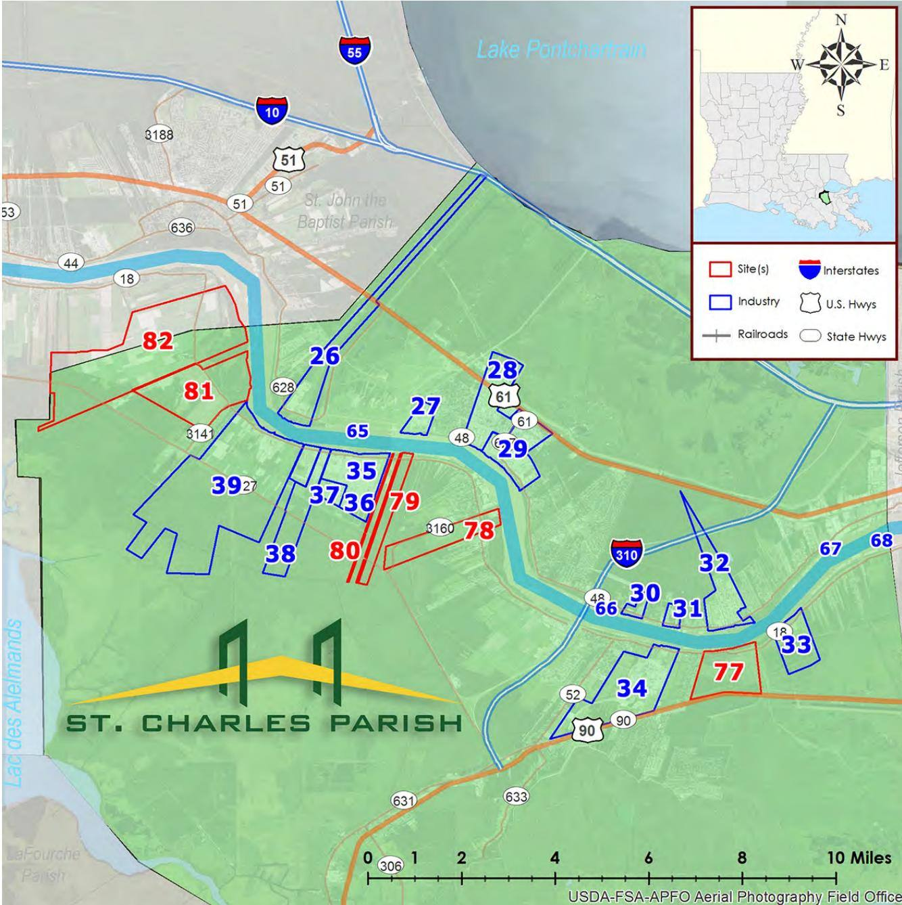

> **Figure description (visual reading, not stated in the plan's text):** Update Figure ED-1, Map of Economic Development Opportunity Sites, on a green base map with an inset locator of Louisiana. Legend, as printed: Site(s) (red outline), Industry (blue outline), Interstates, U.S. Hwys, State Hwys, Railroads. Blue-outlined industrial areas are numbered 26-39 and 65-68 (65 on the river near Montz, 66-68 along the river east of the I-310 crossing); red-outlined sites are numbered 77-82 (81 and 82 at the upstream/west end, 79 and 80 narrow strips beside the river on the west bank, 78 and 77 on the lower river and near US 90). The numbers are printed on the map; their names are not given in the image, so use the page text or the plan's Figure ED-1 for names. Labeled roads include I-10, I-55, I-310, US 51, US 61, US 90 and numbered state highways (18, 48, 52, 628, 3141, 3160, 631, 633); Lake Pontchartrain, Lac des Allemands, St. John the Baptist Parish and Lafourche Parish are labeled. Scale bar 0 to 10 miles; "St. Charles Parish" logo and a USDA-FSA-APFO aerial photography credit are printed.

## Page 77

### Goals for Economic Development

1. Promote a healthy, diversified, and balanced economy.

2. Build on and market the parish’s competitive advantages to support success in the global marketplace.

3. Foster local enterprise—both existing and new businesses.

4. Focus on serving the needs of local residents, workers, and businesses.

5. Invest in the parish’s human capital and promote social equity.

6. Continue to strengthen regional collaboration and partnerships

#### Priority Actions

Stakeholders identified the following priority actions that work to achieve the Economic Development goals and should be completed as soon as possible:

1. Brand and market the Parish, capitalizing on the community’s natural advantages: its location, proximity to urban centers, superior public education, natural setting and quality of life.

2. Establish a Small Business Division inside the Economic Development office that focuses on assisting small- to medium-sized businesses with opening in St. Charles Parish.

3. Establish the Parish as a go-to resource for expertise in the areas of emergency planning, disaster recovery, coastal zone management, and education for riverine and maritime industries.

4. Continue prioritizing connecting with and supporting parish businesses during emergency events.

5. Evaluate and identify actions to improve the appearance of Airline Highway in St. Rose, between I-310 and the parish line.

6. Target the following core industry sectors: Alternate and Renewable Energy; Micro-Manufacturing; Petrochemical and Plastics; Trade, Logistics, and Distribution.

7. Explore and support additional industries which ofer significant job opportunities, quality of life benefits, and growth potential: Food Processing, Tourism, Entertainment, and Healthcare and Medical Services.

8. Assist existing core industries in implementing strategies to develop appropriate complementary uses in large buffer areas.

> **Text-layer supplement (text on this page that the layout parse did not capture; reading order approximate, taken from the PDF text layer):**
>
> ST. C H A R L E S PA RISH C OMPREH ENS I V E PL A N UPDATE

## Page 78

### Updated Policy Recommendations and Implementation Strategies

This section provides a summary of completed and updated actions for Economic Development. The implementation matrix in the Implementation Framework chapter provides a complete update of all plan actions with responsibility, status and recommended timeframe.

#### Updated Economic Development Actions

The following priority, ongoing, mid-term and longterm Economic Development actions are organized into nine groups: ED 1-ED 9. Recommended timing and lead agencies for each action are provided in the Implementation Framework.

\* ED 1 Retain, support, and capitalize on existing core petrochemical industries in the parish.

ED 1.1 Coordinate with economic development allies’ efforts to recruit to the parish secondary industries and ancillary services and businesses. Encourage these industries and services to locate within Employment areas identified on the Future Land Use Map.

ED 1.2 Assist existing core industries in implementing strategies to develop appropriate complementary uses in large buffer areas, such as adoption of Buffer Zone Retrofit Plans (see Buffer Zone Development Guidelines and Retrofit Plans in the 2011 Comprehensive Plan).

ED 1.3 Continue the Parish's participation in ongoing Business Retention and Expansion programs with its economic development allies, economic driver businesses, local businesses, LED and GNO Inc.

#### Organizing Groups for Economic Development Recommendations

ED 1 Retain, support, and capitalize on existing core petrochemical industries in the parish.

ED 2 Support, strengthen and build out existing industrial business parks.

ED 3 Recruit new high-value, information-based manufacturing and services industries.

ED 4 Support development of high value local agricultural sector and related economic opportunities.

ED 5 Encourage local entrepreneurship and new small business startups.

ED 6 Maintain the highest competitive level of workforce and vocational training in anticipation of the recruitment of technology and information-based industries.

Continued on the next page…

## Page 79

ED 1.3 continued…

• Continue to provide an annual local industry survey that includes local businesses in the parish.

• Continue new public/private partnerships or organizations to provide oversight and coordination of economic development initiatives related to the parish’s core industries.

ED 1.4 Coordinate with the LA Workforce Commission and Louisiana Business and Career Solution Center to ensure the continued availability of a trained workforce to meet the needs of local employers.

#### ED 2 Support, strengthen and build out existing industrial and business parks.

ED 2.1 Complete visual character evaluation and identify actions to improve the appearance of Airline Highway in St. Rose, between I-310 and the parish line (including regulatory amendments, code enforcement, public investments).

ED 2.2 Work with property owners to develop a coordinated strategy to position and market employment and mixed-use activity centers.

ED 3 Recruit new high-value, informationbased manufacturing and services industries to St. Charles Parish.

ED 3.1 Selectively target marketing resources to those clusters of industries in which the parish has certain natural "competitive" advantages (developable land, multimodal access, skilled workforce, location, which accommodate reverse commuting).

#### Organizing Groups for Economic Development Recommendations, continued

ED 7 Reduce or eliminate disincentives for private investment and recruitment of employment in the West Bank by linking the urgency of such improvements to the economic future of the parish.

ED 8 Coordinate with and build upon the resources and programs of the Parish’s economic development allies to effectively market the economic development opportunities in the parish.

ED 9 Support and facilitate the revitalization and redevelopment of older commercial areas that are undergoing decline and obsolescence.

## Page 80

ED 3.2 Target the following core industry sectors: Alternate and Renewable Energy; Micro-Manufacturing; Petrochemical and Plastics; Trade, Logistics, and Distribution; Information Technology.

ED 5.1 Develop support structures and resources to support small business start-ups, including additional business incubators, local school and technical training partnerships.

Worked with local industry partners and the St. Charles Parish school system to establish an instrumentation program for the 2016-2017 school year.

✓ Working with River Parishes Community College campus to support local businesses.

ED 5.3 Accommodate and facilitate starting and operating small home-based businesses, including permitting “livework” residences within new mixed-use zoning districts and modifying regulations that allow home occupations within appropriate residential zoning districts.

✓ Simplified the process for establishing a Home Occupation permit.

✓ Established the Paul Maillard mixed-use corridor overlay district.

ED 5.4 Encourage the development of local tourism oriented to sportsmen, eco-tourism and cultural/historic tourism.

Bed and breakfast accommodations are supported in historic districts/ structures/sites by parish residents and allowed in Open Land zoning districts.

River Road Historical Society reconstructed an historic building for a bridal suite and bed and breakfast and has also permitted the relocation of the historic Bethlehem House for a second bed and breakfast cottage.

✓ Improvements have been made at Ormond Plantation Manor Bed and Breakfast.

ED 6.2 Encourage coordination between St. Charles Parish Public Schools and the Gulf Coast Process Technology Alliance (GCPTA) to guide students interested in being trained for positions in the local workforce.

Worked with local industry partners and the St. Charles Parish school system to establish an instrumentation program for the 2016-17 school year.

ED 7.3 Prepare a long-term master plan, with associated implementation and funding strategy to remediate the problem of stormwater infiltration into the sewage collection network.

✓ Long-term Wastewater Master Plans are underway (see Infrastructure Element)

ED 9.2 Promote re-investment in mixed-use development in transitional areas and those identified as potential mixed-use activity centers and corridors in the Land Use Element

✓ Paul Maillard Road Revitalization Plan is adopted.

#### PAUL MAILLARD ROAD (LA 52) CORRIDOR REVITALIZATION PLAN

> **Text-layer supplement (text on this page that the layout parse did not capture; reading order approximate, taken from the PDF text layer):**
>
> Completed Actions, 2011–2022 Economic Development action numbers from the 2011 Comprehensive Plan.
>
> ST. C H A R L E S PA RISH C OMPREH ENSI V E PL A N UPDATE

## Page 81

ED 3.3 Explore and support additional industries which ofer significant job opportunities, quality of life benefits, and growth potential: Food Processing, Tourism, Entertainment, and Healthcare and Medical Services.

ED 3.4 Establish the Parish as a go-to resource for expertise in the areas of emergency planning, disaster recovery, coastal zone management, and education for riverine and maritime industries.

\* ED 4 Support development of a high value local agricultural sector and related economic opportunities.

ED 4.1 Support the development of innovations in existing agriculture and aquaculture, such as the use of biomass from sugarcane for fuel production.

ED 4.2 Support local retail farmers’ markets on both riverbanks.

\* ED 5 Encourage local entrepreneurship and new small business startups.

ED 5.1 Develop support structures and resources to support small business start-ups, including additional business incubators, local school and technical training partnerships, and local revolving or micro-loan programs.

ED 5.2 Continue efforts to disseminate information about technical assistance and funding resources available in the Southeast Louisiana region (SCPDC, SBDC, RLC, SCORE).

ED 5.3 Encourage the development of local tourism oriented to sportsmen, eco-tourism and cultural/historic tourism.

Work with neighboring parishes and municipalities to enhance and model the levee trails as Regional Heritage Greenways, tying together the region’s historic and cultural attractions.

Develop a market for navigable waterwaybased business activities, such as fishing and sightseeing.

ED 5.4 Develop a small business catalyst to help people grow and launch small businesses. (new)

ED 6 Maintain the highest competitive level of workforce and vocational-technical training in anticipation of the recruitment of technology and information-based industries.

ED 6.1 Continue coordination between the Louisiana Technical College River Parishes Campus and the leadership of industrial recruitment initiatives to develop programs to train a local workforce.

ED 6.2 Encourage coordination between St. Charles Parish Public Schools and the Gulf Coast Process Technology Alliance (GCPTA) to guide students interested in being trained for positions in the local workforce.

ED 6.3 Develop a comprehensive life-skills training program to develop job readiness skills for clients seeking assistance through the Department of Community Services.

## Page 82

ED 7 Reduce or eliminate present disincentives for private investment and recruitment of employment on the West Bank by linking the urgency of such improvements to the economic future of St. Charles Parish.

ED 7.1 Continue to coordinate with local businesses and entrepreneurs to support business development on the West Bank. (new)

ED 8 Coordinate with and build upon the resources and programs of the Parish’s economic development allies to effectively market the economic development opportunities in the parish.

ED 8.1 Continue to maintain a detailed inventory of potential economic development and employment sites.

ED 8.2 Brand and market the Parish with a recognizable brand theme and image, capitalizing on the community’s advantages: its location, proximity to urban centers, superior public education, natural setting and quality of life.

ED 8.3 Determine the need for/value of a local tourism/visitor attraction program. (new)

ED 9 Support and facilitate the revitalization and redevelopment of older commercial areas that are undergoing decline and obsolescence.

ED 9.1 Prioritize targeted code enforcement efforts and hardship assistance to areas experiencing minor deterioration as a means to stabilize the area and stem further decline. (reference action CC 2.1).

ED 9.2 Promote re-investment in mixed-use development and those identified as potential mixed-use activity centers and corridors in the Land Use Element (reference action LU 1.1).

## Page 83

This page left intentionally blank

## Page 84

### Plan Element Transportation

#### Existing Conditions

#### The Roadway Network

#### FUNCTIONAL CLASSIFICATION

The major roadways in the parish are outlined below by the Federal Highway Administration (FHWA) Roadway Classification. A map depicting traffic volume count data for Interstates, Principal Arterials, and Minor Arterials is shown in Figure TR-1.

#### Interstates

Interstate-10 (I-10) is the southernmost east-west cross-country highway in the United States and a vital roadway of south Louisiana. Within St. Charles Parish, the entire 9.4 miles of I-10 is elevated and borders the south shore of Lake Pontchartrain. The existing cross section of I-10 in St. Charles Parish is a four-lane divided roadway with two 11.5-foot lanes in each direction, an inside shoulder of five feet, and an outside shoulder of 10 feet. In 2021, the estimated annual average daily traffic (AADT) of I-10 near the St. John Parish/St. Charles Parish line was 76,177. As part of the Louisiana State Police Southeast Louisiana Evacuation Plan, I-10 is prepared to serve with contraflow in the north direction via I-55.

Interstate-310 (I-310) is a north-south interstate spaning from US 90 to I-10. The length of I-310 is 11.5 miles, much of which is elevated. The existing cross section of I-310 in St. Charles Parish is a four-lane divided roadway with two 12-foot lanes in each direction, an inside shoulder of five feet, and an outside shoulder of 10 feet. In 2019, the Louisiana Department of Transportation and Development (LA DOTD) estimated that the AADT of I-310 south of the I-10 interchange was 54,357, and south of Highway 61 (US 61) was 35,666. At the Hale Boggs Memorial Bridge (commonly known as the Luling Bridge), where the I-310 crosses the Mississippi River, the DODT estimated AADT to be 47,396.

## Page 85

#### Principal Arterials

US 61 (Airline Highway) is an east-west principal arterial which runs parallel to the Mississippi River. West of LA 48 (Apple Street), the existing cross section is a four-lane, divided roadway with two 12-foot lanes in each direction and 8-foot shoulders. Between LA 48 (Apple Street) and LA 50 (Almedia Road), the cross section is a four-lane divided roadway with a 15-foot raised median, which allows for turn lanes at key intersections. East of LA 50 (Almedia Road), the cross section is a five-lane roadway with two 12-foot lanes, and a 14-foot twoway left turn lane (TWLTL), and 10-foot shoulders. In 2019, the LA DOTD estimated AADT of US 61 just west of the I-310 interchange was 30,316.

US 90 is an east-west principal arterial which connects Lafayette to New Orleans. The existing cross-section varies from a four-lane divided roadway with 12-foot lanes, a 25-foot depressed median, which accommodates left turn lanes at strategic locations, 5-foot inside shoulders, and 10-foot outside shoulders to a five-lane section with a continuous, two-way, left-turn lane. In 2019, the estimated AADT of US 90 just east of LA 306 was 37,089.

#### Minor Arterials

LA 48 (Apple Street) is a two-lane north-south minor arterial which connects River Road to US 61. The cross-section consists of two 11.5-foot lanes, and 2-foot paved shoulders. In 2019, the estimated AADT was 8,182 (LA DOTD AADT estimates).

LA 48 (River Road) is a two-lane east-west minor arterial which traces the East Bank of the Mississippi River. The cross-section consists of two 11.5-foot lanes. In 2019, the estimated AADT was 7,219.

LA 18 (River Road) from the Jeferson Parish Line to LA 3141 is a two-lane, east-west minor arterial which traces the Westbank of the Mississippi River. The cross-section consists of two 10-foot lanes. In 2020, the estimated AADT was 4,417.

LA 3127 from St. John the Baptist Parish Line to I-310 is a four-lane east-west minor arterial which is located south of the Mississippi River. The crosssection consists of four 11.5-foot lanes and 9-foot shoulders. In 2019, the estimated AADT just west of I-310 was 14,663.

LA 50 (Almedia Road) is a two-lane north-south minor arterial which connects River Road to US 61. The cross-section consists of two 10-foot lanes, and 8-foot paved shoulders. In 2019, the estimated AADT was 6,044.

#### Major Collectors

All of the following major collectors are two-lane roadways, except for Ormond Boulevard, which is a two-lane divided roadway. Major collectors are either state or parish roads.

» River Bend Drive

» LA 626 (St. Rose Avenue)

» Ormond Boulevard

» LA 627 (Prospect Avenue)

» LA 628 (CC Road/River Road)

» LA 3142

» LA 3160

» LA 52 (Paul Mallard Road)

» Easy Street

## Page 86

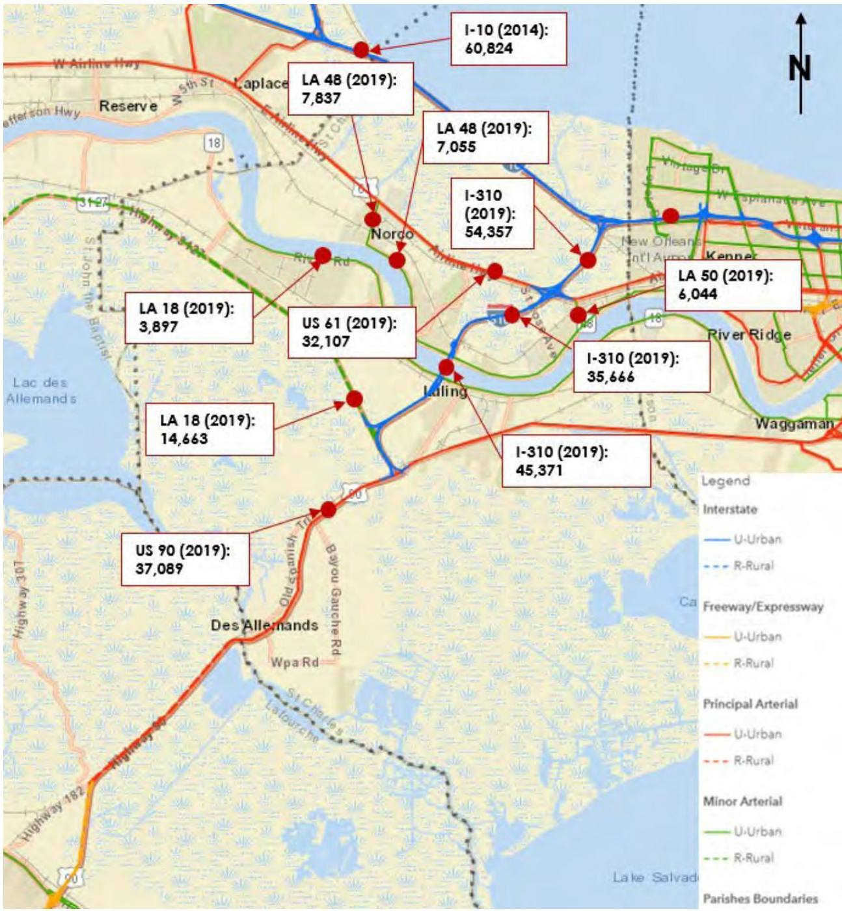

> **Figure description (visual reading, not stated in the plan's text):** Road map of the Laplace, Reserve, Nordo, Luling, Des Allemands, Kenner and River Ridge area, with Waggaman, Lac des Allemands and Lake Salvador labeled. Eleven labeled red-dot callouts give traffic counts: I-10 (2014): 60,824; LA 48 (2019): 7,837 and 7,055; I-310 (2019): 54,357, 35,666 and 45,371; LA 50 (2019): 6,044; LA 18 (2019): 3,897 and 14,663; US 61 (2019): 32,107; US 90 (2019): 37,089. One additional red dot near Kenner has no callout. The legend lists Interstate, Freeway/Expressway, Principal Arterial, Minor Arterial and Parishes Boundaries, with U-Urban (solid) and R-Rural (dashed) line symbols in blue, orange, red and green; the legend is cut off at the bottom edge, so the Parishes Boundaries symbol is not visible. Other printed labels include W Airline Hwy, Airline Hwy, Jefferson Hwy, Highway 307, Highway 182, Old Spanish Trl, Bayou Gauche Rd, Wpa Rd, Latourche and St Charles.

## Page 87

#### Minor Collectors

All of the following minor collectors are two-lane roadways. Minor collectors are either state or parish roads.

» Evangeline Road   
» E. Harding Street   
» LA 3141   
» LA 631 (Old Spanish Trail)   
» LA 635   
» Hwy 631   
» LA 632 (WPA Road)   
» LA 306 (Bayou Gauche Road)   
» LA 633 (Magnolia Ridge Road)   
» Primrose Drive   
» River Ridge Drive from US 90 to Primrose Drive   
» Heather Drive   
» Lakewood Drive   
» Barton Avenue   
» Willowdale Boulevard

#### Areas of Congestion

The Regional Integrated Transportation Information System (RITIS) data identifies areas of congestion. Using RITIS, typical Tuesday-Thursday data was analyzed to determine the times and locations of the heaviest congestion parish-wide. Congestion percentage was determined based on the average speed of the segment as a percentage of free flow speed of that segment.

Based on the available information, more data is necessary to further refine and understand the parish’s level of congestion. Coordination with the Parish and the New Orleans Regional Planning Commission is necessary to further develop areas of high congestion and to further define operational issues in the parish. Figure TR-2 and Figure TR- 3 depict the parish-wide congestion maps based on RITIS data.

## Page 88

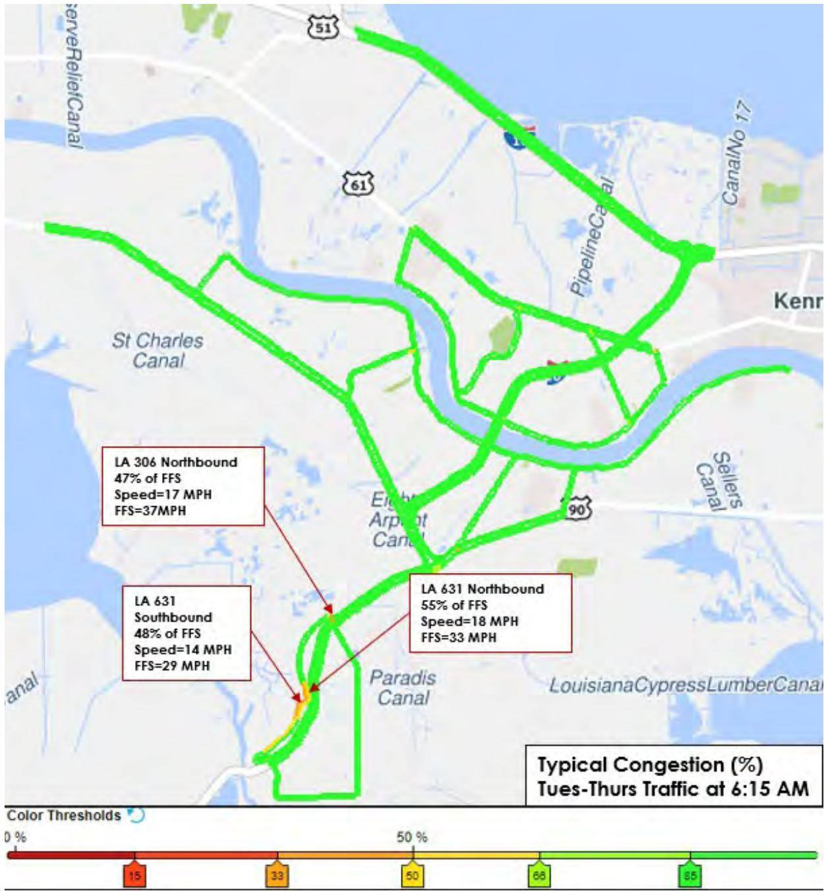

> **Figure description (visual reading, not stated in the plan's text):** Congestion map titled 'Typical Congestion (%) Tues-Thurs Traffic at 6:15 AM' showing a road network with Kenner labeled at the upper right. Three callouts read: 'LA 306 Northbound, 47% of FFS, Speed=17 MPH, FFS=37MPH'; 'LA 631 Southbound, 48% of FFS, Speed=14 MPH, FFS=29 MPH'; and 'LA 631 Northbound, 55% of FFS, Speed=18 MPH, FFS=33 MPH'. Most segments are green, with yellow-orange segments near the southern callouts. The color threshold bar is labeled 0 %, 15, 33, 50 %, 66 and 85, with red, orange, yellow, light green and green bands. Printed water labels include St Charles Canal, Paradis Canal, PipelineCanal, Canal No 17, LouisianaCypressLumberCanal, Sellers Canal, a label ending in 'ServeReliefCanal' that is cut off at the top left, and an 'Airport Canal' label partly covered by a callout. Route shields for US 51, US 61 and US 90 are printed.

## Page 89

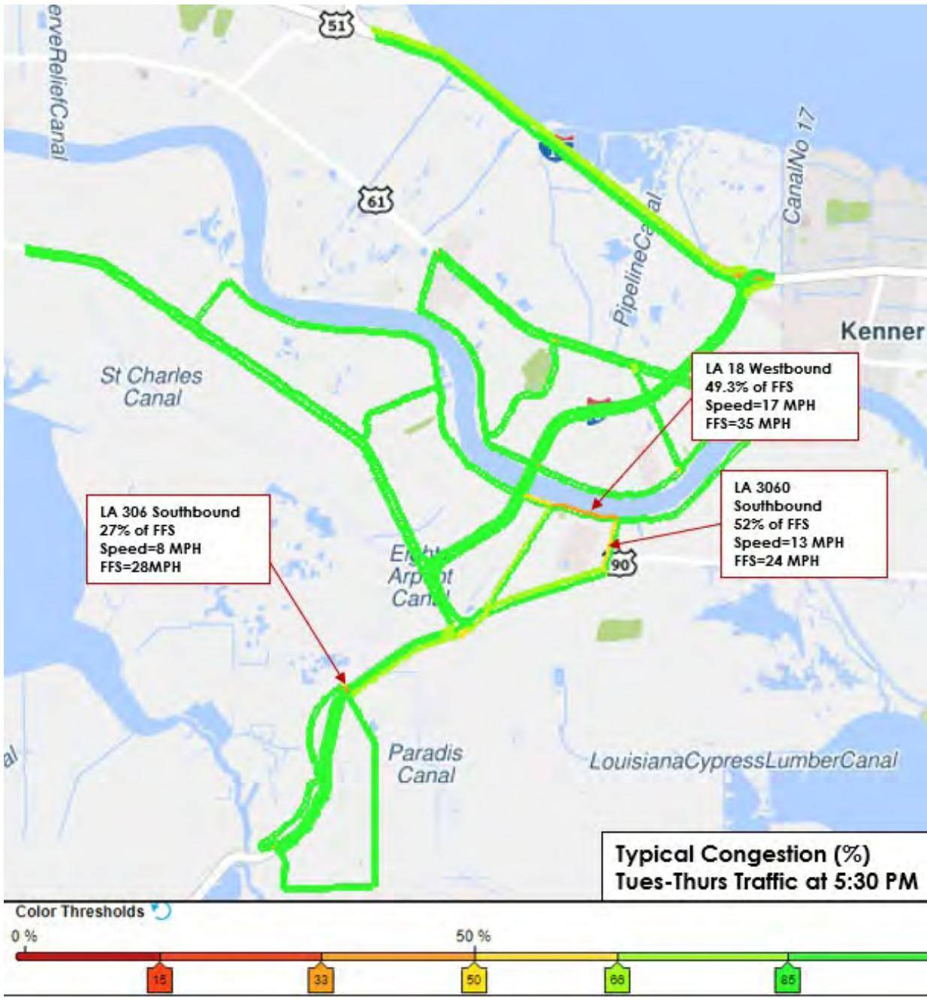

> **Figure description (visual reading, not stated in the plan's text):** Congestion map titled 'Typical Congestion (%) Tues-Thurs Traffic at 5:30 PM' covering the same road network as the preceding map. Three callouts read: 'LA 18 Westbound, 49.3% of FFS, Speed=17 MPH, FFS=35 MPH'; 'LA 3060 Southbound, 52% of FFS, Speed=13 MPH, FFS=24 MPH'; and 'LA 306 Southbound, 27% of FFS, Speed=8 MPH, FFS=28MPH'. Most segments are green, with yellow-orange segments along the LA 18 crossing and near the LA 3060 and LA 306 callouts. The color threshold bar is labeled 0 %, 15, 33, 50 %, 66 and 85, with red, orange, yellow, light green and green bands. Printed labels include Kenner, St Charles Canal, Paradis Canal, PipelineCanal, Canal No 17, LouisianaCypressLumberCanal, a partly covered 'Airport Canal' label, and route shields for US 51, US 61 and US 90.

## Page 90

#### Traffic Impact Analysis

In December 2020, the Parish adopted two ordinances to address the impact of traffic generated by new development on existing infrastructure, the transportation network and the quality of life in the parish. Ordinance 20-12-3 added a traffic impact analysis (TIA) as part of the review for new development, both major and minor land subdivision, to ensure quality of life remains high and the transportation network remains safe and adequate. The second ordinance, 20-12-2 requires a TIA as part of the permitting process for new development, including all new commercial, industrial, townhome, apartment, and multiplex construction. These ordinances are supplemental to the LA DOTD regulations where any development that generates over 100 new trips within a ¼ mile of a state route is subject to a TIA.

The TIA ordinances should be regularly reviewed and updated to ensure they are consistent with the Parish’s overall transportation goals. Priority recommendations include revising the TIA ordinances to focus less on level of service (LOS) and more on the movement of people.

#### Connectivity

Connectivity is a system of streets with multiple routes and connections serving the same origins and destinations. A connected network helps reduce the volume of traffic and traffic delays on streets, and ultimately improves livability in communities, by providing parallel routes and alternative route choices. Bicycle and pedestrian travel is also enhanced by increasing the number of street connections or local street intersections in communities.

Proposed developments should provide multiple direct connections in the local street system to and between local destinations, such as parks, schools, and shopping, without requiring the use of arterial streets. Each development should incorporate and continue all collector or local streets stubbed to the boundary of the development plan by previously approved, but unbuilt development or existing development. Characteristics of a well-connected road or path network include short block lengths, numerous three and four-way intersections and minimal dead-ends.

## Page 91

#### Access Management

According to LA DOTD, Access Management is a technique used to improve efficiency and safety on roadways. It aims at focusing on the location, spacing, design of entrances, street intersections, median openings, and traffic signals by minimizing conflict points. From a road design perspective, Access Management can be achieved by limiting full access intersections through: raised medians, channelization, U-turns, or J-turns. Access Management from an individual property perspective can be accomplished by establishing a minimum distance between driveways, reducing the number of driveways, or constructing rear-access roads / inter-property connections. Minimizing the number of conflict points on a road can greatly increase the safety, aesthetics and efficiency of a road.

#### NORPC Proposed Projects

The NORPC for Jeferson, Orleans, Plaquemines, St. Bernard, St. Charles, St. John the Baptist, St. Tammany, and Tangipahoa Parishes serves as the Metropolitan Planning Organization (MPO) for the New Orleans Urbanized Area (UZA) and Metropolitan Planning Area (MPA). The NORPC is responsible for planning the metropolitan transportation system and programming the expenditure of federal transportation funds allocated to the region. Regional transportation planning is accomplished through coordination with a variety of partners, including elected officials; local, state and federal agencies; public transit providers; community and advocacy groups; and the public.

The Metropolitan Transportation Plan (MTP) 2048 is the chief document reflecting the goals and objectives, the resources, the fundamental planning process, and the project implementation schedule for the region over the next 30 years. The MTP is revised every five years, and the latest version of the MTP was adopted in January, 2019.

The Transportation Improvement Program (TIP) is adopted every four years by NORPC and consists of a priority list of projects (both highway and transit), which are being advanced toward construction over the four year period Fiscal Year 2019 to Fiscal Year 2022. Projects listed in the TIP have evolved through the transportation planning process and are contained in the region’s long-range MTP.

Listed below are the projects within the parish that are noted in either the NORPC MTP and/or the TIP.

#### Listed in the MTP and TIP

» LA 18: Add left turn lane at LA 3060

» LA 628: Add right turn lane at US 6

» LA 3127: Add right turn lane at LA 3141

» US 90: Operational improvements, turn lanes

LA 52 (Phase 1): Blueberry Hill-Angus Drive bike/pedestrian complete streets

#### Listed in the MTP

» US 90 at I-310 Interchange: US 90 widening and operational improvements

» St. Charles Westbank Levee Path (Phase 4 and 5): Shared-use path

» I-310: Luling Bridge replacement

» LA 52 (Phase 2) US 90 to Blueberry Hill: Safety and TSM improvements

» LA 52 (Phase 3) Angus Dr to LA 18: Safety and TSM improvements

» I-49 South (310-Lafourche): Capacity

» Willowdale Extension, US 90 to LA 18: New roadway

## Page 92

The 2015 Louisiana Statewide Transportation Plan includes a list of prioritized megaprojects statewide, which have been prioritized based on project need, cost, goals, and proposed funding options.

Listed below are the megaprojects which fall within St. Charles Parish:

» I-49 South segment from Raceland to Des Allemands: Priority A Megaproject Estimated cost = \$190 million

» I-49 South segment from Des Allemands to I-310 (including improvements to the I-310/ US 90 interchange): Priority C Megaproject Estimated cost = \$470 million

» I-49 South segment from I-310 to Avondale (East of Lapalco Blvd): Priority C Megaproject Estimated cost = \$253 million

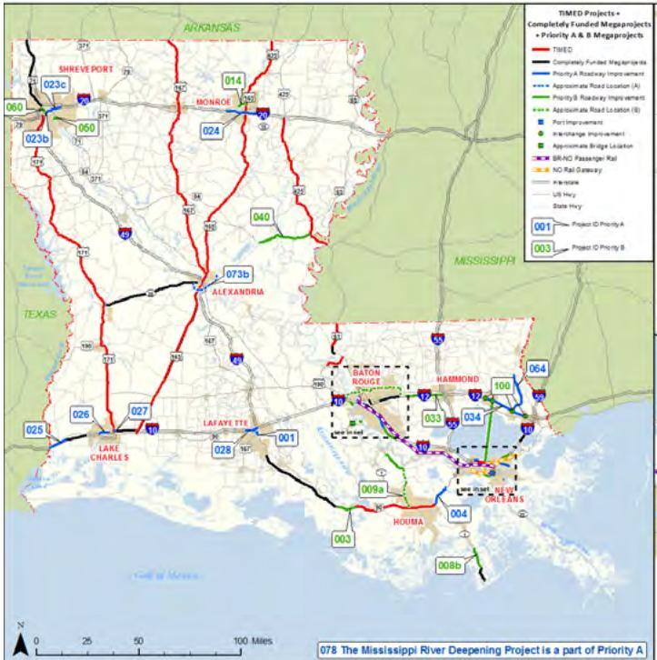

> **Figure description (visual reading, not stated in the plan's text):** Statewide Louisiana map titled 'TIMED Projects + Completely Funded Megaprojects + Priority A & B Megaprojects', with a 0, 25, 50, 100 Miles scale bar and a dashed 'see inset' box near New Orleans. Printed place labels include Shreveport, Monroe, Alexandria, Lafayette, Lake Charles, Baton Rouge, Hammond, Houma, New Orleans, Arkansas, Mississippi, Texas and Gulf of Mexico. The legend lists TIMED; Completely Funded Megaprojects; Priority A Roadway Improvement; Priority B Roadway Improvement; Approximate Road Location (A); Approximate Road Location (B); Port Improvement; Interchange Improvement; Approximate Bridge Location; BR-NO Passenger Rail; NO Rail Gateway; Interstate; US Hwy; State Hwy; Project ID Priority A (blue box); and Project ID Priority B (green box). Project numbers printed on the map include 001, 003, 004, 008b, 009a, 014, 023b, 023c, 024, 025, 026, 027, 028, 033, 034, 040, 060, 064, 073b and 100, and a footer reads '078 The Mississippi River Deepening Project is a part of Priority A'. Some small project numbers are hard to confirm at this resolution.

#### Louisiana Road Transfer Program

Currently the State of Louisiana owns over 27 percent of the public road mileage in the state, which is significantly higher than the national average of 19 percent. In an effort to right-size or reduce the number of miles under the State’s stewardship, the State has established a voluntary road transfer program to transfer some roadways from State to Parish ownership. The Road Transfer Program involves transferring these roads, with the money, to local governments. St. Charles Parish currently has 135 state highway miles; 57.53 state miles have been proposed for transfer to the Parish.

The following state routes are proposed for transfer to the Parish (as of March 2017):

» LA 628 (River Road / CC Road)

» LA 627 (Prospect Avenue)

» LA 626 (St. Rose Avenue)

» LA 48 (River Road) from LA 50 (Almedia Road) to the parish Line

» LA 18 (River Road) from parish line to LA 3141

» LA 18 (River Road) from just outside of Taft to Jeferson Parish line

» LA 631 (Old Spanish Trail)

» LA 632 (WPA Rd)

» LA 632 (Grand Bayou Road)

» LA 306 (Bayou Gauche Road)

» LA 52 (Paul Maillard Road)

» LA 633 (Magnolia Ridge Road)

» LA 3060 (Barton Avenue)

## Page 93

To effectuate the greatest change for the residents of St. Charles Parish, state routes that are located in residential land uses and are relatively short in length should be given the highest consideration to transfer control from LA DOTD to St. Charles Parish. The change will come from designing the road to meet local design guidelines versus adhering to the more stringent LA DOTD standards. Funds obtained through the transfer could be used to enclose the ditches or provide future maintenance.

The following roads should be considered for the Road Transfer Program:

» LA 626 (St. Rose Avenue) » LA 3160 (Home Place) » LA 3060 (Barton Avenue) » LA 52 (Paul Maillard Road) » LA 306 (Bayou Gauche Road) » LA 632 (Grand Bayou Road) » LA 632 (WPA Road) » LA 633 (Magnolia Ridge Road)

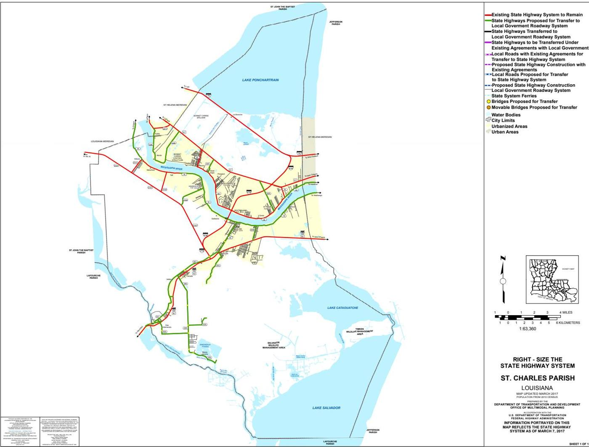

> **Figure description (visual reading, not stated in the plan's text):** Map titled 'RIGHT - SIZE THE STATE HIGHWAY SYSTEM', 'ST. CHARLES PARISH, LOUISIANA', 'MAP UPDATED MARCH 2017', with the note 'Information portrayed on this map reflects the state highway system as of March 7, 2017' and 'Population from 2010 Census'. The legend lists: Existing State Highway System to Remain (red); State Highways Proposed for Transfer to Local Government Roadway System (green); State Highways Transferred to Local Government Roadway System (black); State Highways to be Transferred Under Existing Agreements with Local Government (purple); Local Roads with Existing Agreements for Transfer to State Highway System; Proposed State Highway Construction with Existing Agreements; Local Roads Proposed for Transfer to State Highway System; Proposed State Highway Construction; Local Government Roadway System; State System Ferries; Bridges Proposed for Transfer (yellow circle); Movable Bridges Proposed for Transfer (orange circle); Water Bodies; City Limits; Urbanized Areas; and Urban Areas. Printed labels include LAKE PONCHARTRAIN, Lake Cataouatche, Lake Salvador, Mississippi River, Bonnet Carre Spillway, Bonnet Carre Control Structure, Tiger Wildlife Management Area, Salvador Wildlife Management Area, Hahnville, Des Allemands, St. John the Baptist Parish, Jefferson Parish, Lafourche Parish and St. Helena Meridian. Route numbers are too small to transcribe.

> **Text-layer supplement (text on this page that the layout parse did not capture; reading order approximate, taken from the PDF text layer):**
>
> Bayou Couba Oilfield Canal
>
> THIS MAP HAS BEEN PREPARED BY THE LOUISIANA DEPARTMENT OF TRANSPORTATION AND DEVELOPMENT OFFICE OF MULTIMODAL PLANNING CARTOGRAPHY/GIS UNIT IN COOPERATION WITH THE U.S. DEPARTMENT OF TRANSPORTATIONFEDERAL HIGHWAY ADMINISTRATION.
>
> U.S. DEPARTMENT OF TRANSPORTATION FEDERAL HIGHWAY ADMINISTRATION
>
> DATA ON THIS MAP IS INTENDED FOR INTERNAL PLANNING USE ONLY. ALTHOUGH THIS DATA HAS BEEN SUBJECTED TO MANY RIGOROUS TESTS – ALL WITH EXCELLENT RESULTS – NO WARRANTY, EXPRESSED OR IMPLIED, IS MADE AS TO THE ACCURACY OF THE DATA, NOR SHALL THE FACT OF DISTRIBUTION CONSTITUTE ANY SUCH WARRANTY. DOTD ASSUMES NO LIABILITY IN ANY CONNECTION THERE-WITH, AND ASSUMES NO RESPONSIBILITY TO DISTRIBUTE FUTURE MODIFICATIONS OR CORRECTIONS THAT MAY BE MADE.
>
> www.dotd.louisiana.gov – GIS/Maps Online PRINTED COPIES OF THIS MAP ARE AVAILABLE FOR PUBLIC USE AT A NOMINAL COST. PLEASE SEE THE FOLLOWING CONTACT INFORMATION:
>
> PROJECTION: NAD_1983_UTM_Zone_15N Transverse_Mercator False_Easting: 500000.000000 False_Northing: 0.000000 Central_Meridian: -93.000000 Scale_Factor: 0.999600 Latitude_Of_Origin: 0.000000 HORIZONTAL DATUM: NORTH AMERICAN DATUM OF 1983
>
> DEPARTMENT OF TRANSPORTATION AND DEVELOPMENT GENERAL FILES – MAP SALES P.O. BOX 94245 BATON ROUGE, LA 70804-9245 (225) 379-1107
>
> \\H85001MS001\85Common\85map\Special_Projects\Eric_Kalivoda\Sizing_State_Highway_System\Version_2017\District 02_2017_RS\StCharles_2017_RS.mxd ! (
>
> DEPARTMENT OF TRANSPORTATION AND DEVELOPMENT OFFICE OF MULTIMODAL PLANNING
>
> ST. C H A R L E S PA RISH C OMPREH ENS I V E PL A N UPDATE

## Page 94

#### I-49 Connector

I-49 South is intended to provide a transcontinental highway linking the coastal ports of Louisiana to the entire central United States and central Canada. When completed, within Louisiana, I-49 would connect the interchange of I-49 and I-10 in New Orleans with I-49 in Arkansas. I-49 currently is complete between Shreveport and Lafayette. I-49 South is the section between I-10 in Lafayette and I-10 in New Orleans, which would upgrade the existing US 90 corridor to interstate design standards. Completion of the I-49 South Connector would result in the improvement of access throughout the southern region of the state and may relieve congestion on I-10 between Lafayette and New Orleans.

The new interstate would connect I-49 South to north Louisiana, creating system linkage and enhancing mobility between Lafayette and New Orleans by increasing capacity to meet the travel demand of the design year. The most noticeable changes in traffic that would take place in the US 90 corridor are on US 90 westbound (WB) in Link 4, and on the frontage roads of the Westbank Expressway in Westwego. The LOS is currently F in both locations, which is the worst operating conditions. Construction of I-49 would divert sufficient traffic that both locations would improve to LOS A, the best operating conditions. The new interstate would also increase the movement of freight on an intercontinental scale, enhancing the economic potential of Louisiana through improved access to ports, airports, industrial sectors and tourist attractions. The new corridor would improve regional evacuations from emergencies by providing a continuous elevated roadway capable of being adapted to the use of contraflow lanes. This project is proposed by LA DOTD in cooperation with the FHWA and will be developed in coordination with federal and state resource agencies.

The purpose of the I-49 connector project is to develop I-49 South in the US 90 corridor between the LA 1 / LA 308 interchange at Bayou Lafourche, near Raceland in Lafourche Parish, and the existing completed portion of the elevated Westbank Expressway, near Ames Boulevard in Jeferson Parish, for 36.3 miles. This project also includes an extension of Interstate Highway 310 (I-310) from its current alignment to an interchange with I-49, approximately 2.3 miles. The total length of mainline interstate construction would be 38.6 miles.

The final environmental impact statement (FEIS) for the I-49 connector was completed in coordination with LA DOTD and FHWA in 2007. The selected alternative runs south of US 90 from the Lafourche Parish Line until the proposed interchange at I-310. East of I-310, the selected alternative follows the existing US 90 highway. The FEIS evaluates in detail all potential environmental consequences of the selected alternative, which include relocation of residences, commercial buildings and businesses and other facilities, impact to utilities such as transmission lines, pipelines and drainage structures during construction, and maintenance of visual quality along the Westbank Expressway. The FEIS also outlines measures taken or proposed to be taken during design and construction to avoid, minimize, or mitigate the environmental consequences of the selected alternative. These measures include relocating residences, commercial buildings and

## Page 95

businesses in accordance with federal regulations, relocating utilities prior to or during construction and designing the Westbank Expressway to have an appearance identical to the existing completed portion of that roadway.14 The FEIS was published in the Federal Register in October of 2007, and the Record of Decision (ROD) was published in January of 2008, which allowed the project to begin corridor preservation, and to design and construct the corridor as funding became available.

Figure TR-5 depicts the high-level alignment of the selected alternative. Link 3, Link 4, and Link 5, all fall within St. Charles Parish. The I-49 South Connector is included in the 2015 Louisiana Statewide Transportation Plan, as the segments previously mentioned in Proposed Projects.

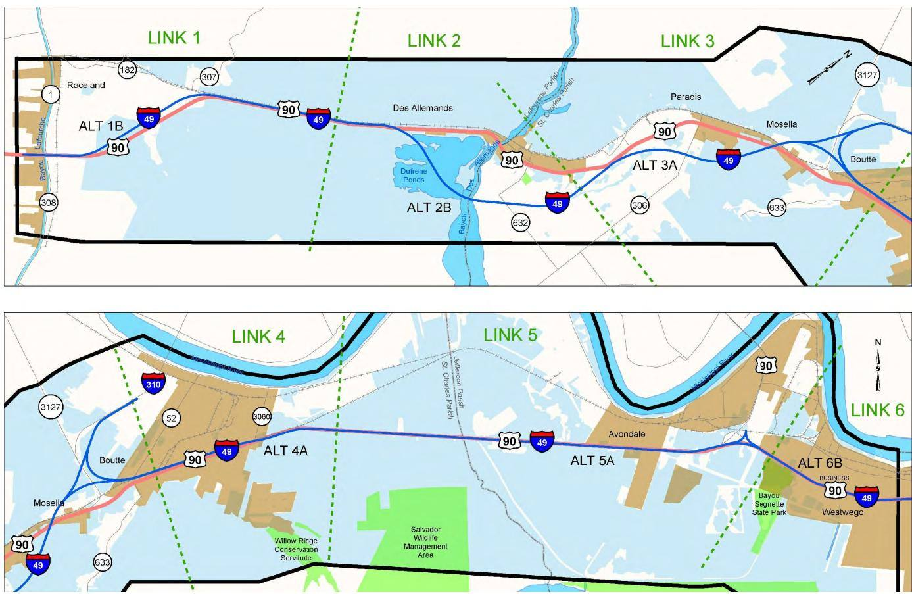

> **Figure description (visual reading, not stated in the plan's text):** Two stacked map panels of the I-49 South Connector study corridor, divided into six areas labeled LINK 1 through LINK 6 by dashed green lines, with alternatives labeled ALT 1B, ALT 2B, ALT 3A, ALT 4A, ALT 5A and ALT 6B. The image has no printed legend, so the blue and pink/red lines are not explained. Printed place labels include Raceland, Des Allemands, Paradis, Mosella, Boutte, Avondale, Westwego, Bayou Segnette State Park, Dufrene Ponds, Willow Ridge Conservation Servitude, Salvador Wildlife Management Area and Bayou Des Allemands. Parish labels are Lafourche Parish, St. Charles Parish and Jefferson Parish. Route shields include 1, 182, 307, 308, 632, 306, 633, 3127, 3060, 52, 310, US 90, I-49 and Business 90, and the bottom panel is cut off at the bottom edge.

> **Text-layer supplement (text on this page that the layout parse did not capture; reading order approximate, taken from the PDF text layer):**
>
> Final Environmental Impact Statement: I-49 South, Raceland to Westbank Expressway
>
> S-5 Source: Final Environmental Impact Statement: I-49 South, Raceland to Westbank Expressway, 2014
>
> 14 Summary Final Environmental Impact Statement: I-49 South, Raceland to Westbank Expressway, 2014 http://wwwsp.dotd.la.gov/Inside_LaDOTD/Divisions/Engineering/ Environmental/Documents/I-49%20South/I49%20South%20Raceland%20to%20Westbank%20Expwy/Summary%20FEIS.pdf
>
> ST. C H A R L E S PA RISH C OMPREH ENS I V E PL A N UPDATE

## Page 96

#### US 90 Corridor

US 90 is an east-west highway corridor that enters the West Bank of St. Charles Parish from Jeferson Parish and connects to LA 631, LA 632, LA 306, LA 3060 (Barton Road), LA 3127, LA 63, LA 52, and I-310. Businesses along the corridor include professional services, retail, and commerce. However, development has been scattered and lacks visual character. Adopting regulations to guide development can encourage cohesion, improve visual quality and character of the corridor, and drive further economic development. In addition, improvements to the US 90 corridor will improve corridor performance, enhance the visual quality of the corridor, and incentivize quality development along the corridor.

In July, 2021, St. Charles Parish submitted an application to the U.S. DOT Rebuilding American Infrastructure with Sustainability and Equity (RAISE)

Grant Program for the US 90 Comprehensive Main Street Corridor Plan. The project proposed to create a comprehensive long-range master plan that will prioritize improvements along a fourmile stretch of US 90 with a western boundary at the I-310 interchange in Boutte, Louisiana, and an eastern boundary at Willowdale Boulevard in Luling, Louisiana. The plan proposed to focus on improvements that will create a safe and efficient thoroughfare with a main street atmosphere that will enhance economic development and become a source of community pride.

Although the project did not receive RAISE Grant funding, once funded and completed, the US 90 Comprehensive Main Street Corridor Plan will help ensure unified and cohesive development along US 90 moving forward.

#### US 90 Corridor Improvement Recommendations

#### Existing Conditions for US 90

» Principal Arterial

» 4-lane, divided highway with a 55 MPH posted speed limit with 5-foot inside shoulder and 10-foot outside shoulder

• Western parish line to LA 52 (20-25-foot median)

• Coronado Drive to eastern parish line (8-foot median)

» 5-lane section from Magnolia Ridge Road to Coronado Drive with a 35 MPH speed limit with 10-foot outside shoulder

» AADT 37,000

#### Recommendations

» Reduce visual clutter including site access and unified signage.

» Execute a cooperative endeavor agreement with LA DOTD for enhanced landscaping, street lighting and pedestrian striping / signage.

» Consider removing center turn lane and replace with median.

» Full-access median openings are only allowed at signalized intersections.

» Desirable spacing for passenger car median U-turn openings is ¼ mile.

» Place major U-turn openings every two miles for WB-67 design vehicles.

» Corner properties' access should be right-in / right-out with full access on the side street.

» Locate bioswales in the depressed median.

» Space driveways at 550 feet per LA DOTD Access Management Policy.

» Driveway geometric design (width, turning radii, and throat lengths) should conform to LA DOTD Access Management Policy.

» Due to volume and speed conditions, a 10-foot (8-foot minimum) multiuse path on either side of US 90 is recommended, where feasible, between Magnolia Ridge Road and Coronado Drive.

» Development standards to require landscaping, access management and potential building standards for new development adjacent to US 90.

## Page 97

> **Text-layer supplement (text on this page that the layout parse did not capture; reading order approximate, taken from the PDF text layer):**
>
> Figure TR-6: U.S. 90 Corridor Improvements Visualizations, St. Charles Parish
>
> ST. C H A R L E S PA RISH C OMPREH ENS I V E PL A N UPDATE

## Page 98

> **Text-layer supplement (text on this page that the layout parse did not capture; reading order approximate, taken from the PDF text layer):**
>
> Figure TR-6: U.S. 90 Corridor Improvements Visualizations, St. Charles Parish
>
> ST. C H A R L E S PA RISH C OMPREH ENS I V E PL A N UPDATE

## Page 99

#### Evacuation Routes

#### WATERFORD POWER PLANT EMERGENCY PLAN

The Waterford Steam Electric Station, Unit 3, also known as Waterford 3, is a nuclear power plant located on a 3,000-acre plot in Killona. The Waterford 3 issues an emergency brochure with an evacuation map that includes a large part of the parish. The evacuation routes utilize east-west roadways in order to distribute vehicles away from the nuclear site to safety.

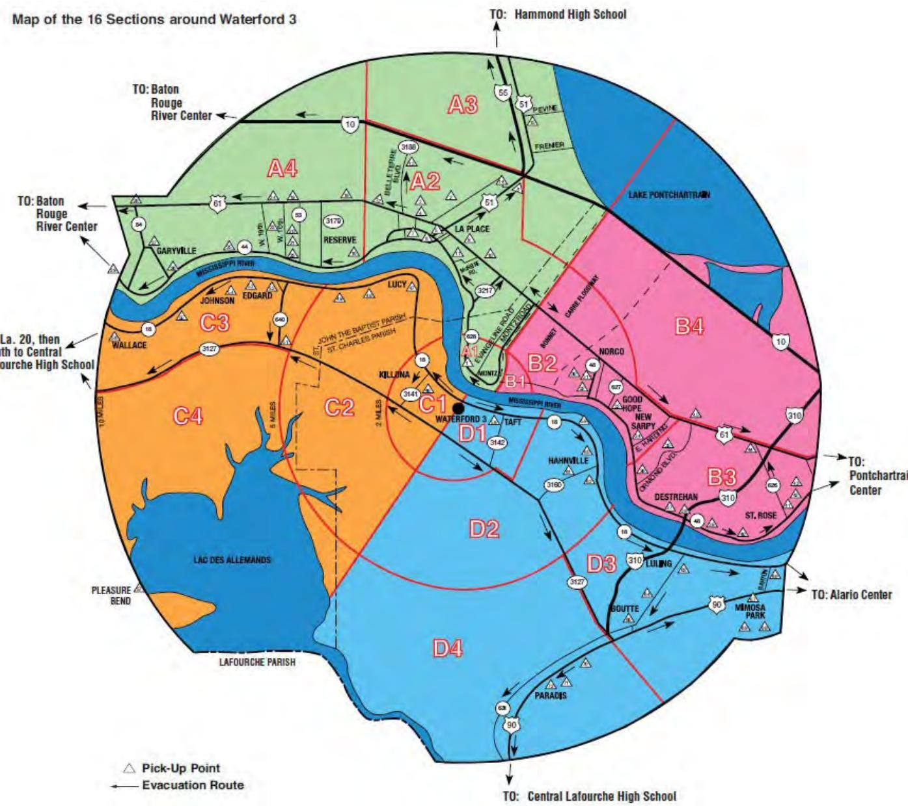

> **Figure description (visual reading, not stated in the plan's text):** Map titled 'Map of the 16 Sections around Waterford 3', a circle divided into sections A1-A4, B1-B4, C1-C4 and D1-D4, shaded green, pink, orange and light blue, with red range rings and a black dot labeled WATERFORD 3. The legend reads 'Pick-Up Point' (triangle symbol) and 'Evacuation Route' (arrow). Edge callouts read 'TO: Hammond High School', 'TO: Baton Rouge River Center' (two labels), 'TO: Pontchartrain Center', 'TO: Alario Center', 'TO: Central Lafourche High School', and a left-edge callout reading 'La. 20, then' followed by text cut off at the edge ('...uth to Central ... ourche High School'). Printed place labels include Lake Pontchartrain, Lac des Allemands, Pleasure Bend, Wallace, Johnson, Edgard, Lucy, Garyville, Reserve, La Place, Killona, Taft, Norco, Good Hope, New Sarpy, Destrehan, St. Rose, Hahnville, Luling, Boutte, Mimosa Park, Paradis, Montz, Lafourche Parish and St. John the Baptist Parish. Numbered route shields include 61, 51, 55, 10, 90, 18, 3127, 3141, 3142, 3160 and 310.

## Page 100

#### HURRICANE EVACUATION ROUTES

LA DOTD has established hurricane evacuation routes for southeast Louisiana along I-10, I-55, Highway 190 (US 190), Interstate 12 (I-12), Interstate 610 (I-610), and Interstate 59 (I-59). In strategic locations, contraflow crossovers are provided to allow vehicles on both sides of the interstates and highways to travel in the same direction.

In St. Charles Parish, I-10 operates as westbound only with contraflow for the entire parish. St. Charles Parish also recommends evacuation routes for the parish along LA 3127, US 90, and US 61. Figure TR-8 shows the local evacuation routes for St. Charles Parish residents in the event of a hurricane.

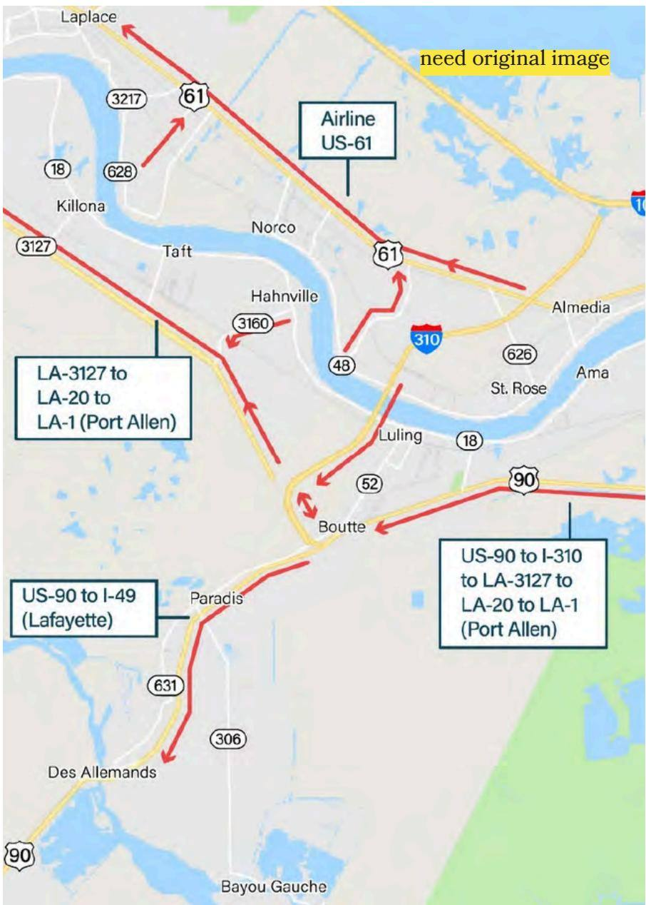

> **Figure description (visual reading, not stated in the plan's text):** Road map of the Laplace, Killona, Taft, Norco, Hahnville, Almedia, St. Rose, Ama, Luling, Boutte, Paradis, Des Allemands and Bayou Gauche area, with red arrows marking evacuation routes. Callout boxes read 'Airline US-61', 'LA-3127 to LA-20 to LA-1 (Port Allen)', 'US-90 to I-310 to LA-3127 to LA-20 to LA-1 (Port Allen)' and 'US-90 to I-49 (Lafayette)'. Route shields printed on the map include 3217, 61, 628, 18, 3127, 3160, 48, 626, 52, 310, 90, 631 and 306. A yellow-highlighted note in the upper right reads 'need original image', and the map has no legend.

## Page 101

#### Mississippi River Crossings

Currently, the Luling Bridge is the only Mississippi River crossing in St. Charles Parish. Within the NORPC MTP, there is documentation that the LA DOTD District 02 Engineer Administrator requested a new Mississippi River crossing to be included in the MTP since the Pontchartrain Expressway study did not reveal any solutions to the corridor congestion issues.

A "West Side Connector" is listed in the Louisiana Transportation Plan as a Priority D Megaproject, which includes connection and a new Mississippi River Bridge, at an estimated cost of \$1.7 billion. Based on the limits provided for this megaproject, the new four-lane highway and proposed Mississippi River Bridge may fall anywhere between West Baton Rouge and the St. John the Baptist-St. Charles Parish line and will not be located in St. Charles Parish. This proposed project, however, should be expected to alleviate some of the traffic volumes on the I-310 Luling Bridge.

There is no active ferry service in St. Charles Parish.

#### Rail System

#### FREIGHT

The freight rail in St. Charles Parish is served by the following four railroads:

1. BNSF/Union Pacific Railroad (UP)/Amtrak runs parallel to US 90 (West Bank).

2. UP runs parallel to the south levee and services plants in St. Charles Parish (West Bank).

3. Canadian National Railroad (CN) runs parallel to the north levee (East Bank).

4. Kansas City Southern Railway (KCS) also runs parallel to the north levee, north of the CN (East Bank).

These railroads connect to the New Orleans area’s six-carrier network, which is the largest carrier network in the southern United States. Of the seven Class 1 Rail Companies in North America, St. Charles Parish is one of the few places in North America where one can find four Class 1 Railroads.

#### RAIL CROSSINGS

With four Class 1 Railroads running through St. Charles Parish, railroad crossings are a significant issue facing commuters when traveling. There are 41 railroad crossings in St. Charles Parish—ten in Norco, five in Killona, five in St. Rose, five in Luling, four in New Sarpy and the remainder in other parts of the parish. Of these 41 railroad crossings, four of them occur with a minor arterial roadway–two on LA 48 (Apple Street) and two on LA 50 (Almedia Road). Eleven of the crossings occur on major collector roads–one on LA 628, two on Prospect Avenue, two on Ormond Blvd, two on LA 626 (St. Rose Avenue), one on River Bend Drive, two on LA 52 (Paul Maillard Road), and one on Highway 3160.

#### Water Transportation

Cargo is delivered to and from St. Charles Parish via the Mississippi River to serve the local and regional economy, as well as all of mid-America. The cargo facility is owned and operated by Port of South Louisiana.

#### Air Transportation

Commercial passenger or freight air travel is not available within St. Charles Parish. Air transportation is available from the Louis Armstrong New Orleans International Airport, less than five miles from St. Charles Parish.

## Page 102

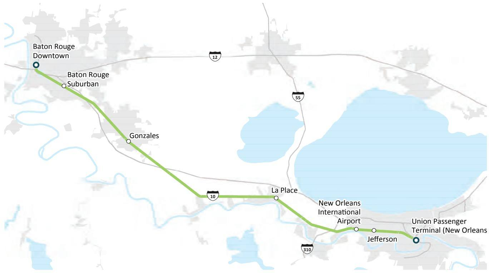

> **Figure description (visual reading, not stated in the plan's text):** Map of a rail corridor drawn as a green line from Baton Rouge Downtown through Baton Rouge Suburban, Gonzales, La Place, New Orleans International Airport and Jefferson, ending at Union Passenger Terminal (New Orleans, with the closing parenthesis cut off at the right edge). Open circles mark intermediate stops, and two dark-outlined circles mark the end points. Interstate shields 12, 55, 10 and 310 are printed. The map has no printed legend or scale, and the light blue water bodies are unlabeled.

#### Transit

#### RIVER PARISH TRANSIT AUTHORITY

The River Parish Transit Authority (RPTA) provides door-to-door transportation services in St. Charles and St. John the Baptist Parishes. Service is ofered Monday through Saturday from 5:30 am to 7:30 pm. The RPTA also connects to transit services in Jeferson Parish, and at the Golden Corral Truck stop in St. James Parish. RPTA operates five 10-12 passenger vehicles. Each vehicle is equipped with a wheelchair lift and can accommodate two wheelchair passengers. Service is curb to curb, meaning passengers will be picked up and dropped of at that point along the public street nearest to the point they wish to get on or of the bus.

#### INTERCITY RAIL

For several years, the Baton Rouge Area Foundation (BRAF) has advocated for an intercity rail between Baton Rouge and New Orleans on existing railroads. As currently proposed, the rail would provide stops in Baton Rouge, Gonzales, LaPlace, and in New Orleans (Figure TR-8). The main intentions of the Intercity Rail are to create a Baton Rouge-New Orleans “super region,” reducing delay impacts on I-10 for pass-through drivers and commuters, and provide alternative evacuation means ahead of storms. While there are no stops planned in St. Charles Parish yet, the anticipated traffic reductions on 1-10 will positively impact those commuting from St. Charles Parish to Baton Rouge or New Orleans.

> **Text-layer supplement (text on this page that the layout parse did not capture; reading order approximate, taken from the PDF text layer):**
>
> role in reducing congestion, by providing an alternative transportation mode for cargo that would otherwise be shipped by truck.
>
> Initially, two daily round trips will travel at speeds of up to 79 mph. These trains will operate on Connections to the local transportation network existing freight rail lines owned and operated by are essential for the success of passenger rail Figure TR-8: Proposed Baton Rouge-New Orleans Intercity Rail Corridor and Station Locations
>
> ST. C H A R L E S PA RISH C OMPREH ENS I V E PL A N UPDATE

## Page 103

#### Pedestrian and Bicycle Facilities

#### PEDESTRIAN AND BICYCLE MASTER PLAN

The St. Charles Parish Comprehensive Pedestrian and Bicycle Master Plan was completed in January, 2019, in coordination with NORPC. The primary objective of the plan is to develop a complete framework for pedestrian and bicyclist circulation at a parish-wide level that will improve safety and increase access and mobility opportunities. The plan establishes a hierarchy of facility types dependent on site-specific conditions that build upon the existing pedestrian and bicycle networks in St. Charles Parish. The project works to improve safety, increase transportation options, and spur economic development. The plan also includes a draft complete streets ordinance for St. Charles Parish.

#### Incident Data

The plan evaluated all pedestrian and bicycle crash data for the parish from 2013 to 2016. In this fouryear period, there were 63 pedestrian crashes and 18 bicycle crashes. Of these, six were fatalities, including five pedestrians and one bicyclist. (See Figures TR-9 and TR-10.)

## Page 104

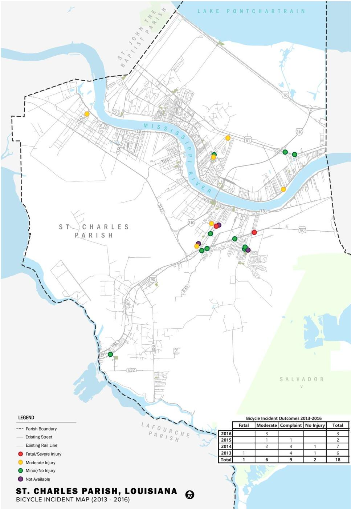

> **Figure description (visual reading, not stated in the plan's text):** Map titled 'ST. CHARLES PARISH, LOUISIANA' and 'BICYCLE INCIDENT MAP (2013 - 2016)', with colored dots marking incident locations. The legend lists: Parish Boundary; Existing Street; Existing Rail Line; Fatal/Severe Injury (red); Moderate Injury (yellow); Minor/No Injury (green); and Not Available (purple). Printed labels include LAKE PONTCHARTRAIN, ST. JOHN THE BAPTIST PARISH, MISSISSIPPI RIVER, ST. CHARLES PARISH, SALVADOR, and LAFOURCHE PARISH, with route shields including 3127, 3160, 18, 61, 10, 310, 90, 633, 631, 306 and 632. A table titled 'Bicycle Incident Outcomes 2013-2016' has columns Fatal, Moderate, Complaint, No Injury and Total, with rows: 2016 (–, 3, –, –, 3); 2015 (–, 1, 1, –, 2); 2014 (–, 2, 4, 1, 7); 2013 (1, –, 4, 1, 6); and Total (1, 6, 9, 2, 18).

> **Text-layer supplement (text on this page that the layout parse did not capture; reading order approximate, taken from the PDF text layer):**
>
> Source: St. Charles Note: Parish Comprehensive Pedestrian and Bicycle Master Plan Points marked as not available are due to missing information in the police report for the extent of injury sustained by the bicyclist. This document and the information contained herein is prepared solely for the purpose of identifying, evaluating and planning safety improvements on public roads which may be implemented utilizing federal and highway funds; and is therefore exempt from discovery or admission into evidence pursuant to 23 U.S. Code § 409.
>
> ST. C H A R L E S PA RISH C OMPREH ENS I V E PL A N UPDATE

## Page 105

> **Figure description (visual reading, not stated in the plan's text):** Map titled 'ST. CHARLES PARISH, LOUISIANA' and 'PEDESTRIAN INCIDENT MAP (2013 - 2016)', with colored dots marking incident locations. The legend lists: Parish Boundary; Existing Street; Existing Rail Line; Fatal/Severe Injury (red); Moderate Injury (yellow); Minor/No Injury (green); and Not Available (purple). Printed labels include LAKE PONTCHARTRAIN, ST. JOHN THE BAPTIST PARISH, JEFFERSON PARISH, MISSISSIPPI RIVER, SALVADOR WMA, and LAFOURCHE PARISH, with route shields including 3127, 3160, 18, 10, 310, 90, 633, 631, 306, 632 and 61. A table titled 'Pedestrian Incident Outcomes 2013-2016' has columns Fatal, Severe, Moderate, Complaint, No Injury and Total, with rows: 2016 (2, 2, 6, 2, 1, 13); 2015 (–, 3, 3, 4, 6, 16); 2014 (1, 1, 3, 11, 1, 17); 2013 (2, 3, 3, 4, 5, 17); and Total (5, 9, 15, 21, 13, 63).

> **Text-layer supplement (text on this page that the layout parse did not capture; reading order approximate, taken from the PDF text layer):**
>
> S T. CH A RLES PA RI SH , LO UISIANA PEDESTRIAN INCIDENT MAP (2013 - 2016)
>
> Note: Points marked as not available are due to missing information in the police report for the extent of injury sustained by the pedestrian. This document and the information contained herein is prepared solely for the purpose of identifying, evaluating and planning safety improvements on public roads which may be implemented utilizing federal and highway funds; and is therefore exempt from discovery or admission into evidence pursuant to 23 U.S. Code § 409.
>
> ST. C H A R L E S PA RISH C OMPREH ENS I V E PL A N UPDATE

## Page 106

#### Priority Projects

The plan outlines 107 projects, including 44 highpriority projects (Table TR-1). Proposed improvements include bike lanes, separated bike lanes, shared use independent paths, shared use paths within roadway right-of-way, improvements at railroad crossings, crosswalks, flashing beacons, pedestrian phasing at signals, and parking regulations.

Based on a review of the pedestrian and bicycle master plan, the highest priority projects should be:

» Paul Maillard Road (LA 52)

» Judge Edward Dufresne Parkway

» Ormond Boulevard

» Apple Street (LA 48)

**Table 16: Table TR-1: St Charles Parish High Priority Bike and Pedestrian Projects**

| Street Name | Path Limits | Path Length (ft) |
|---|---|---|
| Apple St. (LA 48) * | Airline Hwy. (LA 61) to River Rd. (LA 48) | 7,117 |
| Ashton Dr. | S. Destrehan Ave. to Longwood Dr. | 615 |
| Country Cottage Blvd. | Liza Ct. to River Rd. (LA 628) | 17,930 |
| East Bank Bridge Park | N/A | N/A |
| East Bank Levee Multi-Use Trail | Spillway Levee Crown to St. John the Baptist Parish | 15,312 |
| Edgewood Ln. | Leigh Ln. to Westover Ln. | 1,849 |
| Entergy ROW | Ormond Trace to E. Harding St. | 1,959 |
| Entergy ROW | I 310 to S. Destrehan Ave. | 4,138 |
| Eve St. | Murray Hill Dr. to Longview Dr. | 1,242 |
| Fifth St. | Norco St. to W. Pine St. | 4,286 |
| First St. | Apple St. (LA 48) to Washington St. | 2,758 |
| Four J Ln. | Evangeline Rd. to Leigh Ln. | 388 |
| Hill Heights Country Club Trail | Murray Hill Dr. to Plantation Rd. | 2,070 |
| Leigh Ln. | Four J Lane to Edgewood Ln. | 658 |
| Live Oak Dr. | Schexnaydre Ln. to River Village Dr. | 947 |
| Longview Dr. | Eve St. to San Francisco Dr. | 659 |
| Longwood Dr. | Ashton Dr. to San Francisco Dr. | 587 |
| Lower Guide Levee | Wetland Watchers Park to Airline Hwy. (US 61) | 17,930 |
| Murray Hill Dr. | Hill Heights Country Club to River Rd. (LA 48) | 4,922 |
| Ormond Blvd. * | Kansas City Railroad to Airline Hwy. (US 61) | 761 |
| Plantation Rd. | Acadia Ln. to End | 3,073 |
| San Francisco Dr. | Longview Dr. to Longwood Dr. | 763 |
| Schexnaydre Ln. | Thomas Coby Dr. to River Rd. | 4,305 |

_continued on the next page…_

Table snapshot (for checking): 

## Page 107

**Table 17: Table TR-1 (continued): St Charles Parish High Priority Bike and Pedestrian Projects**

| Street Name | Path Limits | Path Length (ft) |
|---|---|---|
| Spillway Rd. | Lower Guide Levee Rd. to Spillway Levee Crown | 8,956 |
| Thomas Coby Dr. | Ormond Blvd. to Schexnaydre Ln. | 886 |
| Washington St. | Third St. (Bethune Park) to River Rd. (LA 48) | 1,576 |
| Barton Ave. (LA 3060) | Rex St. to Highway 90 (US 90) | 939 |
| Davis Dr. | River Rd. (LA 18) to Rex S. | 5,483 |
| Highway 90 (US 90) | Barton Ave. (LA 3060) to Paul Maillard Rd (LA 52) | 14,587 |
| Judge Edward Dufresne Pkwy. * | River Rd. (LA 18) to End | 5,448 |
| Lakewood Dr. | Birch St. to N. Lake Dr. | 4,014 |
| Lakewood Dr. | Highway 90 (US 90) to Birch St. | 2,703 |
| Paul Maillard Rd. (LA 52) * | River Rd (LA 18) to Highway 90 (US 90) | 14,648 |
| Rex St. | Davis Dr. to Barton Ave. | 651 |
| West Bank Levee Multi-Use Trail | Elm St. to St. John the Baptist Parish | 37,272 |
| Audubon St. | Old Spanish Trail (LA 631) to Highway 90 (US 90) | 1,035 |
| Barber Rd. | Eula Dr. to Bayou Gauche Rd. (LA 306) | 4,767 |
| Bayou Gauche Rd. (LA 306) | Old Spanish Trail (LA 631) to Dead End | 45,379 |
| Fourth St. | US Highway 90 to Old Spanish Trail (LA 631) | 310 |
| Highway 90 (US 90) | Entergy ROW to Ruth/4th St. | 2,354 |
| Old Spanish Trail (LA 631) | Paul Maillard Rd. (LA 52) to Up the Bayou Rd. | 38,265 |
| Tiger Dr. | US Highway 90 to Hahnville High School | 1,803 |
| Wisner St. | Highway 90 (US 90) to Barber Rd. | 1,021 |
| WPA Rd. and Levee Rd. (LA 632) | Allemands Elementary School to Old Spanish Trail (LA 631) | 3,190 |

_Source: St. Charles Parish Comprehensive Pedestrian and Bicycle Master Plan \* Highest priority project_
Table snapshot (for checking): 

## Page 108

> **Figure description (visual reading, not stated in the plan's text):** Map titled 'ST. CHARLES PARISH, LOUISIANA' and 'PROPOSED NETWORK - OVERALL', showing a parish-wide bicycle and pedestrian network. The PROPOSED legend lists: Intersection Improvements (open circle); Marked Shared Lane (red); Bike Lane (orange); Separated Bike Lane (blue); Shared Use Trail (roadway right-of-way) (dark green); Shared Use Trail (independent) (bright green); and Sidewalk (magenta). The EXISTING legend lists: Existing Bicycle Routes (brown); Existing Pedestrian Routes; Existing Street (context) (gray); and Existing Rail Line (hatched). The scale bar reads 0, 0.5, 1, 2 and 3 Miles. Printed labels include River Road, Airline Drive, Hwy 90, Hwy 3127, West Bank Sheet, Bayou Sheet, Lake Catouatche, Salvador WMA, St. John the Baptist Parish and Parish Boundary, with route labels including LA 628, LA 631, LA 632 and LA 306.

## Page 109

#### LA DOTD Complete Streets Policy

The LA DOTD complete streets policy provides that for a roadway with an AADT of less than 1,000, pedestrians, bicycles and vehicles can utilize the same travel lane, and no special provisions are required to accommodate bikes and pedestrians. By nature of the low volume, this road is already considered complete.

Complete streets must accommodate bikes on the roadway, so although bikes may be accommodated by a side path, this does not substitute for an onroadway facility.

The LA DOTD complete streets policy requires the following of all urban roadways with an AADT greater than 1,000, except for freeways or expressways:

» Preferred offset of sidewalk from travel lane of eight feet or greater, acceptable offset of sidewalk from travel lane of two feet.

» Usable width of five feet for sidewalks.

» Width of sidewalk if adjacent to curb is seven feet.

» Usable width of side path of 10 feet, with offset from travel lane of five feet.

» Bicycle lane width of five feet.

The LA DOTD complete streets policy requires the following of all rural roadways with an ADT greater than 1,000, except for freeways or expressways:

» Usable width of sidewalk is five feet with a three-foot offset of sidewalk from travel lane preferred. A two-foot offset is acceptable.

» Cycle track one-way only usable width is five feet.

Offset of cycle track from travel lane is five feet striped buffer.

» Bicycle lane width of five feet.

#### Regional Heritage Greenway Initiative

The Regional Heritage Greenway Initiative is a multiparish effort to enhance and integrate the levee trail projects into a “Regional Heritage Greenway” to provide linkages to the surrounding area’s historic and cultural attractions. On the West Bank, the multiuse levee path is either completed or completely funded for construction. On the East Bank, the multiuse, parish-to-parish path was finished in April, 2021.

## Page 110

#### Transportation Goals

1. Coordinate transportation and land use planning.

2. Provide a variety of transportation choices and options for residents and visitors of the parish.

3. Continue to improve coordination of the transportation planning, development and delivery activities of LA DOTD, the Parish government, and the private sector.

4. Use future improvements to the transportation system as an opportunity to increase connectivity between destinations throughout the parish.

5. Because good transportation is critical in attracting new businesses, housing, and wellpaying jobs to St. Charles Parish, apply a “livable community” perspective when addressing transportation needs.

#### Priority Actions

Stakeholders identified the following priority actions that work to achieve the Transportation goals and should be completed as soon as possible:

#### 1. Implement these capital improvements:

• Complete construction of the West Bank levee multi-use path from Elm Street to the St. John line. (LA DOTD/USACE project)

• Make improvements to US 90 in the Willowdale Boulevard area.

Reconstruct LA 52 (Paul Maillard Road) including road, stormwater and sidewalk improvements consistent with recommendations in the Paul Maillard Corridor Revitalization Plan, 2014).

• Complete the extension of Judge Edward Dufresne Parkway to LA 3127.

Revitalize/maintain the arterial and collector access roads into major subdivisions, including the Lakewood Rehab project, the Willowdale Rehab project, and raising of Evangeline Road between US 61 (Airline Hwy) and the KCS Railroad Tracks.

• Continue the annual asphalt pavement maintenance program.

• Extend Deputy Watson Drive to Ashton Plantation Boulevard.

2. Coordinate a US 90 beautification project with the State and relevant stakeholders.

• Improve the look and feel of the corridor through enhanced landscaping, street lighting and pedestrian striping; access management; bioswales; and installation of a multi-use path.

• Adopt development standards to require landscaping, access management and potential building standards for new development adjacent to US 90.

3. Create pedestrian and bicycle connections between the multi-use path and existing and proposed bicycle and pedestrian facilities to enhance local and regional mobility.

4. Develop an inventory and ranking of sidewalk construction or reconstruction with priority given to areas surrounding schools and parks.

5. Reserve land for rights-of-way adequate to accommodate sidewalks and or bicycle facilities to enhance a parish-wide mobility network.

6. Identify opportunities to eliminate existing railroad crossings (public and private) to allow for additional crossings in strategic locations.

7. Continue to maintain a street maintenance rating database and program to equitably prioritize streets that are in the worst condition.

8. Work with the State to extend LA 3127 to improve evacuation routes.

## Page 111

### Updated Policy Recommendations and Implementation Strategies

This section provides a summary of completed and updated actions for Transportation. The implementation matrix in the Implementation Framework chapter provides a complete update of all plan actions with responsibility, status and recommended timeframe.

#### Updated Transportation Actions

The following priority, ongoing, mid-term and long-term Transportation actions are organized into seven groups: TR 1-TR 7. Recommended timing and lead agencies for each action are provided in the Implementation Framework.

TR 1 Support the LA DOTD in meeting their responsibilities to plan, fund, build and maintain a roadway network which supports sound growth and the mobility needs of St. Charles Parish.

TR 1.2 Lobby LA DOTD to implement targeted capacity improvements to major arterial corridors within the parish. Prioritize and further study the need for additional improvements identified by the Parish for other corridors.

TR 1.3 Work with LA DOTD, the SCPDC and RPC to identify, plan for, design, seek funding, and expedite construction of additional roadways links and improvements identified.

TR 1.4 Identify opportunities to eliminate existing railroad crossings (public and private) to allow for additional crossings in strategic locations.

#### Organizing Groups for Transportation Recommendations

TR 1 Support the LA DOTD in meeting their responsibilities to plan, fund, build and maintain a roadway network which supports sound growth and the mobility needs of St. Charles Parish.

TR 2 Improve the efficiency and safety of the road network, in coordination with LA DOTD, SCPDC and RPC.

TR 3 Promote pedestrian and bicycle mobility throughout the parish, with expanded provision of sidewalks, paths and trails and encouragement of bicycle and pedestrian friendly streets and land use and development patterns.

TR 4 Provide transit service for those without access to private automobile use.

Continued on page 103…

## Page 112

TR 1.1 Designate a single point of contact (person or department) to serve as the Parish’s liaison to LA DOTD, SCPDC, and RPC for all transportation projects involving or affecting the Parish.

TR 2.4 Revise the subdivision regulations and zoning ordinance to include standards for collector road spacing; curb cut and driveway spacing; limitations on cul-de-sacs; traffic calming; shared parking and shared driveways (nonresidential).

TR 3.1 Require that residential/mixed-use and other mixeduse development types include sidewalks and bike paths on one or both sides of a street.

TR 3.5 Leverage the levee trails to enhance local and regional bicycle and pedestrian mobility.

✓ Work with regional partners to use the levee trails as "Regional Heritage Greenways" with linkages to historic and cultural attractions.

TR 4.1 Continue to support the low-cost on-demand transit service provided by the River Parishes Transit Authority.

TR 6.2 Participate in explorations of passenger service as part of regional and statewide rail transportation planning efforts.

TR 6.3 Continue to strengthen the Parish government’s working relationship and communication with the existing railroad companies to ensure that the Parish has input into decisions about improvements involving rail capacity, speed, safety, etc.

TR 7.1 Ensure that zoning and other Parish regulations are consistent with applicable noise contours and FAA restrictions on development height and uses in vicinity of the flight path.

TR 7.2 Review existing land uses and current zoning surrounding the Ama Airport (FAA- LS-40) to ensure land use compatibility. Coordinate with the FAA to ensure compliance with FAA regulations for private airport operations.

> **Text-layer supplement (text on this page that the layout parse did not capture; reading order approximate, taken from the PDF text layer):**
>
> Completed Actions, 2011–2022 Transportation action numbers from the 2011 Comprehensive Plan.
>
> ST. C H A R L E S PA RISH C OMPREH ENSI V E PL A N UPDATE

## Page 113

TR 1.6 Coordinate a US 90 beautification project with the state and relevant stakeholders. Assess lands, rights-of-way, and access points to improve the look and feel of the corridor. (new)

TR 1.7 Plan for I-49 corridor. (new)

TR 1.8 Evaluate LA DOTD Road Transfer list to identify opportunities to pursue. (new)

TR 1.9 Work with the state to extend LA 3127 to improve evacuation routes. (new)

TR 2 Improve the efficiency and safety of the road network, in coordination with LA DOTD, SCPDC and RPC.

TR 2.1 In reviewing development applications, identify the need to retain rights-of-way for roadways depicted in an adopted St. Charles Parish Master Transportation Plan.

TR 2.2 Enforce the existing requirement that new subdivisions be designed and built to promote minimum levels of connectivity (stub streets) by not allowing any waivers to be granted.

TR 2.5 Explore adopting an adequate public facilities ordinance to mitigate potential impacts of large-scale new development on the local road network and other public facilities.

TR 2.6 Implement capital improvement projects including: (new)

• Construction of the West Bank levee multi-use path from Elm Street to the St. John line. (LA DOTD/USACE project)

• Make improvements to US 90 in the Willowdale Boulevard area.

#### Organizing Groups for Transportation Recommendations, continued

TR 5 Coordinate with the Port of South Louisiana to ensure that St. Charles Parish remains attractive to industries that rely upon excellent port and riverfront facilities.

TR 6 Support rail transportation as a key component of the parish’s economy and its connections with the other areas in Southeast Louisiana, the state and the nation.

Reconstruct LA 52 (Paul Maillard Road) including road, stormwater and sidewalk improvements consistent with the recommendations in the Paul Maillard Corridor Revitalization Plan, 2014.

• Complete extension of Judge Edward Dufresne Parkway to LA 3127 to improve connectivity and evacuation routes.

Revitalize/maintain the arterial and collector access roads into major subdivisions including the Lakewood Rehab project, the Willowdale Rehab project, and raising of Evangeline Road between US 61 (Airline Hwy) and the KCS Railroad Tracks.

• Continue annual asphalt pavement maintenance program.

• Extend Deputy Watson Drive to Ashton Plantation Boulevard.

## Page 114

TR 2.7 Continue a regular street maintenance program with a rating database and reporting system to equitably prioritize streets that are in the worst condition, especially those in older and lower-income neighborhoods. (new)

TR 2.8 Build a pavement management database through coring of roadways to identify the composition of street profiles (ground, subbase, asphalt or concrete) to better inform capital improvement programming. (new)

TR 2.9 Continue to seek grant funding to improve streets in lower income areas to lower the costs to the parish of repairing and rebuilding these streets. (new)

TR 2.10 Develop a future roadway master plan to help prioritize capital improvements and guide right-of-way acquisition. (new)

TR 2.11 Revise the traffic impact analysis policy to focus less on LOS and more on the movement of people. (new)

TR 3 Promote pedestrian and bicycle mobility throughout the parish, with expanded provision of sidewalks, paths and trails and encourage bicycle and pedestrian friendly streets, land use and development patterns.

TR 3.2 Continue working with LA DOTD to ensure future roads and retrofits are planned and designed as complete streets.

• Implement the St. Charles Parish Bike and Pedestrian Master Plan.

Adopt a complete streets ordinance similar to the ordinance proposed in the St. Charles Parish Bike and Pedestrian Master Plan.

Reconstruct LA 52 corridor to include a complete streets cross section (Paul Maillard). (new)

• Extend complete streets design along Angus Drive and Sugarhouse Road to interconnect LA 52 with Luling Elementary School and Monsanto Park (Paul Maillard). (new)

TR 3.4 Identify needs and funding sources for high priority pedestrian and bicycle facilities.

Develop a ranking system to prioritize needs for new or reconstructed sidewalks in areas surrounding schools and parks.

Apply for funding of priority improvements through the Louisiana Safe Routes to School Program and/or the Recreation Trails Program.

• Consider the creation of a dedicated funding source to augment grant funds to build highpriority sidewalks and other pedestrian and bicycle facilities.

TR 3.5 Build connections between the proposed future bicycle and pedestrian facilities and the existing levee trails.

TR 3.6 Provide for the reservation of land for rights-of-way adequate to accommodate sidewalks and or bicycle facilities to enhance a parish-wide mobility network.

TR 3.7 Require developers to implement complete street features in priority areas or establish a fee system to enable development of these features.

TR 3.8 Improve US 90 corridor through Boutte to Paul Mallard Road to the river levee bike system. Implement ergonomic complete streets with sidewalks and more, including impervious pavement, use of planters, lowmaintenance landscaping, greenspace, and water retention areas.

## Page 115

TR 4 Provide transit service for those without access to private automobile use.

TR 4.2 Periodically review demand to determine t he need for expansion of the existing service.

TR 5 Coordinate with the Port of South Louisiana to ensure that St. Charles Parish remains attractive to industries that rely upon excellent port and riverfront facilities.

TR 5.1 Coordinate land use regulations with port facilities development plans and economic development initiative of the Port of South Louisiana (PSL).

TR 5.2 Coordinate with LA DOTD and the railroad companies to ensure that potential development sites by PSL have adequate multimodal access

\* TR 6 Support rail transportation as a key component of the parish’s economy and its connections with the other areas in Southeast Louisiana, the state and the nation.

TR 6.1 Coordinate ground transportation and intermodal connection planning and improvements to support adequate freight rail transportation.

TR 6.4 Ensure that noise and safety impacts on land uses adjacent to the rail line are minimized and mitigated.

> **Text-layer supplement (text on this page that the layout parse did not capture; reading order approximate, taken from the PDF text layer):**
>
> TR 6.5 Maintain an inventory of existing conditions at each existing railroad crossing, to use
>
> in negotiating potential new crossings and consolidations of existing crossings.
>
> ST. C H A R L E S PA RISH C OMPREH ENS I V E PL A N UPDATE

## Page 116

### Plan Element Infrastructure

#### Existing Water and Wastewater Resources and Potential Constraints

#### Water

Both the East and West Banks of the parish are well served by water treatment plants, located in Norco and Luling. The East Bank water treatment plant increased capacity in 2012 by adding two new water plants that can produce six million gallons of water per day to achieve a total capacity of 13 million gallons per day (MGPD), up from seven million gallons MGPD in 2011.

Additional capacity of two MGPD in capacity to the West Bank treatment plant are proposed. This project is anticipated to be complete within three years.

#### Wastewater

The Parish currently operates three wastewater treatment plants—one on the East Bank in Destrehan and two on the West Bank in Hahnville and Luling. The 2011 Comprehensive Plan noted capacity issues related to infiltration and inflow issues due to improper connection of stormwater drainage systems into the wastewater network and age related deterioration, among others. At the time, the Wastewater Department was in the process of conducting a U.S. EPA Capacity, Management, Operations, and Maintenance (CMOM) program, which provides guidance for analyzing the wastewater system and helps to identify deficiencies and needs. A Wastewater Master Plan to identify the wastewater needs for the West Bank is currently under development.

## Page 117

was in the process of conducting a U.S. EPA Capacity, Management, Operations, and Maintenance (CMOM) program, which provides guidance for analyzing the wastewater system and helps to identify deficiencies and needs. A Wastewater Master Plan to identify the wastewater needs for the West Bank is currently under development.

As of April 2022, all three plants were undergoing studies as part of a master plan for sewage facilities to determine upgrades necessary to the system to identify current deficiencies and to accommodate future growth in the parish.15

**Table 18: Table INFR-1: Quick Infrastructure Facts Comparison**

| Quick Facts | Comprehensive Plan at Adoption (2011) | Comprehensive Plan Update (2022) |
|---|---|---|
| Water |  |  |
| Service Provider | St. Charles Parish Waterworks Department | No change |
| Water Source | Mississippi River | No change |
| Treatment | Two facilities, one on each bank, connected by two water lines under the Mississippi River. East Bank Plant (New Sarpy) Average Daily Demand: 3.75 MGPD (2010) Capacity: 7 MGPD Expansion to 13 MGPD underway West Bank Plant (Luling) Average Daily Demand: 4.61 MGPD (2010) Capacity: 9 MGPD Planned Improvements: On hold | East Bank expansion was completed in 2012 to increase capacity from 7MGPD to 13 MGPD. East Bank Plant (Norco) Average Daily Demand: 4.4824 MGPD Current Capacity: 10 MGPD West Bank Plant (Luling) Average Daily Demand: 4.6439 MGPD Current Capacity: 9 MGPD |
| Sewer |  |  |
| Service Provider | St. Charles Parish Wastewater Department | No change |
| Treatment | Three facilities, one serving the East Bank and two serving the West Bank. • Destrehan Plant Capacity: 4.4 MGPD • Hahnville Plant Capacity: 1.7 MGPD • Luling Oxidation Pond Capacity: 3.2 MGPD |  |
| Stormwater Drainage |  |  |
| Service Provider | St. Charles Parish Public Works Department | No change |
| Infrastructure | Hundreds of miles of canals, drainage ditches and subsurface drains plus 18 pump stations on the East Bank and 27 on the West Bank. | 6,631 catch basins, 14,500 ditches, 1,001 drainage manholes, 179,596 linear feet of storm drain lines, and 55 pump stations parishwide. St. Charles Parish Stormwater Management Program, revised 12/2018 |
| Hurricane Protection and Flood Control |  |  |
| Responsible Agencies | St. Charles Parish (Sunset Drainage District), regional levee districts (Pontchartrain Levee District and Lafourche Levee District) and USACE. | No change |

_15 St. Charles Parish Capital Improvement Projects Monthly Update\_April 2022 https://www.stcharlesparish.gov/home/showpublisheddocument/10314/637847465865900000_
Table snapshot (for checking): 

## Page 118

> **Figure description (visual reading, not stated in the plan's text):** Map titled 'Potable Water System Facilities' showing water lines in blue, with Lake Pontchartrain and the Mississippi River labeled. The legend lists Water Treatment Plant (green circle), Water Tower (blue and white circle) and Water Lines (blue line); two green treatment plant symbols and one water tower symbol are printed, and a route label reading '142' is partly hidden by the water tower symbol. Printed place labels include St. John the Baptist Parish, Jefferson Parish, Lafourche Parish, Montz, Norco, New Sarpy, Destrehan, St. Rose, Ama, Killona, Taft, Hahnville, Luling, Paradis, Boutte, Des Allemands and Bayou Gauche. Road labels include I-10, US 61, LA 3141, LA 3160, LA 3127, US 90, LA 632 and Bayou Gauche Rd, and the scale bar reads 0 to 4 Miles.

## Page 119

> **Figure description (visual reading, not stated in the plan's text):** Map of wastewater facilities over an aerial-photo background, with the legend Sewage Treatment Plant (green circle) and Sewer Lines (thin line). Three yellow callout boxes read 'Westbank Sewerage Treatment Plant Capacity 1.7 MGD', 'Eastbank Sewerage Treatment Plant Capacity 4.4 MGD' and 'Oxidation Pond Capacity 3.2 MGD', each pointing to a green circle. Printed labels include Lake Pontchartrain, St. John the Baptist Parish, Mississippi River, Latourche Parish, River Rd, US 61, US 90, St. Rose Ave, Prospect Ave, Paul Maillard Rd, Bayou Gauche Rd, LA 3141, LA 3142, LA 3160, LA 3127 and LA 632. The scale bar reads 0, 1.25, 2.5 and 5 Miles.

## Page 120

#### Stormwater Drainage

The Parish continues to experience problems throughout its drainage system. In addition to the previously mentioned increased subdivision and other development exacerbating flooding throughout the parish, the 2030 Comprehensive Plan identified system issues such as sporadic subsurface installation and incorrectly sized pipes and culverts also contributing to flooding. The Parish is now in the process of developing stormwater drainage plans for both the East and West Banks to resolve these flooding issues. The plans are estimated to be completed in 2023.

#### Hurricane Flood Protection

St. Charles Parish is protected from flooding from the Mississippi River by its levee system. The system consists of Upper and Lower Guide levees, which guide river water to Lake Pontchartrain via the Bonnet Carre Spillway, Hurricane Protection levees on each bank of the Mississippi River, and other smaller levees throughout the parish, which protect developed areas from tidal flooding. Although the existing system is extensive, gaps remain, leaving some areas of the parish vulnerable to flooding. The Parish has continuously worked to expand and improve the system to achieve its goal of comprehensively protecting its communities during storm events.

The following projects planned in the 2030 Comprehensive Plan have now been completed.

#### EAST BANK

1. The Lake Pontchartrain and Vicinity levee system Hurricane Protection project has been completed to provide 100-year level of protection against a Category 3 hurricane.

2. The West Shore of Lake Pontchartrain levee project, which is proposed to protect the communities of Montz, LaPlace, Reserve and Garyville was awarded funding in July 2018.

#### WEST BANK

1. The Magnolia Ridge, Ellington Plantation and Phase II Willowridge projects, which will protect the Luling area remain under construction.

2. The Western Tie-In Levee which connects the West Bank and Vicinity hurricane protection levee to the Mississippi River levee in Ama was completed in 2012.

> **Figure description (visual reading, not stated in the plan's text):** Map titled 'West Shore Lake Pontchartrain' with a Louisiana location inset, showing levee alignments and numbered project labels in the form WSLP-101 through WSLP-116 with colored callout boxes. Legible callout text includes 'Ridgefield Drainage Structure', 'Reserve Relief Canal Pump Station & DS', 'Reserve Relief Canal Navigation Gate', 'Mississippi Bayou Drainage Structure' and 'HWY 61 Ramp'. Printed place labels include St. John the Baptist Parish, St. James Parish, Garyville, Reserve, LaPlace, Lake Pontchartrain, the Mississippi River and St. Charles Parish. The legend is present, and its items 'Proposed Levee Alignment' and 'Access Route' are readable, but the remaining legend entries and most project labels are too small at this resolution to transcribe reliably.

## Page 121

Currently, the major planned hurricane protection projects include:

1. The West Bank Levee Initiative, a multi-phase project composed of 33-mile flood protection systems spans from the Davis Diversion West Guide Levee in Luling to a natural high-elevation ridge at LA 308 in Lafourche Parish. The West Bank Levee Initiative is divided into the following reaches:

• Davis Pond Freshwater Diversion West Guide Levee (Luling)

• Willowridge Reach (Luling)

• Ellington Reach (Luling and Boutte)

• Magnolia Ridge Reach (Boutte)

• Sunset Reach (Paradis, Bayou Gauche and Des Allemands)

• Bayou Des Allemands Flood Gate

• US 90 Levee (Lafourche Parish)

2. Two alternative alignments are being evaluated by the Louisiana Coastal Protection and Restoration Authority (CPRA) for additional Hurricane Protection in Southeast Louisiana.

• The US 90 alignment, which follows LA 308 to the proposed US 90 Levee in Lafourche Parish before tying into Sunset Drainage District Levee at the proposed Bayou Des Allemands Flood Gate. Preferred by St. Charles Parish and the Lafourche Basin Levee District.

The Northern Alignment, which extends from the St. Charles Parish West Bank Hurricane Protection Levee at the Sunset Drainage District Levee and runs north along the BNSF Railroad and Old Spanish Trail in St. Charles Parish to La 3127 and ties to higher ground near the Mississippi River.

> **Figure description (visual reading, not stated in the plan's text):** Map with no printed title or legend. Printed feature labels are 'WEST BANK HURRICANE PROTECTION LEVEE (PROPOSED)', 'BAYOU DES ALLEMANDS FLOODGATE (PROPOSED)', 'U.S. HIGHWAY 90 LEVEE (PROPOSED)', 'WBV WESTERN TIE-IN & DAVIS POND WEST GUIDE LEVEE (EXISTING)', 'SUNSET DRAINAGE DISTRICT LEVEE (EXISTING - NON-CERTIFIED)' and 'BAYOU LAFOURCHE NATURAL RIDGE (EXISTING - NO LEVEE)'. Two red markers each read 'VULNERABLE'. Place labels include ST. JOHN, JEFFERSON, ST. CHARLES, LAFOURCHE, MIMOSA PARK, BOUTTE, PARADIS, DES ALLEMANDS, BAYOU GAUCHE and RACELAND, with a US 90 shield on the left. The line colors (yellow, green, orange, purple and blue dash-dot) are not explained by any printed legend.

> **Figure description (visual reading, not stated in the plan's text):** Map titled 'Davis Pond to Bayou Lafourche', 'LA 308 Alignment' and 'West Bank Hurricane Protection Systems'. The legend lists Protection Area (light green); Vulnerable Flood Area (light blue); SCP Parish Levees (orange); LA 308 Alignment (yellow line); U.S. Highway 90 (red line); and Drainage Basin (green outline). Printed parish labels include ASCENSION, ST. JAMES, ST. JOHN, ST. CHARLES, JEFFERSON, LAFOURCHE, PLAQUEMINES, ST. BERNARD, ST. MARY, ST. MARTIN, IBERIA, IBERVILLE, ASSUMPTION and TERREBONNE. A scale bar appears at the top right, and the legend is fully readable.

> **Figure description (visual reading, not stated in the plan's text):** Map titled 'Davis Pond to Mississippi River Levee', 'LA 3127 Ridge Alignment' and 'West Bank Hurricane Protection Systems'. The legend lists Protection Area (light green); Vulnerable Flood Area (light blue); SCP Parish Levees (orange); LA 3127 Ridge Alignment (dark blue line); U.S. Highway 90 (red line); and Drainage Basin (green outline). Printed parish labels include ASCENSION, ST. JAMES, ST. JOHN, ST. CHARLES, JEFFERSON, LAFOURCHE, PLAQUEMINES, ST. BERNARD, ST. MARY, ST. MARTIN, IBERIA, IBERVILLE, ASSUMPTION and TERREBONNE, and no other place names are printed. A scale bar appears at the top right, and the legend is fully readable.

## Page 122

> **Figure description (visual reading, not stated in the plan's text):** Map of St. Charles Parish levees and levee improvements, with a legend titled 'St. Charles Parish Levees' listing Bonnet Carre Spillway Levee (dark brown); Eastbank Levee (orange); Mississippi River Levee (pink); Ormond Levee (black); Parish Line Protection Levee (green); Spillway Dam (light purple); Western Tie-In (purple); Sunset Levee (dark blue); Davis Pond (salmon); and Willowdale (olive). A second legend titled 'Levee Improvements Completed Since 2011' lists Ellington (red dashed), MagnoliaRidge (brown dashed) and Willowridge (magenta dotted), and a 'Proposed Levees' entry lists West Shore Levee (light blue). Printed labels include St. John the Baptist Parish, Jefferson Parish, Lafourche Parish, Lake Pontchartrain, Mississippi River, I-10, US 61, US 90, LA 3141, LA 3142, LA 3160, LA 3127, LA 632, Bayou Gauche Rd, Paul Maillard Rd, Barton Ave, Prospect Ave, River Rd and St. Rose Ave. The scale bar reads 0, 0.85, 1.7 and 2.55 Miles.

## Page 123

#### Infrastructure Goals

1. Complete the Parish’s infrastructure systems and resolve existing system deficiencies in a rational, fiscally efficient, and equitable manner.

2. Prioritize infrastructure investment to promote and protect the health, safety, and vitality of the parish’s communities.

3. Provide comprehensive hurricane flood protection to all developed and developable areas of the parish, to reduce the risk of life and material losses.

4. Collaborate regionally, when appropriate, to ensure access to resources, maximize efficiencies, and increase the Parish’s influence in regional infrastructure-related decisions that impact the parish.

#### 2022 Priority Actions

1. Implement recommendations in ongoing East and West Bank drainage studies, including measures to improve drainage conveyance and assess additional pumping needs.

2. Continue and expand the maintenance program, including ditch cleaning, debris removal and other improvements needed to maintain an efficient drainage system.

3. Develop strict enforcement protocols to ensure that existing development adheres to established drainage standards and regulations.

4. Complete and implement the East and West Bank Sewer Master Plan to identify current deficiencies, plan for necessary upgrades to accommodate future growth in the parish and update the location of the future sewer system.

5. Establish a Capital Improvements Plan that draws from the ongoing drainage and sewer studies’ recommendations, and sets project priorities through a five-year window.

6. Consider the Future Land Use Map in the planning of future water extensions, to support the desired land use pattern.

7. Consider potential for growth when replacing water lines to promote proper sizing of the lines for future, as well as current usage.

8. Continue replacement of water meters to automate collections and improve transparency.

9. Study the feasibility of adopting a water system development capacity fee structure.

10. Develop emergency shelters on the East and West Bank yards.

## Page 124

### Updated Policy Recommendations and Implementation Strategies

This section provides a summary of completed and updated actions for Infrastructure. The implementation matrix in the Implementation Framework chapter provides a complete update of all plan actions with responsibility, status and recommended timeframe.

#### Updated Infrastructure Actions

The following priority, ongoing, mid-term and long-term Infrastructure actions are organized into four groups: INFR 1-INFR 4. Recommended timing and lead agencies for each action are provided in the Implementation Framework.

#### 1. Wastewater Recommendations

\* INFR 1.1 Reduce or eliminate existing deficiencies and gaps in the wastewater system.

INFR 1.1.3 Complete development of the Master Wastewater Plan, which will address and define solutions to all deficiencies as identified by both the CMOM and the developed model.

INFR 1.2 Coordinate land use planning and capital programming to ensure that utility infrastructure improvements and extensions are phased to support the future land use pattern.

INFR 1.2.1 Adopt a LOS standard for sewer service, based on per capita or per household wastewater flows, type of land use, etc., to assist in determining an appropriate capacity to meet demand, making decisions about new development, and identifying necessary improvements.

#### Organizing Groups for Infrastructure Recommendations

Wastewater Recommendations

INFR 1.1 Reduce or eliminate existing deficiencies and gaps in the wastewater system.

INFR 1.2 Coordinate land use planning and capital programming to ensure that utility infrastructure improvements and extensions are phased to support the future land use pattern.

#### Water Recommendations

INFR 2.1 Continue to provide quality water service to the entire parish through the rational expansion, upgrade and maintenance of the water network.

INFR 2.2 Continue to provide St. Charles Parish with an adequate supply of high quality and safe potable water.

## Page 125

INFR 1.2.3 Incorporate the population projections and future land use information from the 2030 Comprehensive Plan Update into the wastewater system model. This process will provide the basis for defining future improvements and additions to the wastewater network.

#### 2. Water Recommendations

INFR 2.1 Continue to provide quality water service to the entire parish through the rational expansion, upgrade and maintenance of the water network.

INFR 2.1.2 Consider the Future Land Use Map in the planning of future water extensions, to support the desired land use pattern.

Consider potential for growth when replacing water lines to promote proper sizing of the lines for future, as well as current usage.

INFR 2.1.3 Study the feasibility of adopting a water system development capacity fee structure so that new developments pay not only for their direct impact but also for the incremental system-wide impact.

INFR 2.1.4 Rigorously enforce existing regulations that require rezoning, plat approval and development approval requests to demonstrate that system capacity is adequate to meet requested demands.

• Review for improvements to the infrastructure section of land use reports is ongoing.

• Use a reporting mechanism to report to the council.

• Develop sub-reports for each cost for connections.

#### Organizing Groups for Infrastructure Recommendations, continued

INFR 2.3 Seek to become a model of fiscal stewardship and economic sustainability by continuing to develop innovative ways to provide affordable and competitively-priced potable water.

#### Stormwater Recommendations

INFR 3.1 Reduce or eliminate existing deficiencies in the drainage system.

INFR 3.2 Provide needed drainage facilities in a manner that protects investments in existing facilities and promotes orderly growth.

#### Flood Protection System Recommendations

INFR 4.1 Expedite the construction of all planned levee protection projects, building to the latest U.S. Army Corps of Engineer standards.

INFR 4.2 Adopt and implement complementary strategies, measures, and tools to improve the Parish’s preparation and resilience to storms. Promote “multiple lines of defense” in vulnerable areas.

## Page 126

#### Wastewater Actions Completed

INFR 1.1.1 Devote more Parish resources to expedite completion of the Capacity Management Operation and Maintenance Program (CMOM).

✓ The CMOM is complete and the Department of Wastewater is required to maintain and update CMOM policy as part of the Department of Environmental Quality discharge permits.

INFR 1.1.2 Develop a GIS-based model of the wastewater system to identify the location and causes of deficiencies in the system.

✓ A model of the East Bank system is complete and model development for the West Bank is under consideration.

INFR 1.2.2 Review Subdivision Regulation and Zoning standards related to the provision of sanitary sewer infrastructure, along with enforcement policies, to ensure that the acceptance of new development into the Parish’s wastewater system does not create new deficiencies.

INFR 1.2.4a Include the population and land use demands into the Wastewater Master Plan (ref. INFR Action 1.1.3) and associated Capital Improvement Program.

INFR 1.2.4b Adopt criteria for prioritizing funding to sewer related capital improvement projects.

✓ Part of the Master Wastewater Plan is currently underway.

#### Water Actions Completed

INFR 2.1.1 Implement a potable water Asset Management Program to promote better tracking, management, identification and scheduling of necessary facility upgrades and improvements.

✓ Added schedules for clarifiers, filters, tanks and river pumps.

INFR 2.1.6 Revise and update a Potable Water Master Plan and associated Capital Improvement Program.

✓ In 2016, \$23 million in improvements were made to the East Bank plant.

INFR 2.1.7 Adopt criteria for prioritizing funding to water system-related capital improvement projects.

Criteria were adopted that include the health impact of a project, system capacity, as it relates to new development, regulatory compliance, and fire flows.

INFR 2.2.2 Coordinate contingency and emergency preparedness and response planning for protection of the parish’s water source, treatment facilities and distribution system on a parish-wide and regional basis.

✓ The All Hazards Plan includes response to numerous types of man-made and natural emergencies.

✓ The Water Department developed cooperative relationships with all of the neighboring communities, including the Louisiana Rural Water Association.

✓ The department is a member of the Louisiana Water/ Wastewater Agency Response Network (LaWARN).

Completed actions continued on page 119…

## Page 127

INFR 2.1.5 Adopt a LOS standard for water service, based on average daily water use, peak rate of demand, type of land use, etc., to assist in determining an appropriate capacity to meet demand, making decisions about new development, and identifying necessary improvements. (new)

INFR 2.1.6 Continue replacement of water meters to automate collections and improve transparency. (new)

INFR 2.3 Seek to become a model of fiscal stewardship and economic sustainability by continuing to develop innovative ways to provide affordable and competitively-priced potable water.

INFR 2.3.4 Continue to implement water conservation measures through a tiered system and programs.

#### 3. Stormwater Recommendations

\* INFR 3.1 Reduce or eliminate existing deficiencies in the drainage system.

INFR 3.1.1 Expedite the acquisition of drainage information for the Urban Flood Control Project. As necessary to achieve this end, increase the resources devoted to this project.

• A master drainage plan, phased by watershed, is underway on the East and West Banks.

• Watershed drainage plan process identifies necessary improvements to improve drainage conveyance and additional pumping needed.

• Robust improvement program, and design and implementation of some projects started.

INFR 3.1.3 Continue preparation of the Master Drainage Plans and associated Capital Improvement Program, including, but not limited to projects needed to address:

• Undersized pipes and drainage structures

• Damaged drainage pipe and structures

• Inadequate conveyance in open channel and subsurface drainage structures

• Undersized pumping stations

• Undersized jack and bores under train track berms and roads

INFR 3.1.7 Establish new guidelines for converting open drainage to subsurface. Residents should perform a front foot assessment before placement of subsurface drainage on individual properties. When feasible, a holistic approach should be taken to converting open drainage to subsurface drainage in existing subdivisions.

Establish standards and requirements for enclosing ditches to minimize systemwide impacts.

• Require subsurface improvements by neighborhood rather than a property-byproperty basis.

INFR 3.1.8 Continue to actively seek out sources of outside funding for drainage projects to ensure that all drainage projects are constructed in a timely manner.

## Page 128

#### Completed actions continued from page 117…

#### Stormwater Actions Completed

INFR 3.1.4 Adopt criteria for prioritizing funding of drainagerelated capital improvement projects.

✓ Prioritized criteria and recommendations are being made by watershed through ongoing drainage studies

INFR 3.1.5 Develop strict enforcement protocols to ensure that existing development adheres to established drainage standards and regulations. As necessary, create new or strengthen the existing ordinance to allow department officials to enforce existing and future standards.

✓ Subdivision ordinance was revised and updated with significant changes to drainage standards.

✓ Established a net zero runoff standard.

INFR 3.1.6 Require developers to perform both surface and subsurface impact studies from point of origin to final outfall beyond limits of proposed development before construction can begin.

✓ This requirement is included as Appendix C of the St. Charles Parish Code of Ordinances

✓ New drainage protocol was implemented in subdivision plans, requiring them to have zero impact.

INFR 3.2.1 Meet the standards set by the latest LA DOTD Hydraulics Manual. Adopt a LOS standard based on the 100-year storm event for pumping stations and 20-year storm event for streets and roads, and use this storm design as the governing criteria for all future drainage repair or improvement projects.

✓ Standards have been completed and codified.

✓ Have adopted a 25-year storm event as a new standard.

INFR 3.2.3 Consider enacting a “No Net Increase” drainage ordinance to address runoff created by new development.

✓ Established a net zero runoff standard.

INFR 3.2.5 Ensure that all new development design its drainage system to prevent downstream impacts.

✓ Ordinances established to enforce the zero impact requirement.

#### Flood Protection Actions Completed

INFR 4.1.1 Continue to strengthen the Parish’s working relationship and communication with the U.S. Army Corps of Engineers, and maintain the Parish’s active participation in the engineering review process and construction of federally funded levees.

INFR 4.1.2 Compile and provide information to state and federal government agencies demonstrating the vulnerability of St. Charles Parish to major storm events due to rainfall and heavy storm surge, to make the case for urgent action.

INFR 4.1.3 Evaluate and develop the interim protection plan for the Willowridge, Ellington, and Magnolia Ridge subdivisions while the Donaldsonville to the Gulf Levee is being evaluated by the Corps of Engineers.

INFR 4.1.4 Once determined if needed, press for the Willowridge, Ellington, and Magnolia Ridge levees to be placed under FEMA certification, based upon future developments in the Donaldsonville to the Gulf levee protection project.

INFR 4.1.5 Continue to lobby for funds to permit, design and construct the Donaldson to Gulf levee protection project, to provide comprehensive levee protection to the West Bank of the parish.

INFR 4.1.6 Ensure that developed land uses have adequate flood protection.

✓ Actions 4.1.1-4.1.6 completed

## Page 129

INFR 3.2 Provide needed drainage facilities in a manner that protects investments in existing facilities and promotes orderly growth.

INFR 3.2.2 Continue to periodically review and modernize design standards for drainage structures and outlets to reflect state-of-the-art, “low impact” and “green” best management practices. For example, require that new development retain a larger percentage of natural drainage features to avoid expensive structural solutions.

INFR 3.2.6 Encourage regional stormwater and other creative stormwater drainage solutions.

• Participate in the Louisiana Watershed Initiative.

Continue to participate in PACE (Parishes Against Coastal Erosion) in leading this effort with both Lafourche and Pontchartrain Levee Districts.

INFR 3.2.7 Identify location of water, sewer and private utilities and determine whether there are conflicts such as sewer force mains going through catch basins or into a manhole. Water lines should be rerouted out of conflicts with drainage or sewer gravity lines. (new)

INFR 3.2.8 Implement a drainage permit program so the Parish has a record of what permits exist and has a comprehensive understanding of the drainage system. (new)

#### 4. Flood Protection System Recommendations

INFR 4.1 Expedite the construction of all planned levee protection projects, building to the latest U.S. Army Corps of Engineer standards.

INFR 4.1.7 Strengthen ordinances limiting development in high-risk areas (i.e. outside of the hurricane flood protection levee and parish drainage systems).

• Provide transparent information and data regarding the potential high risk of development in unprotected areas.

INFR 4.2 Adopt and implement complementary strategies, measures, and tools to improve the Parish’s preparation and resilience to storms. Promote “multiple lines of defense” in vulnerable areas.

INFR 4.2.1 Complete a comprehensive coastal management plan and, as appropriate, integrate it into the 2030 Comprehensive Plan.

INFR 4.2.2 Continue to seek funding for coastal protection, and coastal and habitat restoration projects.

INFR 4.2.3 Continue to seek funding (e.g., Federal Hazard Mitigation grants) to acquire repetitive loss homes.

INFR 4.2.4 Promote the use of non-structural flood protection tools, such as approved architectural/ building solutions, hazard mitigation and evacuation plans.

## Page 130

### Plan Element Community Facilities

#### Education, Safety, Healthcare, and Community Facilities

#### Education Facilities

St. Charles Parish Public Schools operates 15 schools and five centers. It also provides adult education at three adult education centers in Boutte, Killona and Norco. Additionally, there are three private schools in the parish. In 2022 the St. Charles Parish School District was ranked 3rd of 70 school districts statewide based on performance scores.

In 2021, the United Way of St. Charles River Parishes Community College campus opened its fourth campus in Boutte. The campus ofers a two-year college program, ofering the highest level of education ofered in the parish. Programs ofered at the school include process technology and industrial instrumentation, among others. Based on goals identified in the 2030 Comprehensive Plan, there will be coordination between the RPCC and local industry to develop programs that can train a local workforce for existing and future jobs in the parish.

> **Text-layer supplement (text on this page that the layout parse did not capture; reading order approximate, taken from the PDF text layer):**
>
> Credit: Sizeler Thompson Brown Architects
>
> ST. C H A R L E S PA RISH C OMPREH ENS I V E PL A N UPDATE

## Page 131

**Table 19: Table CF-1: Quick Community Facilities Facts Comparison**

| Quick Facts | Comprehensive Plan at Adoption (2011) | Comprehensive Plan Update (2022) |
|---|---|---|
| Schools |  |  |
| # of St. Charles Parish Public Schools | • 11 elementary schools • 1 satellite center • 4 middle schools • 3 adult learning centers • 2 high schools | • 9 elementary schools • 1 satellite center • 4 middle schools • 3 learning centers • 2 high schools • 1 performing arts center |
| Statewide Ranking | 10th of 69 school districts (105.5 performance score) Not sourced | 3rd of 70 school districts in Louisiana Niche 2022 Best Schools |
| Projected 5- to 7-Year Enrollment | Approximately 10,000 Not sourced | 9,494 (December 2021) St. Charles Parish Public Schools |
| Private Schools | 3 elementary schools (K-8) | No change |
| Sheriff's Office |  |  |
| Headquarters | New 47,000 sq. ft. Law Enforcement Complex, including a 39,000 sq. ft. office building (Luling) | No change |
| Full-Time Personnel: | 350+ | 375 |
| Patrol Division Deputies | 68 | No change |
| Fire Department |  |  |
| Type | Volunteer | No change |
| # of Districts | 10 | 9 |
| St. Charles Parish Library System |  |  |
| Branches | • 5 branches, 1 bookmobile, 1 planetarium | • 6 branches, 1 bookmobile, 1 planetarium |
| Locations | • St. Rose • Luling (West Regional) • Hahnville • Destrehan (East Regional) • Norco • Paradis (under construction) | • The Paradis library is complete. • The Parish renovated a former bank building for use as a new Norco library, opened in 2019. • Planning has begun for a new Hahnville library. • All other locations remain the same. |
| Healthcare Facilities |  |  |
| St. Charles Parish Hospital | • General care hospital (Luling): 59 beds • East Bank Medical Office (Destrehan) | • St. Charles Parish Hospital became part of the Ochsner Health System in 2014. |
|  | • Rehabilitation Hospital (Luling): 16 beds | • Specialty Rehabilitation Hospital opened (Luling): 22 beds (6 more than 2010) |
| Access Health LA | • St. Charles Community Health Center (Luling) | • St. Charles Community Health Center (Norco), completed in 2012. |
| Ochsner Health |  | • Ochsner Health Center and Ochsner Health Center for Children (East Bank Medical Office, Destrehan), opened in 2016. |
Table snapshot (for checking): 

## Page 132

#### Safety Services

In addition to law enforcement, the Sherif’s Office is responsible for operating the correctional center, tax collection, bonds and fines collection, and issues occupational licenses.

The parish has nine fire districts and each station is staffed by volunteers. Revenue to operate each station is provided by a one-eighth cent sales tax.

#### Healthcare

The St. Charles Parish Hospital and the Luling Rehabilitation Hospital remain the two primary healthcare facilities in the parish, both of which are located in Luling. Residents are also able to access healthcare outside of Luling through smaller facilities located throughout the parish. These include the East Bank Medical Offices in Destrehan and the St. Charles CARE Center, which provides behavioral and social services for youth in Hahnville.

The St. Charles Community Health Center provides medical services to underserved and vulnerable populations. The Center has two locations in Luling and Norco, which opened in 2016.

#### Community Services

#### LIBRARY SERVICES

St. Charles is well served by three East Bank library branches located in Norco (new facility in a renovated bank building), Destrehan and St. Rose and three on the West Bank in Paradis, Hahnville (planned to be relocated to a new facility) and Luling. As of 2020, the library property tax rate was 4.44 mills for library maintenance and operation.

#### COMMUNITY CENTERS

The Parish operates three community centers, one on the East Bank in St. Rose and two on the West Bank in Boutte and Killona. These community centers are drop-in centers providing community-based services for at-risk youth. Programs ofered include an after school activity center, computer lab, summer enrichment program and specialized programs for citizens of St. Charles Parish, from toddlers to seniors.

The Edward Dufresne Community Center, which is located on the West Bank, is a multipurpose facility accommodating sporting events, meetings, and other events. In 2018, the national Council of State Community Development Agencies presented its Sterling Achievement Award to the Center for outstanding contributions in the areas of community and economic development.

> **Text-layer supplement (text on this page that the layout parse did not capture; reading order approximate, taken from the PDF text layer):**
>
> In addition to law enforcement, the Sheriff’s Office

## Page 133

> **Figure description (visual reading, not stated in the plan's text):** Map titled 'Community Facilities' with a legend listing Medical Facility (blue cross); Library (black-outlined square with a book icon); Fire House (red flag); School (orange building); Community Center (green pentagon); and Sheriff's Office Facility (blue icon). Printed place labels include St. John the Baptist Parish, Lake Pontchartrain, Jefferson Parish, Lafourche Parish, Montz, Norco, New Sarpy, Destrehan, St. Rose, Ama, Killona, Taft, Hahnville, Luling, Paradis, Boutte, Des Allemands, Bayou Gauche and Mississippi River. Road labels include I-10, US 61, US 90, LA 3141, LA 3142, LA 3160, LA 3127, LA 632, Bayou Gauche Rd, Paul Maillard Rd, Prospect Ave, River Rd, St. Rose Ave and Barton Ave, and the scale bar reads 0 to 4 Miles.

## Page 134

#### Goals for Community Facilities

1. Provide equal access to and fair distribution of community facilities for all parish residents.

2. To the maximum extent possible, coordinate the provision of community facilities and services with other public and private providers to avoid duplications, improve efficiency, and reduce costs.

3. Maximize the lifespan and use of existing and future public facilities by ensuring adequate flexibility and adaptability.

#### 2022 Priority Actions

Stakeholders identified the following priority actions which should be completed as soon as possible:

1. Prepare a government facilities master plan.

• Evaluate the parish’s space needs, functions, and interdepartmental relationships to eliminate deficiencies, improve efficiencies, and control costs.

2. Explore development of enhanced literacy and job training programs through the school districts, the River Parishes Community College St. Charles Campus and other partners.

3. Continue partnerships through the Early Childhood Community Network and childcare centers to meet the child care needs of low-income families and to serve as a means for providing comprehensive job training and employment referral classes to parents. Consider revising the Zoning Regulations to allow these types of uses in areas where they may be most needed.

## Page 135

### Updated Policy Recommendations and Implementation Strategies

This section provides a summary of completed and updated actions for Community Facilities. The implementation matrix in the Implementation Framework section provides a complete update of all plan actions with responsibility, status and recommended timeframe.

#### Community Facilties Actions

The following priority, ongoing, mid-term and longterm Community Facilities actions are organized into nine groups: CF1-CF9. Recommended timing and lead agencies for each action are provided in the Implementation Framework.

CF 1 General–Plan for the expansion or addition of community facilities and services based on objective standards and consistency with the desired future land use.

CF 1.1 Integrate existing and new facilities into centers of community activity identified in the Future Land Use Map.

CF 1.2 Develop a Capital Improvement Plan for key community facilities and set targets for acceptable LOS standards (such as fire protection, emergency service). Encourage other service providers, such as the Sherif’s Office and the Library Administration to also set LOS standards.

#### Organizing Groups for Community Facilities Recommendations

CF 1 General–Plan for the expansion or addition of community facilities and services based on objective standards and consistency with the desired future land use.

CF 2 General–Ensure that community facilities and services are provided cost-effectively and in a manner that is consistent with the continued fiscal health of St. Charles Parish.

CF 3 General–Improve the accessibility of community facilities to residents.

CF 4 Public Schools–Work with the St. Charles Parish Public School District to continue to promote high quality public education.

CF 5 Other Educational Opportunities–Seek to expand the scope and reach of education services in the parish to address the needs of all citizens.

## Page 136

CF 2.4 Ensure that the Subdivision Regulations and Zoning Code provide adequate opportunities to meet community facility needs through the land development process (e.g., land dedications, fees in lieu, etc. for schools, police and fire stations, libraries, etc.).

✓ Subdivision regulations stipulate land dedications or fees in lieu.

✓ Planning staff have strengthened site analysis for land dedications.

CF 3.1 Provide multiple modes of access to community facilities, including pedestrian and bicycle linkages.

✓ The St. Charles Parish Comprehensive Pedestrian and Bicycle Master Plan was adopted in 2019.

CF 3.2 Improve transportation options for persons who find it difficult to travel to community facilities (youths, the elderly, and special needs population).

✓ The Parish continues to support low-cost, on-demand transit service that is provided by the River Parishes Transit Authority.

CF 4.3 Support strengthening and, as appropriate, expansion of the options ofered by the Satellite Center.

CF 5.2 Encourage and support the continued development of local/vocational/technical training and increased opportunities for post-secondary education, particularly those tied to identified regional industry “clusters.”

The Department of Economic Development and Tourism worked with industry partners and the St. Charles public school system to establish an instrumental program for the 2016-2017 school year.

✓ Programs were established to work with the River Parishes Community College St. Charles campus.

CF 5.5 Seek long-term opportunities to establish higher and technical education institutions (such as a LTI or LSU branch) in St. Charles Parish.

✓ The River Parishes Community College St. Charles Campus was established.

CF 6.8 Maintain a state of readiness to respond to natural and man-made disasters, including an Emergency Preparedness Plan and All Hazards Plan defining actions to be taken to mitigate, prepare for, respond to, and recover from potentially life threatening emergencies.

CF 9.3 In addition to medical related and medical support facilities, encourage other compatible uses, such as senior mixed-use housing, adjacent to the Hospital.

✓ Office uses have been included in the medical district (for dispensaries)

> **Text-layer supplement (text on this page that the layout parse did not capture; reading order approximate, taken from the PDF text layer):**
>
> Credit: Frank L Aymami III
>
> ST. C H A R L E S PA RISH C OMPREH ENS I V E PL A N UPDATE

## Page 137

CF 2 General–Ensure that community facilities and services are provided cost-effectively and in a manner that is consistent with the continued fiscal health of St. Charles Parish.

CF 2.2 Pursue cost efficiencies in the provision of services through partnerships, the sharing of resources for co-location and identification of opportunities for consolidation. (revised)

CF 3 General–Improve the accessibility of community facilities to residents.

CF 3.3 Ensure that community facilities are readily accessible to persons with disabilities.

CF 4 Public Schools–Work with the St. Charles Parish Public School District to continue to promote high quality public education.

CF 4.1 Continually improve local capacity to project population and demographic changes based on subdivision and building permit activity and continually share this information with the School District and other service providers to help them assess operational and capital needs.

CF 4.2 Support the School District in reviewing any future school sites so that they are consistent with the Future Land Use Map and Comprehensive Plan’s policies for land use and development. (revised)

CF 4.4 Support the expansion of adult and community education programs ofered by the School District.

#### Organizing Groups for Community Facilities Recommendations, continued

CF 6 Safety Services–Provide effective police, fire, and emergency services and coverage for existing and future development.

CF 7 Library Services–Continue to support the St. Charles Parish Library in implementing a collaborative planning framework to identify and prioritize present and future community needs.

CF 8 Public Buildings–Optimize the use and operation of St. Charles Parish’s public buildings and facilities.

CF 9 Healthcare–Support and assist St. Charles Parish’s healthcare service providers in implementing a collaborative planning framework to identify and prioritize community facility and service needs.

## Page 138

CF 5 Other Educational Opportunities– Seek to expand the scope and reach of education services in the parish to address the needs of all citizens.

CF 5.1 Explore development of enhanced literacy and job training programs through the School Districts, the River Parishes Community College St. Charles Campus and other partners. (revised)

CF 5.3 Continue partnerships through the Early Childhood Community Network and childcare centers to meet the child care needs of low-income families and to serve as a means for providing comprehensive job training and employment referral classes to parents. Consider revising the Zoning Regulations to allow these types of uses in areas where they may be most needed.

CF 5.4 Support the expansion of life-long learning opportunities in the parish, such as those ofered by the St. Charles Parish Library through educational programs, computer-based learning and independent learning.

CF 6 Safety Services–Provide effective police, fire, and emergency services and coverage for existing and future development.

CF 6.2 Partner with local school districts and colleges to support recruitment and training of police personnel.

CF 6.3 Support development of workforce housing in mixed-use centers to provide additional housing options for police, fire, and safety personnel.

CF 6.4 Maintain an ongoing, open dialogue among the Sherif’s Office, service providers and agencies, and residents, to collectively monitor trends, address problem areas, and involve citizen groups in crime prevention efforts.

CF 7 Library Services–Continue to support the St. Charles Parish Library in implementing a collaborative planning framework to identify and prioritize present and future community needs.

CF 7.1 Reserve future library sites to serve growing population centers, consistent with the Future Land Use Map.

CF 7.2 Continue to provide outreach programs for adults and children that may not be able to physically visit the library via school and community center visits as well as bookmobile outreach.

CF 7.3 Continue to ofer non-traditional means to use library facilities to provide multiple services to residents such as exhibits and performances, service kiosks by sponsoring programs in the library, hosting local, state, and national exhibits at multiple locations, and participating in community events.

CF 7.4 Continue to adapt and respond to the unique needs of St. Charles Parish population with new services and expanded access through the use of new technologies. (e.g., building up digital libraries, creating social networks, providing translation services to serve other language groups and/or disabilities of various types).

> **Text-layer supplement (text on this page that the layout parse did not capture; reading order approximate, taken from the PDF text layer):**
>
> ST. C H A R L E S PA RISH C OMPREH ENS I V E PL A N UPDATE

## Page 139

\* CF 8 Public Buildings–Optimize the use and operation of St. Charles Parish’s public buildings and facilities.

CF 8.1 Prepare a Government Facilities Master Plan. Evaluate the parish’s space needs, functions, and interdepartmental relationships to eliminate deficiencies, improve efficiencies, and control costs.

CF 8.2 Enhance and upgrade public buildings through modernization, energy efficiency improvements, and acceleration of deferred maintenance.

CF 8.3 Incorporate “green” building and site techniques into the construction of new public facilities and retrofit of existing ones.

CF 9 Healthcare–Support and assist St. Charles Parish’s healthcare service providers in implementing a collaborative planning framework to identify and prioritize community facility and service needs.

CF 9.2 Work with the hospitals to ensure continued compatibility of their mission with the needs of its surrounding neighborhoods and those of the larger community.

## Page 140

### Natural and Cultural Resources and Resilience

#### Natural Resources and Features

Approximately 80 percent of St. Charles Parish is occupied by water and wetlands. (See 2030 Comprehensive Plan Figures NCR-1 Water Bodies and NCR-2 Wetlands.) These waterways, lakes and ponds, as well as its vast expanse of wetlands provide ample recreational opportunities, such as boating, fishing, bird watching and hunting. Protecting these sensitive areas is imperative to prevent coastal land loss, maintain ecosystems, and protect developed areas. Additionally, providing access to allow people to enjoy the parish’s abundance of natural areas is important for health, recreation, and cherished way of life in St. Charles Parish.

#### Protection and Restoration Initiatives

In 2015, the Parish adopted the St. Charles Parish Local Coastal Zone Management (CZM) Program Document and was recognized as an approved local coastal program by the State in 2017. The CZM includes policy goals and objectives that reflect

## Page 141

**Table 20: Table NCR-1: Quick Natural and Cultural Resources Facts Comparison**

| Quick Facts | Comprehensive Plan at Adoption (2011) | Comprehensive Plan Update (2022) |
|---|---|---|
| Water | 31 percent of the parish | No change |
| Major Water Bodies | • Mississippi River • Lake Pontchartrain • Lake Des Allemands • Lak Salvador • Lake Cataouatche | No change |
| Wetlands | 49 percent of the parish | No change |
| National Register of Historic Places in the Parish | • Ormond Plantation Home • LaBranche Plantation Dependency • Destrehan Plantation • The Dorvin Home • Homeplace Plantation House (the Keller Plantation) • The Kenner and Kugler Cemeteries Archeological District | Added since 2011: • Odd Fellows Hall, added in 2019 |
| State Historical Markers | • Battle of Des Allemands • Fashion Plantation • Flagville • Destrehan Manor House • Les Allemands | Added since 2011: • L’anse Aux Outardes Bustards Cove, 1722 • St. Charles Borromeo “Little Red Church” • Home Place • LaBranche Plantation Dependency • Skirmish of Boutte Station |
| Unmarked Historic Resources | • Bustard's Cove • Robottom Mortary • Smith's Grocery Store • Timber Mill on Bayou Gauche • Timber Mill on Cousin's Canal • Michael Hahn House • Bethlehem Baptist Church • Hymelia Crevasse | The L’anse Aux Outardes Bustard Cove became a State Historical Marker. All others remain unmarked historic resources. |
Table snapshot (for checking): 

"…There’s very little citizen access to open land for recreation like walking and jogging along trails etc. All of the land is owned privately or by oil companies. The few areas we have for this type of recreation like the levee trail is by a busy highway and chemical plants. It isn’t great to do cardio and breathe in a bunch of grain particulates. We need space to go for a walk in nature and listen to nothing but the birds and the trees.”

– February 22nd public meeting attendee at Ochsner Health Center

## Page 142

In addition to the Parish’s local CZM program, at the state level, CPRA is charged with implementing comprehensive coastal protection for Louisiana. In 2017, CPRA developed Louisiana’s Comprehensive Master Plan for a Sustainable Coast (Coastal Master Plan), which identifies projects that build or maintain land and reduce risk to Louisiana communities. The Coastal Master Plan also shows land and flood risk levels for the coast over the next 10 years—with and without plan implementation. (See Figures NCR-1 and NCR-2, next page.)

Figure NCR-1 shows that without plan implementation, flood depths for a 100-year event increase significantly in St. Charles Parish—up to 16 feet on the East Bank, and up to nine feet on the West Bank—under a medium environmental scenario.

Figure NCR-2 shows that even with plan implementation, under a medium environmental scenario, flood depths within the parish still significantly increase—impacting communities, businesses and infrastructure. Based on these expected outcomes, it is imperative that the Parish continues to work with the State to support restoration, protection, and risk reduction projects and guide local development to minimize flood risk.

Other flood protection and restoration initiatives within St. Charles Parish include the Bonnet Carre Spillway and the Davis Pond Freshwater Diversion Project. Both projects are spearheaded by the U.S. Army Corps of Engineers and provide significant benefit to the region, such as flood protection and reduction of saltwater intrusion to benefit the estuarine habitat of the Barataria Basin.

> **Figure description (visual reading, not stated in the plan's text):** Book page with the heading 'FLOOD RISK TO OUR COMMUNITIES' and subheading 'PREDICTED FUTURE RISK FROM A 100-YEAR FLOOD EVENT WITH NO ADDITIONAL ACTION' above a color-shaded flood-depth map with no place names. A 'FLOOD DEPTHS' legend shows swatches in blue, yellow, green, red, orange and purple; the label 'Over 15 ft' is legible, but the other swatch labels are too small at this resolution to transcribe reliably. The figure caption reads 'Estimated flood depths for a 100-year flood 50 years from now under the Medium Environmental Scenario with a degraded landscape and no additional flood protection.' The page also prints 'LOUISIANA IS DEVELOPING A BLUEPRINT FOR SUCCESS', 'OUR CHALLENGES', 'Photo courtesy of Louisiana Sea Grant' and the footer 'LOUISIANA'S COMPREHENSIVE MASTER PLAN FOR A SUSTAINABLE COAST'.

> **Text-layer supplement (text on this page that the layout parse did not capture; reading order approximate, taken from the PDF text layer):**
>
> an awareness of uses that affect regional, state,
>
> and national interests, while also taking primary responsibility for effective review, issuance and
>
> The intrinsic value of our coast as home to millions of people, critical infrastructure, and acres of vibrant natural habitats make our coast one of the nation’s most unique and valuable landscapes. The challenges we have overcome and continue to face highlight the importance of funding and ES-8
>
> implementing strategic measures to reduce and mitigate risk and to improve the ustainability of the coast. By doing so, we improve the resilience of our economies, increase protection for Louisiana homes and businesses, improve the health of our coastal ecosystem, and support the future of our unique culture and communities.
>
> OUR CHALLENGES Every day, the lives and livelihoods of our residents are affected by the challenges and consequences of land loss in coastal areas. A family may be compelled to leave a community their family has called home for generations to move out of harm’s way. A local business or individual may have trouble obtaining insurance, or an investment may lose value because of uncertainty about the future of our ever-changing landscape.
>
> The master plan approach that was implemented with our first plan in 2007 and the technical tools we have developed can be used as a framework to assist other coastal regions, such as Miami, New York, and North Carolina’s Outer Banks, that are working to develop and implement adaptation strategies.
>
> In response to continued land loss and increasing flood risk and to improve the sustainability of our coastal landscape, communities, and economic future, Louisiana relies on the master plan process to identify and implement robust solutions to counter and address known and anticipated threats. Working in partnership with our local, state, regional, and federal partners, we are building our future together.
>
> CPRA hosts an online, interactive map where users can customize the location and data to explore current and potential future flood depths over the next 50 years. https://cims.coastal.louisiana.gov/masterplan/.
>
> ST. C H A R L E S PA RISH C OMPREH ENS I V E PL A N UPDATE

## Page 143

> **Figure description (visual reading, not stated in the plan's text):** Screenshot of the header 'Coastal Protection and Restoration Authority Master Plan Data Viewer' above a map of cells colored blue, green, yellow, orange, red, purple, gray and white. Printed place labels include LaPlace, Hahnville, Luling, Raceland, New Orleans, New Orleans East, Chalmette, Belle Chasse, Barataria and Lafitte. The scale bar is printed in miles and kilometers. No legend or color key appears on the image, so the cell colors are not explained.

https://cims.coastal.louisiana.gov/masterplan

**Table 21**

| 2017 Coastal Master Plan |  |
|---|---|
| Environmental Scenario: | Medium |
| 2017 Coastal Master Plan: | Without Plan |
| Flood Event: | 1% (100-year) |
| Year: | 10 |
Table snapshot (for checking): 

Service Laver Credits: Source: Esri, DigitalGlobe. GeoEve. Earthstar Geographics. CNES/Airbus DS USDA USGS, AEX Getmapping. Aerogrid. IGN. IGP swisstopo, and the GIS User Community

https://cims.coastal.louisiana.gov/masterplan

> **Figure description (visual reading, not stated in the plan's text):** Map with no printed title, header or legend. Printed place labels include LaPlace, Hahnville, Luling, Raceland, New Orleans, New Orleans East, Chalmette, Belle Chasse, Barataria and Lafitte. Cells are colored blue, green, yellow, orange, red and purple on gray and white, and the color meanings are not printed. The scale bar is printed in miles and kilometers.

**Table 22**

| 2017 Coastal Master Plan |  |
|---|---|
| EnvironmentalScenario: | Medium |
| 2017 Coastal Master Plan: | With Plan |
| Flood Event: | 1% (100-year) |
| Year: | 10 |

_Service Layer Credits: Source: Esri, DigitalGlobe GeoEve. Earthstar Geographics. CNES/Airbus DS. USDA, USGS, AEX, Getmapping, Aerogrid, IGN, IGP swisstopo, and the GIS User Community_

Table snapshot (for checking): 

## Page 144

The Bonnet Carre Spillway is located in Norco and was constructed in 1929-1931 as part of the federal Mississippi River and Tributaries Project. The spillway is designed to divert water from the Mississippi River to Lake Pontchartrain and is maintained and operated by the Corps. When opened, the spillway helps to lower water levels and reduce the speed of water flow, which could threaten levees downriver. When the spillway is opened, fresh water and sediments and nutrients simulates natural flooding of the river and helps to restore natural habitat, such as natural cypress regeneration. Additionally, the spillway provides several recreational opportunities including fishing, hunting, camping, ATV riding and others.

The Davis Pond Freshwater Diversion Project will divert fresh water, nutrients and sediments from the Mississippi River into the Barataria Basin, reducing saltwater intrusion and establishing favorable salinity conditions in the area, thus combating land loss. Protecting existing marsh in this area, while growing new land through sediment deposition creates a land buffer, which helps defend the area from storm surge. These diversions will also increase commercial and recreational fish and wildlife productivity, and enhance vegetated growth for a healthier estuarine ecosystem in the Barataria Basin. Project diversions began July, 2002, and have since continued.16

The Ama Sediment Diversion, still in conceptual phase is designed to divert sediment, nutrients and freshwater from the Mississippi River to existing wetlands in the upper Barataria Basin and will also likely benefit marsh creation projects further down the basin. This diversion is expected to build or maintain 76,600 acres of wetlands over 50 years. Planning and engineering for this project is estimated to take five years and construction is estimated to take three years.17

> **Text-layer supplement (text on this page that the layout parse did not capture; reading order approximate, taken from the PDF text layer):**
>
> Credit: Frank McCormack
>
> Bonnet Carre Spillway, not operational (top) and operational (bottom).
>
> ST. C H A R L E S PA RISH C OMPREH ENS I V E PL A N UPDATE

## Page 145

#### LA SAFE Adaptation Strategies, 2019

RESILIENCE Resilience the capacity of individuals, communities, and systems to survive, adapt, and grow no matter what kinds of chronic stresses and acute shocks they experience.

RISK Exposure to the possibility of experiencing negative consequences that may arise when hazards interact with vulnerable people, property, areas, or environments.

HAZARD Any substance, phenomenon, or situation that has the potential to cause disruption or damage to people, their property, their services, and/or their environment.

VULNERABILITY Constraints of an economic, social, physical, or geographic nature that increase exposure to risk and/or reduce the ability to prepare for and cope with the impacts of disasters and disruptions.

CRS community classifications are based on 19 creditable activities, organized into four categories: public information, mapping and regulations, flood damage reduction and warning response. In 2017, the Flood Aware Committee was formed in the parish to compile a plan for public information that informs residents of local flood risks and promotes flood insurance coverage. The plan will be submitted to the NFIP for the CRS.

#### Community Rating System

The Community Rating System (CRS) is a voluntary incentive program that recognizes and encourages community floodplain management practices that exceed the minimum requirements of the National Flood Insurance Program (NFIP). In CRS communities, flood insurance premium rates are discounted to reflect the reduced flood risk resulting from the community’s efforts that address the goals of the program. St. Charles Parish is currently rated a Class Seven community, which will receive a 15 percent discount on flood insurance premium rates in Special Flood Hazard Areas (SFHA) and a five percent discount in non-SFHA areas, effective October 2022.18

In April 2022, FEMA’s NFIP Risk Rating 2.0 came into effect, which is a new pricing methodology that calculates flood insurance premiums based on an individual property’s specific flood risk and more types of flood risk, as opposed to being placed in a general risk category based on location and property type. The intent of this change is to produce rates that are more equitable, and to inform policy holders of their true flood risk.19

However, this new rating system is impacting many parish residents with significantly higher insurance rates, which can lead to residents being priced out of the area, minimizing the worth of residents’ homes, or causing residents to be upside down on their mortgage. Parish leadership is currently working with FEMA and the state to mitigate these impacts. Additionally, the Parish can continue to develop creditable activities for the CRS, to increase the Parish’s eligibility for insurance premium discounts in both SFHA and Non-SFHA areas.

> **Text-layer supplement (text on this page that the layout parse did not capture; reading order approximate, taken from the PDF text layer):**
>
> Louisiana St. Charles Parish is located in southeastern Orleans and 35 miles north of approximately 12 miles west of New of mainly low coastal the Gulf of Mexico. The area consists land along the rivers and marshes with ridges of higher alluvial the Mississippi River and is bayous. St. Charles Parish straddles and to the south by bordered on the north by Lake Pontchartrain lakes the area make St. Lake Salvador. The river, bayous and construction, Charles Parish attractive to the fishing, and provide numerous transportation and petroleum industries recreation. opportunities for fishing and water-related
>
> Parish is diverse. With at The history of flooding in St. Charles for flooding since least nine presidential disaster declarations the number of risk factors 2001, residents must appreciate both The most obvious source and the potential severity of those risks. weather. Hurricane tropical of impacts of flooding is the regular amounts of flooding rain. and tropical storms can produce high high tides or storm surges. They can also produce flooding from two or more of these St. Charles Parish will most likely experience to mitigate these done been has potential flooding forces. Much to stop tides and storm damaging forces in the form of levees water from neighborhoods, surges, as well as pumps to remove lives. but the risk will always be part of our source of flooding in St. The less-talked-about but more damaging not associated with Charles Parish is slow-moving showers drop extreme amounts of tropical systems. These showers can that protect us from rain. During these times, the same levees rain. Drainage systems captures that bowl a form tides and surges flooding can occur. These are can be overwhelmed and localized and catch residents off less predictable than tropical storms guard.
>
> is highly recommended. The purchase of federal flood insurance don't cover damage from Basic homeowners' insurance policies in the National Flood floods. St. Charles Parish participates that federally subsidized Insurance Program (NFIP), which means in the parish. Remember, everyone to available is flood insurance a policy becomes effective. there is a 30-day waiting period before because it was required by Some have purchased flood insurance obtained a mortgage or the bank or loan company when they policies cover structure home improvement loan. Usually these St. Charles Parish has usually and not contents. (Past flooding in to structure.) Flood caused more damage to contents than annually. insurance policies must be renewed
>
> every year in the United Flood causes more property damage disaster. Don't forget that States than an other type of natural policies do not cover most standard homeowner's insurance offers assistance with flood floods. The Floodplain Administrator questions. insurance Mandatory Purchase Requirement:
>
> applies to all forms of The mandatory purchase requirement assistance for buildings federal or federally related financial affects loans and grants for located in an SFHA. This requirement improvement of any publicly the purchase, construction, repair or The agency or lender is SFHA. an in buildings owned or privately to purchase a flood required by law to force the recipient more information about insurance policy on the building. For /nfip, visit the St. Charles flood insurance, log on to www.fema.gov insurance agent or contact the Parish Public Library, contact your Department at (985) St. Charles Parish Planning and Zoning 783-5060.
>
> you can act now to protect Rather than wait for a flood to occur, alternatives are your property from flood damage. Various If the floor level of your available to help inimize flooding. the Base Flood Elevation (BFE) property or structure is lower than Rate Map (FIRM), located on the parish's Flood Insurance such as occurring, from flooding consider ways to prevent means altering your building retrofitting your building. Retrofitting to eliminate or reduce flood damage. Retrofitting measures include:
>
> waters do not enter or 1. Elevating the building so that flood reach any damageable portion of it. concrete between the 2. Constructing barriers out of fill or building and flood waters. does not enter the 3. "Dry floodproofing" to ensure water
>
> building. structure and relocate the 4. "Wet floodproofing" to modify the enter the building there is contents so that when flood waters little or no damage. sewer backup or sump 5. Preventing basement flooding from pump failure.
>
> on retrofitting at the St. Charles There are several good references you about retrofitting Parish Library. Many of these will inform is best for you. techniques and help you decide which
>
> 18 FEMA Community Rating System Eligible Communities, effective October 1, 2022 https://www.fema.gov/sites/default/files/documents/fema_october-2022-crs-eligible-communites.pdf 19 Congressional Research Service, National Flood Insurance Program Risk Ration 2.0: Frequently Asked Questions, April 2022 https://crsreports.congress.gov/product/pdf/IN/IN11777
>
> ST. C H A R L E S PA RISH C OMPREH ENS I V E PL A N UPDATE

## Page 146

#### Louisiana Watershed Initiative

St. Charles Parish cannot manage the coast and flood mitigation alone. In 2018, the State launched the Louisiana Watershed Initiative to implement a regional, watershed-based approach to reduce flood risk in Louisiana by collecting data and developing models to inform land use and watershed management decisions at the local scale. Furthermore, the initiative promotes nature based solutions that enhance the community, restore water quality and slow the movement of stormwater.

St. Charles Parish is located in Regions Six and Eight of the Louisiana Watershed Initiative. Each watershed region is guided by a regional steering committee, tasked with regional watershed management and assists local entities with watershed planning, policy, project prioritization, and data/modeling. As the Louisiana Watershed Initiative matures, St. Charles Parish has an opportunity to coordinate and collaborate with the regional coordinators, SCPD and the NORPC to ensure that future land use and development do not negatively impact the watersheds and surrounding regions.

#### Cultural Resources and Features

Since 2011, the Odd Fellows Hall was added to the National Register of historic places, and five State of Louisiana historical markers have been established, one of which was previously designated an unmarked historic resource.

The St. Charles Museum and Historical Association maintains a Virtual Museum website that was formed using the text from the St. Charles Parish, Louisiana a Pictorial History, which documents 300 years of the parish’s history.20

There is still is no historic preservation program or local site or building designation authority in the parish. Such a program can enrich the parish’s cultural heritage and enhance tourism and educational opportunities for visitors and residents.

## Page 147

#### Natural and Cultural Resources Goals

1. Minimize the loss of and avoid adverse impacts on the Parish’s natural, historic and cultural resources.

2. Protect the Parish’s natural resources from impacts of scattered development.

3. Promote natural resources, outdoor recreation opportunities, and development that supports economic development and protects and conserves the character of the Parish’s natural, historic and cultural resources.

4. Reduce the Parish’s risk and vulnerability by minimizing the impacts of public and private development and considering resiliency best practices when making development and infrastructure decisions.

#### 2022 Priority Actions

Stakeholders identified the following natural and cultural resources and resilience priority actions which should be completed as soon as possible:

1. Prepare a biodiversity and environmental resource inventory and incorporate it into the Parish’s GIS, including, but not limited to wildlife habitats, wetlands, and floodplains and endangered species habitats.

2. Revise the Zoning Code to include an environmental protection section that incorporates requirements to protect water resources, wetlands, existing tree canopy and other resources on an individual site and areawide basis.

3. Prepare a historic resource inventory. Include the full range of historic resources (cemeteries, landscapes, trees, archeological sites, etc. in addition to individual buildings and districts).

## Page 148

### Updated Policy Recommendations and Implementation Strategies

This section provides a summary of completed and updated actions for Natural and Cultural Resources and Reslience. The implementation matrix in the Implementation Framework chapter provides a complete update of all plan actions with responsibility, status and recommended timeframe.

#### Updated Natural and Cultural Resources and Resilience Actions

The following priority, ongoing, mid-term and long-term Natural and Cultural Resources and Resiliency actions are organized into seven groups: NCR 1-NCR 7. Recommended timing and lead agencies for each action are provided in the Implementation Framework.

#### NCR 1 Protect and restore sensitive environmental resources.

NCR 1.1 Develop an action plan in coordination with MS4 and the GIS department to prepare a biodiversity and environmental resource inventory and incorporate it into the Parish’s GIS. The inventory should include but is not limited to wildlife habitats, wetlands, floodplains and endangered species habitats. Also adopt and implement a plan to track the status of this inventory on an ongoing basis.

NCR 1.2 Continue to explore and support partnerships with private land trusts, foundations, and other organizations that can assist the Parish in acquiring land, obtaining conservation easements, and maintaining and managing open space and natural resources. Lands so preserved may then become part of the parish’s open space system and be integrated into a parish-wide greenway network.

#### Organizing Groups for Natural and Cultural Resources Recommendations

NCR 1 Protect and restore sensitive environmental resources

NCR 2 Strengthen protection of sensitive environmental resources by applying best management practices through zoning and development regulations.

NCR 3 Protect the parish’s water resources.

NCR 4 Protect and enhance St. Charles Parish’s coastal zone, minimize risk and reinforce the parish’s resiliency.

NCR 5 Provide citizen educational programs on environmental stewardship, the interrelationships of natural systems, and the need for a sustainable environment.

NCR 6 Preserve significant elements of St. Charles Parish’s historic, cultural, architectural, and archaeological heritage.

#### \* NCR 7 Support and promote local cultural institutions.

## Page 149

NCR 1.3 Work with the parish’s owners of substantial undeveloped property to explore preservation, economic and recreation opportunities.

#### NCR 2 Strengthen protection of sensitive environmental resources by applying best management practices through zoning and development regulations.

NCR 2.1 Revise the Zoning Code to include an Environmental Protection section that incorporates requirements to protect water resources, wetlands, existing tree canopy and other resources on an individual and areawide basis.

NCR 2.2 Promote alternative site design standards (e.g., conservation subdivisions and lot averaging techniques) to better preserve natural areas on a tract in future zoning ordinance updates.

#### NCR 3 Protect the parish’s water resources.

NCR 3.1 Enact vegetated buffer and setback requirements to protect wetlands and other surface waters.

NCR 3.3 Implement an integrated water management approach that uses both gray and green infrastructure to reduce flooding by alleviating loads on drainage systems and slowing subsidence by recharging groundwater.

NCR 3.4 Implement water management strategies that are based on natural systems and address all scales. Retain and detain stormwater by:

• Managing stormwater on site using green infrastructure.

• Promoting the use of shared detention areas to adjacent property owners.

• Limiting water table drawdown; raise the water table where possible in subsidence-prone areas.

#### NCR 4 Protect and enhance St. Charles Parish’s coastal zone, minimize risk and reinforce the parish’s resiliency.

NCR 4.1 Continue implementation of the Parish’s ongoing Coastal Zone Management Plan.

• The St. Charles Parish Local Coastal Master Plan has been approved by the St. Charles Parish Council and Louisiana Deptartment of Natural Resources.

> **Figure description (visual reading, not stated in the plan's text):** Conceptual site illustration with no printed text, title, legend or scale. It shows a light-green area with dot texture and blue-gray curved arrows, a gray rectangular block with internal lines, a horizontal black-and-white track line across the upper part, gray hatched areas at the left and right, a dashed reddish-orange line along the lower edge, and a small black symbol at the lower left. Nothing printed on the image identifies these features.

The plantings in a green buffer zone help to filter air and water pollution from neighboring homes and businesses—and enhance the experience for pedestrians and bicyclists using the trail network.

Pedestrian network to link services and amenities   
Existing heavy industrial zone   
Planted "green buffer"   
Levee

## Page 150

NCR 2.3 Revise the Zoning Code’s landscaping standards to encourage use of native plants, increase landscape diversity, and require street trees in site development.

NCR 2.4 Amend zoning regulations pertaining to telecommunication towers to take into account the visual impacts on open space resources.

✓ Transmission towers require special use permit.

NCR 4.2 Consistent with the Future Land Use Map, foster a pattern of development that makes beneficial use of a coastal location while minimizing adverse impacts of development.

NCR 4.3 Continue the Parish’s involvement in the NFIP’s Community Rating System to lower flood risk and reduce costs of flood insurance. (new)

• Work with state government and insurers to reduce homeowners' insurance premiums.

• Work with utility providers to make systems more hurricane resistant.

• Ensure that new residential developments do not result in increased flooding in older neighborhoods.

#### NCR 4.4 Adopt additional elevation height

requirements (known as freeboard) above minimum standards in local flood ordinances to the FEMA BFE +2 or CPRA’s recommended elevation height (100-year flood depths plus two feet of freeboard), whichever is higher in order to add a wider safety margin for future flood risk. (new)

NCR 3.2 Require/encourage stormwater management practices that minimize impacts on surface water, groundwater, and other natural resources.

✓ Ordinance 14-1-12 established Chapter 25, Stormwater Management and Erosion and Sediment Control (MS4).

✓ Ordinance 14-1-13 and 14-1-14 integrated MS4 requirements into subdivision regulations and the permit process.

NCR 4.5 Adopt a policy that focuses infrastructure investment and development in areas outside of a flood zone, such as a property tax reduction or a higher density allowance. When facilities must be located in a flood zone, implement the following or similar types of measures:

• Require floodproofing of power generation facilities, water/sewage infrastructure, power transmission infrastructure, transportation infrastructure, or other critical facilities to a higher level of protection, such as the 500-year flood elevation (0.2 percent annual chance).

Siting and design of these facilities must take into consideration impacts from increasing winds, storm surge, and sea level rise, to protect public and private investment and the welfare and safety of current and future populations.

Any new facilities must be built to the 500-year flood elevation to be consistent with the standard for critical actions in 44 CFR Part 9 (Floodplain Management and Protection of Wetlands) and in anticipation of the requirements of Executive Order 13690 (Federal Flood Risk Management Standard). (new)

> **Text-layer supplement (text on this page that the layout parse did not capture; reading order approximate, taken from the PDF text layer):**
>
> NO ATMU R A L A NDFACILI CULTUR C MUNITY TI ESAL R ES OUR CES AND R ESILIEN C E
>
> Completed Actions, 2011–2022 Natural and Cultural Resources action numbers from the 2011 Comprehensive Plan.
>
> ST. C H A R L E S PA RISH C OMPREH ENS I V E PL A N UPDATE

## Page 151

NCR 5 Provide citizen educational programs on environmental stewardship, the interrelationships of natural systems, and the need for a sustainable environment.

NCR 5.2 Continue to seek opportunities to partner with environmental and community organizations (e.g., Wetland Watchers), foundations, and other groups to promote environmental education efforts.

NCR 5.3 Promote grassroots initiatives such as park stewardship, cleanups, community gardens, and ecological restoration/planting projects.

NCR 5.4 Encourage the use of green building and environmentally sensitive construction principles that promote positive environmental benefits.

NCR 5.5 Provide outdoor classrooms that are coordinated with specific needs and lesson plans from nearby schools.

NCR 6 Preserve significant elements of St. Charles Parish’s historic, cultural, architectural, and archaeological heritage.

NCR 6.2 Review the historic resource inventory and determine if it needs to be expanded to include other historic resources.

NCR 6.3 Identify partners and stakeholders and develop an action plan to support efforts that enhance public awareness of the value of the parish’s historic resources and the advantages of historic designation.

NCR 6.6 Designate “destination clusters” for tourism where concentrations exist of historic, recreational, institutional and other attractions.

#### NCR 7 Support and promote local cultural institutions.

NCR 7.3 Build connections among and promote local cultural organizations.

NCR 7.4 Support economic development and the tourism industry by showcasing the parish’s unique features and institutions through diverse activities and national image branding.

NCR 7.5 Working with community groups, local organizations, and the Economic Development and Tourism Department, identify and target potential cultural tourism sites for priority preservation and restoration.

> **Text-layer supplement (text on this page that the layout parse did not capture; reading order approximate, taken from the PDF text layer):**
>
> Credit: Chris Granger, Nola.com
>
> ST. C H A R L E S PA RISH C OMPREH ENS I V E PL A N UPDATE

## Page 152

### Implementation Framework

This chapter updates the 2030 Comprehensive Plan Action Plan (2011). It compiles every action related to each planning element and identifies the agency(ies) that should lead the action.

#### Monitoring the Plan

It is important to review comprehensive plans on a regular basis as shifts in the economy, environment, or demographics may require course-corrections or changes to be made to a plan's goals and strategies. Plans may also require adjustments as technology and development changes occur.

Therefore, to maintain the St. Charles Parish Comprehensive Plan as an effective, relevant guide, the Action Plan should be updated annually or every other year as individual implementation actions are completed and new issues and opportunities are identified, consistent with the Plan. A key component will be a review of how critical goals are being met, and monitoring the progress of the Parish’s ability to achieve the goals. A full update to the Plan should be considered in 2030.

Amendment and update procedures are provided in the 2030 Plan, Section 5. "Measures of Success: Amendment, Monitoring and Update Procedures."

## Page 153

#### 2022 Action Plan Update

For this update, input from residents and stakeholders confirmed that the goals adopted in the 2030 Plan continue to represent their vision for St. Charles Parish. In addition, each of the 2030 Plan actions were assessed and determined to be either still relevant (but not yet implemented), complete, no longer applicable, or in need of revisions for clarity or to better suit the parish's contemporary needs. Where needed, new actions were added.

Table IF-1 compiles all of the goals and priority, shortterm actions for each plan element. The high-priority actions are likely to catalyze movement toward the vision and are doable within a short timeframe—to begin or be completed within the next one to four years.

The 2022 Action Plan (Table IF-2) is organized by plan element and includes a complete updated list of all actions, their status, responsible entity(ies), and timeframe. Actions fall into one of three timeframes:

» Ongoing: Actions in this category require ongoing coordination and planning.

» Priority Actions (1-4 years): These actions should be completed as soon as possible.

» Mid- and Long-Term Actions (over 5 years): Actions in this category include measures that will require additional study, coordination funding resources, etc.

Completed actions (since 2011) are listed within each planning element section of this document.

#### What's Next

The adoption of this 2030 Plan Update will be the first step toward implementation. Full realization of its goals will take the concerted effort of a range of partners from across the parish and region– requiring participation by nonprofit organizations and outside governmental agencies, as well as the business community. Continuous action is needed for a lasting impact.

The 2030 Plan Update will guide private and public development and investment and St. Charles Parish will continue to use it and the plan elements to assess the appropriateness of proposed development applications, public development actions, proposed CIP items, the siting of public facilities, and other activities that affect public and private development and expenditures.

## Page 154

### Goals and Priority Actions Summary

Table IF-1: Goals and Priority Actions for the 2030 Plan Update (2022)

**Table 23**

| Land Use, Housing and Community Character |  |
|---|---|
| Goals | Priority Actions |
| 1. Provide for an orderly and cost- | 1. Use the Comprehensive Plan policies and the Future Land Use Map to evaluate zoning changes and development requests. 2. Update the zoning ordinance to implement the St. Charles Parish Comprehensive Plan and the Future Land Use Map: • Consolidate zoning districts. • Create a new Mixed Use zoning district to promote quality, |
| effective redevelopment and growth pattern. 2. Minimize incompatibilities between different types of uses. | walkable town centers and mixed-use development. • Require mixed-use and town center development to install walkable features such as street trees, wider sidewalks, pedestrian lighting and other amenities. |
| 3. Enhance community livability, historical value, appearance and visual character. 4. Provide a diversity of well-designed | • Adopt development standards to address landscaping, access management, and building siting for new development along the US 90 corridor. |
| affordable, safe, and sanitary housing choices to serve all residents of the parish. 5. Recognize and respect the “sense of place," history, and identity | • Review commercial and nonresidential aesthetic standards to improve facades and the view from the street. • Include incentives for permeable surfaces. |
| of established communities and neighborhoods. 6. Protect / maintain rural character. | 3. Support opportunities for on-farm energy production techniques (e.g., methane, wind, solar, and other forms of power) as a way to enhance economic viability. 4. Remove inadvertent impediments to sustainable development, such as existing restrictions on uses or development standards, that may prevent the use of renewable energy production technologies. Review regulations that allow or encourage excessive impervious |
| 7. Reduce development vulnerability to storms and other disasters. | coverage. 5. Promote mixing of various types of housing (e.g., single-family detached and attached homes) in mixed-residential developments (consistent with the Future Land Use Map). 6. Prioritize creating a connected street network when reviewing development plans. |
Table snapshot (for checking): 

## Page 155

**Table 24**

| Economic Development |  |
|---|---|
| Goals | Priority Actions |
| 1. Promote a healthy, diversified, and balanced economy. 2. Build on and market the parish's | 1. Brand and market the Parish, capitalizing on the community's natural advantages: its location, proximity to urban centers, superior public education, natural setting and quality of life. 2. Establish a Small Business Division inside the Economic Development office that focuses on assisting small- to medium-sized businesses with opening in St. Charles Parish. 3. Establish the Parish as a go-to resource for expertise in the areas of |
| competitive advantages to support success in the global marketplace. 3. Foster local enterprise (both existing and new businesses). | emergency planning, disaster recovery, coastal zone management, and education for riverine and maritime industries. 4. Continue prioritizing connecting with and supporting parish businesses during emergency events. |
| 4. Focus on serving the needs of local residents, workers, and businesses. 5. Invest in the parish's human capital and | 5. Evaluate and identify actions to improve the appearance of Airline Highway in St. Rose, between I-310 and the parish line. 6. Target the following core industry sectors: Alternate and Renewable |
| promote social equity. 6. Strengthen regional collaboration and | Energy; Micro- Manufacturing; Petrochemical and Plastics; Trade, Logistics, and Distribution. |
| partnerships. | 7. Explore and support additional industries which offer significant job opportunities, quality of life benefits, and growth potential: Food Processing, Tourism, Entertainment, and Healthcare and Medical Services. |
|  | 8. Assist existing core industries in implementing strategies to develop appropriate complementary uses in large buffer areas. |
Table snapshot (for checking): 

## Page 156

**Table 25**

| Transportation |  |
|---|---|
| Goals | Priority Actions |
| 1. Coordinate transportation with land use planning. 2. Provide a variety of transportation choices and options for residents and visitors of the parish. 3. Use future improvements to the transportation system as an opportunity to increase connectivity between destinations throughout the parish. 4. Because good transportation is critical in attracting new businesses, housing, and well-paying jobs to St. Charles Parish, apply a “livable community” perspective when addressing transportation needs. | 1. Implement these capital improvements: • Complete construction of the West Bank levee multi-use path from Elm Street to the St. John Parish line. • Make improvements to US 90 near Willowdale Boulevard. • Reconstruct LA 52 (Paul Maillard) including stormwater and sidewalk improvements consistent with recommendations in the Paul Maillard Corridor Revitalization Plan. • Complete the extension of Judge Edward Dufresne Parkway to LA 3127. • Revitalize/maintain the arterial and collector access roads into major subdivisions, including the Lakewood Rehab project, the Willowdale Rehab project, and raising of Evangeline Road between US 61 (Airline Hwy) and the KCS Railroad Tracks. • Continue annual asphalt pavement maintenance program. • Extend Deputy Watson Drive to Ashton Plantation Boulevard. 2. Coordinate a US 90 beautification project with the State and relevant stakeholders. • Improve the look and feel of the corridor through enhanced landscaping, street lighting, pedestrian striping, access management, bioswales, and a multi-use path. • Adopt development standards to require landscaping, access management and potential building standards for new development adjacent to US 90. 3. Create pedestrian and bicycle connections between the multi-use path and existing and proposed bicycle and pedestrian facilities to enhance local and regional mobility. 4. Develop an inventory and ranking of sidewalk construction or reconstruction with priority given to areas surrounding schools/parks. 5. Reserve land for rights-of-way adequate to accommodate sidewalks and or bicycle facilities to enhance a parish-wide mobility network. 6. Identify opportunities to eliminate existing railroad crossings (public and private) to allow for additional crossings in strategic locations. 7. Continue to maintain a street maintenance rating database and program to equitably prioritize streets that are in the worst condition. 8. Work with the state to extend LA 3127 to improve evacuation routes. |
Table snapshot (for checking): 

## Page 157

**Table 26**

| Infrastructure |  |
|---|---|
| Goals | Priority Actions |
| 1. Complete the Parish's infrastructure systems and resolve existing system deficiencies in a rational, fiscally efficient, and equitable manner. 2. Prioritize infrastructure investment to promote and protect the health, safety, and vitality of the parish's communities. 3. Provide comprehensive hurricane flood protection to all developed and developable areas of the parish, to reduce the risk of life and material losses. 4. Collaborate regionally, when appropriate, to ensure access to resources, maximize efficiencies, and increase the Parish's influence in regional infrastructure-related decisions that impact the parish. | 1. Implement recommendations in ongoing East and West Bank drainage studies, including measures to improve drainage conveyance and assess additional pumping needs. 2. Continue and expand the maintenance program, including ditch cleaning, debris removal and other improvements needed to maintain an efficient drainage system. 3. Develop strict enforcement protocols to ensure that existing development adheres to established drainage standards and regulations. 4. Complete and implement the East and West Bank Sewer Master Plan to identify current deficiencies, plan for necessary upgrades to accommodate future growth in the parish and update the location of the future sewer system. 5. Establish a Capital Improvements Plan that draws from the ongoing drainage and sewer studies' recommendations, and sets project priorities through a five-year window. 6. Consider the Future Land Use Map in the planning of future water extensions, to support the desired land use pattern. 7. Consider potential for growth when replacing water lines to promote proper sizing of the lines for future, as well as current usage. 8. Continue replacement of water meters to automate collections and improve transparency. 9. Study the feasibility of adopting a water system development capacity fee structure. 10. Develop emergency shelters on the East and West Bank yards. |
Table snapshot (for checking): 

## Page 158

**Table 27**

| Community Facilities |  |
|---|---|
| Goals | Priority Actions |
| 1. Provide equal access to and fair distribution of community facilities for all residents of the parish. 2. To the maximum extent possible, coordinate the provision of community facilities and services with other public and private providers, to avoid duplications, improve efficiency, and reduce costs. 3. Maximize the lifespan and use of existing and future public facilities by ensuring adequate flexibility and adaptability. | 1. Prepare a government facilities master plan. • Evaluate the Parish's space needs, functions, and interdepartmental relationships to eliminate deficiencies, improve efficiencies, and control costs. 2. Explore development of enhanced literacy and job training programs through the school districts, the River Parishes Community College St. Charles Campus and other partners. 3. Continue partnerships through the Early Childhood Community Network and childcare centers to meet the child care needs of low-income families and to serve as a means for providing comprehensive job training and employment referral classes to parents. Consider revising the Zoning Regulations to allow these types of uses in areas where they may be most needed. |
Table snapshot (for checking): 

**Table 28**

| Natural and Cultural Resources and Resilience |  |
|---|---|
| Goals | Priority Actions |
| 1. Minimize the loss of and avoid adverse impacts on the Parish's natural, historic and cultural resources. 2. Protect the Parish's natural resources from impacts of scattered development. 3. Promote natural resources, outdoor recreation opportunities, and development that supports economic development and protects and conserves the character of the Parish's natural, historic and cultural resources. 4. Reduce the Parish's risk and vulnerability by minimizing the impacts of public and private development and considering resiliency best practices when making development and infrastructure decisions. | 1. Prepare a biodiversity and environmental resource inventory and |
|  | incorporate it into the Parish's GIS, including, but not limited to wildlife habitats, wetlands, and floodplains and endangered species habitats. 2. Revise the Zoning Code to include an environmental protection |
|  | section that incorporates requirements to protect water resources, wetlands, existing tree canopy and other resources on an individual site and areawide basis. 3. Prepare a historic resource inventory. Include the full range of historic resources (cemeteries, landscapes, trees, archeological sites, etc. in addition to individual buildings and districts). |
Table snapshot (for checking): 

## Page 159

#### 2022 Action Plan

Please note, numbering in Table IF-2 has been updated to provide consecutive numbering for easy reference. Where actions are carried over, the previous identifier is referenced for clarity.

**Table 29: Table IF-2: 2022 Action Plan LAND USE POLICIES AND ACTIONS**

| Action | Lead | Comments/Status | Timing |
|---|---|---|---|
| LU 1 Amend regulatory tools to implement the plan. |  |  |  |
| LU 1.1 Prepare area plans for mixed-use and town center areas. | DPZ | Partially complete. Paul Maillard Road Overlay District provides development guidance. | Priority |
| LU 1.2 Update the zoning ordinance to implement the comprehensive plan and the Future Land Use Map. (updated and consolidated from LU 1.2, 1.3, 1.4, 1.5, 1.6) • Consolidate zoning districts and review uses permitted in districts to bring the use list up-to-date; incorporate use charts and development standard tables for ease of use. • Create a new mixed-use zoning district to promote quality walkable town centers and mixed-use development. • Promote mixing of various types of housing (e.g., single-family detached and attached homes) in mixed-residential developments (consistent with the Future Land Use Map). • Require mixed-use and town center development to install walkable features such as street trees, wider sidewalks, pedestrian lighting and other amenities. • Incorporate lighting standards. • Review commercial and nonresidential aesthetic standards to improve facades and the view from the street. • Include incentives for permeable surfaces. | DPZ | Partially complete. Completed subdivision ordinance updates. Update the zoning ordinance to streamline zoning districts and uses, and create mixed-use zoning district. | Priority |
| LU 1.3 Continue to use the policies and the Future Land Use Map in the Comprehensive Plan to evaluate zoning changes and development requests. Include this analysis in all reporting associated with development requests to the Planning and Zoning Commission and Council. | DPZ | New | Ongoing |
| LU 1.4 Adopt administrative guidance to be used in evaluating how requests comply with the adopted Plan (see Rezoning and Development Decision Policy Guidance). | DPZ | New | Priority |
Table snapshot (for checking): 

## Page 160

**Table 30: LAND USE POLICIES AND ACTIONS, CONTINUED**

| Action | Lead | Comments/Status | Timing |
|---|---|---|---|
| LU 1.5 As small area plans are adopted, consider revising zoning to accommodate future land use recommendations in those areas. (PMLU2) | DPZ | New | Mid-term |
| LU 1.6 Adopt development standards to address landscaping, access management building siting for new development adjacent to US 90. | DPZ | New | Priority |
| LU 2 Preserve productive farmland and promote economically viable and compatible agricultural uses. |  |  |  |
| LU 2.1 Review uses permitted in the O-L, R-1A(M) and M-1, as well as any other zoning districts that support agricultural activities, to ensure they promote and facilitate the preservation of productive farmland. • Revise Zoning to consider the needs of farm operations in the zoning standards (e.g., increased lot coverage, housing for agricultural labor, and reduced front setbacks for agricultural uses in agriculture-friendly zoning districts). Previously 2.2 • Support opportunities for on-farm energy production techniques (e.g., methane, wind, solar, and other forms of power) as a way to enhance economic viability. Previously 2.3 • Include State of Louisiana model solar ordinance language into ordinance updates. New | DPZ | Update the zoning ordinance to streamline zoning districts and uses, and create mixed-use zoning district. | Priority |
| LU 3 Continue to improve the user-friendliness and consistency in application of land development regulations and procedures. |  |  |  |
| LU 3.1 Review existing zoning districts for consistency with Table LU-3. Simplify and modernize the current zoning classification, consolidating overlapping districts, and eliminating districts that may be rendered unnecessary by the application of other policies in this Plan (e.g., MS and H zoning districts). | DPZ | Update the zoning ordinance to streamline zoning districts and uses, and create mixed-use zoning district. | Priority |
| LU 4 Reduce the overall environmental impact of buildings and encourage more hazard-resilient development. |  |  |  |
| LU 4.1 Encourage developers and builders to use sustainable land development practices such as low-impact development, construction, and adaptive reuse to reduce costs, waste, and environmental impacts. | DPZ | The Paul Maillard Road Overlay Zoning District facilitates adaptive reuse. Update the zoning ordinance to incorporate low-impact development options and encourage adaptive reuse. | Priority |

Table snapshot (for checking): 

## Page 161

#### LAND USE POLICIES AND ACTIONS, CONTINUED

**Table 31**

| Action | Lead | Comments/Status | Timing |
|---|---|---|---|
| LU 4.2 Remove or adjust inadvertent impediments to sustainable development (e.g. existing restrictions on uses, or dimensional standards) that may prevent the use of renewable energy production technologies; or regulations that allow or encourage excessive impervious coverage. | DPZ | Partially complete. Inadvertent impediments are being identified and cataloged for further action. Research best practices and update the zoning and other development ordinances to address issue. Address review, permitting, regulations of groundwork. | Ongoing Priority |
| LU 4.3 Identify and incorporate possible incentives for the application of sustainable development practices in new development and retrofits. | DPZ | Garden home ordinance allows for higher densities and clustering, and includes open space requirements. Include in update to zoning and development ordinances. | Priority |
| LU 4.4 Encourage maximum protection of wetlands in all development. | DPZ | Partially complete. Coastal Master Plan is approved (DPZ is the steward), wetlands protection is prioritized. | Ongoing |
| LU 4.5 Review the Louisiana Climate Action Plan to identify measures to address impacts of a changing climate. | DPZ, Admin | New | Priority |
Table snapshot (for checking): 

#### HOUSING POLICIES AND ACTIONS

**Table 32**

| Action | Lead | Comments/Status | Timing |
|---|---|---|---|
| HOU 1 Promote the diversification of the housing stock. |  |  |  |
| HOU 1.1 Update development code to ensure mixed-use regulations are effective in attracting mixed uses in desired locations. | DPZ | New | Priority |
| HOU 1.2 Evaluate the need to require the provision of affordable housing for future developments of a certain land area, number of units, or within a certain distance (3-5 miles, on or off-site) of the existing and future parish's employment centers (as identified in the Future Land Use Map). Previously HOU 1.4 | DPZ | Evaluate this recommendation over the long term through a parish housing study. | Long-term |
| HOU 1.3 Conduct a parish housing study to identify strategies to address affordable housing and neighborhood reinvestment programs. Previously HOU 1.6 | DPZ, DCS | New | Priority |
Table snapshot (for checking): 

## Page 162

**Table 33: HOUSING POLICIES AND ACTIONS, CONTINUED**

| Action | Lead | Comments/Status | Timing |
|---|---|---|---|
| HOU 2 Ensure the provision of decent, affordable housing opportunities to all income groups and household types. |  |  |  |
| HOU 2.1 Explore resources for the development of HUD 202 Senior Housing. Previously HOU 2.7 | DCS |  | Priority |
| HOU 2.2 Improve the condition, availability, and diversity of housing stock. (PMLU6) Previously HOU 2.9 • Initiate a home rehabilitation program targeted at single family units owned by low- and moderate-income homeowners, including elderly and disabled. • Utilize an infill housing program to decrease vacancy on buildable lots within existing neighborhoods • Prioritize physical areas from list of vacant/underperforming subdivided properties (with street frontage and utilities access) for a targeted infill development program • Identify properties owned by the parish that are located within R-1AM districts and/or in priority zones. Look to pool these parcels for disposition to qualified non-profit developers • Identify public and privately-owned vacant properties suitable for redevelopment • Direct property owners to available technical resources which can assist them in addressing succession/title issues with legacy properties • Provide homeownership counseling and education services targeted to the Paul Maillard area. | DCS | New | Mid-term |
| HOU 3 Improve the functionality and visual character of new residential subdivisions. |  |  |  |
| HOU 3.1 Introduce or revise the following as Subdivision Regulations to improve the functionality and visual character of new subdivisions: • Review and revise tree planting requirements in ordinance update. • Develop and adopt a tree ordinance requiring the planting of street trees in new residential communities, with an approved tree list and standards for spacing and maintenance. • Include standards requiring new subdivisions to provide a connected street network. Incorporate a requirement for multiple points of entry for subdivisions over a certain size. • Provide for the reservation of land for rights-of-way adequate to accommodate sidewalks and where appropriate bike facilities to enhance a parish-wide mobility network (see Transportation Element). | DPZ |  |  |
Table snapshot (for checking): 

## Page 163

**Table 34: HOUSING POLICIES AND ACTIONS, CONTINUED**

| Action | Lead | Comments/Status | Timing |
|---|---|---|---|
| HOU 4 Promote the preservation, enhancement, and revitalization of existing residential neighborhoods. |  |  |  |
| HOU 4.1 Identify housing tools, programs and potential funding sources for rehabilitating, restoring and repairing existing deteriorated housing. Examples of possible tools include creating a Housing Finance and Community Development Department, Community Development Corporation, and/or a Parish Housing Council. Establish a corridor-based group to facilitate and monitor plan implementation. (PMED1) | DCS | Ongoing through DCS programs. The Paul Maillard Road Community Development Corporation should be reincorporated to provide leadership in corridor improvements. | Ongoing |
| HOU 4.2 Designate Neighborhood Conservation Areas (NCAs) or Neighborhood “Fight-Back” Areas (NFBAs) and establish conservation strategy. Establish the area west of LA 52 to the canal from the UP Railroad south to the BNSF Railroad as a Neighborhood Fight Back Area (NFBA). (PMLU4) | Neighborhood/ community organizations, nonprofits | Support civic groups and landowners to establish routine code enforcement support and reporting. | Ongoing |
| HOU 4.3 Work with communities to create small area plans that address community goals and needs and identify neighborhood revitalization strategies. | DPZ, DCS, SCPSO, nonprofits | Revised | Ongoing |
| HOU 4.4 Research resources for community revitalization through federally funded home renovation programs in targeted neighborhoods. | DCS | DCS engages in research and applications for funding to support targeted neighborhoods in need. (e.g. the Parish receives additional HUD HOME funding through a partnership with Jefferson Parish and is exploring funding opportunities and programming through NeighborWorks.) | Ongoing |
| HOU 4.5 Target programming and resources to implement housing and neighborhood revitalization programs detailed in the Paul Maillard Road Corridor Revitalization Plan. | DCS, DPZ | New Work with a citizen committee to prioritize implementation of plan recommendations. | Priority |
| HOU 4.6 Maintain the residential character of neighborhoods by allowing more flexibility in residential building types within certain areas. (PMLU5) • Create a Housing Trust Fund. • Request technical assistance from organizations such as the Center for Community Change (CCC). | DPZ, DCS | New | Mid-term |
Table snapshot (for checking): 

## Page 164

#### COMMUNITY CHARACTER POLICIES AND ACTIONS

**Table 35**

| Action | Lead | Comments/Status | Timing |
|---|---|---|---|
| CC 1 Improve the functionality and visual character of nonresidential development. |  |  |  |
| CC 1.1 Review transitional buffers and streamlining of commercial and industrial districts in zoning ordinance update. Previously CC 1.4 | DPZ |  | Priority |
| CC 1.2 Address design standards for business parks and industrial areas in zoning ordinance update. Previously CC 1.5 | DPZ |  | Priority |
| CC 1.3 Conduct a corridor plan for Highway 90 to address design standards for the corridor. In the longer-term conduct corridor plans for other major corridors. Previously CC 1.7 | DPZ |  | Priority and Mid-term |
| CC 2 Support and facilitate the revitalization and redevelopment of areas that are undergoing decline and obsolescence. |  |  |  |
| CC 2.1 Apply a targeted code enforcement strategy to areas where simple private investment in upgrades, repair and |  |  |  |
| maintenance will stem further deterioration. Make strategic adjustments in code enforcement practices to address blight and unkept properties. (PMLU3) • Establish process for hauling off derelict vehicles from public/ private property to recover actual costs incurred. • Consider establishing a formal administrative hearing process for code enforcement issues following a model used Lafourche | DPZ | Code enforcement programs established to target areas needing additional attention. | Ongoing |
| or Jefferson Parishes and the need for additional personnel to address community enforcement issues. • Establish link between residents facing code enforcement penalties without funds to address, to future funding for commercial façade improvements, housing rehabilitation funds and other general assistance (including from non-profit |  |  |  |
| organizations and volunteer groups). • Review options for using the International Property Maintenance Code. |  |  |  |
| CC 2.2 Continue to conduct and maintain a parish-wide inventory of potential infill/redevelopment sites. | DEDT | Ongoing and continuously updated. | Ongoing |
| CC 2.3 Continue preparing small area plans to address specific community challenges and opportunities. Previously CC 2.5 | DPZ | Remove | Ongoing |
| CC 2.4 Address impediments to infill development and redevelopment in zoning ordinance update. Previously CC 2.7 | DPZ | Replace | Mid-term |
Table snapshot (for checking): 

## Page 165

#### COMMUNITY CHARACTER POLICIES AND ACTIONS, CONTINUED

**Table 36**

| Action | Lead | Comments/Status | Timing |
|---|---|---|---|
| CC 3 Increase community livability through development form and quality. |  |  |  |
| CC 3.1 When locating parish and other public services, prioritize location in underserved communities. | DEDT, DCS, Admin | Replace | Ongoing |
| CC 3.2 Encourage planners of new residential/ mixed-use communities to establish “neighborhood commercial nodes" at central locations (consistent with the Future Land Use Map). Continue to evaluate development proposals for compliance with the Future Land Use Map. | DPZ |  | Ongoing |
| CC 3.3 Review mixed-use zoning provisions in zoning ordinance rewrite. Adopt development standards to encourage the horizontal and vertical mixed-use development. | DPZ |  | Priority |
| CC 4 Maintain and improve the visual character of publicly owned and maintained landscapes within St. Charles Parish. |  |  |  |
| CC 4.1 Continue to make landscaping, lighting, signage, streetscape and public art improvements to highly visible locations in the parish, such as gateway entrances, major corridors, public buildings and grounds, and parks. | DPZ citizen board | Continues to be a parish priority. | Ongoing |
| CC 4.2 Establish a high standard of design quality in new public improvement projects (buildings, landscapes, and infrastructure). | Admin, DPW | Continues to be a priority. | Ongoing |
| CC 5 Continue to increase community beautification efforts, both to improve visual character and enhance safety and security. |  |  |  |
| CC 5.1 Continue to promote neighborhood and business participation in community clean- ups (roads, parks, waterfront lands, etc.) Establish clean-up programs for cleaning drainage facilities. | DPR, DCS, SCPSO, neighborhood and civic organizations | Ongoing Trash Bash (spring and fall clean-up) | Ongoing |
| CC 5.2 Study the feasibility of and potential funding sources for removing overhead utilities that detract from the quality of the community's visual character and may even pose potential safety problems in selected locations, such as narrow rights of way of mixed-use corridors and activity centers. | Admin, DPZ DPW | New subdivisions require underground utilities. Retrofitting existing facilities is a longer term issue. | Long-term |
| CC 6 Maintain critical environmental resource areas as open space. |  |  |  |
| CC 6.1 Review and consider additional ordinance amendments addressing existing open space dedication standards to ensure the protection of floodplains, wetlands, and other environmentally sensitive resource areas. Previously CC 6.2 | DPZ |  | Ongoing |

Table snapshot (for checking): 

## Page 166

#### COMMUNITY CHARACTER POLICIES AND ACTIONS, CONTINUED

**Table 37**

| Action | Lead | Comments/Status | Timing |
|---|---|---|---|
| CC 6.2 Consider provisions for cluster/ conservation subdivision design, to encourage the protection of sensitive environmental resources, to reduce storm vulnerability, and to maximize hazard resiliency. Previously CC 6.3 | DPZ | Address in the zoning ordinance update. | Priority |

Table snapshot (for checking): 

#### ECONOMIC DEVELOPMENT POLICIES AND ACTIONS

**Table 38**

| Action | Lead | Comments/Status | Timing |
|---|---|---|---|
| ED 1 Retain, support, and capitalize upon existing core petrochemical industries in the parish. |  |  |  |
| ED 1.1 Coordinate with economic development allies' efforts to recruit to the parish industries and services and business that are secondary or ancillary to the core industries. Encourage them to locate within employment areas identified on the Future Land Use Map. | DEDT, DPZ | Ongoing with the help of allies such as LED, PSL, GNOI, and Entergy. | Ongoing |
| ED 1.2 Assist existing core industries in implementing strategies to develop appropriate complementary uses in large buffer areas, such as adoption of Buffer Zone Retrofit Plans. | DPZ | Include industrial buffer zones on the Future Land Use Map. Address in the zoning ordinance update. | Mid-term |
| ED 1.3 Continue the Parish's participation in ongoing Business Retention and Expansion programs with its economic development allies, economic driver businesses, local businesses, LED and GNO Inc. • Continue annual survey of local industry and businesses. • Continue new public/private partnerships or organizations to provide oversight and coordination of economic development initiatives related to the parish's core industries. | DEDT | Coordinating with economic driver businesses, local businesses, and LED and GNOI. Partner with school system and local employers to launch instrumentation class, partner with RPCDC to help small business and community development, BRE efforts are performed in conjunction with GNOI and LED. Cost share business attraction and workforce development projects with RPCC, RREDI, GNOI, Entergy. | Priority |
| ED 1.4 Coordinate with the LA Workforce Commission to ensure the continued availability of a trained workforce to meet the needs of local employers. | DEDT | Continue to work with the Louisiana Business and Career Solution Center that is part of workforce center. | Ongoing |
Table snapshot (for checking): 

## Page 167

**Table 39: ECONOMIC DEVELOPMENT POLICIES AND ACTIONS, CONTINUED**

| Action | Lead | Comments/Status | Timing |
|---|---|---|---|
| ED 2 Support, strengthen and build out existing industrial and business parks. |  |  |  |
| ED 2.1 Complete a visual character evaluation and identify actions to improve the appearance of Airline Highway in St. Rose, between I-310 and the parish line (including regulatory amendments, code enforcement, public investments). | DPZ | Rebranding underway. | Priority |
| ED 2.2 Work with property owners to develop a coordinated strategy to position and market employment and mixed-use activity centers. | DEDT, PSL | Focus on housing, code enforcement and other recommendations from the Paul Maillard Corridor Study. Activate a CDC or other organizational structure to oversee implementation of the Paul Maillard Corridor recommendations. | Priority |
| ED 3 Recruit new high-value, information-based manufacturing and services industries to St. Charles Parish. |  |  |  |
| ED 3.1 Selectively target marketing resources to those clusters of industries in which the parish has certain natural “competitive” advantages (developable land, multimodal access, skilled workforce, location, which accommodate reverse commuting). | DEDT |  | Ongoing |
| ED 3.2 Explore and support additional industries which offer significant job opportunities, quality of life benefits, and growth potential: Food Processing, Tourism, Entertainment, and Healthcare and Medical Services. Previously ED 3.3 | DEDT | Partnering with LED, PSL, GNOI, and Entergy | Ongoing |
| ED 3.3 Establish the Parish as a “go-to” resource for expertise in the areas of Emergency Planning, Disaster Recovery, Coastal Zone Management, and education for riverine and maritime industries. Previously ED 3.4 |  | Prioritizing pushing out information from every Parish department using a consistent overarching theme. Strong effort made to connect with businesses in times of need and recovery. | Priority |
| ED 4 Support development of a high value local agricultural sector and related economic opportunities. |  |  |  |
| ED 4.1 Support the development of innovations in existing agriculture and aquaculture, such as the use of biomass from sugarcane for fuel production. | DEDT |  | Ongoing |
| ED 4.2 Support local retail farmers' markets on both riverbanks. Previously ED 4.3 | DEDT |  | Ongoing |
Table snapshot (for checking): 

## Page 168

**Table 40: ECONOMIC DEVELOPMENT POLICIES AND ACTIONS, CONTINUED**

| Action | Lead | Comments/Status | Timing |
|---|---|---|---|
| ED 5 Encourage local entrepreneurship and new small business startups. |  |  |  |
| ED 5.1 Develop support structures and resources to support small business start-ups, including additional business incubators, local school and technical training partnerships, and local revolving or micro-loan programs. | DEDT | Work with RPCC campus to support local businesses. Worked with local industry partners and school system to establish an instrumentation program for the 2016-17 school year. | Ongoing |
| ED 5.2 Continue efforts to disseminate information about technical assistance and funding resources available in the Southeast Louisiana region (SCPDC, SBDC, RLC, SCORE). | DEDT |  | Ongoing |
| ED 5.3 Encourage the development of local tourism oriented to sportsmen, eco-tourism and cultural / historic tourism. Previously ED 5.4 • Work with neighboring parishes and municipalities to enhance and model the levee trails as “Regional Heritage Greenways," tying together the region's historic and cultural attractions. • Develop a market for navigable waterway-based business activities, such as fishing and sightseeing. | DEDT | Boat launch is built and Parish is working to grow water tourism. Worked with RPTC and local stakeholders/state agencies to add local offerings such as expansion of birding trail. Working with RPTC to leverage regional attractions. | Ongoing |
| ED 5.4 Develop a small business catalyst to help people grow and launch small businesses. | DEDT | New | Priority |
| ED 6 Maintain the highest competitive level of workforce and vocational-technical training in anticipation of the recruitment of technology and information-based industries. |  |  |  |
| ED 6.1 Encourage coordination between the Louisiana Technical College River Parishes Campus and the leadership of industrial recruitment initiatives to develop programs to train a local workforce. | DEDT | RPCC has a new campus on the West Bank. | Ongoing |
| ED 6.2 Continue coordination between St. Charles Parish Public Schools and the Gulf Coast Process Technology Alliance (GCPTA)4 to guide students interested in being trained for positions in the local workforce. | DEDT, SCPPS | Worked with local industry partners and school system to establish an instrumentation program for the 2016-17 school year. Parish and schools partnering to become a certified work ready community ACT has a program where test for worker skill sets; using this process for readiness at school system. | Complete and ongoing |

Table snapshot (for checking): 

## Page 169

**Table 41: ECONOMIC DEVELOPMENT POLICIES AND ACTIONS, CONTINUED**

| Action | Lead | Comments/Status | Timing |
|---|---|---|---|
| ED 6.3 Develop a comprehensive life-skills training program to develop job readiness skills for clients seeking assistance through the Department of Community Services. | DEDT |  |  |

Table snapshot (for checking): 

ED 7 Reduce or eliminate present disincentives for private investment and recruitment of employment in the West Bank, by linking the urgency of such improvements to the economic future of St. Charles Parish.

**Table 42**

| ED 7.1 Continue to coordinate with local businesses and entrepreneurs to support business development on the West Bank. Previously ED 7.4 | DEDT | New | Ongoing |
|---|---|---|---|

Table snapshot (for checking): 

ED 8 Coordinate with and build upon the resources and programs of the Parish’s economic development allies to effectively market the economic development opportunities in the parish.

**Table 43**

| ED 8.1 Continue to maintain a detailed inventory of potential economic development/ employment sites | DEDT, DPZ | Continuously updated and expanded. | Ongoing |
|---|---|---|---|
| ED 8.2 Brand and market the Parish with a recognizable brand theme and image, capitalizing on the community's natural advantages: its location, proximity to urban centers, superior public education, natural setting and quality of life. | DEDT | Initiating a branding and marketing strategy for business development in the parish. | Priority |
| ED 8.3 Determine the need for/value of a local tourism/visitor attraction program. | DEDT, RPTC as lead | Currently the RPTC is serving as lead organization. | Ongoing |

Table snapshot (for checking): 

**Table 44**

| ED 9.1 Prioritize targeted code enforcement efforts and hardship assistance to areas experiencing minor deterioration as a means to stabilize the area and stem further decline. Ref. CC Action 2.1 | DPZ | PMRRP has been on effort towards this, and the Department is prepared to implement the Administration's policies on Code Enforcement. | Ongoing |
|---|---|---|---|
| ED 9.2 Promote re-investment in mixed-use development and those identified as potential mixed-use activity centers and corridors in the Land Use Element. Ref. LU Action 1.1 | DEDT, DPZ | Continue focus on Paul Maillard and US 90 corridors. | Ongoing |
Table snapshot (for checking): 

> **Text-layer supplement (text on this page that the layout parse did not capture; reading order approximate, taken from the PDF text layer):**
>
> ST. C H A R L E S PA RISH C OMPREH ENS I V E PL A N UPDATE

## Page 170

**Table 45: TRANSPORTATION POLICIES AND ACTIONS**

| Action | Lead | Comments/Status | Timing |
|---|---|---|---|
| TR 1 Support the Louisiana Department of Transportation and Development (LA DOTD) in meeting their responsibilities to plan, fund, build and maintain a roadway network which supports sound growth and the mobility needs of St. Charles Parish. |  |  |  |
| TR 1.1 Lobby LA DOTD to implement targeted capacity improvements to major arterial corridors within the parish. Prioritize and further study the need for additional improvements identified by the Parish for other corridors. Previously TR 1.2 | Admin, DPW |  | Ongoing |
| TR 1.2 Work with LA DOTD, the SCPDC and RPC to identify, plan for, design, seek funding, and expedite construction of additional roadways links and improvements. Previously TR 1.3 | DPZ |  | Ongoing |
| TR 1.3 Identify opportunities to eliminate existing railroad crossings (public and private) to allow for additional crossings in strategic locations. Previously TR 1.4 | DPW | Establish a more effective approach of consolidating existing crossings to leverage new opportunities. | Priority |
| TR 1.4 Coordinate a US 90 beautification project with the State and relevant stakeholders. Assess lands, rights-of-way, and access points to improve the look and feel of the corridor. | DPW | New | Priority |
| TR 1.5 Plan for I-49 corridor. | DPW | New Contingent on timing and outcome of corridor in Lafayette and to the west of St. Charles Parish. | Long- term |
| TR 1.6 Evaluate LA DOTD Road Transfer list to identify opportunities to pursue. | Admin, DPWW | New Road transfer would generate improvements for roads taken over by St. Charles Parish. Design standards do not have to conform to LA DOTD standards. | Priority |
| TR 1.7 Work with the state to extend LA 3127 to improve evacuation routes. | DPW | New | Priority |
| TR 2 Improve the efficiency and safety of the road network, in coordination with LA DOTD, SCPDC and RPC. |  |  |  |
| TR 2.1 In reviewing development applications, identify the need to retain rights-of-way for roadways depicted in an adopted St. Charles Parish Master Transportation Plan. | DPZ, SCPDC, LA DOTD, RPC, DPWW, SCPFD | Once a future roadway master plan is developed and approved, require review of roadway master plan in reports to the Planning Commission. | Ongoing |

Table snapshot (for checking): 

## Page 171

#### TRANSPORTATION POLICIES AND ACTIONS, CONTINUED

**Table 46**

| Action | Lead | Comments/Status | Timing |
|---|---|---|---|
| TR 2.2 Enforce the existing requirement that new subdivisions be designed and built to promote minimum levels of connectivity (stub streets). | DPZ |  | Ongoing |
| TR 2.3 Explore adopting an Adequate Public Facilities Ordinance to mitigate potential impacts of large-scale new development on the local road network and other public facilities. Previously TR 2.5 | DPZ | Evaluating impact fee opportunities. | Long-term |
| TR 2.4 Implement capital improvement projects including: • Construction of the West Bank levee multi-use path from Elm Street to the St. John line. (LA DOTD/USACE project) • Make improvements to US 90 in the Willowdale Boulevard area. • Reconstruct Highway 52 (Paul Maillard) including road, stormwater and sidewalk improvements consistent with the recommendations in the Paul Maillard Corridor Revitalization Plan, 2014. • Complete extension of Judge Edward Dufresne Parkway to LA 3127 to improve connectivity and evacuation routes. • Revitalize/maintain the arterial and collector access roads into major subdivisions including the Lakewood Rehab project, the Willowdale Rehab project, and raising of Evangeline Road between US 61 (Airline Hwy) and the KCS Railroad Tracks. • Continue annual asphalt pavement maintenance program. • Extend Deputy Watson Drive to Ashton Plantation Boulevard. | DPW | New | Priority |
| TR 2.5 Continue a regular street maintenance program with a rating database and reporting system to equitably prioritize streets that are in the worst condition, especially those in older and lower-income neighborhoods. | DPW | New | Priority |
| TR 2.6 Build a pavement management database through coring of roadways to identify the composition of street profiles (ground, subbase, asphalt or concrete) to better inform capital improvement programming. | DPW | New | Mid-term |
| TR 2.7 Continue to seek grant funding to improve streets in lower income areas to lower the costs to the parish of repairing and rebuilding these streets. | DPW | New | Priority |
| TR 2.8 Develop a future roadway master plan to help prioritize capital improvements and guide right-of-way acquisition. | DPW | New | Priority |
| TR 2.9 Revise the traffic impact analysis policy to focus less on LOS and more on the movement of people. | DPW | New | Priority |
Table snapshot (for checking): 

## Page 172

#### TRANSPORTATION POLICIES AND ACTIONS, CONTINUED

**Table 47**

| Action | Lead | Comments/Status | Timing |
|---|---|---|---|
| TR 3 Promote pedestrian and bicycle mobility throughout the parish, with expanded provision of sidewalks, paths and trails and encourage bicycle and pedestrian friendly streets, land use and development patterns. |  |  |  |
| TR 3.1 Continue working with LA DOTD to ensure future roads and retrofits are planned and designed as complete streets. Previously 3.2 • Implement the St. Charles Parish Bike and Pedestrian Master Plan. • Adopt a complete streets ordinance similar to the one proposed in the St. Charles Parish Bike and Pedestrian Master Plan. • Reconstruct LA 52 corridor to include a complete streets cross section (Paul Maillard) New • Extend complete streets design along Angus Drive and Sugarhouse Roadd to interconnect LA 52 with Luling Elementary School and Monsanto Park (Paul Maillard) New | Admin, DPZ, DPWW |  | Ongoing |
| TR 3.2 Identify needs and funding sources for high priority pedestrian and bicycle facilities. Previously TR 3.4 • Develop a ranking system to prioritize needs for new or reconstructed sidewalks in areas surrounding schools and parks. | DPZ, GO, DPR, SCPSO, LA DOTD, SCPDC, RPC, SCPPS | Several funding sources are identified in the Paul Maillard Road Revitalization Plan. Other funding sources have been identified by the DPZ and the Department of Finance Grants Office. | Ongoing |
| TR 3.3 Apply for funding of priority improvements through the Louisiana Safe Routes to School (SRTS) Program and/or the Recreation Trails Program. Previously TR 3.4 | DPZ, GO, DPR, SCPPS |  | Ongoing |
| TR 3.4 Consider the creation of a dedicated funding source to augment grant funds to build high priority sidewalks and other pedestrian and bicycle facilities. | DPW | Research and evaluate options. | Mid-term |
| TR 3.5 Build connections between the proposed future bicycle and pedestrian facilities and the existing levee trails. | DPR, DPW | Create pedestrian and bicycle connections between the multi-use path and existing and proposed bicycle and pedestrian facilities to enhance local and regional mobility as recommended. | Ongoing |
| TR 3.6 Provide for the reservation of land for rights-of-way adequate to accommodate sidewalks and or bicycle facilities to enhance a parish-wide mobility network. | DPW |  | Priority |
Table snapshot (for checking): 

## Page 173

#### TRANSPORTATION POLICIES AND ACTIONS, CONTINUED

**Table 48**

| Action | Lead | Comments/Status | Timing |
|---|---|---|---|
| TR 3.7 Require developers to implement complete street features in priority areas or establish a fee system to enable development of these features. | DPW | Sidewalks are currently required with new roadways. Develop additional standards required for development. | Priority |
| TR 3.8 Improve US 90 corridor through Boutte to Paul Maillard to the river levee bike system. Implement ergonomic complete streets with sidewalks and more, including impervious pavement, use of planters, low maintenance landscaping, greenspace, and water retention areas. | DPW | Will begin when Paul Mallard Road is improved. | Mid-term |
| TR 4 Provide transit service for those without access to private automobile use. |  |  |  |
| TR 4.1 Periodically review demand to determine the need for expansion of the existing service. Previously TR 4.2 | DPW |  | Ongoing |
| TR 5 Coordinate with the Port of South Louisiana to ensure that St. Charles Parish remains attractive to industries that rely upon excellent port and riverfront facilities. |  |  |  |
| TR 5.1 Coordinate land use regulations with port facilities development plans and economic development initiative of the Port of South Louisiana (PSL). | DEDT, DPZ |  | Ongoing |
| TR 5.2 Ensure that potential development sites by PSL have adequate multimodal access. | DEDT, DPZ, PSL |  | Ongoing |
| TR 6 Support rail transportation as a key component of the parish's economy and its connections with the other areas in Southeast Louisiana, the state and the nation. |  |  |  |
| TR 6.1 Coordinate ground transportation and intermodal connection planning and improvements to support adequate freight rail transportation. | DEDT, DPZ |  | Ongoing |
| TR 6.2 Ensure that noise and safety impacts on land uses adjacent to the rail line are minimized and mitigated. Previously TR 6.4 | DPZ |  | Priority |
| TR 6.3 Maintain an inventory of existing conditions at each existing railroad crossing, to use in negotiating potential new crossings and consolidations of existing crossings. Previously TR 6.5 | DPW |  | Priority |
Table snapshot (for checking): 

## Page 174

#### INFRASTRUCTURE POLICIES AND ACTIONS

**Table 49**

| Action | Lead | Comments/Status | Timing |
|---|---|---|---|
| INFR 1 Wastewater |  |  |  |
| INFR 1.1 Reduce or eliminate existing deficiencies and gaps in the wastewater system. |  |  |  |
| INFR 1.1.1 Develop a Master Wastewater Plan which will address and define solutions to all deficiencies as identified by both CMOM and the developed model. Previously INFR 1.1.3 | DPWW | Currently preparing Sewer Master Plan. Completed Phase 1: Overall sewer needs. Identifying areas with infiltration that need remediation. Updating the location of the future sewer system. | Priority |
| INFR 1.2 Coordinate land use planning and capital programming to ensure that utility infrastructure improvements and extensions are phased to support the future land use pattern. |  |  |  |
| INFR 1.2.1 Adopt a LOS standard for sewer service, based on per capita or per household wastewater flows, type of land use, etc., to assist in determining an appropriate capacity to meet demand, making decisions about new development, and identifying necessary improvements. | DPWW | In process through GIS and will be addressed in Sewer Master Plan. | Ongoing |
| INFR 1.2.2 Incorporate the population projections and future land use information from the 2030 Comprehensive Plan Update into the wastewater system model. This process will provide the basis for defining future improvements and additions to the wastewater network. Previously INFR 1.2.3 | DPWW, DPZ | Being addressed in Sewer Master Plan. May not have enough room/capacity on East Bank to accommodate all population projected growth. Would need new infrastructure. | Ongoing |
| INFR 2 Water |  |  |  |
| INFR 2.1 Continue to provide quality water service to the entire parish through the rational expansion, upgrade and maintenance of the water network. |  |  |  |
| INFR 2.1.1 Consider the Future Land Use Map in the planning of future water extensions, to support the desired land use pattern. Previously INFR 2.1.2 | DW, DPZ | Consider potential for growth when replacing water lines to promote proper sizing of the lines for future, as well as current usage. Waterworks does not extend water to undeveloped areas. | Ongoing |
Table snapshot (for checking): 

## Page 175

#### INFRASTRUCTURE POLICIES AND ACTIONS, CONTINUED

**Table 50**

| Action | Lead | Comments/Status | Timing |
|---|---|---|---|
| INFR 2.1.2 Study the feasibility of adopting a water system impact fee structure so that new developments pay not only for their direct impact but also for the incremental system-wide impact. Previously INFR 2.1.3 | DW, Admin, Council | Development capacity fees minimize negative impacts of growth if there is significant large-scale growth occurring. (See St. Tammany example.) Consider in the future if development resumes. | Mid- to Long-term |
| INFR 2.1.3 Rigorously enforce existing regulations that require rezoning, plat approval and development approval requests to demonstrate that system capacity is adequate to meet requested demands. Previously INFR 2.1.4 | DW, DPZ | Improvements made to the infrastructure section of land use reports. Develop reporting mechanism to Council. Develop sub-reports for each cost for connections. | Ongoing |
| INFR 2.1.4 Adopt a LOS standard for water service, based on average daily water use, peak rate of demand, type of land use, etc., to assist in determining an appropriate capacity to meet demand, making decisions about new development, and identifying necessary improvements. Previously INFR 2.1.5 | DW, DPZ | Currently have plenty of storage and 80 psi but good to do this for long term demand. | Long-term |
| INFR 2.1.5 Adopt a LOS standard for water service, based on average daily water use, peak rate of demand, type of land use, etc., to assist in determining an appropriate capacity to meet demand, making decisions about new development, and identifying necessary improvements. |  | New | Mid- to Long-term |
| INFR 2.1.6 Continue replacement of water meters to automate collections and improve transparency. | DW | New Partially completed. Completion in FY 2025. | Ongoing |
| INFR 2.2 Seek to become a model of fiscal stewardship and economic sustainability by continuing to develop innovative ways to provide affordable and competitively priced potable water. Previously INFR 2.3 |  |  |  |
|  |  | The tiered rate structure |  |
Table snapshot (for checking): 

**Table 51**

| INFR 2.2.1 Continue to implement water conservation measures through a tiered system and programs. Previously INFR 2.3.4 | DW | The tiered rate structure implemented in 2006 is commonly referred to as a conservation rate structure and has impacted usage. Continue reviewing fees and meter deposits to address billing recidivism. | Ongoing |
|---|---|---|---|
Table snapshot (for checking): 

## Page 176

#### INFRASTRUCTURE POLICIES AND ACTIONS, CONTINUED

**Table 52**

| Action | Lead | Comments/Status | Timing |
|---|---|---|---|
| INFR 3 Stormwater Drainage |  |  |  |
| INFR 3.1 Reduce or eliminate existing deficiencies in the drainage system. |  |  |  |
| INFR 3.1.1 Expedite the acquisition of drainage information for the Urban Flood Control Project. As necessary to achieve this end, increase the resources devoted to this project (e.g., increase the number of Parish employees working on the project or hire outside assistance). | DPW | Master drainage plan currently underway on East and West Bank. Phasing by watershed. Process will identify necessary improvements to improve drainage conveyance and additional pumping needed within the parish. Robust improvement program, and design and implementation of some projects started. | Priority |
| INFR 3.1.2 Continue preparation of the Master Drainage Plans and associated Capital Improvement Program, including, but not limited to projects needed to address: • Undersized pipes and drainage structures • Damaged drainage pipe and structures • Inadequate conveyance in open channel and subsurface drainage structures • Undersized pumping stations • Undersized jack and bores under train track • Berms and roads Previously INFR 3.1.3 | DPW | Currently underway. | Priority |
| INFR 3.1.3 Establish new guidelines for converting open drainage to subsurface. Residents should perform a front foot assessment before placement of subsurface drainage on individual properties. When feasible, a holistic approach should be taken to converting open drainage to subsurface drainage in existing subdivisions. Previously INFR 3.1.7 | DPW, DPZ | Develop a policy regarding enclosing ditches to ensure that individual enclosures are not detrimental to the overall drainage system. Best practices require enclosing entire neighborhood infrastructure system instead of enclosing individual houses or lots. | Priority |
| INFR 3.1.4 Continue to actively seek out sources of outside funding for drainage projects to ensure that all drainage projects are constructed in a timely manner. Previously INFR 3.1.8 | DPW | Consistently seeking grants to fund drainage projects. | Ongoing |
Table snapshot (for checking): 

## Page 177

#### INFRASTRUCTURE POLICIES AND ACTIONS, CONTINUED

**Table 53**

| Action | Lead | Comments/Status | Timing |
|---|---|---|---|
| INFR 3.2 Provide needed drainage facilities in a manner that protects investments in existing facilities and promotes orderly growth. |  |  |  |
| INFR 3.2.1 Continue to periodically review and modernize design standards for drainage structures and outlets to reflect state-of-the-art, “low impact” and “green” best management practices. For example, require that new development retain a larger percentage of natural drainage features to avoid expensive structural solutions. Previously INFR 3.2.2 | DPW |  | Ongoing |
| INFR 3.2.2 Encourage regional stormwater and other creative stormwater drainage solutions. Incorporate concepts and strategies laid out in the Coastal Best Practices manual to manage water in a more holistic, natural manner, reducing the need for increased stormwater drainage infrastructure. Previously INFR 3.2.6 | DPZ | PACE is leading this effort with both Lafourche and Pontchartrain Levee Districts. | Ongoing |
| INFR 3.2.3 Identify location of water, sewer and private utilities and determine whether there are conflicts such as sewer force mains going through catch basins or into a manhole. Water lines should be rerouted out of conflicts with drainage or sewer gravity lines. | DPW | New | Ongoing |
| INFR 3.2.4 Implement a drainage permit program so the Parish has a record of what permits exist and has a comprehensive understanding of the drainage system. | DPW | New | Ongoing |
| INFR 4 Flood Protection System |  |  |  |
| INFR 4.1 Expedite the construction of all planned levee protection projects, building to the latest USACE standards. |  |  |  |
| INFR 4.1.1 Strengthen ordinances limiting development in high-risk areas (i.e. outside of the hurricane flood protection levee and parish drainage systems). Previously INFR 4.1.7 | DPW, DPZ | Provide transparent information and data about the potential high risk of development in unprotected areas. | Mid-term |
| INFR 4.2 Adopt and implement complementary strategies, measures, and tools to improve the Parish's preparation and resilience to storms. Promote “multiple lines of defense” in vulnerable areas. |  |  |  |
| INFR 4.2.1 Complete a comprehensive coastal management plan and, as appropriate, integrate it into the 2030 Comprehensive Plan. | DPW, DPZ | LCMP is currently under final review by NOAA (approved by St. Charles Parish Council and LA DNR). | Ongoing |
| INFR 4.2.2 Continue to seek funding for coastal protection and coastal/habitat restoration projects. | DPW, DPZ |  | Ongoing |
| INFR 4.2.3 Continue to seek funding (e.g., Federal Hazard Mitigation grants) to acquire repetitive loss homes. | DPW, DPZ |  | Ongoing |
| INFR 4.2.4 Promote the use of non-structural flood protection tools, such as approved architectural/ building solutions, hazard mitigation and evacuation plans. | DPZ |  | Ongoing |
Table snapshot (for checking): 

## Page 178

**Table 54: COMMUNITY FACILITIES POLICIES AND ACTIONS**

| Action | Lead | Comments/Status | Timing |
|---|---|---|---|
| General Community Facilities |  |  |  |
| CF 1 Plan for the expansion or addition of community facilities and services based on objective standards and consistency with the desired future land use. |  |  |  |
| CF 1.1 Integrate existing and new facilities into centers of community activity identified in the Future Land Use Map. | DPZ |  | Ongoing |
| CF 1.2 Develop a Capital Improvement Plan for key community facilities and set targets for acceptable LOS standards (such as fire protection, emergency service). Encourage other service providers, such as the Sheriff's Office and the Library Administration to also set LOS standards. |  |  | Ongoing |
| CF 2 Ensure that community facilities and services are provided cost-effectively and in a manner that is consistent with the continued fiscal health of St. Charles Parish. |  |  |  |
| CF 2.1 Pursue cost efficiencies in the provision of services through partnerships, the sharing of resources and identification of opportunities for co-location and consolidation. Previously CF 2.2 |  |  | Ongoing |
| CF 3 Improve the accessibility of community facilities to residents. |  |  |  |
| CF 3.1 Ensure that community facilities are readily accessible to persons with disabilities. Previously CF 3.3 |  |  | Ongoing |
| Public Schools |  |  |  |
| CF 4 Work with the St. Charles Parish Public School District to continue to promote high quality public education. |  |  |  |
| CF 4.1 Continually improve local capacity to project population and demographic changes based on subdivision and building permit activity and continually share this information with the School District and other service providers to help them assess operational and capital needs. | DPZ, SCPPS | Continue to coordinate with school district | Ongoing |
| CF 4.2 Support the School District in reviewing any future school sites so that they are consistent with the Future Land Use Map and Comprehensive Plan's policies for land use and development. | DPZ, SCPPS | Continue to coordinate with school district | Ongoing |
| CF 4.3 Support the expansion of adult and community education programs offered by the School District. Previously CF 4.4 | DPZ, SCPPS |  | Ongoing |
Table snapshot (for checking): 

## Page 179

#### COMMUNITY FACILITIES POLICIES AND ACTIONS, CONTINUED

**Table 55**

| Action | Lead | Comments/Status | Timing |
|---|---|---|---|
| Other Educational Opportunities |  |  |  |
| CF 5 Seek to expand the scope and reach of education services in the parish to address the needs of all citizens. |  |  |  |
| CF 5.1 Explore development of enhanced literacy and job training programs through the School Districts, the River Parishes Community College St Charles Campus and other partners. | DEDT |  | Ongoing |
| CF 5.2 Continue partnerships through the Early Childhood Community Network and childcare centers to meet the child care needs of low-income families and to serve as a means for providing comprehensive job training and employment referral classes to parents. Consider revising the Zoning Regulations to allow these types of uses in areas where they may be most needed. Previously CF 5.3 | DCS, DPZ |  | Priority |
| CF 5.3 Support the expansion of life-long learning opportunities in the parish, such as those offered by the St. Charles Parish Library through educational programs, computer-based learning and independent learning. Previously CF 5.4 |  | The Community Services Department launched a pilot life skills program in 2014 and expanded workshops and job readiness training in 2015. Completed 10 life skills sessions offered in 2015 with 47 clients participating | Ongoing |
| Safety Services |  |  |  |
| CF 6 Provide effective police, fire, and emergency services and coverage for existing and future development. |  |  |  |
| CF 6.1 Partner with local school districts and colleges to support recruitment and training of police personnel. Previously CF 6.2 |  |  | Ongoing |
| CF 6.2 Support development of workforce housing in mixed-use centers to provide additional housing options for police, fire, and safety personnel. Previously CF 6.3 | DCS |  | Priority |
| CF 6.3 Maintain an ongoing, open dialogue among the Sheriff's Office, service providers and agencies, and residents, to collectively monitor trends, address problem areas, and involve citizen groups in crime prevention efforts. Previously CF 6.4 |  |  | Ongoing |
Table snapshot (for checking): 

## Page 180

**Table 56: COMMUNITY FACILITIES POLICIES AND ACTIONS, CONTINUED**

| Action | Lead | Comments/Status | Timing |
|---|---|---|---|
| Library Services |  |  |  |
| CF 7 Continue to support the St. Charles Parish Library in implementing a collaborative planning framework to identify and prioritize present and future community needs. |  |  |  |
| CF 7.1 Reserve future library sites to serve growing population centers, consistent with the Future Land Use Map. |  |  | Ongoing |
| CF 7.2 Continue to provide outreach programs for adults and children that may not be able to physically visit the library via school and community center visits as well as bookmobile outreach. |  |  | Ongoing |
| CF 7.3 Continue to offer non-traditional means to use library facilities to provide multiple services to residents such as exhibits and performances, service kiosks by sponsoring programs in the library, hosting local, state, and national exhibits at multiple locations, and participating in community events. |  |  | Ongoing |
| CF 7.4 Continue to adapt and respond to the unique needs of St. Charles Parish population with new services and expanded access through the use of new technologies. |  |  | Ongoing |
| Public Buildings |  |  |  |
| CF 8 Optimize the use and operation of St. Charles Parish's public buildings and facilities. |  |  |  |
| CF 8.1 Prepare a Government Facilities Master Plan. Evaluate the Parish's space needs, functions, and interdepartmental relationships to eliminate deficiencies, improve efficiencies, and control costs. |  |  | Ongoing |
| CF 8.2 Enhance and upgrade public buildings through modernization, energy efficiency improvements, and acceleration of deferred maintenance. |  |  | Ongoing |
| CF 8.3 Incorporate green building and site techniques into the construction of new public facilities and retrofits of existing ones. |  |  | Ongoing |
| Healthcare |  |  |  |
| CF 9 Support and assist St. Charles Parish's healthcare service providers in implementing a collaborative planning framework to identify and prioritize community facility and service needs. |  |  |  |
| CF 9.1 Work with the hospitals to ensure continued compatibility of their m ission with the needs of its surrounding neighborhoods and those of the larger community. Previously CF 9.2 |  |  | Ongoing |

Table snapshot (for checking): 

## Page 181

**Table 57: NATURAL & CULTURAL RESOURCES AND RESILIENCE POLICIES AND ACTIONS**

| Action | Lead | Comments/Status | Timing |
|---|---|---|---|
| NCR 1 Protect and restore sensitive environmental resources |  |  |  |
| NCR 1.1 Develop an action plan in coordination with MS4 and the GIS department to prepare a biodiversity and environmental resource inventory and incorporate it into the Parish's GIS, including, but not limited to wildlife habitats, wetlands, and floodplains and endangered species habitats. Adopt and implement a plan to track the status of this inventory on an ongoing basis. | DPZ | Incomplete--needs action plan in coordination with MS4 and GIS Coordinators. | Priority |
| NCR 1.2 Continue to explore and support partnerships with private land trusts, foundations, and other organizations that can assist the Parish in acquiring land, obtaining conservation easements, and maintaining and managing open space and natural resources. Lands so preserved may then become part of the parish's open space system and be integrated into a parish wide greenway network. | DPR |  | Ongoing |
| NCR 1.3 Work with the parish's owners of substantial undeveloped property to explore preservation, economic and recreation opportunities. | DPR, DPZ, Admin |  | Ongoing |
| NCR 2 Strengthen protection of sensitive environmental resources by applying best management practices through zoning and development regulations. |  |  |  |
| NCR 2.1 Revise the zoning code to include an Environmental Protection section that incorporates requirements to protect water resources, wetlands, existing tree canopy and other resources on an individual site and areawide basis. | DPZ | Ordinances adopted that establish Chapter 25 of the Code of Ordinances--Stormwater Management and Erosion and Sedimentation Control. Site design standards supporting Chapter 25 also adopted. | Priority |
| NCR 2.2 Promote alternative site design standards (e.g., conservation subdivisions and lot averaging techniques) to better preserve natural areas on a tract in future zoning ordinance updates. | DPZ | Several ordinance amendments adopted for garden homes. Consider additional ordinance amendments when updating ordinances. | Priority |
| NCR 3 Protect the parish's water resources. |  |  |  |
| NCR 3.1 Enact vegetated buffer and setback requirements to protect wetlands and other surface waters. | DPZ |  | Ongoing |
Table snapshot (for checking): 

## Page 182

**Table 58: NATURAL & CULTURAL RESOURCES AND RESILIENCE POLICIES AND ACTIONS, CONTINUED**

| Action | Lead | Comments/Status | Timing |
|---|---|---|---|
| NCR 3.2 Implement an integrated water management approach that uses both gray and green infrastructure to reduce flooding by alleviating loads on drainage systems and slowing subsidence by recharging groundwater. Previously NCR 3.3 | PW, DPZ | New | Priority |
| NCR 3.4 Implement water management strategies that are based on natural systems and address all scales. Retain and detain stormwater by: • Managing stormwater on site using green infrastructure. • Promoting the use of shared detention areas to adjacent property owners. • Limiting water table drawdown; raise the water table where possible in subsidence-prone areas. Previously NCR 3.4 | PW, DPZ | New | Ongoing |
| NCR 4 Protect and enhance St. Charles Parish's coastal zone, minimize risk and reinforce the Parish's resiliency. |  |  |  |
| NCR 4.1 Continue implementation of the Parish's ongoing Coastal Zone Management Plan to: • Minimize loss of life, structures, and natural resources from flooding and erosion, • Protect and restore the quality and function of coastal ecosystems, • Provide for public access to and recreational use of coastal waters, public lands, and public resources in the coastal area, • Promote sustainable use of living coastal resources, • Identify, prioritize and fund coastal restoration projects. | DPZ | LCMP was approved by St. Charles Parish Council and LA DNR. | Ongoing |
| NCR 4.2 Consistent with the Future Land Use Map, foster a pattern of development that makes beneficial use of a coastal zone location while minimizing adverse impacts of development. | DPZ |  | Mid-term |
| NCR 4.3 Continue the Parish's involvement in the NFIP's Community Rating System to lower flood risk and reduce costs of flood insurance. • Work with state government and insurers to reduce homeowners' insurance premiums. • Work with utility providers to make systems more hurricane resistant. • Ensure that new residential developments do not result in increased flooding in older neighborhoods. | DPZ | New | Ongoing |
Table snapshot (for checking): 

## Page 183

**Table 59: NATURAL & CULTURAL RESOURCES AND RESILIENCE POLICIES AND ACTIONS, CONTINUED**

| Action | Lead | Comments/Status | Timing |
|---|---|---|---|
| NCR 4.4 Adopt additional elevation height requirements (known as freeboard) above minimum standards in local flood ordinances to the FEMA BFE +2 or CPRA's recommended elevation height (100-year flood depths plus two feet of freeboard), whichever is higher in order to add a wider safety margin for future flood risk. | DPZ | New | Mid-term |
| NCR 4.5 Adopt a policy that focuses infrastructure investment and development in areas outside of a flood zone, such as a property tax reduction or a higher density allowance. When facilities must be located in a flood zone, implement the following or similar types of measures: • Require floodproofing of power generation facilities, water/ sewage infrastructure, power transmission infrastructure, transportation infrastructure, or other critical facilities to a higher level of protection, such as the 500-year flood elevation (0.2 percent annual chance). • Siting and design of these facilities must take into consideration impacts from increasing winds, storm surge, and sea level rise, to protect public and private investment and the welfare and safety of current and future populations. • Any new facilities must be built to the 500-year flood elevation to be consistent with the standard for critical actions in 44 CFR Part 9 (Floodplain Management and Protection of Wetlands) and in anticipation of the requirements of Executive Order 13690 (Federal Flood Risk Management Standard). | Council | New | Ongoing |
| NCR 4.6 Coordinate with CPRA and Region 6 and Region 8 on modeling uses to determine risk and potential impacts of development on the watershed and to identify shared protection and restoration projects. | DPZ | New | Ongoing |
| NCR 5 Provide citizen educational programs on environmental stewardship, the interrelationships of natural systems, and the need for a sustainable environment. |  |  |  |
| NCR 5.1 Continue to seek opportunities to partner with environmental and community organizations (e.g., Wetland Watchers), foundations, and other groups to promote environmental education efforts. Previously NCR 5.2 | DPR |  | Ongoing |
| NCR 5.2 Promote grassroots initiatives such as park stewardship, cleanups, community gardens, and ecological restoration/planting projects. Previously NCR 5.3 | DPR |  | Ongoing |
Table snapshot (for checking): 

## Page 184

**Table 60: NATURAL & CULTURAL RESOURCES AND RESILIENCE POLICIES AND ACTIONS, CONTINUED**

| Action | Lead | Comments/Status | Timing |
|---|---|---|---|
| NCR 5.3 Encourage the use of green building and environmentally sensitive construction principles that promote positive environmental benefits. Previously NCR 5.4 | DPZ |  | Ongoing |
| NCR 5.4 Provide outdoor classrooms that are coordinated with specific needs and lesson plans from nearby schools. Previously NCR 5.5 | DPR | Two outdoor classrooms located at Wetland Watchers | Ongoing |
| NCR 6 Preserve significant elements of St. Charles Parish's historic, cultural, architectural, and archaeological heritage. |  |  |  |
| NCR 6.1 Review the historic resource inventory and determine if it needs to be expanded to include other historic resources. Previously NCR 6.2 | Historical societies | The historic standing structures survey lists historic structures in the parish. | Mid-term |
| NCR 6.2 Identify partners and stakeholders and develop an action plan to support efforts that enhance public awareness of the value of the parish's historic resources and the advantages of historic designation. Previously NCR 6.3 | DPZ |  | Ongoing |
| NCR 6.3 Designate “destination clusters” for tourism where concentrations exist of historic, recreational, institutional and other attractions. Previously NCR 6.6 | DEDT | Recommend town and civic center plans for Hahnville government complex and BP property. Assist in implementation of the River Road Historical Society' expansion in the Master Plan at Destrehan Plantation. | Ongoing |
| NCR 7 Support and promote local cultural institutions. |  |  |  |
| NCR 7.1 Build connections among and promote local cultural organizations (e.g., a link on the Parish's web site with “one-stop shopping” for organizations and events). Previously NCR 7.3 | EDET |  | Priority |
| NCR 7.2 Support economic development and the tourism industry by showcasing the parish's unique features and institutions through diverse activities and national image branding. Previously NCR 7.4 | DEDT | Ongoing with the help of RPTC. | Ongoing |
| NCR 7.3 Working with community groups, local organizations, and the Economic Development and Tourism Department, identify and target potential cultural tourism sites for priority preservation and restoration. Previously NCR 7.5 | DEDT | Ongoing with DEDT assisting in identification of sites. | Ongoing |
Table snapshot (for checking): 

## Page 185
