# St. Charles Parish 2030 Comprehensive Plan (adopted 2011-06-20)

Source: `scp-2030-comprehensive-plan.pdf`, St. Charles Parish. Pages are PDF page numbers (1-220); printed page numbers differ.

## Page 1

#### ST. CHARLES PARISH 2030 COMPREHENSIVE PLAN VOLUME 1: POLICY DOCUMENT

Adopted: June 20, 2011

## Page 2

## Page 3

### ST. CHARLES PARISH 2030 COMPREHENSIVE PLAN POLICY DOCUMENT

Prepared by Wallace Roberts & Todd, LLC with Burk-Kleinpeter, Inc. and LSA Associates, Inc.

## Page 4

## Page 5

### CITIZENS OF ST. CHARLES PARISH, FOR THEIR CONTRIBUTIONS

#### PARISH COUNCIL

Councilwoman Carolyn K. Schexnaydre   
Councilman Terry Authement   
Councilman Billy Raymond, Sr.   
Councilman Shelley Tastet   
Councilwoman Wendy Benedetto   
Councilman Paul J. Hogan   
Councilman Larry Cochran   
Councilman Marcus M. Lambert   
Councilman Dennis Nuss (Current Chair)

#### PARISH ADMINISTRATION

V.J. St. Pierre, Jr., Parish President Timothy J. Vial, Chief Administrative Officer John Walker, Chief Operating Officer

#### COMPREHENSIVE PLAN STEERING COMMITTEE

Daniel Arnold   
Neal Ayme   
Kevin Belanger   
John Campo, AIA   
Michael Carlson   
Sheriff Greg Champagne   
Mary Clulee   
Tyrell D. Cornwell   
Jerry Darensbourg   
Gwen Dufrene   
Oliver Dufrene

Steven Faucheaux

Tommy Faucheaux

Lelia Jackson

Joshua Johnson

Bishop Otis Kenner

Greg Lier

Federico Martinez

Dr. Ray Matherne, Ph D

Dennis Nuss

Elton Ockman

Patrick O’Malley

Richard Palmer   
Doug Rhodes   
Marilyn Richoux   
Cory Savoie   
Barbara Shelton   
James Smith   
Debra Dufresne Vial   
Captain Jonathan Walsdorf   
Percy Wilson

## Page 6

#### ST. CHARLES PARISH STAFF

Kim Marousek-Marretta   
Marny Stein   
Steve Romano   
Earl Matherne   
Wendy Watkins   
Elliot Madere   
Carl Bischoff   
Danielle Honor   
Donya Folse   
Judy Caillouet   
Karen May   
Ken Lorio   
Leah Guidry   
Pat Dufrene   
Rechelle Fonseca   
Rhys Kinler   
Shameka Potts   
Corey Faucheux   
Duane Foret   
Sam Scholle   
Robert Brou   
Sammy Accardo   
Joan Diaz   
Renee Allemand Simpson   
Luis Martinez

#### L.J. Brady WALLACE ROBERTS & TODD, LLC

John E. Fernsler Silvia Vargas Kelly Ream Elizabeth Houser Brittany Coyle Woo Kim

#### BURK-KLEINPETER, INC.

Paul Waidhas Eric Dallimore

#### LSA ASSOCIATES, INC.

Ray Moe

#### CENTER FOR PLANNING EXCELLENCE

Elizabeth Thomas   
Camille Manning-Broome   
Haley Blakeman   
Jeanette Dubinin   
Molly Malloy   
Tara Titone

## Page 7

#### TABLE OF CONTENTS

EXECUTIVE SUMMARY   
What is a Comprehensive Plan iii   
The Need For A New Comprehensive Plan iii   
Key Challenges and Issues iv   
Plan Structure v   
Plan Highlights vi   
INTRODUCTION   
1 Planning Background 17   
2 The Need For A New Comprehensive Plan 18   
3 Key Plan Themes: The “Big Issues” 19   
4 Planning Process 19   
Public Engagement 21   
CONTEXT   
1 Historic Overview: Key Driving Factors in the Development of the Parish 27   
2 Demographic Characteristics and Trends 28   
3 Regional Position 30   
THE 2030 VISION STATEMENT   
The 2030 Vision Statement 35   
PLAN ELEMENTS   
1 Economic Development Element 41   
2 Land Use, Housing and Community Character Element 52   
3 Transportation Element 87   
4 Infrastructure Element 104   
5 Community Facilities Element 119   
6 Parks and Recreation Elemen 129   
7 Natural and Cultural Resources Element 142   
IMPLEMENTATION   
Overview 155   
1 Adoption Procedure 155   
2 Decision-Making Principles 156   
3 Action Plan 157   
4 Capital Improvement Framework 159   
5 Measures of Success: Amendment, Monitoring and Update Procedures 160

## Page 8

#### IMPLEMENTATION

Appendix A: Public Comments 185   
Appendix B: Planning Commission Resolution 196   
Appendix C: Adopting Ordinance 198

#### LIST OF TABLES

Table CON-1: Historical Decennial Growth 28   
Table CON-2: Population by Age, 2000-2007 29   
Table CON-3: 2010 Population Growth 29   
Table ED-1: St. Charles Parish’s Major Employers, 2010 42   
Table LU-1: Existing Land Use Breakdown, by Area and Percent 54   
Table LU-2: Population and Household Projections 55   
Table LU-3: Population Projections by Community 56   
Table LU-4: Summary of Land Capacity & Needs Analysis 57   
Table LU-5: Analysis of Zoning and Development Capacity 59   
Table LU-6: Correlation Between Future Land Use Categories and Zoning Districts 74   
Table PR-1: Park and Recreation Facility Inventory 131   
Table IMP-1: Action Plan 163   
Table IMP-2: Capital Improvement Framework 182

#### LIST OF FIGURES

Figure ES-1: Future Land Use (Source: St. Charles Parish GIS (base), WRT) viii   
Figure ED-1: Opportunity Sites Identified in St. Charles Parish (Source: Port of South Louisiana) 46   
Figure LU-1: Existing Land Use (Source: St. Charles Parish GIS, March 2010) 53   
Figure LU-2: 2010 and 2030 Age Pyramids 57   
Figure LU-3: Concentrations of Vacant/Infill Residential Lots (Source: St. Charles Parish GIS, March 2011) 58   
Figure LU-4: Existing Zoning (Source: St. Charles Parish GIS, March 2011) 60   
Figure LU-5: Future Land Use (Source: St. Charles Parish GIS/WRT, May 2011) 62   
Figure TR-1: Roadway Network Hierarchy and Functional Classification (Source: LA DOTD, St. Charles Parish GIS,   
April 2011) 88   
Figure TR-2: Roadway Network Projected (2005) Daily Traffic Volume/Daily Capacity Ratios (Source: LA DOTD   
2008 Draft River Region TMP) 90   
Figure TR-3: Roadway Network Projected (2025) Daily Traffic Volume/Daily Capacity Ratios (Source: LA DOTD 2008   
Draft River Region TMP) 92   
Figure TR-4: Railroad Transportation Network (Source: Charles Parish GIS, September 2010) 93   
Figure TR-5: Future Transportation Network (Source: St. Charles Parish GIS, WRT, May 2011) 95   
Figure TR-6: Proposed Arterial Improvement Projects (Source: LA DOTD 2008 DRAFT River Region TMP) 96   
Figure TR-7: Proposed Road Linkages (Source: St. Charles Parish GIS, WRT, May 2011) 97   
Figure TR-8: Proposed and Improved Railroad Crossings (Source: St. Charles Parish GIS, WRT, April 2011) 98   
Figure TR-9: Future Bicycle and Pedestrian Facility Network (Source: St. Charles Parish GIS, WRT, April 2011) 101   
Figure INFR-1: Potable Water System Facilities (Source: St. Charles Parish GIS, BKI, March 2011) 105   
Figure INFR-2: Wastewater System Facilities (Source: St. Charles Parish GIS, BKI, March 2011) 107   
Figure INFR-3: Existing and Under Construction Levees (Source: St. Charles Parish GIS, March 2011) 109   
Figure INFR-4: Planned Levee Improvements (Source: St. Charles Parish GIS, March 2011) 117   
Figure CF-1: Schools and Other Educational Facilities (Source: St. Charles Parish GIS, March 2011) 120   
Figure CF-2: Government Facilities (Source: St. Charles Parish GIS, March 2011) 122   
Figure PR-1: Park and Recreation Facility Inventory (Source: St. Charles Parish GIS, March 2011) 130   
Figure PR-2: Park and Recreation Needs and Opportunities (Source: St. Charles Parish GIS, WRT, March 2011) 135   
Figure PR-3: Linked Network of Community Destinations (Source: St. Charles Parish GIS, WRT, March 2011) 140   
Figure NCR-1: Water Bodies (Source: St. Charles Parish GIS, March 2011) 143   
Figure NCR-2: Wetlands (Source: St. Charles Parish GIS, March 2011) 145   
Figure NCR-3: Historic Resources (Source: St. Charles Parish GIS, March 2011) 147

## Page 9

> **Text-layer supplement (text on this page that the layout parse did not capture; reading order approximate, taken from the PDF text layer):**
>
> Figure TR-3: Roadway Network Projected (2025) Daily Traffic Volume/Daily Capacity Ratios (Source: LA DOTD 2008 Draft River Region TMP) 92 Figure TR-4: Railroad Transportation Network (Source: Charles Parish GIS, September 2010)
>
> Figure TR-5: Future Transportation Network (Source: St. Charles Parish GIS, WRT, May 2011)
>
> Figure TR-6: Proposed Arterial Improvement Projects (Source: LA DOTD 2008 DRAFT River Region TMP)
>
> Figure TR-7: Proposed Road Linkages (Source: St. Charles Parish GIS, WRT, May 2011)
>
> Figure TR-8: Proposed and Improved Railroad Crossings (Source: St. Charles Parish GIS, WRT, April 2011)
>
> Figure TR-9: Future Bicycle and Pedestrian Facility Network (Source: St. Charles Parish GIS, WRT, April 2011)
>
> Figure INFR-1: Potable Water System Facilities (Source: St. Charles Parish GIS, BKI, March 2011)
>
> Figure INFR-2: Wastewater System Facilities (Source: St. Charles Parish GIS, BKI, March 2011)
>
> Figure INFR-3: Existing and Under Construction Levees (Source: St. Charles Parish GIS, March 2011)
>
> Figure INFR-4: Planned Levee Improvements (Source: St. Charles Parish GIS, March 2011)
>
> Figure CF-1: Schools and Other Educational Facilities (Source: St. Charles Parish GIS, March 2011)
>
> Figure CF-2: Government Facilities (Source: St. Charles Parish GIS, March 2011)
>
> Figure PR-1: Park and Recreation Facility Inventory (Source: St. Charles Parish GIS, March 2011)
>
> Figure PR-2: Park and Recreation Needs and Opportunities (Source: St. Charles Parish GIS, WRT, March 2011)
>
> Figure PR-3: Linked Network of Community Destinations (Source: St. Charles Parish GIS, WRT, March 2011)
>
> Figure NCR-1: Water Bodies (Source: St. Charles Parish GIS, March 2011)
>
> Figure NCR-2: Wetlands (Source: St. Charles Parish GIS, March 2011)
>
> Figure NCR-3: Historic Resources (Source: St. Charles Parish GIS, March 2011)

## Page 10

This page intentionally left blank

## Page 11

#### EXECUTIVE SUMMARY

## Page 12

[The 2030 Comprehensive Plan] is especially important for my generation, because it is our future – what our Parish is going to be like in 20 years.

Daniel Arnold

Steering Committee Member

(Hahnville High School Student)

## Page 13

#### EXECUTIVE SUMMARY

#### What is a Comprehensive Plan?

A Comprehensive Plan is a document containing goals, policies and actions that define and support a common vision and purpose. The Plan sets a direction that can be used by St. Charles Parish to proactively manage future change. Specifically, the Plan serves several purposes:

1. Providing an assessment of the Parish’s present conditions and future trends.

2. Articulating citizens’ values and aspirations and catalyzing community consensus in a vision of what the Parish will be in 20 years, based on public input received during the planning process.

3. Providing a guide for decisions by Parish leaders, officials, and stakeholders to direct future growth and make other decisions that impact the Parish’s future.

4. Defining the community’s 20-year “To-Do” list as a series of short-, mid-, and long-term actions to be taken to make the vision of Parish’s future come to fruition.

The plan is comprehensive in the topics that it addresses and in its geographic scope, addressing the Parish as a whole. The legal authority to implement and track the progress of the Plan, stated in Title 33 of the Louisiana Revised Statutes (LRS), resides with the Planning and Zoning Commission.

#### The Need for a New Comprehensive Plan

St. Charles Parish has had a Comprehensive Land Use Plan in place since 1990, when the Parish had just come off a 30 year period of steady population growth and economic stabilization. Between 1960 and 1990, population annual growth rates ranged between 3 percent and 6 percent, and land was quickly being developed, as high-end subdivisions started to replace “company towns.” Therefore, as the 1990 Plan was prepared, residents and public officials were concerned that the Parish, with about 80 percent of its area in wetlands, might not have sufficient developable land to reasonably plan for and accommodate future growth and development. It is for these reasons that the 1990 Plan sees as “managing growth in the Parish” as one of its primary purposes (page 9).

Today, the Parish faces very different circumstances, among them:

● Although the Parish is still attracting growth, the pace of that growth has slowed down. According to the State’s most recent available projections for the next twenty years 1, the Parish will gain less than 10,000 residents by the year 2030. This is equivalent to approximately 3,000 new households, which will require only less than 1,000 acres of land for dwelling units.

• The population is aging and growing more diverse. These changes will challenge the Parish to provide different and more types of housing and services, and to reconsider priorities in capital and other spending.

• The modest population increase could hamper attempts to revitalize and expand the local retail sector, as threshold populations required to attract certain types of retail businesses desired by residents are not reached.

## Page 14

• The heavy industry sector that makes up the bulk of the local economy remains strong, but increasingly vulnerable. The allure of the lower Mississippi River region as a whole has diminished with rising fuel costs, increased regulation, the strengthening of the environmental justice movement, and a recent incidence of natural and man-made disasters. Hurricanes Katrina and Rita were most devastating.

These back-to-back hurricanes showed the vulnerability of the petrochemical industry, and brought into sharp focus the need to diversify the Parish’s economy and introduce structural changes that will make the Parish more attractive to both employers and workers.

This need is reinforced by the fact that more and more of the local labor force is working outside the Parish. According to the 2005-2009 American Community Survey (5-Year Estimates), some 56 percent of workers now commute (compared to 54 percent in 2000). More than 50 percent of these workers travel to locations at least 30 minutes away from their homes. This trend is already changing the character of some parts of the Parish, as more subdivisions acquire the nature of “bedroom communities,” marketed primarily to commuters.

Recognizing the significance of these changes, and the fact that the current Parish Comprehensive Plan has not been updated in over 20 years, the Parish in 2009 embarked on the process to prepare and adopt a new Plan not just to address the challenges of the present but, most important, to set a new course for the future founded on the long-term vision of the citizens of the Parish. The Plan will provide a much-needed tool for improving coordination between the Parish and state and regional agencies when these agencies undertake projects that occur within the Parish or otherwise may affect the Parish. In addition, the Plan will support efforts to compete for grants and other funding opportunities that can be shown to be consistent with the shared vision and goals of the community, as expressed in the Plan.

#### Key Challenges and Issues

Looking towards the future, the major challenges facing the Parish can be summarized as follows:

• Given the moderate projected growth, how does the Parish protect its existing economic base, and how does it prevent the economy from stagnating?

What needs to be done to attract the types of growth the citizens want, while enhancing the lives of current and future residents?

• How should this need be balanced with the desire, expressed through the Vision Statement, to preserve a “small-town” way of life and character?

The answers to these questions are interwoven throughout the Plan Elements. The Plan is organized and focused around five overarching principles that will help the Parish succeed in attaining the collective community Vision and best positioning itself to thrive in the 21st century:

> **Text-layer supplement (text on this page that the layout parse did not capture; reading order approximate, taken from the PDF text layer):**
>
> as threshold populations required to attract certain types of retail businesses desired by residents are not reached. •

## Page 15

1. Diversifying the economy to provide jobs and tax revenue should there be changes within the existing industrial sector.

2. Completing and improving the Parish’s basic infrastructure, road network, government services, and, perhaps most important, the storm protection and flood hazard mitigation systems.

3. Promoting sound, efficient, fiscally responsible growth by introducing new types of development and new development patterns with higher design standards.

4. Increasing housing diversity and the availability of quality housing affordable to all Parish residents.

5. Targeting revitalization and preservation efforts and property upkeep in established commercial and residential areas.

#### Plan Structure

The 2030 Comprehensive Plan document is divided into five major sections:

• An Introduction (Chapter 1), providing an overview of the history of planning in the Parish that has led to the need for the new Plan; a summary of the Plan’s major themes; and a detailed description of the planning process.

• A Context (Chapter 2), offering a brief perspective of the key factors that have driven development in the Parish throughout its history; a description of present and anticipated demographic characteristics and trends; and a review of the Parish’s intergovernmental and interagency relationships, and its place within the region.

• The St. Charles Parish 2030 Vision Statement (Chapter 3) which sets the 20-year image of St. Charles Parish’s future, based on the direct input of citizens during the planning process. The Vision Statement establishes the mandate and direction (“what we want to be”) for the objectives, strategies, and actions set forth in the rest of the Plan (“what we must do to achieve the Vision”).

• The Plan Elements (Chapter 4), which include seven topical subsections that define long-range goals, objectives, and implementing actions for:

Economic Development

Land Use, Housing and Community Character

Transportation

Infrastructure

Community Facilities

Parks and Recreation

Natural and Cultural Resources

## Page 16

There are many synergies and connections between topics such as land use and transportation and these interrelationships are taken into account in the elements. Each element opens with a summary of the existing conditions and trends pertaining to the subject area describes the key issues and factors which have an effect on the Parish’s future and which were considered.

The policy framework for each element then presents the goal or goals and associated policies and actions. The goals, policies and actions can be thought of as a hierarchy going from a broad purpose to specific activities or tasks that the Parish will undertake to achieve the purpose.

The components of this hierarchy can be thought of as responding to a series of questions, as follows:

GOAL(S): “What does the Parish want to accomplish?”

POLICIES: “What needs to be done?”

ACTIONS: “How is it done?”

Each element closes with a list of the key actors and partners who are expected to be responsible for the element’s implementation. Just as the preparation of the Plan is a shared community effort, so its implementation is a collaborative undertaking. It takes the efforts of many to ensure the Plan’s success.

• An Implementation framework (Chapter 5), which provides guidance for using the Plan to make future policy, programmatic, and investment decisions, including a staged action plan; a project framework that may be used to prepare a Capital Improvement Plan (CIP) consistent with the plan; and processes for adopting and updating the Plan, and for tracking implementation.

The Plan was prepared through an exhaustive public process lasting approximately two years, led by a broadly representative citizens steering committee appointed by Parish elected officials and aided by the consultant team of Wallace Roberts & Todd, LLC.

Extensive community outreach and numerous opportunities for review and input were provided, including three series of public workshops which were conducted at key milestones. In total, 23 events were held throughout the Parish, including four interactive sessions with students at the Satellite Center. Over 1,000 people participated in the sessions.

Once adopted, the Planning and Zoning Commission, through the Planning and Zoning Department, will be responsible for coordinating implementation of the Plan, working with the Parish Administration, Council, and staff, as well as outside agencies, nonprofits, and community groups.

#### Plan Highlights

#### Vision Statement

The St. Charles Parish Vision Statement directly reflects the values, aspirations, and priorities expressed by citizens during the planning process. The Vision Statement is expressed in terms of how the community looks and feels

## Page 17

in the year 2030, and of what it has done by then. In this Vision of the future, the Parish’s small-town way of life, scenic natural beauty, and unique heritage and community identity—key attributes of St. Charles Parish—have been preserved for future generations. An exceptional livability, strong sense of community and distinctive character have been achieved and maintained.

#### Plan Elements

The seven plan elements contain policies and strategies that, implemented over time, will move the Parish towards the future articulated in the Vision Statement. All the elements are interrelated and are designed to work together to help achieve the Vision.

#### Economic Development Element

The main goals of the Economic Development Element are to promote a healthy, diversified and balanced local economy, to maintain a strong tax base, and to make available a variety of well-paying and challenging employment, education, and advancement opportunities to all segments of the Parish community.

Key recommendations include:

• Coordinate with and support the River Region Economic Development Initiative and the Port of South Louisiana for the recruitment of secondary and ancillary industries.

• Encourage and, as necessary, provide technical assistance to local industries in developing “Retrofit Plans” for their buffer areas.

• Selectively target marketing resource to attract specific clusters of high-value, information-based industries to the Parish.

• Establish the Parish as a “go-to” resource for expertise in the areas of Emergency Planning, Disaster Recovery, Coastal Zone Management and training and education for riverine and maritime industries.

• Support innovations in existing agriculture and aquaculture.

• Accommodate and facilitate starting and operating small home-based businesses.

• Develop a market for navigable waterway-based business activities, such as fishing, sightseeing, etc.

Brand and market St. Charles Parish with a recognizable brand theme and image.

#### Land Use, Housing and Community Character Element

The Land Use component of this element addresses the general locations, patterns, relationships and character of residential, commercial, industrial, parks and recreation, and institutional land uses throughout the Parish. The Housing component addresses issues related to the quality, diversity, and affordability of housing and the livability of the Parish’s neighborhoods. The Community Character component addresses the community appearance and visual character of the Parish.

## Page 18

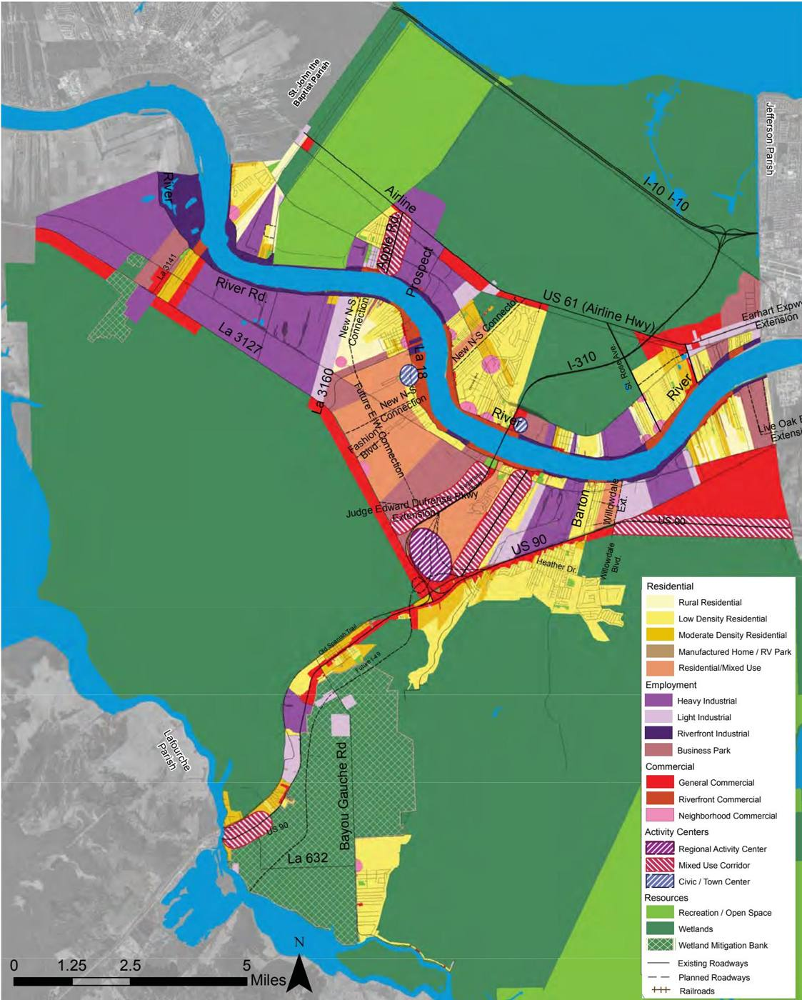

> **Figure description (visual reading, not stated in the plan's text):** Duplicate of Figure LU-5 (Future Land Use, 2011) in the Executive Summary. Legend, as printed: Residential (Rural Residential, Low Density Residential, Moderate Density Residential, Manufactured Home / RV Park, Residential/Mixed Use); Employment (Heavy Industrial, Light Industrial, Riverfront Industrial, Business Park); Commercial (General Commercial, Riverfront Commercial, Neighborhood Commercial); Activity Centers (Regional Activity Center, Mixed Use Corridor, Civic / Town Center); Resources (Recreation / Open Space, Wetlands, Wetland Mitigation Bank); lines for Existing Roadways, Planned Roadways and Railroads. Labeled roads include US 61 (Airline Hwy), I-10, I-310, US 90, La 3127, La 3160, La 18, La 3141, River Rd., Barton, Willowdale Blvd., Judge Edward Dufrene Pkwy Extension, Bayou Gauche Rd, La 632, Fashion Blvd., Earhart Expwy Extension, Live Oak Blvd Ext., Future I-49 and Old Spanish Trail. Scale bar 0 to 5 miles. No community names are printed on this map, so locate a place by its roads or by the zoning and existing-land-use maps (Figures LU-4 and LU-1), which do print names. This is the 2011 map; the 2022 Update revises it (Update Figure LU-8).

> **Text-layer supplement (text on this page that the layout parse did not capture; reading order approximate, taken from the PDF text layer):**
>
> xp wy art E Earh nsion Exte
>
> ak B Live O nsio Exte
>
> Pkwy ufrense dwa rd D Judg e E Extension
>
> Resources Minor Arterial

## Page 19

The overall goal of the Land Use component is to promote an orderly, sustainable, resilient pattern of development and redevelopment and to achieve and maintain flexibility for the future, compatibility with existing development, and the Parish’s fiscal health.

With its accompanying Future Land Use Map (FLUM), this component sets out expectations for what the Parish’s and use and growth patterns may look like in 2030. The FLUM (Figure ES-1) depicts, in a generalized fashion, the expected long-range (20-year) future pattern of land use throughout the Parish. While this makes the development review process more predictable for developers and property owners, the broad categories illustrated on the FLUM provide greater flexibility than current zoning. Each land use categories encompasses several zoning districts, minimizing the need to rezone. Consideration of various forms of development that may be appropriate in each case is encouraged, including as mixed use and planned developments, conservation subdivisions, traditional neighborhood development (TND), senior communities, as is the integration of more housing choices in each development —such detached and attached single family homes, accessory dwelling units, and a variety of multifamily types— to meet the needs of the Parish’s changing demographics.

Important recommendations include:

• Create new base and overlay zoning districts and plans to implement the new land use categories of the FLUM.

• Review, strengthen and modify uses permitted in existing zoning districts to ensure consistency with the future land use categories.

• Review, strengthen and adjust as necessary development standards to ensure consistency with the intent of each land use category regarding development character.

• Support investments that protect and enhance the Parish’s agricultural infrastructure.

• Increase the transparency and consistency of the development approval process.

The Housing component focuses on the need to broaden the array of housing choice in the Parish to meet the needs of a changing population; maintain and enhance the quality of housing and neighborhoods; and create opportunities for all citizens to be housed in well designed, safe, affordable housing suited to their needs. Some key actions include:

• Promote and create opportunities for workforce housing, integrated in new development forms.

• Explore resources for the development of HUD 202 Senior Housing.

• Develop a shelter/transitional living facility.

• Promote preservation and revitalization of older established neighborhoods and the regeneration of neighborhoods which are declining or already obsolete.

## Page 20

Community character is the sum of the attributes and assets that make a community unique. The goal of this component is to preserve and enhance St. Charles Parish’s community livability, appearance, and visual character.

Important recommendations include:

• Review and amend as necessary the Subdivision Regulations.

• Promote preservation, reinvestment and revitalization of older neighborhoods, commercial corridors and other areas experiencing decline or obsolescence.

• Continue to make visual improvements to gateways and other prominent public places.

• Improve design standards for new residential and commercial development.

Establish Character Area standards for key highway corridors.

• Strengthen code enforcement efforts to address abandoned/neglected properties.

• Prepare sector plans for targeted areas in the Parish.

#### Transportation Element

The major goals of the Transportation Element are to coordinate transportation with land use planning, to provide a variety of transportation options for residents and visitors of the Parish, to improve coordination between the Parish, LA DOTD and the private sector regarding the design and construction or improvement of transportation projects, and to continually improve connectivity between Parish destinations.

Key transportation recommendations include:

• Lobby LA DOTD to implement key targeted capacity improvements, and to include additional roadway linkages identified in the Comprehensive Plan as necessary to improve connectivity.

• Ensure that a “complete streets” approach is applied to new roadway projects and roadway improvement projects.

• Develop a Parish-wide network of pedestrian and bicycle facilities to help promote a Regional Heritage Greenway initiative.

• Maintain an inventory of existing conditions at each existing railroad crossing, to use in negotiating potential new crossings and consolidations of existing crossings.

#### Infrastructure

This element addresses sewer, potable water, stormwater drainage, and flood protection systems. Among other things, the goals seek to ensure the provision of adequate infrastructure to meet the demand of existing and future Parish residents and associated development, and call for regional collaboration to ensure access to financial resources available outside the Parish, to maximize efficiencies in the delivery of infrastructure, and to strengthen the Parish’s position in decision-making processes regarding projects that may impact the Parish.

## Page 21

Key recommendations for each system component follow.

#### Wastewater:

• Devote more Parish resources to the expedited completion of the Capacity Management Operation and Maintenance Program (CMOM).

• Develop a Master Wastewater Plan.

• Coordinate land use planning and capital programming.

• Adopt criteria for prioritizing funding to sewer-related capital improvement projects.

#### Water:

• Implement a potable water asset management program.

• Consider the Future Land Use Map in the planning of future water extensions.

• Study the feasibility of adopting a water system impact fee structure.

• Rigorously enforce existing regulations that require rezoning, plat approval and development approval requests to demonstrate that system capacity is adequate to meet requested demands.

#### Drainage:

• Perform a hydraulic/hydrologic drainage model on the entire parish to identify and locate drainage deficiencies in the system.

• Develop strict enforcement protocols to ensure that existing development adheres to established drainage standards and regulations, especially those regarding changes.

• Prepare a Master Drainage Plan and associated Capital Improvement Program.

• Establish new guidelines for converting surface drainage to subsurface.

• Consider enacting a “No Net Increase” drainage ordinance for runoff created by new development.

#### Flood Protection:

• Lobby the USACOE to expedite the construction of planned levee projects in St. Charles Parish.

• Evaluate and develop the interim protection plan for the Willowridge, Ellington, and Magnolia Ridge subdivision.

• Continue to seek funding for coastal protection and coastal/habitat restoration projects.

• Promote the use of non-structural flood-protection tools, such as those described in CPRA’s Coastal Best Practices for Development Manual and other approved architectural and building solutions.

## Page 22

#### Community Facilities Element

This element addresses schools, libraries, fire and rescue services, police protection, health care facilities, and arts and cultural facilities, as well as all government facilities and services.

Excellent community facilities and services are a key component of quality of life. The goals of this element seek to provide quality, cost-effective community facilities and services that support the desired future land use, enhance quality of life, and meet citizens’ needs based on objective standards.

Important recommendations include:

• Develop a Capital Improvement Plan for key community facilities and set targets for acceptable level of service (LOS) standard.

• Seek out opportunities for co-location and joint use of compatible public facilities as a means to maximize and leverage public investment.

• Assist the School District in identifying any future school sites so that they are consistent with the FLUM.

• Seek long-term opportunities to establish higher and technical education institutions (such as a LTI or LSU branch) in St. Charles Parish.

• Support development of workforce housing in mixed-use centers to provide additional housing options for police, fire, and safety personnel.

• Develop a long-range Government Facilities Master Plan.

• Incorporate “green” building and site techniques into the construction of new public facilities and retrofits of existing ones.

• Continue to support community efforts to expand the range of arts and cultural facilities in the Parish.

Parks and Recreation Element

Goals of this element are geared toward creating a network of quality, accessible parks, open spaces, and recreation facilities and services to meet the needs of all residents and visitors of St. Charles Parish.

Key recommendations include:

• Adopt and implement the Parks and Recreation Master Plan (PRMP).

• Appoint a Parks and Recreation Advisory Board.

• Use the Future Land Use Map to identify opportunities for future parks.

• Focus on providing larger community parks, which can accommodate users needs for neighborhood-oriented recreation facilities.

## Page 23

• Develop a Parish-wide bikeway and pedestrian trail network, to improve access to the community’s existing parks, open space and recreation areas and facilities.

• Prepare a Blueways Feasibility Study to identify a network of navigable waterways suitable for recreational paddling and water-based recreation uses.

Natural and Cultural Resources Element

This element addresses the Parish’s natural and historic resources and cultural facilities. Goals include to protect, enhance, and restore St. Charles Parish’s natural, scenic, cultural and historic resources and systems, striving for an appropriate balance between development and resource conservation.

Key recommendations include:

• Adopt and implement the Parish’s ongoing Coastal Zone Management Plan.

• Explore and support partnerships with private land trusts, foundations, and other organizations that can assist the Parish in acquiring land, obtaining conservation easements, and maintaining and managing open space and natural resources.

• Inventory the Parish’s historic resources and strengthen public awareness of the importance of preservation of these resources.

• Create and adopt a Historic District, Buildings and Landmarks Ordinance.

• Adopt incentives and regulatory provisions to promote adaptive reuse of historic properties.

Implementation

Plans are turned into reality through concerted, coordinated, and consistent action over time.

The last chapter of the 2030 Comprehensive Plan describes how the Plan is to be used by the Parish as a guide for policy, decision-making, and action. It lays out a program for implementation of the policies and actions consisting of five components:

• Adoption Procedures.

● Decision-Making Principles

• Action Plan

• Capital Improvement Framework

• Measures for Success/Amendment Procedures.

## Page 24

This page intentionally left blank

## Page 25

#### INTRODUCTION

## Page 26

We are thinking of and targeting 20 years from now...a plan for...what the Parish is going to look like and be capable of; where the infrastructure is going to go, and what our economic development is going to have to be.

Percy Wilson

Steering Committee Member

(Retiree)

## Page 27

#### INTRODUCTION

#### 1. Planning Background

In the early 20th Century, Louisiana was considered a leader in land use planning, being one of only 20 states in the country to adopt the Standard State Zoning Enabling Act (the SZEA). However, by the late 1990’s, few, if any of the state’s planning-related statutes had been updated, and the state was lagging behind the rest of the nation in terms of long-term planning legislation. Further, the statutory standards that do exist allow local governments broad discretion in regulating land use and development. As a result, the extent to which local jurisdictions adopt and implement planning policy has varied widely over the years.

St. Charles Parish has had a Comprehensive Land Use Plan in place since 1990. That Plan portrays itself as a plan to “manage growth in the Parish” because throughout the four decades preceding its adoption, the Parish sustained significant population increases and associated development pressure, which were projected to continue, “and even accelerate,” during the 1990’s.

Contrary to such expectations, the Parish’s growth curve has flattened, and the annual increase rate now stands at less then 1 percent. Other unanticipated circumstances have arisen since then, among them the hurricanes of 2005, which changed the regional growth dynamics and (along with the 2010 Deepwater Horizon oil spill) heightened the Parish’s self-awareness of its vulnerability to the impacts of natural disasters; the intensification of global competition in the industrial/manufacturing sector; and the recession of 2007-2009, which stalled the pace of development. In addition, various “planned” projects referenced in the 1990 Plan, including the Davis Pond Freshwater Diversion, the East Bank Hurricane Protection Levee, and the extension of Interstate 310 across the Mississippi into the West Bank, have since been completed.

In 2001, the Parish (aided by the South Central Planning & Development Commission and the UNO Center for Economic Development) prepared a 5-year strategic economic development plan, which to a certain extent bridges the gap between the outdated 1990 Plan and the present one. The development of the St. Charles Overall Planning Effort (SCOPE) involved a community self-assessment, a strategy development, and action steps set forth by business leaders, public officials, and community stakeholders. However, while the SCOPE recognizes the connection between land use policy and economic development, its focus is primarily economic, and not spatial. SCOPE does highlight the need for the Parish to “[a]dopt a land-use plan that facilitates long-term growth and development,” since the “[c]urrent land-use plan has not been reviewed or revised in over 12 years.”

Hurricanes Katrina and Rita transformed the planning landscape in the state of Louisiana after 2005. After the storms, the state legislature mandated the adoption of the Louisiana State Uniform Building Code, largely based on the International Building Code (I-Code) as an additional measure to address the high risk of major storm events. Also, the Louisiana Recovery Authority (LRA) has promoted land use planning as a tool for flood and storm event damage reduction. The first outcome of this effort was the Louisiana Speaks Regional Plan, which articulates a vision and strategies for the future of South Louisiana as a region, and provides tools for planning at the local level. More recently, the Coastal Protection and Recovery Authority (CPRA) published a Comprehensive Master Plan for a Sustainable Coast (2007) that recommends improved land use planning, zoning, and permitting to address the risks related to development in the coastal zone.

## Page 28

2. The Need for a New Comprehensive Plan

The Comprehensive Plan defines and supports a common vision and purpose. It sets a direction that can be used by the Parish to proactively manage future change and protect Parish heritage.

The 1990 Plan has undergone no significant updates since its adoption to incorporate these and other changes, and the impetus for implementing its initiatives has dissipated. Even though key principles may remain relevant, the Plan’s basic premises are outdated, and the policy recommendations do not reflect the state-of-the-art in planning practices. In addition, the implicit planning horizon of the 1990 Plan was only 10 years 1.

As the 1990 Plan passed its 20th anniversary with no notice, the need became clear for a new comprehensive plan to enable the Parish to set a new course for the future in response to all these changes. Thus in 2009 the Parish embarked on a process to prepare and adopt the community’s next Comprehensive Plan. The endeavor was partially funded by a grant awarded to the Parish by the Center for Planning Excellence.

“The St. Charles 2030: Bridge to the Future” Comprehensive Plan defines a community-wide vision and purpose, providing a policy framework for decision-making for elected officials, appointed boards, and staff. The plan sets a direction that can be used by the Parish to proactively manage future change and protect Parish heritage.

The 2030 Comprehensive Plan serves several purposes:

Articulating citizens’ values and aspirations and catalyzing community consensus in the form of a vision of what the Parish will be 20 years in the future, based on public input received during the planning process.

Providing a guide for decisions by Parish leaders, officials, and stakeholders to direct future growth and make other decisions that impact the Parish’s future.

Defining the community’s 20-year “To-Do” list as a series of short, mid, and long-term actions to be taken to move the vision of St. Charles Parish’s future forward to reality.

The plan is comprehensive in the topics that it addresses and in its geographic scope, considering the Parish as a whole. The legal authority for the Comprehensive Plan, stated in Title 33 of the Louisiana Revised Statutes (LRS), provides general guidance to parishes and municipalities for the development of the comprehensive plan:

“ A plan shall be made with the general purpose of guiding and accomplishing a coordinated, adjusted, and harmonious development of the parish..., and its environs which will, in accordance with present and future needs, best promote health, safety, morals, order, convenience, prosperity, and general welfare, as well as efficiency and economy in the process of development; including, among other things, adequate provision for traffic, the promotion of safety from fire and other dangers, adequate provision for light and air, the promotion of the healthful and convenient distribution of population, the promotion of good civic design and arrangement, wise and efficient expenditure of public funds, the adequate provision of public utilities and other public requirements...”

## Page 29

Title 33 also affirms the importance of the comprehensive plan, stating that:

“B. Whenever a parish or municipal planning commission has adopted a master plan, the governing authority of such parish or municipality shall consider such adopted master plan before adopting, approving, or promulgating any local laws, ordinances, or regulations which are inconsistent with the adopted elements of the master plan.”

Further, Title 33 describes the implications of adopting a plan:

“Whenever a parish or municipal planning commission has adopted a master plan, state agencies and departments shall consider such adopted master plan before undertaking any activity or action which would affect the adopted elements of the master plan.”

#### 3. Key Plan Themes: The “Big Issues”

Based on the findings of a community assessment completed early in the planning process, as well as the collective concerns and aspirations expressed by citizens through the 2030 Vision Statement, the Plan is organized and focused around five broad themes or principles, which will help the Parish succeed in attaining the Vision and positioning itself to thrive in the 21st century:

A. Diversifying the economy to provide jobs and tax revenue should there be changes within the existing industrial sector.

B. Completing and improving the Parish’s basic infrastructure, road network, government services, and, perhaps most important, the storm protection and flood hazard mitigation systems.

C. Promoting sound, efficient, fiscally responsible growth by introducing new types of development and new development patterns with higher design standards.

D. Increasing housing diversity and the availability of quality housing affordable to all Parish residents.

E. Targeting revitalization efforts and property upkeep in established commercial and residential areas.

#### 4. Planning Process

The Plan has been prepared through a planning process lasting approximately two years, starting in June of 2009. The policies, strategies, and actions recommended in the Plan are the results of a careful process of deliberation on the complex choices available to address the “big issues,” weighed against the public input received throughout the process.

## Page 30

#### The Planning Process...

#### Phase 1: Mobilization

#### Phase 2: Vision

• Project Kick-Of

• C.P. Support Committee

• Information Array

• Review Data

Vision Statement

• Stakeholder Interviews

• Community Engagement Program

#### Existing Conditions Trends / Issue Definition

Existing Conditions and Trends

• Trend Growth Scenario

Trend Scenario/ Vision Statement Comparison

#### Phase 4: Policy Framework

Preliminary Goals, Objectives and Policies

Approval Polloy Framowork

Economic Development

• Housing and Neighbor-

•Transportation /Mobility

Community Character

Natural Environment

Infrastructure / Public

Parks/Recreation/Open

Capital Improvements

• Draft Comprehensive Plan Maps

Community Forum Series # 3: "Consensus on Direction

#### Phase 5: Comprehonsive Plan Document

• Final Plan Review / Adoption

• Preliminary Draft Comprehensive

Public Review Draft Comprehen-

## Page 31

The process, facilitated by Wallace Roberts & Todd (WRT), was led by a steering committee of citizens from all over the Parish, appointed by elected officials. Committee members also represented the interests of numerous, sometimes divergent interests. These citizens not only generously volunteered their time to participate in monthly meetings for over a year; they were instrumental in distilling their fellow citizens’ ideas into the Vision Statement and in defining a policy framework best suited to St. Charles Parish to make the vision a reality. They also served as facilitators, scribes, and hosts for the planning processes’ various community involvement activities. All meetings of the Comprehensive Plan Steering Committee were advertised and open to the public.

The planning process consisted of four primary phases of work, as follows

1. Vision: during this phase, WRT conducted a series of interactive exercises with the residents of St. Charles Parish to solicit input on the community’s values and expectations for quality of life, development, and design character. This input served to prepare the 2030 Vision Statement, which expresses what citizens want St. Charles Parish to be in the future.

Fourteen visioning sessions were held throughout the community, and various other means of public outreach were used to solicit input from citizens.

2. Existing Conditions, Trends, and Issue Definition: In this phase, which ran parallel to the Vision phase, a host of information was reviewed on population and development trends in St. Charles Parish and its context area, conditions and trends related to the Plan Elements, and current plans and regulations. The results of this phase are summarized in an Existing Conditions and Trends Report.

3. Policy Development: During this phase, WRT conducted a series of “Shape the Future” workshops and other public engagement activities, to give citizens an opportunity to help develop the strategies that will guide development in the Parish over the next 20 years. The input received at these workshops was used as the basis for the Future Land Use Map. Subsequently, an initial framework of goals, policies and strategies was prepared for each topical Plan element. The elements were presented sequentially to the Steering Committee, and feedback was requested at each meeting.

4. Comprehensive Plan Development: In this phase a complete draft of the Plan was prepared for public review and comment. The draft synthesized the results of the previous three phases. Following the review period, several rounds of revisions to the draft were made to address public comments. The Comprehensive Plan document was adopted by the Planning and Zoning Commission on June 2, 2011, and by the Parish Council on June 20, 2011.

Public Engagement

The planning process included extensive community outreach and numerous opportunities for review and input:

• Interviews and meetings were conducted with a variety of stakeholder groups and experts.

• A blogspot was maintained, along with Facebook and Twitter sites.

• Documents were posted for review and events were publicized on the Parish website.

## Page 32

• Meetings were extensively advertised via various media channels.

The Parish’s Public Information Office was actively involved in documenting the process and putting out communications, ranging from press releases to elaborate videos.

• Parish Council received regular public briefings on the progress of the planning process.

Planning and Zoning staff made presentations about the plan to a variety of community groups and organizations.

• Three series of public workshops were conducted at key milestones, as follows:

I. Visioning Sessions: Between August 18, and October 12, 2009, citizens were encouraged to participate in visioning sessions held throughout the Parish. Additional sessions were conducted to invite input from students at the St. Charles Parish Satellite Center, the members of the Comprehensive Plan Steering Committee, and members of the Economic Development Council.

In total, some 534 persons participated in these sessions, including approximately 281 participants in the general public forums, 160 student participants, and the remainder in the forums conducted with the steering committee and the EDC, plus 56 online responses and comments.

II. “Shape the Future” Workshops: On March 15 and 16, 2010, citizens took part in a series of interactive exercises designed to elicit ideas and concepts regarding where and how to grow, and associated strategies. Activities included a “chip” mapping exercise; a visual preference exercise; an issue prioritization activity; and a discussion regarding the next “big idea” for the Parish’s future economic development.

Separately, similar exercises were conducted with the Steering Committee and students at the Satellite Center (April 9, 2010). The prioritization and the visual preference exercises were posted on the Parish website as an online survey, with opportunities for free-form comment. Approximately 275 persons participated in the “Shape the Future” workshop series.

III. Open Houses: Five open houses were held throughout the Parish between November 8-10, 2010, to introduce the draft Future Land Use Map and transportation, parks, infrastructure, and other concepts and strategies. The open houses allowed informal, public review and discussion of the concepts and their implications. Attendees prioritized future capital spending, and they were encouraged to post comments and ideas. A similar session was conducted separately with the Satellite Center students. In all, about 250 attended the Open Houses.

## Page 33

####  !  #" %-\*(+(	

\$  " &# )	 % .,& #"&"'

!%-&  )\*\$+(&,\$+(&-   -1,01 # (#

!%.&  ))\$((&\*\$((& # -2,  "#( 

,\$((&-\$((&! .,,#("!

!%)(&  ))\$((&\*\$((& # -,1\$#("

,\$((&-\$((&#  -3,  "( 

"""%\*(+(%%

#### rles 2030: Bridge to the Future - Windows Internet Explorer

#### TUESBAT.FERRUART S, Z011

Throughout November, planners continued to meet with citizens at a series of public meetings to gather input on the future of St, Charies Parish, Outfitted with dirplavs, before and possible aftur photoe (photomcrphs), mape and activities, the meetings that were held at five different locations attracted the input of aso participants across the parish. In December, the planning team alao viritad the Satellite Center, and worked with more than o high school students to further the vision for St. Charles 2030.

One of the most popular activities both at the satellite center and in the public meetings was allovring participants to "spend their tax dollars.

Fach participant was given \$so to srend co what they alt was must impurtant by placing their mouey in the corruspunding jar.Categories included béautification, redevelopment, improving/widening roads, newer systen improvemente, road maintonance, drainage, food and storm protection, and bullding new roads, The pie charts show the opinions ef the participants, illustrating the priorities of the public and students.

#### TWITTER UPBATES

ARCHIVE

#### FLAMMING TEAN

## Page 34

This page intentionally left blank

## Page 35

#### CONTEXT

## Page 36

...cadastral patterns often have a greater and longer-lasting impact on the landscape than massive structures of brick and mortar. But buildings come and go...whereas parcel delineation is inscribed in legal and political realms and rooted in fundamental national philosophies.

Richard Campanella,

“Time and Place in New Orleans: Past Geographies in Present Day”

> **Text-layer supplement (text on this page that the layout parse did not capture; reading order approximate, taken from the PDF text layer):**
>
> From "Arpent Bend," a wall hanging by textile artist Leah Evans

## Page 37

#### CONTEXT

#### 1. Historic Overview: Key Driving Factors in the Development of the Parish

In addition to the historical activities on the land, the distinctive pattern of parcelization laid the foundation for development patterns that extend into present day. The development pattern was, and continues to be strongly influenced by the presence of the Mississippi River, which runs through the Parish in a generally eastwest direction. Under both French and Spanish possession, land grants in the province of Louisiana were characteristically carved out in long, narrow slivers (referred to as “arpent tracts”) extending perpendicular to the river1. This system of parcel demarcation ensured that each grantee enjoyed some access to the waterway.

The Parish itself was not created until 1807, when it was carved out from the former New France’s (now Acadiana) German Coast. By that time –nearly one hundred years after the first German settlers came to the area– the population had become increasingly diverse (if slowly so) thanks to the influx of French Creoles and French Acadians, and Free Blacks.

In the mid-1800’s, this population was primarily devoted to farming, which was done under tremendously harsh conditions. Fruits, vegetables, tobacco and dye produced in the area were destined for the City of New Orleans’ markets. In time, dairying and logging became profitable commercial activities as well.

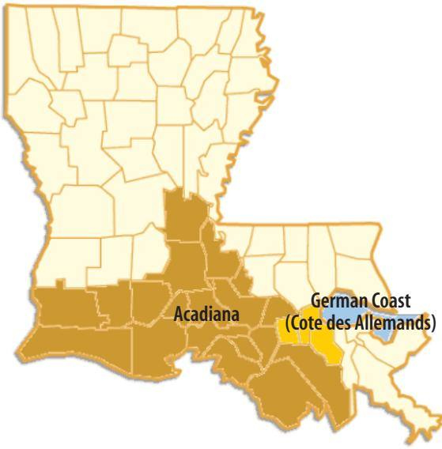

> **Figure description (visual reading, not stated in the plan's text):** Map of Louisiana parishes with one group of parishes shaded as "Acadiana" and a smaller highlighted group labeled "German Coast (Cote des Allemands)". No St. Charles Parish label is printed.

The economy of St. Charles Parish would experience another sweeping change at the beginning of the 20th century. In 1901, the first oil well in the state was drilled in a rice field in the community of Evangeline near Jennings. This event set off the traditional heavy industry base that is still at the core of the Parish’s economy.

The discovery of oil in this region opened up a new era of economic opportunity and prosperity. In 1914, the Mexican Petroleum Company purchased Destrehan Plantation as an oil field. Refineries, transport, and related industries followed in the wake of extraction operations. In the 1930s and 1940s, oil was also discovered at four additional locations throughout St. Charles Parish. Today, three of the state’s nineteen operable refineries are located in the St. Charles Parish 2. Seven chemical companies, two agri-businesses, and a mix of energy, tank terminal, and anchorage operations complete the big picture of the economic sector. Over the years, the presence of these industries has maintained stability in the local economy, attracted new residents, and drove the creation of whole new communities in the Parish, such as Norco. Like the preceding farming and logging operations, these facilities were attracted to locate on the Mississippi River banks, to take advantage of the convenience of water transportation.

## Page 38

In recent years, the Parish has become increasingly attractive for the development of “bedroom subdivisions” geared toward those working in the surrounding urban centers, but looking for comparatively affordable housing, a first-class school system, or a more rural lifestyle. The East Bank developed more quickly because there was a deep natural channel in the river, making dockage easier, and because of the more direct roadway connections to New Orleans and Baton Rouge. After the Hale Boggs Bridge was built, and as developable land became scarcer on the East Bank, the focus of developers started to shift to the West Bank. Along the river, the perpetuation of the arpent tract pattern raises significant challenges for today’s common development configurations, both residentia and commercial. These include issues related to parcel assembly, connectivity, emergency access, and the cost of infrastructure.

#### 2. Demographic Characteristics and Trends

In absolute terms, population growth in St. Charles Parish was gradual and uneven in the first half of the twentieth century. Growth accelerated in the 1950’s, once suburbanization started to take hold – and the Parish grew 58.8 percent in the decade between 1950 and 1960, from 13,363 residents to 21,219. Rapid growth continued through approximately 1980, then moderated somewhat for the remainder of the century (Table CON-1). The Parish’s official 2000 population was 48,072, representing a net increase of approximately 260 percent over 1950. Growth briefly spiked between 2005 and 2006. This was the result of people who were displaced from nearby Orleans and Jefferson Parishes, which were heavily damaged by Hurricane Katrina.

The Census Bureau reports a 2010 population of 52,780, a 10 percent increase since 2000 but a slightly lower gain than that seen between 1980 and 2000.

**Table 1: Table CON-1: Historic Decennial Growth**

|  | St. Charles |  |  |
|---|---|---|---|
| Year | Pop. | Decennial Growth | Avg. Annual Rate |
| 1900 | 9,072 | - | - |
| 1910 | 11,207 | 23.5% | 2.4% |
| 1920 | 8,586 | -23.4% | -2.3% |
| 1930 | 12,111 | 41.1% | 4.1% |
| 1940 | 12,321 | 0.02% | 0.002% |
| 1950 | 13,363 | 7.8% | 0.8% |
| 1960 | 21,219 | 58.8% | 5.9% |
| 1970 | 29,550 | 39.3% | 4.0% |
| 1980 | 37,259 | 26.1% | 2.6% |
| 1990 | 42,437 | 13.9% | 1.4% |
| 2000 | 48,156 | 13.5% | 1.3% |
| 2010 | 52,780 | 9.6% | .96% |

_Source: Population of Counties by Decennial Census: 1900 to 1990, compiled and edited by Richard L. Forstall, U.S. Census Population Division; 2000 and 2010 populations from the U.S. Census; growth rates calculated by WRT._
Table snapshot (for checking): 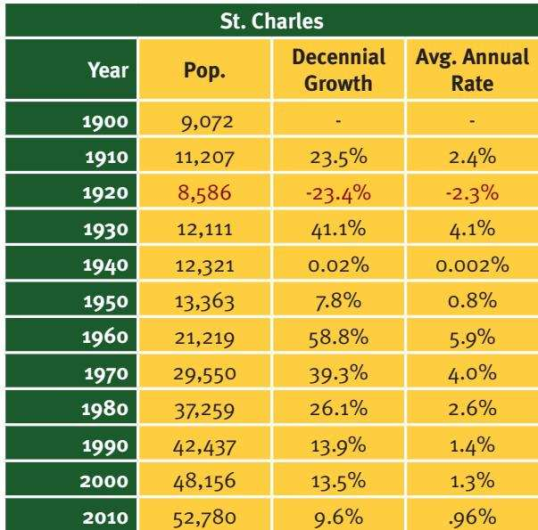

Although the Census has not yet released complete 2010 information on population, or on household and income characteristics, figures from 2000 and the 2005-2009 ACS indicate that the Parish’s population is aging (Figure CON-2). The median age has increased from 34.1 years in 2000, to 35.8 in 2008 (estimated). The age pyramid (Figure CON-3) is consistent with national trends of Baby Boomers (those persons born from 1946 to 1964) continuing to concentrate population growth within the cohorts into which they age. The Baby Boom cohort, which accounts for approximately one-fourth of the Parish’s population, is beginning to reach age 65, with material implications for housing, transportation, and social services to be provided at the community level. Issues involving housing and aging will be of growing importance.

## Page 39

Today, the Parish’s housing stock is dominated by single-family dwellings, with mostly free-standing homes comprising about 80 percent of all units. Multiunit dwellings comprise only 11 percent of the total, and mobile homes make up the remaining 9 percent.

This imbalance stands out against the emerging demographic trends that demand a much wider array of housing choices —for example, small house/small lot development, attached and semi-attached homes, condominium and rental apartments, etc. In particular, the older cohorts (Baby Boomers) show a preference for downsizing to low-maintenance, highly social housing environments, while the younger cohorts (Millenials 3) favor walkable communities and proximity to work, retail and entertainment over lot and house size.

The swell of housing demand for these two groups is probably 10 years away. Lacking these choices, the Parish may not be able to accommodate its older residents who wish to “age in place” or to retain younger residents (or attract them to the Parish). In addition, an increasing number of Generation X4 households will be faced with the need to tend to the care of elderly parents at home or in other housing settings, resulting in demand for ancillary dwelling units and mixed-housing developments.

Changes now taking place as a result of the aging Baby Boom population and affecting housing and household structure will also impact school enrollment patterns and the need for spending on school infrastructure. And as the size of the workforce decreases, regional economies could be dramatically affected.

Similarly, while the Parish overall is growing older, it is also becoming more racially and ethnically diverse. A comparison of 2000-2010 census results shows that the proportion of the population that is White decreased from 72 percent to 69 percent, the Black or African American population increased from 25 percent to 27 percent and those reporting other races or more than one race increased from 3 percent to 6 percent. At the same time, those identifying themselves as Hispanic have increased from 3 percent in 2000, to 5 percent in the 2010 Census.

> **Text-layer supplement (text on this page that the layout parse did not capture; reading order approximate, taken from the PDF text layer):**
>
> Table CON-3: 2010 jPopulation Pyramid p y
>
> Source: Louisiana State Demographer’s Louisiana Parish Population Projection Series 2010-2030.
>
> 3 Also known as Gen Y, Echo Boomers, or Net Generation, Millenials include those generally born between 1970 and 2000. 4 Generation X includes those born between 1965 and 1980. Both Gen Xers and Millenials represent about one-fourth of the Parish’s population.
>
> St. Charles 2030 Comprehensive Plan

## Page 40

#### 3. Regional Position

From a demographic perspective, the Parish is included in the New Orleans-Metairie-Kenner Metropolitan Statistical Area. The MSA also includes the parishes of Jefferson, Orleans, Plaquemines, St. Bernard, St. Tammany and St. John the Baptist.

After Jefferson and Orleans started losing population in the 1980s, the population of the MSA grew by a mere 5,200 persons, or 0.4 percent between 1990 and 2000. By contrast, the population of St. Charles Parish grew by slightly more than 1.3 percent. The MSA’s population peaked at just over 1.3 million just prior to Katrina in 2005, increasing by a slight 0.1 percent from 2000.

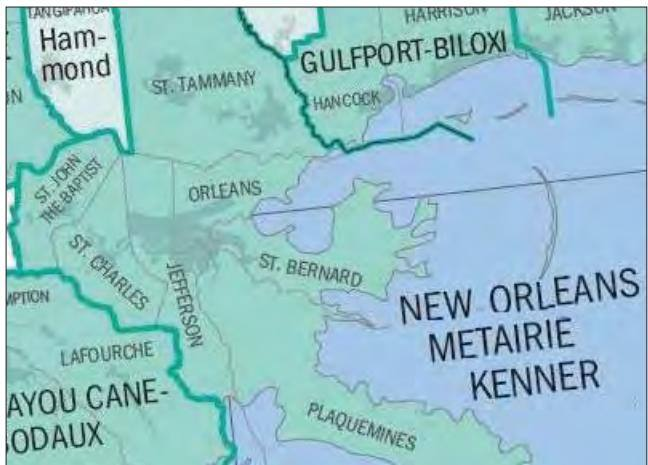

> **Figure description (visual reading, not stated in the plan's text):** Regional map of southeast Louisiana showing parish names (Orleans, Jefferson, St. Charles, St. John the Baptist, St. Bernard, Lafourche, Plaquemines, St. Tammany, Hancock) and the labels NEW ORLEANS METAIRIE KENNER, GULFPORT-BILOXI and Hammond. It is a regional locator for the metropolitan area; it shows no land use.

The region’s fortunes changed, however, in August 2005, when Hurricane Katrina made landfall, inflicting, along with subsequent flooding, severe damage and destruction. According to U.S. Census estimates during this period, the population of the MSA dropped by 320,498 between 2005 and 2006, and then gained back 142,127 between 2006 and 2008. St. Charles Parish’s population spiked after Katrina, leveling off after 2007.

In addition to influencing the Southeast Louisiana’s population dynamics, Katrina also had a serious impact on the region’s economy. Although the Parish was largely spared by the brunt of the storm, infrastructure damage was widespread in other areas, while a number of oil drilling and refining facilities – a sector which accounts for a major portion of economic activity – were damaged or destroyed. Many workers were left unemployed, creating secondary effects on economic activity as well as on state and local tax revenues. Additionally, after the storm, insurance for homes and businesses in many cases became much more expensive or even unavailable.

The economic effects of Katrina remain difficult to measure. However, the MSA as a whole has lost approximately 10 percent of its population in the last decennial, according to the 2010 Census, with Orleans, Plaquemines and St. Bernard Parishes experiencing the greatest individual declines. St. Charles, along with St. John the Baptist and St. Tammany Parishes, on the other hand, have continued to grow, though at more moderate rates than in previous decades.

While statistically the Parish is counted as part of the New Orleans-Metairie-Kenner MSA, with attendant implications related to representation and federal funding, from a market perspective, the State of Louisiana places St. Charles Parish in its Regional Labor Market Area 1, which includes the parishes in the New Orleans MSA plus St. James Parish.

The Parish also is involved in a number of entities and organizations whose missions include addressing planning, development, transportation and economic issues on regional scale which often differ from the MSA. This

## Page 41

generates particular intergovernmental coordination challenges, occasionally resulting in inefficient overlaps or even conflicting issues across the scope of these organizations. Some of the key ones include:

South Central Planning and Development Commission

The South Central Planning and Development Commission (SCPDC) covers six parishes – St. Charles, Assumption, LaFourche, St. James, St. John the Baptist and Terrebonne – and undertakes a number of activities related to land use and transportation planning, land development and economic development. Examples include housing and transportation studies, inventories and surveys, grant coordination, assistance to local governments with land use planning and economic development efforts and a revolving loan fund for local businesses.

#### Regional Planning Commission

St. Charles Parish is an associate member of the Regional Planning Commission (RPC), the five primary members of which are Jefferson, Orleans, Plaquemines, St. Bernard and St. Tammany Parishes. The RPC functions as the metropolitan planning organization (MPO) for the New Orleans region, directing federal transportation funding throughout this region.

#### Greater New Orleans, Inc. (GNO, Inc.)

The Greater New Orleans, Inc. Regional Economic Alliance includes ten parishes (St. Charles, Jefferson, Orleans, Plaquemines, St. Bernard, St. James, St. John the Baptist, St. Tammany, Tangipahoa and Washington). Its mission is to promote this region for economic development and provide information to those who may be seeking to start or relocate a business to the area. GNO, Inc. maintains a high-quality website – www.gnoinc.org – that includes a wealth of economic data, quality of life facts and information about such things as business incentives, available sites and buildings, and economic programs.

#### Port of South Louisiana

The Port of South Louisiana primarily maintains port facilities along the Mississippi River in St. Charles, St. John the Baptist and St. James Parishes (the “River Region”). However, because shipping activities along the River are so closely tied to these three parishes’ economic fortunes, the Port of South Louisiana is heavily involved in economic development for this area. The governments of the three parishes have joined the Port to form the River Region Economic Development Initiative (RREDI), which seeks to plan for economic growth focusing on industrial diversification and increased employment. The RREDI sponsored a 2008 Labor Market Analysis for the three parishes that is discussed at length in the Economy section of this report.

## Page 42

This page intentionally left blank

## Page 43

### THE ST. CHARLES PARISH 2030 VISION

## Page 44

In the year 2030,   
St. Charles Parish is a   
vibrant, friendly community,   
proud of its heritage and   
surrounded by unspoiled nature.

## Page 45

### THE 2030 VISION STATEMENT

The Vision Statement expresses what the citizens of St. Charles Parish envision and desire their community to be like in the year 2030. Written from a perspective of twenty years into the future, this vision represents a shared destination: the future that the citizens, as a community, aspire to reach, and which, by then, they will have achieved through the implementation of the goals, strategies and actions that are framed in this Comprehensive Plan.

In the year 2030, St. Charles Parish is a vibrant, friendly community, proud of its heritage and surrounded by unspoiled nature. We are a community that has taken advantage of its strategic location, and wisely managed growth and change to achieve:

• A strong, diversified economy that offers ample, challenging job opportunities for all, allowing the Parish to retain its talented youth;

• A “small-town” way of life, but enriched with a full array of educational, cultural and recreational opportunities;

• A sound infrastructure system that offers reliable protection from natural disaster, provides for optimum mobility in a variety of modes of travel, and supports sound growth;

• A balanced development pattern that offers a range of housing choices in livable neighborhoods, and commercial and civic activities and services that are needed by our resident population;

• A character of development that reflects the value we place on our scenic natural beauty and our culture, heritage and community identity; and

• A community of educated, engaged and caring citizens with diverse backgrounds, but sharing a common identity and commitment to serve.

This Vision of St. Charles Parish in the year 2030 is built around five major themes:

#### BUILDING ON A SOLID FOUNDATION: BASIC INFRASTRUCTURE AND SAFETY

• Working closely with Federal and State agencies, we have hastened to complete levees and other protective measures crucial to our protection against storm surge vulnerabilities.

• We have planned, prioritized and implemented new investments to upgrade substandard roads with retrofits to improve safety, both for motorists and pedestrians and bicyclists who share our roads.

• In conjunction with LA DOTD, we have created new east- west and north-south road corridors to provide a more integrated Parish-wide road network and reduce travel times and congestion.

• We have applied development standards in a way that supports a functional transportation system through guidelines for access management, road connectivity and the reservation of future roadway corridors necessary for an integrated network.

• We have investigated and pursued greater choice in local and regional alternatives to auto reliance, including transit service and potential regional rail connections and Parish-wide accommodations for pedestrians and bicyclists.

## Page 46

• To coincide with the completion of our levee system, we have implemented a comprehensive drainage plan and associated pumping stations and other improvements.

• In coordination with FEMA and other governmental entities, we have revised our development standards and regulations to minimize damage risk to new development.

• We have invested in expanded sewer system capacity to adequately service existing development and anticipated growth.

#### ECONOMIC STRENGTHENING AND DIVERSIFICATION

• We have worked closely with our core industries to accomplish the following:

\- Minimize risks and hazards associated with plant sites and transportation and with appropriate uses within buffer zones;

\- Ensure we are taking advantage of all opportunities to accommodate smaller business opportunities in support of core industries; and

\- Anticipate global economic trends and risks to our major employers.

• We have conducted a comprehensive effort to diversify the economy by attracting desired compatible businesses and employers, including:

\- Alternative energy and green technologies.

\- Technology/information-based industries.

\- Eco-tourism and cultural tourism.

\- Local family and youth entertainment.

\- Film industry.

\- Medical and health services.

\- Appropriately scaled and compatible retail.

We continue to support and coordinate with the public school system and other education providers to provide vocational training programs to meet the labor needs of existing as well as targeted business segments.

• We have contributed to a thriving local small business community through incentives and business incubators and through public-private ventures to promote and market St. Charles Parish.

• We have sought to maintain vital agricultural and fishing sectors of our local economy, which are an important part of our heritage.

## Page 47

#### FRAMEWORK FOR SUSTAINABLE GROWTH

• We have carefully planned our limited developable land area for the optimum land use balance, providing for healthy economic diversification and improving quality of life with an array of housing types, commercial activities and civic uses.

• We have re-tooled zoning and our development standards to raise the bar of quality while removing impediments to sound growth through greater flexibility and consistent enforcement. Our new standards encourage:

\- A wider variety of housing choices.

\- Neighborhood livability, walkability and roadway connectedness.

\- Retention of open space and greenway corridors.

\- Accommodation of civic activities, neighborhood commercial uses and recreation.

\- Compatibility with historic character and context.

\- Safe access management.

• We have planned for the commercial and employment opportunities that will be created by new I-49 interchanges in a careful, appropriate manner, while mitigating potential negative impacts to existing business along US 90.

• We have encouraged reinvestment and revitalization of abandoned and neglected properties in our community through a variety of regulatory tools and incentives.

• We have expanded resources for affordable and subsidized housing throughout targeted areas of the Parish.

#### FULL ARRAY OF PUBLIC SERVICES AND FACILITIES

• We have created a centrally located multi-purpose center that supports variety of civic, cultural, recreational and social activities and major events, and that has been a unifying influence on the Parish.

• We continue to celebrate our outstanding public school system and have supported expansion to meet growth needs and to broaden opportunities for college preparation, vocational training and life-long learning for adults.

• We have created an outstanding recreation system with conveniently located parks and expanded opportunities to enjoy our waterways and other natural resources.

## Page 48

We have investigated and, consistent with our fiscal resources, introduced new and expanded public services and facilities, such as:

\- A recycling program for residents and businesses.

\- A full-time paid Parish fire fighting force.

\- Exceptional and diversified health care services and facilities.

\- Improved/expanded library information technology system.

\- Emergency shelters and transitional housing services.

We have encouraged and worked closely with local utilities and non-profit organizations to improve and expand the array of public services offered in our communities, in partnership with the Department of Community Services.

We have coordinated with social service and health providers as well as volunteer organizations to serve the needs of our senior citizens.

#### ENHANCING COMMUNITY CHARACTER, SHARED IDENTITY AND CONNECTEDNESS

• We have maintained the Parish’s rural, small-town character by encouraging development that retains open space and is consistent with the scale of our community.

• We have preserved the unique identities of the many small communities, as well as our Parish’s historic and cultural resources.

• We have promoted a high benchmark for the quality and character of new development, through standards designed to reflect our community’s scale, and unique character.

• Through festivals, events, and civic involvement that celebrate our community, we have overcome divisions of geography, race and background, and are a unified community of caring neighbors.

• Our sense of community pride is reflected in the care taken to maintain property and curb littering and neglect.

• We nurture our most valuable resource—our youth—by supporting excellence in our public schools and by challenging our young people to become engaged in the life of the community. We have addressed educational disparities and have raised performance levels among our children and youth.

## Page 49

### PLAN ELEMENTS

## Page 50

The [Plan] is intended to bring ideas from a crosssection of all citizens... so that we...together as a group...decide the direction this Parish is going to be headed. I think that was a strong point, to make sure that each citizen, no matter their background, had input in.

Steering Committee Member

John Campo

(Architect)

## Page 51

### ECONOM IC DEVE LOPM E NT

#### EXISTING CONDITIONS AND TRENDS SNAPSHOT

#### Quick Facts

• Labor force: 23,876 (LA DOL, Louisiana Occupations Information System/Scorecard, January 2011).

• Employees Working in Parish: 23,126 (LWC, Labor Market Statistics, Quarterly Census of Employment and Wages Program).

• Total Jobs in Parish: 24,152 (LED, Parish and Community Profiles, October 2010 Estimate).

• Industrial Jobs: Approximately 4,300 (LWC, Labor Market Statistics, Quarterly Census of Employment and Wages Program).

• Total Establishments1: 1,199 ((LWC, Labor Market Statistics, Quarterly Census of Employment and Wages Program)

• Industrial Establishments: 53, of which 14 are heavy industries including 3 oil refineries (St. Charles Parish).

• Industry Share of Top Parish Employers: Approximately 60 percent.

• Unemployment Rate: 8 percent. (LA DOL, Louisiana Occupational Information System/Scorecard, as of January 2011).

• Percent of Labor Force Working Outside the Parish: Fifty-six percent (13,400). Approximately the same volume of workers commutes into the Parish. (2005-2009 ACS).

• Destination for Most Workers Commuting to Work: Jefferson Parish. (GNO, “Post-Katrina Commuter Patterns – Based on 2008 Local Employment Dynamics data from the U.S. Census Bureau,” by Allyson Plyer, Elaine Ortiz, and Kathy Petit. January 15, 2010).

• Mean Time to Work: 28 minutes (2005-2009 ACS).

The Parish’s economy is more resilient than the surrounding economies due largely to its geographic location, multimodal transportation network, and non-residential tax base.

Table ED-1 shows the vital role that heavy industry plays the Parish’s economy. Industry is the single most important source of tax revenue for local services.

The role of industry in the Parish extends beyond jobs and taxes. Industrial companies often support the provision of community facilities (e.g., parks); provide sponsorships for youth sports leagues and cultural events; and make major contributions toward charitable causes in the community.

Although the presence of industry has afforded stability to the local tax base and fiscal strength, the Parish has not been completely immune to the effects of the recession. The unemployment rate has been climbing (1.3 percent since November 2010 alone), and it is slightly higher than that of the MSA. However, it remains lower than in the adjacent parishes and the state as a whole.

In addition, employment projections by industry for Regional Labor Market Area (RMLA), to which St. Charles Parish belongs, point toward substantial increases in employment for almost every employment sector between now and 2016.7 The sectors exhibiting the greater rates of growth in employment include Healthcare and Social Assistance (38 percent); Arts, Entertainment and Recreation (61 percent); and Accommodation and Food Services (46 percent).2

The exceptions are Agriculture/forestry/ fishing/ hunting; Mining; Utilities; and Manufacturing, all of which show job losses of between 3 percent (Manufacturing) and nearly 11 percent (Agriculture/ forestry, etc.).

> **Text-layer supplement (text on this page that the layout parse did not capture; reading order approximate, taken from the PDF text layer):**
>
> 1 An establishment is an economic unit, such as a factory or store, which produces goods or services. 2 Louisiana Workforce Commission, New Orleans-Southeast Regional Labor Market Area 1, 2006-2016 Projected Employment by Industry.
>
> St. Charles 2030 Comprehensive Plan

## Page 52

While St. Charles Parish’s economy remains strong, its greatest vulnerabilities are its lack of diversity in employment sectors and the rising threat of extreme weather events. Over the years, several initiatives have been undertaken, as part of regional efforts or by the Parish alone, to promote diversification and to minimize the risk of storm- and flooding-related losses. These initiatives include:

• The Louisiana: Vision 2020—A Twenty-Year Strategic Plan for Economic Development for the State of Louisiana, adopted by the State Economic Development Council, which focuses on six major technology clusters expected to be the focus of Louisiana’s economic development strategy:

-Medical and Biomedical

-Micro-manufacturing - Software, Auto-regulation, Internet, and Telecommunications Technologies

-Environmental Technologies

-Food Technologies

\- Materials, Catalysts and Composites, Electronics and Bio-compatibles.

• These six clusters were reiterated, although not formally adopted in the “St. Charles Overall Planning Effort” (SCOPE), a strategic plan for economic development prepared by the Parish in 2001 with the goal of strengthening and diversifying the local economy. Many of the recommendations of the SCOPE have been implemented.

In 2007, Greater New Orleans Inc. Regional Economic Alliance (GNO) completed an industry

**Table 2: Table ED-1: St. Charles Parish’s Major Employers, 2010**

| Business / Industry | Approximate Number of Employees | Product / Service |
|---|---|---|
| St. Charles Parish Schools | 1747 | Education |
| Dow St. Charles | 1000 | Chemicals & Plastics |
| Motiva | 866 | Oil Refinery |
| Monsanto | 698 | Chemical Manufacturer |
| Entergy - Waterford 3 | 650 | Electricity Provider |
| St. Charles Parish Council | 564 | Government |
| Valero St. Charles | 555 | Oil Refinery |
| St. Charles Parish Hospital | 500 | Medical Facility |
| St. Charles Parish Sheriff's Office | 435 | Law Enforcement |
| Glazer's Distribution | 322 | Liquor Distribution |
| Wal-Mart | 320 | Retail Sales |
| Shell Chemical | 258 | Petrochemical Manufacturer |
| Randa Corporation | 249 | Manufacturer / Distributor |
| Occidental Chemical Corp. | 215 | Chemical Manufacturer |
| ADM / Growmark | 185 | Grain Export |
| International Matex Tank Terminals | 165 | Bulk Liquid Handling |
| Bunge North America | 150 | Grain export & soy bean processing |
| Winn-Dixie | 100 (Luling)115 (Destrehan) | Retail Sales |

_Source: http://www.stcharlesparish-la.gov/index.aspx?page=83_

Table snapshot (for checking): 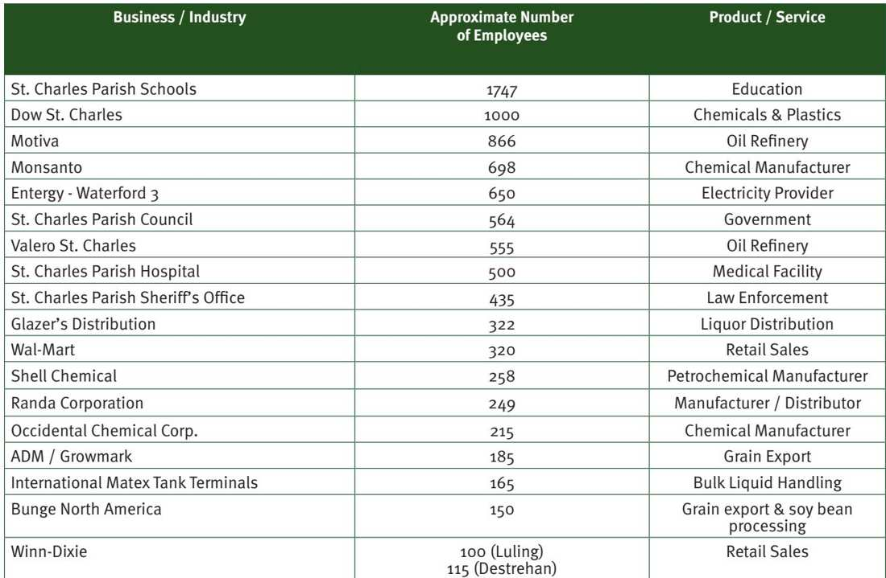

## Page 53

-Advanced Manufacturing

-Creative and Digital Media

-Energy/Petrochemicals/Plastics

-Trade/Logistics/Distribution.

GNO, Inc. launched an aggressive Economic Development roadmap to support and market these industry clusters. The Parish has focused primarily on Petrochemicals/Plastics; and Trade/ Logistical Coordination/Distribution, capitalizing on the Parish’s pre-existing competitive position, infrastructure, and skilled labor. The study also identifies the following as “supported sectors”: Business / Professional; Food Processing; Health Services / Biotechnology; Higher Education; Recovery; and Tourism / Hospitality / Entertainment.

• The Parish also regularly participates in the process of preparing a Comprehensive Economic Development Strategy (CEDS). The CEDS is mandated by the U.S. Economic Development Administration (EDA). The EDA “has designed the CEDS as a vehicle...to create an economic roadmap for fostering diversity to strengthen regional economies.” (Draft 2010 CEDS, p.iii). The area included coincides with the geographic jurisdiction of the South Central Planning and Development Commission, which coordinates the process. Implementation occurs at the parish or municipal level, and each participating community may maintain its own Economic Development strategy.

The Draft 2010 CEDS report lists seven goals which, to some degree, are consistent with the overarching principles established in this Plan (Ref. Introduction):

1. Improve the region’s public infrastructure in order to support and sustain a viable economy and environment.

2. Create and retain quality jobs and foster a more diversified economy.

3. Improve the region’s overall capacity to make efficient land use decisions.

4. Improve the region’s overall capacity to make economic development decisions.

5. Improve the fiscal capacity of local governments to make the region financially attractive for economic development.

6. Protect and conserve the region’s natural assets and promote more equitable use of these resources for business and recreation.

7. Pre-plan to improve the region’s emergency operations and recovery systems.

While reaffirming the region’s commitment to its existing industries, the Draft 2010 CEDS recognizes that the 2010 oil spill increased awareness of the economy’s limitations and vulnerability, and raised interest in emerging industry sectors, which also somewhat overlap with those identified in the prior studies.

-Environmental and Safety Technologies.

-Food Technologies.

-Eco-Tourism.

-Healthcare.

-Information Technology.

-Alternate Energy.

> **Text-layer supplement (text on this page that the layout parse did not capture; reading order approximate, taken from the PDF text layer):**
>
> 3 Completed for GNO by Angelou Economics. GNO is a regional economic development agency that serves the 10-parish Greater New Orleans region, seeking to coordinate, consolidate, and then catalyze economic development initiatives.

## Page 54

#### ECONOMIC DEVELOPMENT GOALS

1. Promote a healthy, diversified, and balanced economy.

2. Build on and market the Parish’s competitive advantages to support success in the global marketplace.

3. Foster local enterprise (both existing and new businesses).

4. Focus on serving the needs of local residents, workers, and businesses.

5. Invest in the Parish’s human capital and promote social equity.

6. Strengthen regional collaboration and partnerships.

#### POLICIES AND ACTIONS

#### ED 1

Retain, support, and capitalize upon existing core petrochemical industries in the Parish.

1.1 Coordinate with economic development allies efforts to recruit to the Parish secondary industries (those that convert basic petrochemicals into materials that may be directly used by other industries) and ancillary services and business (including contractors and suppliers to the core industry). Encourage these industries and services to locate within Employment areas identified on the FLUM.

1.2 Assist existing core industries in implementing strategies to develop appropriate complementary uses in large buffer areas, such as adoption of Buffer Zone Retrofit Plans.

1.3 Continue to participate in the Business Retention and Expansion programs that are ongoing among Louisiana Economic Development, GNO, Inc., and other economic development allies.

• Create an annual local industry survey to track and monitor anticipated changes to local business operations.

• Consider possible public/private partnerships or organizations to provide oversight and coordination of economic development initiatives.

1.4 Coordinate with the LA Workforce Commission to ensure the continued availability of a trained workforce to meet the needs of local employers.

#### ED 2

Support, strengthen and build out existing industrial and business parks.

2.1 Perform a visual character evaluation of Airline Highway in St. Rose, I-310 and the Parish line to identify actions to incrementally improve the appearance of this corridor. (Ref. CC Action 1.8). These actions may include but are not limited to:

• Regulatory amendments (e.g., amortization to address nonconformities).

• Code enforcement efforts (e.g., citations, cleanups).

Public investments (e.g., utility undergrounding, etc.) 2.2 Work with property owners to develop a coordinated strategy to position and market employment and mixed use activity centers, including but not limited to:

## Page 55

• James Business Park (St. Rose).

Plantation Business Campus (Destrehan).

Former BP Superfund site/Pan American/Amoco Refinery site (Destrehan).

Esperanza Business Park site (Hahnville).

Davis Levert Plantation (Luling).

• Bunge property (Ama).

Other opportunity sites identified in Figure ED-1, and designated as Employment centers in the FLUM (go to Figure LU-4).

#### ED 3

Recruit new high-value, information-based manufacturing and services industries to St. Charles Parish.

3.1 Selectively target marketing resource to those clusters of industries in which the Parish has certain natural advantages:

Comparatively abundant developable land for large business parks (relative to Jefferson and Orleans Parishes).

• Convenient vehicular, rail, air and river access.

• A highly trained and motivated workforce.

Close proximity to major population centers and institutions of higher learning and resources.

• Opportunities for reverse commuting.

3.2 Target the following core industry sectors:

• Alternate and Renewable Energy.

Micro-Manufacturing.

• Petrochemical and Plastics.

Trade, Logistics, and Distribution.

• Information Technology.

#### Buffer Zone Development Guidelines and Retrofit Plans

Retaining and attracting industries that generate income and employment is critical to the Parish’s economic well-being. However, it is increasingly important that both existing and new industrial sites integrated well with their surrounding area, particularly in terms of managing known or potential impacts and land use conflicts, Adopting development controls for areas surrounding industrial sites is appropriate to meet this end. Basic components of the strategy include:

1. Working with property owners, prepare a Buffer Definition Study on the basis of an assessment of the use’s impacts (including noise, odor, dust, visual, health, and other risks).

2. Define the objectives to be achieved (e.g., minimize impacts, promote land use compatibility, enable appropriate continued continued development around the site while maintaining efficient operations, or other).

3. Create an Industrial Buffer Zone overlay, identifying uses that are appropriate, limited, or prohibited based on the results of the Buffer Definition Study

4. Establish and apply appropriate site development and/or building controls, as appropriate, both for the industrial site and its buffer zone. This may include but is not limited to site location and orientation requirements; restrictions on the amount, type, and orientation of window glazing; site access, lighting, and screening requirements.

## Page 56

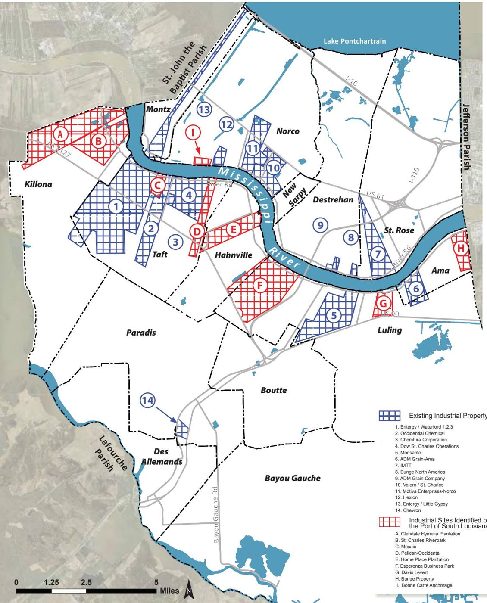

> **Figure description (visual reading, not stated in the plan's text):** Map of Economic Development Opportunity Sites (Port of South Louisiana, February 2010). Blue cross-hatched areas are labeled "Existing Industrial Property" and numbered 1-14: 1 Entergy / Waterford 1,2,3; 2 Occidental Chemical; 3 Chemtura Corporation; 4 Dow St. Charles Operations; 5 Monsanto; 6 ADM Grain-Ama; 7 IMTT; 8 Bunge North America; 9 ADM Grain Company; 10 Valero / St. Charles; 11 Motiva Enterprises-Norco; 12 Hexion; 13 Entergy / Little Gypsy; 14 Chevron. Red cross-hatched areas are "Industrial Sites Identified by the Port of South Louisiana", lettered A-I: A Glendale Hymelia Plantation; B St. Charles Riverpark; C Mosaic; D Pelican-Occidental; E Home Place Plantation; F Esperanza Business Park; G Davis Levert; H Bunge Property; I Bonne Carre Anchorage. In the committed image the legend heading for the red sites is cut off at the right edge (it reads "...Identified b[y] the Port of South Louisian[a]"). Communities labeled: Montz, Norco, New Sarpy, Destrehan, St. Rose, Killona, Taft, Hahnville, Ama, Paradis, Luling, Boutte, Des Allemands, Bayou Gauche.

> **Text-layer supplement (text on this page that the layout parse did not capture; reading order approximate, taken from the PDF text layer):**
>
> ECONO M IC DEVE LOPM E NT

## Page 57

3.3 Explore and support additional industries which offer significant job opportunities, quality of life benefits, and growth potential:

• Food Processing.

• Tourism (eco- and cultural tourism).

Entertainment (family and youth-oriented).

• Healthcare and Medical Services.

3.4 Establish the Parish as a “go-to” resource for expertise in the areas of Emergency Planning, Disaster Recovery, Coastal Zone Management, and education for riverine and maritime industries:

• Collect “best practice” and other resources.

• Identify “resident experts” and encourage additional training.

• Build a portfolio of projects.

Write and publish reports, information products, articles and/or books.

Promote the Parish’s expertise by encouraging “resident experts” to teaching and speak at conferences, seminars, and other venues.

• Form strategic alliances.

• Take a leadership role in related groups and associations.

#### ED 4

Support development of a high value local agricultural sector and related economic opportunities.

4.1Support the development of innovations in existing agriculture and aquaculture, such as the use of biomass from sugarcane for fuel production.

4.2 Work with the German Coast Farmers Market to inform residents about community-wide public health benefits created by the production, availability, access to, and consumption of local food.

4.3 Endorse and promote opportunities to tap into the trend toward high-value “local food” preferences:

• Market to restaurants and food markets in Jefferson and Orleans Parishes.

• Support the adoption of programs such as Community Supported Agriculture, which allow farmers to offer “shares” (memberships) to customers in exchange for “fresh-from-the-farm” food.

• Develop an agricultural incubator in coordination with educational institutions such as LSU, the South Central Louisiana Technical College, Delgado Technical College, etc., complementing the existing Food Technology Business Incubator.

• Supporting local retail farmers’ markets on both banks.

## Page 58

#### Agricultural Incubators

An agricultural incubator supports the notion of protecting and maintaining the Parish’s heritage and rural visual character, expressed in the 2030 Vision Statement.

Agricultural incubators are land-based educational, training and support programs for beginning farmers who wish to start their own agricultural enterprises. Incubators nurture young firms, helping them to survive and grow during the start-up period when they are most vulnerable.

Incubators also serve to educate the public about the importance of agricultural preservation and local food production and consumption.

Components of an agricultural incubator include: access to land and farm infrastructure at a reasonable rate; mentorships with experienced farmers; educational opportunities; financial planning support including loan counseling and grant application assistance; individualized business consulting; and marketing and distribution cooperatives.

Nationally, business incubators boast a proven track record of success in promoting economic growth. The following link provides a list of several incubator projects throughout the country and related resources.

http://sustainableconnections.org/ foodfarming/whatcomfarminc/incubatorlist. pdf

#### ED 5

Encourage local entrepreneurship and new small business startups.

5.1 Develop support structures and resources to support small business start-ups, including additional business incubators, local school and technical training partnerships (e.g., building upon existing Satellite Center efforts), and local revolving or micro-loan programs.

5.2 Continue efforts to disseminate information about technical assistance and funding resources available in the Southeast Louisiana region, such as the South Central Planning and Development Commission, Nicholls State University’s Small Business Development Center (SBDC), the Regional Loan Corporation, or the non-profit SCORE.

5.3 Accommodate and facilitate starting and operating small home-based businesses, including permitting “live-work” residences within new mixeduse zoning districts and modifying regulations that allow home occupations within appropriate residential zoning districts.

> **Text-layer supplement (text on this page that the layout parse did not capture; reading order approximate, taken from the PDF text layer):**
>
> ECONO M IC DEVE LOPM E NT

## Page 59

5.4 Encourage the development of local tourism oriented to sportsmen, eco-tourism and cultural / historic tourism.

• Work with neighboring Parishes and municipalities to enhance and integrate the levee trail projects into a “Regional Heritage Greenway,” providing linkages to the surrounding area’s historic and cultural attractions (Parish river plantations, Audubon Park, Garden District, downtown New Orleans, Vieux Carré, etc.).

• Develop a market for navigable waterwaybased business activities, such as fishing and sightseeing.

• Consider adding “bed & breakfast” lodgings as a use to be encouraged in specific zoning districts, both existing and future (consistent with residential mixed-use or planned communities with limitations on location and scale; general and neighborhood commercial districts; and mixed use activity centers and corridors).

Eliminate or modify regulations that may impede the re-use of qualified structures for this type of use. Considerations dependent on conditions in each district should include but are not limited to:

-Allowable number of rooms/guests

-Parking

-Access

-Signage

-Amenities

-Landscaping and buffers.

#### ED 6

Maintain the highest competitive level of workforce and vocational-technical training in anticipation of the recruitment of technology and information-based industries.

6.1 Encourage coordination between the Louisiana Technical College - River Parishes Campus and the leadership of industrial recruitment initiatives to develop training programs that provide the trained local workforce necessary to meet the needs of those industries targeted for recruitment (ED 3).

6.2 Encourage coordination between St. Charles Parish Public Schools and the Gulf Coast Process Technology Alliance (GCPTA)4 to guide students interested in being trained for positions in the local petrochemical industries.

> **Text-layer supplement (text on this page that the layout parse did not capture; reading order approximate, taken from the PDF text layer):**
>
> 4 The Gulf Coast Process Technology Alliance (GCPTA) is a regional alliance made up of industry representatives and education providers who are responsible for developing, improving and maintaining the standardized Process Technology (PTEC™) curriculum at colleges in Louisiana, Texas and Mississippi. Louisiana Technical College is one of several Louisiana institutions endorsed by the GCPTA.
>
> St. Charles 2030 Comprehensive Plan

## Page 60

6.3 Develop a comprehensive life-skills training program to develop job readiness skills for clients seeking assistance through the Department of Community Services.

#### ED 7

Reduce or eliminate present disincentives for private investment and recruitment of employment in the West Bank, by linking the urgency of such improvements to the economic future of St. Charles Parish.

7.1 Expedite the construction of the planned West Bank Hurricane Protection Levee (see Infrastructure Element).

7.2 Facilitate/expedite the construction of key planned or proposed roadway links, as shown in the Future Transportation Network map (Ref. Transportation Element).

7.3 Prepare a long-term master plan, with associated implementation and funding strategy to remediate the problem of stormwater infiltration into the sewage collection network (Ref. Infrastructure Element).

#### ED 8

Coordinate with and build upon the resources and programs of the Parish’s economic development allies to effectively market the economic development opportunities in the Parish.

8.1 Continue to maintain a detailed inventory of potential economic development/employment sites, including documentation of available infrastructure, access, and suitable uses based on zoning and comprehensive plan land use policies.

8.2 Brand and market the Parish with a recognizable brand theme and image, capitalizing on the community’s natural advantages: its location, proximity to urban centers, superior public education, natural setting and quality of life.

#### ED 9

Support and facilitate the revitalization and redevelopment of older commercial areas that are undergoing decline and obsolescence.

9.1 Prioritize targeted code enforcement efforts and hardship assistance to areas experiencing minor deterioration as a means to stabilize the area and stem further decline. (ref. CC Action 2.1).

9.2 Promote re-investment in mixed use development in transitional areas and those identified as potential mixed use activity centers and corridors in the Land Use Element (ref. LU Action 1.1).

## Page 61

#### KEY ACTORS AND PARTNERS

Ensuring the implementation of the policies and actions of the Economic Development Element will be the primary responsibility of the following governmental units:

• St. Charles Parish Department of Economic Development and Tourism.

• St. Charles Parish Council.

• St. Charles Parish President.

To effectively implement specific actions in this coordination, support, collaborations, and partnerships will be needed with (but are not limited to) the following entities and organizations:

• Economic Development Council.

• South Central Planning and Development Commission.

• St. Charles Parish Department of Planning and Zoning.

• St. Charles Parish Department of Public Works and Wastewater.

• St. Charles Parish Geographic Information Systems.

• St. Charles Parish Grants Office.

• St. Charles Parish Public Information Office.

• St. Charles Parish Department of Parks and Recreation.

• St. Charles Parish Public Schools.

• St. Charles Parish Hospital.

• St. Charles Parish Community Health Center.

• Port of South Louisiana.

• River Region Economic Development Initiative.

• Louisiana Innovation Council.

• U.S. Army Corps of Engineers.

• Louisiana Workforce Commission.

• Louisiana State University Agricultural Center.

• Cooperative Extension Service.

• Non-Profit and Private Sector Partnerships: o River Region Chamber of Commerce.

o Greater New Orleans Inc, Regional Economic Alliance.

o St. Charles Parish Museum and Historical Association.

o Louisiana Technical College.

o Delgado Technical College.

o Gulf Coast Process Technology Alliance.

o Small Business Development Center.

o Regional Loan Corporation.

o SCORE.

More detail on the roles and responsibilities of participants in the implementation of specific actions is provided in Chapter IV, Implementation.

## Page 62

### 2 LAND USE, HOUSING & COMMUNITY CHARACTER

#### EXISTING CONDITIONS AND TRENDS SNAPSHOT

#### Quick Facts

• Total Area: 410 square miles (St. Charles Parish GIS).

• Land Area: 283 square miles (182,000 acres) (St. Charles Parish GIS).

• Open Water: 127 square miles (St. Charles Parish GIS).

• Predominant Land Use: Agriculture (7,047 acres) (WRT).

• Predominant Development Type: Residential (5,428 acres) (WRT).

• Residential Units: 19,490 (2005-2009 ACS).

• Average Residential Density: 3.5 housing units per acre (residential acreage only). (WRT)

Unit Mix:• (2005-2009 ACS) Single-Family Detached: 78 percent Single-Family Attached: 1 percent Semi-Detached (2-4 units): 7 percent Multifamily (5+ units): 4 percent Mobile Homes: 10 percent.

• Occupied Units: 18,180 (2005-2009 ACS).

• Ratio of Owner-Occupied versus Renter-Occupied Units: 82 percent to 18 percent (2005-2009 ACS).

• Vacant Units: 1,460 (2005-2009 ACS).

• Median Year Housing Structure Built: 1980.

• Median Value of Owner-Occupied Homes: \$160,500 (2005-2009 ACS).

• Cost Burdened Households: (2005-2009 ACS) Owner-Occupied: 44 percent Renter-Occupied: 46 percent.

• Section 8 Vouches: 300 (Waiting List: 1,200) (SCPDCS)

• Public Housing Units: 129 (Waiting List: 500+) (SCPDCS)

• Median Household Size: 2.7 (2005-2009 ACS).

• Median Family Size: 3.1 (2005-2009 ACS).

#### Existing Land Use

St. Charles Parish has the 7th smallest land area among parishes in Louisiana. Nearly 31 percent of the total Parish is actually open water, while another 61 percent is covered by wetlands of several types (wetland forests, scrub, and marsh).

Only about 11 percent of the land area, about 20,000 acres, is potentially developable. Of this acreage, approximately 12,300 acres are already used for some type of human activity.

Agriculture, which includes pasture and grassland for livestock as well as cultivation of sugarcane and other crops, is the most prevalent use of land, with over 7,000 acres (Table LU-1 and Figure LU-1). In fact, agriculture has always been an important part of the way of life and economy of the Parish, having evolved into a farm-to-market” resource for the City of New Orleans, early on.

While a significant portion of the Parish remains in agricultural land use, there are no agricultural preservation programs or retention strategies in place. In addition, the agricultural sector has been declining over the past years, compared to other sectors.1

Single-family residential and industrial are the next most land-consuming uses, followed by infrastructure, commercial, institutional, and recreation. Acres in multifamily residential total less than one hundred today.

Excluding agricultural land and wetlands, about 427 acres are classified as “undeveloped” or “vacant” land.

> **Text-layer supplement (text on this page that the layout parse did not capture; reading order approximate, taken from the PDF text layer):**
>
> 1 According to the U.S. Census Bureau - Economic Programs (CBP//County Level/2004), Agriculture, Forestry, Fishing, and Hunting generated slightly over 300 jobs in the Parish, compared to the nearly 5,000 provided by the Manufacturing sector.

## Page 63

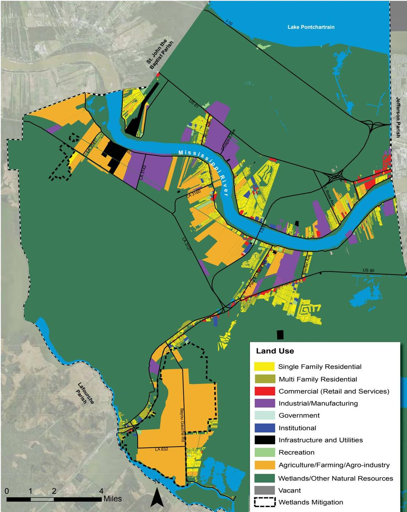

> **Figure description (visual reading, not stated in the plan's text):** Existing Land Use map of the parish, March 2011, on an aerial photo base with Lake Pontchartrain at the top, the Mississippi River crossing the middle, and Jefferson and Lafourche parish boundaries labeled. Legend, as printed: Single Family Residential, Multi Family Residential, Commercial (Retail and Services), Industrial/Manufacturing, Government, Institutional, Infrastructure and Utilities, Recreation, Agriculture/Farming/Agro-industry, Wetlands/Other Natural Resources, Vacant, Wetlands Mitigation (dashed outline). Roads labeled include US 61, LA 3142, LA 3160, LA 3127, US 90, LA 632 and Bayou Gauche Rd. Scale bar 0 to 4 miles. Most of the parish outside the river corridor is shown as Wetlands/Other Natural Resources. Industrial/Manufacturing parcels appear along both banks of the river. No community names are printed.

## Page 64

**Table 3: Table LU-1: Existing Land Use Breakdown, by Area and Percent**

| St. Charles Parish Existing Land Use | Area (Acres) | % of Total Parish Area | % of Land Area |
|---|---|---|---|
| Wetlands /Other Natural Resources* | 160,701.99 | 61.22% | 88.69% |
| Agriculture/Farming/Agro-industry | 7,047.20 | 2.68% | 3.89% |
| Single Family Residential | 5,427.60 | 2.07% | 3.00% |
| Industrial/Manufacturing | 4,846.24 | 1.85% | 2.67% |
| Infrastructure and Utilities | 1,086.89 | 0.41% | 0.60% |
| Commercial (retail and services) | 739.31 | 0.28% | 0.41% |
| Institutional | 569.45 | 0.22% | 0.31% |
| Undeveloped/Vacant Land | 427.18 | 0.16% | 0.24% |
| Recreation | 239.15 | 0.09% | 0.13% |
| Multi-Family Residential | 84.96 | 0.03% | 0.05% |
| Government | 28.84 | 0.01% | 0.02% |
| Subtotal | 181,198.81 | 69.03% | 100.00% |
| Open Water | 81,280.00 | 30.97% |  |
| Total Area | 262,478.81 | 100.00% |  |

_Source: WRT based on GIS March 2011 data and 2009 Pictometry Aerial Photography provided by St. Charles Parish Planning and Zoning Department. \* Includes acreage in the Bonnet Carre Spillway and the Salvador/Timken Wildlife Management Area._

Table snapshot (for checking): 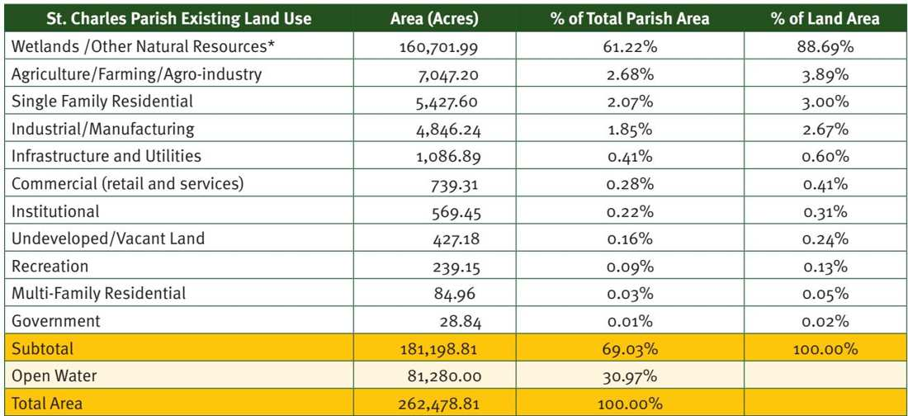

#### Development Trends

Development activity in St. Charles Parish is heavily weighted toward construction of single-family homes in conventional subdivisions. Single family construction was fairly steady in the early years of this decade, then increased substantially in the 2003-2006 period reflecting the national residential real estate market and demand generated by the 2005 hurricanes, before dropping to pre-2003 levels during the recession.

In total, nearly 2,500 new homes were built in the Parish during the last 10 years, according to the 2010 Census. About 80 percent of these were single-family dwellings. Comparatively, multifamily development was minimal. Between 2000 and 2009, the number of completed multifamily projects totaled a modest 37. A dearth of both zoned land and financing incentives, combined with the potential for community resistance, often inhibits developer interest in these types of projects.

Geographically, development in the Parish has shifted from the East Bank in favor of the West Bank, which now accounts for 55 percent of the Parish’s population (up from 50 percent in 2000).

This is not unanticipated, since more vacant land presently exists on the West Bank, and there are numerous newer subdivisions with an abundance of undeveloped single-family lots. The average gross density in these subdivisions is about 3.5 units per acres, which is at the low end of the density scale. The 2010 Census shows that housing vacancies have increased by over 300 since 2000, suggesting the possibility of overbuilding.

Montz and St. Rose, at the farthest edges of the Parish on the East Bank, experienced the greatest jump in population between 2000-2010, according to the 2010 Census. Among the communities on the West Bank, Luling, Hahnville and Boutte also saw a particularly high volume of development activity. In Luling and Boutte, more than 850 new homes were built during this period.

Most of the multifamily development which has occurred this past decade is rental units, and much of it has been built in Destrehan, St. Rose or

## Page 65

Luling/Boutte — the largest and fastest growing communities in the Parish during the past decade, which have developed a more urbanized character and have more multifamily zoning available. The comparatively small amount of this type of housing reflects entrenched stigmas about multifamily housing, yet this housing option will become increasingly important to the Parish as anticipated population shifts occur (see next section).

Older areas of the Parish are showing evidence of ongoing deterioration or abandonment, including certain neighborhoods and/or commercial corridors in Killona, New Sarpy, St. Rose, Ama, Luling, Boutte, and Des Allemands. Striving to stem further decline, and to eliminate threats to life, public health and safety from neglected or abandoned structures, the Parish has undertaken efforts to demolish such structures in several of these communities. Additional targeted strategies are required to bring about reinvestment and revitalization to these areas.

#### Projected Population and Demographics

Although in recent years there has been a preoccupation among residents and public officials that the Parish might not have sufficient developable land to reasonably accommodate future growth and development, the State of Louisiana’s most recent population projections3 indicate that the Parish will, in fact, experience modest growth over the next 20 years, ranging from approximately 5,000 (Low Series Growth Projection) to about 10,000 (High Series Growth Projection) additional residents by 2030 (Table LU-2).

The latest Census figures, which put the population at 52,780, confirm the flattening of the growth curve. Although a gain of 10 percent since 2000, the new figure is about 1,000 persons less than the State’s original projection for 2010.

**Table 4: Table LU-2: Population and Household Projections**

| Year | Population | Households |
|---|---|---|
| 2000 | 48,072 | 16,422 |
| 2005 | 50,600 | 17,631 |
| 2010 | 52,780 | 18,739 |
| 2015 | 56,050 | 19,530 |
| 2020 | 57,930 | 20,185 |
| 2025 | 59,540 | 20,746 |
| 2030 | 60,580 | 21,108 |

_Sources: U.S. Census Bureau, local level data (2000 and 2010 actual counts); ACS 2005 population (est.); Louisiana State Demographer’s Louisiana Parish Population Projection Series 2010-2030, developed by Louisiana State University; WRT (household conversion). Signs of disinvestment and decline are evident in certain older areas of the Parish, both commercial and residential_

Table snapshot (for checking): 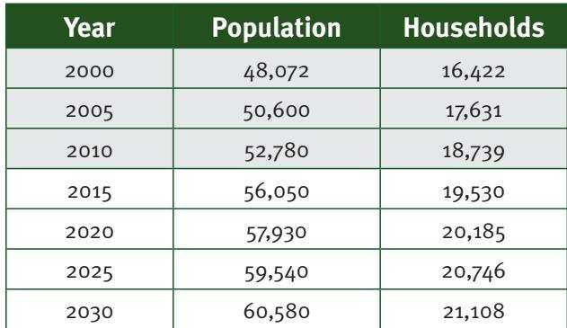

2 Louisiana State University, which developed the Louisiana Parish Population Projections Series, 2010-2030 for the State of Louisiana, recommends using the Middle Series growth projection (of for St. Charles Parish (and all other parishes except Orleans, Jefferson, and St. Bernard). This recommendation is based on long term trends derived from comparisons of the 1990 and 2000 U.S. Census, state-level population projections produced by the U.S. Census Bureau, and recent revisions to the 2007 Population Estimates for the New Orleans area.

## Page 66

One of the main things that I learned from this whole process that I found quite amazing is that as a Parish we are only projected to gain about 10,000 residents over the next 20-30 years...

Corey Savoie Steering Committee Member Supervisor, Cox Communications

Also important to consider for planning purposes is the possible distribution of the population throughout the Parish. The 2010 Census provides a comparison of population by Census Data Place for the years 2000 and 2010. Table LU-3 shows the result: Communities experiencing particularly significant population increases include Boutte, Hahnville, Montz, and St. Rose. In addition, the Census counts show that New Sarpy, Norco and Killona are losing population. In the case of Norco, one of the reasons for the loss was the buyout of property in the African American Diamond neighborhood by Shell Chemical.

While these Census counts may, in fact, provide an indication of trends in geographic distribution, circumspection is necessary in making assumptions about future growth. Other factors must be considered to predict the level of demand for development in each community, including the actual availability of developable land, major infrastructure projects and other drivers of (or impediments to) development.

Another consideration is the projected age distribution of the Parish through the 2030 planning horizon. As indicated in Chapter II, Context, the Parish’s demographic characteristics are changing, with the population growing older and households getting smaller.

In the past decade, the median age has increased from 34 to 36 years, according to the 2005-2009 ACS. In addition, a comparison between the 2010 and 2030 population pyramids (Figure LU-3), clearly shows that the Parish can expect sizable increases in the number of those aged 60 and older, as well as in residents aged 35 to 44. About 35 percent of the total population falls in this broad range (35-65). By contrast, the number of young adults is expected to decline somewhat.

The projections indicate that the number of schoolaged children will be similar in 2030 to what it is today. Public school enrollment is fairly flat at 9,602 students.

It is also expected that the Parish will continue on a trend of racial diversification. Between 2010 and 2030, the percentage of the Parish population that is White is projected to decline from 68.4 to 64.0. During the same time period, the percentage of Black residents is projected to increase from 28.4 to 31.6 and other races to increase from 3.3 to 4.3.

**Table 5: Table LU-3: Population Projections by Community**

| CDP Community | 2000 | 2010 | Total % Change |
|---|---|---|---|
| Ama | 1,285 | 1,316 | 2 |
| Bayou Gauche | 1,770 | 2,771 | 17 |
| Boutte | 2,181 | 3,075 | 41 |
| Des Allemands | 2,500 | 2,505 | 0 |
| Destrehan | 11,260 | 11,535 | 2 |
| Hahnville | 2,792 | 3,344 | 20 |
| Killona | 797 | 793 | -1 |
| Luling | 11,512 | 12,119 | 5 |
| Montz | 1,120 | 1,918 | 71 |
| New Sarpy | 1,568 | 1,464 | -7 |
| Norco | 3,597 | 3,074 | -14 |
| Paradis | 1,252 | 1,298 | 4 |
| St. Rose | 6,540 | 8,122 | 24 |
| TOTAL: | 48,156 | 52,780 | 10 |

_Source: U.S. Census._

Table snapshot (for checking): 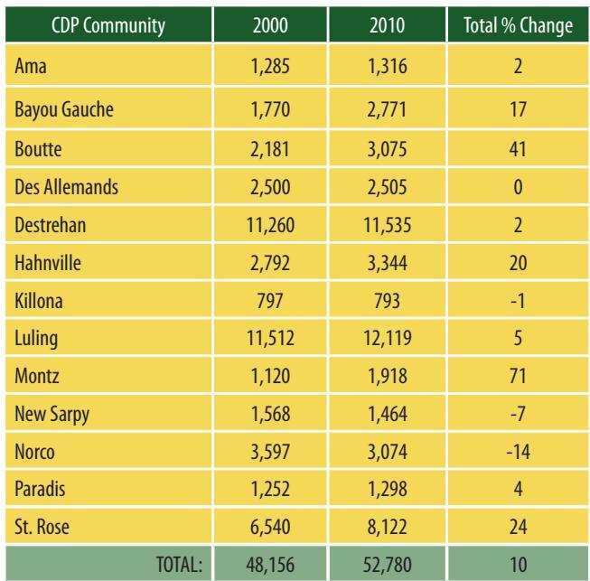

## Page 67

These changes will spur demand for different housing types, different development patterns, and different neighborhood amenities and services. The predominantly single-family housing stock of today is not well suited to the needs of a demographically changing population. In particular, various forms of multifamily housing may become the choice of housing for this shifting population.

Studies conducted on the current and anticipated housing preferences of Americans indicate that households older than 45 —the group which includes both Gen Xers and Baby Boomers— show particular interest in more densely configured development at more central locations. These households will represent over 30 percent of potential homeowners by 2030, their housing priorities driving a sizable share of the market.

#### Existing Development Capacity and Future Land Demand

Using the State population projection’s Middle Series, the new population would require less than 1,000 acres to be developed for residential use at present average residential densities (Table LU-4).

The Parish presently has nearly 7,500 acres in land that is either classified as vacant or agricultural in current use.4 There are approximately 1,200 vacant platted lots in existing subdivisions today, which could be developed over time with homes for between one-third and two-thirds of the projected range of additional population (Figure LU-3).

#### Land Capacity

• Total Net Developable Land = 16,978 acres

• Residential (incl. mixed) = 7,017 net developable acres = 34,455 residential units = ±138 years of growth

• Commercial = 2,422 net developable acres = 27,590,219 sq. ft.

• Industrial = 8,613 net developable acres = 22,760,143 sq. ft

#### Projected Growth

• Projected 2030 Population = 60,580 = 8,000 additional residents

• Average Household Size = 2.8 (ACS 2005-2009)

• New Residential Units Needed = 2,857 by 2030

#### Land Needs

• R id ti l es en a = 400-950 additi l ( t t ona acres a curren average zoned densities)

• Complementary Uses (Commercial, Institutional, etc.) = 300-400 additional acres (at current average F.A.R.s)

**Table LU-4: Summary of Land Capacity & Needs Analysis** (a bulleted call-out box in the PDF, not a ruled table; transcribed from the page image and the text layer)

| Heading | Item |
|---|---|
| Land Capacity | Total Net Developable Land = 16,978 acres |
| Land Capacity | Residential (incl. mixed) = 7,017 net developable acres = 34,455 residential units = ±138 years of growth |
| Land Capacity | Commercial = 2,422 net developable acres = 27,590,219 sq. ft. |
| Land Capacity | Industrial = 8,613 net developable acres = 22,760,143 sq. ft |
| Projected Growth | Projected 2030 Population = 60,580 = 8,000 additional residents |
| Projected Growth | Average Household Size = 2.8 (ACS 2005-2009) |
| Projected Growth | New Residential Units Needed = 2,857 by 2030 |
| Land Needs | Residential = 400-950 additional acres (at current average zoned densities) |
| Land Needs | Complementary Uses (Commercial, Institutional, etc.) = 300-400 additional acres (at current average F.A.R.s) |

> **Note:** Figure LU-2 (2010 and 2030 age pyramids, source: State of Louisiana Projections) is a pair of bar charts. Its bar values appear only in the text-layer supplement below, unordered, so the charts cannot be read from the text; see the page image.

> **Text-layer supplement (text on this page that the layout parse did not capture; reading order approximate, taken from the PDF text layer):**
>
> Source: State of Louisiana Projections 4 Agricultural land is often well suited for residential development, and is sometimes treated as a transitional use or “holding” zone.
>
> St. Charles 2030 Comprehensive Plan

## Page 68

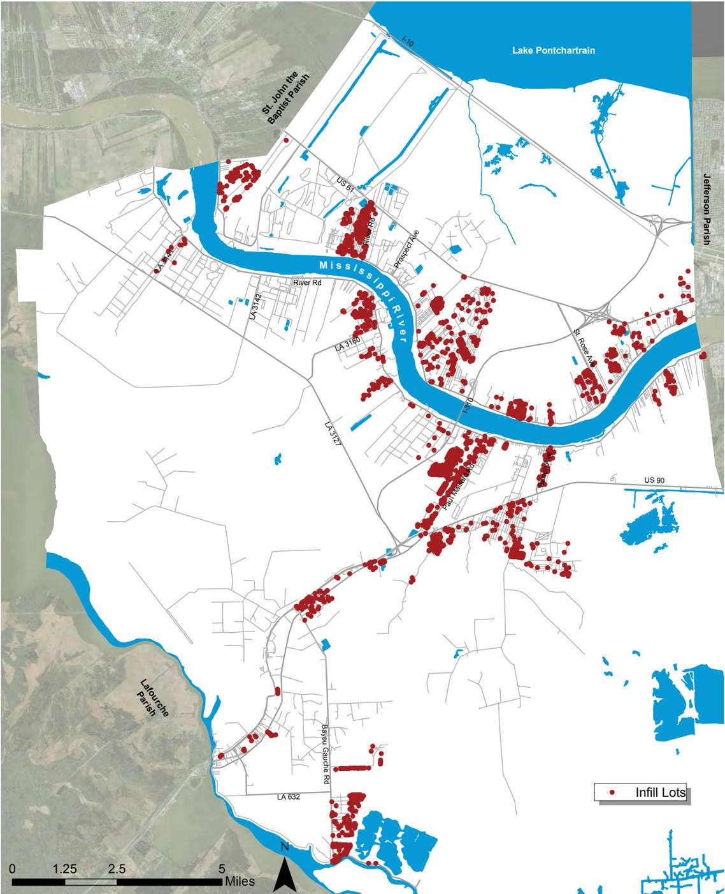

> **Figure description (visual reading, not stated in the plan's text):** Map of the parish, March 2011, with dots marking vacant or infill residential lots (legend: Infill Lots). Dots cluster along the river corridor and the US 90 and Bayou Gauche Rd corridors; roads labeled include US 61, River Rd, LA 3142, LA 3160, LA 3127, St. Rose Ave, US 90, LA 632 and Bayou Gauche Rd. No community names are printed. Scale bar 0 to 5 miles.

## Page 69

#### Development Capacity and Land Demand Issues

In the past, St. Charles Parish applied a proactive approach to zoning, resulting in 51 percent of the land in the Parish already being set aside for specific types of uses.5 (Figure LU-5).

As a result, there is vastly more “zoned” capacity for residential development in St. Charles Parish today than is likely to be needed through the year 2030. Table LU-5).

Overall, the vacant, potentially developable land set aside in all residential zoning districts adds up to nearly 10,000 acres, which at the average zoned densities for those districts could accommodate almost 34,500 new homes (almost 10 times the number of homes needed by 2030).

**Table 6: Table LU-5: Analysis of Zoning and Development Capacity (Moderately-Constrained and Unconstrained Land**

|  | Zoned (Acres) | Developed/Committed (Acres) | Gross Developable Area (Acres) | Net Developable Area (Acres) | Potential Development Capacity (units or square feet) |  |
|---|---|---|---|---|---|---|
| Large Lot Residential (Open Land zoning) | 6,300.8 | 552.4 | 5,748.4 | 4,023.9 | 8,764 |  |
| Single Family | 6,407.1 | 3,728.7 | 2,678.4 | 1,874.9 | 13,573 |  |
| Mobile Homes | 1,902.8 | 719.7 | 1,182.6 | 827.8 | 7,265 |  |
| Two-Family | 8.3 | 6.6 | 1.7 | 1.2 | 17 |  |
| Multi-Family | 504.0 | 119.0 | 385 | 269.5 | 4,694 |  |
| Residential-Commercial | 46.7 | 20.0 | 26.7 | 18.7 | 142 |  |
| Commercial (Office) | 25.9 | 19.8 | 6.1 | 4.3 | 46,195 | (.25 FAR) |
| Commercial (Office and Retail) | 4,048.5 | 580.1 | 3,468.4 | 2,427.9 | 27,497,197 | (.26 FAR) |
| Light Industrial | 2,245.7 | 284.3 | 1,961.4 | 1,373.0 | 10,167,191 | (.17 FAR) |
| Heavy Industrial (including B-2 district) | 9,997.6 | 3,114.4 | 6,883.2 | 4,818.2 | 12,592,952 | (.06 FAR) |
| Other Zoning | 4,220.1 | 2,307.4 | 1,912.7 | 1,338.9 | Not Calculated |  |
| Totals: | 35,706.9 | 11,452.4 | 24,254.5 | 16,978.2 |  |  |
| Potential New Residential Units: |  |  |  |  | 34,455 units |  |

_Data Sources: St. Charles Parish GIS (Zoning, Sensitive Habitats, Road Network), WRT._
Table snapshot (for checking): 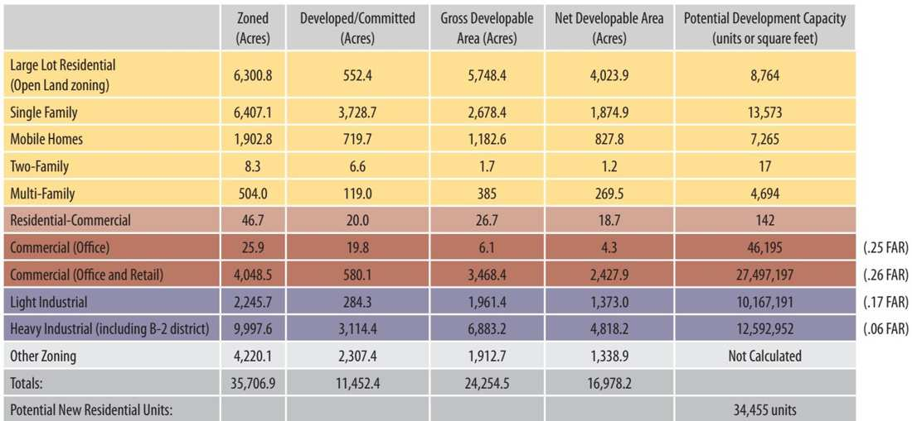

> **Text-layer supplement (text on this page that the layout parse did not capture; reading order approximate, taken from the PDF text layer):**
>
> Infill residential lots in existing subdivisions
>
> 5 The remaining 49 percent is zoned W-Wetland, where options for development are extremely limited. This zoning category includes some water bodies, such as Lake Salvador and Lake Cataouatche.

## Page 70

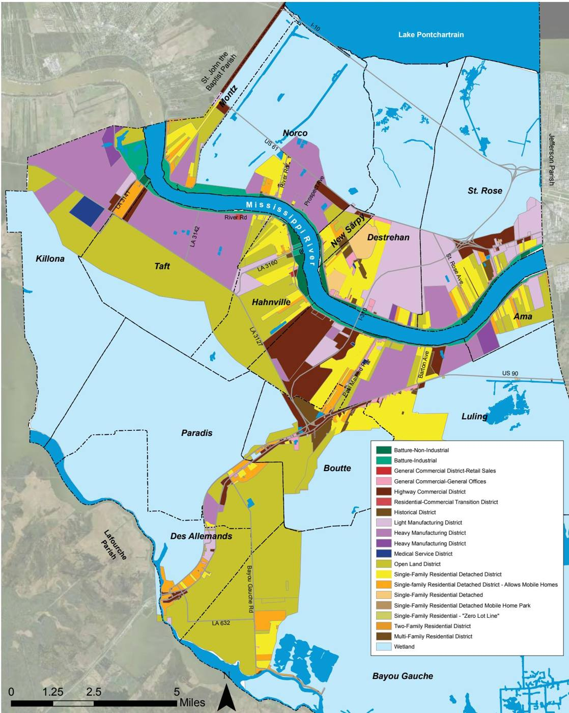

> **Figure description (visual reading, not stated in the plan's text):** Existing Zoning map of the parish, March 2011. Communities labeled: Montz, Norco, St. Rose, Killona, Taft, New Sarpy, Destrehan, Hahnville, Ama, Paradis, Luling, Boutte, Des Allemands, Bayou Gauche. Legend, as printed: Batture-Non-Industrial, Batture-Industrial, General Commercial District-Retail Sales, General Commercial-General Offices, Highway Commercial District, Residential-Commercial Transition District, Historical District, Light Manufacturing District, Heavy Manufacturing District (listed twice, in two shades of purple), Medical Service District, Open Land District, Single-Family Residential Detached District, Single-family Residential Detached District - Allows Mobile Homes, Single-Family Residential Detached, Single-Family Residential Detached Mobile Home Park, Single-Family Residential - "Zero Lot Line", Two-Family Residential District, Multi-Family Residential District, Wetland. The legend text is small at the committed resolution; the district names are as read from the image, so check the zoning code for exact names.

## Page 71

Of the land zoned for residential use, O-L, Open Land is the most common zoning district, covering 18 percent of the Parish. O-L is intended as an interim district, and primarily accommodates agriculture, forestry and very low-density residential. Residential districts are slightly over 10 percent of all the zoned land.

The excessive zoning capacity is a factor that, together with the rights of property owners, has an impact on the pattern of future land uses, facilitating the potential continuation of a dispersed and fragmented development pattern.

#### FUTURE LAND USE

The Future Land Use Map (FLUM) and the associated future land use designations identify the desired general pattern of future land use throughout St. Charles Parish. The term “general” is emphasized because the map does not represent future land use at the scale of individual properties.

The map (Figure LU-6) does, however, acknowledge the Parish’s existing development and zoning patterns as the basis for future uses, while indicating areas where these patterns will be modified over time to achieve the St. Charles Parish 2030 Vision and the policies and actions of the Comprehensive Plan.

The FLUM does not replace the Parish’s current Zoning Map, nor do the future land use categories replace the zoning districts which currently exist. Rather, the Future Land Use Map – coupled with the related future land use goals, policies and actions – is to be used as a guide in reviewing future requests for rezoning and development applications.

While the Parish will not proactively initiate or impose rezonings to ensure consistency with the FLUM, certain adjustments to current zoning districts and standards for development will be required to achieve consistency with the policies of the Plan. For example, the map emphasizes “Activity Centers” (relatively intensive mixed use community “destinations”) as a new future land use designation, which could be implemented through overlay zoning. Overlay zoning creates a special zoning district, placed over an existing base zone, which identifies special regulations and/or incentives to guide development in addition to those in the underlying base zone. The Parish’s current zoning structure does not include overlays.

The Future Land Use categorization took into consideration the Louisiana Land Use Toolkit, a set of model codes developed to implement recommendations of the Louisiana Speaks regional planning effort that followed Hurricanes Katrina and Rita. The model codes (for zoning, subdivision regulations and other ordinances) were created so that they could be tailored to the conditions of each Louisiana community. Most of the St. Charles Parish Future Land Use categories can be easily correlated in intent (although not in precise specifics) to the Context Areas proposed in the Land Use Toolkit Model Zoning Code.

The major categories of land use shown on the Future Land Use Map are Residential, Employment, Commercial, Activity Centers, Recreation and Open Space, and Wetlands. The following pages describe the different types of land activities shown on the FLUM for each major category.

[The Future Land Use Map] does not replace the Parish’s current Zoning Map, nor do the future land use categories replace the zoning districts which currently exist. Rather, the [map]...is to be used as a guide in reviewing future requests for rezoning and development applications.

## Page 72

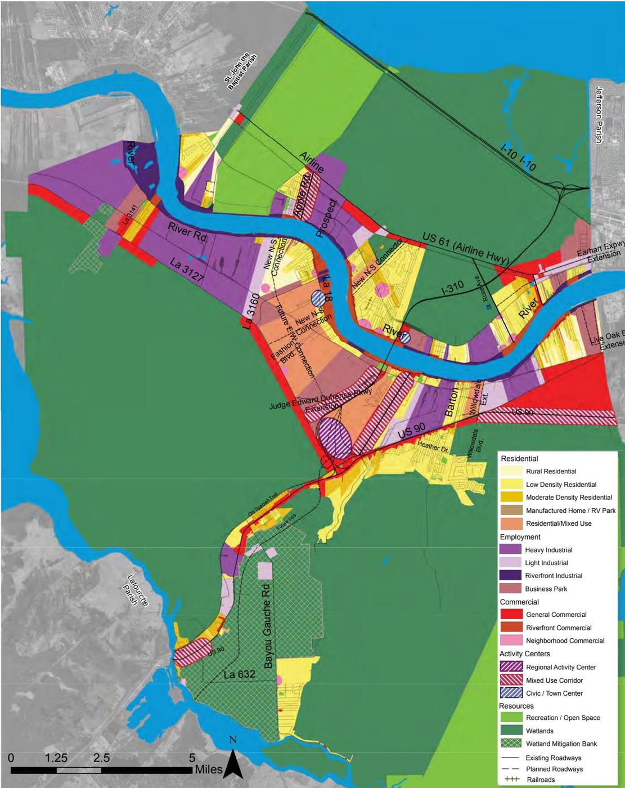

> **Figure description (visual reading, not stated in the plan's text):** Parish-wide Future Land Use map of the 2030 Plan. Legend, as printed: Residential (Rural Residential, Low Density Residential, Moderate Density Residential, Manufactured Home / RV Park, Residential/Mixed Use); Employment (Heavy Industrial, Light Industrial, Riverfront Industrial, Business Park); Commercial (General Commercial, Riverfront Commercial, Neighborhood Commercial); Activity Centers (Regional Activity Center, Mixed Use Corridor, Civic / Town Center); Resources (Recreation / Open Space, Wetlands, Wetland Mitigation Bank); lines for Existing Roadways, Planned Roadways and Railroads. Labeled roads include US 61 (Airline Hwy), I-10, I-310, US 90, La 3127, La 3160, La 18, La 3141, River Rd., Barton, Willowdale Blvd., Judge Edward Dufrene Pkwy Extension, Bayou Gauche Rd, La 632, Fashion Blvd., Earhart Expwy Extension, Live Oak Blvd Ext., Future I-49 and Old Spanish Trail. Scale bar 0 to 5 miles. No community names are printed on this map, so locate a place by its roads or by the zoning and existing-land-use maps (Figures LU-4 and LU-1), which do print names. This is the 2011 map; the 2022 Update revises it (Update Figure LU-8).

> **Text-layer supplement (text on this page that the layout parse did not capture; reading order approximate, taken from the PDF text layer):**
>
> xp wy art E Earh nsion Exte
>
> ak B Live O nsio Exte
>
> Pkwy ufrense dwa rd D Judg e E Extension
>
> Resources Minor Arterial

## Page 73

#### Residential - Includes five subcategories of residential use:

Rural Residential (less than 4 dwelling units per gross acre)

This category includes low-density residential development that is consistent with the O-L, Open Land zoning district, and conservation subdivisions which retain large amounts of open space. The Rural Residential land use category is intended to help preserve the Parish’s rural character, which residents, in the Vision Statement, expressed a desire to see retained. For this reason, this designation also allows for the continuation of agricultural activities and related uses, since agriculture is an important part of the community’s rural heritage and identity.

#### Low-Density Residential (from 4 up to 8 dwellings per gross acre)

This category includes the Parish’s predominantly single family detached subdivisions, including those developed consistent with the R-1A (6,000 sq. ft. minimum lot size) and R-1B (10,000 sq. ft. minimum lot size) zoning districts. It also allows accessory units and individual mobile homes on small platted lots zoned R-1AM. Neighborhood-serving uses such a neighborhood parks, churches and servitudes may also be included in this land use category.

#### Moderate-Density Residential (8 dwellings per gross acre and greater)

This category includes single family detached dwellings developed consistent with the R-1AM zoning district; attached dwellings such as duplexes, patio/ zero-lot line homes and townhomes consistent with the R-2 zoning district; multifamily housing developed consistent with the R-3 zoning district; and accessory units. Neighborhood-serving uses such as parks, churches, easements and ancillary neighborhood commercial uses permitted under the CR-1 zoning district or permitted subject to special exceptions or special permits.

#### Manufactured Home/Recreational Vehicle (RV) Parks

This land use category accommodates existing mobile home or recreational vehicle parks, or other concentrations of mobile homes or recreation vehicles that occur on a single lot. Land uses appropriate in this district are those permitted in the R-1M (Manufactured Home/Recreational Vehicle Park) zoning district.

#### Residential/Mixed Use

This land use designation applies in areas appropriate for large scale, creatively planned developments where the predominant use is residential, but where a variety of housing types at varying densities are encouraged, as well as compatible, local-serving commercial and service uses. Development under this land use category is anticipated to take the form of Planned Developments (PD’s) as well as Traditional Neighborhood Developments (TND’s).

## Page 74

#### Employment - Includes four sub-categories of land uses:

#### Heavy Industrial

This land use category includes heavy manufacturing, such as oil refineries, petrochemical plants and other uses permitted in the M-2 and M-3 Heavy Manufacturing zoning districts, that have the potential to impact adjacent uses with noise, dust, odors or fumes and related safety and health factors. Some policy issues associated with Heavy Industrial land uses include, but are not limited to proper buffering to minimize impacts on neighboring uses; proper access for vehicular and truck traffic to the local and regional road network; and the minimization of visual impacts on the major road corridors.

#### Light Industrial

This designation includes such uses as warehouse and distribution activities, as well as office uses, repair facilities, light assembly and light manufacturing activities that do not involve emissions of odors, dust, fumes or excessive noise, consistent with the uses in the M-1 Light Manufacturing and Industrial zoning district.

#### Riverfront Industrial

This category includes certain land areas extending generally from River Road to the Mississippi River, the use and development of which are intended to enhance the Parish’s riverfront economy. Uses appropriate in this land use category include those permitted in the B-2 Ports/Maritime zoning district (including shipping material storage, on- and off-loading facilities and ship fueling.

Riverfront Industrial

#### Business Park

Although office uses are permitted within the Light Industry land use category and the associated M-1 zoning district, this zoning classification also permits a variety of industrial uses that would be incompatible with the development of a quality, planned corporate office, research or technology park. Therefore, this new land use category (and the zoning district that should be developed to implement it) would provide for the development of planned business, office, technology and research activities, with uses limited to these and directly related ancillary uses, such as shipping offices, office supply, hotels and restaurants. Business parks should be planned to incorporate consistent standards of development quality.

## Page 75

#### Commercial - Includes three sub-categories of land uses:

Areas designated as any of the following commercial categories should seek to: 1) strengthen existing retail and service uses, 2) encourage the introduction of new uses, and 3) introduce complementary adjoining uses such as public facilities and moderate-density residential, to reinforce the retail base and support the continued health of these uses.

#### General Commercial

The General Commercial category includes sites for commercial uses that provide a mix of business activities and that serve the community as a whole. These uses provide for comparison shopping and services which are ordinarily obtained on an occasional rather than daily basis. In general, this designation applies to most commercial uses that are permitted in the C-2 (General Commercial - Retail) and all of the uses permitted in the C-3 (Highway Commercial) zoning districts.

#### Neighborhood Commercial

Neighborhood Commercial areas accommodate retail sales and services for the daily self-sufficiency of residents of a neighborhood or neighborhoods, such as convenience shopping, dry cleaners, hair salons and barber shops, day care centers, coffee shops, professional and business service offices, etc. Uses permitted in the C-1 (Commercial Office) zoning district are allowed in this district. Some uses that are permitted in the C-2 zoning district are also appropriate (e.g., bakeries, tailors, etc.).

On the Future Land Use Map, Neighborhood Commercial areas are shown conceptually as nodes around major intersections or segments along roadways where commercial uses serve one or multiple adjacent neighborhoods, or where the development of new commercial uses to serve adjacent neighborhoods is intended. The size of a Neighborhood Commercial area ranges between 2-5 acres, and its service/trade area is approximately 1 mile.

#### Riverfront Commercial

This designation applies to areas generally zoned B-1, Non-industrial Batture zoning district, and allows commercial uses that are water-dependent (such as riverboat docks and barge tie-ups), or water-related (such riverfront restaurants, fishing camps, etc.)

Boardwalks, esplanades, piers, street ends, and other public open spaces that offer vistas and waterfront views are also allowed in this district, with the intent to enhance access to the river at appropriate locations.

## Page 76

#### Activity Centers – three types:

As St. Charles Parish continues to develop and redevelop, it has the opportunity not simply to accommodate development of separate residential, commercial and industrial and commercial uses, but also to develop diversified activity centers as “destinations” within the Parish. These include three types of activity centers, some of which could be designated as “overlays” to an underlying land use. The activity center should coincide with future overlay zoning districts to implement urban design and development standards other than those provided in the underlying “base” zoning.

#### Regional Activity Center

The widely dispersed population of St. Charles Parish and the proximity to malls and “big box” development nearby in Jefferson Parish precludes the market support necessary to attract a commercial center of regional significance in St. Charles Parish today. However, the potential construction of I-49, with a major interchange connecting with US 90 and I-310, could open up the Parish for a commercial center of regional importance in the future, supported by traffic from neighboring parishes. Thus, an area adjacent to the anticipated interchange is designated in Luling/Boutte as a potential Regional Activity Center, capable of accommodating a planned commercial center such as an outlet mall or even a mixed-use retail center.

#### Mixed Use Corridor

St. Charles Parish has several corridors which have become, or have the potential to become, mixed use corridor activity centers. The following corridors have been identified in this Comprehensive Plan as warranting this designation. Others may be identified in future updates. Mixed Use Corridors will be implemented through the adoption of “special character” overlay zoning districts, and may include particular use mixes and densities (consistent with the FLUM), and distinct standards or guidelines for private development, public realm/urban design, and/or architectural design.

#### • Apple Street, Norco

This corridor, connecting River Road and Airline Highway through Norco, today contains a mix of residential, commercial and service uses and functions as an activity center for the community.

The Mixed Use Corridor designation will reinforce Apple Street’s smalltown, “main street character” with special development and urban design guidelines, emphasizing a pedestrian character.

## Page 77

#### • Paul Maillard Road, Luling

Connecting River Road in Luling to US 90 in Boutte, Paul Maillard Road contains major employment related to the presence of the St. Charles Parish Hospital, Luling Rehabilitation Hospital, the St. Charles Parish Community Health Center and associated activities, along with a mix of older commercial and residential uses.

The Paul Maillard Road Mixed Use Corridor Overlay should encourage redevelopment and revitalization of existing commercial sites with a mix of local-serving retail and service-oriented offices (health-care related), as well as provide for infill and redevelopment (as opportunities arise) of higher density residential (apartments and town homes) to serve those employed the nearby hospital and put in place development guidelines to reinforce walkability with an improved streetscape.

#### • Judge Edward Dufresne Parkway, Luling

Judge Edward Dufresne Parkway, which is planned to be extended and connected to LA 3127, already accommodates a number of important governmental and community facilities. The development of these facilities has been incremental, rather than as part of a cohesive concept.

As a designated Mixed-Use Corridor, the completed parkway, with landscaped median and streetscape elements, will have the opportunity to develop as a well-planned concentration of civic activities serving the entire Parish. Future uses should complement the existing Satellite Center, School District Operations Building, Sheriff Department Headquarters, nearby Bridge Park, and the future Community Center. Urban design guidelines will be established with the intent to encourage and celebrate the corridor’s civic focus.

#### • U.S. 90, Luling

The easternmost segment of the U.S. 90 corridor, roughly between the Davis Diversion and the Parish line, is expected to experience some degree of commercial development in the future, due to both the Parish’s intended construction of a boat ramp complex and the area’s immediate proximity to Jefferson Parish.

The planned boat ramp facility –comprising 5 new back-down ramps and extensive parking for cars, trucks, as well as ancillary facilities— will provide much needed access to the abundant resources of the Cataouatche/Salvador Wildlife Management Areas, and will draw sports fi shermen, hunters, paddlers, bird watchers, and other active and passive types of recreational visitors.

The corridor is positioned to take on a unique character, with a mix of uses related to fishing and eco-tourism (hotels and fishing lodges, camps, restaurants, bait shops, outdoor equipment stores, etc.).

> **Text-layer supplement (text on this page that the layout parse did not capture; reading order approximate, taken from the PDF text layer):**
>
> St. Charles 2030 Comprehensive Plan

## Page 78

#### • Old U.S. 90 and U.S. 90/Twin Bridge Road, Des Allemands

At the southwestern end of the Parish, the commercial needs of Des Allemands’ residents used to be met by small retail and service uses lined along Old U.S. 90, which historically functioned as this community’s “village center.”

Over time, this function and the character of this district has eroded, due in part to market forces, but also to the effect of zoning and development standards which reflect a suburban character. Therefore, a Mixed-Use Corridor designation for this area will be used to re-introduce a village-like character, consistent with and promoting Des Allemands’ historic identity as “the Catfish Capital of the Universe.”

#### Civic/Town Centers

St. Charles Parish has the opportunity to develop activity centers which focus on civic uses built in the character of a “town center” at the following two locations:

#### • Hahnville Civic/Town Center

This Civic/Town Center designation generally encompasses land located between Bethlehem Lane and Courthouse Lane, on both sides of River Road. Centered on the Courthouse, along with nearby governmental offices, this area has the opportunity to develop as a “downtown” or “town center” for Hahnville.

Additional civic and governmental activities, infill housing, restaurants and other retail uses and amenities such as a central “town green” or plaza, along with sidewalk and streetscape enhancements to improve walkability, will help create the necessary critical mass of activity that would constitute a town center.

#### • Plantation Civic/Town Center

Located at the base of the Hale Boggs Bridge on the East Bank, this approximately 165 acre site (which houses the Parish’s East Regional Library) lends itself to becoming a future concentration of civic facilities and other community-serving activities and functions; it is centrally located and has high accessibility to I-310.

#### Recreation and Open Space

This land use category includes all St. Charles Parish owned or maintained parks (excluding undeveloped or small neighborhood mini parks), protected natural and recreational resources owned or managed by state or national agencies (including the Bonnet Carre Spillway and the Salvador/Timken Wildlife Management Area), as well as private recreational facilities (such as golf courses and shooting ranges).

## Page 79

#### Wetlands

Although a natural wetland is not considered a human use of land, substantial portions of the Parish are designated as wetlands. Most are likely to remain as such due to existing regulatory limitations on their development. The wetlands land use designation, which applies to these areas, acknowledges these limitations, but most importantly, highlight the value of wetlands to St. Charles Parish.

Wetlands serve a variety of functions, not the least of which include providing hydrologic/flood control, habitat for wildlife, and water-quality control. Hydrologic functions are those related to the quantity of water that enters, is stored in, or leaves a wetland. These functions include such factors:

• reduction of flow velocity

• role as ground-water recharge or discharge areas

• influence on atmospheric processes.

Water-quality functions include the trapping of sediment, pollution control, and the biochemical processes that take place in wetlands.

Wetlands also have significant recreational value, and along with this, economic development value by attracting tourism to the Parish. The value of a wetland for recreation and tourism is a product of all the processes that work together to create and maintain the wetland.

Allowable land uses in areas designated as wetlands are limited to low impact uses, such as eco-tourism and recreation (e.g., boating, hiking, hunting, fishing), wildlife observation, environmental education, environmental research, compatible agriculture (e.g., periodic haying and grazing), managed timber harvest, and other uses that may be permitted by special exception or special permit by the Louisiana Department of Natural Resources, the U.S. Army Corps of Engineers or the St. Charles Parish Coastal Zone Advisory Council.

## Page 80

> **Text-layer supplement (text on this page that the layout parse did not capture; reading order approximate, taken from the PDF text layer):**
>
> Apple Street Mixed Use Corridor: Visualization of the incremental effect of a public/private investment strategy combined with the application of overlay development and design standards.

## Page 81

#### LAND USE, HOUSING AND COMMUNITY CHARACTER GOALS

1. Provide for an orderly and cost-effective redevelopment and growth pattern

2. Minimize incompatibilities between different types of uses.

3. Enhance community livability, historical value, appearance and visual character.

4. Provide a diversity of well designed, affordable, safe, and sanitary housing choices to serve all residents of the Parish.

5. Recognize and respect the “sense of place,” history, and identity of established communities and neighborhoods.

6. Protect / maintain rural character.

7. Reduce development vulnerability to storms and other disasters.

#### LAND USE POLICIES AND ACTIONS

#### LU 1

Using the Future Land Use Map and corresponding land use categories as a guide, amend the Parish’s regulatory tools as necessary to provide for the range of residential, business, industrial, and communityserving mixed uses needed to meet the residents’ present and future needs.

1.1 Create Overlay Zoning Districts as follows to implement the FLUM. As appropriate, prepare area plans for these districts as part of a coordinate revitalization strategy (ref. CC 2). The specific boundaries and land area of each district listed will be determined in the course of creating the districts.

o Regional Activity Center: comprising land located generally east and north of the future I-49 / I-310 / U.S. 90 interchange, and west of Paul Maillard Road.

o Mixed Use Corridor: these may consist generally of parcels abutting a roadway, on both sides, but could be one or several blocks deep.

\- Apple Street, roughly from River Road to Airline Highway, in Norco.

\- Paul Maillard Road, roughly from U.S. 90 to River Road, in Luling.

\- The completed Judge Edward Dufresne Parkway, roughly between River Road and LA 3127.

\- U.S. 90 between the Davis Diversion and the Jefferson Parish line, in Luling.

\- Old U.S. 90 between the junction with (new) U.S. 90 and LA 631, and (new) U.S. 90 between

## Page 82

#### Overlay Zoning District:

An overlay district is an additional zoning requirement that is placed on a geographic area but does not change the underlying zoning. An overlay district can share common boundaries with the base zoning or cut across base zoning boundaries. Regulations or incentives are attached to the overlay district to guide development within a special area or to protect a specific resource. There are three basic steps to creating an overlay district:

1. Define the purpose of the district. The district should have a clearly defined purpose e.g. to preserve historic character or to allow a specific mix of commercial and residential uses.

2. Identify the areas that make up the district. Mapping district boundaries will depend on the geographic areas that relate to achieving the purpose of the district.

3. Develop specific rules that apply to the identified district. In a mixed use corridor, provisions may include expansion or restriction of allowable uses; development standards to guide the placement and orientation of a building on a site or incentives to reduce the amount of on-site parking; or guidelines to promote or enhance a specific design character.

The procedures for adopting an overlay district are the same as for adopting a zoning or rezoning provision.

To ensure success in areas lacking market demand, the overlay district should be applied as part of or in conjunction with a focal plan or coordinated revitalization plan for those areas (CC Action 2.5), including public investment strategy (LU Action 1.9) and/or private development incentive strategies (CC Actions 1.3, 2.4, 2.6 and 2.7).

the junction with Old U.S. 90 and the bayou, in Des Allemands.

#### o Civic / Town Center

\- Hahnville Civic / Town Center: comprising land that surrounds the St. Charles Parish Courthouse and generally located between Bethlehem Lane and Courthouse Lane, on both sides of River Road.

\- Plantation Civic / Town Center: comprising land that surrounds the East Regional Library on the East Bank, and generally located east of the Hale Boggs Bridge ramps.

1.2 Review, strengthen and amend the existing R-1A, R-1B, R-2 and R-3 (residential) districts to ensure that they accommodate multiple housing types consistent with the Future Land Use categories, either as “by right” permitted uses, or as special exceptions or conditional uses subject to determination of compatibility.

1.3 Create a new Residential/Mixed Use zoning district consistent with the intent of the Future Land Use category of the same name. Alternatively, consider a new, Planned Development overlay, with very detailed standards and an approval process that will ensure achieving the same type of residential use mix and character.

1.4 Create a new Business Park zoning district consistent with the intent of the Future Land Use category of the same name.

1.5 Review, strengthen and amend the existing B-1 (batture) zoning district to ensure the list of uses permitted in that district is consistent with the intent of the Riverfront Commercial Land Use category. Concurrently, review the Zoning Map to ensure that the present boundaries and arrangement of B-1 and B-2 zoning along the riverfront is compatible with adjacent uses, and consistent with the long-term anticipated character of those areas.

1.6 Review, strengthen and adjust the list of permitted uses in the existing C-1, C-2, and C-3 (commercial) districts to be consistent with the intent of the General Commercial and Neighborhood Commercial future land use categories.

## Page 83

1.7 Incentivize landowners to voluntarily reserve land for long-term commercial and employment uses, consistent with the FLUM. One possible tool is a preferential tax assessment, which only remains as long as the land is reserved; if the land developed with a different use, a rollback tax is charged to the landowner.

1.8 Monitor the levels of new residential, commercial, and employment uses, based on actual development, to periodically adjust estimates of future land demand and take appropriate action.

1.9 Prepare, adopt, and implement a capital improvement program to coordinate the expansion of infrastructure, facilities, and services with the occurrence of new development, or to upgrade capacity concurrent with redevelopment (See Infrastructure Element).

1.10 Ensure consistency of plans, land divisions, rezonings or development proposals with the intent of the FLUM or the Comprehensive Plan’s policies (See Implementation Element).

#### LU 2

Preserve productive farmland and promote economically viable and compatible agricultural uses in the Parish.

2.1 Review uses permitted in the O-L, R-1A(M) and M-1, as well as any other districts in the Zoning Ordinance which support agricultural activities, to ensure that those districts sufficiently promote and facilitate the preservation of productive farmland.

2.2 Review and adjust, as necessary, related zoning standards to consider the needs of farm operations: for example, consider permitting increased lot coverage, housing for agricultural labor, and reduced front setbacks for agricultural uses in agriculturefriendly zoning districts.

#### Residential/Mixed Use District or Planned Development Overlay Standards:

The intent of planned development standards should be to promote high quality development that incorporates amenities beyond those expected under conventional development, to achieve greater flexibility in design, to encourage well-planned projects through creative and imaginative planning, and to provide for appropriate use of land that is sufficiently unique in its physical characteristics or other circumstances to warrant special methods of development.

Special standards that may be applied in a Residential/Mixed Use District (or Planned Development Overlay) include but are not limited to flexible density and floor area ratios, setbacks, lot coverage, parking, and open space; the planned development project may deviate from the Zoning Ordinance in these areas within certain parameters, but must comply with an approved development plan.

2.3 Support opportunities for on-farm energy production techniques (e.g., methane, wind, solar, and other forms of power) as a way to enhance economic viability.

2.4 Promote and facilitate the establishment of agri-tourism, community supported agriculture (CSAs), farm stands and farm markets, greenhouse operations, equine operations, and accessory farm businesses. Support the development of agricultural management practices for these activities, as needed, reduce Right-to-Farm conflicts and incompatibilities.

2.5 Protect and enhance agricultural infrastructure, including but not limited to capital investment to ensure:

## Page 84

**Table LU-6: Correlation Between Future Land Use Categories and Zoning Districts (Source: St. Charles Parish Zoning Ordinance, WRT)**

> **Reading note:** ● marks a zoning district that corresponds to the Future Land Use category in that row; ◉ marks a district where only neighborhood-scale, neighborhood-serving uses (those permitted in C-2) are appropriate. The printed table is rotated 90 degrees. The H and MS columns carry the printed vertical text "Deletion or revision recommended" for every row. Printed notes: Governmental and Institutional Uses are permitted in any residential, commercial, and employment district, subject to specific criteria. * The Low-Density Residential Land Use Category does not preclude the use of individual mobile homes on platted single family lots that are zoned R-1AM. Marks were placed from the text-layer coordinates and checked against the page image.

| Future Land Use category | R-1A | R-1AM | R-1B | R-1M | R-2 | R-3 | O-L | CR-1 | C-1 | C-2 | C-3 | M-1 | M-2 | M-3 | AV-1 | B-1 | B-2 | W-1 | G | H | MS |
|---|---|---|---|---|---|---|---|---|---|---|---|---|---|---|---|---|---|---|---|---|---|
| **RESIDENTIAL** | | | | | | | | | | | | | | | | | | | | | |
| Rural Residential |  |  |  |  |  |  | ● |  |  |  |  |  |  |  |  |  |  |  |  |  |  |
| Low-Density Residential * | ● | ● | ● |  |  |  |  |  |  |  |  |  |  |  |  |  |  |  |  |  |  |
| Moderate-Density Residential |  | ● |  |  | ● | ● |  | ● |  |  |  |  |  |  |  |  |  |  |  |  |  |
| Manufactured Home/RV Park |  |  |  | ● |  |  |  |  |  |  |  |  |  |  |  |  |  |  |  |  |  |
| Residential/Mixed Use | new R/M-U zoning district or new standards/procedure for Planned Development approval | | | | | | | | | | | | | | | | | | | | |
| **COMMERCIAL** | | | | | | | | | | | | | | | | | | | | | |
| General Commercial |  |  |  |  |  |  |  |  |  | ● | ● |  |  |  |  |  |  |  |  |  |  |
| Neighborhood Commercial |  |  |  |  |  |  |  | ● | ● | ◉ |  |  |  |  |  |  |  |  |  |  |  |
| Riverfront Commercial |  |  |  |  |  |  |  |  |  |  |  |  |  |  |  | ● |  |  | ● |  |  |
| **EMPLOYMENT** | | | | | | | | | | | | | | | | | | | | | |
| Heavy Industrial |  |  |  |  |  |  |  |  |  |  |  |  | ● | ● |  |  |  |  |  |  |  |
| Light Industrial |  |  |  |  |  |  |  |  |  |  |  | ● |  |  | ● |  |  |  |  |  |  |
| Riverfront Industrial |  |  |  |  |  |  |  |  |  |  |  |  |  |  |  |  | ● |  |  |  |  |
| Business Park | new Business Park (BP) zoning district | | | | | | | | | | | | | | | | | | | | |
| PARKS AND OPEN SPACE | ● |  | ● | ● | ● | ● | ● | ● | ● | ● | ● | ● | ● | ● |  | ● | ● | ● |  |  |  |
| WETLANDS |  |  |  |  |  |  | ● |  |  |  |  |  |  |  |  |  |  | ● |  |  |  |
| **OVERLAY DISTRICTS** | | | | | | | | | | | | | | | | | | | | | |
| Mixed Use Corridor | new Mixed Use Corridor (MUC) zoning overlay district | | | | | | | | | | | | | | | | | | | | |
| Civic/Town Center | new Civic/Town Center (C-TC) zoning overlay district | | | | | | | | | | | | | | | | | | | | |
| Regional Activity Center | new Regional Activity Center (RAC) zoning overlay district | | | | | | | | | | | | | | | | | | | | |

Table snapshot (for checking): 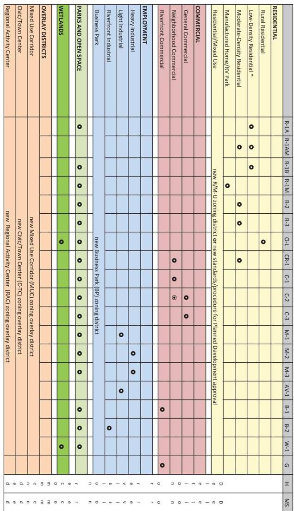

## Page 85

• the quality and condition of “farm-to-market” roadways which carry heavy truck traffic

• provision for access to rail and river transportation

• adequate water supply for irrigation

flood control and stormwater drainage systems

• provision of and access to agri-related information and communications technology.

#### LU 3

Continue to improve the user-friendliness and consistency in application of the Parish’s land development regulations and review and approval procedures for applicants, citizens, and staff.

3.1 Review and amend the Parish’s existing zoning districts to be consistent in intent with the FLUM (Table LU-3). Strive to simplify and modernize the current zoning classification, consolidating, if necessary, overlapping districts, and eliminating districts that may be rendered unnecessary by the application of other policies in this Plan (e.g., MS and H zoning districts).

3.2 Increase the transparency, predictability and consistency of the development approval process. Techniques may include but are not limited to:

• Review and improvement of work flows to ensure consistency and efficiencies in procedures.

• Offer staff training to ensure regulations and procedures are consistently applied.

• Establish interdepartmental project management systems.

Increase reliance on the Parish’s website to allow customers to track project progress, obtain updates, and expedite communication.

3.3 Adopt regulatory incentives to attract and retain small/locally-owned business (e.g., simplifying processes for approval of home occupations, and offering financial incentives to locally-owned businesses such as tax credits or exemptions, low

Productive farmland:

• Benefits the environment

• Adds to the community’s character

• Helps keep taxes down

• Increases property values

• Ensures that residents get access to an abundant supply of locally produced fresh food and agricultural products.

## Page 86

#### The Comprehensive Plan and the Zoning Ordinance

implement of the Comprehensive Plan, will play a critical role in shaping the function, form, and visual character of St. Charles Parish. As such, it should faithfully interpret and represent the collective mandate of the 2030 Vision and the goals and policies of the Comprehensive Plan.

In many communities, a zoning code or ordinance is updated many times over the years, but usually in an piecemeal manner. As a result, at some point the code may stop reflecting best practices, or the true development expectations of the community. There may be internal inconsistencies and contradictions within the code; or regulations that have unintended, and some times surprising results on other regulations.

St. Charles Parish is no exception. The Zoning Ordinance was adopted in 1981. Since then, it has been incrementally revised to its current form.

With the adoption of the 2030 Comprehensive Plan, the Parish will have a unique window of opportunity to perform a wholesale evaluation of its Ordinance to bring the zoning in line with the Comprehensive Plan. Not only will various adjustments need to be made to existing standards, but new districts, tools, associated standards and incentives incorporated. A general “cleanup” of the ordinance should be completed at the same time.

interest loans for development and expansion, or reduced development fees).

#### LU 4

Reduce the overall environmental impact of buildings and encourage more hazard-resilient development.

4.1 Encourage developers and builders to use sustainable land development practices such as lowimpact development, deconstruction3 and adaptive reuse to reduce costs, waste, and environmental impacts.

4.2 Remove from the Zoning Ordinance, or adjust as necessary, inadvertent impediments to sustainable development, such as existing restrictions —on uses, dimensional standards or others— that may prevent the use of technologies and techniques for renewable energy production (e.g., solar panels or personal wind turbines) or energy and water conservation (e.g., “green” roofs, water harvesting, etc.); regulations that allow or encourage excessive impervious coverage (e.g., from parking or excessive site disturbance).

4.3 In addition to removing barriers, identify and incorporate possible incentives (e.g., setback or height exceptions, density bonuses, fee waivers, or other inducements) for the application of sustainable development practices in new development and retrofits, including but not limited to:

• solar panels and/or personal wind turbines (in appropriate districts).

• green roofs and water harvesting technologies.

• preservation of existing trees and plant material.

• reduced parking in areas of a more urban character.

• regional approaches (rather than site-by-site) to stormwater solutions.

> **Text-layer supplement (text on this page that the layout parse did not capture; reading order approximate, taken from the PDF text layer):**
>
> 3 A technique associated with green building, deconstruction is the selective dismantlement of building components, specifically for re-use, recycling, and waste management.

## Page 87

• minimization of site grading, filling, and overall soil disturbance.

• reduction of construction waste and increase in reuse and recycling.

• use of low-emissions materials in construction (consistent with the Building Code).

4.4 In all development, encourage maximum protection of wetlands and other natural systems that offer a buffer against storm surge.

#### HOUSING POLICIES AND ACTIONS

#### HOU 1

Promote the diversification of the housing stock.

1.1 Adopt Accessory Unit regulations applicable to existing residential zoning districts to facilitate the provision of legal accessory units. These types of units offer an alternative form housing for families with aging parents, among others.

1.2 Identify opportunities to provide workforce and alternative housing in appropriate locations compatible with zoning and the character of existing neighborhoods. Ensure equitable Parish-wide distribution. Possible approaches include:

Encouraging apartments above stores in residential/mixed use projects.

Consider requiring the provision of workforce housing in redevelopment projects which replace obsolescent commercial development in Overlay Mixed-Use districts.

1.3 Include standards for the integration of “scattered site” affordable housing units in subdivisions.

1.4 Evaluate the need to require the provision of affordable housing for future developments of a certain land area, number of units, or within a certain distance (3-5 miles, on or off-site) of the existing and future Parish’s employment centers (as identified in the FLUM) .

1.5 Promote mixing of various types of housing (e.g. single family detached and attached homes) in mixed-residential developments (consistent with the FLUM).

#### HOU 2

Ensure the provision of decent, affordable housing opportunities to all income groups and household types.

2.1 Implement guidelines to ensure the quality of new housing (livable community design, quality construction, energy efficiency, etc.).

2.2 Require that the architectural design of different types of housing within the same community be consistent.

2.3 Continue to promote and provide affordable ownership opportunities for first-time home buyers through assistance programs.

2.4 Identify resources to bring homes that do not initially qualify for existing programs up to Code.

2.5 Allocate a targeted number of existing units for emergency placement for those in immediate need of housing.

2.6 Expand the development of affordable units through the use of USDA Rural Development Funds.

2.7 Explore resources for the development of HUD   
202 Senior Housing.

2.8 Develop a shelter/transitional living facility.

#### HOU 3

Improve the functionality and visual character of new residential subdivisions.

3.1 Introduce new or revise existing standards that:

• Take into consideration pedestrian, bike path and roadway connectivity of the housing to places to shop and work.

## Page 88

• Develop and adopt a tree ordinance requiring the planting of street trees in new residential communities, with an approved tree list and standards for spacing and maintenance.

• Limit the maximum length of blocks to less than the present 1,500 feet (which is more than four football-field lengths). Longer uninterrupted street blocks allow cars to travel at faster speeds and give pedestrians less route alternatives. Optimum block lengths range between 500 and 1,000 feet.

• Disallow cul-de-sacs, or at least limit their number (see Transportation Element) and length. Cul-desacs are detrimental to a connected community; and as cul-de-sacs lengths increase, properties accessible from only one direction become more isolated and difficult to reach.

• Clearly describe appropriate types of locations, necessary degree of accessibility to, and required amounts of land for public amenities and facilities such as schools, parks, playgrounds, open space, pedestrian paths and bicycle trails.

• Make sure that all dedicated public open space and recreation areas (except for environmental open space) provide direct access from public streets, be visible and easily accessible, have multiple points of entry, and be well buffered from moving vehicles.

• Ensure that each phase of a phased development meet minimum requirements for open space and recreational areas.

• Provide for the reservation of land for rights-ofway adequate to accommodate complete streets to enhance a Parish-wide mobility network (see Transportation Element).

#### HOU 4

Promote the preservation, enhancement, and revitalization of existing residential neighborhoods.

4.1 Identify housing tools, programs and potential funding sources for rehabilitating, restoring and repairing existing deteriorated housing. Examples of possible tools include creating a Housing Finance and Community Development Department, Community Development Corporation, and/or a Parish Housing Council.

4.2 Designate neighborhoods that remain largely stable but which are potentially vulnerable to decline as Neighborhood Conservation Areas (NCAs) or Neighborhood “Fight-Back” Areas (NFBAs). To identify these neighborhoods, a housing condition inventory and housing rating shall be conducted (e.g., “sound,” “minor deterioration,” “major deterioration,” and “dilapidated”). Actions may include:

o Mobilizing residents through a grass-roots campaign.

o Creating a Neighborhood Conservation Advisory Committees to support condition monitoring, code enforcement, policing, and other conservation efforts.

## Page 89

o Monitoring housing conditions by conducting periodic updates of a NCA’s inventory and rating.

o Targeting code enforcement to curtail, reverse, and prevent minor deterioration.

o Seeking grants and use available funding to provide financial assistance for maintenance and renovations to eligible property owners.

o Clear dilapidated, abandoned, and unsafe structures.

4.3 In the case of older neighborhoods already experiencing physical and socioeconomic decline and abandonment, adopt Neighborhood Revitalization Area (NRAs) strategies, including the following actions:

• Perform a housing condition assessment.

• Mobilize residents through a grass-roots campaign.

• Create a NFBA Advisory Committee.

• Concentrate (on a temporary basis, as needed) code enforcement resources and other services (e.g., police, housing services, etc.) to eliminate or prevent blight, reduce crime, and help stabilize and restore the neighborhood.

• Seek grants and use available funding to provide financial assistance for maintenance and renovations to eligible property owners.

• Clear dilapidated, abandoned, and unsafe structures.

• Assemble and market cleared, abandoned and/ or tax delinquent lots as infill and redevelopment sites.

4.4 Research resources for community revitalization through federally-funded home renovation programs in targeted neighborhoods.

#### COMMUNITY CHARACTER POLICIES AND ACTIONS

#### CC 1

Improve the functionality and visual character of nonresidential development.

1.1 Create and adopt special development standards and design guidelines for each Overlay Zoning district proposed in LU Action 1.1.

1.2 Adjust as necessary the zoning requirements for commercial development to match the intended character of the land use categories, including but not limited to:

• minimum and maximum setbacks

• minimum and maximum parking ratios

• location of parking to the side or rear whenever possible

• parking reduction/credits

access management and shared access requirements

• increased landscaping

• flexible stormwater solutions.

1.3 Adopt building design guidelines to improve the aesthetics of commercial development, in particular building massing, parking/building relationship, façade appearance, materials, site lighting, signage, etc.

1.4 Review and revise standards for transitional buffers in the R-3, CR-1, C-1, C-2, C-3, M-1, and M-2 zoning districts to ensure that their widths are both “context sensitive” and adequate to reduce the impacts of existing adjacent incompatible use, and to minimize future incompatibilities.

1.5 Develop a business park master plan campus overlay or zoning district. Consider complementary uses and the establishment of development and design standards to create a cohesive architectural style. Standards should consider:

## Page 90

> **Text-layer supplement (text on this page that the layout parse did not capture; reading order approximate, taken from the PDF text layer):**
>
> U.S-90 Highway Corridor Character District: Visualization of the potential effect of access management, landscape, and signage standards, as well as utility undergrounding.

## Page 91

• minimum/maximum parcel size

• ownership requirements

• restrictive covenant requirements

• setbacks

• floor area ratio/building coverage

• open space

• building height

• design review requirements.

1.6 Revise existing standards for industrial development to include criteria for the provision of minimal landscaping and open space; open storage screening; on-site employee and truck parking; loading, maneuvering and storage.

1.7 Study, plan and establish Highway Corridor Character Districts in the Zoning Ordinance, with specific provisions for landscaping, signage, architectural character, parking, access management and bicycle / pedestrian accommodations to maintain or enhance the quality and appearance of development along or protect the scenic value of key Parish roadway corridors, including:

• I-310, particularly “gateway” segments at the northern and southern edges of the Parish

• U.S.-90, or portions thereof (not covered by Mixed Use Corridor District overlays)

• LA 3127, or portions thereof

• LA 18 and LA 48 (River Roads)

• LA 631 (Old Spanish Trail)

• Airline Highway, or portions thereof.

#### CC 2

Support and facilitate the revitalization and redevelopment of areas that are undergoing decline and obsolescence.

2.1 Apply a targeted code enforcement strategy to areas where simple private investment in upgrades, repair and maintenance will stem further deterioration.

2.2 Conduct and maintain a Parish-wide inventory of potential infill/redevelopment sites.

2.3 Evaluate the practicability of re-submitting a application to the HUD/DOT Planning Challenge Grant program, if continued, for the revitalization of the Paul Maillard Road Mixed Use Corridor. Also consider alternative assistance, such as EPA’s Smart Growth Implementation Assistance program.

2.4 As opportunity arises, identify public funds to invest in targeted areas and sites, including on land assembly and clearance, developer solicitation and selection, and construction of capital improvements (infrastructure upgrades, streetscape improvements, etc.) to incentivize and support for private investment, particularly in those areas identified as future mixed-use corridors and activity centers.

2.5 Prepare sector or focal plans for areas suited for a targeted planning approach (e.g., Elkinsville, Killona, etc.), including those undergoing or susceptible to change because of lack of investment,

As opportunity arises, identify public funds to invest in targeted areas and sites...to incentivize and support private investment, particularly in those areas identified as future mixed use corridors and activity centers.

> **Text-layer supplement (text on this page that the layout parse did not capture; reading order approximate, taken from the PDF text layer):**
>
> St. Charles 2030 Comprehensive Plan

## Page 92

> **Text-layer supplement (text on this page that the layout parse did not capture; reading order approximate, taken from the PDF text layer):**
>
> Paul Maillard Road Mixed Use Corridor: Visualization of the potential incremental effect of Overlay Zoning standards and guidelines, combined with targeted public investment.

## Page 93

> **Text-layer supplement (text on this page that the layout parse did not capture; reading order approximate, taken from the PDF text layer):**
>
> Apple Street Mixed Use Corridor: Visualization of the possible incremental impact of capital projects such as streetscape, with application of design guidelines and incentives to spur private reinvestment.
>
> St. Charles 2030 Comprehensive Plan

## Page 94

#### Sector Plans

While the Comprehensive Plan takes primarily a community-wide perspective, a focal, sector or small area plan (terms used interchangeably here) allows a detailed examination of issues that are unique to a define and more manageable portion of the community.

A sector plan not only implements policies of the Comprehensive Plan, but also minimizes discrepancies that often result from making decisions on a parcel-by-parcel basis. At this scale, a sector plan can also deal with more fine-grained design issues.

The following steps provide a generalized model process for focal/sector/small area planning. Public engagement should be included at every step:

1. Project Kickoff (Study Area Tour; Data Assembly; Stakeholder Interviews)

2. Existing Conditions and Trends Analysis

Land Use/Zoning and Land Ownership; Physical Form/Design; Property Condition Inventory (as appropriate); Circulation and Infrastructure; Environment/Landscape Character

Economic/Market Assessment (as appropriate)

• Summary

3. Concept Development

• Vision and Guiding Principles

Alternative Land Use, Urban Design, Circulation, Infrastructure and other concepts

Evaluation and Selection of Preferred Concept

4. Plan Documentation

• Illustrative

underutilization of land resources, physical obsolescence, decline or other factors.

2.6 Review existing standards to remove impediments for infill and redevelopment projects, including parking, storm water, setback or other site requirements that older sites may not be able to meet.

2.7 Adopt incentives for infill and redevelopment projects such as:

• Expedited review or intensity/density bonuses for infill and redevelopment projects.

• Adjusted fees (e.g., development review fees) for projects in specific Mixed Use Corridors or other designated areas.

#### CC 3

Increase community livability through development form and quality.

3.1 Provide incentives for the introduction of neighborhood businesses and services into underserved neighborhoods. Such incentives may include:

• Assistance with market studies

• Expedited review processes (e.g., over-the-counter permitting, etc.)

• Facilitating access to financing for small businesses.

3.2 Encourage planners of new residential/ mixed use communities to establish a “neighborhood commercial nodes” at central locations consistent with the FLUM, combining small-scale retail, civic, cultural, and recreation uses.

3.3 Adopt development standards to encourage the horizontal and vertical integration of different land uses (retail, office, housing).

3.4 Require the provision of sidewalks and bicycle paths, along with pedestrian and bicyclist amenities (bike racks, etc.) to provide opportunities for active, healthy lifestyles.

## Page 95

#### CC 4

Maintain and improve the visual character of publicly owned and maintained landscapes within St. Charles Parish.

4.1 Continue to make improvements (e.g. landscaping, lighting, signage, streetscape and public art) to highly visible locations in the Parish. This includes gateway entrances, major corridors, public buildings and grounds, and parks.

4.2 Establish a high standard of design quality in new public improvement projects (buildings, landscapes, and infrastructure).

#### CC 5

Continue to increase community beautification efforts, both to improve visual character and enhance safety and security.

5.1 Promote neighborhood and business participation in community clean-ups (roads, parks, waterfront lands, etc.).

5.2 Study the feasibility of and potential funding sources for removing overhead utilities that detract from the quality of the community’s visual character and may even pose potential safety problems in selected locations, such as narrow rights of way of mixed-use corridors and activity centers.

5.3 Improve road drainage in locations where storm water accumulations impact visual character as well as safety.

#### CC 6

Maintain critical environmental resource areas as open space.

6.1 Identify, map, and designate components of a permanently preserved open space system that provides a diversity of publicly accessible resources in the form greenways, parks, blueways, and other natural areas.

6.2 Review and adjust existing open space dedication standards to include a separate definition for environmental open space set-asides or feein-lieu, to ensure the protection of fl oodplains, wetlands, and other environmentally sensitive resource areas.

6.3 Consider provisions for cluster/conservation subdivision design, to encourage the protection of sensitive environmental resources, to reduce storm vulnerability, and to maximize hazard resiliency.

> **Text-layer supplement (text on this page that the layout parse did not capture; reading order approximate, taken from the PDF text layer):**
>
> (bike racks, etc.) to provide opportunities for active, healthy lifestyles.
>
> St. Charles 2030 Comprehensive Plan

## Page 96

#### KEY ACTORS AND PARTNERS

Ensuring the implementation of the policies and actions of the Land Use and Community Character Element will be the primary responsibility of the following governmental units:

• St. Charles Parish Department of Planning and Zoning.

• St. Charles Parish Planning and Zoning Commission.

• St. Charles Parish Council.

• St. Charles Parish President.

To effectively implement specific actions in this Coordination, support, collaborations, and partnerships will be needed with (but are not limited to) the following agencies and organizations:

• St. Charles Parish Department of Economic Development and Tourism.

• St. Charles Parish Department of Public Works and Wastewater.

• St. Charles Parish Department of Waterworks.

• St. Charles Parish Department of Community Services.

• St. Charles Parish Geographic Information Systems.

• St. Charles Parish Grants Office.

• St. Charles Parish Public Information Office.

• St. Charles Parish Department of Parks and Recreation.

• South Central Planning and Development Commission.

• Regional Planning Commission.

• Port of South Louisiana.

• Lafourche Basin and Pontchartrain Levee Districts.

• Louisiana Department of Transportation and Development.

• Private Sector Partnerships: Landowners, Real Estate Industry (developers, investors, real estate agents, etc.), Neighborhood and Civic Association Groups.

More detail on the roles and responsibilities of participants in the implementation of specific actions is provided in Chapter IV, Implementation.

## Page 97

### 3 TRANSPORTATION ELEMENT

#### EXISTING CONDITIONS AND TRENDS SNAPSHOT

St. Charles Parish enjoys the great advantage of a complete multimodal transportation network, which connects the Parish to the surrounding region, the rest of the country, and the world with relative ease. This network includes vehicular, rail, water, and air transportation.

Mobility within the Parish is less efficient, due to numerous natural and man-made impediments to connectivity; the present lack of a sidewalk and bicycle infrastructure; and the dispersal of population, which inhibits the ability to provide extensive transit service.

#### Roadway Network

Figure TR-1 shows the Parish’s roadway network and functional classification. According to the Louisiana Department of Transportation and Development (LA DOTD), which has jurisdiction over most of the Parish’s key roadways, there are three basic functional classifications: arterial, collector, and local. The classification of each road is determined as a function of mobility and access. The process is a cooperative effort between the federal, state and local governments led by LA DOTD. It involves a comprehensive review each decade following the U.S. Census and continuous review and adjustments.

Each one of the three classifications is applied in one of two separate contexts: rural or urban. The arterial system is designed to provide mobility and limit access, for higher traffic volumes and speed. In the rural area this mobility is provided between adjacent urban areas. In the urban area, mobility is provided between traffic generators and to and from the rural arterials at the rural/urban boundary.

The collector system focuses on providing some combination of mobility and access. In the rural area, it connects the local road system to the rural arterial system or to a population center. It is used

#### Quick Facts

• Roadway Network: I-10, I-310, U.S. 90, U.S. 61, LA   
3127, LA 3141, LA 3160, LA 18, LA 48, LA 52, local roads. Traffic Count Increase: 5 percent annual (Interstate and Principal Arterial) (DOTD 2003-2008). Traffic Conflict Areas: Highway 90 west of I-310 through Paradis; LA 18 under the I-310 interchange and west to the Parish Courthouse; LA 48 under the   
1-310 interchange west toward Destrehan (LA DOTD)

• Railroad Network: Canadian National Railroad (CNR) and the Kansas City-Southern (KCS) , and the Union Pacific Railroad (UP) and the Burlington Northern Santa Fe Railroad (BNSF) on the West Bank.

Service: Freight Only.

#### • Water Transportation: Mississippi River

Facilities: Port of South Louisiana and Port of New Orleans (both deep water, 45-ft. draft)

Tonnage: over 246 million in 2010 (including St. John the Baptist and St. James Parishes)

#### • Air Transportation:

Facilities: New Orleans Louis Armstrong International Airport (MSY), only 5 miles away. Ama Airport: privately owned, 22-acre. 4,000 foot runway general aviation airport located in Ama. No commercial passenger travel or freight.

Transit: On-demand, three 12-passenger buses, operated by River Parishes Transit Authority.

as a connection between adjacent small population centers and also between them and adjacent urban areas or the rural arterial system.

The local system primarily provides access to the land use adjacent to the road and mobility is compromised. The design is typically based on lower volume and lower speed, and high/unlimited access.

## Page 98

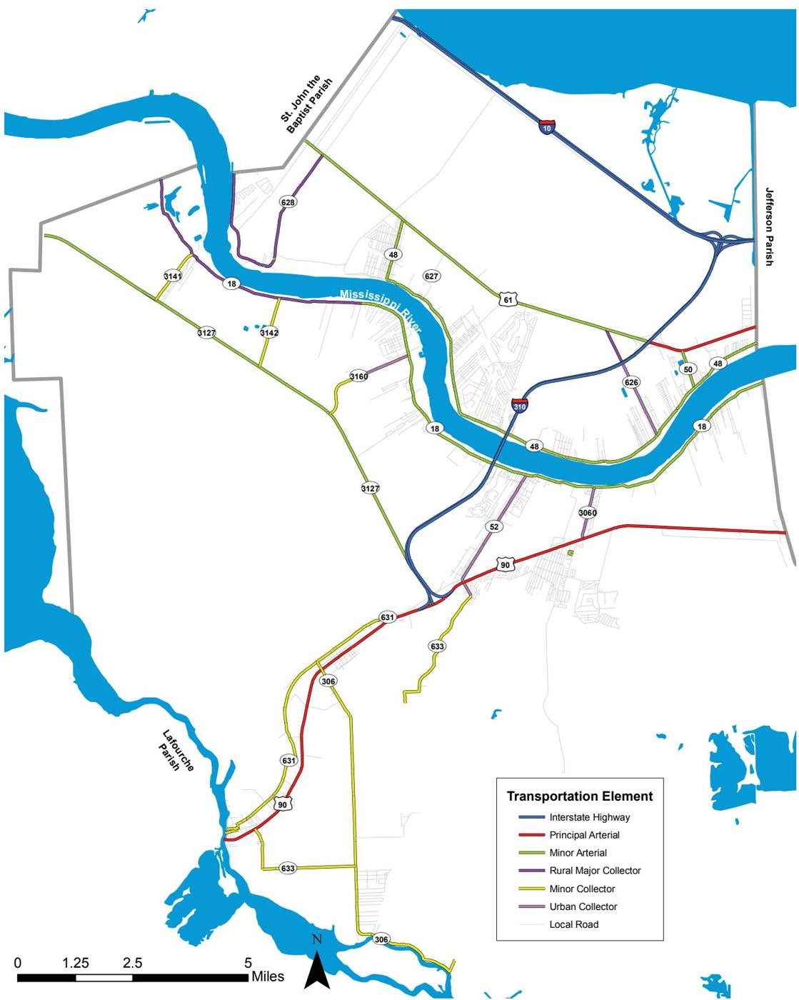

> **Figure description (visual reading, not stated in the plan's text):** Parish map with the Mississippi River, Lake Pontchartrain at the top edge, and labels for St. John the Baptist Parish, Jefferson Parish and Lafourche Parish. The legend, titled Transportation Element, lists Interstate Highway, Principal Arterial, Minor Arterial, Rural Major Collector, Minor Collector, Urban Collector and Local Road. Route shields printed on the map include 10, 310, 61, 48, 18, 50, 52, 90, 306, 627, 628, 626, 631, 633, 3060, 3127, 3141, 3142 and 3160. The scale bar reads 0, 1.25, 2.5 and 5 Miles. The legend is complete and readable.

## Page 99

Average annual daily traffic (AADT) count data available from LA DOTD and the South Central Planning and Development Commission (SCPDC) from 2003 to 2008 indicates that I-10, I-310, and U.S. 90 and U.S. 61 hold the highest traffic volumes in the Parish. The same data shows moderate to high annual growth rates in AADT for most segments of the principal arterials and interstates for which counts have been recorded.

Traffic counts have increased approximately 5 percent per year along the Major Arterial network, most likely due to through-traffic. In contrast, traffic volumes along Minor Arterials and Local Roads have grown very little, and in some cases they have decreased, indicating a relatively slow pace development within the Parish for the past 7 years.

Data comparing daily traffic volume to daily capacity for Parish roadways, compiled during the preparation of LA DOTD’s Draft River Region Transportation Master Plan (TMP), suggests that travel flow is generally good and there is very little congestion within the Parish today. An exception involves Highway 90 from River Ridge Drive in Boutte to Paradis, where congestion is associated with the lack of left-turn lanes and/or the presence of multiple individual driveways. In other instances where congestion occurs, it is primarily near major industries at morning and evening work-day peakhours only. (Figure TR-2).

The most significant issue related to the functionality the roadway network is that it is hampered by travel barriers: wetlands, vast expanses of privatelyowned, restricted industrial property, privately owned railroad lines, and the Mississippi River. The network is alternative-poor, and results in circuitous trip patterns which cause increased travel time and distance to travelers. Without proactive action on the part of the Parish and careful coordination with LA DOTD, the South Central Planning and Development Commission, the Regional Planning Commission, and other stakeholders, the few potential opportunities to increase network connectivity could be squandered as the Parish builds out.

In addition, although the TMP was never adopted, its draft document showed that existing principal arterials could experience significant degradation of their level of service by 2030 due to significant increases in the volume of through-traffic. (Figure TR-3).

#### Railroad Transportation

Figure TR-4 shows the Parish’s railroad system. The Parish is served by four mainline east-west lines. All the lines provide the Parish’s petrochemical and other industries with freight service. No commuter passenger service is available. However, Amtrak’s Sunset Limited, which runs between Los Angeles and New Orleans (and, pre-Katrina, eastward to Florida), travels through the parish using the BNSF tracks.

Although the railroads are a major transportation and economic development asset for the Parish, they also function as barriers for travel. Many roads throughout the Parish terminate at a railroad track. Opportunities for new crossings are very limited and can typically only be provided when eliminating or consolidating another crossing.

> **Text-layer supplement (text on this page that the layout parse did not capture; reading order approximate, taken from the PDF text layer):**
>
> Union Pacific line, looking east from Ashton Plantation Blvd.
>
> St. Charles 2030 Comprehensive Plan

## Page 100

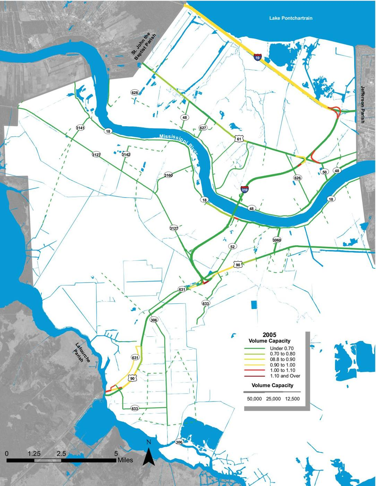

> **Figure description (visual reading, not stated in the plan's text):** Parish map with Lake Pontchartrain labeled at the top, St. John the Baptist Parish and Jefferson Parish at the edges, and Lafourche Parish at lower left. The legend, titled 2005 Volume Capacity, lists six classes: Under 0.70; 0.70 to 0.80; 08.8 to 0.90 (printed this way); 0.90 to 1.00; 1.00 to 1.10; and 1.10 and Over. A second legend titled Volume Capacity lists the values 50,000, 25,000 and 12,500 along a graduated bar. Route shields printed include 10, 310, 61, 48, 18, 50, 52, 90, 306, 627, 628, 626, 631, 633, 3060, 3127, 3141, 3142 and 3160.

## Page 101

#### Water Transportation

Large segments of the local and regional economy depend on the Mississippi River and other navigable waterways. Freight transport is handled by two nearby deep-water ports: the Port of South Louisiana and the Port of New Orleans. Both are designated a Foreign Trade Zone.

#### Air Transportation

No commercial passenger or freight air travel is available within St. Charles Parish. There is a privately owned airport located in Ama. However, this airport is suited to supporting only light, general aviation aircraft.

Regionally, the Parish is served by the Louis Armstrong New Orleans International Airport (LA NOIA), less than 5 miles from the Parish. Every major domestic airline and several international carriers serve LA NOIA.

Also on a regional level, the Port of South Louisiana has been pursuing a plan to expand the St. John the Baptist Parish Airport to accommodate corporate jets and possibly cargo. This could eventually provide an alternative air transportation route for corporate businesses and industry located in St. Charles Parish.

#### Transit

The only transit service in St. Charles Parish is provided by the River Parishes Transit Authority, an on-demand system using a fleet of three 12-passenger buses, which is funded through a cooperative venture between St. Charles and St. John the Baptist Parishes. In the year since the services started, reception has been very positive and usage has increased by the month.

While the critical mass does not exist for other types of transit, it is important to track demand and to keep abreast and involved in regional and federal project transit projects which may benefit the Parish.

## Page 102

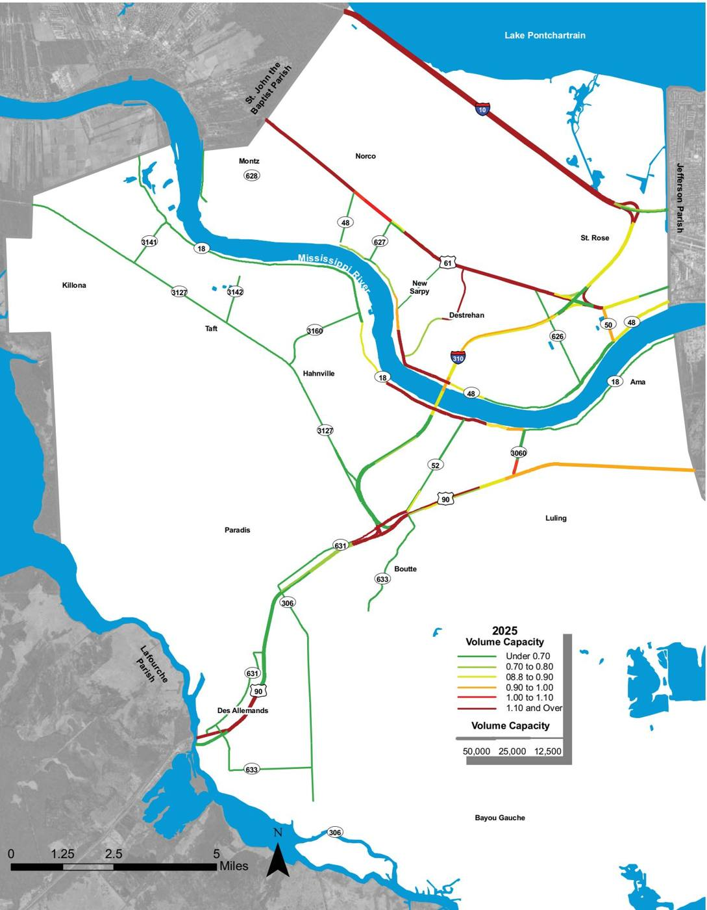

> **Figure description (visual reading, not stated in the plan's text):** Map titled 2025 Volume Capacity with place names printed on it: Montz, Norco, St. Rose, Killona, Taft, Hahnville, New Sarpy, Destrehan, Ama, Luling, Paradis, Boutte, Des Allemands and Bayou Gauche. Lake Pontchartrain, St. John the Baptist Parish, Jefferson Parish and Lafourche Parish are also labeled. The legend lists Under 0.70; 0.70 to 0.80; 08.8 to 0.90 (as printed); 0.90 to 1.00; 1.00 to 1.10; and 1.10 and Over, followed by a Volume Capacity bar with 50,000, 25,000 and 12,500. Route shields printed include 10, 310, 61, 48, 18, 50, 52, 90, 306, 627, 628, 626, 631, 633, 3060, 3127, 3141, 3142 and 3160.

## Page 103

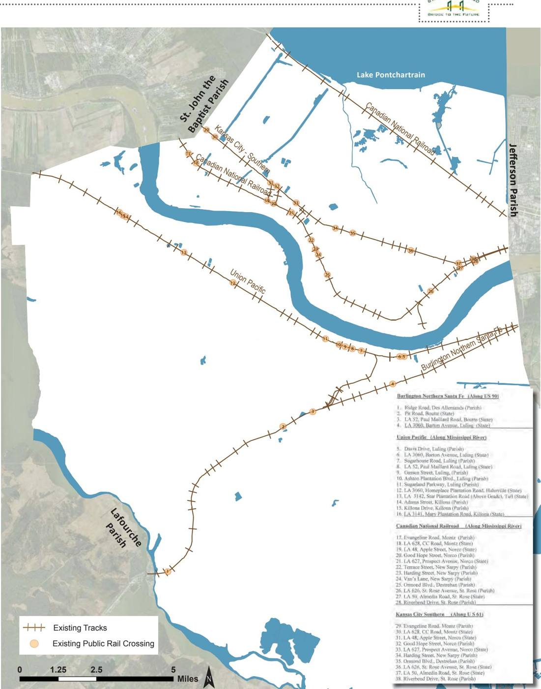

> **Figure description (visual reading, not stated in the plan's text):** Railroad map with the Mississippi River and Lake Pontchartrain, and labels for Canadian National Railroad, Kansas City Southern, Union Pacific and Burlington Northern Santa Fe. The legend lists Existing Tracks and Existing Public Rail Crossing. A text box lists numbered crossings in four groups: Burlington Northern Santa Fe (Along US 90), items 1 to 4; Union Pacific (Along Mississippi River), items 5 to 16; Canadian National Railroad (Along Mississippi River), items 17 to 28; and Kansas City Southern (Along U S 61), items 29 to 38. Each entry gives a street name and a jurisdiction in parentheses, such as (Parish) or (State), and the numbers 1 to 38 are also printed as markers on the map. The scale bar reads 0, 1.25, 2.5 and 5 Miles.

## Page 104

#### TRANSPORTATION GOALS

1. Coordinate transportation with land use planning.

2. Provide a variety of transportation choices and options for residents and visitors of the Parish.

3. Improve coordination of the transportation planning, development and delivery activities of LA DOTD, the Parish government, and the private sector.

4. Use future improvements to the transportation system as an opportunity to increase connectivity between destinations throughout the Parish.

5. Because good transportation is critical in attracting new businesses, housing, and well-paying jobs to St. Charles Parish, apply a “livable community” perspective when addressing transportation needs.

#### POLICIES AND ACTIONS

#### TR 1

Support the Louisiana Department of Transportation and Development (LA DOTD) in meeting their responsibilities to plan, fund, build and maintain a roadway network which supports sound growth and the mobility needs of St. Charles Parish.

1.1 Designate a single point of contact (person or department) to serve as the Parish’s liaison to LA DOTD, SCPDC, and RPC for all transportation projects involving or affecting the Parish.

1.2 Lobby LA DOTD to implement targeted capacity improvements to improve traffic flow and safety along major arterial corridors within the Parish (Figure TR-6). Prioritize and further study additional improvements identified by the Parish for other corridors, as necessary.

1.3 Work with LA DOTD, the SCPDC and RPC to identify, plan for, design, seek funding, and expedite construction of additional roadways links and improvements identified as necessary to support the desired future land use pattern and achieve a better integrated roadway network (Figure TR-7).

1.4 Document the need for additional railroad crossings (Figure TR-8), which are necessary to improve connectivity of the roadway network.

1.5 Establish protocols to negotiate the approval and expedite the construction of new crossings with the railroad companies involved.

#### TR 2

Improve the efficiency and safety of the road network, in coordination with LA DOTD, SCPDC and RPC.

2.1 In reviewing development applications, identify the need to retain rights-of-way for roadways depicted in Figure TR-7.

2.2 Enforce the existing requirement that new subdivisions be designed and built in a manner which promotes minimum levels of connectivity, e.g., through the reservation of stub streets onto adjacent property.

## Page 105

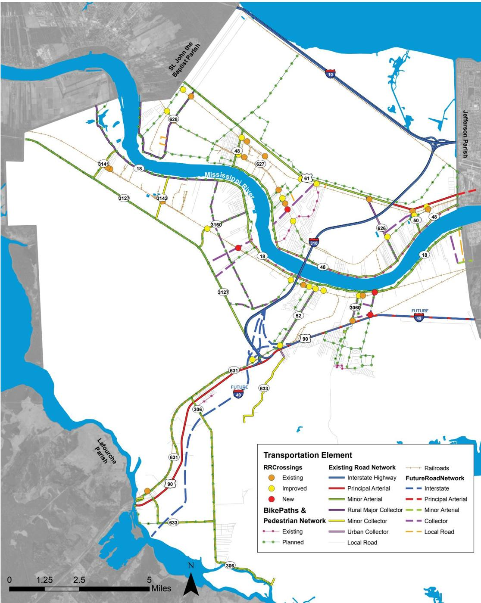

> **Figure description (visual reading, not stated in the plan's text):** Map with a legend titled Transportation Element that lists RRCrossings (Existing, Improved, New), Existing Road Network (Interstate Highway, Principal Arterial, Minor Arterial, Rural Major Collector, Minor Collector, Urban Collector, Local Road), Railroads, FutureRoadNetwork (Interstate, Principal Arterial, Minor Arterial, Collector, Local Road) and BikePaths & Pedestrian Network (Existing, Planned). Printed labels include FUTURE 49 (twice), St. John the Baptist Parish, Jefferson Parish, Lafourche Parish and the Mississippi River. Route shields printed include 10, 310, 90, 631, 633, 306, 3060, 3127, 3141, 3142, 3160, 52, 61, 627, 628, 626, 50, 48 and 18. The scale bar reads 0, 1.25, 2.5 and 5 Miles.

## Page 106

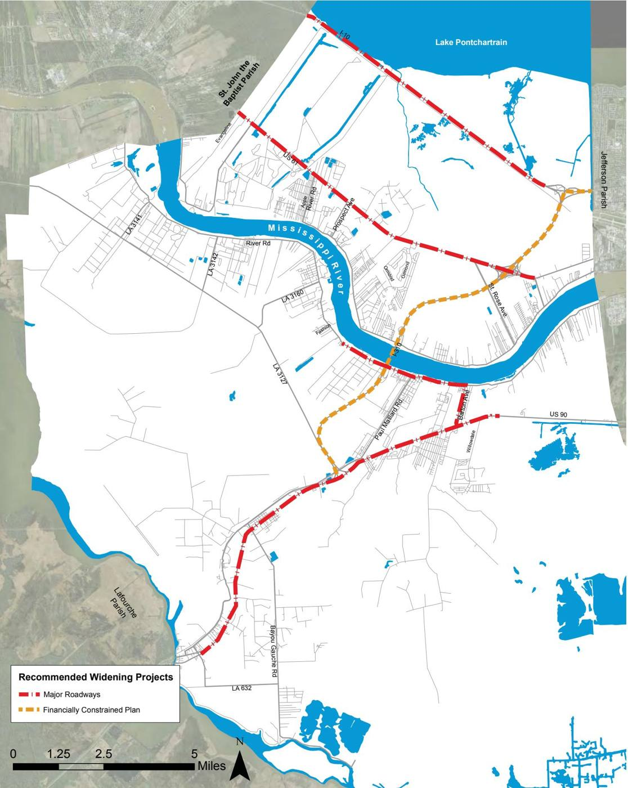

> **Figure description (visual reading, not stated in the plan's text):** Map with a legend titled Recommended Widening Projects that lists Major Roadways (red dashed line) and Financially Constrained Plan (orange dashed line). Labeled roads include I-10, US 61, Prospect Ave, Evangeline, Apple River Rd, River Rd, LA 3141, LA 3142, LA 3160, LA 3127, I-310, St. Rose Ave, Paul Maillard Rd, Barton Ave, Willowdale, US 90, LA 632 and Bayou Gauche Rd. The Mississippi River, Lake Pontchartrain, St. John the Baptist Parish, Jefferson Parish and Lafourche Parish are also labeled. The scale bar reads 0, 1.25, 2.5 and 5 Miles.

## Page 107

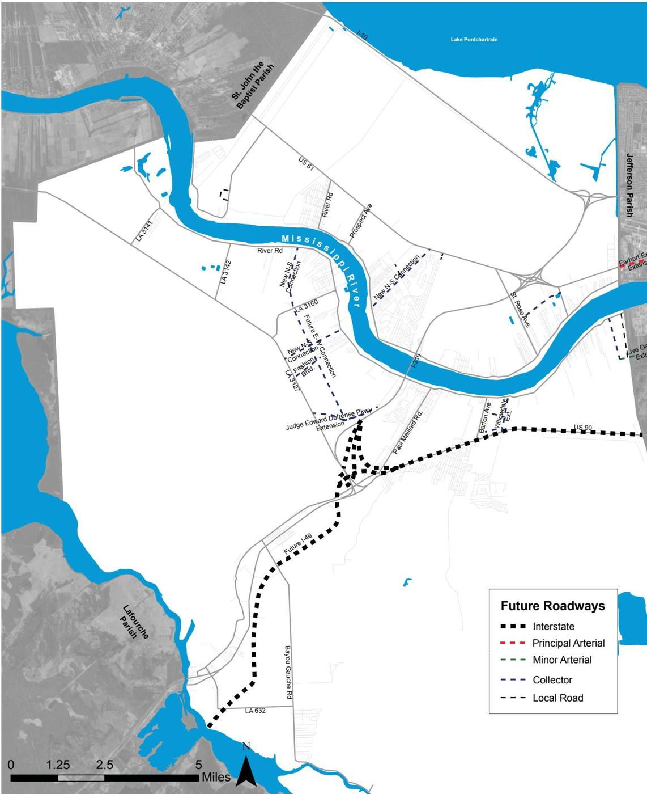

> **Figure description (visual reading, not stated in the plan's text):** Map with a legend titled Future Roadways that lists Interstate (black dotted line), Principal Arterial (red dashed line), Minor Arterial (green dashed line), Collector (blue dashed line) and Local Road (black dashed line). Printed project labels include Future I-49, New N-S Connection (printed more than once), Future E-W Connection, Fashion Blvd., Willowdale Ext., and Judge Edward [middle word not legible at this resolution] Pkwy Extension. Labels cut off at the right edge read Earhart Ex... Extension and Live Oa... Extension. Road and place labels include I-10, US 61, River Rd, Prospect Ave, LA 3141, LA 3142, LA 3160, LA 3127, I-310, St. Rose Ave, Paul Maillard Rd, Barton Ave, US 90, LA 632, Bayou Gauche Rd, Lafourche Parish, Jefferson Parish, Lake Pontchartrain and the Mississippi River.

> **Text-layer supplement (text on this page that the layout parse did not capture; reading order approximate, taken from the PDF text layer):**
>
> P frense rd Du Edwa nsion te x E

## Page 108

> **Figure description (visual reading, not stated in the plan's text):** Map of railroad tracks and public rail crossings, with Lake Pontchartrain at the top and Lafourche Parish, St. John the Baptist Parish, Jefferson Parish and the Mississippi River labeled. Railroad labels on the map are Union Pacific, Burlington Northern Santa Fe, Canadian National Railroad (two labels) and Kansas City Southern. The legend lists Existing Tracks, Existing Public Rail Crossing, Improved Public Rail Crossing and New Public Rail Crossing, and numbered crossing markers run from 1 to 38. The map has no printed list of crossing names, so the numbers cannot be matched to street names from this image. The scale bar reads 0, 1.25, 2.5 and 5 Miles.

## Page 109

2.3 To strengthen the existing requirement, adopt a Roadway Connectivity Index applicable to residential subdivisions and residential/mixed-use communities.

2.4 Revise the Subdivision Regulations and Zoning Ordinance to ensure they include adequate standards for the following features to improve safety and reduce vehicular conflicts:

• Spacing of collector roads.

Spacing of curb cuts and driveways along collectors and arterials. (This standard needs to be implemented jointly by St. Charles Parish and LA DOTD).

Limitations on the use of cul-de-sacs and other street configurations that limit connectivity and reduce route choices.

Traffic calming (slow-down) techniques to improve safety at appropriate locations such as near schools and parks. Stop signs should not be used solely for purposes of traffic calming.

Shared use of parking and driveways in nonresidential development, and other access management tools along collector and arterial roads.

2.4 Explore the feasibility of adopting an Adequate Public Facilities Ordinance to mitigate potential impacts of large scale new development on the capacity of the local road network and other public facilities.

#### TR 3

Promote pedestrian and bicycle mobility throughout the Parish, with expanded provision of sidewalks, paths and trails and encouragement of bicycle and pedestrianfriendly streets and land use and development patterns.

#### Roadway Connectivity Index (RCI)

A Roadway Connectivity Index is used to evaluate the road network of a proposed development projects for directness of routes and density of connections. A well-connected road network has many short links, numerous intersections and minimal dead-ends (cul-de-sacs). The RCI is measured as the ratio of the number of roadway segments (roadway sections between intersections) to the number of intersections. Generally, communities utilizing a Connectivity Index do not go lower than a ratio of 1.2.

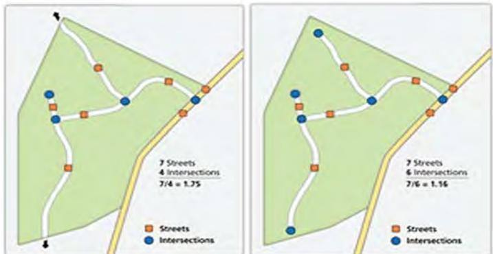

> **Figure description (visual reading, not stated in the plan's text):** Diagram with two panels, each showing a green polygon with white road lines, orange squares for streets and blue circles for intersections. No title, place name or map label is printed. The left panel reads '7 Streets', '4 Intersections' and '7/4 = 1.75'; the right panel reads '7 Streets', '6 Intersections' and '7/6 = 1.16'. The legend lists Streets (orange square) and Intersections (blue circle).

#### Traffic Calming

Common traffic calming techniques such as roundabouts, “neck-downs,” “chicanes” (winding roads), or on-street parking often require wide rights-of-way, as well as curbs to channel traffic, and are well suited to urban road conditions. More appropriate to the conditions in St. Charles Parish may be relatively low-cost techniques such as speed humps (gradually raised parabolic roadbed overlays often incorporating “rumble strips”); speed cushions (three small speed humps spaced to allow wide axle emergency vehicles to pass without slowing); and speed tables (flat-topped and elongated speed humps, as long as a vehicle wheel base).

## Page 110

#### The Need for Bicycle and Pedestrian Friendly Regulations

The Parish’s current Zoning Ordinance and Subdivision Regulations contain few standards for or any incentives to promote bicyclist and pedestrian friendliness. The Zoning Ordinance does not contain a single reference to sidewalks or bicycle paths in either residential or nonresidential development. The Subdivision Regulation lays out requirements for sidewalks, but it does not necessitate that these sidewalks be linked to a network. No mention is made of bike paths in the Subdivision Regulations.

3.1 Require that residential/mixed use and other developments that allow a mix of uses include:

• Sidewalks on at least one side of the street for local/neighborhood streets.

• Sidewalks on both sides of the street for internal collectors and for routes to schools and parks.

Bike paths on at least one side of the street for internal collector and for routes to schools and parks.

3.2 Work with LA DOTD to ensure that a “complete streets” approach is applied to all planned future roads and retrofits to existing roads, to include provisions for bicycles and pedestrians:

3.3 Develop a manual of “complete street” profiles based on roadway classification, including maximum right-of-way width; pavement width; travel lanes; sidewalks; parking (if applicable); bike lanes; planters; and utility strips.

3.4 Identify needs and funding sources for high priority pedestrian and bicycle facilities:

Develop ranking system to prioritize needs for new or reconstructed sidewalks in areas surrounding schools and parks. Generally, there are four factors to consider, and they should all be translated into measurable criteria:

-level of demand

-degree of barriers

-potential benefits

-cost and ease of improvement

(Consult resources such as the Federal Highway Administration Bicycle and Pedestrian Program clearinghouse.)

Apply for funding of priority improvements through the Louisiana Safe Routes to School (SRTS) Program and/or the Recreation Trails Program.

Consider the creation of a dedicated funding source to augment grant funds to build high priority sidewalks and other pedestrian and bicycle facilities.

## Page 111

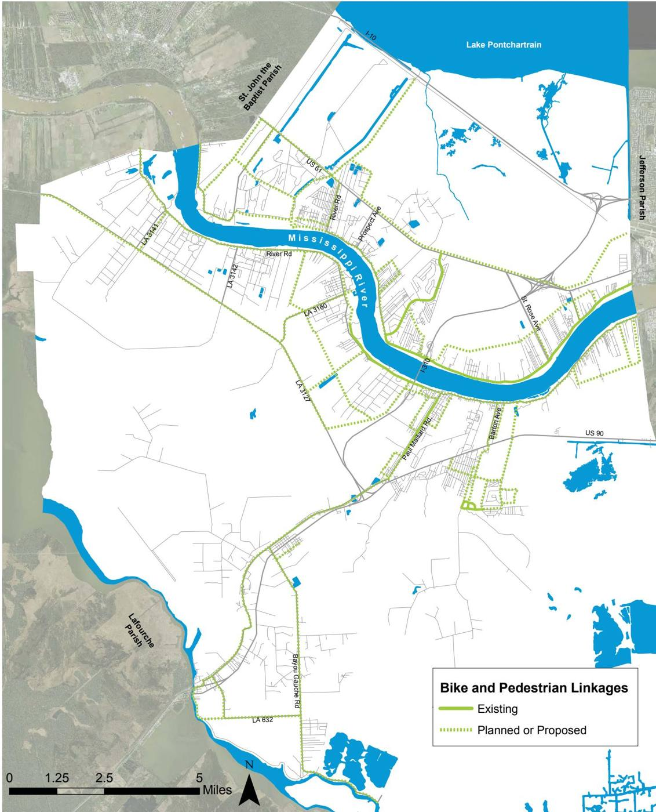

> **Figure description (visual reading, not stated in the plan's text):** Map with a legend titled Bike and Pedestrian Linkages that lists Existing (solid green line) and Planned or Proposed (dotted green line). Labeled roads include I-10, US 61, River Rd (printed twice), Prospect Ave, LA 3141, LA 3142, LA 3160, LA 3127, I-310, St. Rose Ave, Paul Maillard Rd, Barton Ave, US 90, LA 632 and Bayou Gauche Rd. Lake Pontchartrain, St. John the Baptist Parish, Jefferson Parish, Lafourche Parish and the Mississippi River are also labeled. The scale bar reads 0, 1.25, 2.5 and 5 Miles.

## Page 112

3.5 Build on the levee trails to enhance local and regional bicycle and pedestrian mobility.

Build connections between proposed bicycle and pedestrian facilities and the levee trails (FigureTR-9).

Work with neighboring Parishes and municipalities to use the levee trails as “Regional Heritage Greenways” with linkages to other Greater New Orleans historic and cultural attractions (plantations, Audubon Park, Garden District, downtown New Orleans, Vieux Carre’, etc.) (ref. ED 5.3)

#### TR 4

Provide transit service for those without access to private automobile use.

4.1 Continue to support the low-cost on-demand transit service provided by the River Parishes Transit Authority.

4.2 Periodically review demand to determine the need for expansion of the existing service.

#### TR 5

Coordinate with the Port of South Louisiana to ensure that St. Charles Parish remains attractive to industries that rely upon excellent port and riverfront facilities.

5.1 Coordinate land use regulations with the port facilities development plans and economic development initiatives of the Port of South Louisiana.

5.2 Coordinate with LA DOTD and the railroad companies to ensure that potential development sites associated with the Port of South Louisiana have adequate access to roads and rail facilities, as well as river access.

#### TR 6

Support rail transportation as a key component of the Parish’s economy and its connections with the other areas in Southeast Louisiana, the state and the nation.

6.1 Coordinate ground transportation and intermodal connection planning and improvements to ensure that good facilities are available to support freight rail transportation.

6.2 Participate in explorations of passenger service as part of regional and statewide rail transportation planning efforts.

6.3 Continue to strengthen the Parish government’s working relationship and communication with the existing railroad companies to ensure that the Parish has input into decisions about improvements involving rail capacity, speed, safety, etc.

6.4 Ensure that impacts on land uses adjacent to the rail line are minimized and mitigated through measures such as the application of intelligent grade railroad crossings to improve safety and quiet zones, where necessary, to reduce noise concerns.

6.5 Maintain an inventory of existing conditions at each existing railroad crossing, to use in negotiating potential new crossings and consolidations of existing crossings.

#### TR 7

Coordinate with the Louis Armstrong New Orleans International Airport (LANOIA) to accommodate continued adequate passenger and freight air operations to meet the regions’ needs for air travel and ensure compatible development surrounding the private airstrip in St. Charles Parish.

7.1 Ensure that zoning and other Parish regulations are consistent with applicable noise contours and FAA restrictions on development height, and uses in vicinity of the flight path.

## Page 113

7.2 Review existing land uses and current zoning surrounding the Ama Airport (FAA- LS-40) to ensure land use compatibility. Coordinate with the FAA to ensure compliance with FAA regulations for private airport operations.

#### KEY ACTORS AND PARTNERS

Ensuring the implementation of the policies and actions of the Transportation Element will be the primary responsibility of the following governmental units:

• St. Charles Parish Council.

• St. Charles Parish President.

• St. Charles Parish Department of Public Works.

• St. Charles Parish Department of Planning and Zoning.

• St. Charles Parish Planning and Zoning Commission.

To effectively implement specific actions in this Coordination, support, collaborations, and partnerships will be needed with (but are not limited

to) the following entities and organizations:

• Louisiana Department of Transportation and Development.

• South Central Planning and Development Commission.

New Orleans Metro Area Regional Planning Commission.

• Port of South Louisiana.

• U.S. Army Corps of Engineers.

• New Orleans Aviation Board.

St. Charles Parish Department of Parks and Recreation.

St. Charles Parish Public Schools.

• Non-Profit and Private Sector Partnerships:

o River Parishes Transit Authority.

o Canadian National Railroad. (CNR)

o Kansas City-Southern. (KCS)

o Union Pacific Railroad. (UP)

o Burlington Northern Santa Fe Railroad (BNSF).

o League of American Bicyclists.

o Local and regional bicycling clubs, Local industry/employers, Developers.

More detail on the roles and responsibilities of participants in the implementation of specific actions is provided in Chapter IV, Implementation.

## Page 114

### 4 INFRASTRUCTURE ELEMENT

#### EXISTING CONDITIONS AND TRENDS SNAPSHOT

#### Quick Facts

#### Water•

Service Provider: St. Charles Parish (Waterworks Department).

Water Source: Mississippi River.

Treatment: Two facilities, one in each bank, connected by two water lines under the Mississippi River.

East Bank Plant (New Sarpy):   
Average Daily Demand: 3.75 MGPD (2010) . Current Capacity: 7 MGPD.   
Planned Improvements: Expansion to 13 MGPD underway. West Bank Plant (Luling):   
Average Daily Demand: 4.61 MGPD (2010). Current Capacity: 9 MGPD.   
Planned Improvements: On hold

#### Sewer•

Service Provider: St. Charles Parish (Wastewater Department).

Treatment: Three facilities, one serving the East Bank and two the West Bank. Destrehan Plant Current Capacity: 4.4 MGPD. Hahnville Plant Current Capacity: 1.7 MGPD. Luling Oxidation Pond Current Capacity: 3.2 MGPD

#### • Stormwater Drainage

Service Provider: St. Charles Parish (Public Works Department).

Infrastructure: Hundreds of miles of canals, drainage ditches and subsurface drains plus 18 pump stations on the East Bank and 27 on the West Bank.

#### • Hurricane Protection and Flood Control

Responsible Agencies: St. Charles Parish (Sunset Drainage District), regional levee districts (Pontchartrain Levee District and Lafourche Levee District) and USACE.

#### Water and Wastewater: General

For a community of its size and predominantly rural character, the Parish is uncommonly well-served by basic infrastructure. Almost the entire parish is provided with central water and sewer service.

Because the Parish is divided by the Mississippi River into an East Bank and West Bank service areas, there are water and wastewater treatment plants located on each side of the river.

Both utilities are fee-supported, but the user rates are comparative and competitive with those of other parishes in the River Region.

#### Water

There are two water treatment plants and several storage towers in the Parish. The two treatment plants are connected by two water lines that cross under the Mississippi River, allowing the Department of Waterworks to support consumption and flow demands of one side of the river by utilizing excess capacity from the other side in times of high water usage (Figure INFR-1).

The East Bank plant is currently expanding to increase its capacity. The expansion will add 6 MGPD, bringing total capacity on the East Bank to 13 MGPD.

Plans to add 4 MGPD in capacity to the West Bank treatment plant have been provisionally placed on hold.

#### Wastewater

The Parish currently operates three wastewater treatment plants. The Destrehan Treatment Plant serves the East Bank, while the Hahnville Treatment Plant and Luling Oxidation Pond serve the West Bank of the river (Figure INFR-2).

The Hahnville Treatment Plant discharges into the Mississippi River while the Luling Oxidation Pond discharges into the adjacent wetlands.

## Page 115

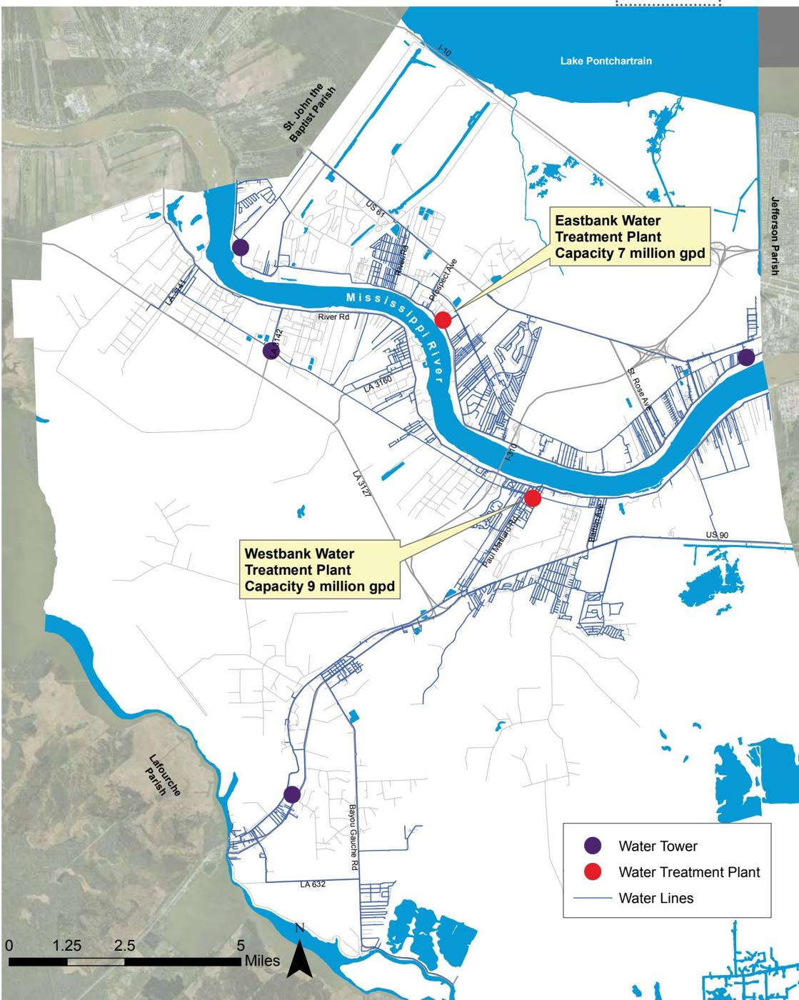

> **Figure description (visual reading, not stated in the plan's text):** Map of potable water facilities with a legend listing Water Tower (purple dot), Water Treatment Plant (red dot) and Water Lines (blue line). Two callout boxes read 'Eastbank Water Treatment Plant / Capacity 7 million gpd' and 'Westbank Water Treatment Plant / Capacity 9 million gpd'. Four purple water tower dots are drawn without individual labels. Printed road and place labels include I-10, US 61, River Rd, Prospect Ave, LA 3141, LA 3142, LA 3160, LA 3127, I-310, St. Rose Ave, Paul Maillard Rd, Barton Ave, US 90, LA 632, Bayou Gauche Rd, Lafourche Parish, Jefferson Parish, St. John the Baptist Parish, Lake Pontchartrain and the Mississippi River.

## Page 116

Some existing un-served properties or “skip areas” rely on individual on-site sewage treatment systems. However, the Parish does not allow such systems when Parish-wide wastewater system is available.

The wastewater system is currently considered to be at its maximum capacity during wet weather events, due to widespread infiltration and inflow issues. The causes for these problems include improper connection of stormwater drainage systems into the wastewater network, or cracks and leaks due to age-related deterioration, loose joints, and similar deficiencies.

Because of these capacity issues, the system suffers from sewage overflow problems, which happen when the treatment plants reach their maximum capacity and cause sewage to back up into the streets and even into businesses and homes in the most severe cases.

The Wastewater Department is in the process of conducting a U.S. EPA’s Capacity, Management, Operations, and Maintenance (CMOM) program. This program provides guidance for analyzing a municipality’s wastewater system, and will help to

#### Infiltration and Inflow

Infiltration is defined as groundwater and storm water that enters wastewater or sanitary sewer systems through cracks or leaks in the sewer system. Cracks or leaks in the sewer system may be caused by age related deterioration, loose joints, poor design, subsidence, installation or maintenance errors, damage or root infiltration.

Inflow is stormwater that enters the sewer system at the point of direct connection to the system. This is usually due to improper connection of stormwater drainage systems into the wastewater network such as roof drains, downspouts, sump pumps, yard drains, driveway drains, etc.

identify the deficiencies and needs of the wastewater system. In addition, the South Central Planning and Development Commission is preparing a Wastewater Master Plan which will identify the wastewater needs for the West Bank.

#### Stormwater Drainage

Communities or subdivisions within the Parish handle stormwater by flowing water into drainage canals or adjacent wetlands. Drainage canals flow to pumping stations that pump the water over flood protection levees.

A stormwater drainage impact analysis is required for new subdivisions and new commercial development. This consists of an engineered drainage plan and stormwater calculations which are reviewed by the Parish engineer. Issuance of a permit or construction of the subdivision does not occur until the drainage review has been approved. The drainage impact analysis requires that downstream (as well as upstream) impacts be determined. However, more regulatory clarity is needed regarding the actions necessary to demonstrate adequate mitigation of these impacts.

Stormwater conveyance problems exist throughout the Parish’s drainage system, some of them severe. Many older neighborhoods in the Parish were designed with open swale drainage systems that over time have been partially converted to closed drainage systems.

Cumulative issues arise when subsurface drainage is installed sporadically in subdivisions that were designed for open swale drainage. Without an overall subsurface drainage plan, the pipes and culverts installed on an individual basis often are incorrectly sized and/or do not have appropriate inverts. This leads to bottlenecks or poor flowing lines in the system.

There are also conveyance issues in the major canals and ditches. Many of the canals were intended to drain less intensively developed areas and are undersized with no right-of-way or servitude

## Page 117

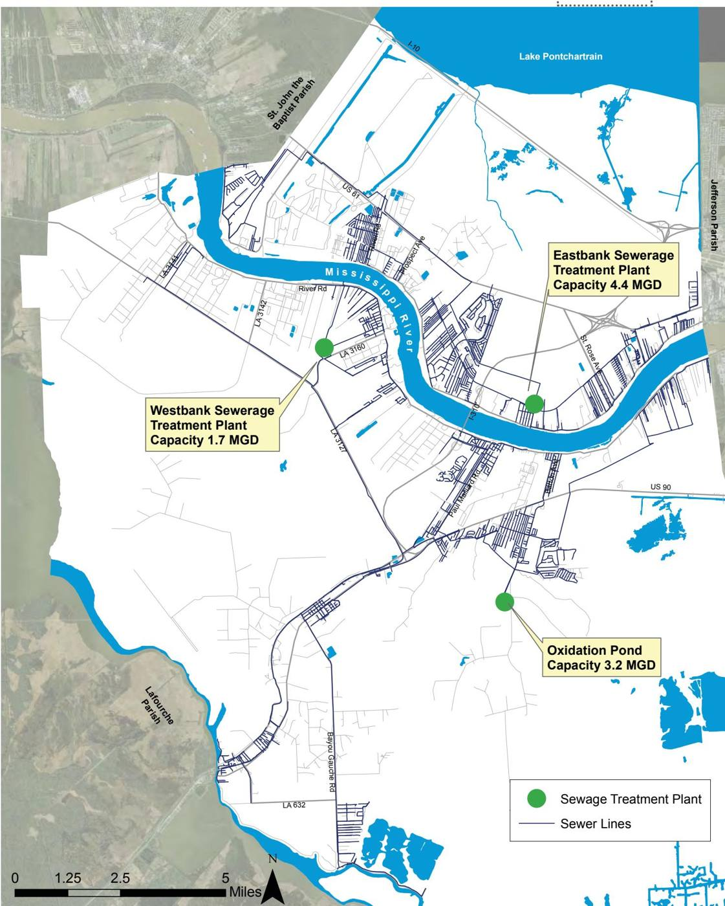

> **Figure description (visual reading, not stated in the plan's text):** Map of wastewater facilities with a legend listing Sewage Treatment Plant (green dot) and Sewer Lines (dark blue line). Three callout boxes read 'Westbank Sewerage Treatment Plant / Capacity 1.7 MGD', 'Eastbank Sewerage Treatment Plant / Capacity 4.4 MGD' and 'Oxidation Pond / Capacity 3.2 MGD'. Printed road labels include I-10, US 61, Prospect Ave, River Rd, LA 3141, LA 3142, LA 3160, LA 3127, I-310, St. Rose Ave, Paul Maillard Rd, Barton Ave, US 90, LA 632 and Bayou Gauche Rd. Lafourche Parish, Jefferson Parish, St. John the Baptist Parish, Lake Pontchartrain and the Mississippi River are also labeled.

## Page 118

available for expansion. In many instances, residents have built fences or buildings in the canal rights-ofway and maintenance servitudes, which precludes expansion of the canal’s width and prevents efficient cleaning and maintenance of the canal.

Another main issue that causes conveyance problems is the result of the jack-and-bore drainage pipes under the four major rail lines that run through St. Charles Parish. Many of these lines are undersized and do not allow the proper flows though them.

#### Hurricane Flood Protection

The majority of St. Charles Parish consists of low elevation marsh-coastal areas of approximately 2 to 3 feet North American Vertical Datum (NAVD). The profile or ground elevation slopes gradually to higher ground, 10 to 20 feet NAVD, which was created by historical Mississippi River overflows. Flooding from high stages in the Mississippi River does not now occur due to the levees protection. Most of the developed areas are located along the higher elevations.

The Army Corps of Engineers, the St. Charles Parish Department of Public Works, the Sunset Drainage District and regional levee districts have built many miles of levees to prevent tidal surges from flooding developed areas. The levee system includes levees on each bank of the Mississippi River (Figure INFR-3).

The Upper and Lower Guide Levees act as barriers to protect the East Bank from flooding in case the Bonnet Carré Spillway must be opened in high river elevation events. These levees provide a directional guide to send river water to Lake Pontchartrain via the Bonnet Carré Spillway.

The East Bank is also protected by the St. Charles East Bank hurricane protection levee system, which mostly runs parallel to U.S. Highway 61 (Airline Highway). This levee starts at the St. Charles/Jefferson parish line near the New Orleans International airport and connects to the lower guide levee.

The West Bank levee system is currently made up of smaller levees that protect discrete areas on the west bank of the parish, and some gaps remain.

The Sunset Levee, which runs along the Paradis Canal, protects the Bayou Gauche and Paradis areas. The Cajun Paradis levee connects to the intersection of the Paradis canal and the Southern Pacific railroad tracks and connects back to the same track berm. There are two ring levees that protect the Willowridge and Willowdale subdivisions, and tie into the western Davis Pond Diversion canal levee. A Parishowned levee runs from the Sunset Levee to the east guide levee for the Davis Pond Diversion project.

The area of Ama is protected by the Western Tie-In levee for the West Bank and Vicinity Project, which in turn ties into Jefferson Parish’s West Bank levee protection system. Finally, there is a small protection levee which protects the areas of Boutte and Luling.

Currently there are five major projects, either planned or already under construction in the Parish (Figure INFR-4). When completed, these projects are designed to comprehensively protect the Parish during storm events. For this reason, it is vital for the Parish to press its case for funding the construction of these projects as soon as possible. The projects are:

## Page 119

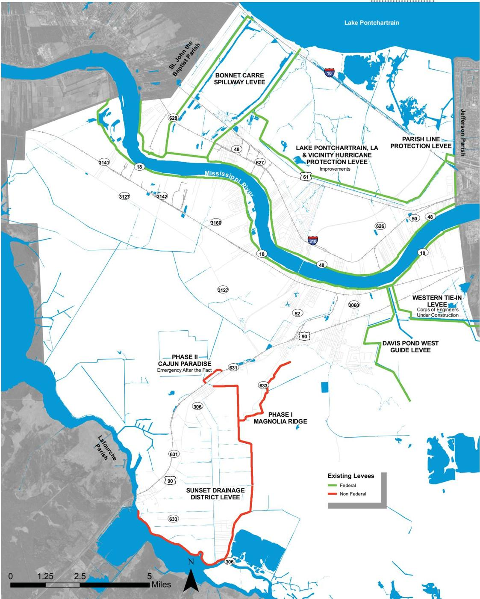

> **Figure description (visual reading, not stated in the plan's text):** Map of levees with a legend titled Existing Levees that lists Federal (green line) and Non Federal (red line). Labeled features are Bonnet Carre Spillway Levee; Lake Pontchartrain, LA & Vicinity Hurricane Protection Levee (subtitle Improvements); Parish Line Protection Levee; Western Tie-In Levee (subtitle Corps of Engineers Under Construction); Davis Pond West Guide Levee; Phase II Cajun Paradise (subtitle Emergency After the Fact); Phase I Magnolia Ridge; and Sunset Drainage District Levee. Printed route labels include 628, 627, 626, 48, 50, 18, 3141, 3142, 3127, 3160, 3060, 52, 90, 631, 633, 306, I-10, I-310 and 61. Lafourche Parish, Jefferson Parish, St. John the Baptist Parish, Lake Pontchartrain and the Mississippi River are also labeled.

## Page 120

#### East Bank

1. The Lake Pontchartrain, LA, and Vicinity Hurricane Protection Project, north of Airline Highway on the East Bank, will provide 100-year of protection to the communities east of the Bonnet Carré Spillway to the St. Charles/Jefferson Parish line.

2. West Shore project, which will place a levee starting at the upper guide levee on the Bonnet Carré Spillway, going west towards New River Canal. This will provide 100-year level of protection to the Montz area.

#### West Bank

1. The Magnolia Ridge, Ellington Plantation and the Phase II Willowridge projects are currently in various stages of construction and development. These projects will protect the Luling area which include Willowridge, Willowdale and Mimosa Park subdivisions, as well as the Boutte area, running from the Davis Diversion Canal to the Sunset Levee.

2. The Donaldsonville to the Gulf project will provide 100-year levee protection to the entire West Bank of the Parish. The alignment of this levee is not finalized, although there is a preferred alignment.

3. The Western Tie-In Levee will connect to the Mississippi River levee at the Davis Diversion structure. It will be completed during 2011, and will protect Ama against 100-year storm events.

## Page 121

#### INFRASTRUCTURE GOALS

1. Complete the Parish’s infrastructure systems and resolve existing system deficiencies in a rational, fiscally efficient, and equitable manner.

2. Prioritize infrastructure investment to promote and protect the health, safety, and vitality of the Parish’s communities.

3. Provide comprehensive hurricane flood protection to all developed and developable areas of the Parish, to reduce the risk of life and material losses.

4. Collaborate regionally, when appropriate, to ensure access to resources, maximize efficiencies, and increase the Parish’s influence in regional infrastructure-related decisions that impact the Parish.

#### POLICIES AND ACTIONS

#### WASTEWATER

#### INFR 1.1

Reduce or eliminate existing deficiencies and gaps in the wastewater system.

1.1.1 Devote more Parish resources to expedite the completion of the Capacity Management Operation and Maintenance Program (CMOM), either by increasing the number of Parish employees working on the program, or by hiring an outside firm to assist in its completion. Given that the Parish does not have adequate crews to perform the program it is recommended that the Parish hire outside crews that will ensure the CMOM program to be completed within a year’s time for the field investigations, with a completed report six months after.

1.1.2 In conjunction with the CMOM Program, develop a GIS-based model of the wastewater system to identify the location and causes of deficiencies in the system (i.e., limited capacity at treatment facilities, inflow and infiltration, conveyance issues, damaged or undersized pipes, damaged or undersized lift stations, etc.) in an ongoing manner, and to track Parish actions to resolve these deficiencies. This will likely also need to be performed by an outside contractor because the Parish does not currently have adequate staff in-house.

1.1.3 Develop a Master Wastewater Plan which will address and define solutions to all deficiencies as identified by both CMOM and the developed model. Special consideration should be given to the West Bank because of existing deficiencies and the potential for development and population increases.

1.1.4 Allocate sufficient resources (e.g. funding, employees, materials) to continue the maintenance program to ensure maximum efficiency of the wastewater system.

1.1.5 Ensure that system meets latest health and safety guidelines established by the local, state, and federal governments.

#### INFR 1.2

Coordinate land use planning and capital programming to ensure that utility infrastructure improvements and extensions are phased to support the future land use pattern.

## Page 122

1.2.1 Adopt a Level of Service (LOS) standard for sewer service, based on per capita or per household wastewater flows, type of land use, etc., to assist in determining an appropriate capacity to meet demand, making decisions about new development, and identifying necessary improvements.

1.2.2 Review Subdivision Regulation and Zoning standards related to the provision of sanitary sewer infrastructure, along with enforcement policies, to ensure that the acceptance of new development into the Parish’s wastewater system does not create new deficiencies.

1.2.3 Incorporate the population projections and future land use information from the 2030 Comprehensive Plan into the wastewater system model. This process will provide the basis for defining future improvements and additions to the wastewater network.

1.2.4 Include the foregoing population and land use demands into the Wastewater Master Plan (ref. INFR Action 1.1.3) and associated Capital Improvement Program, including, but not limited to projects needed to:

• Upgrade or repair undersized and/or damaged pipes in the sewer system

• Increase the capacity of lift stations

• Improve and upgrade existing treatment facilities

Build new treatment facilities as needed.

1.2.4 Adopt criteria for prioritizing funding to sewerrelated capital improvement projects, including the degree to which a project:

• addresses health, welfare or public safety issues

• improves system efficiency/reliability

• is consistent with the Comprehensive Plan

• complies with requirements imposed by others (e.g., federal and/or state agencies)

• may be completed in a short timeframe relative to other projects

#### Level of Service (LOS) Standards

A term typically heard in relationship to transportation networks, Level of Service Standards are minimum benchmarks of performance set by a local government to encourage land use patterns that can be served efficiently by public infrastructure and facilities, to provide adequate service at the time of new development, and to prevent new development from degrading the service standards for the current users of existing infrastructure.

There are various methodologies and metrics to establish LOS for different types of infrastructure and community services. The most commonly monitored systems include:

• Transportation

• Water

• Sewer

Level of Service Standards are also commonly applied to other services and facilities (e.g., parks, schools, solid waste, emergency services, libraries, etc.).

Once a level of service standard is established, an ordinance is adopted giving the local government authority to disallow proposed development if it will cause the level of service to decline below the adopted standard, unless improvements or strategies to accommodate the impacts of development are made concurrent with the development.

Development impacts may be accommodated by changing the phasing or timing of new development, improving transportation facilities or services to serve the new development, reducing the level of service standard, or revising land use policies.

## Page 123

• requires coordination with other projects

• eliminates obsolescence or extends the useful life of a facility

improves the protection of an existing facility, especially those at risk (e.g., from natural disaster)

serves a (to be determined) threshold percentage of residents and businesses

may be completed with available funds, or can be efficiently phased to complete portions with available funds and/or projected funds

may obtain funding through outside sources.

#### WATER

#### INFR 2.1

Continue to provide quality water service to the entire Parish through the rational expansion, upgrade and maintenance of the water network.

2.1.1 Implement a potable water Asset Management Program to promote better tracking, management, identification and scheduling of necessary facility upgrades and improvements.

2.1.2 Consider the Future Land Use Map in the planning of future water extensions, to support the desired land use pattern.

2.1.3 Study the feasibility of adopting a water system impact fee structure so that new developments pay not only for their direct impact but also for the incremental system-wide impact.

2.1.4 Rigorously enforce existing regulations that require rezoning, plat approval and development approval requests to demonstrate that system capacity is adequate to meet requested demands.

2.1.5 Adopt a Level of Service (LOS) standard for water service, based on average daily water use, peak rate of demand, type of land use, etc., to assist in determining an appropriate capacity to meet

demand, making decisions about new development, and identifying necessary improvements.

2.1.6 Revise and update a Potable Water Master Plan and associated Capital Improvement Program, including, but not limited to projects needed to:

• correct existing system deficiencies

• replace worn out or obsolete treatment facilities

• fund new and ongoing conservation initiatives.

2.1.7 Adopt criteria for prioritizing funding to water system-related capital improvement projects. Criteria may include a determination of the degree to which a project:

addresses health, welfare or public safety issues

• improves system efficiency/reliability

• is consistent with the Comprehensive Plan

• complies with requirements imposed by others (e.g., federal and/or state agencies)

• improves water flow from fire hydrants, improving the Parish’s fire ratings

• may be completed in a short timeframe relative to other projects

• requires coordination with other projects

• eliminates obsolescence or extends the useful life of a facility

improves the protection of an existing facility, especially those at risk (e.g., from natural disaster)

serves a (to be determined) threshold percentage of residents

may be completed with available funds, or can be efficiently phased to complete portions with available funds

• may obtain funding through outside sources.

## Page 124

#### INFR 2.2

Continue to provide to St. Charles Parish with an adequate supply of high-quality and safe potable water.

2.2.1 Continue to meet, at a minimum, water standards set by the United States Environmental Protection Agency, the Louisiana Department of Environmental Quality and the Louisiana Department of Health & Hospitals/Office of Public Health.

2.2.2 Coordinate contingency and emergency preparedness and response planning for protection of the Parish’s water source, treatment facilities and distribution system on a Parish-wide and regional basis.

2.2.3 Use interconnections, looping and valve configurations to minimize areas affected by major leaks.

#### INFR 2.3

Seek to become a model of fiscal stewardship and economic sustainability by continuing to develop innovative ways to provide affordable and competitively-priced potable water.

2.3.1 Continue to establish water rates that are determined by sound fiscal policy, are competitive and provide value consistent with best business practices.

2.3.2 Periodically review service fees charged, to ensure that such fees are adequate and reasonable to cover the impacts to the Parish infrastructure.

2.3.3 Continue to upgrade the Waterworks Department software to improve service efficiencies, reduce operational costs, and offer expanded service options to water customers.

2.3.4. Continue to implement water conservation measures and programs, such as:

• outreach and education programs

• routine water audits

• water accounting and loss control procedures

• conservation rate structures

• conservation device requirements in new development and retrofits.

2.3.5 Strive to coordinate rates with the Capital Improvement Planning cycle.

#### STORMWATER DRAINAGE

INFR 3.1

Reduce or eliminate existing deficiencies in the drainage system.

3.1.1 Expedite the acquisition of drainage information for the Urban Flood Control Project. As necessary to achieve this end, increase the resources devoted to this project (e.g., increase the number of Parish employees working on the project or hire outside assistance).

3.1.2 Perform a hydraulic/hydrologic drainage model on the entire parish to identify and locate drainage deficiencies in the system.

3.1.3 Prepare a Master Drainage Plan and associated Capital Improvement Program, including, but not limited to projects needed to address:

• undersized pipes and drainage structures

• damaged drainage pipe and structures

• inadequate conveyance in open channel and subsurface drainage structures

• undersized pumping stations

• undersized jack and bores under train track berms and roads.

3.1.4 Adopt criteria for prioritizing funding of drainage-related capital improvement projects. The following criteria may be included:

• The project should be part of the Master Drainage Plan.

## Page 125

The project should be completed in sequence and in the timeframe established by the Master Plan.

The project may be completed in a timely manner relative to other projects.

• The project is consistent with the Comprehensive Plan.

• The project eliminates obsolescence or extends the useful life of a facility.

• The project serves a (to be determined) threshold percentage of residents.

The project may be completed with available funds, or can be efficiently phased to complete portions with available funds.

• The project may obtain funding through outside sources.

• The project protects property from flooding.

The project maintains or improves the reliability, effectiveness and/or integrity of the Parish’s drainage infrastructure.

Degree to which the project complies with requirements imposed by others (e.g., federal and/or state agencies).

Degree to which the project require coordination with other projects.

Degree to which the project improves the protection of an existing facility, especially those at risk (e.g., from natural disaster)

3.1.5 Develop strict enforcement protocols to ensure that existing development adheres to established drainage standards and regulations. As necessary, create new or strengthen the existing ordinance to allow department officials to enforce existing and future standards. (Ref. St. Charles Parish Code of Ordinances, Appendix C, Part IV, Section D for existing ordinance).

3.1.6 Require developers to perform both surface and subsurface impact studies from point of origin to

#### Urban Flood Control Study

The St. Charles Parish Urban Flood Control (UFC) Study addresses flooding and interior drainage issues associated with St. Charles Parish. The purpose of the study is to investigate the drainage related problems in the Parish. The investigation will concentrate on finding improvements to manage the risk associated with flooding damages resulting from rainfall and other related water resources problems. The study looks at alternative plans for addressing flood risk management.

The study is at this time limited to the East Bank. Although this portion of the Parish is protected —from river flooding by the Mississippi River Levee and from lake storm surges by the Lake Pontchartrain & Vicinity Hurricane Protection project—these levees also impound water. In addition the interior drainage system is insufficient to prevent flooding from heavy rainfall events. Major floods caused by heavy rainfall occurred in St. Charles during 1978, 1980, 1982, and 1995. The damages resulting from these rainfall events total \$30,200,000.

final outfall beyond limits of proposed development before construction can begin. The drainage impact study should focus on two areas:

It should determine proper surface and subsurface drainage structure sizes to ensure that bottlenecks are not created.

Downstream impacts of new development should be determined and accounted for to prevent impacts to neighboring developments.

3.1.7 Establish new guidelines for converting open drainage to subsurface. Residents should perform a front foot assessment before placement of subsurface drainage on individual properties. When feasible, a holistic approach should be taken to

## Page 126

converting open drainage to subsurface drainage in existing subdivisions.

3.1.8 Continue to actively seek out sources of outside funding for drainage projects to ensure that all drainage projects are constructed in a timely manner.

#### INFR 3.2

Provide needed drainage facilities in a manner that protects investments in existing facilities and promotes orderly growth.

3.2.1 Meet the standards set by the latest LA DOTD Hydraulics Manual. Adopt a Level of Service (LOS) standard based on the 100-year storm event for pumping stations and 20-year storm event for streets and roads, and use this storm design as the governing criteria for all future drainage repair or improvement projects.

3.2.2 Periodically review and modernize design standards for drainage structures and outlets to reflect state-of-the-art, “low impact” and “green” best management practices. For example, require that new development retain a larger percentage of natural drainage features to avoid expensive structural solutions.

3.2.3 Consider enacting a “No Net Increase” drainage ordinance to address runoff created by new development

3.2.4 Study the feasibility of a drainage system impact fee structure so that new developments pay not only for their direct impact but also for the incremental system-wide impact.

3.2.5 Ensure that all new development design its drainage system to prevent downstream impacts.

3.2.6 Encourage regional stormwater and other creative stormwater drainage solutions. Incorporate concepts and strategies laid out in the Coastal Best Practices manual to manage water in a more holistic, natural manner, reducing the need for increased stormwater drainage infrastructure.

#### FLOOD PROTECTION SYSTEM

#### INFR 4.1

Expedite the construction of all planned levee protection projects, building to the latest U.S. Army Corps of Engineer standards.

4.1.1 Continue to strengthen the Parish’s working relationship and communication with the U.S. Army Corps of Engineers, and maintain the Parish’s active participation in the engineering review process and construction of federally funded levees.

4.1.2 Compile and provide information to state and federal government agencies demonstrating the vulnerability of St. Charles Parish to major storm events due to rainfall and heavy storm surge, to make the case for urgent action.

4.1.3 Evaluate and develop the interim protection plan for the Willowridge, Ellington, and Magnolia Ridge subdivisions while the Donaldsonville to the Gulf Levee is being evaluated by the Corps of Engineers.

4.1.4 Once determined if needed, press for the Willowridge, Ellington, and Magnolia Ridge levees to be placed under FEMA certification, based upon future developments in the Donaldsonville to the Gulf levee protection project.

4.1.5 Continue to lobby for funds to permit, design and construct the Donaldson to Gulf levee protection project, to provide comprehensive levee protection to the west bank of the Parish.

4.1.6 Ensure that developed land uses have adequate flood protection.

4.1.7 Strengthen ordinances limiting development in high risk areas (i.e. outside of the hurricane flood protection levee and parish drainage systems).

4.1.8 Continue to perform maintenance and inspection on all existing and future levee systems to ensure protection from the specified storm events.

4.1.9 Ensure that all future levee protection projects are built to the latest Army Corps of Engineers

## Page 127

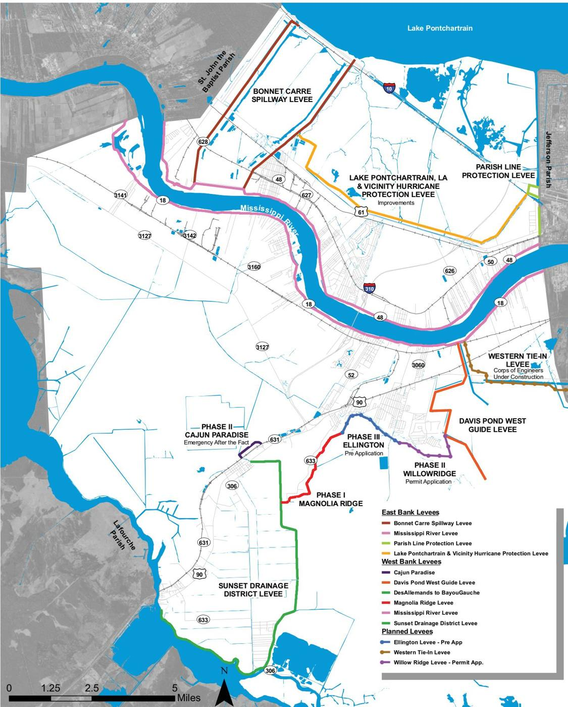

> **Figure description (visual reading, not stated in the plan's text):** Map of levee projects with a legend grouped as East Bank Levees (Bonnet Carre Spillway Levee; Mississippi River Levee; Parish Line Protection Levee; Lake Pontchartrain & Vicinity Hurricane Protection Levee), West Bank Levees (Cajun Paradise; Davis Pond West Guide Levee; DesAllemands to BayouGauche; Magnolia Ridge Levee; Mississippi River Levee; Sunset Drainage District Levee) and Planned Levees (Ellington Levee - Pre App; Western Tie-In Levee; Willow Ridge Levee - Permit App.). Map labels include Phase II Cajun Paradise (Emergency After the Fact), Phase III Ellington (Pre Application), Phase II Willowridge (Permit Application), Phase I Magnolia Ridge, Sunset Drainage District Levee, Davis Pond West Guide Levee, Western Tie-In Levee (Corps of Engineers Under Construction), Bonnet Carre Spillway Levee, Parish Line Protection Levee and Lake Pontchartrain, LA & Vicinity Hurricane Protection Levee (Improvements). Route labels include 628, 627, 626, 48, 50, 18, 3141, 3142, 3127, 3160, 3060, 52, 90, 631, 633, 306, I-10, I-310 and 61, and the Mississippi River is labeled.

## Page 128

standards to provide the best possible protection and resistance to major storm events.

#### INFR 4.2

Adopt and implement complementary strategies, measures, and tools to improve the Parish’s preparation and resilience to storms. Promote “multiple lines of defense” in vulnerable areas.

4.2.1 Complete a comprehensive coastal management plan and, as appropriate, integrate it into the 2030 Comprehensive Plan.

4.2.2 Continue to seek funding for coastal protection and coastal/habitat restoration projects.

4.2.3 Continue to seek funding (e.g., Federal Hazard Mitigation grants) to acquire repetitive loss homes.

4.2.4 Promote the use of non-structural fl oodprotection tools, such as approved architectural/ building solutions, hazard mitigation and evacuation plans, etc.

#### KEY ACTORS AND PARTNERS

Ensuring the implementation of the policies and actions of the Infrastructure Element will be the primary responsibility of the following governmental units:

• St. Charles Parish Department of Public Works and Wastewater.

• St. Charles Parish Department of Waterworks.

• St. Charles Parish Council.

• St. Charles Parish President.

To effectively implement specific actions in this Coordination, support, collaborations, and partnerships will be needed with (but are not limited to) the following agencies and organizations:

• St. Charles Parish Department of Planning and Zoning.

• St. Charles Parish Planning and Zoning Commission.

• St. Charles Parish Geographic Information Systems.

• St. Charles Parish Department of Economic Development.

• St. Charles Parish of Homeland Security & Emergency Preparedness.

• U.S. Army Corps of Engineers.

• Sunset Drainage District.

• Pontchartrain Levee District.

• Lafourche Basin Levee District.

More detail on the roles and responsibilities of participants in the implementation of specific actions is provided in Chapter IV, Implementation.

## Page 129

### COMMUNITY FACILITIES ELEMENT

#### EXISTING CONDITIONS AND TRENDS SNAPSHOT

#### Education

Public education throughout St. Charles Parish is provided by the St. Charles Parish Public Schools (Figure CF-1). The district operates 23 schools/ centers, including the Satellite Center, a facility for juniors and seniors to pursue a more career-oriented curriculum utilizing state-of-the-art equipment and technologies. Additionally, the school district operates three adult learning centers in Norco, Killona and Boutte. There are also three private schools in the Parish.

The district is widely recognized for providing excellent K-12 education. In 2010, the State of Louisiana ranked the district 10th of 69 school districts based on performance scores.

While disparities in performance levels and graduation rates exist among individual schools, the district strives to address these gaps through a coordinated curriculum, a focus on literacy, and the preparation of improvement plans for each school.

School district projections for the next five years indicate a stable level of enrollment, consistent with overall population projections for the Parish showing a slow rate of growth and aging trend.

Currently, there are no higher education institutions within St. Charles Parish. However, 18 colleges and universities are all located within a few hours-drive of the Parish. Ten are in the New Orleans metro area and can be reached within 30 minutes or less. Two regional technical institutes are also a half-hour drive from the heart of St. Charles Parish: the ITT Technical Institute (located in St. Rose), and the Louisiana Technical Institute (South Central - River Parishes Campus, located in Reserve, LA). LTI has developed highly successful partnerships with the St. Charles Parish business community.

#### Quick Facts

#### Schools•

St. Charles Parish Public Schools: 11 elementary schools, 4 middle schools, 2 high schools, a “Satellite Center,” and 3 adult learning centers.

2010 Statewide Ranking: 10th of 69 school districts (105.5 Performance score).

Projected 5-7 Year Enrollment: Approximately 10,000 students.

Private Schools: 3 K-8 elementary schools.

#### • Sheriff’s Office

Headquarters: New 47,000 sq. ft. Law Enforcement Complex, including a 39,000 sq. ft. office building (Luling)

Full-Time Personnel: 350+.

Patrol Division Deputies: 68.

Corrections: Nelson Coleman Correctional Center (Killona)

Corrections Personnel: 149

Average Number of Immates: 550

• Fire Department

Type: Volunteer.

Districts: 10.

• St. Charles Parish Library System: Five branches, plus a bookmobile.

Locations: St. Rose, Hahnville, Norco, Luling (West Regional), Destrehan (East Regional), and Paradis (under construction).

• Government Buildings: 123 (both leased and owned).

• Healthcare Facilities

St. Charles Parish Hospital: General care hospital (59 beds in Luling), plus an East Bank Medical Office (in Destrehan)

Luling Rehabilitation Hospital (16 beds)

St. Charles Community Health Center (Luling)

## Page 130

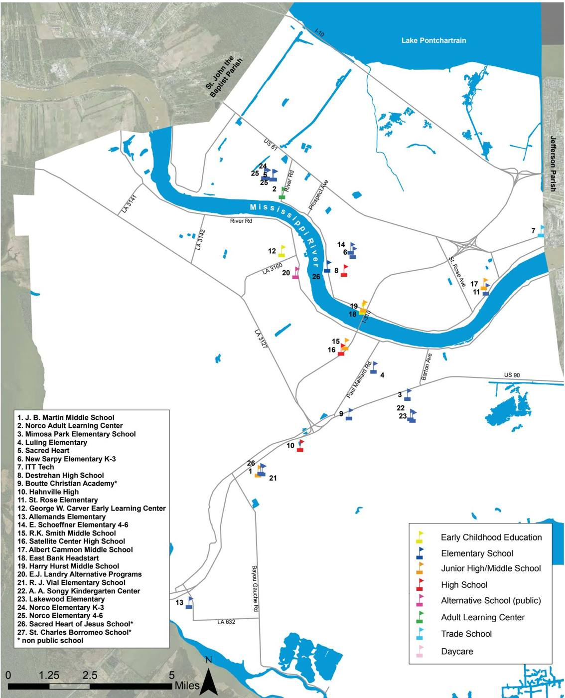

> **Figure description (visual reading, not stated in the plan's text):** Map of schools and related facilities, with a key of 27 numbered points in the lower-left box; entries marked with an asterisk are non public schools. The legend lists Early Childhood Education (yellow flag), Elementary School (dark blue flag), Junior High/Middle School (orange flag), High School (red flag), Alternative School (public) (pink flag), Adult Learning Center (green flag), Trade School (light blue flag) and Daycare (light pink flag). Key entries: 1. J. B. Martin Middle School; 2. Norco Adult Learning Center; 3. Mimosa Park Elementary School; 4. Luling Elementary; 5. Sacred Heart; 6. New Sarpy Elementary K-3; 7. ITT Tech; 8. Destrehan High School; 9. Boutte Christian Academy*; 10. Hahnville High; 11. St. Rose Elementary; 12. George W. Carver Early Learning Center; 13. Allemands Elementary; 14. E. Schoeffner Elementary 4-6; 15. R.K. Smith Middle School; 16. Satellite Center High School; 17. Albert Cammon Middle School; 18. East Bank Headstart; 19. Harry Hurst Middle School; 20. E.J. Landry Alternative Programs; 21. R. J. Vial Elementary School; 22. A. A. Songy Kindergarten Center; 23. Lakewood Elementary; 24. Norco Elementary K-3; 25. Norco Elementary 4-6; 26. Sacred Heart of Jesus School*; 27. St. Charles Borromeo School*. The key marks asterisks as '* non public school'.

> **Text-layer supplement (text on this page that the layout parse did not capture; reading order approximate, taken from the PDF text layer):**
>
> COMMU N ITY FACI LITI E S

## Page 131

#### Safety Services: Police, Fire Protection, and Emergencies

The Sheriff’s Office is responsible for law enforcement. An elected post, the Sheriff is also responsible for operating the correctional center and collecting all property and inheritance taxes, tax collections and tax sales, bonds and fines collection, and issuance of occupational licenses.

In early 2011, the Sheriff’s Office officially dedicated its new Law Enforcement Complex located on Judge Edward Dufresne Parkway. The new building plus storage facility combined all of the Sheriff’s Office functions under one roof. The building is rated to withstand 150 mph winds.

For the purposes of fire protection, the Parish is divided into 10 fire districts, all of which rely on volunteers.

#### Library Services

The Library system is the responsibility of the Library Control Board, which includes five regular members plus one ex-offi cio member from the Parish Council.

The new state-of-the-art East Bank Regional library facility with approximately 40,000 square feet of space was completed in 2010. The building was designed and constructed to meet LEED “green building” standards.

A new branch library of nearly 6,400 square feet was completed in Paradis in June 2011. This library will serve residents of not only Paradis but also Bayou Gauche and Des Allemands. The 1.8 acre site, which housed the former Paradis Elementary School, was donated by the St. Charles Parish school system.

On October 2, 2010, St. Charles Parish residents voted to renew the library property tax at a rate of 4.5 Mills, for another ten-year period. The prior levies taxes paid for the new libraries in St. Rose and Destrehan, as well as the Paradis branch. The levies also allowed the existing branches in Hahnville and Norco to be renovated.

#### Government Buildings

The most prominent government buildings are shown on Figure CF-2. Each of the buildings that the Parish owns or leases is regularly appraised for insurance purposes. The appraisal includes rating of the condition of the building based on construction material and age/condition.

Most of the Parish’s buildings, while older, are in Good condition. The Courthouse and newer buildings such as the East Bank Library attain a rating of Excellent. The condition of the Tourist Information Center was deemed Fair. The Department of Government Buildings is responsible for providing building and yard maintenance to the Parish’s facilities on a day-to-day basis, and for managing improvement and new construction projects.

Two projects were completed in early 2011: A new Department of Motor Vehicles facility and a 8,000 sq.-ft. warehouse for record retention, both located behind the Economic Development office.

#### Healthcare

The two primary healthcare facilities in the Parish are the St. Charles Parish Hospital and the Luling Rehabilitation Hospital, both located in Luling.

The St. Charles Parish Hospital is based in Luling, but also operates an East Bank Medical Office in Destrehan capable of handling medical issues related to allergies, asthma, ear, nose and throat, internal medicine dental, and orthopedics. The Hospital is building a new Emergency Department, which will provide larger rooms for ease in accessing and caring for patients with technologically advanced equipment and facilitate shorter wait times and increased patient privacy. Completion is targeted for early 2012.

The nearby Luling Rehabilitation Hospital is a specialized facility dealing with such medical issues as neurological disorders, orthopedic conditions and replacements, cardiac/pulmonary disorders, congenital deformities, developmental disabilities

## Page 132

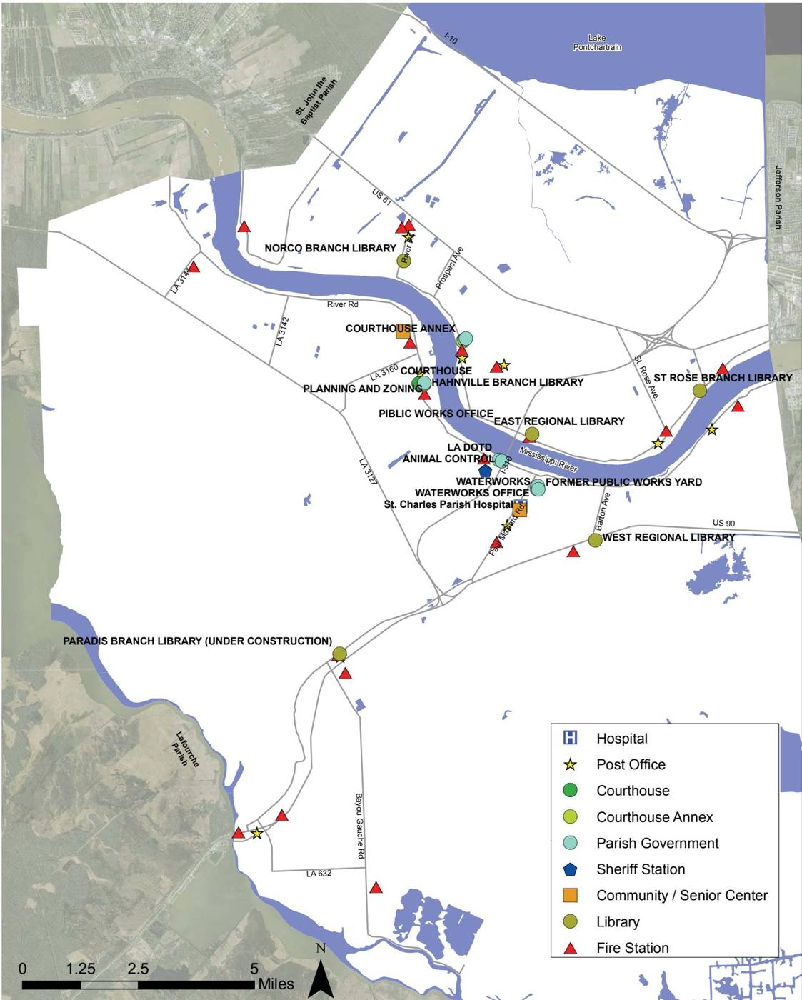

> **Figure description (visual reading, not stated in the plan's text):** Map of government and public facilities with a legend listing Hospital (blue H box), Post Office (yellow star), Courthouse (dark green circle), Courthouse Annex (light green circle), Parish Government (light teal circle), Sheriff Station (blue pentagon), Community / Senior Center (orange square), Library (olive circle) and Fire Station (red triangle). Labeled facilities include NORCO BRANCH LIBRARY, COURTHOUSE ANNEX, COURTHOUSE, HAHNVILLE BRANCH LIBRARY, PLANNING AND ZONING, PUBLIC WORKS OFFICE, EAST REGIONAL LIBRARY, LA DOTD, ANIMAL CONTROL, WATERWORKS, WATERWORKS OFFICE, FORMER PUBLIC WORKS YARD, St. Charles Parish Hospital, ST ROSE BRANCH LIBRARY, WEST REGIONAL LIBRARY and PARADIS BRANCH LIBRARY (UNDER CONSTRUCTION). Road and place labels include US 61, River Rd, Prospect Ave, LA 3141, LA 3142, LA 3160, LA 3127, I-310, St. Rose Ave, Paul Maillard Rd, Barton Ave, US 90, LA 632, Bayou Gauche Rd, Lafourche Parish, Jefferson Parish, St. John the Baptist Parish, Lake Pontchartrain and the Mississippi River.

> **Text-layer supplement (text on this page that the layout parse did not capture; reading order approximate, taken from the PDF text layer):**
>
> COMMU N ITY FACI LITI E S

## Page 133

and skin disorders.

The St. Charles Community Health Center, also located in Luling, focuses on providing medical services to underserved and vulnerable populations. The Center includes a full array of pediatric services, basic/routine care for adults, behavioral health care, and care for diabetes, podiatry services, asthma/ allergy and women’s services. The Center operates largely on the basis of donations, and collaborates with the St. Charles Parish Hospital and other community institutions.

#### COMMUNITY FACILITIES GOALS

1. Provide equal access to and fair distribution of community facilities for all residents of the Parish.

2. To the maximum extent possible, coordinate the provision of community facilities and services with other public and private providers, to avoid duplications, improve efficiency, and reduce costs.

3. Maximize the lifespan and use of existing and future public facilities by ensuring adequate flexibility and adaptability.

#### POLICIES AND ACTIONS

CF 1 - General

Plan for the expansion or addition of community facilities and services based on objective standards and consistency with the desired future land use.

1.1 Integrate existing and new facilities into centers of community activity identified in the FLUM.

1.2 Develop a Capital Improvement Plan for key community facilities and set targets for acceptable level of service (LOS) standards (such as fire protection, emergency service). Encourage other service providers, such as the Sheriff’s Office and the Library Administration to also set LOS standards.

#### CF 2 - General

Ensure that community facilities and services are provided cost-effectively and in a manner that is consistent with the continued fiscal health of St. Charles Parish.

2.1 Promote creative partnerships among service providers and between providers and private organizations, institutions, and businesses to help meet community facility and service needs.

2.2 Pursue cost efficiencies in the provision of services through the sharing of resources and identification of opportunities for consolidation.

2.3 Seek out opportunities for co-location and joint use of compatible public facilities to maximize and leverage public investment (such as school/park, or library/community center).

2.4 Ensure that the Subdivision Regulations and Zoning Code provide adequate opportunities to meet community facility needs through the land development process (e.g., land dedications, fees in lieu, etc. for schools, police and fire stations, libraries, etc.).

2.5 Adopt criteria to rank and prioritize funding for capital investment related to the provision of

## Page 134

#### Co-location/Joint Use Facilities

Co-location of public facilities (essentially sharing facilities) is a more efficient way to provide some services to the Parish. Co-location can reduce the size, as well as the building and operating costs of new facilities

Common facility combinations involve school sites, emergency shelters, bike and pedestrian pathways, libraries, parks, and community and recreational centers and facilities, museums, performing arts centers, auditoriums, stadiums, healthcare and social services.

Inter- and intra-governental communication and coordination is key to successfully implementing a co-location policy. Agencies must annually share information and assess future needs to identify areas of mutual concern and financial savings concerning the construction and operation of public facilities.

Co-locating public facilities provides resourcesavings benefits, increased efficiency and synergy of services, and enhanced sense of community.

community facilities. The criteria may include determination of the degree to which a project:

• addresses health, welfare or public safety issues.

• is consistent with the Comprehensive Plan.

serves a (to be determined) threshold percentage of residents or a community that is under-served by the particular type of facility.

complies with requirements imposed by others (e.g., federal and/or state agencies).

may be completed in a short timeframe relative to other projects.

• requires coordination with other projects.

• eliminates obsolescence or extends the useful life of a facility.

improves the protection of an existing facility, especially those at risk (e.g., from natural disaster).

may be completed with available funds, or can be efficiently phased to complete portions with available funds.

• may obtain funding through outside sources.

#### CF 3 – General

Improve the accessibility of community facilities to residents.

3.1 Provide multiple modes of access to community facilities, including pedestrian and bicycle linkages.

3.2 Improve transportation options for persons who find it difficult to travel to community facilities (e.g., youths, the elderly, and special needs population).

3.3 Ensure that community facilities are readily accessible to persons with disabilities.

#### CF 4 – Public Schools

Work with the St. Charles Parish Public School District to continue to promote high quality public education.

4.1 Continually improve local capacity to project population and demographic changes based on subdivision and building permit activity and continually share this information with the School District and other service providers to help them assess operational and capital needs.

4.2 Assist the School District in identifying any future school sites so that they are consistent with the FLUM and Comprehensive Plan’s policies for land use and development.

4.3 Support the strengthening and, as appropriate, expansion of the options offered by the Satellite Center.

> **Text-layer supplement (text on this page that the layout parse did not capture; reading order approximate, taken from the PDF text layer):**
>
> COMMU N ITY FACI LITI E S

## Page 135

4.4 Support the expansion of adult and community education programs offered by the School District.

4.5 Support School District efforts to improve performance levels and graduation rates, both at the district-wide and individual school levels.

#### CF 5 – Other Educational Opportunities

Seek to expand the scope and reach of education services in the Parish to address the needs of all citizens.

5.1 Explore development of enhanced literacy and job training programs through the School Districts and other partners.

5.2 Encourage and support the continued development of local vocational/technical training and increased opportunities for post-secondary education, particularly those tied to identified regional industry “clusters.”

5.3 Encourage Head Start/child care center partnerships (including Head Start, Early Head Start, full-day and part-day preschool, and other

### Community EDucation

early childhood programs) to meet the child care needs of low-income families and to serve as a means for providing comprehensive job training and employment referral classes to parents. Consider revising the Zoning Regulations to allow these types of uses in areas where they may be most needed.

5.4 Support the expansion of life-long learning opportunities in the Parish, such as those offered by the St. Charles Parish Library through educational programs, computer-based learning and independent learning.

5.5 Seek long-term opportunities to establish higher and technical education institutions (such as a LTI or LSU branch) in St. Charles Parish.

#### CF 6 - Safety Services

Provide effective police, fire, and emergency services and coverage for existing and future development.

6.1 Reserve future police, fire and emergency facility sites to serve growing population centers, consistent with the FLUM.

6.2 Partner with local school districts and colleges to support recruitment and training of police personnel.

## Page 136

6.3 Support development of workforce housing in mixed-use centers to provide additional housing options for police, fire, and safety personnel.

6.4 Maintain an ongoing, open dialogue among the Sheriff’s Office, service providers and agencies, and residents, to collectively monitor trends, address problem areas, and involve citizen groups in crime prevention efforts.

6.5 Identify and strengthen activities and programs that prevent crime, for example:

• Facilities, activities, and programs for youths.

Activities and events for the community such as “neighbors’ night out,” safety walkabouts, safety newsletters, neighborhood watch groups and crime prevention presentations.

Application of Crime Prevention through Environmental Design (CPTED) techniques in the design of public facilities, landscapes, and streetscapes and in design standards for private developments.

6.6 Periodically evaluate and identify the need for professional staffing of Fire and EMS facilities, and identify potential funding mechanisms for such needs. Consider establishing full-time paid day shifts to supplement volunteers and provide a “core crew” for fire protection service.

6.7 Periodically review fire flow and fire suppression standards to ensure that local requirements are adequate to meet the needs of future development and to maintain fire ratings.

6.8 Maintain a state of readiness to respond to natural and man-made disasters, including an Emergency Preparedness Plan and All Hazards Plan defining actions to be taken to mitigate, prepare for, respond to, and recover from potentially lifethreatening emergencies.

#### CF 7 – Library Services

Continue to support the St. Charles Parish Library in implementing a collaborative planning framework to identify and prioritize present and future community needs.

7.1 Reserve future library sites to serve growing population centers, consistent with the FLUM.

7.2 Continue to provide outreach programs for adults and children that may not be able to physically visit the library via school and community center visits as well as bookmobile outreach.

7.3 Continue to offer non-traditional means to use library facilities to provide multiple services to residents such as exhibits and performances, service kiosks by sponsoring programs in the library, hosting local, state, and national exhibits at multiple locations, and participating in community events such as the German Coast Farmers Market and Fun Runs.

7.4 Continue to adapt and respond to the unique needs of St. Charles Parish population with new services and expanded access through the use of new technologies. (e.g., building up digital libraries, creating social networks, providing translation

> **Text-layer supplement (text on this page that the layout parse did not capture; reading order approximate, taken from the PDF text layer):**
>
> New East Bank Regional Library in Destrehan
>
> COMMU N ITY FACI LITI E S

## Page 137

services to serve other language groups and/or disabilities of various types, etc).

#### CF 8 – Public Buildings

Optimize the use and operation of St. Charles Parish’s public buildings and facilities.

8.1 Prepare a Government Facilities Master Plan. Evaluate the Parish’s space needs, functions, and interdepartmental relationships to eliminate deficiencies, improve efficiencies, and control costs.

8.2 Enhance and upgrade public buildings through modernization, energy efficiency improvements, and acceleration of deferred maintenance.

8.3 Incorporate “green” building and site techniques into the construction of new public facilities and retrofits of existing ones.

#### CF 9 - Healthcare

Support and assist St. Charles Parish’s healthcare service providers in implementing a collaborative planning framework to identify and prioritize community facility and service needs.

9.1 Encourage the hospitals to develop and apply level of service standards in conjunction with demographic trends to identify needs for new, expanded, or consolidated facilities.

9.2 Work with the hospitals to ensure continued compatibility of their mission with the needs of its surrounding neighborhoods and those of the larger community.

9.3 In addition to medical related and medical support facilities, encourage other compatible uses, such as senior mixed-use housing, adjacent to the Hospital.

> **Text-layer supplement (text on this page that the layout parse did not capture; reading order approximate, taken from the PDF text layer):**
>
> New Law Enforcement Complex on Judge Edward Dufresne Parkway
>
> River Region Performing Arts and Cultural Center

## Page 138

#### KEY ACTORS AND PARTNERS

Ensuring the implementation of the policies and actions of the Community Facilities Element will be the primary responsibility of the following governmental units:

• St. Charles Parish Council.

• St. Charles Parish President.

• St. Charles Parish Public Schools District.

• St. Charles Parish Sheriff’s Office.

• St. Charles Parish Volunteer Fire Departments.

• St. Charles Parish Library Control Board.

To effectively implement specific actions in this Coordination, support, collaborations, and partnerships will be needed with (but are not limited to) the following entities and organizations:

• St. Charles Parish Department of Economic Development and Tourism.

• St. Charles Parish Department of Planning and Zoning.

• St. Charles Parish Department of Parks and Recreation.

• St. Charles Parish Public Schools.

• Louisiana State University and other public higher education institutions.

• Non-Profit and Private Sector Partnerships:

o St. Charles Parish Hospital.

o Luling Rehabilitation Hospital.

o St. Charles Parish Community Health Center.

o River Region Performing Arts and Cultural Center .

o River Region River Region Drama Guild, Inc.

o River Region Ballet, Inc.

o St. Charles Museum and Historical Association.

o River Road Historical Society.

o Charles Parish’s private schools.

o Louisiana Technical Institute.

o ITT Technical Institute.

More detail on the roles and responsibilities of participants in the implementation of specific actions is provided in Chapter IV, Implementation.

## Page 139

### PARKS AND RECREATION ELEMENT

#### EXISTING CONDITIONS AND TRENDS SNAPSHOT

The Department of Parks and Recreation has responsibility for providing recreation programs, activities, parks and facilities for St. Charles Parish residents.

The Department is finalizing a Parks and Recreation Master Plan (PRMP), including a comprehensive needs assessment that includes a Resident Survey and a standards-based analysis. (For a detailed analysis of existing conditions and trends, refer to the PRMP’s Existing Conditions and Needs Assessment Report).

The PRMP and the Comprehensive Plan are designed to work in tandem.

#### Inventory of Parks and Recreational Facilities

Of the 50 park sites in the Parks and Recreation Department inventory, 27 sites (54 percent) are owned by the Parish, while the rest (23 sites or 46 percent) are leased other entities. The Parish maintains facilities it leases (Table PR-1).

Currently, the parks inventory includes only 3 undeveloped sites (Ashton, Montz-Bougere, South Destrehan), and 3 public boat launches (plus several operated by others).

#### Recreational Programs

The Department of Parks and Recreation exists to provide recreation programs, activities, parks, and facilities for all St. Charles Parish citizens. Currently, the Department offers a variety of youth, adult, senior citizen, and special athlete activities and programs.

Gym space is in great demand and the Parish today relies entirely on the School District’s facilities to provide this service.

#### Quick Facts \*

• Number of Park Sites: 50.

• Parkland: 317 acres.

• Parish-Owned: 27.

• Parish Leased: 23.

• Undeveloped Parkland: 3 sites, less than 20 acres total.

• Regional Parks: Bonnet Carre Spillway, Salvador/ Timken WMA,. Over 40,000 acres of land and waterbased resources..

• Community Parks: 25 sites.

• Neighborhood Parks: 17 sites, approximately 37 acres.

• Boat Launches: 10.

• Paths and Trails: Approximately 17 miles, including community park walking trails.

#### • Park and Recreation Programs Offered:

Youth: Football, Basketball, Baseball, All Stars, Fall Baseball, Soccer, Cheerleading, Softball, T-Ball (Boys & Girls), Summer Camp, Volleyball, Track, Picnics.

Adult: Basketball, Independent and Industrial Softbal Leagues, Women Softball, Radio control Racetrack, Picnics,Multi-use Track at East and West Bank Levee, Walking Track.

Senior Citizen: Bowling, Softball, Basketball, Arts & Crafts, Game Sporting Activities, Mardi Gras Ball, Fishing Rodeo, Horseshoes, Sketching & Oil Painting Classes, Casino Trips, Field Trips.

Special Athletes: Softball, T-Ball, Volleyball, Track & Field, Basketball, Bowling, Bocce, Picnics, Challenger Program, Shooting Stars.

Highest Program Participation (2009): youth baseball, youth football, soccer (ages 4-19), and summer camp.

\* Source: Parks and Recreation Department

## Page 140

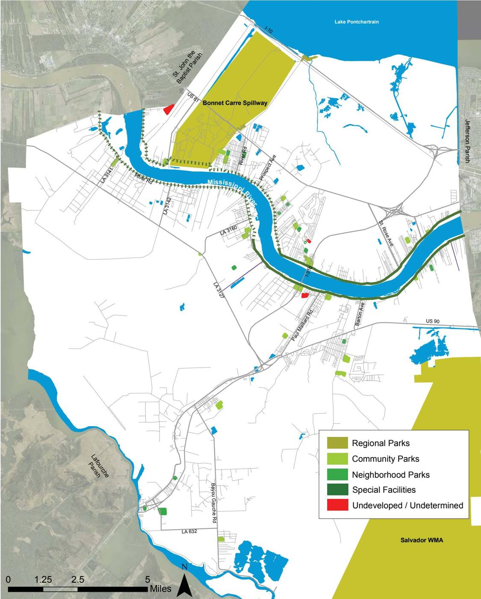

> **Figure description (visual reading, not stated in the plan's text):** Park inventory map with a legend listing Regional Parks, Community Parks, Neighborhood Parks, Special Facilities and Undeveloped / Undetermined, shown as olive, light green, green, dark green and red fills. Printed labels include Bonnet Carre Spillway (on the olive area at upper center) and Salvador WMA (on the olive area at lower right). Road labels include US 61, River Rd, Prospect Ave, LA 3141, LA 3142, LA 3160, LA 3127, I-310, St. Rose Ave, Paul Maillard Rd, Barton Ave, US 90, LA 632 and Bayou Gauche Rd. I-10, Lake Pontchartrain, St. John the Baptist Parish, Lafourche Parish and the Mississippi River are also labeled. The scale bar reads 0, 1.25, 2.5 and 5 Miles.

## Page 141

**Table 8: Table PR-1: Park and Recreation Facility Inventory**

| Park | Town | Acreage | Tenure |
|---|---|---|---|
| Ama Grain | AMA | 3.8 | leased |
| St. Marks | AMA | 2.7 | owned |
| Bayou Gauche Park | BAYOU GAUCHE | 7.3 | owned |
| Boutte Community Park | BOUTTE | 4.0 | owned |
| JB Green Park | DES ALLEMANDS | 1.8 | owned |
| American Legion Field | DES ALLEMANDS | 9.4 | leased |
| Des Allemands Walking Park | DES ALLEMANDS | 1.8 | owned |
| Des Allemands Boat Launch | DES ALLEMANDS | 0.2 | leased |
| Shriners Field | DESTREHAN | 5.0 | leased |
| Ormond Community Park | DESTREHAN | 5.1 | owned |
| Destrehan High School | DESTREHAN | 5.0 | leased |
| South Destrehan | DESTREHAN | 0.6 | owned |
| Red Church Park | DESTREHAN | 2.7 | owned |
| Harry Hurst Middle School | DESTREHAN | 8.1 | leased |
| East Bank Bridge Park | DESTREHAN | 11.5 | leased |
| Nottaway Park | DESTREHAN | 0.2 | owned |
| Panther Run Park | DESTREHAN | 0.9 | owned |
| Hahnville High School | HAHNVILLE | 6.0 | leased |
| Fashion Plantation Park | HAHNVILLE | 2.9 | owned |
| Eual J. Landry Middle School | HAHNVILLE | 8.6 | leased |
| Holy Rosary Park | HAHNVILLE | 7.3 | leased |
| Carver Elementary School | HAHNVILLE | 5.5 | leased |
| Hahnville Boat Launch | HAHNVILLE | 0.2 | leased |
| Killona Park | KILLONA | 7.3 | owned |
| Rathborne Park | LULING | 12.0 | owned |
| Lakewood Elementary Park | LULING | 15.5 | leased |
| Mimosa Elementary | LULING | 0.5 | leased |
| Lagattuta Field | LULING | 2.2 | owned |
| Monsanto Bi-centennial Park | LULING | 4.6 | owned |
| Monsanto Park | LULING | 9.1 | owned |
| R K Smith Middle School | LULING | 4.2 | leased |
| Ashton Plantation (undeveloped) | LULING | 9.0 | owned |
| West Bank Bridge Park | LULING | 28.7 | leased |
| Montz/Bougere Tract (undeveloped) | MONTZ | 3.22 | owned |
| Montz Park | MONTZ | 11.7 | owned |
| New Sarpy Park | NEW SARPY | 4.1 | owned |
| East Harding Park (Collins Park) | NEW SARPY | 0.4 | owned |
| East Harding Park (Whitehall) | NEW SARPY | 0.7 | owned |
| West Harding Park | NEW SARPY | 0.8 | owned |
| Bonnet Carre Spillway | NORCO | 23.1 | leased |
| Bethune Park | NORCO | 11.3 | owned |
| Norco Elementary School | NORCO | 11.1 | leased |
| Sacred Heart Elementary School | NORCO | 3.1 | leased |
| 5th and Goodhope Park | NORCO | 3.6 | owned |
| Wetland Watchers Park | NORCO | 28.3 | owned |
| RJ Vial Elem/JB Martin Middle School | PARADIS | 13.6 | leased |
| Paradis Boat Launch | PARADIS | 0.4 | leased |
| Albert Cammon Middle School | ST. ROSE | 2.7 | leased |
| IMMT Park | ST. ROSE | 3.9 | leased |
| Fairfield Playground | ST. ROSE | 1.3 | owned |
| East Bank Multi-Use Path | St. Charles |  |  |
| West Bank Multi-Use Path | St. Charles |  |  |
| TOTAL PARKS | 50 | 317.059 |  |
Table snapshot (for checking): 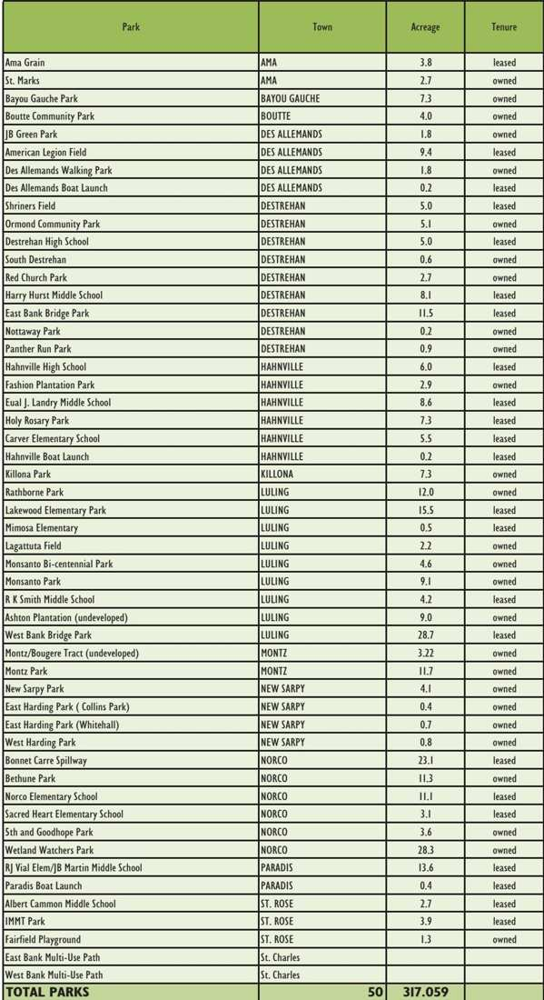

## Page 142

#### Special Events

The Department of Parks and Recreation hosts several special events each year which attract residents throughout the Parish and visitors from the surrounding areas, including: the Alligator Festival, Battle of the Paddle, Christmas Tree Lighting, and 5K Bridge Run, etc.

Special events are typically a joint effort between the Parish and a nonprofit organization.

#### Organization

The Parks and Recreation Department, as of January 2010, employed 34 full-time staff and 10 temporary or permanent part-time employees.

#### Demand-Based vs. Standards-Based Needs

In contrast with the Demand-based needs assessment derived from the community survey, Standards-based needs assessments provide an objective way of measuring the strengths and deficiencies within a park system. Level of Service (LOS) is the term used to describe the quantifiable measurement of park provision, and LOS can be used to establish numerical standards that can be used over time to track the condition of the park system. The most common level of service measure is number of acres of parkland per 1000 persons. The measure varies for each park type (regional, community, etc.)

To define the Parish’s Standards-based needs, a park typology and hierarchization was first established for the Parish’s parks, and then the set of recommended level of service (LOS) standards was applied to determine present and projected deficiencies based on population.

About 86 percent of the department’s staff resources are devoted to the park maintenance side of the organization, in particular grass-cutting, which takes up about 75% of the maintenance budget.

#### Demand-Based Assessment – Resident Survey

The following is a summary of key findings derived from an analysis of the responses to a Resident Survey administered as part of the PRMP process. (For details, consult the Existing Conditions and Needs Assessment Report).

Respondents were generally satisfied with the availability of facilities and programs, but feel that improvements could be made.

Residents seemed more likely to use those parks and other outdoor facilities that are close to their home and easy to access.

Most respondents (49%) felt that facilities are located at a reasonable distance from their place of residence, but almost just as many (43%) did not. Of the latter, 44% do not use Parish parks due to their distance from the facilities.

There is a significant lack of awareness regarding the location of park facilities and program offerings. Perhaps because of this, many recreation needs are perceived to be not well (or not at all) satisfied by the Parish.

• Following are the top priorities of residents who responded to the survey:

1. Safe, well-connected, Parish-wide multi-use trail system

2. More small neighborhood parks – i.e., playgrounds, walking paths

3. Indoor recreation centers/gym facilities

4. Picnic facilities and shelters

5. Maintenance and upgrade of existing facilities

## Page 143

6. Increased accessibility to athletic/play fields

7. Expanded offerings for all age groups and abilities

8. Programs such as fitness/wellness, teen/ youth, art, performing arts, & summer camp

#### Standards-Based Need

• The standards recommended for St. Charles Parish are:

-Neighborhood parks: 1.0 acres per 1,000 persons

-Community parks: 4.5 acres per 1,000 persons

-Parish-wide LOS of 5.5 acres per 1,000 persons.

-No regional park standard is recommended or necessary at this time.

-Regional greenways/walking & biking trails LOS of 1 linear mile per 3,000 persons.

Applying these standards, the Parish currently is below LOS for community parks by about 66 acres. However, the need varies from community to community.

St. Charles Parish has fallen behind mostly on acquiring and constructing community parks to meet the growing needs of the community. Instead, the Parish has increasingly relied on school system facilities to take the place of community parks, but these facilities have limitations on their use.

To meet the needs of the projected population in 2030, the Parish will need to acquire approximately five (5) community parks and slightly more than 20 miles of greenways/trails.

The Parish would continue to be able to meet and exceed the (Parish-wide) LOS for neighborhood parks at that time.

There is a significant lack of awareness regarding the location of park facilities and program offerings. Perhaps because of this, many recreation needs are perceived to be not well (or not at all) satisfied by the Parish.

St. Charles Parish Parks & Recreation Needs Assessment

#### Q-7 Visitation & Participation

If you responded yes to questions #1 or #4 please check all, the reasons you or your household uses parks, recreation facilities or programs offered by the Parish:

**Table 9**

| Answer Options | Response Percent | Response Count |
|---|---|---|
| Enjoyment of the outdoors | 83.0% | 347 |
| Proximity of facility to my home | 61.5% | 257 |
| Desire to improve health or physical fitr | 54.8% | 229 |
| Menu of facilities or programs offered | 23.2% | 97 |
| Quality of facilities or programs offered | 27.0% | 113 |
| Quality of instructors | 8.1% | 34 |
| Safety of facilities | 23.4% | 98 |
| Availability of parking | 30.6% | 128 |
| Affordability of fees | 25.8% | 108 |
| Convenience of operating hours | 19.4% | 81 |
| Ease of registration for programs | 22.2% | 93 |

Table snapshot (for checking): 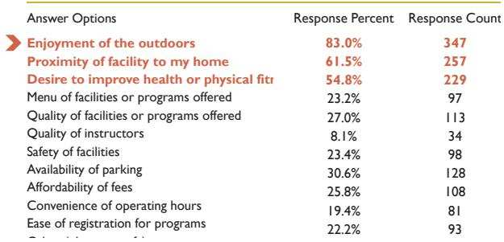

## Page 144

#### PARKS AND RECREATION GOALS

1. Provide equal access to and fair distribution of community facilities for all residents of the Parish.

2. To the maximum extent possible, coordinate the provision of community facilities and services with other public and private providers, to avoid duplications, improve efficiency, and reduce costs.

3. Maximize the lifespan and use of existing and future public facilities by ensuring adequate flexibility and adaptability.

#### POLICIES AND ACTIONS

#### PR 1

Continue to improve existing parks and recreation facilities and programs to adequately serve the needs and expectations of St. Charles Parish residents.

1.1 Adopt and implement the Parks and Recreation Master Plan (PRMP) as the means to systematize, prioritize, and coordinate the budgeting process for the regular maintenance and upgrade of existing parks and recreation facilities.

1.2 Continue to provide the ongoing maintenance necessary to keep up the high quality appearance of parks. As necessary, develop management plans and protocols for the Parish’s parks and recreation facilities, addressing issues such as:

• Lifecycle replacement

• Safety and security

• Access and linkages

• Natural resource preservation and restoration

Development of a GIS database of parks, with acreage, features, facilities, age, etc., as a dayto-day management tool.

1.3 Monitor the upkeep of privately owned park facilities that are maintained by homeowners associations and other private entities.

1.4 Where appropriate as needs grow, extend the usefulness of playfields in existing facilities with synthetic surfaces or new configurations, lighting to expand hours of use, bicycle and pedestrian links to improve access, etc.

1.5 Whenever possible, link existing and new facilities, to build up a Parish-wide greenway system (using bike paths and bike trails, linear parks, natural open space, etc.).

#### PR 2

Provide an array and distribution of recreational opportunities to serve all recreation interests, income levels, age groups, and geographic areas in the Parish fairly.

2.1 Use the Future Land Use Map to identify opportunities for future parks. (Figure PR-2).

2.2 Continue to expand the variety of recreational programs to reach the largest number of citizens in St. Charles Parish.

2.3 Continue to explore opportunities, as they arise, to acquire private recreational facilities and assets such as golf courses and swimming pools, if they meet needs identified in the PRMP and show potential to create positive cash flow.

## Page 145

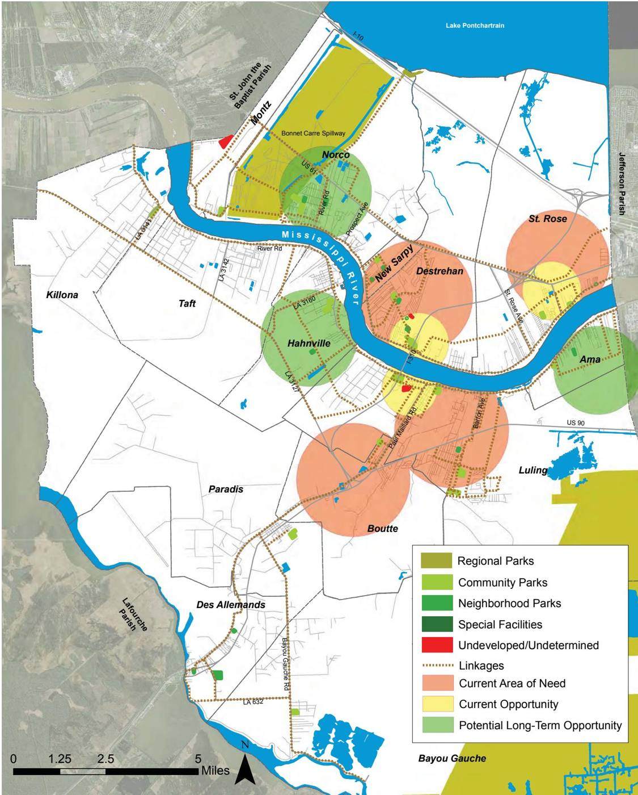

> **Figure description (visual reading, not stated in the plan's text):** Park needs and opportunities map with a legend listing Regional Parks, Community Parks, Neighborhood Parks, Special Facilities, Undeveloped/Undetermined, Linkages (dotted line), Current Area of Need (orange), Current Opportunity (yellow) and Potential Long-Term Opportunity (light green). Printed community labels are Montz, Norco, New Sarpy, Destrehan, St. Rose, Ama, Killona, Taft, Hahnville, Luling, Paradis, Boutte, Des Allemands and Bayou Gauche, along with Bonnet Carre Spillway. Colored circular areas are drawn around several communities without separate printed labels. Road labels include US 61, River Rd, Prospect Ave, LA 3141, LA 3142, LA 3160, LA 3127, I-310, St. Rose Ave, Paul Maillard Rd, Barton Ave, US 90, LA 632 and Bayou Gauche Rd, and I-10, Lake Pontchartrain and the Mississippi River are also labeled.

## Page 146

2.4 Improve access to the Parish’s existing parks, open space, and recreation areas and facilities:

Develop a Parish-wide bikeway and pedestrian trail network, consistent with the PRMP and the Future Bicycle and Pedestrian Facility Network Map (Figure TR-9, Transportation Element)

Use the Subdivision Regulations and the Zoning Ordinance to reserve land to link existing and future parks and open space to the proposed Parish-wide greenway trail system

Create “whole access” trails to provide outdoor recreation for all regardless of physical ability.

• Continue to pursue opportunities to improve public access to and use of the Parish’s extensive waterfront and water resources.

#### Parks and Recreation Advisory Board (PRAB)

The Parks and Recreation Advisory Board is an advisory group to the Parish Council.

In other communities, the members of the PRAB are typically appointed by Council members and the government administrator (here, the Parish President). The board composition should be representative of the community’s varied park and recreation stakeholder interests. Member terms usually last two years, and may be staggered to provide continuity.

While it coordinates closely with the Parks and Recreation Department (which in turn serves as technical staff for the board), the PRAB does not have authority for the Department’s operations.

#### In reaching conclusions about

recommendations, the PRAB follows the Parish’s Parks and Recreation Master Plan, as well as the policies of the Park and Recreation Element of the Comprehensive Plan.

Seek opportunities to integrate community gardening into new parks, and encourage land set-asides for community gardens in other public facilities and in private developments.

2.5 Require that large-scale stormwater retention areas in new development be designed as open space amenities conveniently accessible to the public for recreation and enjoyment.

2.6 Prepare a Blueways Feasibility Study to identify a network of navigable waterways suitable for recreational paddling and water-based recreation uses.

#### PR 3

Capitalize on available resources and the participation from as many local agencies as possible to avoid duplication of facilities and services and reduce financial impacts on the Parish’s taxpayers.

3.1 Continue to pursue joint use of recreational facilities owned by the school district and other recreational providers, including private recreation facilities.

3.2 Appoint a Parks and Recreation Advisory Board to evaluate and prioritize park and recreational demands and needs, and to advise the Parks Department and the Parish Council on matters related to park and recreation issues.

3.3 Continue to encourage private sector development of recreational facilities to help meet the Parish’s needs.

## Page 147

#### PR 4

Develop new facilities which conform to adopted standards for levels of quantity and quality.

4.1 Adopt the Level of Service (LOS) Standards recommended in the PRMP for current and future parks and recreation facilities.

4.2 To remedy present and projected quantitative deficiencies identified in the PRMP, over the next 20 years obtain and develop sites for five additional community parks throughout the Parish, and construct twenty additional linear miles of greenway trails.

4.3 Give immediate priority to meeting the needs of local communities with the greatest parkland deficiencies, but focus on providing larger community parks, which can accommodate users needs for neighborhood-oriented recreation facilities. Future public park sites may be gained by several means:

Undeveloped sites and underutilized sites that are already owned by the Parish (for other uses)

Existing recreational sites or facilities not owned by the Parish (private or commercial recreation uses)

• Raw land specifically purchased for park development (or co-location agreements)

4.4 At least every five years, review and update the PRMP’s population forecast and associated projections of parkland needs. Concurrently, evaluate the adopted LOS Standards and adjust, as necessary, to meet changing conditions.

4.5 Consistent with the PRMP, prepare detailed master plans for the development of new parks, greenways, trails, and plans for the management of open space areas.

4.6 Review and, as necessary, refine the wording of the current open space requirements in the Subdivision Regulations (Section III.F.1(a) and (b)) to clarify that:

All land reserved for parkland as part of a development shall be usable for active or passive recreational use. Usable in this context means that the land must be accessible and free of development. It shall not include rights of way of engineered, non-accessible flood control channels, inaccessible utility easements, areas devoted to parking, traffic or private uses, or areas that do not provide a recreational or scenic benefit.

• The location and configuration of the park site is subject to plat review and approval.

Because the Parish will be primarily focused on the acquisition of parkland for community parks and not neighborhood parks, the Parish may choose to not accept park sites dedicated as neighborhood parks (i.e., a park of a certain size that serves only the immediate neighborhood, as defined in the PRMP). Such parks shall remain under the ownership and management of a property owners association or a similar private entity. The development shall receive credit for such open space in accordance with Section III.F (1(d).

The Parish will encourage developers to donate a fee-in-lieu of dedication to allow the Parish to pursue the acquisition of larger sites for community parks, consistent with the PRMP.

4.7 Consider providing an increase in net density (i.e., a reduction of the minimum lot size) for developments that provide parkland above the minimum required.

4.8 Ensure that parks and recreational open space are included in appropriate redevelopment projects, to promote the revitalization of existing communities.

4.9 Secure corridors that allow parks, cultural sites and other community destinations to be connected through both public and private development (Figure PR-3. Means to achieve this include:

• Voluntary easement agreements with utility agencies, private landowners and other

> **Text-layer supplement (text on this page that the layout parse did not capture; reading order approximate, taken from the PDF text layer):**
>
> St. Charles 2030 Comprehensive Plan

## Page 148

> **Text-layer supplement (text on this page that the layout parse did not capture; reading order approximate, taken from the PDF text layer):**
>
> Multi-Use Levee Path (West Bank): Visualization of possible improvements,including addition of bike rental kiosks, sitting, shade, and waterfront access.

## Page 149

governmental agencies for co-use of roadway, utility or waterway corridors, where appropriate, as greenway linkages and trails.

Coordination with LA DOTD, the Parish’s Public Works Department, and private developers to ensure that improved or new roadways are adequately sized and designed to accommodate on or off-road bike paths and trail facilities, prioritizing those identified in Figure TR-9, (Transportation Element).

#### PR 5

Promote St. Charles Parish’s parks and recreation facilities and programs.

5.1 Reinforce the Parish’s public awareness program to publicize park, recreation facility and recreation program offerings, including locations, hours of operation, fees, and other information that may serve to promote their use by residents.

5.2 Publish separate maps geared toward ecotourists (including blueways, greenways/trails, etc.), and sportsmen (including boat launches, fishing areas, gamelands, etc.) to promote the Parish’s outdoor recreation opportunities.

5.3 In coordination with the Department of Economic Development & Tourism and related economic development entities, establish appropriate parks, recreation, and leisure indicators of community health and quality of life that can be used to attract investment, as well as visitors, to the Parish. Measures, which can be tracked through the implementation of the PRMP, may include but are not limited to:

• Per capita provision of parkland for public use

• Overall number and types of recreational facilities

• Miles of trails and paths

• Proximity/access to parks (service area distances)

#### PR 6

Budget sufficient resources and seek innovative funding sources to maintain a high quality of parks and recreation facilities.

6.1 Identify opportunities to reduce the inventory of low recreational value (due to size, location, access, or other factors identified in the PRMP) but maintenance intensive sites, which create a financial drain on the Parish. Possible means for disposition include, but are not limited to:

• Discontinuation of leases of underdeveloped, under-used, low-value properties

Ownership/maintenance transfer to homeowner or neighborhood organizations (where available) of facilities which serve only that neighborhood or subdivision.

6.2 Prepare an investment program specifically related to the acquisition, development, maintenance and operation of public parks, then annually allocate and update the funding needed for these actions in the Capital Improvement Program.

6.3 Periodically review and, if necessary, reallocate or increase staff resources as new programs or park acquisitions expand the Parish’s park and recreation system.

6.4 Continue to explore opportunities to augment current funding, including:

• Fair pricing of recreational activities and programs

• Development of new revenue-producing facilities

• Federal, state, corporate and institutional grants

• Corporate sponsorships and advertising

• Outsourcing and concession agreements

• Park “friends” group(s) (nonprofits for fundraising purposes)

6.5 Continue to support and expand events and partnerships with volunteers and citizen groups on

## Page 150

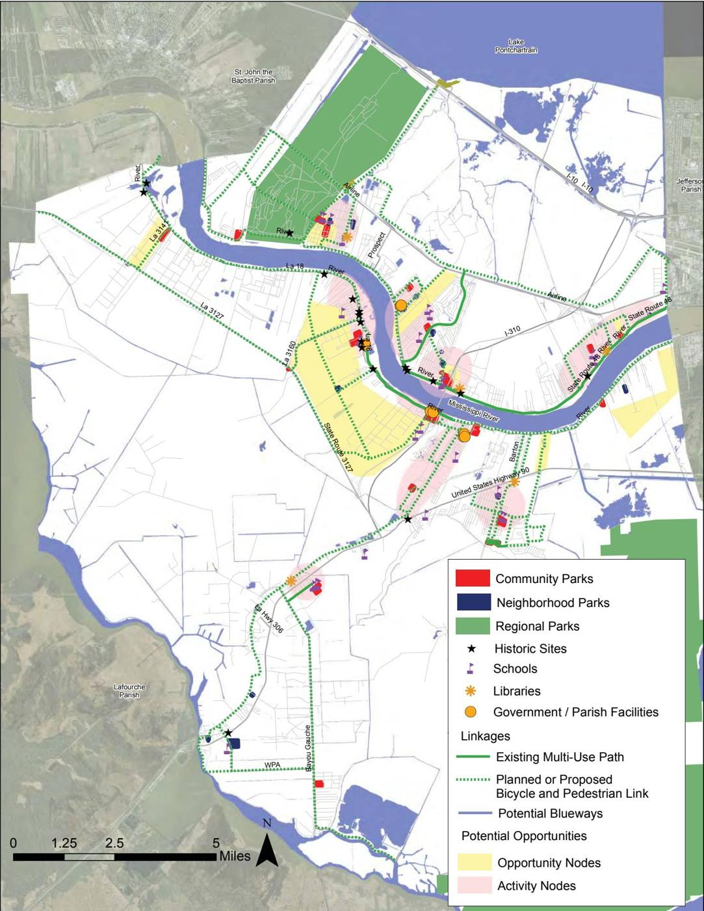

> **Figure description (visual reading, not stated in the plan's text):** Map of linkages and community destinations with a legend listing Historic Sites (black star), Schools (purple flag), Libraries (orange asterisk), Government / Parish Facilities (orange circle), Existing Multi-Use Path (solid green line), Planned or Proposed Bicycle and Pedestrian Link (dotted green line), Potential Blueways (blue line), Opportunity Nodes (yellow area) and Activity Nodes (pink area). The park legend lists Community Parks (red), Neighborhood Parks (dark blue) and Regional Parks (green). Printed labels include Lake Pontchartrain, I-10, I-310, US 61, Prospect Ave, Airline (printed twice), Barton, United States Highway 90, State Route 3127, La 3160, La 3141, La 18, Bayou Gauche, WPA, La Hwy 306, Lafourche Parish, St. John the Baptist Parish, Jefferson Parish and the Mississippi River. A State Route label on the right-hand river reach has small digits that are not reliably legible.

## Page 151

park maintenance and improvement projects through programs such as Park Stewards and Adopt-a-Park.

6.6 Integrate green/best environmental practices (energy and water conservation measures, use of recycled materials, low-water landscaping, etc.) into the design, construction, and management of the Parish’s parks and recreation facilities to lower costs.

6.7 Pursue opportunities to combine new park sites with other public facilities (e.g., libraries, fire stations, or schools) to reduce acquisition and development costs.

#### KEY ACTORS AND PARTNERS

Ensuring the implementation of the policies and actions of the Parks and Recreation Element will be the primary responsibility of the following governmental units:

• St. Charles Parish Department of Parks and Recreation.

St. Charles Parish Council.

• St. Charles Parish President.

To effectively implement specific actions in this Coordination, support, collaborations, and partnerships will be needed with (but are not limited to) the following entities and organizations:

St. Charles Parish Department of Economic Development and Tourism.

• St. Charles Parish Department of Planning and Zoning.

St. Charles Parish Public Schools.

• U.S. Army Corps of Engineers.

St. Charles Parish Library Control Board.

• St. Charles Parish Geographic Information Systems.

Non-Profit and Private Sector Partnerships:

o Booster Clubs.

o Wetland Watchers.

o Private Utility Service Providers (Entergy, etc.).

o Private/Commercial Recreation Owners/ Operators/Providers.

o Developers.

o Neighborhood/Property Owner Associations.

More detail on the roles and responsibilities of participants in the implementation of specific actions is provided in Chapter IV, Implementation.

## Page 152

### 7 NATURAL AND CULTURAL RESOURCES ELEMENT

#### EXISTING CONDITIONS AND TRENDS SNAPSHOT

#### Quick Facts

Water: • 31 percent of the Parish.

• Major Water Bodies: Mississippi River, Lake Pontchartrain, Lake Des Allemands, Lake Salvador, and Lake Cataouatche

• Wetlands: 49 percent of the Parish.

• National Register of Historic Places in the Parish:

-Ormond Plantation House

-LaBranche Plantation Dependency.

-Destrehan Plantation.

-The Dorvin Home.

\- Homeplace Plantation House (also known as Keller Plantation).

-The Kenner and Kugler Cemeteries Archeological District.

#### • State historical markers:

-Battle of Des Allemands

-Fashion Plantation

-Flagville

-Destrehan Manor House

-Les Allemands

#### • Unmarked Historic Resources:

-Bustard’s Cove;   
-Robottom Mortary;   
-Smith’s Grocery Store;   
-Timber Mill on Bayou Gauche;   
-Timber Mill on Cousin’s Canal;   
-Michael Hahn House;   
-Bethlehem Baptist Church; and, -Hymelia Crevasse.

#### Natural Resources and Features

The Parish has vast extensions of environmentally sensitive lands (wetlands) and other open space resources. These resources protect the water supply, lessen flood hazards, and promote diversity of plants and wildlife.

Understanding the key elements of the Parish’s natural setting serves as the basis for identifying lands that may in the future need to be targeted for conservation or enhanced for recreation in partnership with a landowner and/or governmental partners at the local, state, and federal levels.

Hydrological System and Features

The presence of water is one of the Parish’s most significant natural features.

Figure NCR-1 depicts the abundance of water in the Parish, which is dotted smaller ponds and lakes, and criss-crossed by numerous natural and man-made water channels (bayous) and canals (Figure NCR-1). These canals were built primarily for utilitarian purposes (providing stormwater runoff control, or access to and material for levee construction), but they also provide unparalleled opportunities for boating and angling.

The Mississippi River bisects the Parish. Historically, the river has been (and is) the Parish’s economic lifeline as a transportation corridor and a scenic and recreational amenity.

Levees constructed on both banks reflect the Parish’s historic vulnerability to flooding associated with the Mississippi, but today they also represent a tremendous recreational opportunity for the ongoing construction of a regional multi-use path system.

Within St. Charles Parish, Lake Pontchartrain is a major stormwater drainage basin for the East Bank, provides recreational opportunities, and supports a diverse habitat for fish and wildlife.

## Page 153

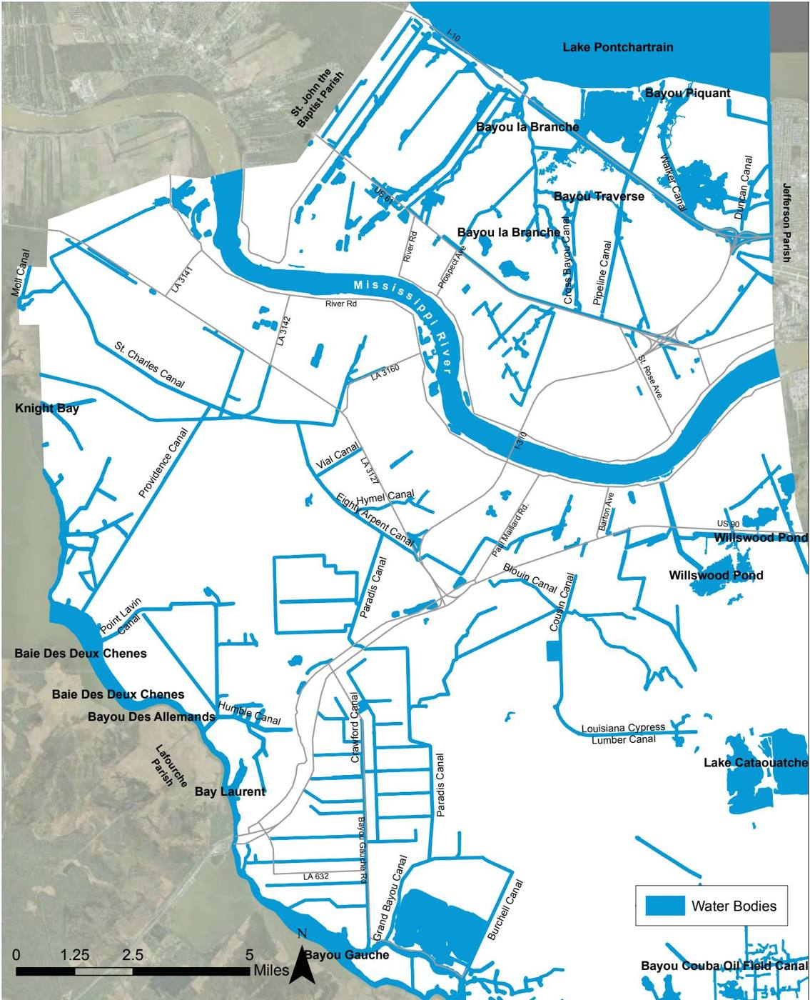

> **Figure description (visual reading, not stated in the plan's text):** Water bodies map with a legend listing only Water Bodies (blue). Printed water feature names include Lake Pontchartrain, Lake Cataouatche, Bayou Piquant, Bayou la Branche (printed twice), Bayou Traverse, Walker Canal, Duncan Canal, Cross Bayou Canal, Pipeline Canal, Moll Canal, St. Charles Canal, Providence Canal, Vial Canal, Hymel Canal, Eighty Arpent Canal, Paradis Canal (printed twice), Point Lavin Canal, Humble Canal, Crawford Canal, Grand Bayou Canal, Burchell Canal, Blouin Canal, Cousin Canal, Louisiana Cypress Lumber Canal, Bayou Couba Oil Field Canal, Knight Bay, Baie Des Deux Chenes (printed twice), Bayou Des Allemands, Bay Laurent, Bayou Gauche and Willswood Pond (printed twice). Road labels include I-10, US 61, River Rd, Prospect Ave, LA 3141, LA 3142, LA 3160, LA 3127, I-310, St. Rose Ave, Paul Maillard Rd, Barton Ave, US 90, LA 632 and Bayou Gauche Rd.

## Page 154

Lakes Cataouatche and Salvador, located in the southeastern corner of the Parish, provide recreational opportunities such as boating and fishing. Partially located in both St. Charles and Jefferson Parishes, Lake Cataouatche is increasingly popular among bass fishers and provides opportunities for fishing, boating, bird watching, camping, and hiking. Lake Cataouatche connects to Lake Salvador via Bayou Couba and Bayou Bardeaux.

Lake Salvador, partially located in Lafourche Parish is bordered on the northwest by the Salvador Wildlife Management Area (WMA). While the lake is popular among recreational fishers, St. Charles Parish does not have hiking or camping opportunities.

The Salvador and Timken Wildlife Management Areas cover much of the southeastern part of the Parish, generally north and west of Lake Salvador and Lake Cataouatche, and include approximately 33,000 acres combined. These WMAs are operated by the Louisiana Department of Wildlife and Fisheries

#### Wetlands

Federal agencies, states, and scientists vary in the way in which they define wetlands. Generally, wetlands are lands on which water frequently covers or saturates the soil and has influenced the development of soil and the vegetation it supports.

Three major types of wetlands can be found in the Parish: forested wetland communities, which are subject to occasional flooding by tides and include a variety of hardwoods; shrub/scrub swamp communities, which hold water and have woody vegetation such as Cypress and Tupelo-gum; and marsh communities, which can hold freshwater, brackish water, or saltwater and each serves as habitat for a diversity of plant and animal species (Figure NCR-2).

While wetlands can be a constraint to development, they are critical to the health of the Parish’s ecosystems, reducing coastal land loss, protecting developed areas, and providing important habitat.

Wetlands provide wildlife habitat and nursery grounds for aquatic life communities year round. Groundwater discharge through wetlands can enhance these communities in downstream areas. At the intersection of the Mississippi River and Central flyways, St. Charles Parish wetlands also provide important habitat for large populations of migrating birds. Many species of endangered and threatened plants and animals are found in wetland areas.

Wetlands provide educational and scientific research opportunities due to their unique combination of terrestrial and aquatic life and physical/chemical processes. St. Charles Parish has some of the most functional and scenic wetlands in the area, but offers comparatively limited access to allow people to enjoy them. The new Wetland Watchers Park is one way in which the Parish, working with the LaBranche Wetland Watcher service-learning project, is starting to rectify this situation, providing unique access to the LaBranche Wetlands through a boardwalk, overlooks, and an outdoor classroom space. The LaBranche Wetlands comprise approximately 20,000 acres of privately owned, mostly cypress swamp, intermediate marsh and shallow open water ponds.

Additionally, the Parish’s wetlands create recreational opportunities for hiking, bird watching, fishing, paddling, and even hunting. Wetlands also present numerous benefits as they filter pollution, control erosion, store water during high rainfall and release the water slowly during low rainfall, provide a buffer zone during storms, and absorb waters from storm surges.

The Bonnet Carré Spillway, owned by the U.S. Army Corps of Engineers (USACOE), covers over 7,700 acres. The Spillway is located on the East Bank of the Mississippi, and extends from river to Lake

## Page 155

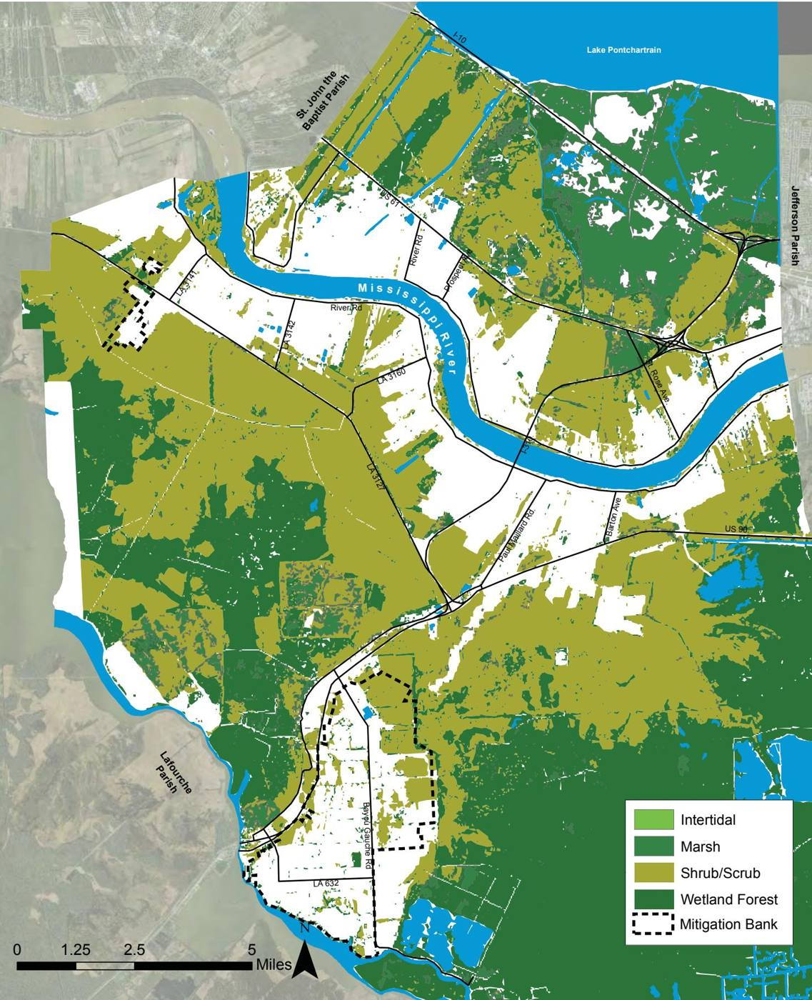

> **Figure description (visual reading, not stated in the plan's text):** Wetland cover map with a legend listing Intertidal (light green), Marsh (medium green), Shrub/Scrub (olive), Wetland Forest (dark green) and Mitigation Bank (black dashed outline). Printed labels include the Mississippi River, Lake Pontchartrain, I-10, US 61, River Rd, Prospect Ave, LA 3141, LA 3142, LA 3160, LA 3127, I-310, St. Rose Ave, Paul Maillard Rd, Barton Ave, US 90, Bayou Gauche Rd, LA 632, St. John the Baptist Parish, Lafourche Parish and Jefferson Parish. The scale bar reads 0, 1.25, 2.5 and 5 Miles.

## Page 156

Pontchartrain. Although the primary function of the Spillway is flood control, the site is extensively used for recreation.

The USACOE has reported in the past that visitation may well exceed 500,000 annually. A master plan has been completed (and recently updated) which includes expanded recreational use of the spillway for horseback riding, ATVs, birding and photography, etc.

#### Sensitive Species

There are four species in St. Charles Parish listed as endangered or threatened by the State of Louisiana: the Gulf Sturgeon (Acipenser oxyrinchus desotoi); the Pallid Sturgeon (Scaphirhynchus albus); the Brown Pelican (Pelecanus occodentalis); and the West Indian Manatee (Trichechus manatus).

#### Cultural Resources and Features

The River Region Performing Arts and Cultural Center is housed in the rehabilitated building of the former Good Hope School, on the East Bank (Norco). Both the River Region Drama Guild, Inc. and the River Region Ballet, Inc. use the facility.

St. Charles Parish does not have in place historic preservation programs or any official, local designation of a site or building as historic.

A number of historic resources exist in the Parish (Figure NCR-3). Many of these are located in the vicinity of River Road on both sides of the Mississippi River. The lack of local historic designations and preservation programs may endanger the integrity and continued existence of historically and architecturally significant features in the Parish. National Register status can convey prestige and the ability to qualify for federal tax credits for repairs and renovation, but cannot prevent historic buildings and sites which have enduring value for the community from being demolished or otherwise altered beyond recognition. Local regulations are better suited to achieve this protection.

There have been recent efforts to recognize the Parish’s past:

-On October 17, 2009, the Parish dedicated a monument at the East Bank Bridge Park to the 77 victims of the Luling Ferry Crash in 1976.

-The St. Charles Museum recounts the history of the petroleum industry in the Parish. This institution, which opened on October 28, 2009 on the site of the Destrehan Plantation House, is currently in need of a new facility.

\- A new publication, St. Charles Parish: a Pictorial History, by local historians, spans over 300 years of the Parish’s history and commemorates the Bicentennial of the civil Parish of St. Charles.

## Page 157

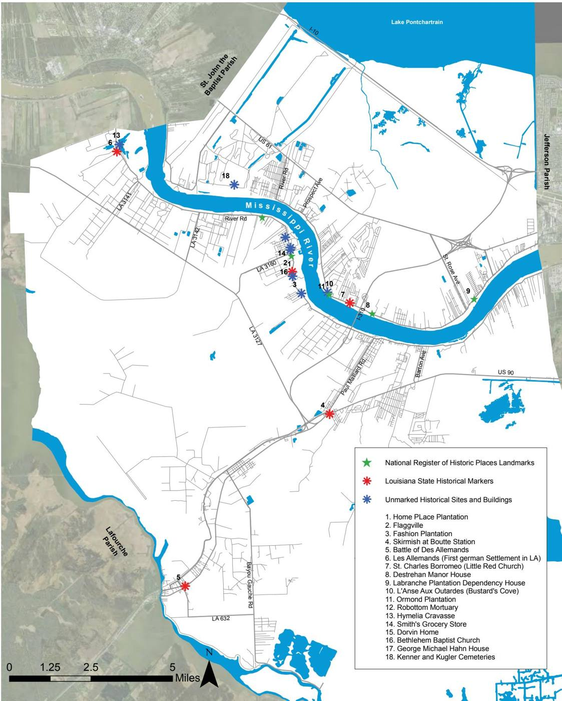

> **Figure description (visual reading, not stated in the plan's text):** Historic resources map with a legend listing National Register of Historic Places Landmarks (green star), Louisiana State Historical Markers (red star) and Unmarked Historical Sites and Buildings (blue star). The numbered key lists 18 entries: 1. Home PLace Plantation; 2. Flaggville; 3. Fashion Plantation; 4. Skirmish at Boutte Station; 5. Battle of Des Allemands; 6. Les Allemands (First german Settlement in LA); 7. St. Charles Borromeo (Little Red Church); 8. Destrehan Manor House; 9. Labranche Plantation Dependency House; 10. L'Anse Aux Outardes (Bustard's Cove); 11. Ormond Plantation; 12. Robottom Mortuary; 13. Hymelia Cravasse; 14. Smith's Grocery Store; 15. Dorvin Home; 16. Bethlehem Baptist Church; 17. George Michael Hahn House; 18. Kenner and Kugler Cemeteries. The map shows a marker labeled 21 that has no matching key entry, since the key ends at 18. Printed place and road labels include Lake Pontchartrain, St. John the Baptist Parish, Jefferson Parish, Lafourche Parish, I-10, US 61, Prospect Ave, River Rd, LA 3141, LA 3142, LA 3160, LA 3127, I-310, St. Rose Ave, Paul Maillard Rd, Barton Ave, US 90, LA 632, Bayou Gauche Rd and the Mississippi River.

## Page 158

#### NATURAL AND CULTURAL RESOURCES GOALS

1. Minimize the loss of and avoid adverse impacts on the Parish’s natural, historic and cultural resources.

2. Protect the Parish’s natural resources from scattered development and fragmentation.

3. Promote natural resources and outdoor recreation opportunities in a sensitive and responsible manner for economic development.

4. Support private management of the Parish’s natural and cultural resources for long-term sustainability.

5. Promote development forms and methods that protect, conserve, and respect the character of the Parish’s natural, historic and cultural resources.

#### POLICIES AND ACTIONS

#### NCR 1

Protect and restore sensitive environmental resources.

1.1 Prepare a biodiversity and environmental resource inventory and incorporate it into the Parish’s GIS, including, but not limited to wildlife habitats, wetlands, and flood plains and endangered species habitats. Adopt and implement a plan to track the status of this inventory on an ongoing basis.

1.2 Explore and support partnerships with private land trusts, foundations, and other organizations that can assist the Parish in acquiring land, obtaining conservation easements, and maintaining and managing open space and natural resources. Lands so preserved may then become part of the Parish’s open space system and be integrated into a Parishwide greenway network.

1.3 Work with the Parish’s owners of substantial undeveloped property to explore preservation, economic and recreation opportunities.

#### NCR 2

Strengthen protection of sensitive environmental resources by applying best management practices through zoning and development regulations.

2.1 Revise the Zoning Code to include an Environmental Protection section that incorporates requirements to protect water resources, wetlands, existing tree canopy and other resources on an individual site and areawide basis.

2.2 Promote alternative site design standards (e.g., conservation subdivisions and lot averaging techniques) to better preserve natural areas on a tract.

2.3 Revise the Zoning Code’s landscaping standards to encourage use of native plants, increase landscape diversity, and require street trees in site development.

2.4 Consider revising zoning regulations pertaining to telecommunication towers to take into account the visual impacts on open space resources.

## Page 159

#### NCR 3

Protect the Parish’s water resources.

3.1 Enact vegetated buffer and setback requirements to protect wetlands and other surface waters.

3.2 Require/encourage stormwater management practices that minimize impacts on surface water, groundwater, and other natural resources, e.g.:

Filtering and discharge designs for stormwater management facilities that blend into the existing landscape.

• Use of pervious surfacing to reduce runoff.

#### NCR 4

Protect and enhance St. Charles Parish’s coastal zone.

4.1 Adopt and implement the Parish’s ongoing Coastal Zone Management Plan in order to:

• minimize loss of life, structures, and natural resources from flooding and erosion,

• protect and restore the quality and function of coastal ecosystems,

• provide for public access to and recreational use of coastal waters, public lands, and public resources in the coastal area,

• promote sustainable use of living coastal resources,

• identify, prioritize and fund coastal restoration projects.

4.2 Consistent with the FLUM, foster a pattern of development that makes beneficial use of a coastal zone location while minimizing adverse impacts of development.

#### Coastal Zone Management

Coastal zone management is the planning process to protect, conserve and manage coasts and coastal resources. It is a specific area of environmental protection which focuses on coastal zones. In the United States, coastal zone management is greatly affected by government regulation, especially the Coastal Zone Management Act.

A coastal zone management plan can help to reduce land loss; hurricane flood risk; and the loss of ecosystems and cultural heritage; it can protect assets; build up community resilience; and produce long-term savings by identifying strategic investments in coastal protection and infrastructure.

## Page 160

#### NCR 5

Provide citizen educational programs on environmental stewardship, the interrelationships of natural systems, and the need for a sustainable environment.

5.1 Prepare and distribute newsletters and other information on environmental issues (e.g., information on wetlands and other environmental regulations that apply to private properties).

5.2 Continue to seek opportunities to partner with environmental and community organizations (e.g., Wetland Watchers), foundations, and other groups to promote environmental education efforts.

5.3 Promote grassroots initiatives such as park stewardship, cleanups, community gardens, and ecological restoration/planting projects.

5.4 Encourage the use of green building and environmentally sensitive construction principles that promote positive environmental benefits.

5.5 Provide outdoor classrooms that are coordinated with specific needs and lesson plans from nearby schools.

#### NCR 6

Preserve significant elements of St. Charles Parish’s historic, cultural, architectural, and archaeological heritage.

6.1 Create and adopt a Historic District, Buildings and Landmarks Ordinance.

• Develop criteria to define local significance

Develop criteria to evaluate the appropriateness of alterations to historic buildings or sites and construction in historic districts, including exterior alterations to non-contributing structures.

• Develop criteria to determine hardship cases.

Develop criteria for minimum maintenance standards and demolitions by neglect.

6.2 Prepare a historic resource inventory using the criteria established to define locally significant historic properties, structures and sites. Address the full range of historic resources (cemeteries, landscapes, trees, archaeological sites, etc. in addition to individual buildings and districts).

6.3 Support efforts to enhance public awareness of the value of the Parish’s historic resources and the advantages of historic designation, including:

Disseminate information on historic resources to residents through general mailings such as tax bills.

• Undertake outreach to owners of historic properties.

Study requiring that properties with historic designations be so identified when advertised for sale and at closing.

Organize walking and/or bicycling tours of historic sites.

• Public education efforts, including conferences, panels, seminars, and presentations.

6.4 Investigate designation as a Certified Local Government under the National Historic Preservation Act, making the Parish eligible for state grants for historic preservation activities such as planning, staff support, and public education.

6.5 Adopt incentives and regulatory provisions to promote adaptive reuse of historic properties for other uses, such as office, commercial, or institutional.

6.6 Designate “destination clusters” for tourism where concentrations exist of historic, recreational, institutional and other attractions (Ref Figure PR-3)

#### NCR 7

Support and promote local cultural institutions.

7.1 Improve the sustainability of local historic and cultural non-profit organizations through grants or other means of support that leverage organizational resources.

## Page 161

7.2 Support efforts to provide community groups access to adequate facilities for the performing arts.

7.3 Build connections among and promote local cultural organizations (e.g., a link on the Parish’s web site with “one-stop shopping” for organizations and events).

7.4 Support economic development and the tourism industry by showcasing the Parish’s unique features and institutions through diverse activities and national image branding.

7.5 Working with community groups, local organizations, and the Economic Development and Tourism Department, identify and target potential cultural tourism sites for priority preservation and restoration.

#### KEY ACTORS AND PARTNERS

Ensuring the implementation of the policies and actions of the Natural and Cultural Resources Element will be the primary responsibility of the following governmental units:

St. Charles Parish Department of Parks and Recreation.

• St. Charles Parish Department of Planning and Zoning.

• St. Charles Parish Council.

• St. Charles Parish President.

To effectively implement specific actions in this Coordination, support, collaborations, and partnerships will be needed with (but are not limited to) the following entities and organizations:

• St. Charles Parish Department of Economic Development and Tourism.

• St. Charles Parish Department of Planning and Zoning.

• State of Louisiana Office of Coastal Protection and Restoration.

• St. Charles Parish Geographic Information Systems.

• St. Charles Parish Public Information Office.

• Non-Profit and Private Sector Partnerships:

o Community groups, local institutions and cultural and historical organizations.

o Private foundations (TPL, others).

o Property owners, Developers.

> **Text-layer supplement (text on this page that the layout parse did not capture; reading order approximate, taken from the PDF text layer):**
>
> other means of support that leverage organizational resources.
>
> St. Charles 2030 Comprehensive Plan

## Page 162

This page intentionally left blank

## Page 163

#### IMPLEMENTATION

## Page 164

This page intentionally left blank

## Page 165

#### IMPLEMENTATION

#### Overview

Although this is the last chapter of the Plan, it is the most important because it is intended to guide Parish policies for the next 20 years.

This chapter reiterates the policies and actions listed in each of the elements in a clear, coherent “to-do list.” The “to-do list” identifies the best actions to take and the best person or agency to take the lead of those actions in order to achieve the ideals of the Vision Statement.

In other words, this chapter is designed to communicate very clearly to the current and to future Parish administrations, department staffs, elected officials, Planning and Zoning Commissioners, and citizens actions that will help guide the Parish to look like what citizens expressed during the Visioning process and what the Steering Committee distilled into the Vision Statement.

There are five components to the Implementation strategy:

1. Adoption Procedure

2. Decision-Making Principles

3. Action Plan

4. Capital Improvement Plan

5. Measures for Success/Amendment Procedures

#### 1. Adoption Procedure

The Louisiana Revised Statutes (LRS) establish the manner in which a comprehensive plan must be adopted by a community. Section 33:108, LRS., Procedure of commission; adoption of plan, states among other things:

“A. A commission may adopt a plan as a whole by a single resolution or may by successive resolutions adopt successive parts of a plan, said parts corresponding with major geographical sections or divisions of the parish, in the case of a parish planning commission...or with functional subdivisions of the subject matter of the plan, and may adopt any amendment or extension thereof or addition thereto.

B. Before the adoption of a plan or any such part, amendment, extension, or addition, a commission shall hold at least one public hearing thereon. A parish planning commission shall give notice of the purpose, time, and place of the public hearing by one publication in a newspaper of general circulation throughout the parish at least ten days prior to the date set for the hearing....

C. The adoption of a plan or of any such part or amendment or extension or addition shall be by resolution of a commission. The resolution shall refer expressly to the maps and descriptive and other matter intended by a commission to form the whole or part of a plan, and the action taken shall be recorded on the map and plan and descriptive matter by the identifying signature of the chairman or secretary of the commission....”

## Page 166

The Planning and Zoning Commission shall be responsible for adopting the Plan in accordance with the statutory requirements. Next, although not mandated by the statutes, the Parish Council will be asked to pass an ordinance or a resolution endorsing the Plan. Upon adoption, the Plan shall become the Parish’s key policy document, superseding the 1990 Comprehensive Land Use Plan. Copies of the document should be filed in the following locations, at a minimum:

1. Clerk of the Courts

2. Council Records

3. Planning and Zoning Office

4. Regional Library Branches

5. Parish Website

Copies of the Plan maintained at these locations will be updated each time the plan is amended or updated.

#### 2. Decision-Making Principles

The Plan elements call for numerous revisions to present the zoning and subdivision regulations and other Parish ordinances. In some cases, new standards and incentives are required to implement a particular action, such as those that will be needed to promote the development of special character overlays derived from the Future Land Use Categories. Section 33:109, LRS., requires that the Plan be considered “before adopting, approving, or promul gating any local laws, ordinances or regulations which are inconsistent with the adopted elements of the master plan.”

The following principles will ensure the usefulness of the Plan and compliance with this section of the Revised Statutes:

Principle 1: Zoning and related development regulations and ordinances should be revised, as necessary, to maintain consistency with the Comprehensive Plan.

After adoption, the Parish should undertake a review of the Zoning Ordinance and other related ordinances for consistency with the directions set by this Plan. Where inconsistencies are identified, the ordinances should be amended. New standards should be created where gaps exist.

Applicants for zoning changes should demonstrate that the proposed use/development is consistent with the land use designation on the FLUM. However, consistency with the FLUM is only one of several considerations, and all other development criteria must be met for a rezoning approval, pursuant to the process already laid out in the Zoning Ordinance.

## Page 167

Principle 2: Rezoning requests and development applications should be reviewed for consistency with the Comprehensive Plan and should not be approved if found to be contrary to the Comprehensive Plan, unless the Plan is amended.

Because Future Land Use designations are considerably broader than the specific zoning districts, most routine applications and rezoning proposals will likely be found consistent with the Comprehensive Plan. In fact, in many cases, the Comprehensive Plan will add flexibility to the development review and zone change process, since several different zoning districts may conform to the provisions of a single FLUM land use category (see Table LU-6 in the Land Use Element). However, in cases where proposed development clearly conflicts with the Plan, an approval should not be granted unless the Plan is amended. Amendments should be made upon findings of fact by the Planning and Zoning Commission and the Parish Council.

The Louisiana Revised Statutes lay out the legal foundation for this process in Section 33:109:

“A. Whenever a commission has adopted a master plan...or one or more major sections or districts thereof and has filed certified copies thereof as provided in R.S. 33:108, no street, square, park or other public way, ground, or open space, or public building or structure, or public utility, whether publicly or privately owned, shall be constructed or authorized in the parish...or in such planned section or district until the location, character, and extent thereof has been submitted to and approved by the commission. In case of disapproval, the commission shall communicate its reasons to the local legislative body which shall have the power to overrule such disapproval by a recorded vote of not less than two-thirds of its entire membership. However, if the public way, ground, space, building, structure, or utility is one the authorization or financing of which does not, under the law or charter provisions governing same, fall within the province of the local legislative body, then the submission to a planning commission shall be by the board, commission, or body having such jurisdiction, and a planning commission’s disapproval may be overruled by such board, commission, or body by a vote of not less than two-thirds of its membership. The failure of a commission to act within sixty days from and after the date of official submission to a commission shall be deemed approval.”

Principle 3: Consider consistency with the Comprehensive Plan as a factor in making decisions on proposed projects, programs, and CIP initiatives.

As evidenced by the lists of key actors and partners at the end of each Plan element, many boards, departments, and agencies guide or make decisions about projects, programs, and potential capital improvements in the Parish. The effectiveness of the Comprehensive Plan relies in part upon the extent to which these actors and partners buy into the Plan and are willing to consider it when making decisions that affect the Parish’s future.

#### 3. Action Plan

Table IMP-1 summarizes the actions related to each Plan’s element. While the list may seem long, many actions may be bundled into a single task, such as those related to the revision and update of the Zoning Ordinance.

## Page 168

To help organize priorities, each item in the Action Plan is assigned a timeframe, as follows:

#### Ongoing Initiatives

Actions in this category generally require ongoing coordination and planning. An example of an ongoing initiative is the application of targeted code enforcement in neighborhoods where simple private property upgrades, repairs and maintenance can help maintain the economic viability of the area (ref. CC Action 2.1).

#### Immediate Actions

Immediate actions should begin no more than six months from the adoption of the plan. This actions are either easily doable within a short timeframe, or are considered very high priority. These actions include relatively straightforward changes to development standards.

#### Short-Term Actions (one to two years)

Short-term actions are those that can begin or can be completed within one to two years of plan adoption. They may require a planning process (starting in year 1 or 2) with implementation carried out in the mid or long-term timeframe, for example preparation of a Public Facilities Master Plan (ref. CF Action 8.1).

#### Mid-Term Actions (two to five years)

Actions that fall within the mid-range category include high priorities that will require additional study or detailed design work and therefore take a longer period to begin (e.g., preparation of sector area plans, referenced in CC Action 2.5) and actions that require coordination between other agencies.

#### Long-Term Actions (five to ten years)

Actions designated as long-term are generally those which are likely to require at least three to four years to define needs and opportunities, create programs and build partnerships, and establish funding resources (e.g., establishing higher and technical education institutions (such as a LTI or LSU branch) in St. Charles Parish, from CF Action 5.5.).

In addition, the following information is provided in the table for each action:

• A reference to the relevant policies in the associated plan element.

• Primary responsibility for implementing the action.

• Action type, organized into five general categories as follows:

o Planning: Establishing policies or undertaking additional, more detailed studies to guide decision-making or specific implementation initiatives.

o Regulation: Adopting new or modifying existing ordinances (e.g., zoning, development review, site plan and landscape standards) to achieve the objectives of the Comprehensive Plan.

o Program: Actions involving a series of steps to be carried out to accomplish an objective.

## Page 169

o Capital Investment: Investing in specific capital projects (e.g., parks, public buildings, or transportation improvements).

o Partnership: Creating relationships between public, private, institutional, and/or nonprofits to leverage resources and create momentum leading to plan implementation.

The Action Plan is not a rigid formula. It is suggested as a framework to guide decision-making and the allocation of resources; a “task list” to ensure steady progress in implementing the Comprehensive Plan.

#### 4. Capital Improvement Framework

A Capital Improvements Program (CIP) is the “blueprint” for allocating community expenditures and is one of the most important responsibilities of municipal government. It typically includes two parts—a capital budget and a capital program.

A successful capital improvements program provides a number of benefits including:

• Facilitating coordination between community-wide needs and the City’s operating budgets

• Increasing opportunities for obtaining federal and state aid for capital projects

• Linking public facilities to other planning efforts and private development

• Encouraging careful project planning that meets the vision and goals of the Comprehensive Plan

Table IMP-2 lists and describes capital projects and planning initiatives that will be necessary to carry out the recommendations of the Comprehensive Plan. Order of magnitude costs are provided. It is differentiated from a Capital Improvement Program because no capital budget or phasing is provided. However, the Comprehensive Plan actions can be directly translated to the CIP.

Using this framework to develop the CIP requires the City set priorities and carefully consider funding and project phasing. The major steps in developing the CIP include:

1. Identifying the needs for facilities, the timing, costs and means of financing for each project;

2. Preparing a financial analysis of the jurisdiction’s capacity to pay for new facilities;

3. Setting priorities among the proposals; the Infrastructure Element outlines possible criteria for ranking and prioritizing infrastructure projects;

4. Seeking review and comment by the public on the recommended projects and priorities;

5. Preparing a final capital facilities program showing projects, priorities, schedule of completion and methods of funding each project;

6. Adopting the capital facilities program by the governing body and adopting first year’s projects as a capital budget as part annual budget; and

## Page 170

The Capital Improvement Program should be reviewed and updated on a yearly basis by Parish staff and the Parish Council as part of the annual budgeting process.

Based on recommendations of the Plan, seven planning priorities from Table IMP-1 should begin immediately:

1. Diagnosis and revision/update of Zoning Ordinance.

2. Diagnosis and revision/update of Subdivision Regulations.

3. Development of new branding and marketing strategy for St. Charles Parish.

4. Prepare sector planning strategy and identify candidate “pilot area” for application. It is recommended that the Parish consider Paul Maillard Road, since some preliminary planning has already been undertaken, and LA DOTD is planning a roadway improvement project.

5. Completion of the CMOM program.

6. Create and appoint Parks and Recreation Advisory Board.

7. Identify candidate locations and acquisition and development of two additional community parks (over the next two years).

#### 5. Measures of Success: Amendment, Monitoring and Update Procedures

#### Plan Amendments

Plan amendments are periodic, substantive changes to the Comprehensive Plan and its associated goals, policies and actions or changes to the FLUM which are necessary to accommodate changed or unforeseen circumstances in a manner consistent with the public interest.

While the Plan provides for reasonable flexibility in interpretation, to have relevance over time, it should not be subject to continuous amendment. Therefore, it is recommended the Planning and Zoning Commission review applications for FLUM or Plan text amendments on a quarterly basis. The rezoning application that necessitates the FLUM amendment can be submitted concurrently.

Applicants shall submit all materials required for consideration of the rezoning request. The Planning and Zoning Commission’s approval of a Plan text or map amendment request should be based on at least one of the following suggested criteria:

• That there have been major changes of an economic, physical, or social nature within the area involved, which were not anticipated in the adopted Comprehensive Plan and which have substantially altered the basic character of such area (such as a planned highway construction).

• A demonstrated overriding public benefit of the proposed development. (This may include the provision of a major public facility or amenity, the provision of a major source of employment or an economic development asset that cannot be accommodated in a location consistent with the current FLUM).

## Page 171

#### Exceptions

The following deviations should not require FLUM amendment prior to consideration for approval.

• Emergency situations requiring immediate actions to protect public health, safety and welfare (e.g, temporary housing required to shelter residents displaced by natural disaster).

• Corrections of “scrivener’s” (typographical or mapping drafting) errors

• Rezoning requests for small properties (less than 3 acres) for a use consistent and compatible with existing adjacent uses

• Rezoning requests of 10 acres or less, where a proposed development site lies within two or more future land use designations, if at least 50% of the property lies within a zoning district which is consistent with the requested future land use designation

#### Plan Monitoring and Updating

If a comprehensive plan is to have value and remain useful over time, it is important to develop ways of monitoring progress on the many initiatives it calls for, to evaluate its effectiveness, and to keep it current as new information becomes available and as circumstances change.

Comprehensive planning should be thought of as an ongoing process and not as a one-time event. The Plan is not an end in itself, but rather the foundation that will guide ongoing, more detailed planning. The plan must be structured to respond to changing needs and conditions. Without an evaluation and feedback loop, the Plan can soon become irrelevant. To avoid this, the Planning and Zoning Department will be responsible on behalf of the Parish for monitoring plan implementation progress annually, and should conduct a thorough review, revision, and update of the Comprehensive Plan at least every five (5) years.

#### Annual Monitoring

• At the anniversary of plan adoption, staff should submit a report to the Planning and Zoning Commission, indicating actions taken and progress made toward Plan implementation during the previous year.

• Develop measures of success as part of the plan-monitoring program, to evaluate the effectiveness of implementation efforts and adherence to the plan. The measures may include timeframes for specific completion of actions, or metrics (e.g., number of new miles of bicycle paths per year; number of acres for usable parkland; reduction in vehicle miles traveled; etc.).

#### Updating / Plan Revision

Every five (5) years, the Planning and Zoning Commission should initiated a process to update the Plan. The revision process should include the following:

## Page 172

• Updating of the Comprehensive Plan base data documenting growth trends, completed projects and other factors experienced since the adoption of the current plan,

• Preparation of an “Comprehensive Plan Evaluation Report,” documenting Plan effectiveness and implementation efforts, identifying constraints upon implementation, and summarizing trends and challenges which have emerged or changed in the period since plan adoption.

• Revision of goals, strategies and actions to reflect changing circumstances, emerging needs and opportunities, and expressed citizen priorities.

Revisions to Future Land Use and other maps.

**Table 10**

| Acronyms |  |
|---|---|
| DCS | Department of Community Services |
| DEDT | Department of Economic Development and Tourism |
| DPR | Department of Parks and Recreation |
| DPWW | Department of Public Works and Wastewater |
| DPZ | Department of Planning and Zoning |
| DW | Department of Waterworks |
| EDC | Economic Development Council |
| GO | Grants Office |
| LA DOTD | Louisiana Department of Transportation and Development |
| LRH | Luling Rehabilitation Hospital |
| PRAB | Park and Recreation Advisory Board (future) |
| PSL | Port of South Louisiana |
| RREDI | River Region Economic Development Initiative |
| RPC | Regional Planning Commission |
| SCPCHC | St. Charles Parish Community Health Center |
| SCPH | St. Charles Parish Hospital |
| SCPL | St. Charles Parish Libraries |
| SCPPS | St. Charles Parish Public Schools |
| SCPSO | St. Charles Parish Sheriff's Office |
| SCPFD | St. Charles Parish Fire Department |
| SCPDC | South Central Planning and Development Commission |

Table snapshot (for checking): 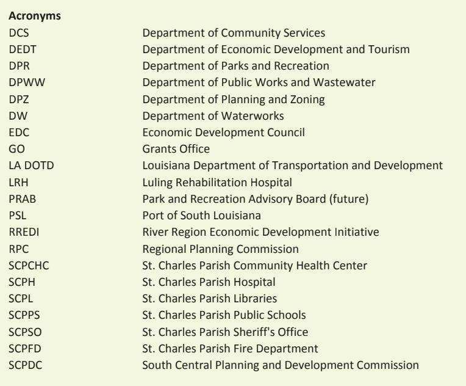

## Page 173

**Table 11: Table IMP-1: Action Plan**

| ECONOMIC DEVELOPMENT ELEMENT Economic Development Actions and Timeframe for Completion | Action Type | Lead |
|---|---|---|
| Immediate |  |  |
| 1.3 Continue the Parish's participation in ongoing Business Retention and Expansion programs with its economic development allies. | PARTNERSHIP | DEDT |
| Create an annual local industry survey. | PLANNING | DEDT, EDC |
| Consider new public/private partnerships or organizations to provide oversight and coordination of economic development initiatives related to the Parish's core industries. | PARTNERSHIP | DEDT, EDC |
| 2.2 Work with property owners to develop a coordinated strategy to position and market employment and mixed use activity centers. | PLANNING, PROGRAM | DEDT, PSL, EDC |
| 4.2 Work with the German Coast Farmers Market to inform residents about community-wide public health benefits created by the production, availability, access to, and consumption of local food. | PROGRAM | DEDT |
| 4.3 Endorse and promote opportunities to tap into the trend toward high-value “local food” preferences: | PROGRAM | DEDT |
| Market to restaurants and food markets in Jefferson and Orleans Parishes. | PLANNING, PROGRAM |  |
| Support the adoption of programs such as Community Supported Agriculture. | PROGRAM |  |
| Support local retail farmers' markets on both river banks. | PROGRAM |  |
| Develop an agricultural incubator in coordination with educational institutions such as LSU, the South Central Louisiana Technical College, Delgado Technical College, etc., complementing the existing Food Technology Business Incubator. | PROGRAM, PARTNERSHIP |  |
| 6.3 Develop a comprehensive life-skills training program to develop job readiness skills for clients seeking assistance through the Department of Community Services. | PROGRAM | DCS |
| 8.2 Brand and market the Parish with a recognizable brand theme and image, capitalizing on the community's natural advantages: its location, proximity to urban centers, superior public education, natural setting and quality of life. | PLANNING, PROGRAM | DEDT, EDC |
| Determine the need for/value of a local tourism/visitor attraction program. | PROGRAM | DEDT |
| Short Term |  |  |
| 2.1 Perform a visual character evaluation and identify actions to improve the appearance of Airline Highway in St. Rose, between I-310 and the Parish line. | PLANNING, REGULATION | DPZ |
| 5.3 Accommodate and facilitate starting and operating small home-based businesses, including permitting “live-work” residences within new mixed-use zoning districts and modifying regulations that allow home occupations within appropriate residential zoning districts. | REGULATION | DPZ |
| Consider adding “bed & breakfast” lodgings as a use encouraged zoning districts corresponding to residential mixed-use or planned communities (with limitations on location and scale); general and neighborhood commercial districts; and mixed use activity centers and corridors. | REGULATION | DPZ |
| Eliminate or modify regulations that may impede the re-use of qualified structures for this type of use. | REGULATION | DPZ |
| Mid-Term |  |  |
| 1.2 Assist existing core industries in implementing strategies to develop appropriate complementary uses in large buffer areas, such as adoption of Buffer Zone Retrofit Plans. | PLANNING, PARTNERSHIP | DPZ |
| 3.2 Target the following core industry sectors: Alternate and Renewable Energy; Micro-Manufacturing; Petrochemical and Plastics; Trade, Logistics, and Distribution. | PLANNING, PROGRAM, PARTNERSHIP | DEDT, EDC |
| 3.3 Explore and support additional industries which offer significant job opportunities, quality of life benefits, and growth potential: Food Processing, Tourism, Entertainment, and Healthcare and Medical Services. | PLANNING | DEDT, EDC |
| 3.4 Establish the Parish as a “go-to” resource for expertise in the areas of Emergency Planning, Disaster Recovery, Coastal Zone Management, and education for riverine and maritime industries. | PROGRAM |  |
| 5.1 Develop support structures and resources to support small business start-ups, including additional business incubators, local school and technical training partnerships, and local revolving or micro-loan programs. | PLANNING, PROGRAM | DEDT |
| 5.4 Encourage the development of local tourism oriented to sportsmen, eco-tourism and cultural / historic tourism. | PROGRAM | DEDT |
Table snapshot (for checking): 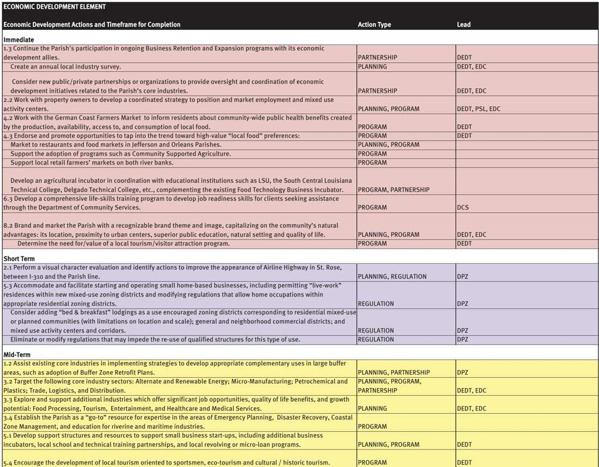

## Page 174

**Table 12** (rebuilt from the PDF text layer; 14 rows)

**Economic Development Actions and Timeframe for Completion**

| Timeframe | Action | Action Type | Lead |
|---|---|---|---|
|  | Develop a market for navigable waterway-based business activities, such as fishing and sightseeing. | REGULATION | DEDT, DPZ |
|  | Work with neighboring Parishes and municipalities to enhance and model the levee trails as “Regional Heritage Greenways,” tying together the region’s historic and cultural attractions. | PARTNERSHIP | DEDT, DPZ |
|  | 7.1 Expedite the construction of the planned West Bank Hurricane Protection Levee. | CAPITAL INVESTMENT, PARTNERSHIP | COUNCIL |
|  | 7.3 Prepare a long-term master plan, with associated implementation and funding strategy to remediate the problem of stormwater infiltration into the sewage collection network (Ref. Infrastructure Element). | PLANNING, CAPITAL INVESTMENT | DPWW |
| Long-Term | 9.2 Promote re-investment in mixed use development in transitional areas and those identified as potential mixed use activitREGULATION, PROGRAM          DEDT, DPZ 7.2 Facilitate/expedite the construction of key planned or proposed roadway links, as shown in the Future Transportation Network map (Ref. Transportation Element). | CAPITAL INVESTMENT, PARTNERSHIP | LA DOTD |
| Ongoing | 1.1 Coordinate with economic development allies efforts to recruit to the Parish industries and services and business that are secondary or ancillary to the core industries . Encourage them to locate within Employment areas identified on the FLUM. | PARTNERSHIP | DEDT, PSL/RREDI, DPZ |
| Ongoing | 1.4 Coordinate with the LA Workforce Commission to ensure the continued availability of a trained workforce to meet the needs of local employers. | PLANNING, PROGRAM | DEDT |
| Ongoing | 3.1 Selectively target marketing resource to those clusters of industries in which the Parish has certain natural advantages. | PROGRAM | DEDT |
| Ongoing | 4.1Support the development of innovations in existing agriculture and aquaculture, such as the use of biomass from sugarcane for fuel production. | PROGRAM | DEDT |
| Ongoing | 5.2 Continue efforts to disseminate information about technical assistance and funding resources available in the Southeast Louisiana region (SCPDC, SBDC, RLC, SCORE). | PROGRAM | DEDT |
| Ongoing | 6.1 Encourage coordination between the Louisiana Technical College - River Parishes Campus and the leadership of industrial recruitment initiatives to develop programs to train a local workforce. | PARTNERSHIP | DEDT |
| Ongoing | 6.2 Encourage coordination between St. Charles Parish Public Schools and the Gulf Coast Process Technology Alliance (GCPTA)4 to guide students interested in being trained for positions in the local petro-chemical industries. | PARTNERSHIP | DEDT, SCPPS |
| Ongoing | 8.1 Continue to maintain a detailed inventory of potential economic development/employment sites | PLANNING, PROGRAM | DEDT, DPZ |
| Ongoing | 9.1 Prioritize targeted code enforcement efforts and hardship assistance to areas experiencing minor deterioration as a means to stabilize the area and stem further decline. (ref. CC Action 2.1). | REGULATION | DPZ |

Table snapshot (for checking): 

## Page 175

**Table 13** (rebuilt from the PDF text layer; 14 rows)

**Land Use Actions and Timeframe for Completion**

| Timeframe | Action | Action Type | Lead |
|---|---|---|---|
| Immediate | Implement the following zoning changes: 1.1 Create Regional Activity Center, Mixed Use Corridor, and Civic/Town Center Overlay Zoning Districts. Prepare area plans for those that cover areas referenced in Action CC 2.5. | REGULATION | (SOME PLANNING)   DPZ |
| Immediate | 1.2 Review and broaded the existing R-1A, R-1B, R-2 and R-3 (residential) districts to accommodate multiple housing types, as may be appropriate. | REGULATION | DPZ |
| Immediate | 1.3 Create a new Residential/Mixed Use zoning district (or Planned Development overlay) consistent with the FLUM and corresponding land use category. | REGULATION | DPZ |
| Immediate | 1.4 Create a new Business Park zoning district consistent with the FLUM. | REGULATION | DPZ |
| Immediate | 1.5 Review uses permitted in the existing B-1 (batture) zoning district to ensure consistency with the Riverfront Commercial Land Use category. Review the Zoning Map to ensure that existing B-1 and B-2 zoning districts are compatible with adjacent uses, and consistent with the long-term anticipated character of those areas. | REGULATION | DPZ |
| Immediate | 1.6 Review, strengthen and adjust the list of permitted uses in the existing C-1, C-2, and C-3 (commercial) districts to be consistent with the intent of the General Commercial and Neighborhood Commercial future land use categories. | REGULATION | DPZ |
| Immediate | 2.1 Review uses permitted in the O-L, R-1A(M) and M-1, as well as any other zoning districts that support agricultural activities, to ensure they promote and facilitate the preservation of productive farmland. | REGULATION | DPZ |
| Immediate | 2.2 Revise Zoning to consider the needs of farm operations in the zoning standards (e.g. increased lot coverage, housing for agricultural labor, and reduced front setbacks for agricultural uses in agriculture-friendly zoning districts). | REGULATION | DPZ |
| Immediate | 3.1 Review existing zoning districts for consistency with Table LU-3. Simplify and modernize the current zoning classification, consolidating overlapping districts, and eliminating districts that may be rendered unnecessary by the application of other policies in this Plan (e.g., MS and H zoning districts). | REGULATION | DPZ |
| Immediate | 1.9 Prepare, adopt, and implement a CIP to ensure that infrastructure and facility expansion or upgrade is concurrent with the pace of development (See Infrastructure Element). | PLANNING | PARISH ADMINISTRATION, DEPARTMENT HEADS |
| Short-Term | 2.4 Promote and facilitate the establishment of agri-tourism, community supported agriculture (CSAs), farm stands and farm markets, greenhouse operations, equine operations, and accessory farm businesses. Support the development of agricultural management practices for these activities, as needed, to reduce Right-to-Farm conflicts and incompatibilities. | PLANNING, REGULATION | DPZ, DEDT |
| Short-Term | 3.3 Adopt regulatory incentives to attract and retain small/locally-owned business. | REGULATION | DPZ, PLANNING COMMISSION |
| Short-Term | 4.2 Remove or adjust inadvertent impediments to sustainable development (e.g. existing restrictions on uses, or dimensional standards) that may prevent the use of renewable energy production technologies; or regulations that allow or encourage excessive impervious coverage. | REGULATION | DPZ |
| Short-Term | 4.3 Identify and incorporate possible incentives for the application of sustainable development practices in new development and retrofits. | REGULATION | DPZ |

Table snapshot (for checking): 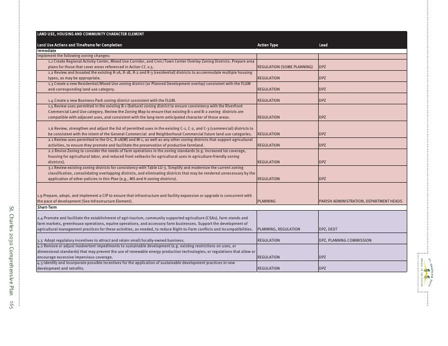

## Page 176

**Table 14** (rebuilt from the PDF text layer; 8 rows)

**Land Use Actions and Timeframe for Completion**

| Timeframe | Action | Action Type | Lead |
|---|---|---|---|
| Mid-Term | 1.7 Incentivize landowners (e.g. using a preferential tax assessment) to voluntarily reserve land for long-term commercial and employment uses, consistent with the FLUM. | REGULATION, PROGRAM | DPZ, DEDT |
| Mid-Term | 2.3 Support opportunities for on-farm energy production techniques (e.g., methane, wind, solar, and other forms of power) as a way to enhance economic viability. | PLANNING, REGULATION | DPZ, DEDT |
| Ongoing | 1.8 Monitor the levels of development according to land use type, to periodically adjust estimates of future land demand and amend the FLUM as appropriate. | PROGRAM | DPZ |
| Ongoing | 1.10 Ensure consistency of plans, land divisions, re-zonings or development proposals with the intent of the FLUM or the Comprehensive Plan’s policies. | REGULATION | DPZ, PLANNING COMMISSION, PARISH COUNCIL |
| Ongoing | 2.5 Protect and enhance agricultural infrastructure, including but not limited to capital investments. | PROGRAM, CAPITAL INVESTMENT | PARISH ADMINISTRATION, PARISH COUNCIL |
| Ongoing | 3.2 Increase the transparency, predictability and consistency of the development approval process. | REGULATION, PROGRAM | DPZ, DEDT |
| Ongoing | 4.1 Encourage developers and builders to use sustainable land development practices such as low-impact development, deconstruction3 and adaptive reuse to reduce costs, waste, and environmental impacts. | REGULATION | DPZ |
| Ongoing | 4.4 Encourage maximum protection of wetlands in all development. | REGULATION | DPZ |

Table snapshot (for checking): 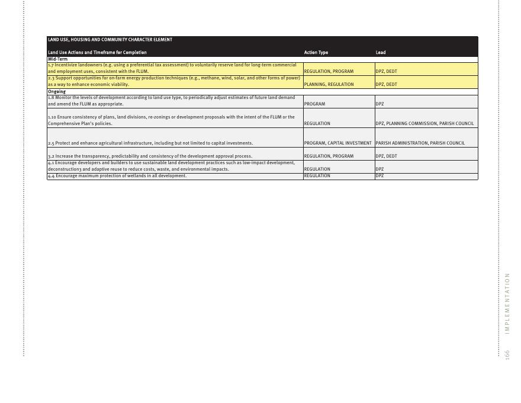

## Page 177

**Table 15** (rebuilt from the PDF text layer; 21 rows)

**Housing Actions and Timeframe for Completion**

| Timeframe | Action | Action Type | Lead |
|---|---|---|---|
| Immediate | 1.1 Adopt Accessory Unit regulations applicable to existing residential zoning districts to facilitate the provision of legal accessory units. These types of units offer an alternative form housing for families with aging parents, among others. | PLANNING, REGULATION | DPZ |
| Immediate | 1.2 Identify opportunities to provide workforce and alternative housing in appropriate locations compatible with zoning and the character of existing neighborhoods. Ensure equitable Parish-wide distribution. | REGULATION | DPZ |
| Immediate | Encourage apartments above stores in residential/mixed use projects. | REGULATION | DPZ |
| Immediate | Consider requiring the provision of workforce housing in redevelopment projects which replace obsolescent commercial development in Overlay Mixed-Use districts. | REGULATION | DPZ |
| Immediate | 1.5 Promote mixing of various types of housing (e.g. single family detached and attached homes) in mixed- residential developments (consistent with the FLUM). | REGULATION, PROGRAM | DPZ |
| Immediate | 3.1 Introduce or revise the following as Subdivision Regulations to improve the functionality and visual character of new subdivisions: | REGULATION | DPZ |
| Immediate | Consider pedestrian, bike path and roadway connectivity between housing, shopping and work places. | REGULATION, PROGRAM | DPZ, DEDT |
| Immediate | Develop and adopt a tree ordinance requiring the planting of street trees in new residential communities, with an approved tree list and standards for spacing and maintenance. | REGULATION | DPZ, PLANNING COMMISSION |
| Immediate | Limit the maximum length of blocks to between 500 and 1,000 feet. | REGULATION | DPZ |
| Immediate | Disallow cul-de-sacs, or at least limit their number and length. | REGULATION | DPZ |
| Immediate | Specify appropriate types of locations, necessary degree of accessibility to, and required amounts of land for public amenities and facilities such as schools, parks, playgrounds, open space, pedestrian paths and bicycle trails. | REGULATION | DPZ |
| Immediate | Make sure that all dedicated public open space and recreation areas (except for environmental open space) provide direct access from public streets, are visible and easily accessible, have multiple points of entry, and are well buffered from moving vehicles. | REGULATION | DPZ |
| Immediate | Ensure that each phase of a phased development meet minimum requirements for open space and recreational areas. | REGULATION | DPZ |
| Immediate | Provide for the reservation of land for rights-of-way adequate to accommodate complete streets to enhance a Parish-wide mobility network (see Transportation Element). | PLANNING, PARTNERSHIP | DPZ in coordination with LA DODT, SCPDC, RPC |
| Short-Term | 1.3 Include standards for the integration of “scattered site” affordable housing units in subdivisions. | REGULATION | DPZ |
| Short-Term | 1.4 Evaluate the need to require the provision of affordable housing for future developments of a certain land area, number of units, or within a certain distance (3-5 miles, on or off-site) of the existing and future Parish’s employment centers (as identified in the FLUM) . | REGULATION | DPZ |
| Short-Term | 2.1 Implement guidelines to ensure the quality of new housing (livable community design, quality construction, energy efficiency, etc.). | PROGRAM | DPZ |
| Short-Term | 2.2 Require that the architectural design of different types of housing within the same community be consistent. | PLANNING | DPZ |
| Short-Term | 2.4 Identify resources to bring homes that do not initially qualify for existing programs up to Code. | PROGRAM, REGULATION | DCS, DPZ |
| Short-Term | 2.5 Allocate a targeted number of existing units for emergency placement for those in immediate need of housing. | REGULATION | DCS, DPZ |
| Short-Term | 2.7 Explore resources for the development of HUD 202 Senior Housing. | PLANNING, REGULATION | DCS, DPZ |

Table snapshot (for checking): 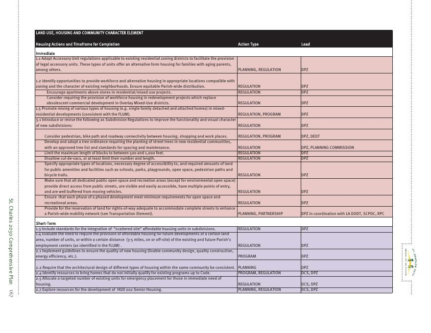

## Page 178

**Table 16** (rebuilt from the PDF text layer; 7 rows)

**Housing Actions and Timeframe for Completion**

| Timeframe | Action | Action Type | Lead |
|---|---|---|---|
|  | DCS, DPZ, PARISH ADMINISTRATION, PARISH 2.8 Develop a shelter/transitional living facility. | PROGRAM, CAPITAL INVESTMENT | COUNCIL |
|  | 4.2 Designate Neighborhood Conservation Areas (NCAs) or Neighborhood “Fight-Back” Areas (NFBAs) and establish conservation strategy. | PLANNING, PROGRAM, REGULATION | DPZ, DCS, SCPSO, Nonprofits |
|  | 4.3 Designate Neighborhood Revitalization Areas (NRAs) and establish revitalization strategies. | PLANNING, PROGRAM, REGULATION | DPZ, DCS, SCPSO, Nonprofits |
| Mid-Term | 2.6 Expand the development of affordable units through the use of USDA Rural Development Funds. | PLANNING, REGULATION | DCS, DPZ |
| Ongoing | 2.3 Continue to promote and provide affordable ownership opportunities for first-time homebuyers through assistance programs. | REGULATION | DCS |
| Ongoing | 4.1 Identify housing tools, programs and potential funding sources for rehabilitating, restoring and repairing existing deteriorated housing. Examples of possible tools include creating a Housing Finance and Community Development Department, Community Development Corporation, and/or a Parish Housing Council. | PROGRAM | DCS, DPZ |
| Ongoing | 4.4 Research resources for community revitalization through federally-funded home renovation programs in targeted neighborhoods. | PROGRAM | DCS, DPZ |

Table snapshot (for checking): 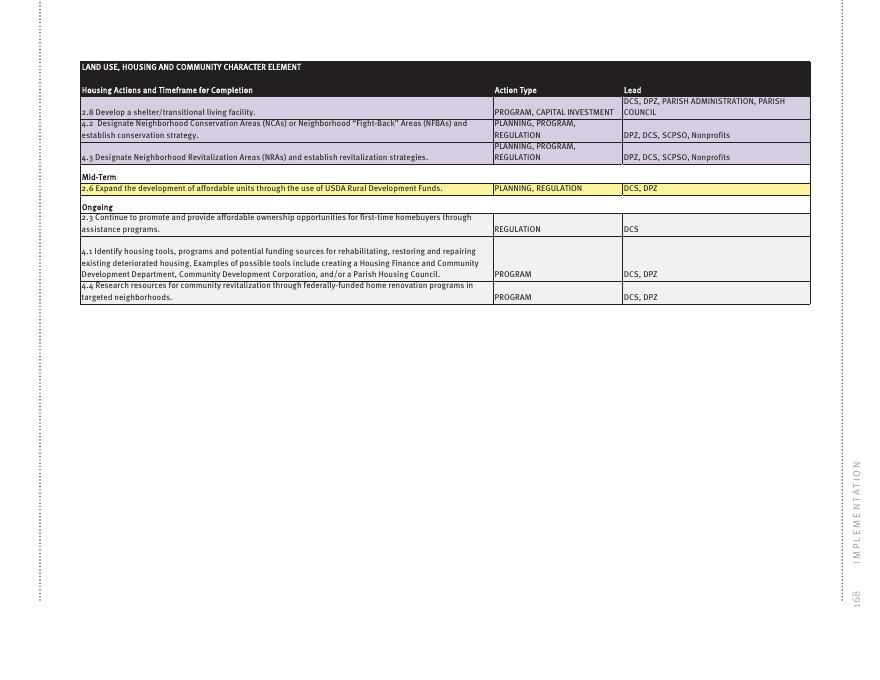

## Page 179

**Table 17** (rebuilt from the PDF text layer; 13 rows)

**Community Character Actions and Timeframe for Completion**

| Timeframe | Action | Action Type | Lead |
|---|---|---|---|
| Immediate | 1.1 Create and adopt special development standards and design guidelines for Overlay Zoning districts (LU Action 1.1). | REGULATION | DPZ |
| Immediate | 1.2 Adjust zoning requirements for commercial development to be consistent with the corresponding land use district character (FLUM).                                                                                                                       REGULATION 1.3 Adopt building design guidelines to improve the aesthetics of commercial development (building massing, parking/building relationship, façade appearance, materials, site lighting, signage). | REGULATION | DPZ |
| Immediate | 1.5 Develop a business park master plan campus overlay or zoning district with complementary uses and appriopiate development and design standards for cohesive architectural style. | REGULATION | DPZ |
| Immediate | 1.4 Review and revise transitional buffer standards for the R-3, CR-1, C-1, C-2, C-3, M-1, and M-2 zoning districts. | REGULATION | DPZ |
| Immediate | 1.6 Revise existing standards for industrial development to include criteria for the provision of minimal landscaping and open space; open storage screening; on-site employee and truck parking; loading, maneuvering and storage. | REGULATION | DPZ |
| Immediate | 1.7 Study, plan and establish Highway Corridor Character Districts, with specific provisions for landscaping, signage, architectural character, parking, access management and bicycle / pedestrian accommodations for: I-310; portions of U.S.-90 not covered by MUCD overlays; LA 3127, or portions thereof; LA 18 and LA 48; LA 631; and Airline Highway, or portions thereof. PLANNING/REGULATION   DPZ 2.3 Evaluate re-submitting a application to the HUD/DOT Planning Challenge Grant program, if continued, for the revitalization of the Paul Maillard Road Mixed Use Corridor. (Also consider alternative assistance, such as EPA’s Smart Growth Implementation Assistance program). | PROGRAM | DPZ, GO |
| Short-Term | 2.1 Apply a targeted code enforcement strategy to areas where simple private investment in upgrades, repair and maintenance will stem further deterioration. | REGULATION | DPZ |
| Short-Term | 3.2 Encourage planners of new residential/ mixed use communities to establish “neighborohod commercial nodes” at central locations (consistent with the FLUM). | REGULATION, PROGRAM | DPZ |
| Short-Term | 3.3 Adopt development standards to encourage the horizontal and vertical mixed use development. | PLANNING, REGULATION, PROGRAM | DPZ |
| Short-Term | 6.2 Review and adjust existing open space dedication standards to include a separate definition for environmental open space set-asides or fee-in-lieu, to ensure the protection of floodplains, wetlands, and other environmentally sensitive resource areas.                    DPZ 2.6 Remove regulatory impediments that may exist for infill and redevelopment projects, including parking, storm water, setback or other site requirements that older sites may not be able to meet. | PLANNING | DPZ |
| Mid-Term | 6.3 Consider provisions for cluster/conservation subdivision design, to encourage the protection of sensitive environmental resources, to reduce storm vulnerability, and to maximize hazard resiliency.                                                                         DPZ 2.5 Prepare sector or focal plans for areas suited for a targeted planning approach (e.g. Elkinsville, Killona). | PLANNING | DPZ |
| Mid-Term | 2.7 Adopt incentives for infill and redevelopment projects. | PLANNING | DPZ |
| Mid-Term | 3.1 Provide incentives for the introduction of neighborhood businesses and services into underserved neighborhoods. | REGULATION | DPZ |
| | 5.3 Improve road drainage in locations where storm water accumulations impact visual character as well as safety.                                    DPZ | | |

Table snapshot (for checking): 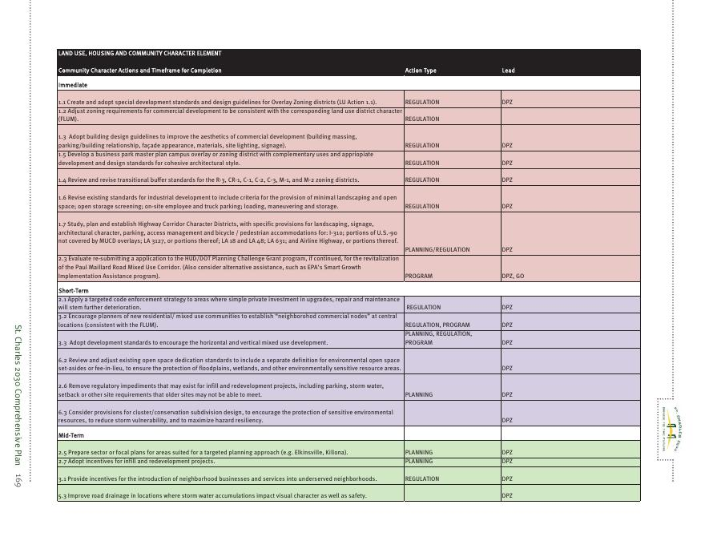

## Page 180

**Table 18** (rebuilt from the PDF text layer; 4 rows)

**Community Character Actions and Timeframe for Completion**

| Timeframe | Action | Action Type | Lead |
|---|---|---|---|
|  | 6.1 Identify, map, and designate components of a permanently preserved open space system that provides a diversity of publicly accessible resources in the form greenways, parks, blueways, and other natural areas. | PLANNING, REGULATION, PROGRAM | DPZ |
|  | 2.4 Identify public funds to invest in targeted areas and sites for the purposes of land assembly and clearance, developer solicitation and selection, and construction of capital improvements (infrastructure upgrades, streetscape improvements, etc.). | PLANNING | DPZ, DECT |
| Ongoing | 5.2 Study the feasibility of and potential funding sources for removing overhead utilities that detract from the quality of the community’s visual character and may even pose potential safety problems in selected locations, such as narrow rights of way of mixed-use corridors and activity centers.                                                                                                              PARISH ADMINISTRATION, DPZ 4.1 Continue to make landscaping, lighting, signage, streetscape and public art improvements to highly visible locations in the Parish, such as gateway entrances, major corridors, public buildings and grounds, and parks.                                                              DPZ 2.2 Conduct and maintain a Parish-wide inventory of potential infill/redevelopment sites. | PROGRAM | DPZ, DEDT |
| Ongoing | 4.2 Establish a high standard of design quality in new public improvement projects (buildings, landscapes, and infrastructure).                           PARISH ADMINISTRATION DPR, DCS, SCPSO, Neighborhood and Civic 5.1 Promote neighborhood and business participation in community clean-ups (roads, parks, waterfront lands, etc.). | PROGRAM, PARTNERSHIP | Organizations |

Table snapshot (for checking): 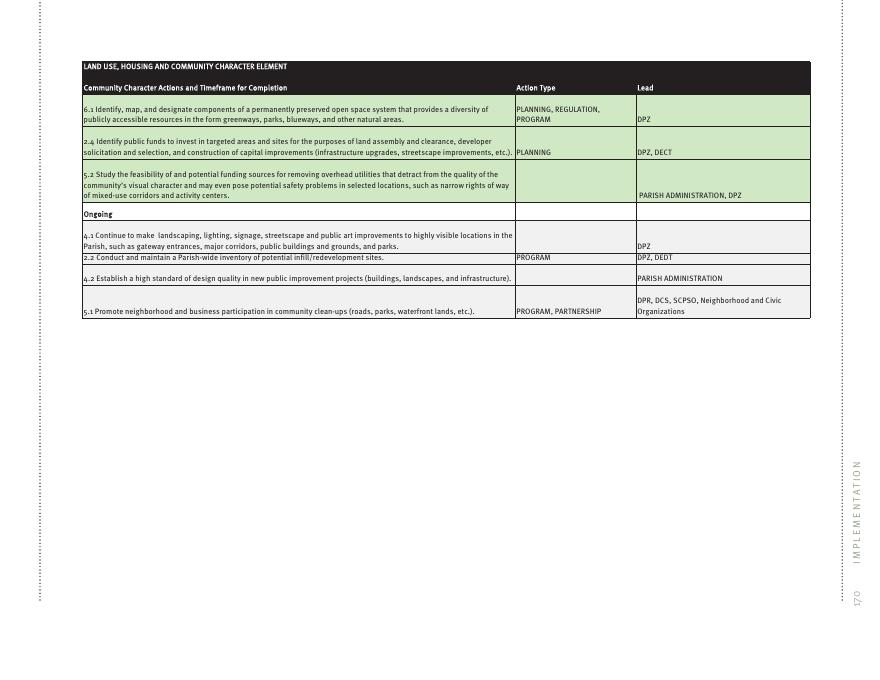

## Page 181

**Table 19** (rebuilt from the PDF text layer; 19 rows)

**Transportation Actions and Timeframe for Completion**

| Timeframe | Action | Action Type | Lead |
|---|---|---|---|
| Immediate | 2.4 Revise the Subdivision Regulations and Zoning Ordinance to include standards for collector road spacing; curb cut and driveway spacing; limitations on cul-de-sacs; traffic calming; shared parking and shared driveways (non-residential). | REGULATION | DPZ, SCPFD |
| Immediate | 3.1 Require that residential/mixed use and other mixed use development types include sidewalks and bike paths on one or both sides of a street. | REGULATION | DPZ |
| Immediate | 7.1 Ensure that zoning and other Parish regulations are consistent with applicable noise contours and FAA restrictions on development height, and uses in vicinity of the flight path. | REGULATION | DPZ |
| Immediate | 1.1 Designate a point of contact to serve as liaison to LA DOTD, SCPDC, and RPC for all transportation projects involving or affecting the Parish. | PLANNING, PARTNERSHIP, CAPITAL INVESTMENT | PARISH ADMINISTRATION, PARISH COUNCIL |
| Short-Term | 2.3 Adopt a Roadway Connectivity Index applicable to residential subdivisions and residential/mixed-use communities. | REGULATION | DPZ |
| Short-Term | 3.3 Develop a manual of “complete street” profiles based on roadway classification, including maximum right-of-way width; pavement width; travel lanes; sidewalks; parking (if applicable); bike lanes; planters; and utility strips. | PLANNING, PARTNERSHIP | DPZ, DPW, SCPFD, LA DOTD, SCPDC, RPC |
| Short-Term | DPZ, GO, DPR, SCPSO, LA DOTD, SCPDC, RPC, 3.4 Identify needs and funding sources for high priority pedestrian and bicycle facilities . | PLANNING, PARTNERSHIP, PROGRAM, CAPITAL INVESTMENT | SCPPS |
| Short-Term | Develop ranking sytem to prioritize needs for new or reconstructed sidewalks in areas surrounding schools and parks. | PLANNING | DPZ, DPR, SCPSO, SCPPS |
| Short-Term | Apply for funding of priority improvements through the Louisiana Safe Routes to School (SRTS) Program and/or the Recreation Trails Program. | PROGRAM | DPZ, GO, DPR, SCPPS |
| Short-Term | Consider the creation of a dedicated funding source to augment grant funds to build high priority sidewalks and other pedestrian and bicycle facilities. | CAPITAL INVESTMENT | PARISH COUNCIL |
| Mid-Term | 3.5 Leverage the levee trails to enhance local and regional bicycle and pedestrian mobility. | PLANNING | DPZ, DEDT, DPR, RPC |
| Mid-Term | Build connections between the proposed future bicycle and pedestrian facilities and the existing levee trails | PLANNING, CAPITAL INVESTMENT | DPR, DPW, |
| Mid-Term | Work with regional partners to use the levee trails as "Regional Heritage Greenways" with linkages to historic and cultural attractions | PLANNING, PARTNERSHIP | DEDT, DPZ |
| Mid-Term | 6.4 Ensure that noise and safety impacts on land uses adjacent to the rail line are minimized and mitigated. | PLANNING | DPZ |
| Mid-Term | 7.2 Review existing land uses and current zoning surrounding the Ama Airport (FAA- LS-40) to ensure land use compatibility. Coordinate with the FAA to ensure compliance with FAA regulations for private airport operations. | PLANNING, REGULATION | DPZ |
| Mid-Term | 1.3 Work with LA DOTD, the SCPDC and RPC to identify, plan for, design, seek funding, and expedite construction of additional roadways links and improvements identified in Figure TR-7. | PLANNING | DPZ |
| Mid-Term | 1.4 Document the need for additional railroad crossings (Figure TR-8) to improve roadway network connectivity. | PLANNING, PARTNERSHIP, CAPITAL INVESTMENT | PARISH ADMINISTRATION, DPZ |
| Mid-Term | 6.5 Maintain a Railroad Crossing Existing Conditions inventory, to use in negotiating future crossings and consolidations of existing crossings. | PLANNING | DPZ |
| Mid-Term | 1.5 Establish protocols to negotiate the approval and expedite the construction of new crossings with the railroad companies involved. | PLANNING, REGULATION | DPZ, DPWW, SCPFD |

Table snapshot (for checking): 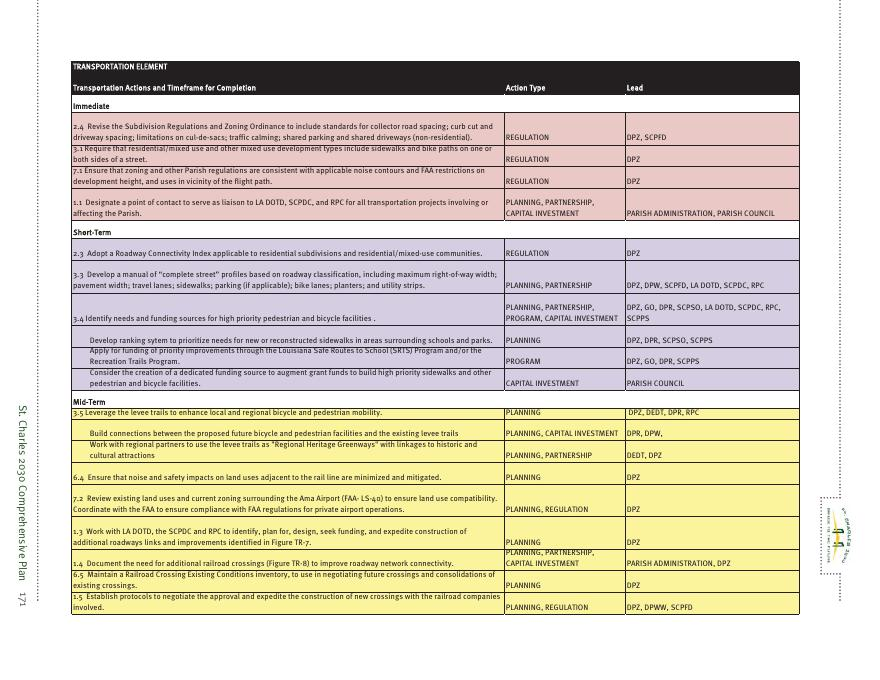

## Page 182

**Table 20** (rebuilt from the PDF text layer; 12 rows)

**Transportation Actions and Timeframe for Completion**

| Timeframe | Action | Action Type | Lead |
|---|---|---|---|
| Long-Term | 2.5 Explore adopting an Adequate Public Facilities Ordinance to mitigate potential impacts of large scale new development on the local road network and other public facilities. | REGULATION | DPZ |
| Ongoing | 2.1 In reviewing development applications, identify the need to retain rights-of-way for roadways depicted in Figure TR-7. | PLANNING, REGULATION | DPZ, SCPDC, LA DOTD, RPC, DPWW, SCPFD |
| Ongoing | 2.2 Enforce the existing requirement that new subdivisions be designed and built to promote minimum levels of connectivity (stub streets). | REGULATION | DPZ |
| Ongoing | 3.2 Work with LA DOTD to ensure future roads and retrofits are planned and design as "complete streets" . | PLANNING, PARTNERSHIP | PARISH ADMINISTRATION, DPZ, DPWW |
| Ongoing | 4.1 Continue to support the low-cost on-demand RPTA transit service. | PROGRAM, CAPITAL INVESTMENT | PARISH ADMINISTRATION |
| Ongoing | 4.2 Periodically review transit demand to determine the need for expansion. | PLANNING | PARISH ADMINISTRATION |
| Ongoing | 5.1 Coordinate land use regulations with the port facilities development plans and economic development initiative of the Port of South Louisiana . | PLANNING, REGULATION | DEDT, DPZ |
| Ongoing | 5.2 Coordinate with LA DOTD and the railroad companies to ensure that potential development sites by PSL have adequate multimodal access. | PLANNING, PARTNERSHIP | DEDT, DPZ, PSL |
| Ongoing | 6.1 Coordinate ground transportation and intermodal connection planning and improvements to support adequate freight rail transportation. | PLANNING | DEDT, DPZ |
| Ongoing | 6.2 Participate in explorations of passenger service as part of regional and statewide rail transportation planning efforts. | PLANNING, PARTNERSHIP | PARISH ADMINISTRATION |
| Ongoing | 6.3 Continue to strengthen the Parish government’s working relationship and communication with the existing railroad companies to ensure that the Parish has input into decisions about improvements involving rail capacity, speed, safety, etc. | PARTNERSHIP | PARISH ADMINISTRATION |
| Ongoing | 1.2 Lobby LA DOTD to implement targeted capacity improvements to major arterial corridors within the Parish. Prioritize and further study the need for additional improvements identified by the Parish for other corridors. | PLANNING, PARTNERSHIP, CAPITAL INVESTMENT | PARISH ADMINISTRATION, DPWW |

Table snapshot (for checking): 

## Page 183

**Table 21** (rebuilt from the PDF text layer; 20 rows)

**Infrastructure Actions and Timeframe for Completion**

| Timeframe | Action | Action Type | Lead |
|---|---|---|---|
| Immediate | 1.1.1 Devote more Parish resources to expedite the completion of the Capacity Management Operation and Maintenance Program (CMOM): | PROGRAM | DPWW |
| Immediate | 1.2.4 Adopt criteria for prioritizing funding to sewer-related capital improvement projects. | PLANNING | DPWW |
| Immediate | 1.2.2 Review Subdivision Regulation and Zoning standards related to the provision of sanitary sewer infrastructure, along with enforcement policies, to ensure that the acceptance of new development into the Parish’s wastewater system does not create new deficiencies. | REGULATION | DPZ, DPWW |
| Immediate | 2.1.7 Adopt criteria for prioritizing funding to water system-related capital improvement projects. | PLANNING | DW |
| Immediate | Increase Parish resource allocation or hire outside crews. | PLANNING | DW |
| Immediate | Complete field investigations within one year. | PLANNING | DW |
| Immediate | Complete report within six months of field investigations. | PLANNING | DW |
| Short-Term | 3.1.1 Expedite the acquisition of drainage information for the Urban Flood Control Project. As necessary to achieve this end, increase the resources devoted to this project (e.g., increase the number of Parish employees working on the project or hire outside assistance). | PLANNING, CAPITAL INVESTMENT | DPWW |
| Short-Term | 3.1.4 Adopt criteria for prioritizing funding of drainage-related capital improvement projects. | PLANNING | DPWW |
| Short-Term | 3.1.5 Develop strict enforcement protocols to ensure that existing development adheres to established drainage standards and regulations. As necessary, create new or strengthen the existing ordinance to allow department officials to enforce existing and future standards. (Ref. St. Charles Parish Code of Ordinances, Appendix C, Part IV, Section D for existing ordinance). | REGULATION | DPWW |
| Short-Term | 3.2.1 Meet the standards set by the latest LADOTD Hydraulics Manual. Adopt a Level of Service (LOS) standard based on the 100-year storm event for pumping stations and 20-year storm event for streets and roads, and use this storm design as the governing criteria for all future drainage repair or improvement projects. | PLANNING | DPWW |
| Short-Term | 1.2.3 Incorporate the population projections and future land use information from the 2030 Comprehensive Plan into the wastewater system model. This process will provide the basis for defining future improvements and additions to the wastewater network. | PLANNING | DPWW, DPZ |
| Short-Term | 4.1.7 Strengthen ordinances limiting development in high risk areas (i.e. outside of the hurricane flood protection levee and parish drainage systems). | REGULATION | DPZ |
| Short-Term | 2.2.3 Use interconnections, looping and valve configurations to minimize areas affected by major leaks. | CAPITAL INVESTMENT | DW |
| Short-Term | 2.1.2 Consider the Future Land Use Map in the planning of future water extensions, to support the desired land use pattern. | PLANNING | DW, DPZ |
| Short-Term | 4.1.2 Compile and provide information to state and federal government agencies demonstrating the vulnerability of St. Charles Parish to major storm events due to rainfall and heavy storm surge, to make the case for urgent action. | PLANNING | PARISH ADMINISTRATION |
| Mid-Term | 1.1.2 Develop a GIS based model of the wastewater system to identify the location and causes of deficiencies in the system. | PLANNING, CAPITAL INVESTMENT | DPWW |
| Mid-Term | 1.1.3 Develop a Master Wastewater Plan. | PLANNING, CAPITAL INVESTMENT | DPWW |
| Mid-Term | 1.1.4 Allocate sufficient resources (e.g. funding, employees, materials) to continue the maintenance program. | CAPITAL INVESTMENT, PROGRAM | DPWW |
| Mid-Term | 1.2.4 Include the foregoing population and land use demands into the Wastewater Master Plan (ref. INFR Action 1.1.3) and associated Capital Improvement Program. | PLANNING | DPWW, DPZ |

Table snapshot (for checking): 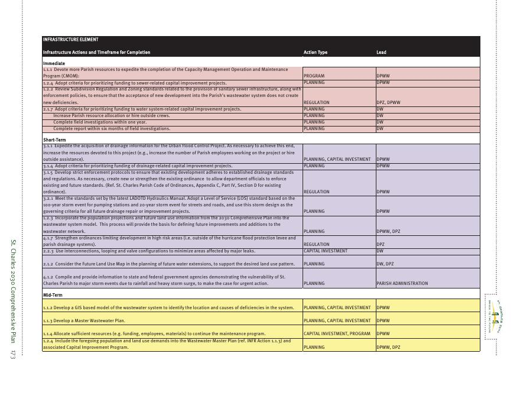

## Page 184

**Table 22** (rebuilt from the PDF text layer; 19 rows)

**Infrastructure Actions and Timeframe for Completion**

| Timeframe | Action | Action Type | Lead |
|---|---|---|---|
|  | 3.1.6 Require developers to perform both surface and subsurface impact studies from point of origin to final outfall beyond limits of proposed development before construction can begin. | REGULATION | DPWW, DPZ |
|  | 3.1.7 Establish new guidelines for converting open drainage to subsurface. Residents should perform a front foot assessment before placement of subsurface drainage on individual properties. When feasible, a holistic approach should be taken to converting open drainage to subsurface drainage in existing subdivisions. | REGULATION | DPWW, DPZ |
|  | 3.2.3 Consider enacting a “No Net Increase” drainage ordinance to address runoff created by new development. | REGULATION | DPWW, DPZ |
|  | 4.1.3 Evaluate and develop the interim protection plan for the Willowridge, Ellington, and Magnolia Ridge subdivisions while                                     DPWW, PARISH ADMINISTRATION, PARISH the Donaldsonville to the Gulf Levee is being evaluated by the Corps of Engineers. | PLANNING | COUNCIL |
|  | 4.1.4 Once determined if needed, press for the Willowridge, Ellington, and Magnolia Ridge levees to be placed under FEMA                                         DPWW, PARISH ADMINISTRATION, PARISH certification, based upon future developments in the Donaldsonville to the Gulf levee protection project. | PLANNING | COUNCIL |
|  | 4.2.1 Complete a comprehensive coastal management plan and, as appropriate, integrate it into the 2030 Comprehensive Plan. | PLANNING | DPZ |
|  | 3.2.6 Encourage regional stormwater and other creative stormwater drainage solutions. Incorporate concepts and strategies laid out in the Coastal Best Practices manual to manage water in a more holistic, natural manner, reducing the need for increased stormwater drainage infrastructure. | PLANNING | DPZ |
|  | 2.1.1 Implement a potable water Asset Management Program to promote better tracking, management, identification and scheduling of necessary facility upgrades and improvements. | PLANNING, PROGRAM | DW |
|  | 2.1.6 Revise and update a Potable Water Master Plan and associated Capital Improvement Program. | PLANNING, CAPITAL INVESTMENT | DW |
|  | 2.1.3 Study the feasibility of adopting a water system impact fee structure so that new developments pay not only for their direct impact but also for the incremental system-wide impact. | PLANNING | DW, PARISH ADMINISTRATION, PARISH COUNCIL |
| Long-Term | 1.2.1 Adopt a Level of Service (LOS) standard for sewer service, based on per capita or per household wastewater flows, type of land use, etc., to assist in determining an appropriate capacity to meet demand, making decisions about new development, and identifying necessary improvements. | PLANNING | DPWW |
| Long-Term | 3.1.2 Perform a hydraulic/hydrologic drainage model on the entire parish to identify and locate drainage deficiencies in the system. | PLANNING, CAPITAL INVESTMENT | DPWW |
| Long-Term | 3.1.3 Prepare a Master Drainage Plan and associated Capital Improvement Program. | PLANNING, CAPITAL INVESTMENT | DPWW |
| Long-Term | 3.2.4 Study the feasibility of a drainage system impact fee structure so that new developments pay not only for their direct                                     DPWW, PARISH ADMINISTRATION, PARISH impact but also for the incremental system-wide impact. | PLANNING | COUNCIL |
| Long-Term | 4.1.9 Ensure that all future levee protection projects are built to the latest Army Corps of Engineers standards to provide the                                  DPWW, PARISH ADMINISTRATION, PARISH best possible protection and resistance to major storm events. | PLANNING | COUNCIL |
| Long-Term | 2.1.5 Adopt a Level of Service (LOS) standard for water service, based on average daily water use, peak rate of demand, type of land use, etc., to assist in determining an appropriate capacity to meet demand, making decisions about new development, and identifying necessary improvements. | PLANNING | DW, DPZ |
| Ongoing | 1.1.5 Ensure that the sewer system always meets the latest health and safety guidelines | PLANNING | DPWW |
| Ongoing | 3.1.8 Continue to actively seek out sources of outside funding for drainage projects to ensure that all drainage projects are constructed in a timely manner | PLANNING | DPWW |
| Ongoing | 3.2.2 Periodically review and modernize design standards for drainage structures and outlets to reflect state-of-the-art, “low impact” and “green” best management practices. For example, require that new development retain a larger percentage of natural drainage features to avoid expensive structural solutions. | REGULATION | DPWW 174 |

Table snapshot (for checking): 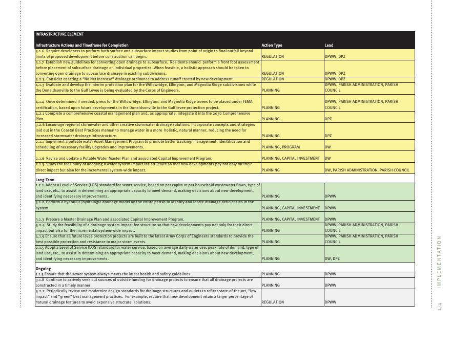

## Page 185

**Table 23** (rebuilt from the PDF text layer; 14 rows)

**Economic Development Actions and Timeframe for Completion**

| Timeframe | Action | Action Type | Lead |
|---|---|---|---|
|  | Develop a market for navigable waterway-based business activities, such as fishing and sightseeing. | REGULATION | DEDT, DPZ |
|  | Work with neighboring Parishes and municipalities to enhance and model the levee trails as “Regional Heritage Greenways,” tying together the region’s historic and cultural attractions. | PARTNERSHIP | DEDT, DPZ |
|  | 7.1 Expedite the construction of the planned West Bank Hurricane Protection Levee. | CAPITAL INVESTMENT, PARTNERSHIP | COUNCIL |
|  | 7.3 Prepare a long-term master plan, with associated implementation and funding strategy to remediate the problem of stormwater infiltration into the sewage collection network (Ref. Infrastructure Element). | PLANNING, CAPITAL INVESTMENT | DPWW |
| Long-Term | 9.2 Promote re-investment in mixed use development in transitional areas and those identified as potential mixed use activitREGULATION, PROGRAM          DEDT, DPZ 7.2 Facilitate/expedite the construction of key planned or proposed roadway links, as shown in the Future Transportation Network map (Ref. Transportation Element). | CAPITAL INVESTMENT, PARTNERSHIP | LA DOTD |
| Ongoing | 1.1 Coordinate with economic development allies efforts to recruit to the Parish industries and services and business that are secondary or ancillary to the core industries . Encourage them to locate within Employment areas identified on the FLUM. | PARTNERSHIP | DEDT, PSL/RREDI, DPZ |
| Ongoing | 1.4 Coordinate with the LA Workforce Commission to ensure the continued availability of a trained workforce to meet the needs of local employers. | PLANNING, PROGRAM | DEDT |
| Ongoing | 3.1 Selectively target marketing resource to those clusters of industries in which the Parish has certain natural advantages. | PROGRAM | DEDT |
| Ongoing | 4.1Support the development of innovations in existing agriculture and aquaculture, such as the use of biomass from sugarcane for fuel production. | PROGRAM | DEDT |
| Ongoing | 5.2 Continue efforts to disseminate information about technical assistance and funding resources available in the Southeast Louisiana region (SCPDC, SBDC, RLC, SCORE). | PROGRAM | DEDT |
| Ongoing | 6.1 Encourage coordination between the Louisiana Technical College - River Parishes Campus and the leadership of industrial recruitment initiatives to develop programs to train a local workforce. | PARTNERSHIP | DEDT |
| Ongoing | 6.2 Encourage coordination between St. Charles Parish Public Schools and the Gulf Coast Process Technology Alliance (GCPTA)4 to guide students interested in being trained for positions in the local petro-chemical industries. | PARTNERSHIP | DEDT, SCPPS |
| Ongoing | 8.1 Continue to maintain a detailed inventory of potential economic development/employment sites | PLANNING, PROGRAM | DEDT, DPZ |
| Ongoing | 9.1 Prioritize targeted code enforcement efforts and hardship assistance to areas experiencing minor deterioration as a means to stabilize the area and stem further decline. (ref. CC Action 2.1). | REGULATION | DPZ |

Table snapshot (for checking): 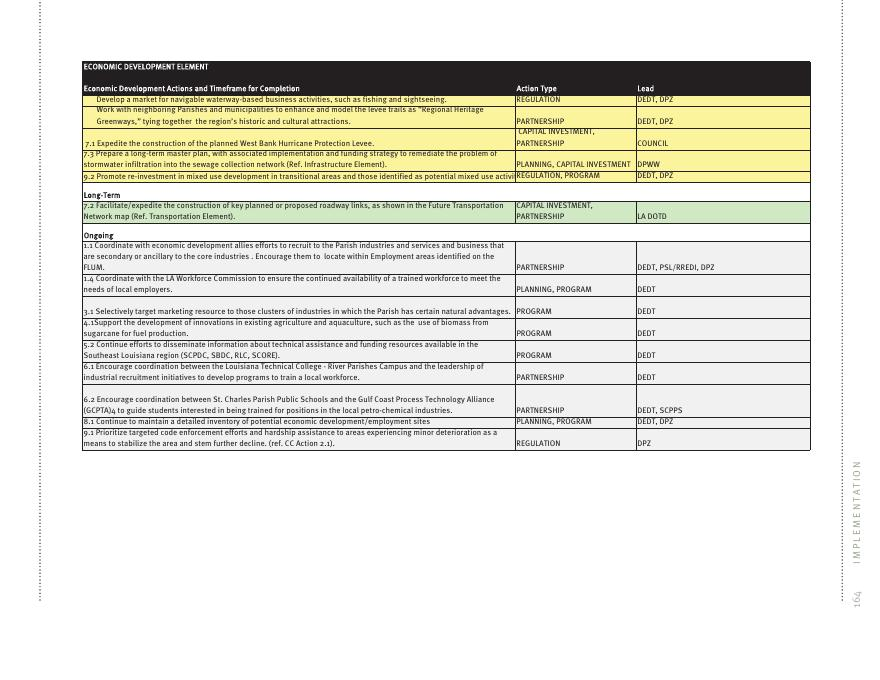

## Page 186

**Table 24** (rebuilt from the PDF text layer; 8 rows)

**Land Use Actions and Timeframe for Completion**

| Timeframe | Action | Action Type | Lead |
|---|---|---|---|
| Mid-Term | 1.7 Incentivize landowners (e.g. using a preferential tax assessment) to voluntarily reserve land for long-term commercial and employment uses, consistent with the FLUM. | REGULATION, PROGRAM | DPZ, DEDT |
| Mid-Term | 2.3 Support opportunities for on-farm energy production techniques (e.g., methane, wind, solar, and other forms of power) as a way to enhance economic viability. | PLANNING, REGULATION | DPZ, DEDT |
| Ongoing | 1.8 Monitor the levels of development according to land use type, to periodically adjust estimates of future land demand and amend the FLUM as appropriate. | PROGRAM | DPZ |
| Ongoing | 1.10 Ensure consistency of plans, land divisions, re-zonings or development proposals with the intent of the FLUM or the Comprehensive Plan’s policies. | REGULATION | DPZ, PLANNING COMMISSION, PARISH COUNCIL |
| Ongoing | 2.5 Protect and enhance agricultural infrastructure, including but not limited to capital investments. | PROGRAM, CAPITAL INVESTMENT | PARISH ADMINISTRATION, PARISH COUNCIL |
| Ongoing | 3.2 Increase the transparency, predictability and consistency of the development approval process. | REGULATION, PROGRAM | DPZ, DEDT |
| Ongoing | 4.1 Encourage developers and builders to use sustainable land development practices such as low-impact development, deconstruction3 and adaptive reuse to reduce costs, waste, and environmental impacts. | REGULATION | DPZ |
| Ongoing | 4.4 Encourage maximum protection of wetlands in all development. | REGULATION | DPZ |

Table snapshot (for checking): 

## Page 187

**Table 25** (rebuilt from the PDF text layer; 7 rows)

**Housing Actions and Timeframe for Completion**

| Timeframe | Action | Action Type | Lead |
|---|---|---|---|
|  | DCS, DPZ, PARISH ADMINISTRATION, PARISH 2.8 Develop a shelter/transitional living facility. | PROGRAM, CAPITAL INVESTMENT | COUNCIL |
|  | 4.2 Designate Neighborhood Conservation Areas (NCAs) or Neighborhood “Fight-Back” Areas (NFBAs) and establish conservation strategy. | PLANNING, PROGRAM, REGULATION | DPZ, DCS, SCPSO, Nonprofits |
|  | 4.3 Designate Neighborhood Revitalization Areas (NRAs) and establish revitalization strategies. | PLANNING, PROGRAM, REGULATION | DPZ, DCS, SCPSO, Nonprofits |
| Mid-Term | 2.6 Expand the development of affordable units through the use of USDA Rural Development Funds. | PLANNING, REGULATION | DCS, DPZ |
| Ongoing | 2.3 Continue to promote and provide affordable ownership opportunities for first-time homebuyers through assistance programs. | REGULATION | DCS |
| Ongoing | 4.1 Identify housing tools, programs and potential funding sources for rehabilitating, restoring and repairing existing deteriorated housing. Examples of possible tools include creating a Housing Finance and Community Development Department, Community Development Corporation, and/or a Parish Housing Council. | PROGRAM | DCS, DPZ |
| Ongoing | 4.4 Research resources for community revitalization through federally-funded home renovation programs in targeted neighborhoods. | PROGRAM | DCS, DPZ |

Table snapshot (for checking): 

## Page 188

**Table 26** (rebuilt from the PDF text layer; 4 rows)

**Community Character Actions and Timeframe for Completion**

| Timeframe | Action | Action Type | Lead |
|---|---|---|---|
|  | 6.1 Identify, map, and designate components of a permanently preserved open space system that provides a diversity of publicly accessible resources in the form greenways, parks, blueways, and other natural areas. | PLANNING, REGULATION, PROGRAM | DPZ |
|  | 2.4 Identify public funds to invest in targeted areas and sites for the purposes of land assembly and clearance, developer solicitation and selection, and construction of capital improvements (infrastructure upgrades, streetscape improvements, etc.). | PLANNING | DPZ, DECT |
| Ongoing | 5.2 Study the feasibility of and potential funding sources for removing overhead utilities that detract from the quality of the community’s visual character and may even pose potential safety problems in selected locations, such as narrow rights of way of mixed-use corridors and activity centers.                                                                                                              PARISH ADMINISTRATION, DPZ 4.1 Continue to make landscaping, lighting, signage, streetscape and public art improvements to highly visible locations in the Parish, such as gateway entrances, major corridors, public buildings and grounds, and parks.                                                              DPZ 2.2 Conduct and maintain a Parish-wide inventory of potential infill/redevelopment sites. | PROGRAM | DPZ, DEDT |
| Ongoing | 4.2 Establish a high standard of design quality in new public improvement projects (buildings, landscapes, and infrastructure).                           PARISH ADMINISTRATION DPR, DCS, SCPSO, Neighborhood and Civic 5.1 Promote neighborhood and business participation in community clean-ups (roads, parks, waterfront lands, etc.). | PROGRAM, PARTNERSHIP | Organizations |

Table snapshot (for checking): 

## Page 189

**Table 27** (rebuilt from the PDF text layer; 12 rows)

**Transportation Actions and Timeframe for Completion**

| Timeframe | Action | Action Type | Lead |
|---|---|---|---|
| Long-Term | 2.5 Explore adopting an Adequate Public Facilities Ordinance to mitigate potential impacts of large scale new development on the local road network and other public facilities. | REGULATION | DPZ |
| Ongoing | 2.1 In reviewing development applications, identify the need to retain rights-of-way for roadways depicted in Figure TR-7. | PLANNING, REGULATION | DPZ, SCPDC, LA DOTD, RPC, DPWW, SCPFD |
| Ongoing | 2.2 Enforce the existing requirement that new subdivisions be designed and built to promote minimum levels of connectivity (stub streets). | REGULATION | DPZ |
| Ongoing | 3.2 Work with LA DOTD to ensure future roads and retrofits are planned and design as "complete streets" . | PLANNING, PARTNERSHIP | PARISH ADMINISTRATION, DPZ, DPWW |
| Ongoing | 4.1 Continue to support the low-cost on-demand RPTA transit service. | PROGRAM, CAPITAL INVESTMENT | PARISH ADMINISTRATION |
| Ongoing | 4.2 Periodically review transit demand to determine the need for expansion. | PLANNING | PARISH ADMINISTRATION |
| Ongoing | 5.1 Coordinate land use regulations with the port facilities development plans and economic development initiative of the Port of South Louisiana . | PLANNING, REGULATION | DEDT, DPZ |
| Ongoing | 5.2 Coordinate with LA DOTD and the railroad companies to ensure that potential development sites by PSL have adequate multimodal access. | PLANNING, PARTNERSHIP | DEDT, DPZ, PSL |
| Ongoing | 6.1 Coordinate ground transportation and intermodal connection planning and improvements to support adequate freight rail transportation. | PLANNING | DEDT, DPZ |
| Ongoing | 6.2 Participate in explorations of passenger service as part of regional and statewide rail transportation planning efforts. | PLANNING, PARTNERSHIP | PARISH ADMINISTRATION |
| Ongoing | 6.3 Continue to strengthen the Parish government’s working relationship and communication with the existing railroad companies to ensure that the Parish has input into decisions about improvements involving rail capacity, speed, safety, etc. | PARTNERSHIP | PARISH ADMINISTRATION |
| Ongoing | 1.2 Lobby LA DOTD to implement targeted capacity improvements to major arterial corridors within the Parish. Prioritize and further study the need for additional improvements identified by the Parish for other corridors. | PLANNING, PARTNERSHIP, CAPITAL INVESTMENT | PARISH ADMINISTRATION, DPWW |

Table snapshot (for checking): 

## Page 190

**Table 28** (rebuilt from the PDF text layer; 19 rows)

**Infrastructure Actions and Timeframe for Completion**

| Timeframe | Action | Action Type | Lead |
|---|---|---|---|
|  | 3.1.6 Require developers to perform both surface and subsurface impact studies from point of origin to final outfall beyond limits of proposed development before construction can begin. | REGULATION | DPWW, DPZ |
|  | 3.1.7 Establish new guidelines for converting open drainage to subsurface. Residents should perform a front foot assessment before placement of subsurface drainage on individual properties. When feasible, a holistic approach should be taken to converting open drainage to subsurface drainage in existing subdivisions. | REGULATION | DPWW, DPZ |
|  | 3.2.3 Consider enacting a “No Net Increase” drainage ordinance to address runoff created by new development. | REGULATION | DPWW, DPZ |
|  | 4.1.3 Evaluate and develop the interim protection plan for the Willowridge, Ellington, and Magnolia Ridge subdivisions while                                     DPWW, PARISH ADMINISTRATION, PARISH the Donaldsonville to the Gulf Levee is being evaluated by the Corps of Engineers. | PLANNING | COUNCIL |
|  | 4.1.4 Once determined if needed, press for the Willowridge, Ellington, and Magnolia Ridge levees to be placed under FEMA                                         DPWW, PARISH ADMINISTRATION, PARISH certification, based upon future developments in the Donaldsonville to the Gulf levee protection project. | PLANNING | COUNCIL |
|  | 4.2.1 Complete a comprehensive coastal management plan and, as appropriate, integrate it into the 2030 Comprehensive Plan. | PLANNING | DPZ |
|  | 3.2.6 Encourage regional stormwater and other creative stormwater drainage solutions. Incorporate concepts and strategies laid out in the Coastal Best Practices manual to manage water in a more holistic, natural manner, reducing the need for increased stormwater drainage infrastructure. | PLANNING | DPZ |
|  | 2.1.1 Implement a potable water Asset Management Program to promote better tracking, management, identification and scheduling of necessary facility upgrades and improvements. | PLANNING, PROGRAM | DW |
|  | 2.1.6 Revise and update a Potable Water Master Plan and associated Capital Improvement Program. | PLANNING, CAPITAL INVESTMENT | DW |
|  | 2.1.3 Study the feasibility of adopting a water system impact fee structure so that new developments pay not only for their direct impact but also for the incremental system-wide impact. | PLANNING | DW, PARISH ADMINISTRATION, PARISH COUNCIL |
| Long-Term | 1.2.1 Adopt a Level of Service (LOS) standard for sewer service, based on per capita or per household wastewater flows, type of land use, etc., to assist in determining an appropriate capacity to meet demand, making decisions about new development, and identifying necessary improvements. | PLANNING | DPWW |
| Long-Term | 3.1.2 Perform a hydraulic/hydrologic drainage model on the entire parish to identify and locate drainage deficiencies in the system. | PLANNING, CAPITAL INVESTMENT | DPWW |
| Long-Term | 3.1.3 Prepare a Master Drainage Plan and associated Capital Improvement Program. | PLANNING, CAPITAL INVESTMENT | DPWW |
| Long-Term | 3.2.4 Study the feasibility of a drainage system impact fee structure so that new developments pay not only for their direct                                     DPWW, PARISH ADMINISTRATION, PARISH impact but also for the incremental system-wide impact. | PLANNING | COUNCIL |
| Long-Term | 4.1.9 Ensure that all future levee protection projects are built to the latest Army Corps of Engineers standards to provide the                                  DPWW, PARISH ADMINISTRATION, PARISH best possible protection and resistance to major storm events. | PLANNING | COUNCIL |
| Long-Term | 2.1.5 Adopt a Level of Service (LOS) standard for water service, based on average daily water use, peak rate of demand, type of land use, etc., to assist in determining an appropriate capacity to meet demand, making decisions about new development, and identifying necessary improvements. | PLANNING | DW, DPZ |
| Ongoing | 1.1.5 Ensure that the sewer system always meets the latest health and safety guidelines | PLANNING | DPWW |
| Ongoing | 3.1.8 Continue to actively seek out sources of outside funding for drainage projects to ensure that all drainage projects are constructed in a timely manner | PLANNING | DPWW |
| Ongoing | 3.2.2 Periodically review and modernize design standards for drainage structures and outlets to reflect state-of-the-art, “low impact” and “green” best management practices. For example, require that new development retain a larger percentage of natural drainage features to avoid expensive structural solutions. | REGULATION | DPWW 174 |

Table snapshot (for checking): 

## Page 191

**Table 29** (rebuilt from the PDF text layer; 8 rows)

**Land Use Actions and Timeframe for Completion**

| Timeframe | Action | Action Type | Lead |
|---|---|---|---|
| Mid-Term | 1.7 Incentivize landowners (e.g. using a preferential tax assessment) to voluntarily reserve land for long-term commercial and employment uses, consistent with the FLUM. | REGULATION, PROGRAM | DPZ, DEDT |
| Mid-Term | 2.3 Support opportunities for on-farm energy production techniques (e.g., methane, wind, solar, and other forms of power) as a way to enhance economic viability. | PLANNING, REGULATION | DPZ, DEDT |
| Ongoing | 1.8 Monitor the levels of development according to land use type, to periodically adjust estimates of future land demand and amend the FLUM as appropriate. | PROGRAM | DPZ |
| Ongoing | 1.10 Ensure consistency of plans, land divisions, re-zonings or development proposals with the intent of the FLUM or the Comprehensive Plan’s policies. | REGULATION | DPZ, PLANNING COMMISSION, PARISH COUNCIL |
| Ongoing | 2.5 Protect and enhance agricultural infrastructure, including but not limited to capital investments. | PROGRAM, CAPITAL INVESTMENT | PARISH ADMINISTRATION, PARISH COUNCIL |
| Ongoing | 3.2 Increase the transparency, predictability and consistency of the development approval process. | REGULATION, PROGRAM | DPZ, DEDT |
| Ongoing | 4.1 Encourage developers and builders to use sustainable land development practices such as low-impact development, deconstruction3 and adaptive reuse to reduce costs, waste, and environmental impacts. | REGULATION | DPZ |
| Ongoing | 4.4 Encourage maximum protection of wetlands in all development. | REGULATION | DPZ |

Table snapshot (for checking): 

## Page 192

**Table 30** (rebuilt from the PDF text layer; 7 rows)

**Housing Actions and Timeframe for Completion**

| Timeframe | Action | Action Type | Lead |
|---|---|---|---|
|  | DCS, DPZ, PARISH ADMINISTRATION, PARISH 2.8 Develop a shelter/transitional living facility. | PROGRAM, CAPITAL INVESTMENT | COUNCIL |
|  | 4.2 Designate Neighborhood Conservation Areas (NCAs) or Neighborhood “Fight-Back” Areas (NFBAs) and establish conservation strategy. | PLANNING, PROGRAM, REGULATION | DPZ, DCS, SCPSO, Nonprofits |
|  | 4.3 Designate Neighborhood Revitalization Areas (NRAs) and establish revitalization strategies. | PLANNING, PROGRAM, REGULATION | DPZ, DCS, SCPSO, Nonprofits |
| Mid-Term | 2.6 Expand the development of affordable units through the use of USDA Rural Development Funds. | PLANNING, REGULATION | DCS, DPZ |
| Ongoing | 2.3 Continue to promote and provide affordable ownership opportunities for first-time homebuyers through assistance programs. | REGULATION | DCS |
| Ongoing | 4.1 Identify housing tools, programs and potential funding sources for rehabilitating, restoring and repairing existing deteriorated housing. Examples of possible tools include creating a Housing Finance and Community Development Department, Community Development Corporation, and/or a Parish Housing Council. | PROGRAM | DCS, DPZ |
| Ongoing | 4.4 Research resources for community revitalization through federally-funded home renovation programs in targeted neighborhoods. | PROGRAM | DCS, DPZ |

Table snapshot (for checking): 

## Page 193

**Table 31** (rebuilt from the PDF text layer; 4 rows)

**Community Character Actions and Timeframe for Completion**

| Timeframe | Action | Action Type | Lead |
|---|---|---|---|
|  | 6.1 Identify, map, and designate components of a permanently preserved open space system that provides a diversity of publicly accessible resources in the form greenways, parks, blueways, and other natural areas. | PLANNING, REGULATION, PROGRAM | DPZ |
|  | 2.4 Identify public funds to invest in targeted areas and sites for the purposes of land assembly and clearance, developer solicitation and selection, and construction of capital improvements (infrastructure upgrades, streetscape improvements, etc.). | PLANNING | DPZ, DECT |
| Ongoing | 5.2 Study the feasibility of and potential funding sources for removing overhead utilities that detract from the quality of the community’s visual character and may even pose potential safety problems in selected locations, such as narrow rights of way of mixed-use corridors and activity centers.                                                                                                              PARISH ADMINISTRATION, DPZ 4.1 Continue to make landscaping, lighting, signage, streetscape and public art improvements to highly visible locations in the Parish, such as gateway entrances, major corridors, public buildings and grounds, and parks.                                                              DPZ 2.2 Conduct and maintain a Parish-wide inventory of potential infill/redevelopment sites. | PROGRAM | DPZ, DEDT |
| Ongoing | 4.2 Establish a high standard of design quality in new public improvement projects (buildings, landscapes, and infrastructure).                           PARISH ADMINISTRATION DPR, DCS, SCPSO, Neighborhood and Civic 5.1 Promote neighborhood and business participation in community clean-ups (roads, parks, waterfront lands, etc.). | PROGRAM, PARTNERSHIP | Organizations |

Table snapshot (for checking): 

## Page 194

**Table 32** (rebuilt from the PDF text layer; 12 rows)

**Transportation Actions and Timeframe for Completion**

| Timeframe | Action | Action Type | Lead |
|---|---|---|---|
| Long-Term | 2.5 Explore adopting an Adequate Public Facilities Ordinance to mitigate potential impacts of large scale new development on the local road network and other public facilities. | REGULATION | DPZ |
| Ongoing | 2.1 In reviewing development applications, identify the need to retain rights-of-way for roadways depicted in Figure TR-7. | PLANNING, REGULATION | DPZ, SCPDC, LA DOTD, RPC, DPWW, SCPFD |
| Ongoing | 2.2 Enforce the existing requirement that new subdivisions be designed and built to promote minimum levels of connectivity (stub streets). | REGULATION | DPZ |
| Ongoing | 3.2 Work with LA DOTD to ensure future roads and retrofits are planned and design as "complete streets" . | PLANNING, PARTNERSHIP | PARISH ADMINISTRATION, DPZ, DPWW |
| Ongoing | 4.1 Continue to support the low-cost on-demand RPTA transit service. | PROGRAM, CAPITAL INVESTMENT | PARISH ADMINISTRATION |
| Ongoing | 4.2 Periodically review transit demand to determine the need for expansion. | PLANNING | PARISH ADMINISTRATION |
| Ongoing | 5.1 Coordinate land use regulations with the port facilities development plans and economic development initiative of the Port of South Louisiana . | PLANNING, REGULATION | DEDT, DPZ |
| Ongoing | 5.2 Coordinate with LA DOTD and the railroad companies to ensure that potential development sites by PSL have adequate multimodal access. | PLANNING, PARTNERSHIP | DEDT, DPZ, PSL |
| Ongoing | 6.1 Coordinate ground transportation and intermodal connection planning and improvements to support adequate freight rail transportation. | PLANNING | DEDT, DPZ |
| Ongoing | 6.2 Participate in explorations of passenger service as part of regional and statewide rail transportation planning efforts. | PLANNING, PARTNERSHIP | PARISH ADMINISTRATION |
| Ongoing | 6.3 Continue to strengthen the Parish government’s working relationship and communication with the existing railroad companies to ensure that the Parish has input into decisions about improvements involving rail capacity, speed, safety, etc. | PARTNERSHIP | PARISH ADMINISTRATION |
| Ongoing | 1.2 Lobby LA DOTD to implement targeted capacity improvements to major arterial corridors within the Parish. Prioritize and further study the need for additional improvements identified by the Parish for other corridors. | PLANNING, PARTNERSHIP, CAPITAL INVESTMENT | PARISH ADMINISTRATION, DPWW |

Table snapshot (for checking): 

## Page 195

**Table 33** (rebuilt from the PDF text layer; 19 rows)

**Infrastructure Actions and Timeframe for Completion**

| Timeframe | Action | Action Type | Lead |
|---|---|---|---|
|  | 3.1.6 Require developers to perform both surface and subsurface impact studies from point of origin to final outfall beyond limits of proposed development before construction can begin. | REGULATION | DPWW, DPZ |
|  | 3.1.7 Establish new guidelines for converting open drainage to subsurface. Residents should perform a front foot assessment before placement of subsurface drainage on individual properties. When feasible, a holistic approach should be taken to converting open drainage to subsurface drainage in existing subdivisions. | REGULATION | DPWW, DPZ |
|  | 3.2.3 Consider enacting a “No Net Increase” drainage ordinance to address runoff created by new development. | REGULATION | DPWW, DPZ |
|  | 4.1.3 Evaluate and develop the interim protection plan for the Willowridge, Ellington, and Magnolia Ridge subdivisions while                                     DPWW, PARISH ADMINISTRATION, PARISH the Donaldsonville to the Gulf Levee is being evaluated by the Corps of Engineers. | PLANNING | COUNCIL |
|  | 4.1.4 Once determined if needed, press for the Willowridge, Ellington, and Magnolia Ridge levees to be placed under FEMA                                         DPWW, PARISH ADMINISTRATION, PARISH certification, based upon future developments in the Donaldsonville to the Gulf levee protection project. | PLANNING | COUNCIL |
|  | 4.2.1 Complete a comprehensive coastal management plan and, as appropriate, integrate it into the 2030 Comprehensive Plan. | PLANNING | DPZ |
|  | 3.2.6 Encourage regional stormwater and other creative stormwater drainage solutions. Incorporate concepts and strategies laid out in the Coastal Best Practices manual to manage water in a more holistic, natural manner, reducing the need for increased stormwater drainage infrastructure. | PLANNING | DPZ |
|  | 2.1.1 Implement a potable water Asset Management Program to promote better tracking, management, identification and scheduling of necessary facility upgrades and improvements. | PLANNING, PROGRAM | DW |
|  | 2.1.6 Revise and update a Potable Water Master Plan and associated Capital Improvement Program. | PLANNING, CAPITAL INVESTMENT | DW |
|  | 2.1.3 Study the feasibility of adopting a water system impact fee structure so that new developments pay not only for their direct impact but also for the incremental system-wide impact. | PLANNING | DW, PARISH ADMINISTRATION, PARISH COUNCIL |
| Long-Term | 1.2.1 Adopt a Level of Service (LOS) standard for sewer service, based on per capita or per household wastewater flows, type of land use, etc., to assist in determining an appropriate capacity to meet demand, making decisions about new development, and identifying necessary improvements. | PLANNING | DPWW |
| Long-Term | 3.1.2 Perform a hydraulic/hydrologic drainage model on the entire parish to identify and locate drainage deficiencies in the system. | PLANNING, CAPITAL INVESTMENT | DPWW |
| Long-Term | 3.1.3 Prepare a Master Drainage Plan and associated Capital Improvement Program. | PLANNING, CAPITAL INVESTMENT | DPWW |
| Long-Term | 3.2.4 Study the feasibility of a drainage system impact fee structure so that new developments pay not only for their direct                                     DPWW, PARISH ADMINISTRATION, PARISH impact but also for the incremental system-wide impact. | PLANNING | COUNCIL |
| Long-Term | 4.1.9 Ensure that all future levee protection projects are built to the latest Army Corps of Engineers standards to provide the                                  DPWW, PARISH ADMINISTRATION, PARISH best possible protection and resistance to major storm events. | PLANNING | COUNCIL |
| Long-Term | 2.1.5 Adopt a Level of Service (LOS) standard for water service, based on average daily water use, peak rate of demand, type of land use, etc., to assist in determining an appropriate capacity to meet demand, making decisions about new development, and identifying necessary improvements. | PLANNING | DW, DPZ |
| Ongoing | 1.1.5 Ensure that the sewer system always meets the latest health and safety guidelines | PLANNING | DPWW |
| Ongoing | 3.1.8 Continue to actively seek out sources of outside funding for drainage projects to ensure that all drainage projects are constructed in a timely manner | PLANNING | DPWW |
| Ongoing | 3.2.2 Periodically review and modernize design standards for drainage structures and outlets to reflect state-of-the-art, “low impact” and “green” best management practices. For example, require that new development retain a larger percentage of natural drainage features to avoid expensive structural solutions. | REGULATION | DPWW 174 |

Table snapshot (for checking): 

## Page 196

**Table 34** (rebuilt from the PDF text layer; 15 rows)

**Infrastructure Actions and Timeframe for Completion**

| Timeframe | Action | Action Type | Lead |
|---|---|---|---|
|  | 4.1.8 Continue to perform maintenance and inspection on all existing and future levee systems to ensure protection from the specified storm events. | PROGRAM | DPWW |
|  | 3.2.5 Ensure that all new development design its drainage system to prevent downstream impacts. | REGULATION | DPWW, DPZ |
|  | 4.1.6 Ensure that developed land uses have adequate flood protection. | PLANNING, REGULATION | DPWW, DPZ |
|  | 4.2.2 Continue to seek funding for coastal protection and coastal/habitat restoration projects. | PROGRAM | DPZ |
|  | 4.2.4 Promote the use of non-structural flood-protection tools, such as approved architectural/building solutions, hazard mitigation and evacuation plans. | REGULATION | DPZ |
|  | 2.2.1 Continue to meet, at a minimum, water standards set by the United States Environmental Protection Agency, the Louisiana Department of Environmental Quality and the Louisiana Department of Health & Hospitals/Office of Public Health. | PLANNING | DW |
|  | 2.2.2 Coordinate contingency and emergency preparedness and response planning for protection of the Parish’s water source, treatment facilities and distribution system on a Parish-wide and regional basis. | PLANNING | DW |
|  | 2.3.1 Continue to establish water rates that are fiscally sound, competitive and value-based. | PLANNING | DW |
|  | 2.3.2 Periodically review adequacy of water service fees to cover impacts of water infrastructure | PLANNING | DW |
|  | 2.3.3 Continue to upgrade the Waterworks Department software | PROGRAM | DW |
|  | 2.3.4 Continue to implement water conservation measures and programs | PROGRAM | DW |
|  | 2.3.5 Strive to coordinate water rates with the Capital Improvement Planning cycle.                                                                  DW 2.1.4 Rigorously enforce existing regulations that require rezoning, plat approval and development approval requests to demonstrate that system capacity is adequate to meet requested demands. | REGULATION | DW, DPZ |
|  | 4.1.1 Continue to strengthen the Parish’s working relationship and communication with the U.S. Army Corps of Engineers, and maintain the Parish’s active participation in the engineering review process and construction of federally funded levees. | PARTNERSHIP | PARISH ADMINISTRATION, PARISH COUNCIL |
|  | 4.1.5 Continue to lobby for funds to permit, design and construct the Donaldson to Gulf levee protection project, to provide comprehensive levee protection to the west bank of the Parish. | PARTNERSHIP | PARISH ADMINISTRATION, PARISH COUNCIL |
|  | 4.2.3 Continue to seek funding (e.g., Federal Hazard Mitigation grants) to acquire repetitive loss homes. | PROGRAM | PARISH ADMINISTRATION, PARISH COUNCIL |

Table snapshot (for checking): 

## Page 197

**Table 35** (rebuilt from the PDF text layer; 18 rows)

**Action**

| Timeframe | Action | Action Type | Lead |
|---|---|---|---|
| Immediate | 2.4 Ensure that the Subdivision Regulations and Zoning Code provide adequate opportunities to meet community facility needs through the land development process (e.g., land dedications, fees in lieu, etc. for schools, police and fire stations, libraries, etc.). | REGULATION | DPZ |
| Immediate | 2.5 Adopt criteria to rank and prioritize funding for capital investment related to the provision of community facilities. | PLANNING | PARISH ADMINISTRATION |
| Short-Term | 5.3 Encourage Head Start/child care center partnerships to meet the child care needs of low-income families and to serve as a means for providing comprehensive job training and employement referral classes to parents. Consider revising the Zoning Regulations to allow these types of uses in areas where they may be most needed. | PARTNERSHIP, PROGRAM, REGULATION | DCS, PDZ |
| Mid-Term | 1.2 Develop a Capital Improvement Plan for key community facilities and set targets for acceptable level of service (LOS) standards. Encourage other service providers, such as the Sheriff’s Office and the Library Administration to also set LOS standards. | PLANNING | PARISH ADMINISTRATION, SCPSO, SCPL |
| Mid-Term | 6.1 Reserve future police, fire and emergency facility sites to serve growing population centers, consistent with the FLUM. | PLANNING, REGULATION | DPZ, SCPSO, SCPFD |
| Mid-Term | 6.6 Periodically evaluate and identify the need for professional staffing of Fire and EMS facilities, and identify potential funding mechanisms for such needs. Consider establishing full-time paid dayshifts to supplement volunteers and provide a                                    SCPFD, PARISH ADMINISTRATION, PARISH “core crew” for fire protection service. | PLANNING | COUNCIL |
| Mid-Term | 6.7 Periodically review fire flow and fire suppression standards to ensure that local requirements are adequate to meet the needs of future development and to maintain fire ratings. | PLANNING | SCPFD, PARISH ADMINISTRATION, DWW |
| Mid-Term | 7.1 Reserve future library sites to serve growing population centers, consistent with the FLUM. | PLANNING | SCPL |
| Mid-Term | 9.1 Encourage the hospitals to develop and apply level of service standards in conjunction with demographic trends to identify needs for new, expanded, or consolidated facilities. | PARTNERSHIP, PLANNING | SCPH, LRH, SCPCHC, PARISH ADMINISTRATION |
| Long-Term | 8.1 Prepare a Government Facilities Master Plan. Evaluate the Parish’s space needs, functions, and interdepartmental relationships to eliminate deficiencies, improve efficiencies, and control costs. | PLANNING | PARISH ADMINISTRATION |
| Ongoing | 1.1 Integrate existing and new facilities into centers of community activity identified in the FLUM. | PLANNING | PARISH ADMINISTRATION, DPZ |
| Ongoing | 2.1 Promote creative partnerships among service providers and between providers and private organizations, institutions, and businesses to help meet community facility and service needs. | PARTNERSHIP | PARISH ADMINISTRATION |
| Ongoing | 2.2 Pursue cost efficiencies in the provision of services through the sharing of resources and identification of opportunities for consolidation. | PLANNING, PARTNERSHIP | PARISH ADMINISTRATION |
| Ongoing | 2.3 Seek out opportunities for co-location and joint use of compatible public facilities to maximize and leverage public investment (such as school/park, or library/community center). | PLANNING | PARISH ADMINISTRATION ,SCPL , SCPPS |
| Ongoing | 3.1 Provide multiple modes of access to community facilities, including pedestrian and bicycle linkages. | PLANNING, REGULATION | PARISH ADMINISTRATION |
| Ongoing | 3.2 Improve transportation options for persons who find it difficult to travel to community facilities (e.g., youths, the elderly, and special needs population). | PROGRAM | DCS, PARISH ADMINISTRATION, PARISH COUNCIL |
| Ongoing | 3.3 Ensure that community facilities are readily accessible to persons with disabilities. | PLANNING | PARISH ADMINISTRATION |
| Ongoing | 4.1 Continually improve local capacity to project population and demographic changes based on subdivision and building permit activity and continually share this information with the School District and other service providers to help them assess operational and capital needs. | PLANNING | DPZ, SCPPS 176 |

Table snapshot (for checking): 

## Page 198

**Table 36** (rebuilt from the PDF text layer; 19 rows)

**Action**

| Timeframe | Action | Action Type | Lead |
|---|---|---|---|
|  | 4.2 Assist the School District in identifying any future school sites so that they are consistent with the FLUM and Comprehensive Plan’s policies for land use and development. | PARTNERSHIP | DPZ, SCPPS |
|  | 4.3 Support the strengthening and, as appropriate, expansion of the options offered by the Satellite Center. | PARTNERSHIP | SCPPS SCPPS, SCPL, PARISH ADMINISTRATION, PARISH |
|  | 4.4 Support the expansion of adult and community education programs offered by the School District. | PLANNING, PARTNERSHIP | COUNCIL |
|  | 5.1 Explore development of enhanced literacy and job training programs through the School Districts and other partners. | PARTNERSHIP | SCPSS |
|  | 5.2 Encourage and support the continued development of local vocational/technical training and increased opportunities for post-secondary education, particularly those tied to identified regional industry “clusters.” | PARTNERSHIP | DDET, PARISH ADMINISTRATION, PARISH COUNCIL |
|  | 5.4 Support the expansion of life-long learning opportunities in the Parish, such as those offered by the St. Charles Parish                             SCPL, SCPPS, PARISH ADMINISTRATION, PARISH Library thorugh educational programs, computer-based learning and independent learning. | PARTNERSHIP | COUNCIL |
|  | 5.5 Seek long-term opportunities to establish higher and technical education institutions (such as a LTI or LSU branch) in St. Charles Parish | PARTNERSHIP | PARISH ADMINISTRATION, PARISH COUNCIL |
|  | 6.2 Partner with local school districts and colleges to support recruitment and training of police personnel. | PARTNERSHIP | SCPSO, SCPPS |
|  | 6.3 Support development of workforce housing in mixed-use centers to provide additional housing options for police, fire, and safety personnel. | PLANNING, REGULATION | DPZ |
|  | 6.4 Maintain an ongoing, open dialogue among the Sheriff’s Office, service providers and agencies, and residents, to collectively monitor trends, address problem areas, and involve citizen groups in crime prevention efforts. | PROGRAM, PARTNERSHIP | SCPSO |
|  | 6.5 Identify and strengthen activities and programs that prevent crime. | PROGRAM | SCPSO |
|  | 6.8 Maintain a state of readiness to respond to natural and man-made disasters, including an Emergency Preparedness Plan and All Hazards Plan defining actions to be taken to mitigate, prepare for, respond to, and recover from potentially life- threatening emergencies. | PLANNING | PARISH ADMINISTRATION |
|  | 7.2 Continue to provide outreach programs for adults and children that may not be able to physically visit the library via school and community center visits as well as bookmobile outreach. | PROGRAM | SCPL |
|  | 7.3 Continue to offer non-traditional means to use library facilities (e.g. exhibits and performances, service kiosks, program sponsorships, hosting local, state, and national exhibits at multiple locations, and participating in community events). | PROGRAM | SCPL |
|  | 7.4 Continue to adapt and respond to the unique needs of the Parish's population through the use of new technologies. | PROGRAM | SCPL |
|  | 8.2 Enhance and upgrade public buildings through modernization, energy efficiency improvements, and acceleration of deferred maintenance. | CAPITAL INVESTMENT | PARISH ADMINISTRATION |
|  | 8.3 Incorporate “green” building and site techniques into the construction of new public facilities and retrofits of existing ones. | PLANNING | PARISH ADMINISTRATION |
|  | 9.2 Work with the hospitals to ensure continued compatibility of their mission with the needs of its surrounding neighborhoods and those of the larger community. | PLANNING | SCPH, LRH, SCPCHC, PARISH ADMINISTRATION |
|  | 9.3 In addition to medical related and medical support facilities, encourage other compatible uses, such as senior mixed-use housing, adjacent to the Hospital. | PLANNING | SCPH, LRH, SCPCHC, DPZ |

Table snapshot (for checking): 

## Page 199

**Table 37** (rebuilt from the PDF text layer; 17 rows)

**Park and Recreation Actions and Timeframe for Completion**

| Timeframe | Action | Action Type | Lead |
|---|---|---|---|
| Immediate | 1.1 Adopt and implement the Parks and Recreation Master Plan (PRMP) as the means to systematize, prioritize, and coordinate the budgeting process for the regular maintenance and upgrade of existing parks and recreation facilities. | PLANNING | DPR, PARISH COUNCIL |
| Immediate | 3.2 Appoint a Parks and Recreation Advisory Board to evaluate and prioritize park and recreational demands and needs, and to advise the Parks Department and the Parish Council on matters related to park and recreation issues. | PLANNING | PARISH COUNCIL, DPR |
| Immediate | 4.1 Adopt the Level of Service (LOS) Standards recommended in the PRMP for current and future parks and recreation facilities. | PLANNING | DPR, PRAB |
| Immediate | 4.2 To remedy present and projected quantitive deficiencies identified in the PRMP, over the next 20 years obtain and develop sites for five additional community parks throughout the Parish, and construct twenty additional linear miles of greenway trails. | PLANNING, CAPITAL INVESTMENT | DPR, PRAB, PARISH COUNCIL |
| Immediate | 4.6 Review and, as necessary, refine the wording of the current open space requirements in the Subdivision Regulations (Section III.F.1(a) and (b)) | REGULATION | DPZ, DPR |
| Immediate | 6.1 Identify opportunities to reduce the inventory of low recreational value / maintenance intensive sites. | PLANNING | DPR, PRAB, PARISH COUNCIL |
| Short-Term | 5.1 Reinforce the Parish’s public awareness program to publicize park, recreation facility and recreation program offerings, including locations, hours of operation, fees, and other information that may serve to promote their use by residents. | PROGRAM | DPR |
| Short-Term | 6.2 Prepare an investment program specifically related to the acquisition, development, maintenance and operation of public parks, then annually allocate and update the funding needed for these actions in the Capital Improvement Program. | CAPITAL INVESTMENT | DPR, PRAB, PARISH COUNCIL |
| Short-Term | 4.7 Consider providing an increase in net density (i.e., a reduction of the minimum lot size) for developments that provide parkland above the minimum required. | REGULATION | DPZ, DPR |
| Mid-Term | 2.6 Prepare a Blueways Feasibility Study to identify a network of navigable waterways suitable for recreational paddling and water-based recreation uses. | PLANNING | DPR, DPZ |
| Mid-Term | 5.2 Publish separate maps geared toward eco-tourists (including blueways, greenways/trails, etc.), and sportsmen (including boat launches, fishing areas, gamelands, etc.) to promote the Parish’s outdoor recreation opportunities. | PLANNING | DPR |
| Mid-Term | 5.3 Establish appropriate parks, recreation, and leisure indicators of community health and quality of life that can be used to attract investment, as well as visitors, to the Parish. Measures may include per capita provision of public parkland; overall number and types of recreational facilities; miles of trails and paths; service area distances/acces. | PLANNING | DPR, DEDT |
| Long-Term | Develop a Parish-wide bikeway and pedestrian trail network, consistent with the PRMP and the Future Bicycle and Pedestrian Facility Network Map (Figure TR-9, Transportation Element) | CAPITAL INVESTMENT | DPR, DPWW |
| Ongoing | 1.2 Continue to provide the ongoing maintenance necessary to keep up the high quality appearance of parks. As necessary, develop management plans and protocols for parks and recreation facilities. | CAPITAL INVESTMENT | DPR |
| Ongoing | 1.3 Monitor the upkeep of privately owned park facilities that are maintained by homeowners associations and other private entities. | PROGRAM | DPR, DPZ |
| Ongoing | 1.4 Where appropriate as needs grow, extend the usefulness of playfields in existing facilities with synthetic surfaces or new configurations, lighting to expand hours of use, bicycle and pedestrian links to improve access, etc. | CAPITAL INVESTMENT | DPR |
| Ongoing | 1.5 Whenever possible, link existing and new facilities, to build up a Parish-wide greenway system (using bike paths and bike 178 trails, linear parks, natural open space, etc.). | PLANNING, CAPITAL INVESTMENT | DPR, DPWW |

Table snapshot (for checking): 

## Page 200

**Table 38** (rebuilt from the PDF text layer; 21 rows)

**Park and Recreation Actions and Timeframe for Completion**

| Timeframe | Action | Action Type | Lead |
|---|---|---|---|
|  | 2.1 Use the Future Land Use Map to identify opportunities for future parks. (Figure PR-2). | PLANNING | DPR, DPZ |
|  | 2.2 Continue to expand the variety of recreational programs to reach the largest number of citizens in St. Charles Parish. | PLANNING, PROGRAM | DPR |
|  | 2.3 Continue to explore opportunities, as they arise, to acquire private recreational facilities and assets such as golf courses, swimming pools, etc., if they meet needs identified in the PRMP and show potential to create positive cash flow. | PLANNING | DPR, PARISH ADMINISTRATION, PARISH COUNCIL |
|  | 2.4 Improve access to the Parish’s existing parks, open space, and recreation areas and facilities: | PLANNING | DPR |
|  | Use the Subdivision Regulations and the Zoning Ordinance to reserve land to link existing and future parks and open space to the proposed Parish-wide greenway trail system | REGULATION | DPZ, DPR |
|  | Create “whole access” trails to provide outdoor recreation for all regardless of physical ability. | CAPITAL INVESTMENT | DPR |
|  | Continue to pursue opportunities to improve public access to and use of the Parish’s extensive waterfront and water resources. | PLANNING | DPR |
|  | Seek opportunities to integrate community gardening into new parks, and encourage land set-asides for community gardens in other public facilities and in private developments. | PLANNING | DPR |
|  | 2.5 Require that large-scale stormwater retention areas in new development be designed as open space amenities                                               DPZ, DPR, PLANNING COMMISSION, PLANNING conveniently accessible to the public for recreation and enjoyment. | PLANNING | COUNCIL |
|  | 3.1 Continue to pursue joint use of recreational facilities owned by the school district and other recreational providers, including private recreation facilities. | PLANNING, CAPITAL INVESTMENT | DPR, PARISH ADMINISTRATION, PARISH COUNCIL |
|  | 3.3 Continue to encourage private sector development of recreational facilities to help meet the Parish’s needs. | PARTNERSHIP | PARISH COUNCIL, DPR |
|  | 4.3 Give immediate priority to meeting the needs of local communities with the greatest parkland deficiencies, but focus on providing larger community parks, which can accommodate users needs for neighborhood-oriented recreation facilities. Future public park sites may be gained by several means: | PLANNING, CAPITAL INVESTMENT | DPR, PRAB, PARISH COUNCIL |
|  | 4.4 At least every five years, review and update the PRMP’s population forecast and associated projections of parkland needs. Concurrently, evaluate the adopted LOS Standards and adjust, as necessary, to meet changing conditions. | PLANNING | DRP, PRAB |
|  | 4.5 Consistent with the PRMP, prepare detailed master plans for the development of new parks, greenways, trails, and plans for the management of open space areas. | PLANNING | DRP |
|  | 4.8 Ensure that parks and recreational open space are included in appropriate redevelopment projects, to promote the revitalization of existing communities. | PLANNING | DPZ |
|  | 4.9 Secure corridors that allow parks, cultural sites and other community destinations to be connected through both public and private development (Figure PR-3 | PLANNING | DPR |
|  | 6.3 Periodically review and, if necessary, reallocate or increase staff resources as new programs or park acquisitions expand the Parish’s park and recreation system. | PLANNING | DPR |
|  | 6.4 Continue to explore opportunities to augment current funding. | PLANNING | DPR |
|  | 6.5 Continue to support and expand events and partnerships with volunteers and citizen groups on park maintenance and improvement projects through programs such as Park Stewards and Adopt-a-Park. | PARTNERSHIP | DPR |
|  | 6.6 Integrate green/best environmental practices into the design, construction, and management of parks and recreation facilities to lower costs. | PLANNING | DPR |
|  | 6.7 Pursue opportunities to combine new park sites with other public facilities (e.g.,schools, community centers) to reduce                                  DPR, PRAB, PARISH ADMINISTRATION, PARISH acquisition and development costs. | PLANNING, PARTNERSHIP | COUNCIL |

Table snapshot (for checking): 

## Page 201

**Table 39** (rebuilt from the PDF text layer; 17 rows)

**Natural and Cultural Resources Actions and Timeframe for Completion**

| Timeframe | Action | Action Type | Lead |
|---|---|---|---|
| Immediate | 2.3 Revise the Zoning Code’s landscaping standards to encourage use of native plants, increase landscape diversity, and require street trees in site development. | REGULATION | DPZ |
| Immediate | 3.1 Enact vegetated buffer and setback requirements to protect wetlands and other surface waters. | REGULATION | DPZ |
| Immediate | 3.2 Require/encourage stormwater management practices that minimize impacts on surface water, groundwater, and other natural resources. | REGULATION | DPZ |
| Immediate | 6.6 Designate “destination clusters” for tourism where concentrations exist of historic, recreational, institutional and other attractions (Ref Figure PR-3) | PLANNING | DEDT, DPZ, DPR, HISTORICAL SOCIETIES, |
| Immediate | 7.4 Support economic development and the tourism industry by showcasing the Parish’s unique features and institutions through diverse activities and national image branding. | PLANNING | DEDT, PARISH COUNCIL |
| Short-Term | 2.2 Promote alternative site design standards (e.g., conservation subdivisions and lot averaging techniques) to better preserve natural areas on a tract. | REGULATION | DPZ |
| Short-Term | 2.4 Consider revising zoning regulations pertaining to telecommunication towers to take into account the visual impacts on open space resources. | REGULATION | DPZ |
| Short-Term | 7.5 Working with community groups, local organizations, and the Economic Development and Tourism Department, identify and target potential cultural tourism sites for priority preservation and restoration. | PARTNERSHIP, PLANNING | DEDT, PARISH COUNCIL |
| Mid-Term | 1.1 Prepare a biodiversity and environmental resource inventory and incorporate it into the Parish’s GIS, including, but not limited to wildlife habitats, wetlands, and flood plains and endangered species habitats. Adopt and implement a plan to track the status of this inventory on an ongoing basis. | PLANNING | DPZ |
| Mid-Term | 2.1 Revise the Zoning Code to include an Environmental Protection section that incorporates requirements to protect water resources, wetlands, existing tree canopy and other resources on an individual site and areawide basis. | REGULATION | DPZ |
| Mid-Term | 4.1 Adopt and implement the Parish’s ongoing Coastal Zone Management Plan. | PLANNING | DPZ DPZ, PLANNING COMMISSION, PLANNING |
| Mid-Term | 6.1 Create and adopt a Historic District, Buildings and Landmarks Ordinance. | REGULATION | COUNCIL |
| Mid-Term | 6.2 Prepare a historic resource inventory using the criteria established to define locally significant historic properties, structures and sites. Address the full range of historic resources (cemeteries, landscapes, trees, archaeological sites, etc. in addition to individual buildings and districts). | PLANNING | DPZ |
| Mid-Term | 6.3 Support efforts to enhance public awareness of the value of the Parish’s historic resources and the advantages of historic designation. | PROGRAM | DPZ, HISTORICAL SOCIETIES |
| Mid-Term | 6.4 Investigate designation as a Certified Local Government under the National Historic Preservation Act, making the Parish eligible for state grants for historic preservation activities such as planning, staff support, and public education . | PLANNING | DPZ, HISTORICAL SOCIETIES |
| Mid-Term | 6.5 Adopt incentives and regulatory provisions to promote adaptive reuse of historic properties for other uses, such as office, commercial, or institutional. | REGULATION | DPZ |
| Ongoing | 7.3 Build connections among and promote local cultural organizations (e.g., a link on the Parish’s web site with “one-stop shopping” for organizations and events). | PARTNERSHIP | PARISH ADMINISTRATION, PARISH COUNCIL   180 |

Table snapshot (for checking): 

## Page 202

**Table 40** (rebuilt from the PDF text layer; 10 rows)

**Natural and Cultural Resources Actions and Timeframe for Completion**

| Timeframe | Action | Action Type | Lead |
|---|---|---|---|
|  | 1.2 Explore and support partnerships with private land trusts, foundations, and other organizations that can assist the Parish in acquiring land, obtaining conservation easements, and maintaining and managing open space and natural resources. Lands so preserved may then become part of the Parish’s open space system and be integrated into a Parish-wide greenway network. | PARTNERSHIP | DPR, PARISH ADMINISTRATION |
|  | 1.3 Work with the Parish’s owners of substantial undeveloped property to explore preservation, economic and recreation opportunities. | PARTNERSHIP, PLANNING | DPR, DPZ, PARISH ADMINISTRATION |
|  | 4.2 Consistent with the FLUM, foster a pattern of development that makes beneficial use of a coastal location while minimizing adverse impacts of development. | PLANNING | DPZ |
|  | 5.1 Prepare and distribute newsletters and other information on environmental issues (e.g., information on wetlands and other environmental regulations that apply to private properties). | PROGRAM | DPZ, DPR |
|  | 5.2 Continue to seek opportunities to partner with environmental and community organizations (e.g., Wetland Watchers), foundations, and other groups to promote environmental education efforts. | PARTNERSHIP | DPR, DPZ, PARISH ADMINISTRATION |
|  | 5.3 Promote grassroots initiatives such as park stewardship, cleanups, community gardens, and ecological restoration/planting projects. | PROGRAM, PARTNERSHIP | DPR |
|  | 5.4 Encourage the use of green building and environmentally sensitive construction principles that promote positive environmental benefits. | PLANNING, REGULATION | PARISH ADMINISTRATION |
|  | 5.5 Provide outdoor classrooms that are coordinated with specific needs and lesson plans from nearby schools. | PLANNING | DPR |
|  | 7.1 Improve the sustainability of local historic and cultural non-profit organizations through grants or other means of support that leverage organizational resources. | PARTNERSHIP | PARISH COUNCIL, GO |
|  | 7.2 Support efforts to provide community groups access to adequate facilities for the performing arts. | PLANNING, PARTNERSHIP | PARISH ADMINISTRATION, PARISH COUNCIL |

Table snapshot (for checking): 

#### NATURAL AND CULTURAL RESOURCES ELEMENT

## Page 203

**Table 41: Table IMP-2: Capital Improvement Framework INFRASTRUCTURE CAPITAL INVESTMENT**

| ITEM | DESCRIPTION | COST ESTIMATE |
|---|---|---|
| Wastewater |  |  |
| Expedited CMOM | CMOM is a program developed by the EPA to help a municipality better manage, operate, and maintain sewer systems. This program will also provide investigation into capacity constrained areas of the inspection system which will eliminate system overflows and quicken responses to overflows when they occur. | $500,000 (per year) |
| Sewer Model | GIS, Sewer GEMS or Similar Model | $200,000 |
| Wastewater Capital Improvement Plan | Update Capital Improvements Plan | $50,000 |
|  | Capital Improvements Current Estimated Cost (5 year) | $10,000,000 (5 years) |
|  | Entire wastewater infrastructure needs (Estimated) | $100,000,000+ |
| Wastewater Master Plan | A long term program outlining recommendations, description, timeframes, and costs of new construction | $300,000 |
| Infiltration & Inflow Repairs | Repairs to eliminate seepage of ground water and rain water into the wastewater network | $200,000 (per year) |
| Treatment Capacity Additions | Upgrades to existing facilities or construction of new facilities | Varies |
| Waterworks |  |  |
| Model | The Parish currently uses Water CAD, which requires updating. Currently the east bank and west bank are seperated | $20,000 |
| Master Plan | Program outlining recommendations, descriptions, timeframes and costs of new construction (Update Existing Plan) | $30,000 |
| Capital Improvements Plan | A short term program outlining descriptions, timeframes, and costs of new construction (Updated In house) | Varies |
|  | Forecasted Expenditures (5 years) | $4,000,000 |
| Drainage |  |  |
| Master Plan/Drainage Model | A long term program outlining recommendations, description, timeframes, and costs of new construction (Entire parish) | $1,500,000 |
| Drainage Model | Model Featuring all the attributes of the Drainage Network. | $200,000 |
|  | Current Estimated Cost of Repairs (Entire Parish) | $150,000,000+ |
| Capital Improvements | Update Capital Improvements Plan | $25,000 |
|  | Capital Improvement Expenditures | Varies |
| Flood Protection System |  |  |
| Current Flood Protection Plans | Elington Plantation, Willowdale, and Magnolia Ridge Levees | $150,000,000 |
Table snapshot (for checking): 

**Table 42: TRANSPORTATION PROJECTS**

| ITEM | DESCRIPTION | COST ESTIMATE |
|---|---|---|
| River Region TPM Projects |  |  |
| I-10 expansion | Refer to River Region Transportation Master Plan | $39 million |
| LA 48 expansion | Ormond Blvd. to Jefferson Parish line | $31 million |
| Willowdale Blvd. extension |  | $2 million |
| Earhart Blvd. extension | from Dickory Drive to US 61 at Almedia Road | $63 million |
| LA 18 expansion | Luling to Hahnville, 1.4 miles west of I-310 | $14 million |
| Ormond Blvd. expansion |  | $12 million |
| LA 48 expansion | Ormond Meadows to I-310 | $8 million |
| Spillway Road |  | $3 million |
| CCC Road |  | $5 million |
| LA 52 Widening |  |  |
| Paul Maillard Road | DOTD Feasibility Study for widening to 3 or 4 lanes (not including sidewalks) | $3.4-$3.6 million |
| Other Mobility Projects |  |  |
| Multiuse Levee Trails |  | $150-$170,000 per mile |
| Sidewalks | 20 miles over 20 years | approximately $3.3 million total $100,000 per mile |
| Road Retrofits |  |  |
|  | Milling and Resurfacing 2 Lane Rural Road with 5' Paved Shoulders | $380,000 per mile |
|  | Milling and Resurfacing 3 Lane Rural Road with 5' Paved Shoulders and Center Turn Lane | $535,000 per mile |
|  | Milling and Resurfacing 4 Lane Rural Road with 5' Paved Shoulders | $840,000 per mile |
|  | Widen Exisiting Rural Facility to the Inside with Addition of Closed Drainage System and Median | $2.3 million per mile |
|  | Widen 4 Lane Suburban Roadway with 6~5' Paved Shoulder and Convert to C+G OutStripe for Bike Lane | $1.9 million per mile |
Table snapshot (for checking): 

## Page 204

**Table 43**

| ITEM | DESCRIPTION | COST RANGE |
|---|---|---|
| Sector Plans, Overlay Character District Plans, etc. | for Corridors, Mixed Use Activity Centers, etc. | $50,000-$125,000 each |
|  | Cost varies widely depending on scope |  |
| Zoning Ordinance Update | Creation of new districts, amendment of existing districts, amendment of development standards, etc. | $150,000-$250,000 |
|  |  |  |
| Subdivision Regulations Update |  | $40,000-$75,000 |
|  |  |  |
| Blueways Feasibility Study |  | $75,000-$125,000 |
|  |  |  |
| Historic District, Buildings and Landmarks Ordinance |  | $50,000-$75,000 |
| Government Facilities Master Plan |  | $50,000-$100,000 |
|  |  |  |
| Buffer Area Retrofit Plans |  | $10,000-$15,000 |
|  |  |  |
| Parish Branding Strategy | Not including marketing costs (advertising, etc.) | $30,000-$50,000 |
|  |  |  |
| Neighborhood Plans | For Neighborhood Conservation/Revitalization Areas (Housing inventories, planning, etc.) | $15,000 each |
|  |  |  |
Table snapshot (for checking): 

## Page 205

This page intentionally left blank

## Page 206

Work Boats on Bayou Des Allemands

### APPENDIX

## Page 207

This page intentionally left blank

## Page 208

### APPENDIX A: PUBLIC COMMENTS

--------Internet submission 1 recorded on: 5/24/2011 6:05:50 AM-------- Name: Marcel Di Giovanni E-mail Address: marceldig@mindspring.com

#### Your Comments on the St. Charles 2030 Comprehensive Plan:

There is a block of land, made up of several tracts, west and adjacent to LA 50, fronting on LA 48 and zoned C-2. My family owns two of the tracts. Other than the tracts fronting LA 50, the remainder of the 20+ acres has less than 500’ frontage on a hard surface roadway (LA 48). The C-2 zoning seems inappropriate with so little roadway access. This land seems to fit the Open Land definition significantly better than the current zoning and I wonder why this has not been considered in the land use plan.

I am also confused about the perceived need for high density residential housing when the people would like to preserve the rural feel of St. Charles Parish. Thanks.

--------Internet submission 2 recorded on: 6/1/2011 8:34:01 PM-------- Name: Jeffrey Roux E-mail Address: Jeff@roux.org

#### Your Comments on the St. Charles 2030 Comprehensive Plan:

The plan has some good points within the scope of implementation with the exception of dealing with the wetlands. The Parish does not have an approved management plan by state and federal authorities -- as one has not been developed/presented for approval. The Parish therefore does not have the authority to put into effect the dramatic changes presented in the document such as changing wetlands to general commercial or mixed commercial use. The Planning and Zoning Commission which is charged with this coordination is not staffed nor has the expertise to deal with the complex regulations in dealing with the wetlands.

One of the comments states that we were to capitalize on coastal management expertise. It was not evident in this serious fault with the document.

Minor point but none the less significant is that Ellington Subdivision is quite a ways from the wetlands interface of Willowridge and Magnolia Ridge which is mentioned in the document. Familiarity with the terrain is also questionable as to the location of historical sites and other sites.

This document and its conclusions although in draft form needs to be reviewed prior to any request for public input.

The document states that the commercial area needs to be increased by 400+ acres yet the expansion is much more and land that is not used now is in a much more advantageous position for growth because it is on higher ground but in some cases lacks the infrastructure. Turning several hundred acres south of the UP and BSNF tracks toward Hwy 90 is on a hiding to nowhere.

State and Federal agencies have asked for environmental easements on this land in the Corps environmental document for the Western Tie In Levee. The Corps kicked the can to someone else because it is not their responsibility. If the Parish submitted a management plan to change this from wetlands to general commercial, we will be tied up in negotiations for years.

## Page 209

The hydraulic study for the western tie in is based on wetlands in the area and any changes that produces rooftops and cement will dramatically impact the planning as their plan does not have any pump station for the area. All these cost along with mitigation and legal costs will have to borne by the developer.

The Planning and Zoning Commission does not have the where-with-all/budget/staff/expertise to take this on. Quite frankly nor does the Parish Administration. The public also will not support public funds to pay for mitigation.

The same applies for lands along Hwy 3127 and Airline drive in New Sarpy and establishing a mitigation bank in the Sunset drainage district.

Wetlands are a complicated issue as seen in permitting the levee on the westbank. Nothing has been done quickly (over 18 years and we are not there yet). Even with permitting the money is questionable.

The Willowdale extension to River Road is questionable because of recent briefs where the land will be donated if the use is suitable to the developer. The document addresses commercial development yet a recent brief appeared to state residential. The crossing of the tracks is questionable and the Regional Planning Commission was going to revisit the proposal. A similar problem exists in the development of land west of ADM in Ama. The RR tracks/ the Diversion/ with the Western Tie in Levee are major problems not discussed in detail as to infrastructure.

There are some good points in the document but over shadowed by the above.

There may be other issues presented by others as my basic familiarity is on the westbank and specifically from I310 to the Jefferson Parish Line.

Thank you for the opportunity to submit a comment in I feel a short period for public comment and with more time I would give page and paragraph comments.

--------Internet submission 3 recorded on: 6/2/2011 6:31:32 AM------- Name: Joan Robbins E-mail Address: joan\_robbins@att.net

#### Your Comments on the St. Charles 2030 Comprehensive Plan:

I was very excited to see that in the 2030 Comprehensive Plan, provisions were made in LU2 for farmland. Yet when I looked at all the maps, I could not find a single map that displayed the present farmlands being used as productive farmland. The farmland classification seemed to be thrown out and in its place were identified industry or business parks.

If the vision is to "preserve productive farmland and promote economically viable and compatible agricultural uses in the parish," then shouldn't there at least be maps that identify the present working farms of the parish - there are so few left. . . Taft, Montz, New Sarpy, Luling, St. Rose, Ama, Bayou Gauche.

As I see fuel prices increase at the fuel pumps and the blandness of fresh produce increase in our local grocery stores, I would think that preserving farmland would be one of the highest priorities. There is truly a farm-to-table movement in this country that we all should be a part of. I understand that farmlands do not produce the local revenue that industry does, but planning a community should not be around the increase of industry. It is a well known fact that the increase of industry decreases the residents in the industrial area. Afterall, no one wants to live that close to the industry where they work. They know too well the dangers their industry possesses.

## Page 210

Don't just give lip service to farming.

-Email Correspondence 1----------   
From: Jara and Jeff Roux   
To: VJ St. Pierre   
Marousek; Leon Vial; Manina Dubroca; Matt Scallan

Sent: Tuesday, May 31, 2011 3:02 PM Cc: Terry Authement; Kimberly Subject: land use plan

Will the response date be extended??? Reading it on the computer which was hard because the map is essential, I question the statement about using the parish’s expertise in coastal management.

When I look on the map and see hundreds of acres of wetlands north of Hwy 90 behind Ama being turned into general commercial and the hwy 90 corridor east of willowdale being put in to a mixed commercial corridor. The area presently is over 90% wetlands. There is not a contiguous levee with a pump to drain this area and I definitely don’t think the state and fed agencies will look the other way in granting permits.   
This is only a short read into the doc.

I was going to look at the 1 at the library in Paradis but they don’t have a copy. All the libraries should have multiple copies of these types of doc. For I 49 the Jeff library had multiple copies and I checked 1 out.

From: VJ St. Pierre To: Jara and Jeff Roux

Sent: Tuesday, May 31, 2011 3:43 PM Subject: RE: land use plan

Jeff, it is my understanding these areas to be commercial are only 200’ to 500’ of the HWY

From: Jara and Jeff Roux To: 'VJ St. Pierre'

Sent: Tuesday, May 31, 2011 4:02 PM Subject: RE: land use plan

Not what is shown on map for wetlands area. The other corridor along Hwy 90 may be but it shouldn’t be. With commercial growth in that area, the probablility of damage to the environment is much greater if the area is inundated. All the agencies have been pushing the Corps to put environmental easements on this property. It is all defined in the documents for the western tie in levee. The Corps kicked the can to lacal govt (St Charles Parish)

From the zoning in the area a year ago, we did not do our part. And I’ve been asking P&Z about other permitting in the area near the old dump and again I think we have failed to follow the rules.

If I 49 is elevated there will be very few outlets to service the area. This is a very complicated issue and also will cost tons of money to mitigate the land. Jefferson will get the businesses once the bridge is finished and they won’t fill out until way after 2030. There will not a need for more commercial and if there is we have the Bunge area in Ama that is higher without the mitigation costs and land at Dufrense/etc/Hahnville/Kilona.

The small land use study just completed for Ama did not cover I believe the land south of the tracks but it is all wetlands. The same goes for the dev of the lands around the grain elevator and the diversion. You can’t get there from here with the tracks and the diversion.

## Page 211

The study needs more time for review because it is embarrassing as presented. I’m happy to get with you but I have to read the entire doc in hard copy and other things have been in the way over the last week. Jeff

From: Jara and Jeff Roux Sent: Tuesday, May 31, 2011 4:11 PM To: Kimberly Marousek Cc: VJ St. Pierre

Subject: FW: land use plan

Please include the [ABOVE] in the public record as well Jeff Roux

Manina Dubroca; Leon Vial

Subject: FW: land use plan

Got a hard copy of plan this morning. Didn’t get far yet but on page vi 2nd para from bottom has P&Z commission responsible for coordinating implementation of the plan. Better check your budget for staffing this area and increasing the expertise of the members of the commission. Went to Parish website and function of P&Z commission is not that broad.

Will get to more of my comments later. Jeff

#### ---------Email Correspondence 2----------

From: Jara and Jeff Roux Sent: Friday, June 03, 2011 1:12 AM

To: Kimberly Marousek Cc: VJ St. Pierre; Manina Dubroca; Leon Vial;

#### PHogan; TAuthement; CSchexnaydre; George Williamson; Matt Scallan; Marilyn Richoux Subject: FW: state law

I have a problem with the 3 items below as to who does what and if the proper procedure is being followed with the Land Use Plan in this case.

#1 -----rec from P&Z commission

#2 ----P&Z Commission -make and adopt

#3 -----P&Z Department -after review by the P&Z Commission prepare and recommend P&Z Commission gives advice

This is also confusing with the last statement made by Kim during the meeting on 2 June 2011 in response to a question from a commission member as to what happens next and in the future at the end of the discussion of this ordinance. Thanks Jeff

#### 1 45 PZO-2011-10

Requested by: V.J. St. Pierre, Jr., Parish President, an ordinance to adopt and implement St. Charles Parish 2030, the Comprehensive Land Use Plan. The Planning

Commission will consider a Resolution on the matter following a public hearing.

The draft Comprehensive Land Use Plan can be viewed at the Parish website:

http://www.stcharlesparish-la.gov/; the Planning Zoning Department, 14996 River Rd, Hahnville and all St. Charles Parish libraries. This request requires a recommendation from the Planning Commission and approval from the Council. Forward to the Council for the June 20, 2011 public hearing.

#### 2 PHYSICAL DEVELOPMENT OF PARISHES AND MUNICIPALITIES: PLANNING

#### COMMISSIONS: http://www.legis.state.la.us/lss/lss.asp?doc=88645

Section 106 reads: §106. General powers and duties

A.(1) A parish planning commission shall make and adopt a master plan for the physical development of the unincorporated territory of a parish.

(2) A municipal planning commission shall make and adopt a master plan for the physical development of the municipality.

## Page 212

B.(1) Any such plan shall provide a general description or depiction of existing roads, streets, highways, and publicly controlled corridors, along with a general description or depiction of other public property within the jurisdiction that is subject to the authority of the commission.

(2) Any such plan, with the accompanying maps, plats, charts, and descriptive matter may include a commission's recommendations for the development of the parish or municipality, as the case may be, including, among other things, the general location, character, and extent of railroads, highways, streets, viaducts, subways, bus, street car and other transportation routes, bridges, waterways, lakes, water fronts, boulevards, parkways, playgrounds, squares, parks, aviation fields, and other public ways, grounds, and open spaces; the general location of public buildings, schools, and other public property; the general character, extent and layout of public housing and of the replanning of blighted districts and slum areas; the general location and extent of public utilities and terminals, whether publicly or privately owned or operated, for water, light, sanitation, communication, power, transportation, and other purposes; and the removal, relocation, widening, narrowing, vacating, abandonment, change of use, or extension of any of the foregoing ways, grounds, open spaces, buildings, property, utilities, or terminals.

C. As the work of making the whole master plan progresses, a commission may from time to time adopt and publish a part or parts thereof, any such part to cover one or more major sections or divisions of the parish or municipality, as the case may be, or one or more of the aforesaid or other functional matters to be included in the plan. A commission may from time to time amend, extend, or add to the plan.

D. Where a municipal planning commission has been established under the authority of this Subpart, it shall also serve as a municipal zoning commission, and when acting as such, it shall hold separate meetings with separate minutes and records.

Acts 2004, No. 859, §1, eff. July 12, 2004.

NOTE: See Acts 2004, No. 859, §2, relative to applicability of Act.

#### 3 From the Parish Charter:

4. Planning and Zoning

a. The planning commission heretofore created by the St. Charles Parish Police Jury shall continue in existence, and the members thereof holding office on the effective date of this Charter shall each continue to hold office until the expiration of the term for which he was appointed. As the terms of these members expire, their successors shall be appointed by the parish council. In addition to the members already appointed, the council shall designate that one of its members, a member of the parish school board designated by the school board and the parish president or an administrative employee designated by him shall serve as exofficio, non-voting members of the commission. Each person so designated shall serve at the pleasure of the body or official who appointed him.

b. The planning commission shall constitute the zoning commission for the Parish of St. Charles, and 45 PZO-2011-10

c. There shall be a planning and zoning department headed by a planning and zoning director appointed by the parish president. Under the supervision of the president and with the advise [advice] of the planning commission, the planning and zoning director shall:

i. Conduct studies necessary to prepare official maps and other maps, plats, charts and reports which, taken together, will constitute a proposed master plan for the social, economic and physical development of the parish. Such proposed plan shall be submitted to the planning commission for review and shall include, but shall not be limited to recommendations for: the most desirable density of population in the various parts of the parish; the most desirable use of land for residential, commercial, agricultural, industrial and other purposes; a system of principle [principal] streets, highways and other public ways, parks, playgrounds and recreation; the general location, relocation and improvements of public buildings; the extent and general location of public utilities, whether privately or publicly owned, for water, sewerage, drainage, light, power, transit and other purposes; the extent and general location of air, water, rail and bus terminals; the extent and location of public housing projects.

## Page 213

ii. necessary to insure the application of such regulations to all situations in the parish. The recommended ordinances, or changes and amendments thereto shall be presented by the president to the council in accordance with the provisions of general and special laws of the state applicable to St. Charles Parish.

iii. Advise the planning commission in the exercise of its responsibilities and in connection therewith, provide necessary staff assistance.

To: Kimberly Marousek Cc: VJ St Pierre; Manina Dubroca; Leon Vial;

Sorry I had to change #3 P&Z Commission gives advice

#### ---------Email Correspondence 3---------

Sent: Monday, June 06, 2011 5:29 PM

Cc: VJ St. Pierre; Kimberly Marousek

In 2 documents I have reviewed lately have shown Willswood Pond in St Charles Parish.

Willswood pond is in Jefferson Parish. Google "Willswood Pond" Llouisiana and there is a site that you can click on that shows 19 Historic Ponds in LA. The documents were the Willowdale ext to River Road and the Land Use Plan 2030 (Fig NCR-1).

The area that is described was usually called "Louisa". Also the Jefferson Parish Line is labeled "Jefferson County"

I'm going to check on some of the other figures that ref GIS in the Land Use Doc as I think some of the historic sites are close to where they actually are but off a little. Jeff Roux

From: Luis Martinez

To: Jara and Jeff Roux

Sent: Monday, June 06, 2011 7:19 PM

Cc: VJ St. Pierre; Kimberly Marousek

Subject: RE: Willswood Pond

Mr. Roux, I dont have the Land Use Plan in front of me but will take a look at the Willswood issue you mentioned. This is the first I ever hear of that but in all my GIS Data, Willswood is located outside the St.Charles Parish boundary. Please see the attached images from the parish Web GIS Map. As for the NCR-1 map, I did not make those maps but will certainly take a look at that figure as well as the others to make sure that error was not duplicated elsewhere. Thanks, Luis

From: Jara and Jeff Roux

To: Luis Martinez

Sent: Monday, June 06, 2011 7:51 PM

Cc: VJ St. Pierre; Kimberly Marousek

Subject: RE: Willswood Pond

Luis Thanks for the quick response. The other doc was a presentation to the OP/Main/const Management Committee Mtg on Thurs March 24 2011. In the doc they label davis pond as willswood Pond and also refer to a pond on the batture near the diversion as willswood pond The brief was given by someone from Krebs LaSalle Environmental LLC. I mentioned it to them after the brief. The GIS does define the Parish Boundary as St Charles County in one presentation and Jefferson County as another. I don't understand how Parish is not there. Thanks again Jeff

---------Email Correspondence 4---------

From: Jara and Jeff Roux

To: Barbara Jacob-Tucker

Sent: Monday, June 06, 2011 2:02 PM

Subject: Land Use Plan 2030

## Page 214

Please pass the following to the council Members before tonight’s meeting.

1. In the plan as written on page 57 Table LU-4 Summary of Land Capacity & Needs Analysis -- Land needs for complimentary uses is 300-400 acres.

The map on page vii fig ES-1 Future Land Use reflects a net gain of well over 1200 acres with about 700 acres coming just from converting wetlands south of the tracks in Ama to Hwy 90. The difference was roughly calculated using fig ES-1 and Fig LU-1 on page 53 and data presented in the hydraulic study for the Western Levee Tie In Project.

I could find no explanation for this disparity in the document and the doc comments many times on using the Parish’s expertise in Coastal Zone Management.

#### 2. [Deleted; verbatim from Email Correspondence 2]

3. In the tables (Table IMP-1 Action Plan) starting on page 163 Planning and zoning dept has the lead on many items and the question is “What will be required to staff this dept in the future?”

Please consider all these items before the 20 June 2011 meeting. Jeff Roux

#### ---------Email Correspondence 5---------

From: Jara and Jeff Roux

Sent: Thursday, June 09, 2011 7:42 AM

To: Marny Stein Cc: MRichoux; Joan & Roland Becnel; VJ

St. Pierre; TAuthement; PHogan; CSchexnaydre; STastet; KMarousek

#### Subject: Land use plan comment PLAN ELEMENTS Natural/Cultural resources Element

Comments

P 142 Box on left

Zeringue House in Taft not listed and Fig NCR -3 Historic Resources has some sites not ID’d and 1 Bustard’s Cove in wrong location

Natural resources and features Section

Phrasing “criss-crossed by numerous natural and man-made water channels(bayous)” ???

Page 144

Lake Des Allemands although tech not in St Charles Parish is important. We have boat launches and possible future economic benefit from this water body

Page 146

St Charles Museum is not now at Destrehan Plantation

Page 149

NCR 4 para 4.2 “foster a pattern of dev….minimizing adverse impacts of development”

Conflicts with Fig ES-1 Future Land Use as to wetlands being used as possible commercial sites

General Comment

Rec Contractor discuss some of the historic issues with the authors of our Pictorial History Thank you Jeff Roux

---------Email Correspondence 6---------

From: Jara and Jeff Roux

Sent: Saturday, June 11, 2011 7:19 AM

To: Larry Cochran; POmalley

Cc: Kimberly Marousek

Subject: FW: Comments on Land use Plan

## Page 215

Reviewed P&Z commission meeting on 2 June. Kim addressed my wife and my written comments. Note notification req in Herald Guide. 3 listings Plan put on website 5/16/2011

Don’t get HG but will be lucky to have had it listed 5/19 5/26 6/2 (date of mtg) Any questions please ask. Jeff Roux

From: Jara and Jeff Roux Sent: Thursday, June 09, 2011 10:07 PM To: Kimberly Marousek Cc: VJ St. Pierre; Leon Vial; PHogan; TAuthement; CSchexnaydre; Manina Dubroca; MStein; Matt Scallan Subject: Comments on Land use Plan

Below found in westlaw ref Louisiana. I would like to know if it is applicable to the procedure to the land use plan just followed. I know the procedure being followed is not in accordance to what is in the document reference the open- house format.

Statement from website ref procedure for land use plan

Phase 5. Plan Preparation, Review, and Adoption

The final phase of the planning process includes the preparation of the Comprehensive Plan document and the process necessary to secure its adoption. The work of the previous phases is refined and compiled into a single, cohesive document during this phase. The Comprehensive Plan will be organized as a series of “elements,” each with its own set of goals, policies, and actions in support of the vision and of each of the other elements. The anticipated elements of the plan include:

•Land Use •Economic Development •Housing and Neighborhoods •Transportation •Community Character - Natural and Built Environment •Infrastructure and Public Facilities •Parks, Recreation and Open Space•Capital Improvements. An additional element, implementation, provides the critical link between the plan’s vision and the Parish’s commitment to action. The implementation element will establish a clear set of priorities for short, intermediate, and long-term regulatory, capital investment, and other types of actions.

A draft of the plan document will be presented to the public in an open-house format. The Planning Commission and Parish Council will also have the opportunity to review and comment on the document before taking action to adopt the plan.

#### Comments found in westlaw

§ 4726. Zoning commission; recommendations; public hearing

A. In order to avail itself of the powers conferred by R.S. 33:4721 through 4729, the legislative body of the municipality shall appoint a zoning commission whose function it shall be to recommend the boundaries of the various original districts as well as the restrictions and regulations to be enforced therein, and any supplements, changes, or modifications thereof. Before making any recommendation to the legislative body of the municipality, the zoning commission shall hold a public hearing. Notice of the time and place of the hearing shall be published at least three times in the official journal of the municipality, or if there be none, in a paper of general circulation therein, and at least ten days shall elapse between the first publication and date of the hearing. After the hearing has been held by the zoning commission, it shall make a report of its findings and recommendations to the legislative body of the municipality. The legislative body shall not hold its public hearings or take action until it has received the final report of the zoning commission.

In other public comment periods for I 49/western Tie-In Levee written comments were sought during a 30 day comment period and normally answered in subsequent drafts of the document until a final decision was made and even the supplemental doc was issued when changes were required.

## Page 216

I do not know if the planning commission received any written comments submitted prior to the meeting. I have not reviewed the CD of the meeting but will.

I would also like to have the addresses (snail mail or email) of the members of the steering committee in order to forward my comments to them. If this is not poss because of some privacy rules I would like for your dept to forward the comments to them since there must have been calling notices issued for meetings. Thank you, Jeff Roux

> **Text-layer supplement (text on this page that the layout parse did not capture; reading order approximate, taken from the PDF text layer):**
>
> St. Charles 2030 Comprehensive Plan 195

## Page 217

### APPENDIX B: PLANNING COMMISSION RESOLUTION

A resolution approving the St. Charles Parish Comprehensive Land Use Plan: St. Charles Parish 2030.

WHEREAS, the current Comprehensive Land Use Plan for St. Charles Parish was adopted on August 13, 1990 and has not been updated since that time; and,

WHEREAS, in June 2009 the Parish, working through a consultant team, began the process of preparing a new Comprehensive Land Use Plan ("Plan"); and,

WHEREAs, the first step was to appoint a citizen based Steering Committee who met 13 times, to guide the Plan development and act as a sounding board for policy ideas; and,

WHEREAS, significant effort was made to engage the public throughout the development of the Plan; and,

WHEREAS public outreach centered around three major workshops: Visioning Sessions (August 18 – October 12, 2009); Shape the Future (March 15- 16, 2010); and, Open Houses (November 8-10, 2010); as well as outreach through updates to the Parish Council, social media sites, television broadcasts, on-line survey and presentations to community groups; and,

WHEREAS, the Parish Council passed Resolution No. 5692 endorsing the St. Charles Parish 2030 Vision Statement which set the framework for the Plan; and,

WHEREAS, the Plan is organized around seven (7) elements: Economic Development; Land Use, Housing and Community Character; Transportation; Infrastructure, Community Facilities, Parks and Recreation and Natural and Cultural Resources which together provide goals, policies and action items that provide a blueprint for the future of St. Charles Parish; and,

WHEREAS, the Plan contains a Future Land Use Map which graphically represents the Parish's potential land use and growth pattem into the future; and,

WHEREAS, an Implementation Action Plan broken into Immediate, Short Term, Mid Term and Ongoing actions is included in the Plan to assist the Parish in prioritizing projects to implement the policies of the Plan; and,

WHEREAS, the draft Plan incorporates public comments that have been received throughout the entire planning process; and,

WHEREAS, the Steering Committee met on May 3, 2010 and voted to forward the draft Plan to the Planning and Zoning Commission. for a public hearing; and,

WHEREAS, the draft plan was made available May 19, 2011, on-line at the Parish's website, at public libraries and at the Parish Planning and Zoning Department to allow the general public opportunity to review and provide comments; and,

WHEREAs, in addition to considering all submitted comments, the Planning and Zoning Commission held a public hearing on the draft Plan to allow public comments.

NOW THEREFORE. BE IT RESOLVED, THAT WE, THE MEMBERS OF THE ST. CHARLES PARISH PLANNING AND ZONING COMMISSION, do hereby appreveKapprove as amended the St. Charles Comprehensive Land Use Plan: St. Charles Parish 2030 and forward this issue to the Parish Council for their consideration.

## Page 218

The foregoing resolution having been submitted to a vote, the vote thereon was as follows: Yeas: Stanky Foster, Billy Booth, Scotl Galliano, Delores Nays: Neal Clulee Pierre Absent: PickGibbs

The resolution was declared adopted this day of une2011.

Billy B. Booth, Chairman

St. Charles Parish Planning and Zoning Commission

Amendments to the Resolution to adopt St. Charles Comprehensive Land Use Plan Planning Commission Meeting, June 2, 2011

1. Amend Table LU-3 to include R-1AM as a zoning district consistent with the Low Density Residential land use designation.

## Page 219

### APPENDIX C: ADOPTING ORDINANCE

2011-0212

INTRODUCED BY: V.J. ST. PIERRE, JR., PARISH PRESIDENT

(DEPARTMENT OF PLANNING AND ZONING)

ORDINANCE NO.11-6-11

An ordinance to adopt the St. Charles Parish Comprehensive Land Use Plan: St. Charles 2030.

WHEREAS, the current Comprehensive Land Use Plan for St. Charles Parish was adopted on August 13, 1990 (Ord. 90-8-2), and has not been updated since that time; and,

WHEREAS, the Council entered into a contract with WRT, LLC consulting firm (Ord. 09-4-8) to lead the Parish in the development of a new Comprehensive Land Use Plan; and,

WHEREAS, St. Charles Parish received a grant from the Center for Planning Excellence (CPEX) in the amount of \$100,000 and received technical staff assistance from CPEX for the development of a new Comprehensive Land Use Plan; and,

WHEREAS, a citizen-based steering committee guided the Plan development and helped form policy ideas; and,

WHEREAS, the public was engaged throughout the development of the Plan; and,

WHEREAS, the public participated in three major workshops: Visioning Sessions (August 18 – October 12, 2009); Shape the Future (March 15-16, 2010); and, Open Houses (November 8-10, 2010) and presentations to community groups; and,

WHEREAs, the Public Information Office provided ongoing updates through the parish website social media sites, television broadcasts, on-line survey and produced an informational video about the Steering Committee and process; and,

WHEREAS, the Parish Council passed Resolution No. 5692 endorsing the St, Charles Parish 2030 Vision Statement which set the framework for the Plan; and,

WHEREAS, the Plan contains seven (7) elements: Economic Development; Land Use, Housing and Community Character; Transportation; Infrastructure, Community Facilities, Parks and Recreation and Natural and Cultural Resources which establish goals policies and action items which provide the pathway to achieving the adopted vision; and,

WHEREAS, the Plan contains a Future Land Use Map which graphically represents the Parish's potential land use and growth pattern into the future; and,

WHEREAS, an Implementation Action Plan is included in the Plan to assist the Parish in prioritizing projects and to implement the policies of the Plan; and,

WHEREAS, the Plan incorporates the public input received throughout the entire planning process; and,

WHEREAS, the Steering Committee met on May 3, 2011 and voted to forward the Plan to the Planning and Zoning Commission for a public hearing; and,

WHEREAS, the Plan was made available to the public on May 19, 2011; and,

WHEREAS, the Planning and Zoning Commission held a public hearing on June 2, 2011 to consider the Plan and take public comments; and,

WHEREAS, the Planning and Zoning Commission passed a Resolution to approve the plan with one amendment which was appended to the resolution.

THE ST. CHARLES PARISH COUNCIL HEREBY ORDAINS:

SECTION I. That the St. Charles Parish Comprehensive Land Use Plan: St. Charles 2030,

Policy Document, dated May 9, 2011 as amended by the Planning and Zoning Commission on June 2, 2011, is hereby approved and adopted.

SECTiON II. That the final document shall be printed and filed in the St. Charles Parish Clerk of Courts Office and in the records of the St. Charles Parish Council.

The foregoing ordinance having been submitted to a vote, the vote thereon was as follows:

YEAS: SCHEXNAYDRE. AUTHEMENT. RAYMOND, BENEDETTO, HOGAN, COCHRAN,LAMBERT, NUSS

NAYS: NONE

ABSENT: TASTET

## Page 220

And the ordinance was declared adopted this 20 th day of June 2011, to become effective five (5) days after publication in the Official Journal.

SECRETARY: Ballaaairt Jucke

DLVD/PARISH PRESIDENT: ne 21 2011

APPROVED:DISAPPROVED:

PARISH PRESIDENT:

RETD/SECRETARY: uMe 21, 2011

AT: 1.4S p.m. RECD BY:BOA
