# Almedia  Executive Summary

Source: `Almedia  Executive Summary.pdf` (St. Charles Parish, Master Drainage Plan). Pages: 15.

## Page 1

#### Volume 10: Almedia

#### 10.1 Executive Summary

St. Charles Parish tasked Principal Engineering, Inc. to complete the study of the Almeida Drainage Area for the East Bank Master Drainage Plan. Principal Engineering performed analyses for 25-Year and 100-Year Design Storms (NOAA Atlas 14), and developed drainage improvement that:

1. 25-Year: Reduce the water surface elevations in the canals to one foot below top of the bank such that future internal drainage improvements may function to eliminate street flooding.

2. 100-Year: Lower water surface elevations in the canals such that direct structure flooding from the canals is eliminated and future internal drainage improvements may function to eliminate internal area structure flooding.

The recommended program consists of the 25-Year and select 100-Year improvements at major street crossings and railroad crossings.

Analysis used models built in EPA SWMM and AutoDesk’s Storm and Sanitary Analysis. Existing flood-prone areas were identified in residential area between Riverbend Drive and Parish line Canal, and south of CN railroad, as well as area west of Parish line Canal and north of KCS railroad. The results of the existing conditions simulation illustrate the inadequacy of the drainage system for the design events.

The recommended improvements are grouped into phases and projects, building from the previous, in sensible order of construction, downstream to upstream.

Modeled improvements have been partitioned into executable projects with cost estimates provided. It is expected that the Parish will create an integrated priority list consisting of projects from all basins, constructed individually as funding becomes available. A summary of projects and costs is tabulated on the following pages by phase.

## Page 2

**Table 1**

| Recommended ProgramConstruction Cost Estimation |  |  |
|---|---|---|
| Phase | Number of Projects | Cost |
| Phase 1 | 4 | $ 21,720,000.00 |
| Phase 2 | 7 | $ 6,465,620.00 |
| Phase 3 | 4 | $ 1,932,000.00 |
| Phase 4 | 2 | $ 1,227,450.00 |
| Phase 5 | 2 | $ 321,300.00 |
| Phase 6 | 1 | $ 163,760.00 |
| Total | 20 | $ 31,830,130.00 |

Table snapshot (for checking): 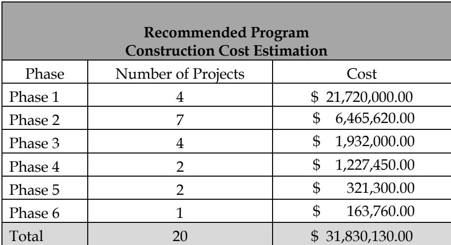

## Page 3

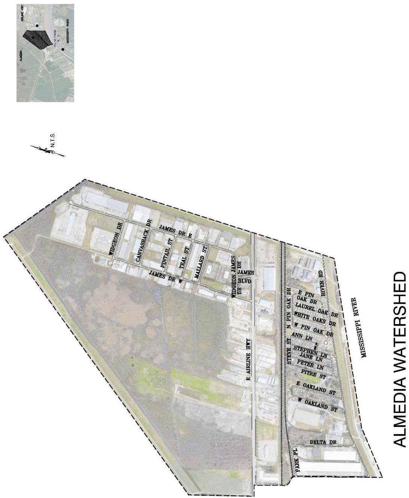

> **Figure description:** Aerial site plan of the Almedia watershed (title: ALMEDIA WATERSHED), with a locator inset showing its position between Airline Hwy and the Mississippi River. The dashed boundary encloses the residential streets north of E Airline Hwy (James Dr, Widgeon Dr, Canvasback Dr, Pintail St, Teal St, Mallard St) and the Pin Oak, Oakland, Delta Dr and Park Pl streets to the east, plus a large undeveloped vegetated area to the west. N.T.S.

## Page 4

**Table 2**

| Phase 1 Projects and Construction Cost Estimates |  |
|---|---|
| 1-1: Walker Structure Pump Station and Sump Upgrade Upgrade Pump Station from 125 CFS to 250 CFS | $ 7,500,000.00 |
| 1-2: Fairfield Pump Station Replacement Replace/Upgrade Pump Station from 25 CFS to 100 CFS | $ 4,500,000.00 |
| 1-3: Oakland Pump Station Replacement Replace/Upgrade Pump Station from 67 CFS to 150 CFS | $ 6,750,000.00 |
| 1-4: Riverbend 1 Pump Station and Sump Upgrade Upgrade Pump Station from 96 CFS to 150 CFS | $ 2,970,000.00 |
| Phase 1 Subtotal | $ 21,720,000.00 |

Table snapshot (for checking): 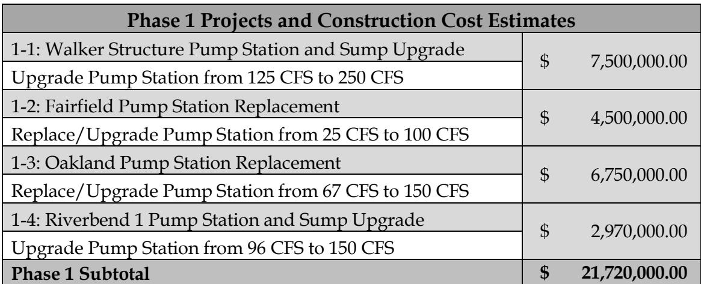

## Page 5

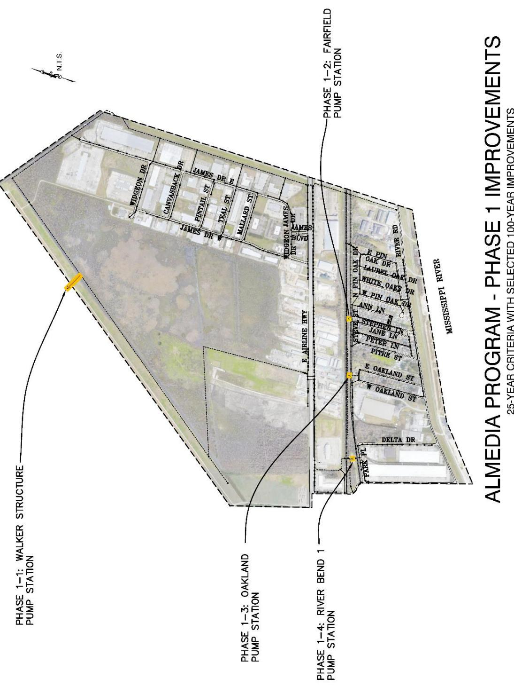

> **Figure description:** Phase 1 improvements (25-year criteria with selected 100-year improvements). Four pump stations are called out: Phase 1-1 Walker Structure pump station (west boundary), Phase 1-2 Fairfield pump station, Phase 1-3 Oakland pump station, and Phase 1-4 River Bend 1 pump station.

## Page 6

**Table 3**

| Phase 2 Projects and Construction Cost Estimates |  |
|---|---|
| 2-1: East Bank Hurricane Protection Canal Required 5-84" RCPApproximately 630 Linear Feet | $ 504,000.00 |
| 2-2.1: Airline Hwy. Crossing at Parish Line Canal Required Jack and Bore 4-72" RCPApproximately 750 Linear Feet | $ 4,875,000.00 |
| 2-2.2: Parish Line Canal Culvert Required Jack and Bore 1-60" RCPApproximately 100 Linear Feet | $ 520,000.00 |
| 2-3.1: West Oakland St. Outfall Required 1-36" RCPApproximately 140 Linear Feet | $ 29,820.00 |
| 2-3.2: Oakland Outfall Required 1-54" RCPApproximately 220 Linear Feet | $ 121,000.00 |
| 2-3.3: W Pin Oak Dr Outfall Required 1-48" RCPApproximately 270 Linear Feet | $ 64,800.00 |
| 2-4: CN RR Culvert Required Jack and Bore1-48" RCPApproximately 90 Linear Feet | $ 351,000.00 |
| Phase 2 Subtotal | $ 6,465,620.00 |

Table snapshot (for checking): 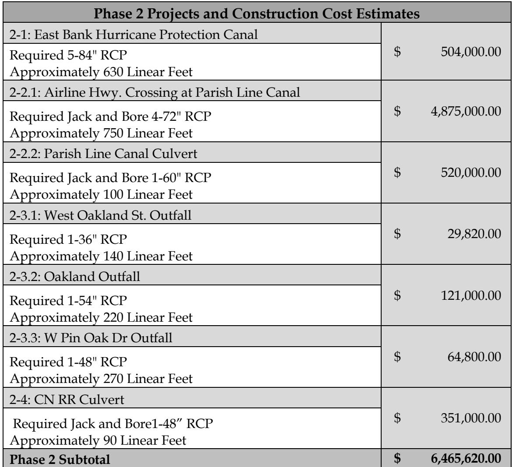

## Page 7

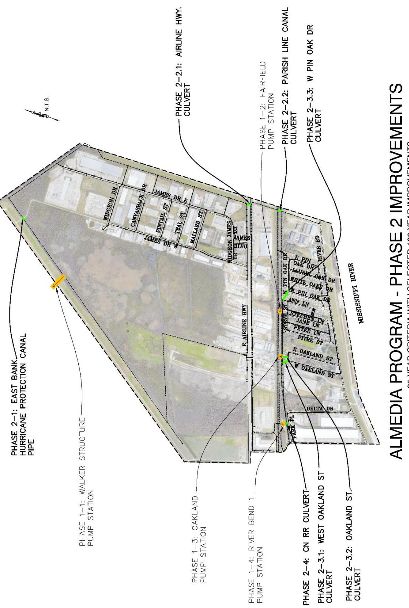

> **Figure description:** Phase 2 improvements (25-year criteria with selected 100-year improvements), with the Phase 1 pump stations shown for context. Phase 2 items are marked in green: 2-1 East Bank Hurricane Protection Canal Pipe (west boundary), 2-2.1 Airline Hwy culvert, 2-2.2 Parish Line canal culvert, 2-3.1 West Oakland St culvert, 2-3.2 Oakland St culvert, 2-3.3 W Pin Oak Dr culvert, and 2-4 CN RR culvert.

## Page 8

**Table 4**

| Phase 3 Projects and Construction Cost Estimates |  |
|---|---|
| 3-1: Reshape and clean Parish Line Canal Required cleaning and reshaping the canal.Approximately 5,360 Linear Feet | $ 1,229,865.00 |
| 3-2: Reshape and clean Parish Line Canal Required cleaning and reshaping the canal.Approximately 1,350 Linear Feet | $ 309,750.00 |
| 3-3: Reshape and clean Parish Line Canal Required cleaning and reshaping the canal.Approximately 720 Linear Feet | $ 165,217.50 |
| 3-4: Reshape and clean Parish Line Canal Required cleaning and reshaping the canal.Approximately 990 Linear Feet | $ 227,167.50 |
| Phase 3 Subtotal | $ 1,932,000.00 |

Table snapshot (for checking): 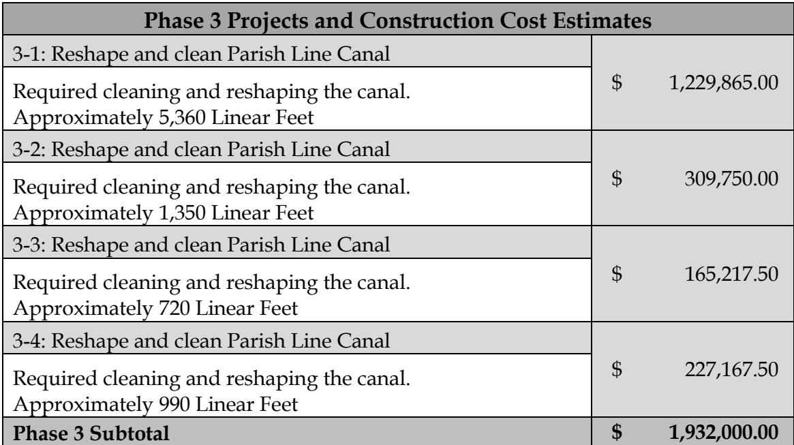

## Page 9

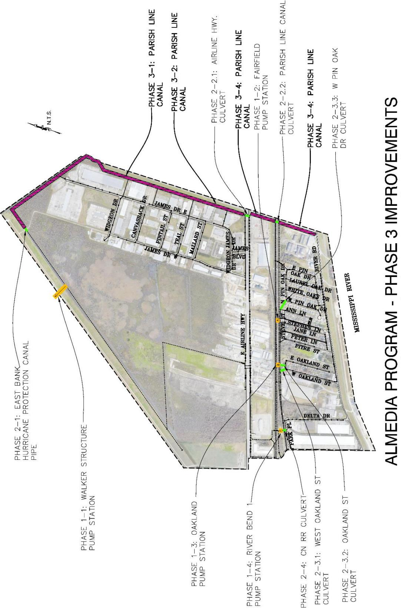

> **Figure description:** Phase 3 improvements (25-year criteria with selected 100-year improvements). Phase 3 canal segments are highlighted in magenta along the north boundary: Phase 3-1 and 3-2 (Parish Line canal, north-west section) and Phase 3-4 (Parish Line canal, north-east section). Phase 1 pump stations and Phase 2 culverts are shown for context.

## Page 10

**Table 5**

| Phase 4 Projects and Construction Cost Estimates |  |
|---|---|
| 4-1: Reshape and clean KS RR Canal Required cleaning and reshaping the canal.Approximately 2,550 Linear Feet | $ 585,007.50 |
| 4-2:Reshape and clean KS RR Canal Required cleaning and reshaping the canal.Approximately 2,800 Linear Feet | $ 642,442.50 |
| Phase 4 Subtotal | $ 1,227,450.00 |

Table snapshot (for checking): 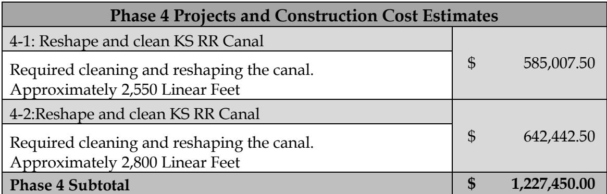

## Page 11

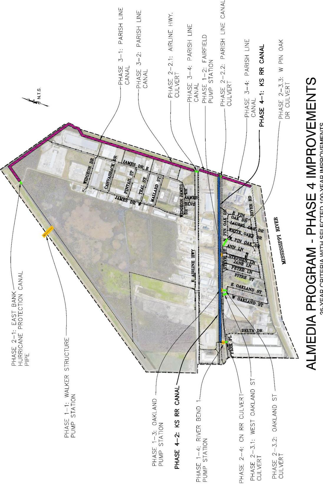

> **Figure description:** Phase 4 improvements (25-year criteria with selected 100-year improvements). Phase 4-1 and 4-2 (KS RR canal) are shown in blue, running north-south along the Steve St corridor from the Parish Line canal to the River Bend 1 pump station area. Phase 3 canal segments and Phase 2 culverts are shown for context.

## Page 12

**Table 6**

| Phase 5 Projects and Construction Cost Estimates |  |
|---|---|
| 5-1: Reshape and clean canal between P.S. Riverbent 1 & P.S.Riverbent 2 Required cleaning and reshaping the canal.Approximately 550 Linear Feet | $ 126,262.50 |
| 5-2:Reshape and Clean canal west side of 10397 HW 61between CN RR & KS RR Required cleaning and reshaping the canal.Approximately 850 Linear Feet | $ 195,037.50 |
| Phase 5 Subtotal | $ 321,300.00 |

Table snapshot (for checking): 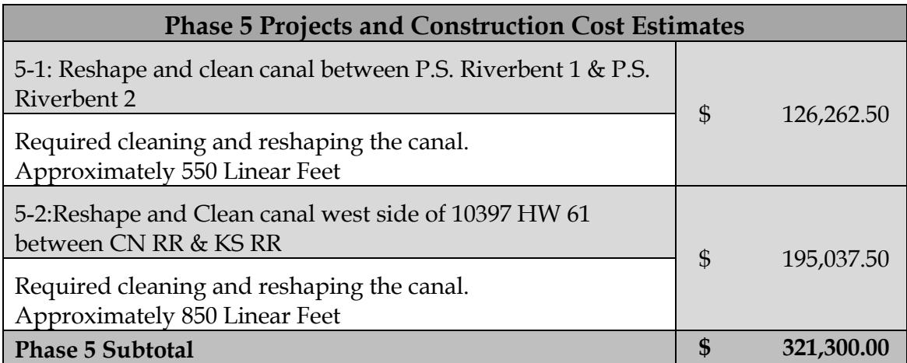

## Page 13

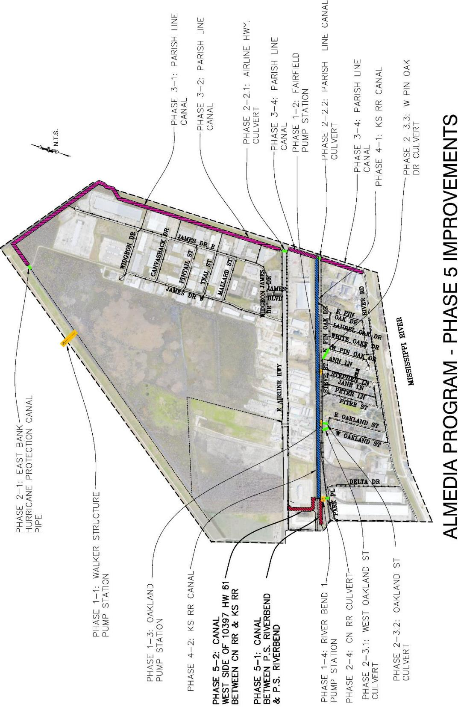

> **Figure description:** Phase 5 improvements (25-year criteria with selected 100-year improvements). Phase 5-1 (canal between P.S. Riverbend and P.S. Riverbend) and Phase 5-2 (canal on the west side of 10397 HW 61, between CN RR and KS RR) are shown in red at the south end of the study area. The Phase 4 KS RR canal (blue) and earlier phases are shown for context.

## Page 14

**Table 7**

| Phase 6 Projects and Construction Cost Estimates |  |
|---|---|
| 6-1: Teal Street Required 1-42" RCPApproximately 460 Linear Feet | $ 163,760.00 |
| Phase 6 Subtotal | $ 163,760.00 |

Table snapshot (for checking): 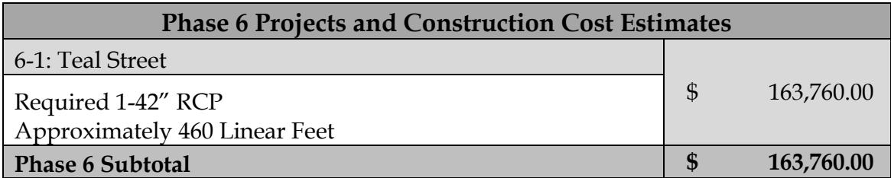

## Page 15

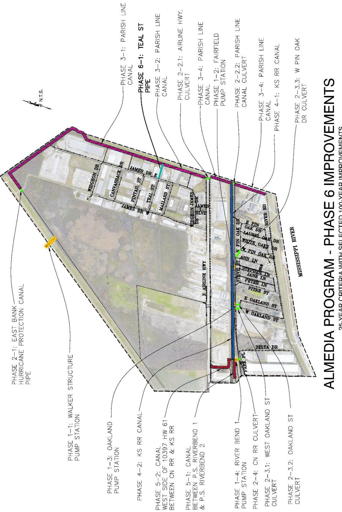

> **Figure description:** Phase 6 improvements (25-year criteria with selected 100-year improvements). Phase 6-1 (Teal St pipe) is shown in cyan, running north-south between James Dr and the Parish Line canal. Phase 5-1 (canal between P.S. Riverbend 1 and P.S. Riverbend 2), Phase 5-2, and the Phase 4 KS RR canal are shown for context.
