# AmaSellers Executive Summary

Source: `AmaSellers Executive Summary.pdf` (St. Charles Parish, Master Drainage Plan). Pages: 9.

## Page 1

### ST. CHARLES PARISH WEST BANK MASTER DRAINAGE PLAN AMA-SELLERS WATERSHED

#### EXECUTIVE SUMMARY

The goal of this section is to give a high-level overview of the process and results of the hydraulic and hydrologic study of the Ama-Sellers watershed. This summary shall always be accompanied by the comprehensive detailed report, which follows this section.

This report presents the results of a basin-wide modeling study for the Ama-Sellers drainage basin. The purpose of this study was to identify necessary improvements to the major conveyance systems to mitigate the effects of the 100-yr event. Drainage features that were considered as part of the system upgrades were the construction of ditches and replacement of culverts along critical areas along with the construction of a pump station and jack-and-bore culverts across the UP and BNSF railroads. This model can be used to identify these locations and provide inputs for targeted analyses that are focused on upgrades at the subdivision scale.

#### WATERSHED CHARACTERISTICS

The Ama-Sellers drainage basin is located on the west bank of the Mississippi River in St. Charles Parish (SCP), Louisiana. The focus area for this analysis is approximately 1,400 acres and is drained via the existing Ama Pump Station to the Sellers Canal. This canal flows from the southern boundary of the focus area, crossing the existing Union Pacific (UP) railroad and Burlington Northern Santa Fe (BNSF) railroad before crossing U.S. 90 and entering Bayou Verrett through a flood control structure, whose primary function is to mitigate the effects of storm surge in this region.

#### CURRENT DRAINAGE ISSUES

At present, the majority of drainage issues occur due to the lack of conveyance capacity within localized drainage systems in the neighborhoods. While there have not been reports of frequent repeated structure flooding provided as part of this study, residential areas have experienced frequent roadway flooding in recent years resulting from short duration rainfall events with high intensity.

#### PROPOSED IMPROVEMENTS

The development of the proposed conditions model focused on upgrading the existing drainage system within the Ama-Sellers basin. These upgrades include channel modification and culvert installation within the main forced drainage basin along with the addition of pumping capacity. The addition of a second pump station near the southern end of Kennedy Street was also evaluated as part of this basin-wide assessment. The following exhibits show the proposed improvements as defined in the report and consolidated into “Improvement Groups.”

## Page 2

#### MODEL RESULTS

This report analyzes the model results for the Existing Conditions (EC) and Proposed Conditions (PC) model simulations. Since the aim of the drainage basin upgrades is to reduce the impacts experienced by the 100-yr event, those simulation results will be the focus of this analysis and review.

#### ALTERNATIVES

By the request of the SCP Administration, TBS analyzed the conceptual cost to construct the proposed improvements to convey the stormwater flow produced by the 25-year rainfall event. The proposed conditions model was constructed to analyze the effects of various storms on the 100- year improvements. Therefore, TBS tabulated the flows generated from running the 25-year rainfall event against the 100-year improvements. These flows were then used to theoretically size channel and culvert improvements which could convey these flows. These resulting “25-year improvements” have not been analyzed to determine the effect on water surface elevation. However, they have been considered for cost comparison purposes as tabulated in the below section. If SCP should decide to construct any improvement to the 25-year size, further analysis is required. It should be noted that railroad crossings which are required to be sized for the 100-yr storm by the railroad companies remain sized as such in all cost calculations.

#### CONCEPTUAL COST ESTIMATE

The table below provides a summary for conceptual-level cost estimates associated with the recommended improvements. The table includes the cost for the “25-year improvements” as discussed above as well as the 100-year improvements as analyzed in the model. Mitigation, permitting, and land acquisition costs are not included as part of this cost assessment, as these costs can vary significantly depending on the final layout of the improvements determined during detailed design.

**Table 1: Conceptual project cost summary table**

| Prioritization Level | Improvement Group | Name | 25-year Total Cost* | 100-yr Total Cost* |
|---|---|---|---|---|
| 1 | IG-1 IG-2 Priority 1 Projects Subtotal | Primary Culvert and Channel Improvements Secondary Culvert and Channel Improvements | $1,157,000 $424,100 $1,581,100 | $1,613,200 $646,500 $2,259,700 |
| 2 | IG-3 IG-4 Priority 2 Projects Subtotal | Pump Station Outfall Channel Creation | $3,814,200 $1,730,300 $5,544,500 | $8,962,200 $2,290,000 $11,252,200 |
| Total Cost for Improvements |  |  | $7,125,600 | $13,511,900 |

_\*Total Cost includes 20% contingency_

Table snapshot (for checking): 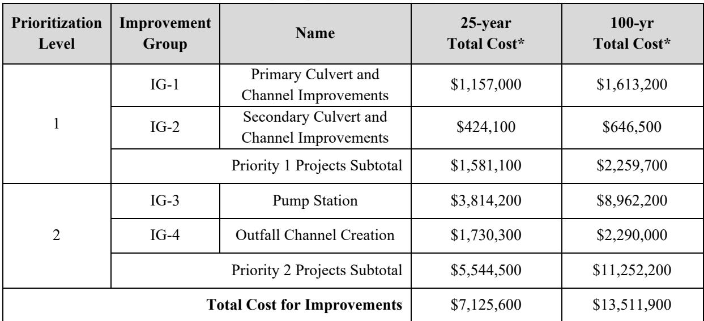

## Page 3

**Table 2**

| Legend Existing Culvert |
|---|
| X Existing Culvert - Blocked |
|  |
| Existing Culvert - Unknown Size |
| Existing Bridge |
| PS Existing Ama-Sellers Pump Station |
| Parcel Boundary |
| SCP-Owned Parcel Boundary |
| Existing Subsurface Culvert Ama-Sellers Study Area |

Table snapshot (for checking): 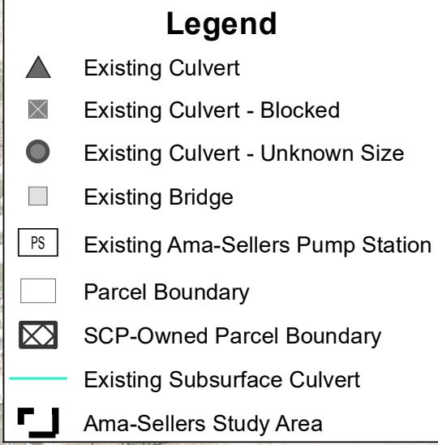

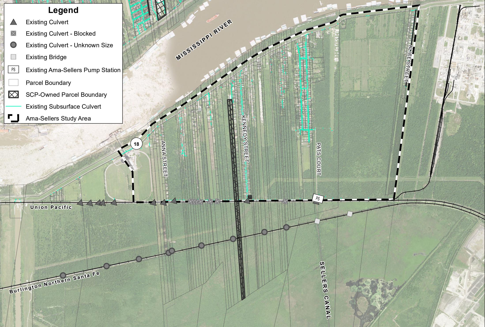

> **Figure description:** Existing-conditions map of the Ama-Sellers study area on an aerial base, with a legend. The Mississippi River is at the top, the Union Pacific and Burlington Northern Santa Fe rail lines cross the area, and Hwy 18 is at the west end. Symbols mark existing culverts (open, blocked, and unknown size), existing bridges, the existing Ama-Sellers pump station, parcel boundaries, SCP-owned parcels, and existing subsurface culverts. Labelled streets include Anna St, Kennedy St, Pats Court and Alice St. Sellers Canal is labelled south of the rail lines.

NOTES: 1. Background Image Source: NAIP, 2015

EXHIBITES-1–EXISTINGINFRASTRUCTURE

EXISTINGCONDITIONS

AMA-SELLERS WATERSHED

## Page 4

> **Figure description:** Logo only (TBS). Not content; candidate for removal.

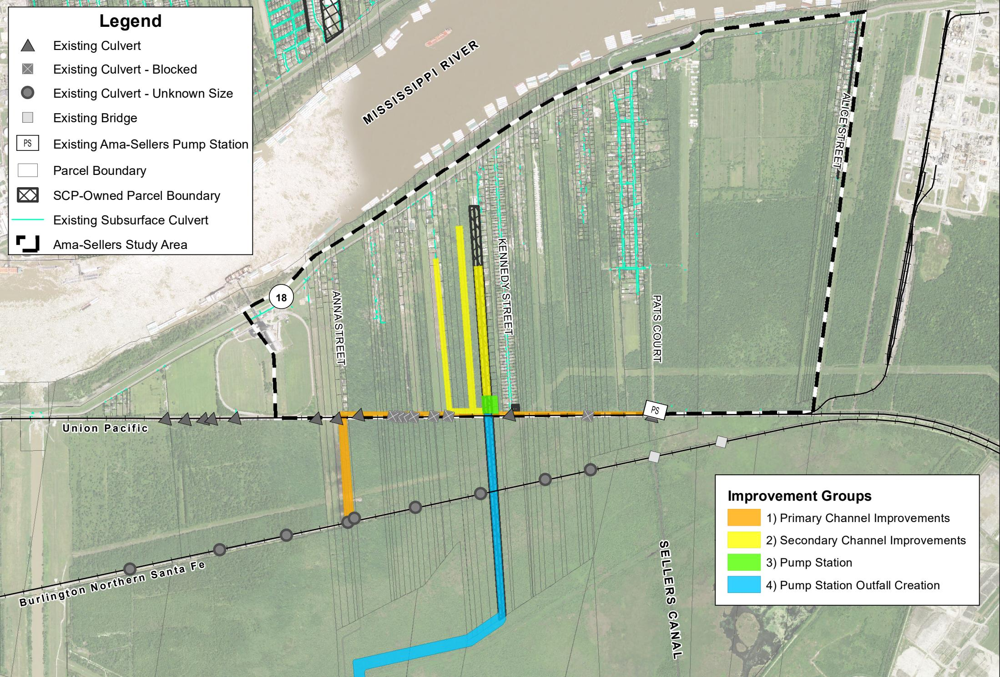

> **Figure description:** Improvement groups map for Ama-Sellers on the existing-conditions base. IG-1 primary channel improvements (orange) run along the Union Pacific line and south along Anna St. IG-2 secondary channel improvements (yellow) are three channels running north from the Union Pacific line between Anna St and Kennedy St. IG-3 pump station (green) sits at Kennedy St. IG-4 pump station outfall creation (blue) runs south under the BNSF line and then southwest toward the marsh.

NOTES:   
1. Background Image Source: NAIP, 2015   
2. IG Extent is meant for general description only. Final locations for all IGs have not been established as part of this phase of the project. Locations are subject to change as part of permitting and detailed engineering design. As such, costs associated with each IG do not include property acquisition.

EXHIBITES-2– IMPROVEMENTGROUPSPROPOSEDDRAINAGESYSTEMIMPROVEMENTSAMA-SELLERS WATERSHED

## Page 5

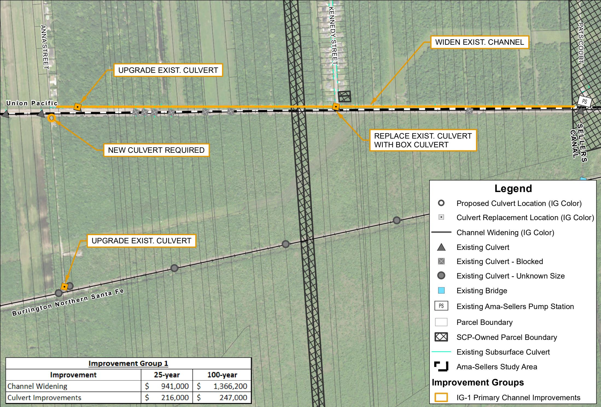

> **Figure description:** IG-1 detail (primary channel improvements). Callouts: upgrade existing culvert (two locations, one under the Union Pacific line near Anna St and one under the BNSF line), new culvert required at the west end of the Union Pacific line, widen existing channel along the Union Pacific line, and replace existing culvert with box culvert at Kennedy St. Cost table: channel widening $941,000 (25-year) and $1,366,200 (100-year); culvert improvements $216,000 (25-year) and $247,000 (100-year).

EXHIBITES-3–IMPROVEMENTGROUP

PROPOSEDDRAINAGESYSTEMIMPROVEMENTS

## Page 6

**Table 3**

| Improvement | 25-year | 100-year |
|---|---|---|
| West Channel & Culvert | $ 125,100 | $ 179,800 |
| Middle Channel & Culvert | $ 174,000 | $ 287,000 |
| East Channel & Culvert | $ 125,000 | $ 179,700 |

Table snapshot (for checking): 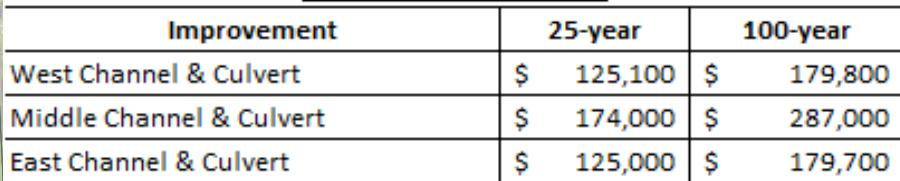

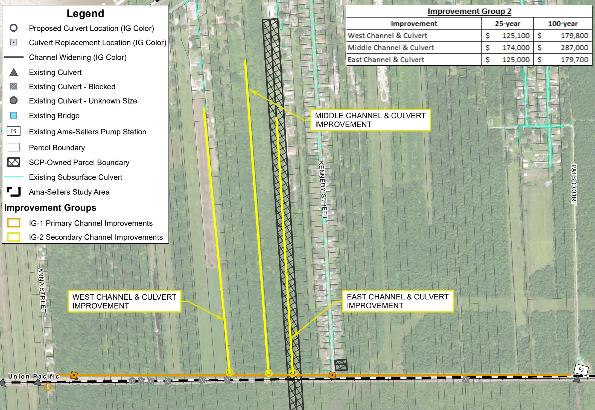

> **Figure description:** IG-2 detail (secondary channel improvements). Three channels are labelled: West Channel and Culvert Improvement, Middle Channel and Culvert Improvement, and East Channel and Culvert Improvement, all running north from the Union Pacific line. Cost table (25-year / 100-year): West $125,100 / $179,800; Middle $174,000 / $287,000; East $125,000 / $179,700. These three items total $424,100 / $646,500, which does not match the Group 2 row of $416,000 / $635,000 in the summary table (fig 9).

## Page 7

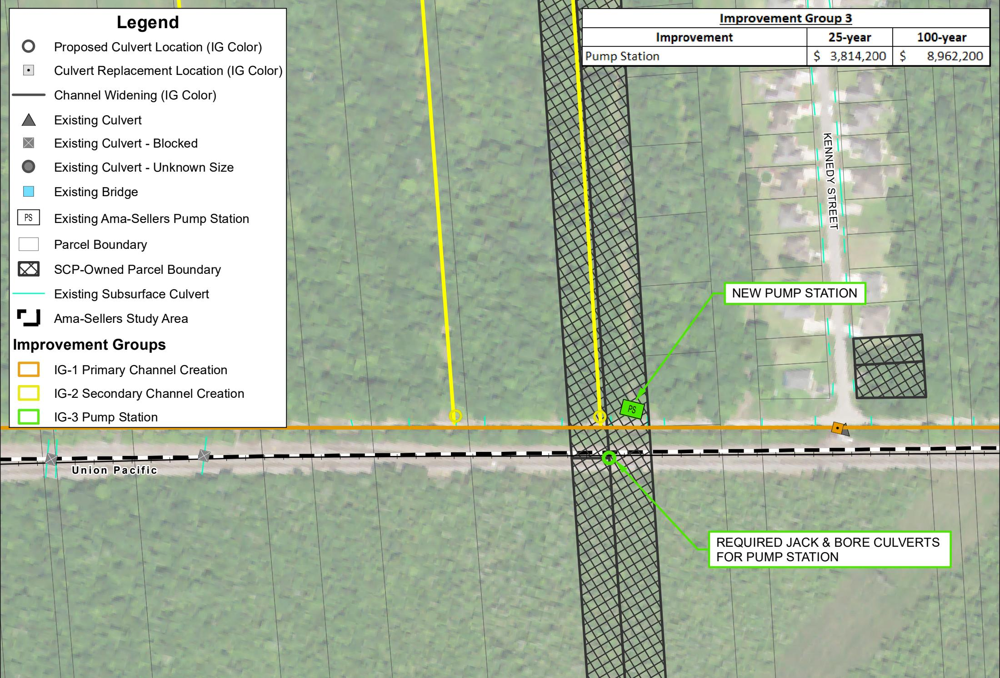

> **Figure description:** IG-3 detail (pump station). A new pump station is marked in green on the north side of the Union Pacific line at Kennedy St, with required jack-and-bore culverts under the Union Pacific line for the pump station. The hatched strip running north-south is not labelled in the figure. Cost table: pump station $3,814,200 (25-year) and $8,962,200 (100-year).

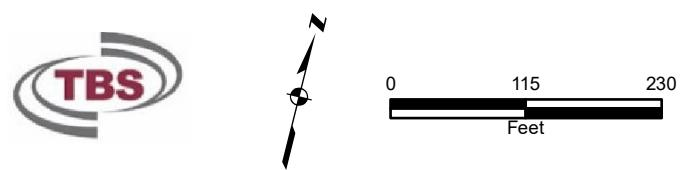

> **Figure description:** Logo, north arrow and scale bar only (TBS; scale 0 to 230 ft). Not content; candidate for removal.

NOTES:   
1. Background Image Source: NAIP, 2015   
2. IG Extent is meant for general description only. Final locations for all IGs have not been established as part of this phase of the project. Locations are subject to change as part of permitting and detailed engineering design. As such, costs associated with each IG do not include property acquisition.   
NOTES:   
1. Background Image Source: NAIP, 2015   
2. IG Extent is meant for general description only. Final locations for all IGs have not been established as part of this phase of the project. Locations are subject to change as part of permitting and detailed engineering design. As such, costs associated with each IG do not include property acquisition.

## Page 8

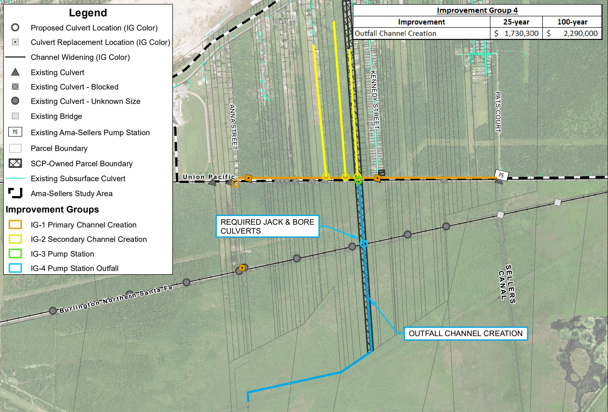

> **Figure description:** IG-4 detail (pump station outfall). Callouts: required jack-and-bore culverts where the outfall crosses under the Union Pacific and BNSF lines, and outfall channel creation (blue) running south from the pump station and then southwest. Cost table: outfall channel creation $1,730,300 (25-year) and $2,290,000 (100-year). IG-1 (orange) and IG-2 (yellow) channels are shown for context.

EXHIBITES-6–IMPROVEMENTGROUP4

PROPOSEDDRAINAGESYSTEMIMPROVEMENTS

## Page 9

**Table 4**

| Legend Existing Culvert |
|---|
| X Existing Culvert - Blocked |
| Existing Culvert - Unknown Size |
| Existing Bridge |
| PS Existing Ama-Sellers Pump Station |
| Parcel Boundary |
| SCP-Owned Parcel Boundary |
| Existing Subsurface Culvert |
| Ama-Sellers Study Area |

Table snapshot (for checking): 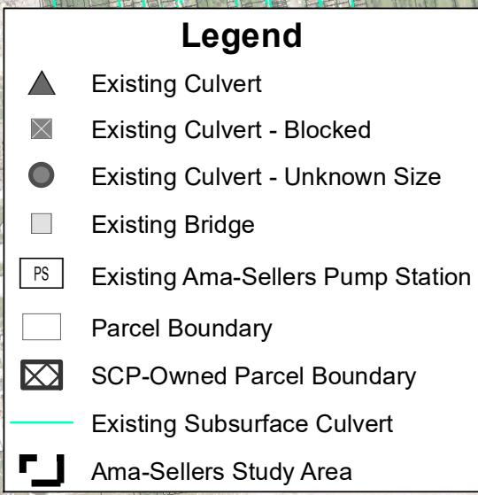

**Table 5**

| Summary Table |  |  |
|---|---|---|
| Improvement Group | 25-year | 100-year |
| 1 - Primary Channel Widening | $ 1,157,000 | $ 1,613,200 |
| 2 - Secondary Channel Improvements | $ 416,000 | $ 635,000 |
| 3 - Pump Station | $ 3,814,200 | $ 8,962,200 |
| 4 - Outfall Channel Creation | $ 1,730,300 | $ 2,290,000 |
| Total | $ 7,117,500 | $ 13,500,400 |

Table snapshot (for checking): 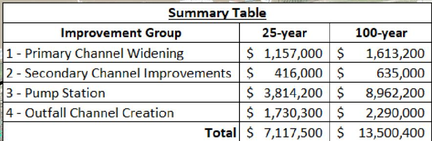

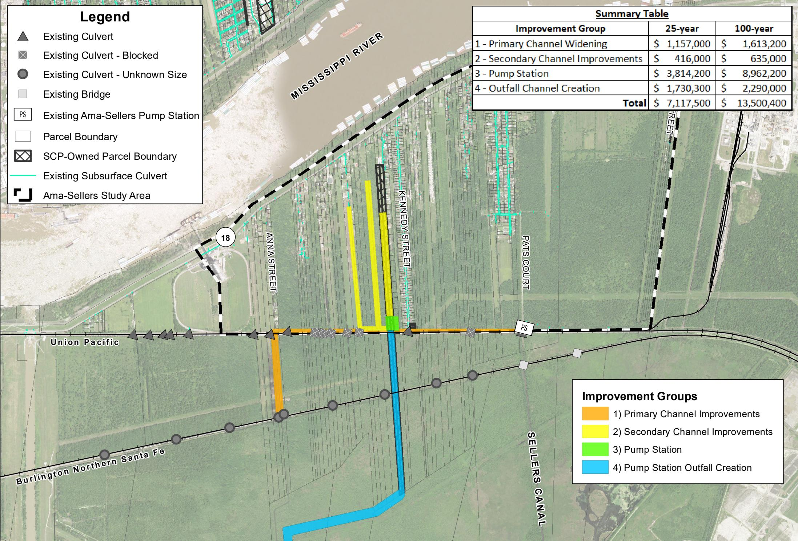

> **Figure description:** Summary map of all four improvement groups on the existing-conditions base, with a summary table. Totals: 1 Primary channel widening $1,157,000 (25-year) / $1,613,200 (100-year); 2 Secondary channel improvements $416,000 / $635,000; 3 Pump station $3,814,200 / $8,962,200; 4 Outfall channel creation $1,730,300 / $2,290,000; overall total $7,117,500 / $13,500,400. The Group 2 row does not equal the sum of its three channel items in fig 5 ($424,100 / $646,500).

NOTES:   
1. Background Image Source: NAIP, 2015   
2. IG Extent is meant for general description only. Final locations for all IGs have not been established as part of this phase of the project. Locations are subject to change as part of permitting and detailed engineering design. As such, costs associated with each IG do not include property acquisition.

EXHIBITES-7– IMPROVEMENTGROUPSSUMMARY
