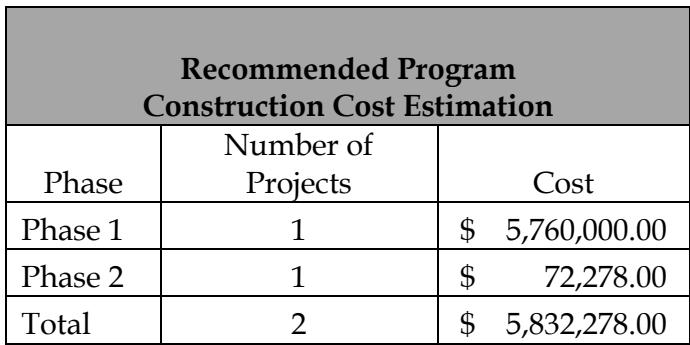
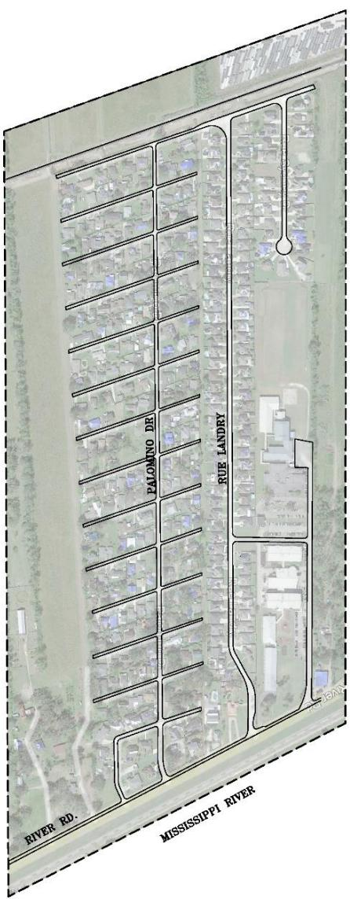
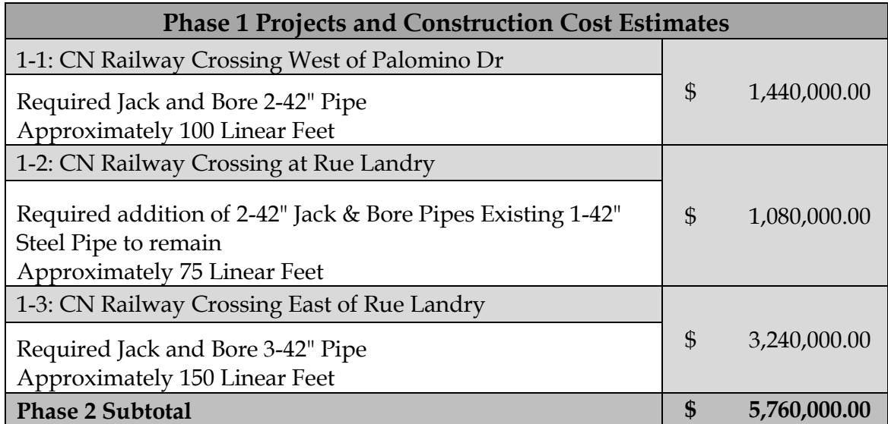
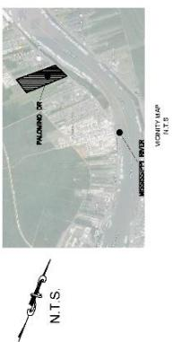
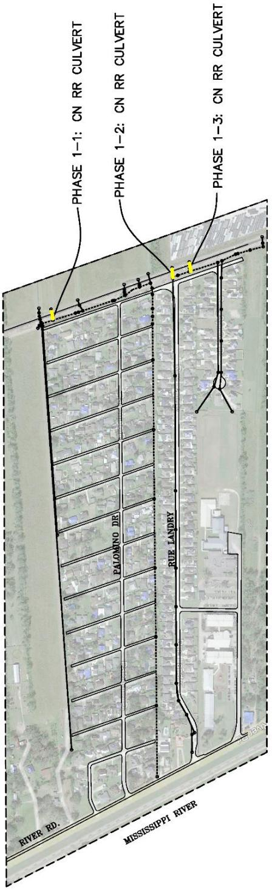
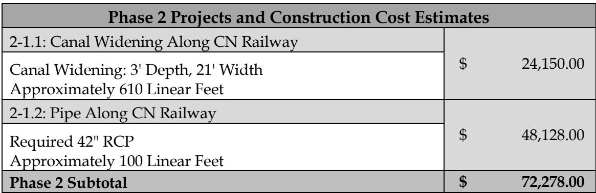
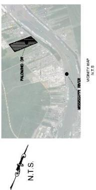
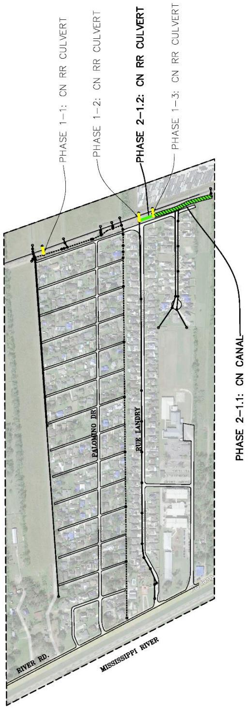

# Bar None  Executive Summary

Source: `Bar None  Executive Summary.pdf` (St. Charles Parish, Master Drainage Plan). Pages: 7.

## Page 1

#### Volume 8: Bar None

#### 8.1 Executive Summary

St. Charles Parish tasked Principal Engineering, Inc. to complete the study of the Bar None Drainage Area for the East Bank Master Drainage Plan. Principal Engineering performed analyses for 25-Year and 100-Year Design Storms (NOAA Atlas 14), and developed drainage improvements that:

1. 25-Year: Reduce the water surface elevations in the canals to one foot below top of the bank such that future internal drainage improvements may function to eliminate street flooding.

2. 100-Year: Lower water surface elevations in the canals such that direct structure flooding from the canals is eliminated and future internal drainage improvements may function to eliminate internal area structure flooding.

The recommended program consists of the 25-Year and select 100-Year improvements at canals along railroad and railroad crossings.

Analysis used models built in EPA SWMM and AutoDesk’s Storm and Sanitary Analysis. Existing flood-prone areas were identified in areas along Rue Landry and Rue Sydney Drive. The results of the existing conditions simulation illustrate the inadequacy of the drainage system for the design events, however, modeled flooding does not appear severe and impact to the community is reported as low by Parish personnel.

The recommended improvements are grouped into phases and projects, building from the previous, in sensible order of construction, downstream to upstream. Major improvements include increasing capacity of existing crossings under CN RR and widening drainage ditch south of CN RR.

Modeled improvements have been partitioned into executable projects with cost estimates provided. It is expected that the Parish will create an integrated priority list consisting of projects from all basins, constructed individually as funding becomes available. A summary of projects and costs is tabulated on the following pages by phase.

## Page 2

**Table 1**

| Recommended ProgramConstruction Cost Estimation |  |  |
|---|---|---|
| Phase | Number of Projects | Cost |
| Phase 1 | 1 | $ 5,760,000.00 |
| Phase 2 | 1 | $ 72,278.00 |
| Total | 2 | $ 5,832,278.00 |

Table snapshot (for checking): 

## Page 3

> **Figure description:** Aerial site plan of the study area near Palomino Dr, enclosed by a dashed boundary. Streets labelled: Palomino Dr (long north-south street) and Rue Landry (north-south, east of Palomino Dr), with River Rd along the south edge and the Mississippi River beyond. Solid outlines mark the residential blocks and the street network; a building complex on the east side is unlabelled.

## Page 4

**Table 2**

| Phase 1 Projects and Construction Cost Estimates |  |
|---|---|
| 1-1: CN Railway Crossing West of Palomino Dr Required Jack and Bore 2-42" Pipe Approximately 100 Linear Feet | $ 1,440,000.00 |
| 1-2: CN Railway Crossing at Rue Landry Required addition of 2-42" Jack & Bore Pipes Existing 1-42"Steel Pipe to remain Approximately 75 Linear Feet | $ 1,080,000.00 |
| 1-3: CN Railway Crossing East of Rue Landry Required Jack and Bore 3-42" Pipe Approximately 150 Linear Feet | $ 3,240,000.00 |
| Phase 2 Subtotal | $ 5,760,000.00 |

Table snapshot (for checking): 

## Page 5

> **Figure description:** Locator inset: an aerial with the study area hatched near Palomino Dr, the Mississippi River labelled to the southeast, and a north arrow with N.T.S. The text is too small to read beyond these labels. Shows location only.

> **Figure description:** Phase 1 improvements for the Palomino Dr area. Phases 1-1, 1-2 and 1-3 are CN RR culverts, marked as yellow symbols where the storm drain lines cross the Canadian National railroad north of the subdivision. Pipe runs are drawn as solid and dotted lines along Palomino Dr and Rue Landry to River Rd. The figure has no legend distinguishing the line types.

## Page 6

**Table 3**

| Phase 2 Projects and Construction Cost Estimates |  |
|---|---|
| 2-1.1: Canal Widening Along CN Railway Canal Widening: 3' Depth, 21' Width Approximately 610 Linear Feet | $ 24,150.00 |
| 2-1.2: Pipe Along CN Railway Required 42" RCPApproximately 100 Linear Feet | $ 48,128.00 |
| Phase 2 Subtotal | $ 72,278.00 |

Table snapshot (for checking): 

## Page 7

> **Figure description:** Locator inset, the same image as fig 2 (page 5): aerial with the study area hatched near Palomino Dr and the Mississippi River labelled to the southeast. Shows location only.

> **Figure description:** Rotated phase map of CN RR culverts along the Union Pacific rail line: Phase 1-1, 1-2 and 1-3 culverts, the bold Phase 2-1.2 CN RR culvert, and the Phase 2-1.1 CN canal. Streets labelled: Palomino Dr and Rue Landry, with River Rd and the Mississippi River at the bottom edge. Aerial base, no legend beyond call-outs.
