# Destrehan East Executive Summary

Source: `Destrehan East Executive Summary.pdf` (St. Charles Parish, Master Drainage Plan). Pages: 25.

## Page 1

#### Volume 14: Destrehan East

#### 14.1 Executive Summary

St. Charles Parish tasked Principal Engineering, Inc. to complete the study of the Destrehan East Drainage Area for the East Bank Master Drainage Plan. Principal Engineering performed analyses for 25-Year and 100-Year Design Storms (NOAA Atlas 14), and developed drainage improvements that:

1. 25-Year: Reduce the water surface elevations in the canals to one foot below top of the bank such that future internal drainage improvements may function to eliminate street flooding.

2. 100-Year: Lower water surface elevations in the canals such that direct structure flooding from the canals is eliminated and future internal drainage improvements may function to eliminate internal area structure flooding.

The recommended program consists of the 25-Year and select 100-Year improvements at major street crossings and railroad crossings.

Analysis used models built in EPA SWMM and AutoDesk’s Storm and Sanitary Analysis. Existing flood-prone areas were identified in areas along Oaklawn Ridge Ln. and Ponderosa Rd. The results of the existing conditions simulation illustrate the inadequacy of the drainage system for the design events.

The recommended improvements are grouped into phases and projects, building from the previous, in sensible order of construction, downstream to upstream. Major improvements include increasing the capacity of existing crossings under CN RR, increasing the capacity of the CN RR Canal, and increasing capacity of existing drainage pipes and culverts along Oaklawn Ridge Ln., Oaklawn Dr., Ponderosa Rd., and River Rd. Alternate 1 reduces internal system storage and requires additional gravity conveyance across the CN RR. Alternate 2 reduces internal system storage and requires a new pump station across the CN RR.

## Page 2

Modeled improvements have been partitioned into executable projects with cost estimates provided. It is expected that the Parish will create an integrated priority list consisting of projects from all basins, constructed individually as funding becomes available. A summary of projects and costs is tabulated on the following pages by phase.

**Table 1**

| Recommended ProgramConstruction Cost Estimation |  |  |
|---|---|---|
| Phase | Number of Projects | Cost |
| Phase 1 | 6 | $ 8,999,437.50 |
| Phase 2 | 4 | $ 460,306.00 |
| Phase 3 | 10 | $ 5,289,077.00 |
| Total | 20 | $14,748,820.50 |

Table snapshot (for checking): 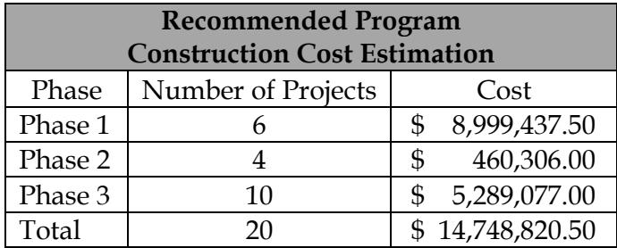

## Page 3

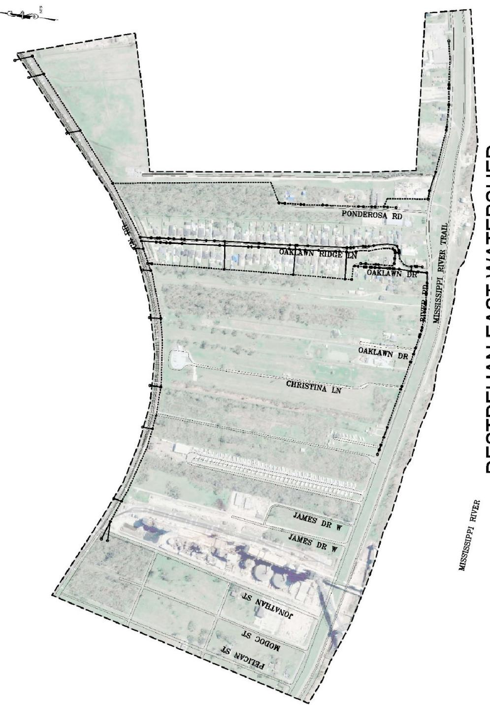

> **Figure description:** Base map of the Destrehan East watershed (dashed boundary, no projects or legend). Labelled streets: Ponderosa Rd, Oaklawn Ridge Ln, Oaklawn Dr, Christina Ln, James Dr W, Jonathan St, Modoc St, Pelican St, River Rd and the Mississippi River Trail. Dotted and solid lines show the existing storm drain network.

## Page 4

**Table 2**

| Phase 1 Projects and Construction Cost Estimates |  |
|---|---|
| 1-1: CN Railway Crossing at Bunge Required addition of 3-42" Jack & Bore Pipe Existing pipes to remain Approximately 300 Linear Feet | $ 2,160,000.00 |
| 1-2: CN Railway Crossing East of Nelson RV Park Required addition 4-36" Jack & Bore Pipe Existing pipes to remain Approximately 400 Linear Feet | $ 2,480,000.00 |
| 1-3: CN Railway Crossing West of Oaklawn Dr. Required addition 4-36" Jack & Bore Pipe Existing pipes to remain Approximately 400 Linear Feet | $ 2,480,000.00 |
| 1-4: CN Railway Crossing 650' East of Ponderosa Ditch Required addition 1-30" Jack & Bore Pipe Existing pipes to remain Approximately 100 Linear Feet | $ 520,000.00 |
| 1-5: CN Railway Crossing 1400' East of Ponderosa Ditch Required addition 2-36" Jack & Bore Pipe Existing pipes to remain Approximately 200 Linear Feet | $ 1,240,000.00 |
| 1-6: CN Railway Canal Canal Widening: 3' Depth, 23' Width Approximately 3850 Linear FeetCanal Widening: 3'- Depth, 30' Width Approximately 100 Linear Feet | $ 119,437.50 |
| Phase 1 Subtotal | $ 8,999,437.50 |

Table snapshot (for checking): 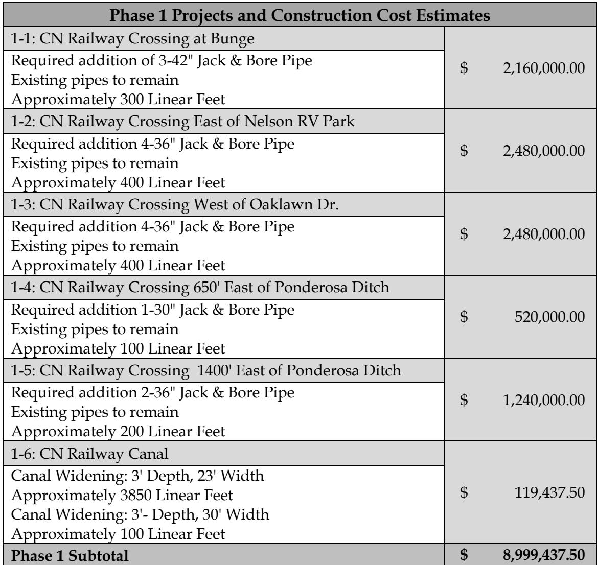

## Page 5

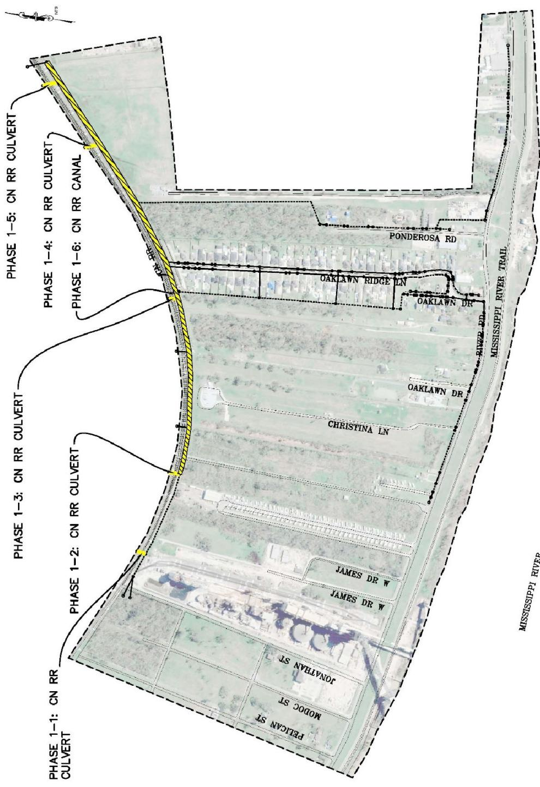

> **Figure description:** Phase 1 projects along the CN rail line on the west edge, in yellow: CN RR culverts at Phases 1-1 to 1-5 and the CN RR canal at Phase 1-6 (hatched). Call-outs are the only labels; no legend. Streets visible: Oaklawn Ridge Ln, Christina Ln and James Dr W.

## Page 6

**Table 3**

| Phase 2 Projects and Construction Cost Estimates |  |
|---|---|
| 2-1: Ponderosa Ditch Widening Canal Widening: 3.5' Depth, 23' Width Approximately 1720 Linear Feet | $ 23,625.00 |
| 2-2.1: Ponderosa Rd. Canal Widening Canal Widening: 3' Depth, 15' Width Approximately 1270 Linear Feet | $ 15,225.00 |
| 2-2.2: Required 3'x5' CBC Ponderosa Rd. Required 3'x5' CBC Approximately 215 Linear Feet | $ 322,500.00 |
| 2-3: Required 36" RCP River Rd. Required 36" RCP Approximately 260 Linear Feet | $ 98,956.00 |
| Phase 2 Subtotal | $ 460,306.00 |

Table snapshot (for checking): 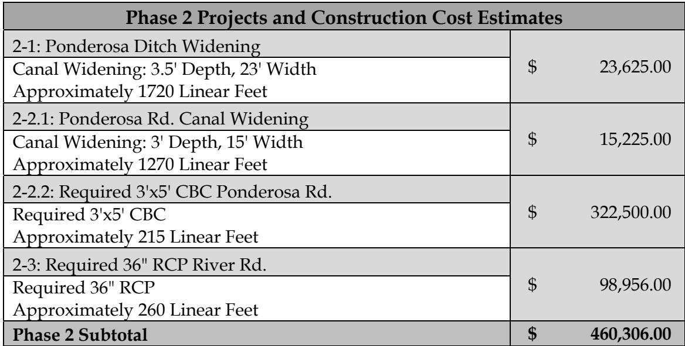

## Page 7

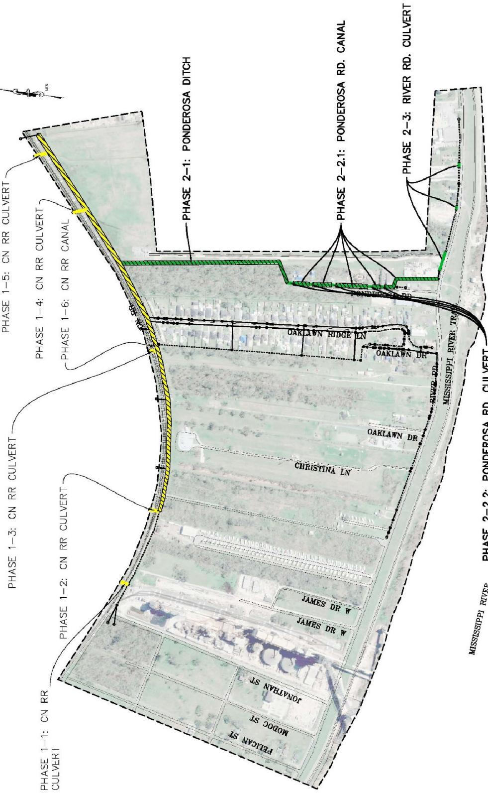

> **Figure description:** Phase 1 projects (yellow) plus Phase 2 projects (green): Phase 2-1 Ponderosa Ditch along the north boundary, Phase 2-2.1 Ponderosa Rd canal, Phase 2-2.2 Ponderosa Rd culvert, and Phase 2-3 River Rd culvert near the Mississippi River Trail. Call-outs only; no legend.

## Page 8

**Table 4**

| Phase 3 Projects and Construction Cost Estimates |  |
|---|---|
| 3-1.1: Oaklawn Ridge Canal Canal: 3' Depth, 110' Width Approximately 1920 Linear FeetCanal: 3' Depth, 15' Width Approximately 125 Linear Feet Approximately 6 Acres of Land Acquisition Required | $ 2,683,350.00 |
| 3-1.2: Oaklawn Dr. to Oaklawn Ridge Ln. Culvert Removal Remove Existing 18" Plastic Pipe Approximately 140 Linear Feet | $ 14,000.00 |
| 3-1.3: Oaklawn Ridge Canal Weir Required Weir Oaklawn Ridge Canal at CN RR Canal | $ 35,000.00 |
| 3-1.4: Oaklawn Ridge Canal Weir Culvert Required 18" RCPApproximately 40 Linear Feet | $ 9,776.00 |
| 3-2.1: Required 2-24" RCP Oaklawn Ridge Ln. Required 2-24" RCPApproximately 4950 Linear Feet | $ 1,442,430.00 |
| 3-2.2: Required 2-18" RCP Oaklawn Ridge Ln. Required 2-18" RCPApproximately 150 Linear Feet | $ 36,660.00 |
| 3-3.1: Required 2-36" RCP to Oaklawn Ridge Canal Required 2-36" RCPApproximately 1300 Linear Feet | $ 494,780.00 |
| 3-3.2: Required 36" RCP Oaklawn Ridge Ln. Required 36" RCPApproximately 135 Linear Feet | $ 51,381.00 |
| 3-4: Required 2-24" RCP Oaklawn Dr. Required 2-24" RCPApproximately 1220 Linear Feet | $ 355,508.00 |
| 3-5: Required 2-18" RCP River Rd. Required 2-18" RCPApproximately 680 Linear Feet | $ 166,192.00 |
| Phase 3 Subtotal | $ 5,289,077.00 |

Table snapshot (for checking): 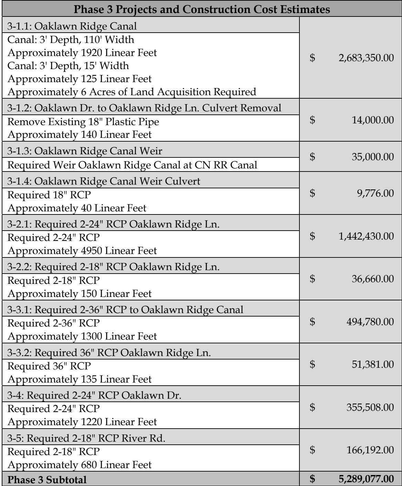

## Page 9

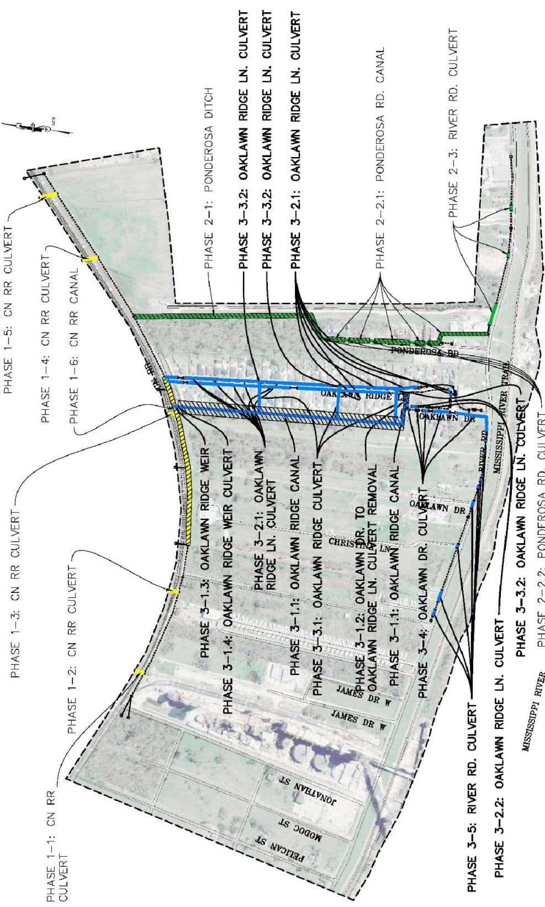

> **Figure description:** Phase 3 projects (blue) over Phases 1 and 2. Call-outs include the Oaklawn Ridge weir and weir culvert (Phases 3-1.3 and 3-1.4), Oaklawn Ridge canals and culverts (Phases 3-1.1, 3-2.1, 3-2.2, 3-3.1, 3-3.2), the Oaklawn Dr to Oaklawn Ridge Ln culvert removal (Phase 3-1.2), the Oaklawn Dr culvert (Phase 3-4) and the River Rd culvert (Phase 3-5). No printed numbers.

## Page 10

#### Alternate 1

**Table 5**

| Recommended ProgramConstruction Cost Estimation |  |  |
|---|---|---|
| Phase | Number of Projects | Cost |
| Phase 1 | 10 | $16,048,720.00 |
| Phase 2 | 4 | $ 460,306.00 |
| Phase 3 | 8 | $ 2,854,951.00 |
| Total | 22 | $ 19,363,977.00 |

Table snapshot (for checking): 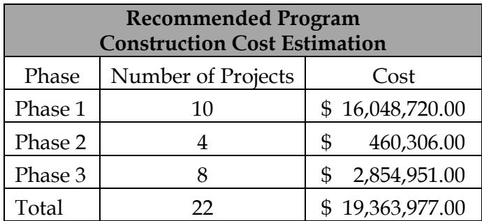

## Page 11

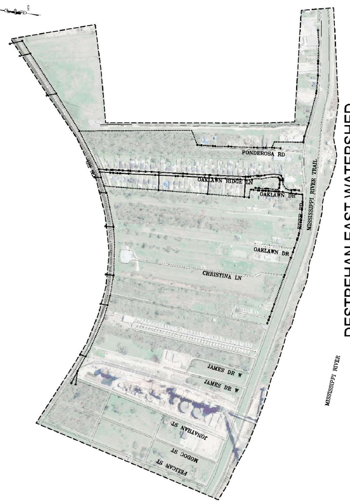

> **Figure description:** Base map of the Destrehan East watershed with no projects called out and no legend. Visually the same as the base map on page 3, figure 1. Labelled streets: Ponderosa Rd, Oaklawn Ridge Ln, Oaklawn Dr, Christina Ln, James Dr W, Jonathan St, Modoc St, Pelican St, River Rd and the Mississippi River Trail.

## Page 12

**Table 6**

| Phase 1 Projects and Construction Cost Estimates |  |
|---|---|
| 1-1: CN Railway Crossing at Bunge Required addition of 3-42" Jack & Bore Pipe Existing pipes to remain Approximately 300 Linear Feet | $ 2,160,000.00 |
| 1-2: CN Railway Crossing East of Nelson RV Park Required 2-48" Jack & Bore Pipe Approximately 200 Linear Feet | $ 1,600,000.00 |
| 1-3: CN Railway Crossing West of Christina Ln. Required 2-48" Jack & Bore Pipe Approximately 200 Linear Feet | $ 1,600,000.00 |
| 1-4: CN Railway Crossing East of Christina Ln. Required 3-42" Jack & Bore Pipe Approximately 300 Linear Feet | $ 2,160,000.00 |
| 1-5: CN Railway Crossing West of Oaklawn Dr. Required 3-48" Jack & Bore Pipe Approximately 300 Linear Feet | $ 2,400,000.00 |
| 1-6: CN Railway Crossing East of Oaklawn Dr. Required 2-48" Jack & Bore Pipe Approximately 200 Linear Feet | $ 1,600,000.00 |
| 1-7: CN Railway Crossing 650' East of Ponderosa Ditch Required 2-42" Jack & Bore Pipe Approximately 200 Linear Feet | $ 1,440,000.00 |
| 1-8: CN Railway Crossing 1400' East of Ponderosa Ditch Required 2-48" Jack & Bore Pipe Approximately 200 Linear Feet | $ 1,600,000.00 |
| 1-9: CN Railway Crossing 1500' East of Ponderosa Ditch Required 2-42" Jack & Bore Pipe Approximately 200 Linear Feet | $ 1,440,000.00 |
| 1-10: CN Railway Canal Canal: 3' Depth, 23' Width Approximately 1430 Linear FeetCanal: 3' Depth, 30' Width Approximately 100 Linear Feet | $ 48,720.00 |
| Phase 1 Subtotal | $ 16,048,720.00 |

Table snapshot (for checking): 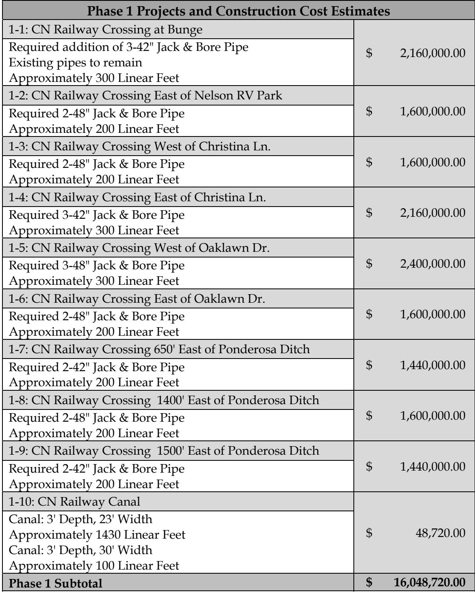

## Page 13

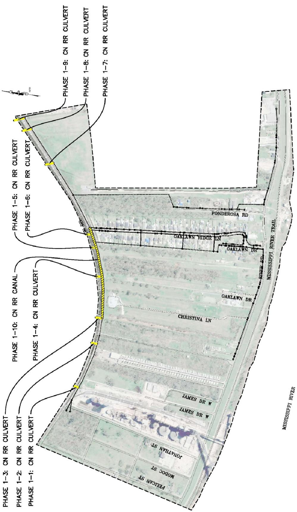

> **Figure description:** Phase 1 projects along the CN rail line: call-outs for CN RR culverts at Phases 1-1 to 1-9, and a CN RR canal at Phase 1-10 (hatched yellow). Oaklawn Ridge Ln is labelled at the north edge of the watershed. Call-outs only; no legend or printed numbers.

## Page 14

**Table 7**

| Phase 2 Projects and Construction Cost Estimates |  |
|---|---|
| 2-1: Ponderosa Ditch Widening Canal Widening: 3.5' Depth, 23' Width Approximately 1720 Linear Feet | $ 23,625.00 |
| 2-2.1: Ponderosa Rd. Canal Widening Canal Widening: 3' Depth, 15' Width Approximately 1270 Linear Feet | $ 15,225.00 |
| 2-2.2: Required 3'x5' CBC Ponderosa Rd. Required 3'x5' CBC Approximately 215 Linear Feet | $ 322,500.00 |
| 2-3: Required 36" RCP River Rd. Required 36" RCP Approximately 260 Linear Feet | $ 98,956.00 |
| Phase 2 Subtotal | $ 460,306.00 |

Table snapshot (for checking): 

## Page 15

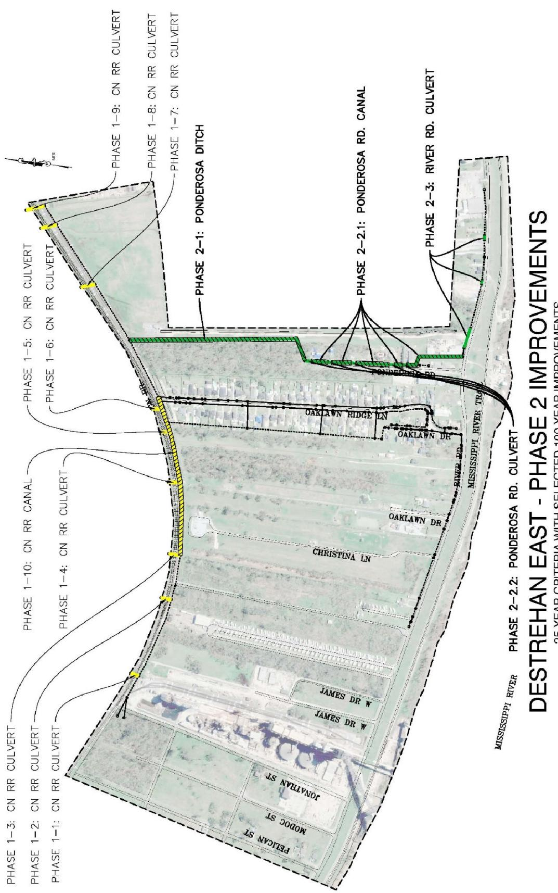

> **Figure description:** DESTREHAN EAST - PHASE 2 IMPROVEMENTS, 25-year criteria with selected 100-year improvements. Phase 1 call-outs 1-1 to 1-10 (CN RR culverts and the Phase 1-10 CN RR canal, hatched) plus Phase 2 projects in green: Phase 2-1 Ponderosa Ditch, Phase 2-2.1 Ponderosa Rd canal, Phase 2-2.2 Ponderosa Rd culvert and Phase 2-3 River Rd culvert. Mississippi River Trail and River Rd labelled. No printed numbers.

## Page 16

**Table 8**

| Phase 3 Projects and Construction Cost Estimates |  |
|---|---|
| 3-1.1: Oaklawn Ridge Canal Canal: 3' Depth, 30' Width Approximately 1960 Linear FeetCanal: 3' Depth, 15' Width Approximately 125 Linear Feet | $ 294,000.00 |
| 3-1.2: Oaklawn Dr. to Oaklawn Ridge Ln. Culvert Removal Remove Existing 18" Plastic Pipe Approximately 140 Linear Feet | $ 14,000.00 |
| 3-2.1: Required 2-24" RCP Oaklawn Ridge Ln. Required 2-24" RCPApproximately 4950 Linear Feet | $ 1,442,430.00 |
| 3-2.2: Required 2-18" RCP Oaklawn Ridge Ln. Required 2-18" RCPApproximately 150 Linear Feet | $ 36,660.00 |
| 3-3.1: Required 2-36" RCP to Oaklawn Ridge Canal Required 2-36" RCPApproximately 1300 Linear Feet | $ 494,780.00 |
| 3-3.2: Required 36" RCP Oaklawn Ridge Ln. Required 36" RCPApproximately 135 Linear Feet | $ 51,381.00 |
| 3-4: Required 2-24" RCP Oaklawn Dr. Required 2-24" RCPApproximately 1220 Linear Feet | $ 355,508.00 |
| 3-5: Required 2-18" RCP River Rd. Required 2-18" RCPApproximately 680 Linear Feet | $ 166,192.00 |
| Phase 3 Subtotal | $ 2,854,951.00 |

Table snapshot (for checking): 

## Page 17

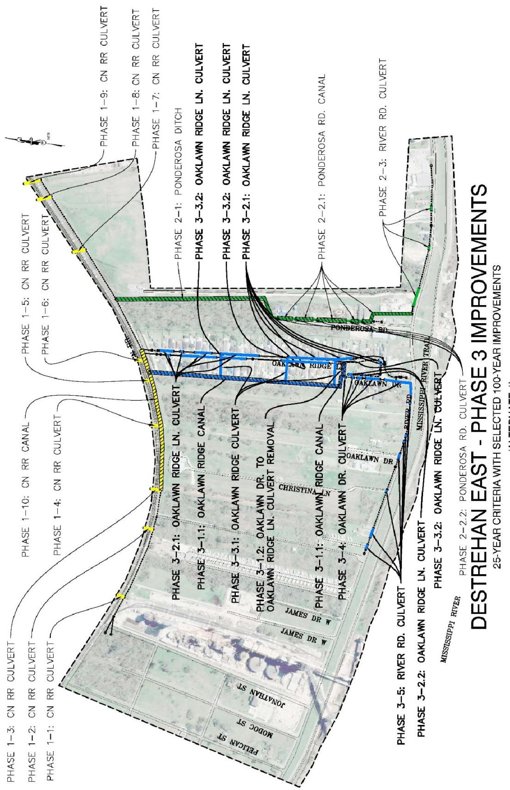

> **Figure description:** DESTREHAN EAST - PHASE 3 IMPROVEMENTS, 25-year criteria with selected 100-year improvements. Phase 1 and Phase 2 projects are shown in yellow and green. Phase 3 projects in blue: Oaklawn Ridge Ln culverts (Phases 3-2.1 and 3-3.2), Oaklawn Ridge canals and culverts, the Oaklawn Dr to Oaklawn Ridge Ln culvert removal (Phase 3-1.2), the Oaklawn Dr culvert (Phase 3-4) and the River Rd culvert (Phase 3-5). No printed numbers.

## Page 18

**Table 9: Alternate 2**

| Recommended ProgramConstruction Cost Estimation |  |  |
|---|---|---|
| Phase | Number of Projects | Cost |
| Phase 1 | 7 | $13,918,720.00 |
| Phase 2 | 4 | $ 460,306.00 |
| Phase 3 | 8 | $ 2,854,951.00 |
| Total | 19 | $17,233,977.00 |

Table snapshot (for checking): 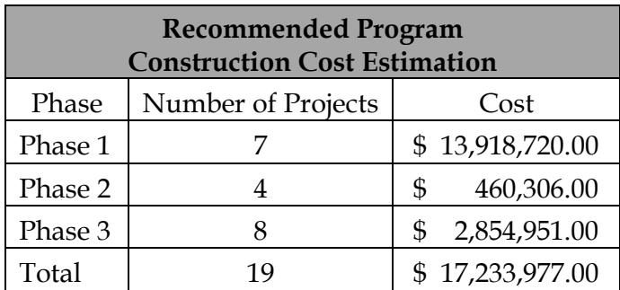

## Page 19

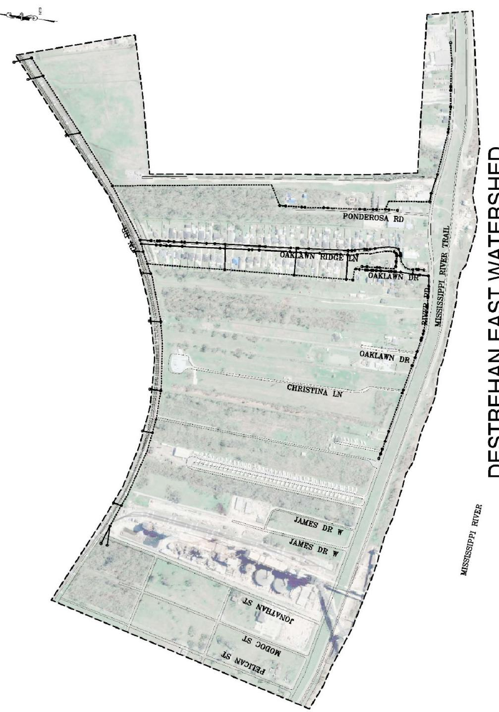

> **Figure description:** Base map of the Destrehan East watershed with no projects, call-outs or legend. Visually the same as the base map on page 3, figure 1. Labelled streets: Ponderosa Rd, Oaklawn Ridge Ln, Oaklawn Dr, Christina Ln, James Dr W, Jonathan St, Modoc St, Pelican St, River Rd and the Mississippi River Trail.

## Page 20

**Table 10**

| Phase 1 Projects and Construction Cost Estimates |  |
|---|---|
| 1-1: CN Railway Crossing at Bunge Required addition of 5-42" Jack & Bore Pipe Existing pipes to remain Approximately 500 Linear Feet | $ 3,600,000.00 |
| 1-2: CN Railway Crossing East of Nelson RV Park Required addition of 1-36" Jack & Bore Pipe Existing pipes to remain Approximately 100 Linear Feet | $ 620,000.00 |
| 1-3: CN Railway Crossing East of Christina Ln. Required addition of 1-36" Jack & Bore Pipe Existing pipes to remain Approximately 100 Linear Feet | $ 620,000.00 |
| 1-4: CN Railway Pump Station Required New 150 CFS Pump Station825,000 Cubic Feet Sump | $ 6,750,000.00 |
| 1-5: CN Railway Crossing 650' East of Ponderosa Ditch Required addition of 2-30" Jack & Bore Pipe Existing pipes to remain Approximately 200 Linear Feet | $ 1,040,000.00 |
| 1-6: CN Railway Crossing 1400' East of Ponderosa Ditch Required addition of 2-36" Jack & Bore Pipe Existing pipes to remain Approximately 200 Linear Feet | $ 1,240,000.00 |
| 1-7: CN Railway Canal Canal: 3' Depth, 23' Width Approximately 1430 Linear FeetCanal: 3' Depth, 30' Width Approximately 100 Linear Feet | $ 48,720.00 |
| Phase 1 Subtotal | $ 13,918,720.00 |

Table snapshot (for checking): 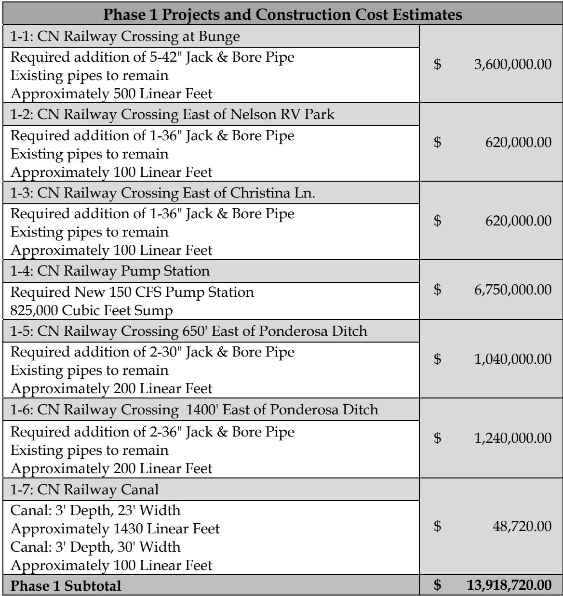

## Page 21

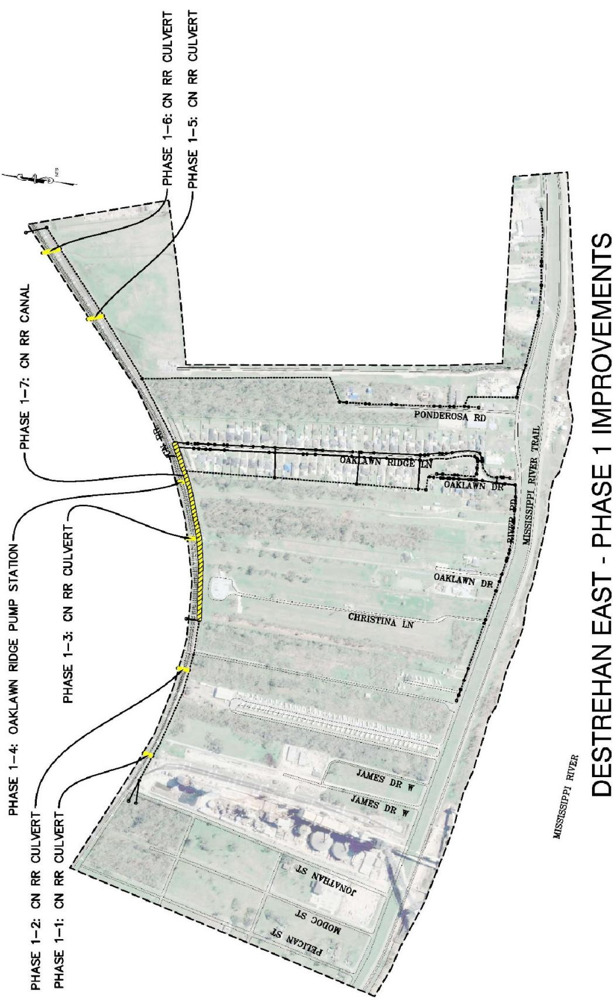

> **Figure description:** DESTREHAN EAST - PHASE 1 IMPROVEMENTS. Yellow Phase 1 projects along the CN rail line: CN RR culverts at Phases 1-1, 1-2, 1-3, 1-5 and 1-6, the Oaklawn Ridge pump station at Phase 1-4, and the CN RR canal at Phase 1-7 (hatched). Streets labelled: Ponderosa Rd, Oaklawn Ridge Ln, Oaklawn Dr, Christina Ln, River Rd and the Mississippi River Trail. No printed numbers.

## Page 22

**Table 11**

| Phase 2 Projects and Construction Cost Estimates |  |
|---|---|
| 2-1: Ponderosa Ditch Widening Canal Widening: 3.5' Depth, 23' Width Approximately 1720 Linear Feet | $ 23,625.00 |
| 2-2.1: Ponderosa Rd. Canal Widening Canal Widening: 3' Depth, 15' Width Approximately 1270 Linear Feet | $ 15,225.00 |
| 2-2.2: Required 3'x5' CBC Ponderosa Rd. Required 3'x5' CBC Approximately 215 Linear Feet | $ 322,500.00 |
| 2-3: Required 36" RCP River Rd. Required 36" RCP Approximately 260 Linear Feet | $ 98,956.00 |
| Phase 2 Subtotal | $ 460,306.00 |

Table snapshot (for checking): 

## Page 23

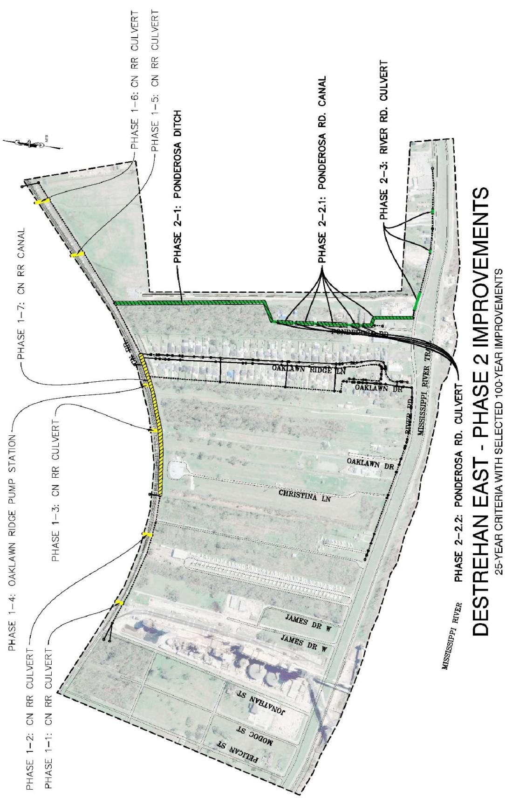

> **Figure description:** DESTREHAN EAST - PHASE 2 IMPROVEMENTS, 25-year criteria with selected 100-year improvements. Phase 1 projects (yellow) include the Oaklawn Ridge pump station at Phase 1-4. Phase 2 projects in green: Phase 2-1 Ponderosa Ditch, Phase 2-2.1 Ponderosa Rd canal, Phase 2-2.2 Ponderosa Rd culvert, and Phase 2-3 River Rd culvert. No printed numbers.

## Page 24

**Table 12**

| Phase 3 Projects and Construction Cost Estimates |  |
|---|---|
| 3-1.1: Oaklawn Ridge Canal Canal: 3' Depth, 30' Width Approximately 1960 Linear FeetCanal: 3' Depth, 15' Width Approximately 125 Linear Feet | $ 294,000.00 |
| 3-1.2: Oaklawn Dr. to Oaklawn Ridge Ln. Culvert Removal Remove Existing 18" Plastic Pipe Approximately 140 Linear Feet | $ 14,000.00 |
| 3-2.1: Required 2-24" RCP Oaklawn Ridge Ln. Required 2-24" RCPApproximately 4950 Linear Feet | $ 1,442,430.00 |
| 3-2.2: Required 2-18" RCP Oaklawn Ridge Ln. Required 2-18" RCPApproximately 150 Linear Feet | $ 36,660.00 |
| 3-3.1: Required 2-36" RCP to Oaklawn Ridge Canal Required 2-36" RCPApproximately 1300 Linear Feet | $ 494,780.00 |
| 3-3.2: Required 36" RCP Oaklawn Ridge Ln. Required 36" RCPApproximately 135 Linear Feet | $ 51,381.00 |
| 3-4: Required 2-24" RCP Oaklawn Dr. Required 2-24" RCPApproximately 1220 Linear Feet | $ 355,508.00 |
| 3-5: Required 2-18" RCP River Rd. Required 2-18" RCPApproximately 680 Linear Feet | $ 166,192.00 |
| Phase 3 Subtotal | $ 2,854,951.00 |

Table snapshot (for checking): 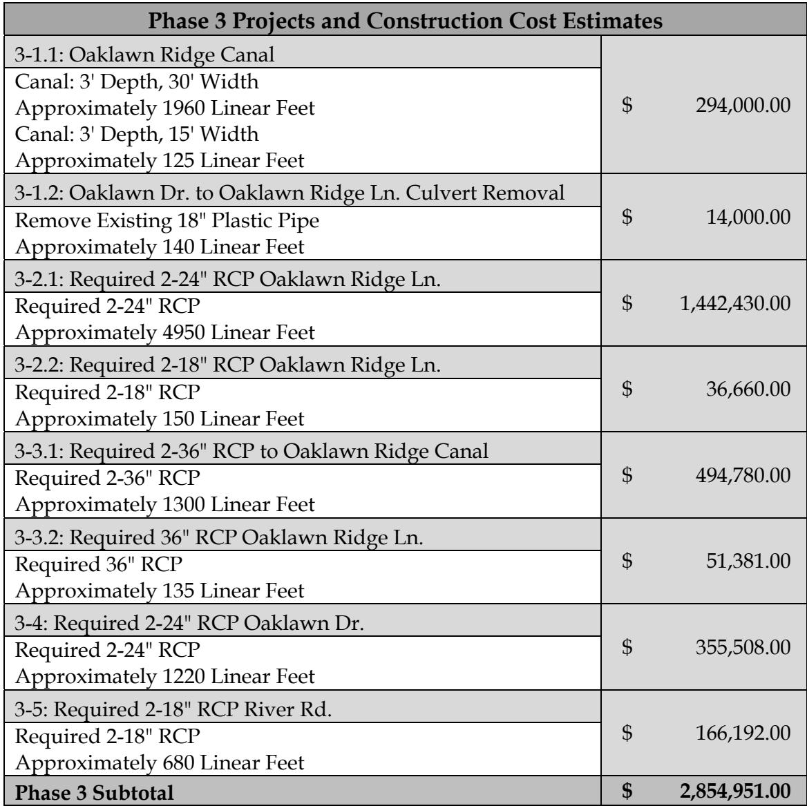

## Page 25

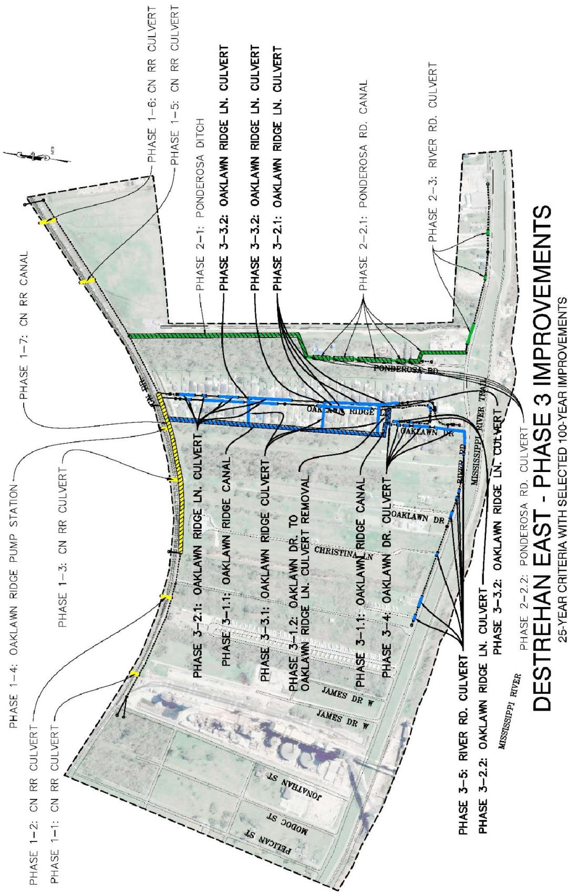

> **Figure description:** DESTREHAN EAST - PHASE 3 IMPROVEMENTS, 25-year criteria with selected 100-year improvements. Phase 1 projects (yellow), including the Oaklawn Ridge pump station, and Phase 2 projects (green) are shown with Phase 3 projects in blue: Oaklawn Ridge Ln culverts (Phases 3-2.1, 3-2.2, 3-3.2), Oaklawn Ridge canal, the Oaklawn Dr to Oaklawn Ridge Ln culvert removal (Phase 3-1.2), Oaklawn Dr culvert (Phase 3-4) and River Rd culvert (Phase 3-5). No printed numbers.
