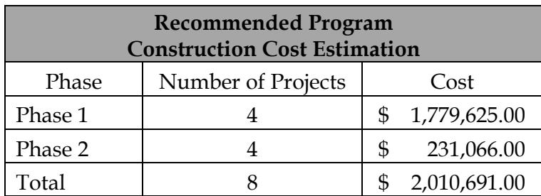
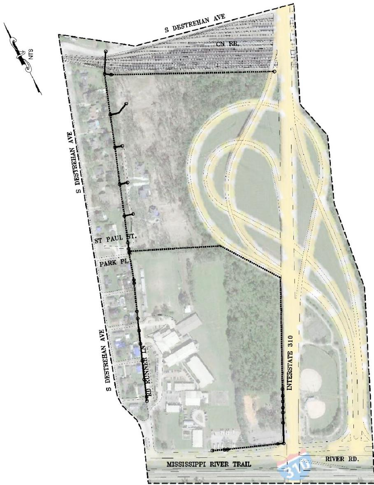
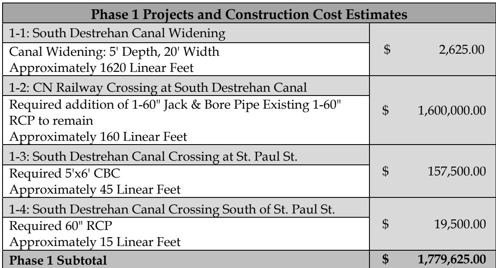
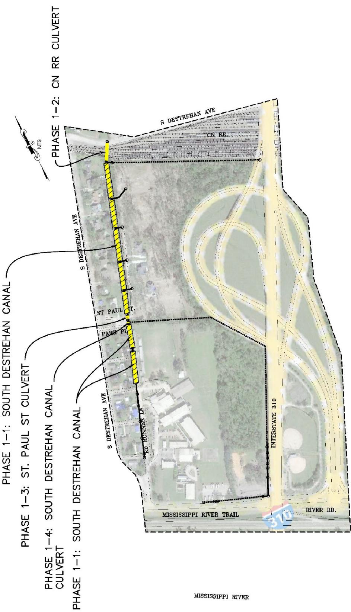
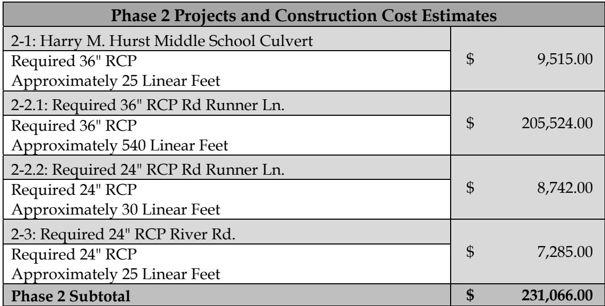
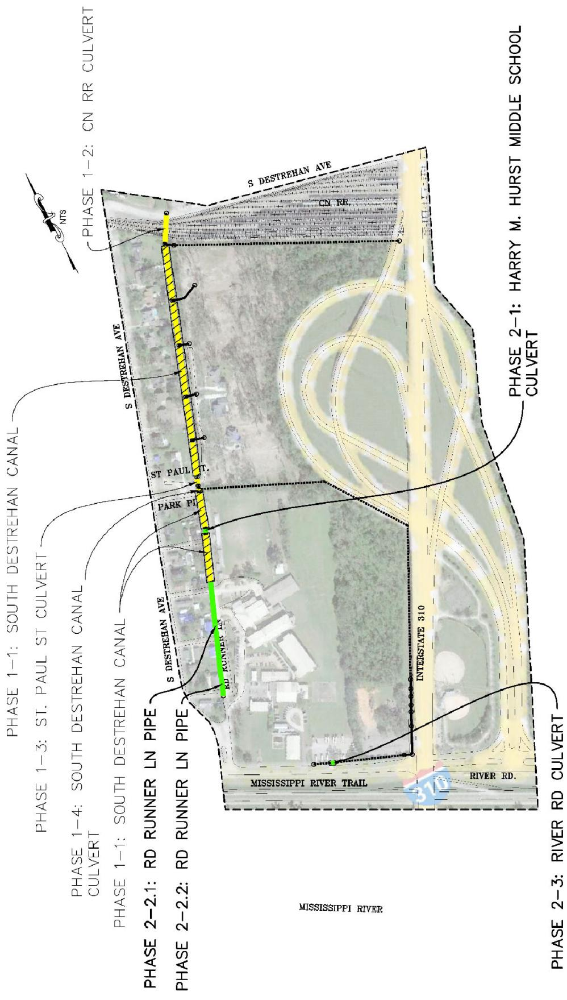

# Destrehan Plantation Executive Summary

Source: `Destrehan Plantation Executive Summary.pdf` (St. Charles Parish, Master Drainage Plan). Pages: 7.

## Page 1

#### Volume 11: Destrehan Plantation

#### 11.1 Executive Summary

St. Charles Parish tasked Principal Engineering, Inc. to complete the study of the Destrehan Plantation Drainage Area for the East Bank Master Drainage Plan. Principal Engineering performed analyses for 25-Year and 100-Year Design Storms (NOAA Atlas 14), and developed drainage improvements that:

1. 25-Year: Reduce the water surface elevations in the canals to one foot below top of the bank such that future internal drainage improvements may function to eliminate street flooding.

2. 100-Year: Lower water surface elevations in the canals such that direct structure flooding from the canals is eliminated and future internal drainage improvements may function to eliminate internal area structure flooding.

The recommended program consists of the 25-Year and select 100-Year improvements at major street crossings and railroad crossings.

Analysis used models built in EPA SWMM and AutoDesk’s Storm and Sanitary Analysis. Existing flood-prone areas were identified in areas along St. Paul St. and the South Destrehan Canal. The results of the existing conditions simulation illustrate the inadequacy of the drainage system for the design events.

The recommended improvements are grouped into phases and projects, building from the previous, in sensible order of construction, downstream to upstream. Major improvements include increasing the capacity of existing crossings under CN RR, increasing the capacity of the South Destrehan Canals, and increasing capacity of existing drainage pipes and culverts along Rd Runner Ln. and River Rd.

Modeled improvements have been partitioned into executable projects with cost estimates provided. It is expected that the Parish will create an integrated priority list consisting of projects from all basins, constructed individually as funding becomes available. A summary of projects and costs is tabulated on the following pages by phase.

## Page 2

**Table 1**

| Recommended ProgramConstruction Cost Estimation |  |  |
|---|---|---|
| Phase | Number of Projects | Cost |
| Phase 1 | 4 | $ 1,779,625.00 |
| Phase 2 | 4 | $ 231,066.00 |
| Total | 8 | $ 2,010,691.00 |

Table snapshot (for checking): 

## Page 3

> **Figure description:** Base map of the Destrehan Plantation study area (dashed boundary, no projects or legend). Labelled features: S Destrehan Ave on the west, CN RR along the north, Interstate 310 on the east, the Mississippi River Trail and River Rd at the south, plus St Paul St, Park Pl and Rd Runner Ln. Existing storm drain lines are dotted and solid.

## Page 4

**Table 2**

| Phase 1 Projects and Construction Cost Estimates |  |
|---|---|
| 1-1: South Destrehan Canal Widening Canal Widening: 5' Depth, 20' Width Approximately 1620 Linear Feet | $ 2,625.00 |
| 1-2: CN Railway Crossing at South Destrehan Canal Required addition of 1-60" Jack & Bore Pipe Existing 1-60"RCP to remain Approximately 160 Linear Feet | $ 1,600,000.00 |
| 1-3: South Destrehan Canal Crossing at St. Paul St. Required 5'x6' CBCApproximately 45 Linear Feet | $ 157,500.00 |
| 1-4: South Destrehan Canal Crossing South of St. Paul St. Required 60" RCPApproximately 15 Linear Feet | $ 19,500.00 |
| Phase 1 Subtotal | $ 1,779,625.00 |

Table snapshot (for checking): 

## Page 5

> **Figure description:** Phase 1 projects (yellow): the South Destrehan canal along S Destrehan Ave, with call-outs for Phase 1-1 South Destrehan canal, Phase 1-4 South Destrehan canal culvert near Park Pl, Phase 1-3 St Paul St culvert, and Phase 1-2 CN RR culvert at the north end. Rd Runner Ln, Interstate 310 and the Mississippi River Trail are labelled. No printed numbers.

## Page 6

**Table 3**

| Phase 2 Projects and Construction Cost Estimates |  |
|---|---|
| 2-1: Harry M. Hurst Middle School Culvert Required 36" RCPApproximately 25 Linear Feet | $ 9,515.00 |
| 2-2.1: Required 36" RCP Rd Runner Ln. Required 36" RCPApproximately 540 Linear Feet | $ 205,524.00 |
| 2-2.2: Required 24" RCP Rd Runner Ln. Required 24" RCPApproximately 30 Linear Feet | $ 8,742.00 |
| 2-3: Required 24" RCP River Rd. Required 24" RCPApproximately 25 Linear Feet | $ 7,285.00 |
| Phase 2 Subtotal | $ 231,066.00 |

Table snapshot (for checking): 

## Page 7

> **Figure description:** Phase 1 projects (yellow) plus Phase 2 projects (green): Phase 2-1 Harry M. Hurst Middle School culvert, Phase 2-2.1 and 2-2.2 Rd Runner Ln pipe (green, along Rd Runner Ln), and Phase 2-3 River Rd culvert near Interstate 310. Call-outs only; no legend or printed numbers.
