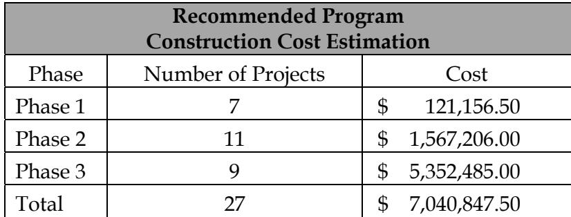
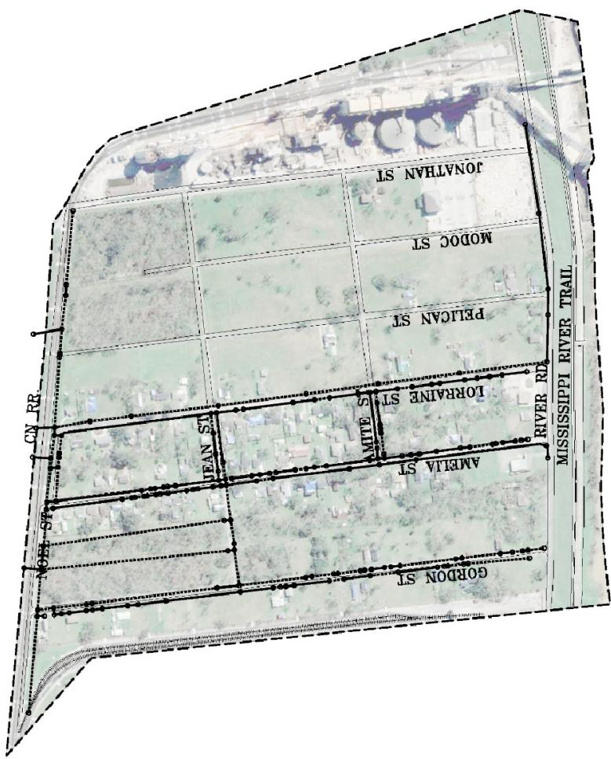
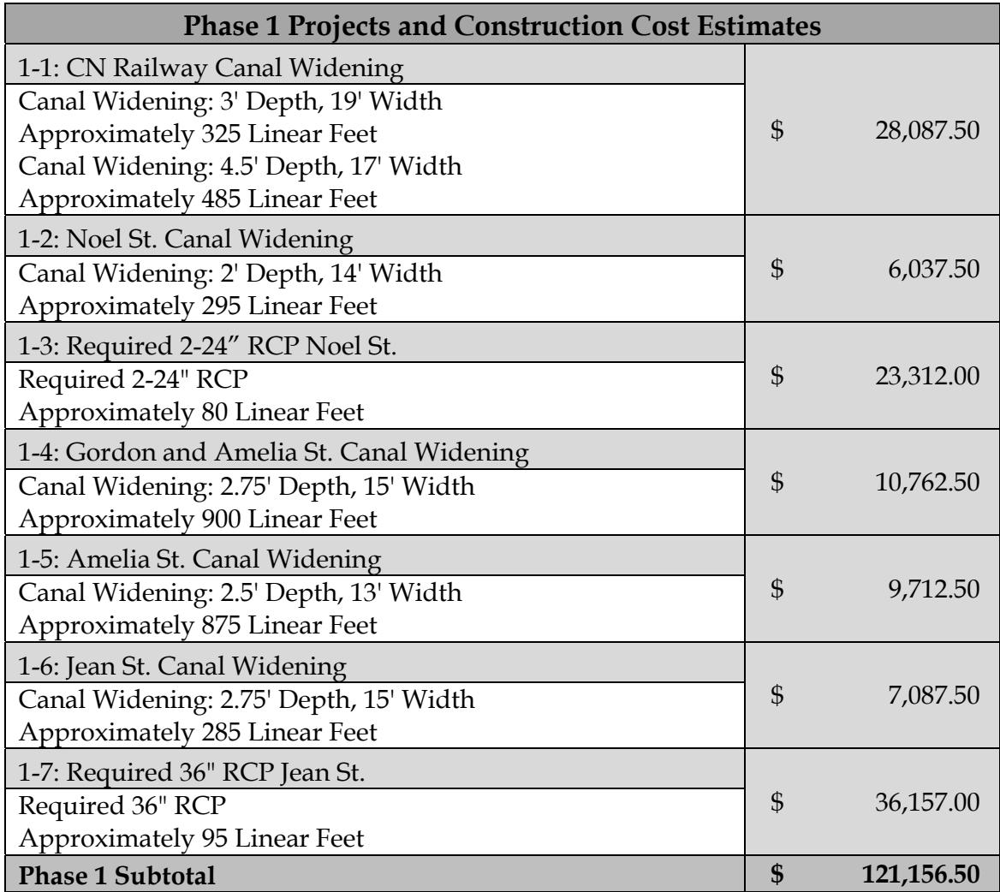
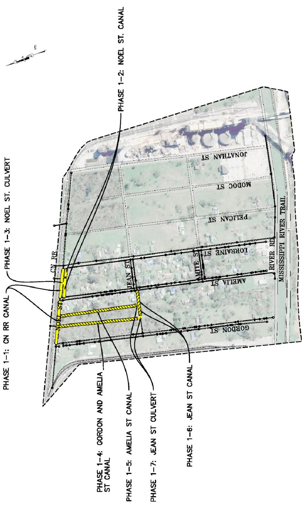
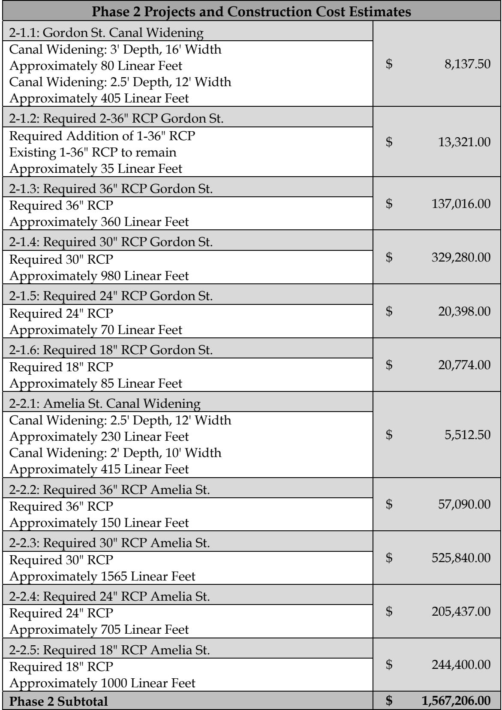
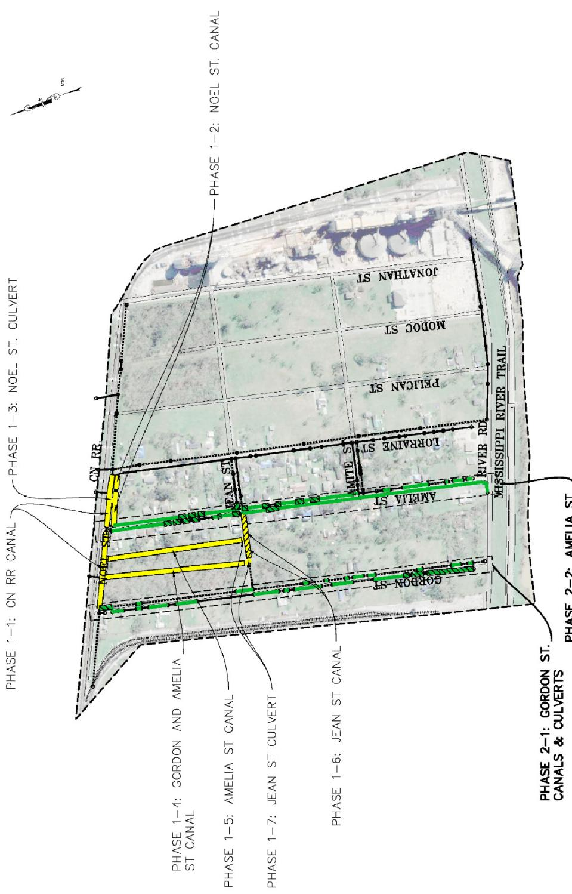
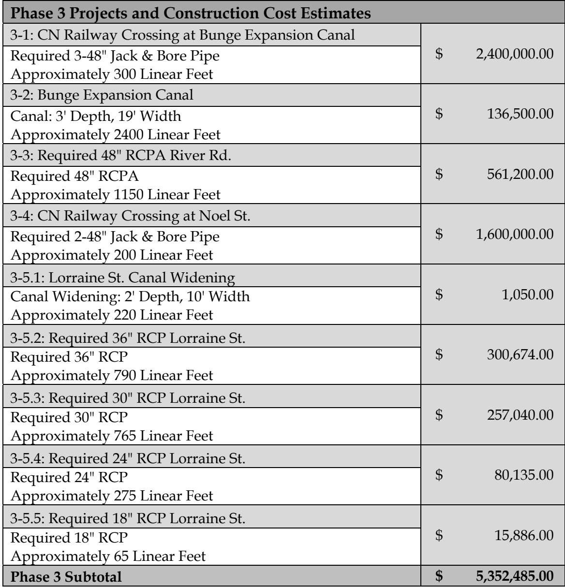
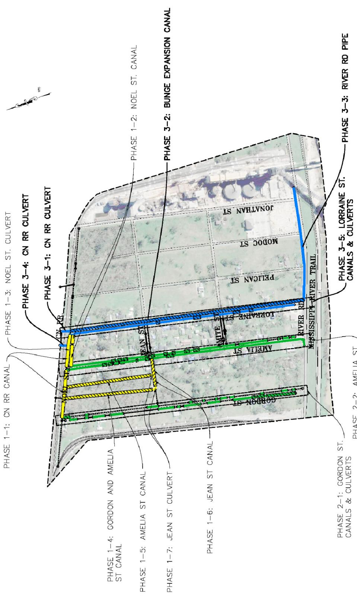

# Destrehan West Executive Summary

Source: `Destrehan West Executive Summary.pdf` (St. Charles Parish, Master Drainage Plan). Pages: 9.

## Page 1

#### Volume 13: Destrehan West

#### 13.1 Executive Summary

St. Charles Parish tasked Principal Engineering, Inc. to complete the study of the Destrehan West Drainage Area for the East Bank Master Drainage Plan. Principal Engineering performed analyses for 25-Year and 100-Year Design Storms (NOAA Atlas 14), and developed drainage improvements that:

1. 25-Year: Reduce the water surface elevations in the canals to one foot below top of the bank such that future internal drainage improvements may function to eliminate street flooding.

2. 100-Year: Lower water surface elevations in the canals such that direct structure flooding from the canals is eliminated and future internal drainage improvements may function to eliminate internal area structure flooding.

The recommended program consists of the 25-Year and select 100-Year improvements at major street crossings and railroad crossings.

Analysis used models built in EPA SWMM and AutoDesk’s Storm and Sanitary Analysis. Existing flood-prone areas were identified in areas along Amelia St. and Lorraine St. The results of the existing conditions simulation illustrate the inadequacy of the drainage system for the design events.

The recommended improvements are grouped into phases and projects; verified by sequenced modeling that upstream improvements do not cause adverse effect downstream, if constructed in recommended order. Major improvements include increasing the capacity of existing crossings under CN RR, increasing the capacity of the canals between Gordon St. and Amelia St., drainage conveyance from River Rd. around the planned expansion of Bunge’s facility, and increasing capacity of existing drainage pipes and culverts along Gordon St., Amelia St., and Lorraine St.

## Page 2

Modeled improvements have been partitioned into executable projects with cost estimates provided. It is expected that the Parish will create an integrated priority list consisting of projects from all basins, constructed individually as funding becomes available. A summary of projects and costs is tabulated on the following pages by phase.

**Table 1**

| Recommended ProgramConstruction Cost Estimation |  |  |
|---|---|---|
| Phase | Number of Projects | Cost |
| Phase 1 | 7 | $ 121,156.50 |
| Phase 2 | 11 | $ 1,567,206.00 |
| Phase 3 | 9 | $ 5,352,485.00 |
| Total | 27 | $ 7,040,847.50 |

Table snapshot (for checking): 

## Page 3

> **Figure description:** Aerial site plan of the study area (dashed boundary, no legend), between CN RR on the west and River Rd and the Mississippi River Trail on the east. Streets labelled, north to south: Jonathan St, Modoc St, Pelican St, Lorraine St, Amelia St and Gordon St, with Jean St, Noel St and Mite St crossing them. Dotted and solid lines show the existing storm drain network. Industrial storage tanks are visible along the north edge. No projects are called out.

## Page 4

**Table 2**

| Phase 1 Projects and Construction Cost Estimates |  |
|---|---|
| 1-1: CN Railway Canal Widening Canal Widening: 3' Depth, 19' Width Approximately 325 Linear FeetCanal Widening: 4.5' Depth, 17' Width Approximately 485 Linear Feet | $ 28,087.50 |
| 1-2: Noel St. Canal Widening Canal Widening: 2' Depth, 14' Width Approximately 295 Linear Feet | $ 6,037.50 |
| 1-3: Required 2-24" RCP Noel St. Required 2-24" RCPApproximately 80 Linear Feet | $ 23,312.00 |
| 1-4: Gordon and Amelia St. Canal Widening Canal Widening: 2.75' Depth, 15' Width Approximately 900 Linear Feet | $ 10,762.50 |
| 1-5: Amelia St. Canal Widening Canal Widening: 2.5' Depth, 13' Width Approximately 875 Linear Feet | $ 9,712.50 |
| 1-6: Jean St. Canal Widening Canal Widening: 2.75' Depth, 15' Width Approximately 285 Linear Feet | $ 7,087.50 |
| 1-7: Required 36" RCP Jean St. Required 36" RCPApproximately 95 Linear Feet | $ 36,157.00 |
| Phase 1 Subtotal | $ 121,156.50 |

Table snapshot (for checking): 

## Page 5

> **Figure description:** Phase 1 projects, highlighted in yellow, with call-outs: Phase 1-1 CN RR canal, Phase 1-2 Noel St canal, Phase 1-3 Noel St culvert, Phase 1-4 Gordon and Amelia St canal, Phase 1-5 Amelia St canal, Phase 1-6 Jean St canal, and Phase 1-7 Jean St culvert (hatched). N.T.S. No legend beyond the call-outs.

## Page 6

**Table 3**

| Phase 2 Projects and Construction Cost Estimates |  |
|---|---|
| 2-1.1: Gordon St. Canal Widening Canal Widening: 3' Depth, 16' Width Approximately 80 Linear FeetCanal Widening: 2.5' Depth, 12' Width Approximately 405 Linear Feet | $ 8,137.50 |
| 2-1.2: Required 2-36" RCP Gordon St. Required Addition of 1-36" RCPExisting 1-36" RCP to remain Approximately 35 Linear Feet | $ 13,321.00 |
| 2-1.3: Required 36" RCP Gordon St. Required 36" RCPApproximately 360 Linear Feet | $ 137,016.00 |
| 2-1.4: Required 30" RCP Gordon St. Required 30" RCPApproximately 980 Linear Feet | $ 329,280.00 |
| 2-1.5: Required 24" RCP Gordon St. Required 24" RCPApproximately 70 Linear Feet | $ 20,398.00 |
| 2-1.6: Required 18" RCP Gordon St. Required 18" RCPApproximately 85 Linear Feet | $ 20,774.00 |
| 2-2.1: Amelia St. Canal Widening Canal Widening: 2.5' Depth, 12' Width Approximately 230 Linear FeetCanal Widening: 2' Depth, 10' Width Approximately 415 Linear Feet | $ 5,512.50 |
| 2-2.2: Required 36" RCP Amelia St. Required 36" RCPApproximately 150 Linear Feet | $ 57,090.00 |
| 2-2.3: Required 30" RCP Amelia St. Required 30" RCPApproximately 1565 Linear Feet | $ 525,840.00 |
| 2-2.4: Required 24" RCP Amelia St. Required 24" RCPApproximately 705 Linear Feet | $ 205,437.00 |
| 2-2.5: Required 18" RCP Amelia St. Required 18" RCPApproximately 1000 Linear Feet | $ 244,400.00 |
| Phase 2 Subtotal | $ 1,567,206.00 |

Table snapshot (for checking): 

## Page 7

> **Figure description:** Phase 1 projects as in fig 2 (yellow), plus Phase 2 projects in green: Phase 2-1 Gordon St canals and culverts, and Phase 2-2 Amelia St canals and culverts along Amelia St toward River Rd.

## Page 8

**Table 4**

| Phase 3 Projects and Construction Cost Estimates |  |
|---|---|
| 3-1: CN Railway Crossing at Bunge Expansion Canal Required 3-48" Jack & Bore Pipe Approximately 300 Linear Feet | $ 2,400,000.00 |
| 3-2: Bunge Expansion Canal Canal: 3' Depth, 19' Width Approximately 2400 Linear Feet | $ 136,500.00 |
| 3-3: Required 48" RCPA River Rd. Required 48" RCPAApproximately 1150 Linear Feet | $ 561,200.00 |
| 3-4: CN Railway Crossing at Noel St. Required 2-48" Jack & Bore Pipe Approximately 200 Linear Feet | $ 1,600,000.00 |
| 3-5.1: Lorraine St. Canal Widening Canal Widening: 2' Depth, 10' Width Approximately 220 Linear Feet | $ 1,050.00 |
| 3-5.2: Required 36" RCP Lorraine St. Required 36" RCPApproximately 790 Linear Feet | $ 300,674.00 |
| 3-5.3: Required 30" RCP Lorraine St. Required 30" RCPApproximately 765 Linear Feet | $ 257,040.00 |
| 3-5.4: Required 24" RCP Lorraine St. Required 24" RCPApproximately 275 Linear Feet | $ 80,135.00 |
| 3-5.5: Required 18" RCP Lorraine St. Required 18" RCPApproximately 65 Linear Feet | $ 15,886.00 |
| Phase 3 Subtotal | $ 5,352,485.00 |

Table snapshot (for checking): 

## Page 9

> **Figure description:** Phases 1, 2 and 3 combined. Phase 1 (yellow) and Phase 2 (green) projects are as in the earlier figures. Phase 3 projects are in blue: Phase 3-1 CN RR culvert (west end), Phase 3-2 Bunge expansion canal (north-south along Jean St), Phase 3-3 River Rd pipe, Phase 3-4 CN RR culvert (near the Noel St end of Lorraine St), and Phase 3-5 Lorraine St canals and culverts.
