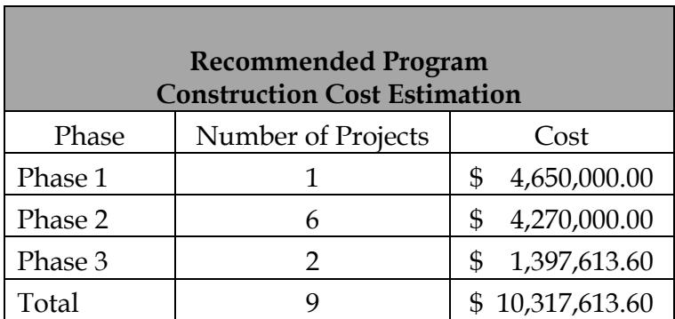
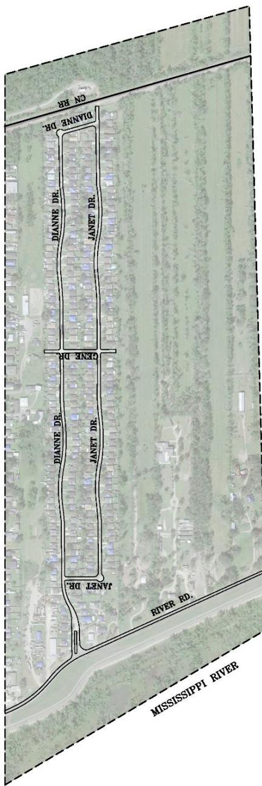
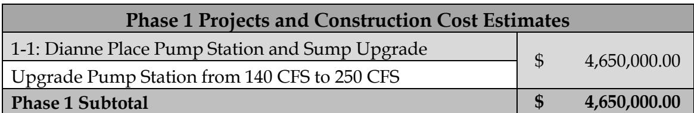
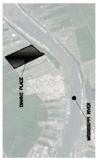
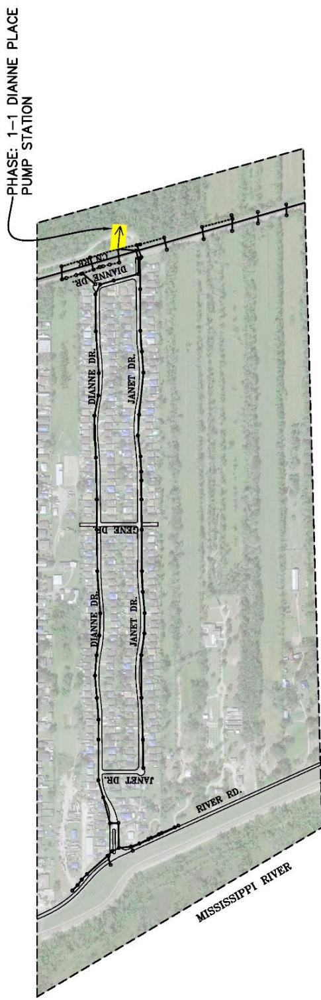
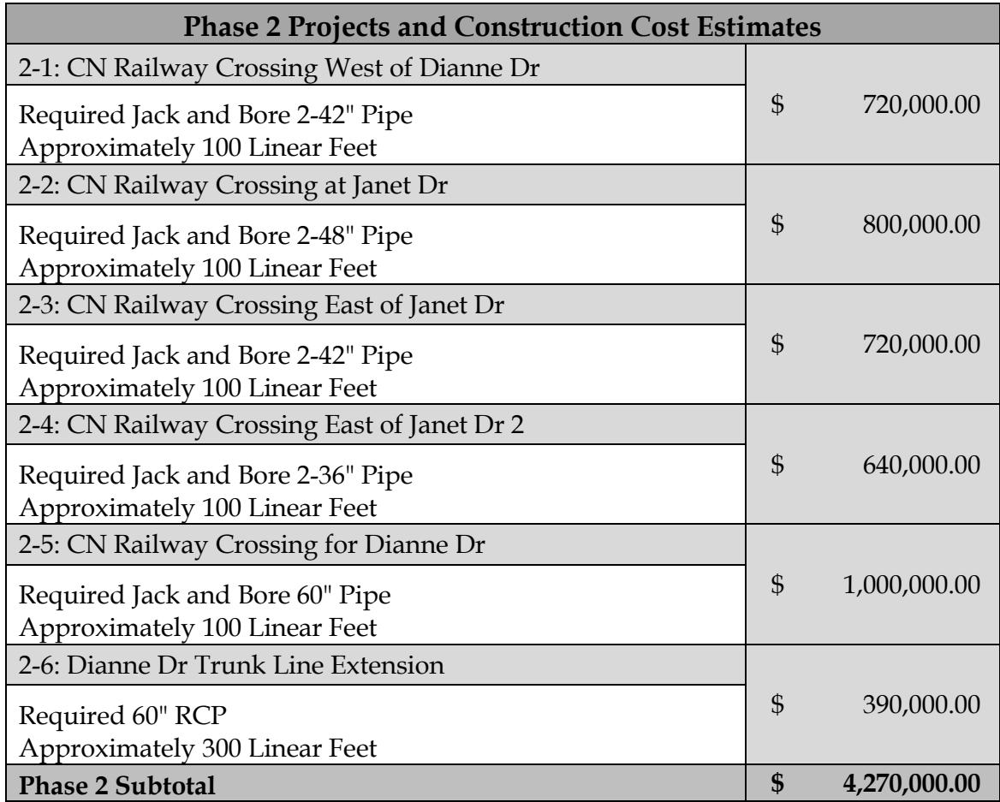
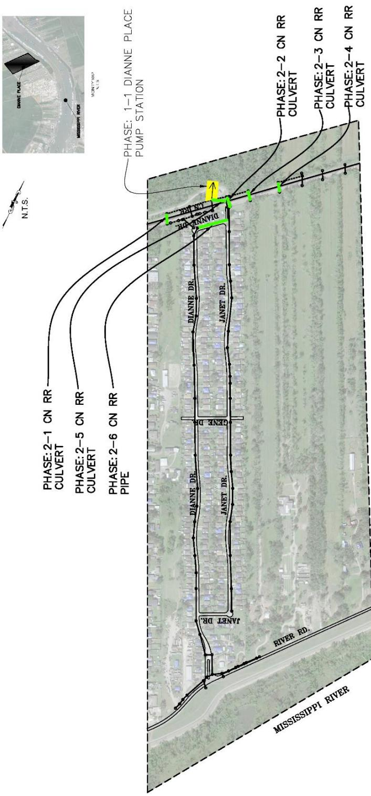
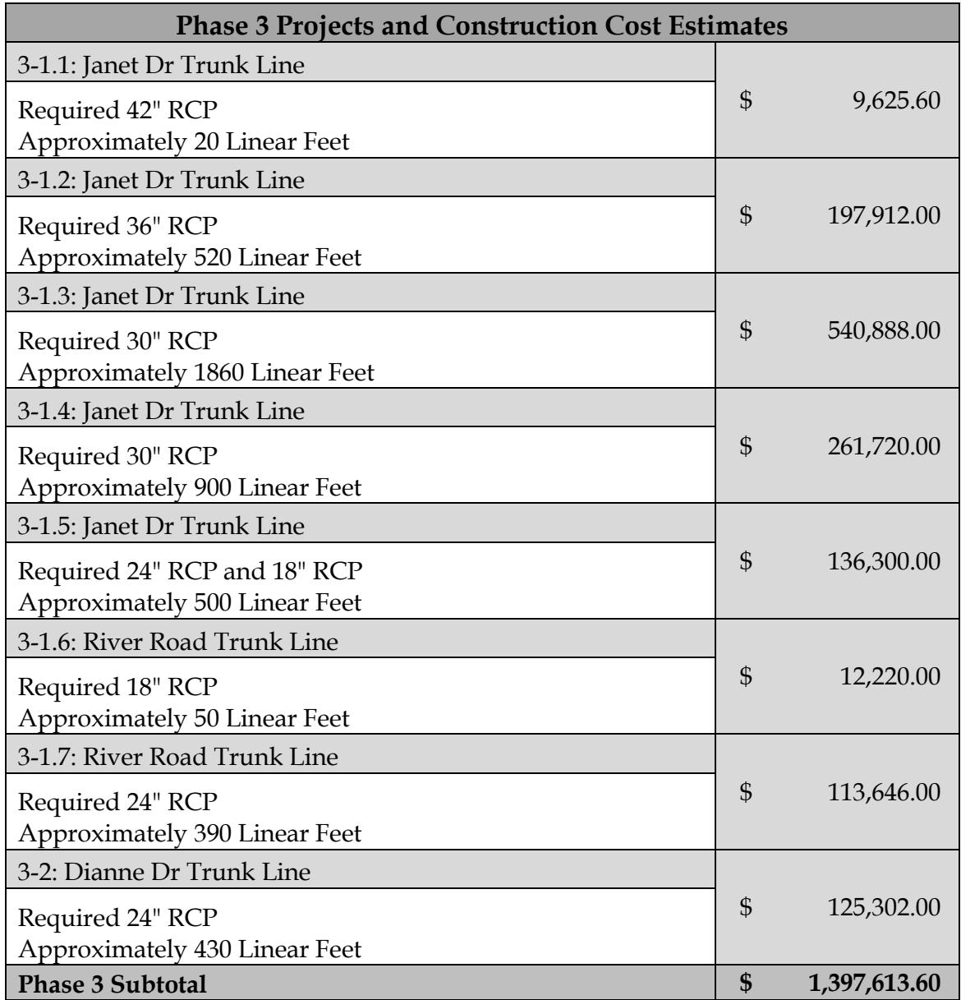
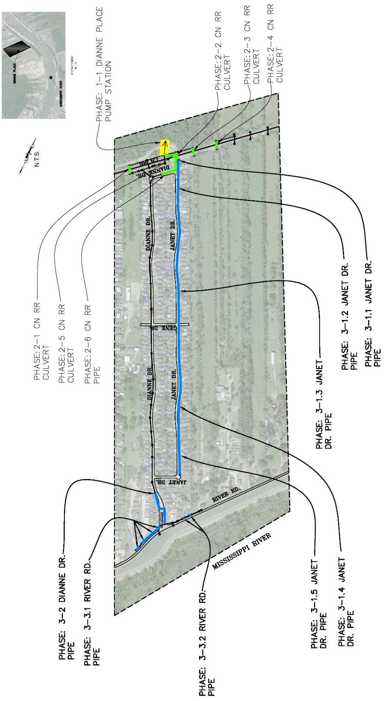

# Dianne Place  Executive Summary

Source: `Dianne Place  Executive Summary.pdf` (St. Charles Parish, Master Drainage Plan). Pages: 9.

## Page 1

#### Volume 7: Dianne Place

#### 7.1 Executive Summary

St. Charles Parish tasked Principal Engineering, Inc. to complete the study of the Dianne Place Drainage Area for the East Bank Master Drainage Plan. Principal Engineering performed analyses for 25-Year and 100-Year Design Storms (NOAA Atlas 14), and developed drainage improvements that:

1. 25-Year: Reduce the water surface elevations in the canals to one foot below top of the bank such that future internal drainage improvements may function to eliminate street flooding.

2. 100-Year: Lower water surface elevations in the canals such that direct structure flooding from the canals is eliminated and future internal drainage improvements may function to eliminate internal area structure flooding.

The recommended program consists of the 25-Year and select 100-Year improvements at major street crossings and railroad crossings.

Analysis used models built in EPA SWMM and AutoDesk’s Storm and Sanitary Analysis. Existing flood-prone areas were identified in areas along Dianne Drive and Janet Drive north of Gene Drive, as well as in open space east of Janet Drive and south of CN RR. The results of the existing conditions simulation illustrate the inadequacy of the drainage system for the design events.

The recommended improvements are grouped into phases and projects, building from the previous, in sensible order of construction, downstream to upstream. Major improvements include upgrading existing Dianne Place Pump Station, increasing capacity of existing crossings under CN RR, and increasing capacity of existing drainage pipes and culverts along Dianne Drive and Janet Drive.

Modeled improvements have been partitioned into executable projects with cost estimates provided. It is expected that the Parish will create an integrated priority list consisting of projects from all basins, constructed individually as funding becomes available. A summary of projects and costs is tabulated on the following pages by phase.

## Page 2

**Table 1**

| Recommended ProgramConstruction Cost Estimation |  |  |
|---|---|---|
| Phase | Number of Projects | Cost |
| Phase 1 | 1 | $ 4,650,000.00 |
| Phase 2 | 6 | $ 4,270,000.00 |
| Phase 3 | 2 | $ 1,397,613.60 |
| Total | 9 | $10,317,613.60 |

Table snapshot (for checking): 

## Page 3

> **Figure description:** Aerial site plan of the Dianne Place study area (dashed boundary, no legend), a long strip between CN RR to the north and River Rd and the Mississippi River to the south. Streets labelled: Dianne Dr, Janet Dr, Gene Dr (east-west cross street at mid-length), River Rd, CN RR and the Mississippi River. Residential blocks and the street network are drawn with solid outlines. No pump stations or projects are called out.

## Page 4

**Table 2**

| Phase 1 Projects and Construction Cost Estimates |  |
|---|---|
| 1-1: Dianne Place Pump Station and Sump Upgrade Upgrade Pump Station from 140 CFS to 250 CFS | $ 4,650,000.00 |
| Phase 1 Subtotal | $ 4,650,000.00 |

Table snapshot (for checking): 

## Page 5

> **Figure description:** Locator inset: an aerial with the study area hatched (Dianne Place) on the west bank near the Mississippi River, with a vicinity map label and N.T.S. Shows location only.

> **Figure description:** Phase 1-1 Dianne Place pump station, marked by a yellow symbol and arrow at the north end of the study area where Dianne Dr meets CN RR. Streets labelled Dianne Dr, Janet Dr, Gene Dr and River Rd. Node dots mark the storm drain runs. No legend.

## Page 6

**Table 3**

| Phase 2 Projects and Construction Cost Estimates |  |
|---|---|
| 2-1: CN Railway Crossing West of Dianne Dr Required Jack and Bore 2-42" Pipe Approximately 100 Linear Feet | $ 720,000.00 |
| 2-2: CN Railway Crossing at Janet Dr Required Jack and Bore 2-48" Pipe Approximately 100 Linear Feet | $ 800,000.00 |
| 2-3: CN Railway Crossing East of Janet Dr Required Jack and Bore 2-42" Pipe Approximately 100 Linear Feet | $ 720,000.00 |
| 2-4: CN Railway Crossing East of Janet Dr 2 Required Jack and Bore 2-36" Pipe Approximately 100 Linear Feet | $ 640,000.00 |
| 2-5: CN Railway Crossing for Dianne Dr Required Jack and Bore 60" Pipe Approximately 100 Linear Feet | $ 1,000,000.00 |
| 2-6: Dianne Dr Trunk Line Extension Required 60" RCPApproximately 300 Linear Feet | $ 390,000.00 |
| Phase 2 Subtotal | $ 4,270,000.00 |

Table snapshot (for checking): 

## Page 7

> **Figure description:** Phase 2 improvements under the CN RR line, marked in green: Phase 2-1 CN RR culvert (west end), Phase 2-2, 2-3 and 2-4 CN RR culverts (east along the railroad), Phase 2-5 CN RR culvert, and Phase 2-6 CN RR pipe (short run near Dianne Dr). The Phase 1-1 pump station is shown in yellow at the north end. Locator inset in the top left (vicinity map, N.T.S.).

## Page 8

**Table 4**

| Phase 3 Projects and Construction Cost Estimates |  |
|---|---|
| 3-1.1: Janet Dr Trunk Line Required 42" RCPApproximately 20 Linear Feet | $ 9,625.60 |
| 3-1.2: Janet Dr Trunk Line Required 36" RCPApproximately 520 Linear Feet | $ 197,912.00 |
| 3-1.3: Janet Dr Trunk Line Required 30" RCPApproximately 1860 Linear Feet | $ 540,888.00 |
| 3-1.4: Janet Dr Trunk Line Required 30" RCPApproximately 900 Linear Feet | $ 261,720.00 |
| 3-1.5: Janet Dr Trunk Line Required 24" RCP and 18" RCPApproximately 500 Linear Feet | $ 136,300.00 |
| 3-1.6: River Road Trunk Line Required 18" RCPApproximately 50 Linear Feet | $ 12,220.00 |
| 3-1.7: River Road Trunk Line Required 24" RCPApproximately 390 Linear Feet | $ 113,646.00 |
| 3-2: Dianne Dr Trunk Line Required 24" RCPApproximately 430 Linear Feet | $ 125,302.00 |
| Phase 3 Subtotal | $ 1,397,613.60 |

Table snapshot (for checking): 

## Page 9

> **Figure description:** Phase 3 pipe improvements, drawn in blue. Phase 3-1.1 to 3-1.5 Janet Dr pipes run along the Janet Dr alignment from the CN RR crossing south to River Rd. Phase 3-2 Dianne Dr pipe is at the south end, and Phase 3-3.1 and 3-3.2 River Rd pipes are near the river road crossing. The Phase 1-1 pump station and Phase 2 culverts are repeated. Locator inset in the top left.
