# Hahnville I Executive Summary

Source: `Hahnville I Executive Summary.pdf` (St. Charles Parish, Master Drainage Plan). Pages: 16.

## Page 1

### ST. CHARLES PARISH WEST BANK MASTER DRAINAGE PLAN HAHNVILLE 1 WATERSHED

#### EXECUTIVE SUMMARY

The goal of this section is to give a high-level overview of the process and results of the hydraulic and hydrologic study of the Hahnville 1 watershed. This summary shall always be accompanied by the comprehensive detailed report, which follows this section.

This report presents the results of a basin-wide modeling study for the Hahnville 1 drainage basin. The purpose of this study was to identify necessary improvements to the major conveyance systems to mitigate the effects of the 100-yr event. Drainage features that were considered as part of the system upgrades were the construction of ditches and replacement of culverts along critical areas within the Hahnville 1 basin along with jack-and-bore culverts across the UP railroad. This model can be used to identify other deficiencies and provide inputs for targeted analyses that are focused on upgrades at the subdivision-scale.

#### WATERSHED CHARACTERISTICS

The Hahnville 1 drainage basin is located on the west bank of the Mississippi River in St. Charles Parish (SCP), Louisiana. The focus area for this analysis is approximately 2,509 acres and is drained via gravity by a system of canals that are tidally influenced due to the connection with Lac des Allemands to the west. The northern basin has one primary outfall canal north of the UP. This canal flows from the southwestern boundary of the focus area, via cross-drain culverts at the existing Union Pacific (UP) railroad and a bridge at LA 3127 before joining with the Eighty Arpent Canal and west to the St. Charles Canal.

#### CURRENT DRAINAGE ISSUES

At present, the majority of drainage issues occur due to the lack of conveyance capacity within localized drainage systems in the neighborhoods. Residential areas along two key streets, King Street and River Park Drive, have experienced frequent flooding in recent years resulting from short duration rainfall events with high intensity.

#### PROPOSED IMPROVEMENTS

The development of the proposed conditions model focused on upgrading the existing drainage system within the Hahnville 1 basin. These upgrades include channel modifications to convey surface water runoff from the affected areas in the northern portion of the basin to the outfall and proposed culvert installations at the UP railroad crossings. The following exhibits show the proposed improvements as defined in the report and consolidated into “Improvement Groups.”

## Page 2

#### MODEL RESULTS

The following sections review the model results for the Existing Conditions (EC) and Proposed Conditions (PC) model simulations. Since the aim of the drainage basin upgrades is to reduce the impacts experienced by the 100-yr event, those simulation results will be the focus of this analysis and review.

#### ALTERNATIVES

By the request of the SCP Administration, TBS analyzed the conceptual cost to construct the proposed improvements to convey the stormwater flow produced by the 25-year rainfall event. The proposed conditions model was constructed to analyze the effects of various storms on the 100-year improvements. Therefore, TBS tabulated the flows generated from running the 25-year rainfall event against the 100-year improvements. These flows were then used to theoretically size channel and culvert improvements which could convey these flows. These resulting “25-year improvements” have not been analyzed to determine the effect on water surface elevation. However, they have been considered for cost comparison purposes as tabulated in the section below. If SCP should decide to construct any improvement to the 25-year size, further analysis is required. It should be noted that railroad crossings which are required to be sized for the 100-yr storm by the railroad companies remain sized as such in all cost calculations.

#### CONCEPTUAL COST ESTIMATE

The table below provides a summary for conceptual-level cost estimates associated with each improvement group. The table includes the cost for the “25-year improvements” as discussed above as well as the 100-year improvements as analyzed in the model. Mitigation, permitting, and land acquisition costs are not included as part of this cost assessment, as these costs can vary significantly depending on the final layout of the improvements determined during detailed design.

**Table 1: Conceptual project cost summary table**

| Prioritization Level | Improvement Group | Name | 25-year Total Cost* | 100-year Total Cost* |
|---|---|---|---|---|
| 1 | IG-1 IG-2 Priority 1 Projects Subtotal | King Street Hahn Street | $615,400 $394,100 $1,009,500 | $679,600 $516,400 $1,196,000 |
| 2 | IG-3 IG-4 | River Park Drive Sunset Court Priority 2 Projects Subtotal | $488,700 $313,200 $801,900 | $503,200 $340,500 $843,700 |
| 3 | IG-5 IG-6 Priority 3 Projects Subtotal | River Road Estates WestChannel River Road Estates East Channel | $200,800 $211,200 $412,000 | $232,400 $242,800 $475,200 |
| 4 | IG-7 IG-8 IG-9 IG-10 Priority 4 Projects Subtotal | Jack and Bore (East) Jack and Bore (West – 1) Jack and Bore (West – 2) Jack and Bore (West – 3) | $481,600 $487,100 $488,100 $496,400 $1,953,200 | $481,600 $487,100 $488,100 $496,400 $1,953,200 |
| Total Cost for Improvements |  |  | $4,176,600 | $4,468,100 |

_\*Total Cost includes 20% contingency._

Table snapshot (for checking): 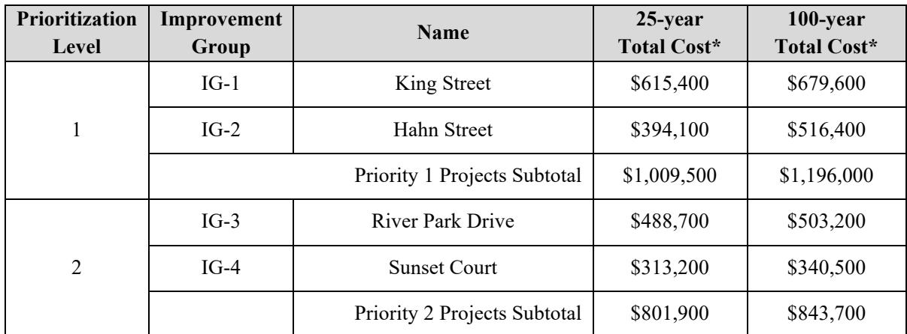

## Page 3

**Table 2**

_(continuation of Table 1 from the previous page; its rows are included there. The PDF text layer for this page matches.)_

## Page 4

NOTES: 1. Background Image Source: NAIP, 2015

**Table 3**

| X | Legend Existing Railroad Culvert Location |
|---|---|
|  | Existing Subsurface Culvert |
|  | Proposed Development |
|  | Existing Servitudes |
|  | Parcel Boundary |
|  | SCP Parcel Boundary |
|  | Hahnville 1 Study Area |

Table snapshot (for checking): 

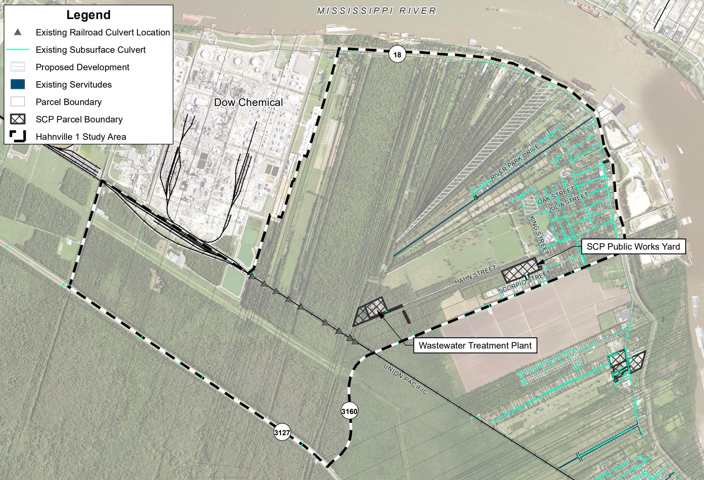

> **Figure description:** Study-area overview map with a legend, showing the Hahnville 1 Study Area (dashed boundary) along the Mississippi River. Labelled: the Dow Chemical plant to the northwest, US 18, LA 3127 and LA 3160, the Union Pacific rail line, and the streets Hahn St, King St, River Park Dr, Julia St, Oak St, Sunset Ct and Scorpio St. Also labelled: the SCP Public Works Yard and the Wastewater Treatment Plant. Legend items: existing railroad culvert locations, existing subsurface culverts, proposed development, existing servitudes, parcel boundary, SCP parcel boundary and study area.

EXISTINGCONDITIONS

HAHNVILLE 1 WATERSHED

## Page 5

**Table 4**

| Λ | Legend Existing Railroad Culvert Location |
|---|---|
|  | Existing Subsurface Culvert |
|  | Proposed Development |
|  | Existing Servitudes |
|  | Parcel Boundary |
|  | SCP Parcel Boundary |
|  | Hahnville 1 Study Area |

Table snapshot (for checking): 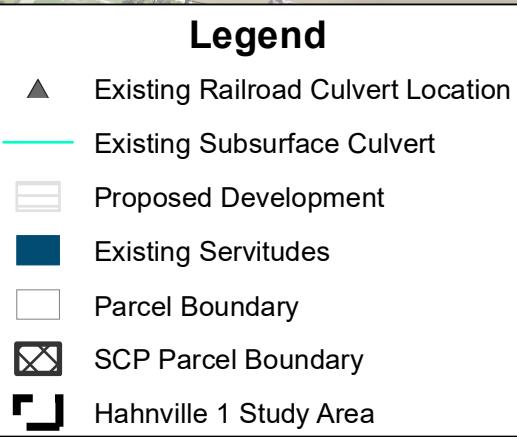

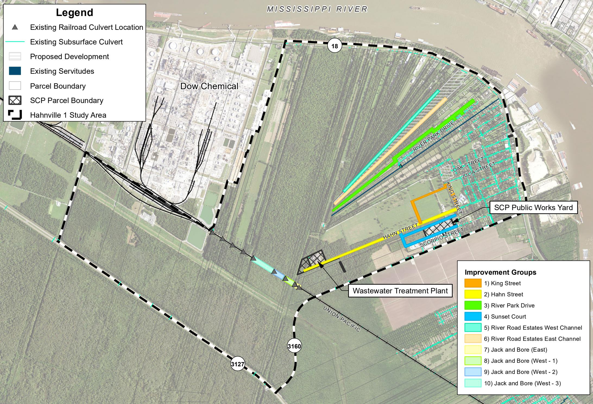

> **Figure description:** Improvement groups overview with ten colour-coded groups, listed in the legend: 1 King St, 2 Hahn St, 3 River Park Dr, 4 Sunset Ct, 5 River Road Estates West Channel, 6 River Road Estates East Channel, 7 Jack and Bore (East), 8 Jack and Bore (West-1), 9 Jack and Bore (West-2) and 10 Jack and Bore (West-3). The Jack and Bore groups lie along the Union Pacific rail line. No dollar figures are shown.

## Page 6

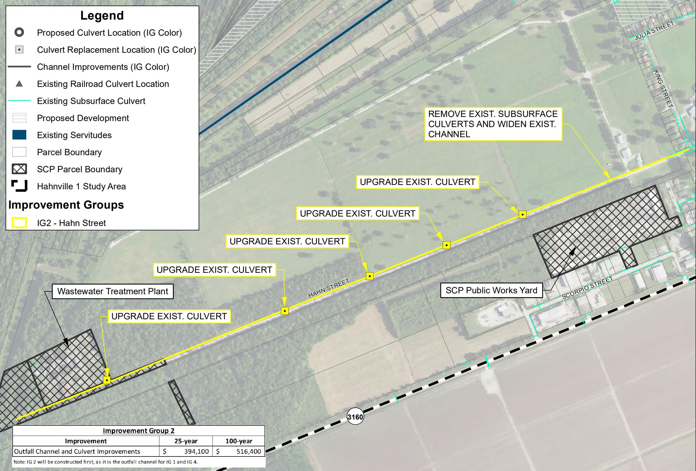

> **Figure description:** Improvement Group 2 (IG2, yellow) detail along Hahn St, from the Wastewater Treatment Plant northeast to the SCP Public Works Yard. Five call-outs read UPGRADE EXIST. CULVERT, and the northeast end reads REMOVE EXIST. SUBSURFACE CULVERTS AND WIDEN EXIST. CHANNEL. Table: Improvement Group 2, outfall channel and culvert improvements, $394,100 (25-year) and $516,400 (100-year). The note says IG 2 is built first as the outfall channel for IG 1 and IG 4.

NOTES:   
1. Background Image Source: NAIP, 2015   
2. IG Extent is meant for general description only. Final locations for all IGs have not been established as part of this phase of the project. Locations are subject to change as part of permitting and detailed engineering design. As such, costs associated with each IG do not include property acquisition.

EXHIBITES-3–IMPROVEMENTGROUP2PROPOSEDDRAINAGESYSTEMIMPROVEMENTSHAHNVILLE 1 WATERSHED

## Page 7

**Table 5**

| Legend |  |
|---|---|
|  | Proposed Culvert Location (IG Color) |
|  | Culvert Replacement Location (IG Color) |
|  | Channel Improvements (IG Color) |
|  | Existing Railroad Culvert Location |
|  | Existing Subsurface Culvert |
|  | Proposed Development |
|  | Existing Servitudes |
|  | Parcel Boundary |
|  | SCP Parcel Boundary |
|  | Hahnville 1 Study Area |
| Improvement Groups |  |
|  | IG1 - King Street |
|  | IG2 - Hahn Street |

Table snapshot (for checking): 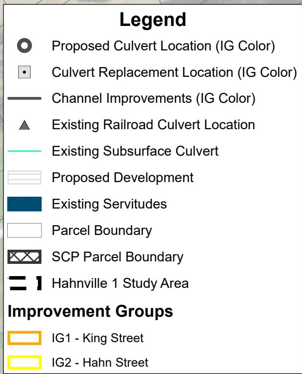

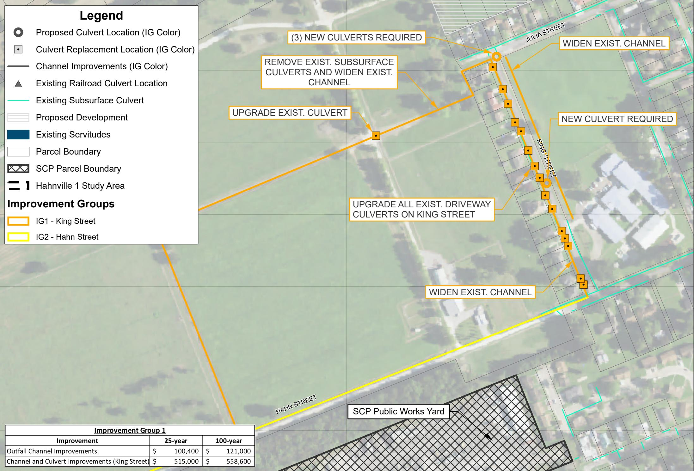

> **Figure description:** Improvement Group 1 (IG1, orange) detail along King St, with IG2 (yellow) along Hahn St at the south edge. Call-outs: (3) NEW CULVERTS REQUIRED at the north end near Julia St, NEW CULVERT REQUIRED midway, UPGRADE ALL EXIST. DRIVEWAY CULVERTS ON KING STREET, WIDEN EXIST. CHANNEL (two places), UPGRADE EXIST. CULVERT on the west branch, and REMOVE EXIST. SUBSURFACE CULVERTS AND WIDEN EXIST. CHANNEL on the west branch. Table: Improvement Group 1, outfall channel improvements $100,400 (25-year) and $121,000 (100-year); channel and culvert improvements (King Street) $515,000 and $558,600.

**Table 6**

| Improvement Group 1 |  |  |
|---|---|---|
| Improvement | 25-year | 100-year |
| Outfall Channel Improvements | $ 100,400 | $ 121,000 |
| Channel and Culvert Improvements (King Street) | $ 515,000 | $ 558,600 |

Table snapshot (for checking): 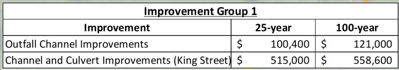

1. Background Image Source: NAIP, 2015 2. IG Extent is meant for general description only. Final locations for all IGs have not been established as part of this phase of the project. Locations are subject to change as part of permitting and detailed engineering design. As such, costs associated with each IG do not include property acquisition.

EXHIBIT ES-4 – IMPROVEMENT GROUP 1

PROPOSED DRAINAGE SYSTEM IMPROVEMENTS

HAHNVILLE 1 WATERSHED

## Page 8

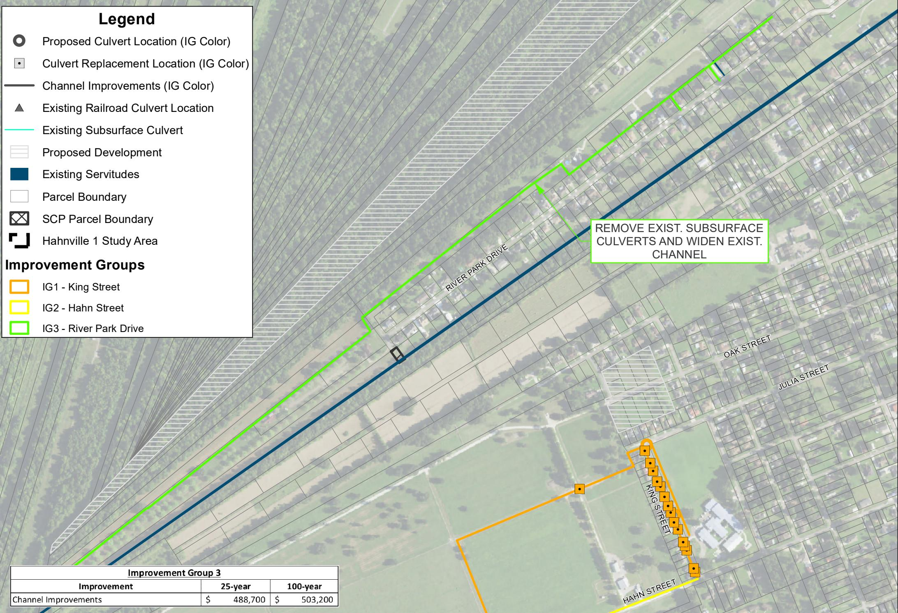

> **Figure description:** Improvement Group 3 (IG3, green) detail along River Park Dr. The green line follows the road, with a call-out to REMOVE EXIST. SUBSURFACE CULVERTS AND WIDEN EXIST. CHANNEL. A dark blue line marks an existing servitude parallel to the road, and the King St culverts of IG1 appear at the lower right. Table: Improvement Group 3, channel improvements, $488,700 (25-year) and $503,200 (100-year).

**Table 7**

| Improvement Group 3 |  |  |
|---|---|---|
| Improvement | 25-year | 100-year |
| Channel Improvements | $ 488,700 | $ 503,200 |

Table snapshot (for checking): 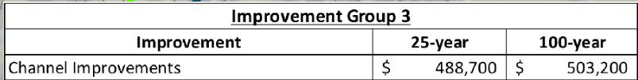

EXHIBITES-5–IMPROVEMENTGROUP3

PROPOSEDDRAINAGESYSTEMIMPROVEMENTS

HAHNVILLE 1 WATERSHED

## Page 9

**Table 8**

|  | Proposed Culvert Location (IG Color) |
|---|---|
|  | Culvert Replacement Location (IG Color) |
|  | Channel Improvements (IG Color) |
|  | Existing Railroad Culvert Location |
|  | Existing Subsurface Culvert |
|  | Proposed Development |
|  | Existing Servitudes |
|  | Parcel Boundary |
|  | SCP Parcel Boundary |
|  | Hahnville 1 Study Area |

Table snapshot (for checking): 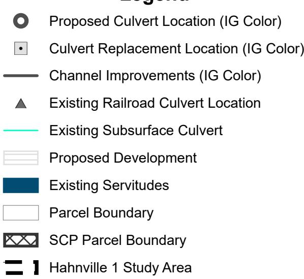

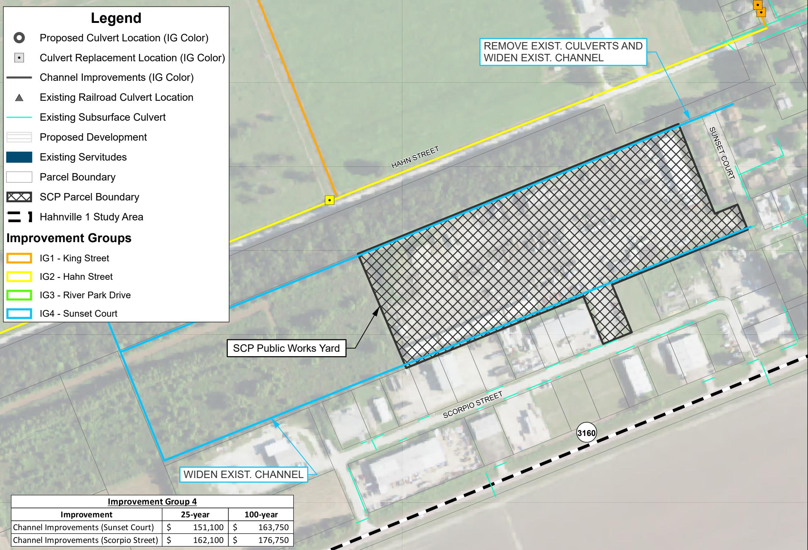

> **Figure description:** Improvement Group 4 (IG4, light blue) detail around Sunset Ct and the SCP Public Works Yard parcel (hatched). Call-outs: REMOVE EXIST. CULVERTS AND WIDEN EXIST. CHANNEL along the north side of the yard, and WIDEN EXIST. CHANNEL along the Scorpio St side. Hahn St (IG2, yellow) runs along the north edge. Table: Improvement Group 4, channel improvements (Sunset Court) $151,100 (25-year) and $163,750 (100-year); channel improvements (Scorpio Street) $162,100 and $176,750.

**Table 9**

| Improvement Group 4 |  |  |
|---|---|---|
| Improvement | 25-year | 100-year |
| Channel Improvements (Sunset Court) | $ 151,100 | $ 163,750 |
| Channel Improvements (Scorpio Street) | $ 162,100 | $ 176,750 |

_NOTES: 1. Background Image Source: NAIP, 2015 2. IG Extent is meant for general description only. Final locations for all IGs have not been established as part of this phase of the project. Locations are subject to change as part of permitting and detailed engineering design. As such, costs associated with each IG do not include property acquisition._

Table snapshot (for checking): 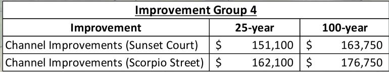

EXHIBIT ES-6 – IMPROVEMENT GROUP 4 PROPOSED DRAINAGE SYSTEM IMPROVEMENTS HAHNVILLE 1 WATERSHED

## Page 10

#### Legend

Proposed Culvert Location (IG Color)

"/ Culvert Replacement Location (IG Color)

Channel Improvements (IG Color)

Existing Railroad Culvert Location

Existing Subsurface Culvert

Proposed Development

Existing Servitudes

Parcel Boundary

SCP Parcel Boundary

Hahnville 1 Study Area

#### Improvement Groups

IG1 - King Street

IG2 - Hahn Street

IG3 - River Park Drive

IG4 - Sunset Court

IG5 - River Road Estates West Channel

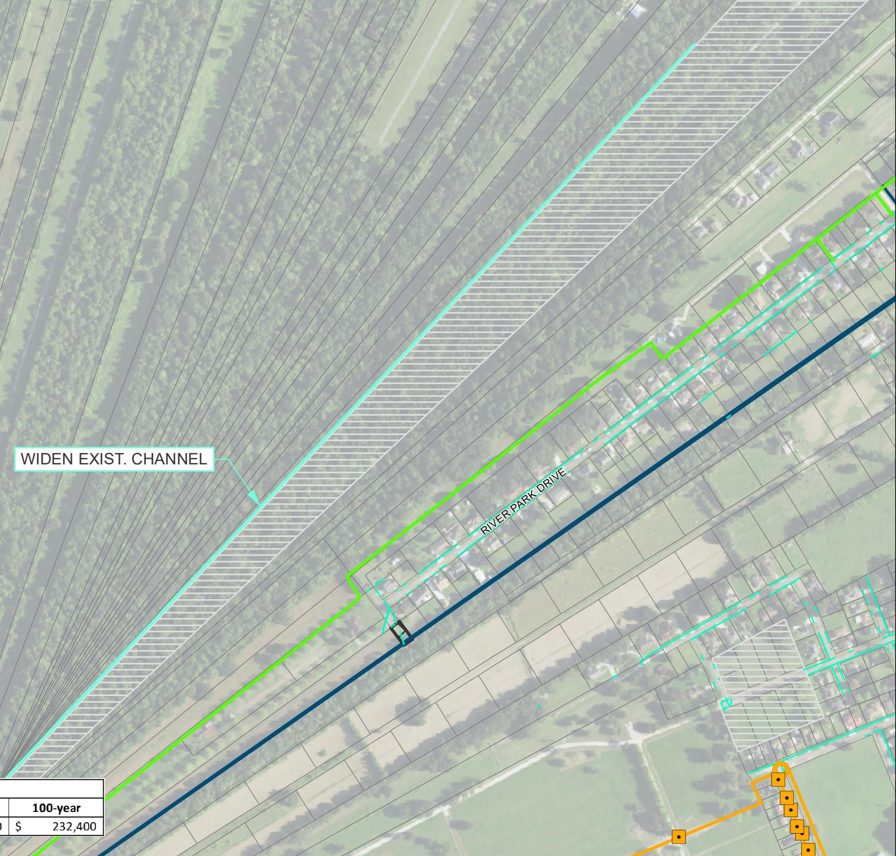

> **Figure description:** Close-up of the River Park Dr area with no legend. A hatched proposed development lies to the northwest, a dark blue existing servitude runs parallel to the road, and the IG3 green line follows River Park Dr. A cyan existing channel along the edge of the proposed development is labelled WIDEN EXIST. CHANNEL. The table at the left edge is cropped: only the 100-year value of $232,400 is visible, and its row label and 25-year value are cut off.

**Table 10**

| Improvement Group 5 |  |  |
|---|---|---|
| Improvement | 25-year | 100-year |
| Channel Improvements | $ 200,800 | $ 232,400 |

Table snapshot (for checking): 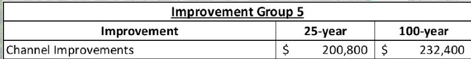

1. Background Image Source: NAIP, 2015 2. IG Extent is meant for general description only. Final locations for all IGs have not been established as part of this phase of the project. Locations are subject to change as part of permitting and detailed engineering design. As such, costs associated with each IG do not include property acquisition.

EXHIBITES-7–IMPROVEMENTGROUP5

PROPOSEDDRAINAGESYSTEMIMPROVEMENTS

HAHNVILLE 1 WATERSHED

## Page 11

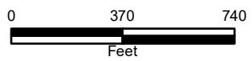

> **Figure description:** Map scale bar, 0 to 370 to 740 feet. Map furniture only.

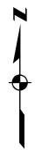

> **Figure description:** North arrow with N.T.S. Map furniture only.

#### Legend

Proposed Culvert Location (IG Color)

"/ Culvert Replacement Location (IG Color)

Channel Improvements (IG Color)

#\* Existing Railroad Culvert Location

Existing Subsurface Culvert

Proposed Development

Existing Servitudes

Parcel Boundary

SCP Parcel Boundary

Hahnville 1 Study Area

#### Improvement Groups

IG1 - King Street

IG2 - Hahn Street

IG3 - River Park Drive

IG4 - Sunset Court

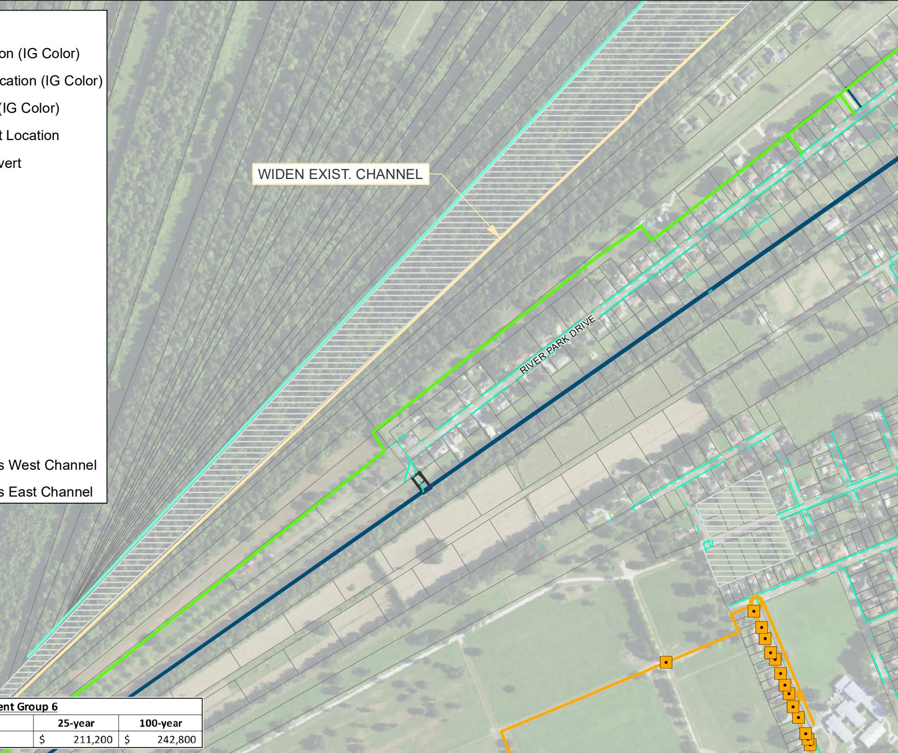

> **Figure description:** Close-up of the River Park Dr area. A beige hatched strip labelled WIDEN EXIST. CHANNEL runs diagonally across the upper left; a dark blue existing servitude runs parallel to the road, and the IG3 green line follows River Park Dr. Legend at the left edge is cut off, showing only the ends of entries: "...on (IG Color)", "...cation (IG Color)", "...(IG Color)", "...t Location", "...vert", "...s West Channel" and "...s East Channel". Table at the lower left is cropped: header 'Improvement Group 6', 25-year $211,200 and 100-year $242,800; the row label is cut off.

IG5 - River Road Estates West Channel

IG6 - River Road Estates East Channel

**Table 11**

| Improvement Group 6 |  |  |
|---|---|---|
| Improvement | 25-year | 100-year |
| Channel Improvements | $ 211,200 | $ 242,800 |

Table snapshot (for checking): 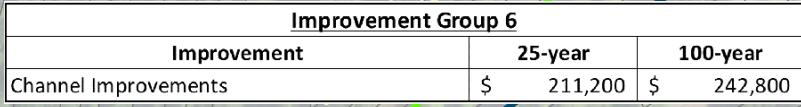

EXHIBITES-8–IMPROVEMENTGROUP6

PROPOSEDDRAINAGESYSTEMIMPROVEMENTS

HAHNVILLE 1 WATERSHED

## Page 12

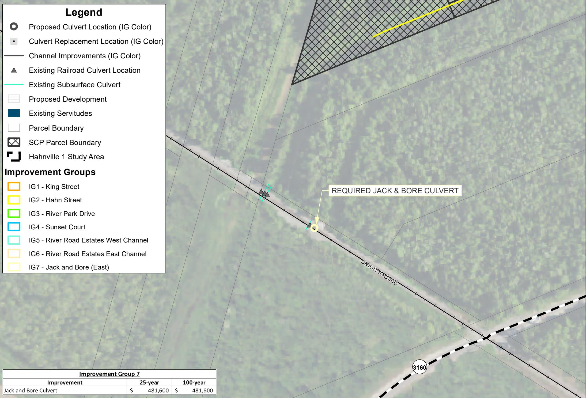

> **Figure description:** Legend and map of the Improvement Group 7 (Jack and Bore, East) location along the Union Pacific rail line. Call-out: REQUIRED JACK & BORE CULVERT at the rail line, with a route 3160 shield to the southeast. Legend items: proposed culvert location, culvert replacement location, channel improvements, existing railroad culvert, existing subsurface culvert, proposed development, existing servitudes, parcel boundary, SCP parcel boundary, Hahnville 1 study area, and the IG1 to IG7 colour keys. Table: Improvement Group 7, Jack and Bore Culvert, $481,600 (25-year) and $481,600 (100-year).

**Table 12**

| Improvement Group 7 |  |  |
|---|---|---|
| Improvement | 25-year | 100-year |
| Jack and Bore Culvert | $ 481,600 | $ 481,600 |

Table snapshot (for checking): 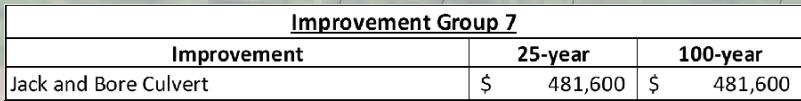

NOTES:

2. IG Extent is meant for general description only. Final locations for all IGs have not been established as part of this phase o the project. Locations are subject to change as part of permitting and detailed engineering design. As such, costs associated with each IG do not include property acquisition.

EXHIBITES-9–IMPROVEMENTGROUP7

PROPOSEDDRAINAGESYSTEM IMPROVEMENTS

HAHNVILLE 1 WATERSHED

## Page 13

#### Legend

Proposed Culvert Location (IG Color)

"/ Culvert Replacement Location (IG Color)

Channel Improvements (IG Color)

#\* Existing Railroad Culvert Location

Existing Subsurface Culvert

Proposed Development

Existing Servitudes

Parcel Boundary

SCP Parcel Boundary

Hahnville 1 Study Area

#### Improvement Group

IG1 - King Street

IG2 - Hahn Street

IG3 - River Park Drive

IG4 - Sunset Court

IG5 - River Road Estates West Channel

IG6 - River Road Estates East Channel

IG7 - Jack and Bore (East)

IG8 - Jack and Bore (West - 1)

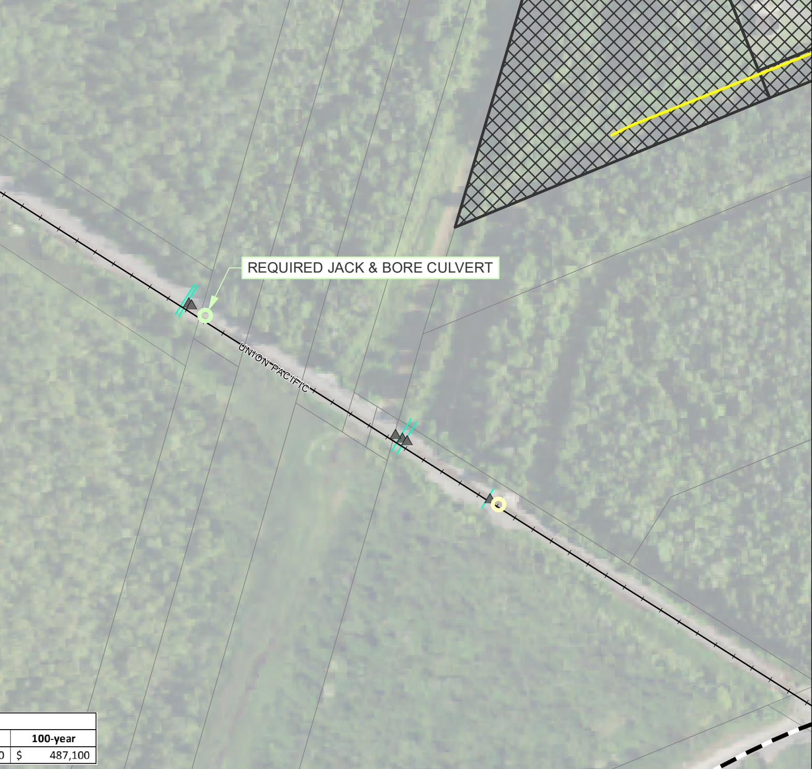

> **Figure description:** Jack and Bore culvert detail along the Union Pacific rail line, with a REQUIRED JACK & BORE CULVERT call-out, three existing railroad culvert locations and a proposed culvert location. A hatched proposed-development area is at the top right. The table in the bottom left is cropped: only the 100-year value of $487,100 is visible. That value matches the Improvement Group 8 (Jack and Bore, West-1) row of the summary table on page 16.

**Table 13**

| Improvement Group 8 |  |  |
|---|---|---|
| Improvement | 25-year | 100-year |
| Jack and Bore Culvert | $ 487,100 | $ 487,100 |

Table snapshot (for checking): 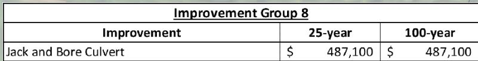

NOTES:

2. IG Extent is meant for general description only. Final locations for all IGs have not been established as part of this phase o the project. Locations are subject to change as part of permitting and detailed engineering design. As such, costs associated with each IG do not include property acquisition.

EXHIBITES-10–IMPROVEMENTGROUP8

PROPOSEDDRAINAGESYSTEMIMPROVEMENTS

HAHNVILLE 1 WATERSHED

## Page 14

#### Legend

Proposed Culvert Location (IG Color)

"/ Culvert Replacement Location (IG Color)

Channel Improvements (IG Color)

Existing Railroad Culvert Location

Existing Subsurface Culvert

Proposed Development

Existing Servitudes

Parcel Boundary

SCP Parcel Boundary

Hahnville 1 Study Area

#### Improvement Groups

IG1 - King Street

IG2 - Hahn Street

IG3 - River Park Drive

IG4 - Sunset Court

IG5 - River Road Estates West Channel

IG6 - River Road Estates East Channel

IG7 - Jack and Bore (East)

IG8 - Jack and Bore (West - 1)

IG9 - Jack and Bore (West - 2)

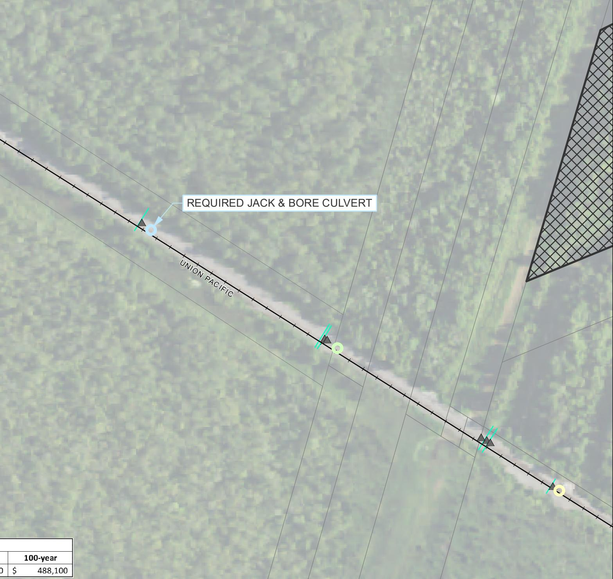

> **Figure description:** Jack and Bore culvert detail along the Union Pacific rail line, with a REQUIRED JACK & BORE CULVERT call-out and existing railroad culvert locations. The table in the bottom left is cropped: only the 100-year value of $488,100 is visible. That value matches the Improvement Group 9 (Jack and Bore, West-2) row of the summary table on page 16.

**Table 14**

| Improvement Group 9 |  |  |
|---|---|---|
| Improvement | 25-year | 100-year |
| Jack and Bore Culvert | $ 488,100 | $ 488,100 |

Table snapshot (for checking): 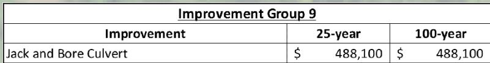

NOTES:

1. Background Image Source: NAIP, 2015

2. IG Extent is meant for general description only. Final locations for all IGs have not been established as part of this phase of the project. Locations are subject to change as part of permitting and detailed engineering design. As such, costs associated with each IG do not include property acquisition.

EXHIBITES-11–IMPROVEMENTGROUP9

PROPOSEDDRAINAGESYSTEMIMPROVEMENTS

HAHNVILLE 1 WATERSHED

## Page 15

#### Legend

Proposed Culvert Location (IG Color)

"/ Culvert Replacement Location (IG Color)

Channel Improvements (IG Color)

#\* Existing Railroad Culvert Location

Existing Subsurface Culvert

Proposed Development

Existing Servitudes

Parcel Boundary

SCP Parcel Boundary

Hahnville 1 Study Area

#### Improvement Group

IG1 - King Street

IG2 - Hahn Street

IG3 - River Park Drive

IG4 - Sunset Court

IG5 - River Road Estates West Channel

IG6 - River Road Estates East Channel

IG7 - Jack and Bore (East)

IG8 - Jack and Bore (West - 1)

IG9 - Jack and Bore (West - 2)

IG10 - Jack and Bore (West - 3)

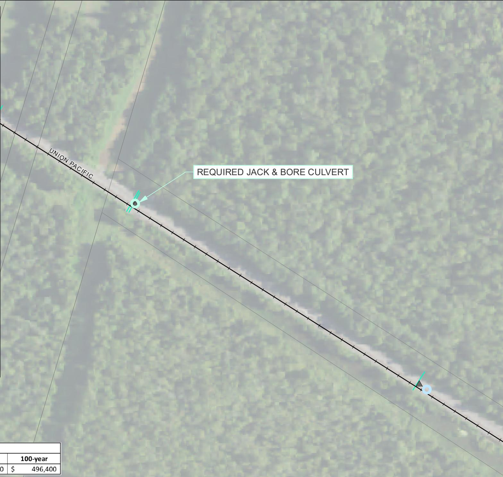

> **Figure description:** Jack and Bore culvert detail along the Union Pacific rail line, with a REQUIRED JACK & BORE CULVERT call-out and existing railroad culvert locations. The table in the bottom right is cropped: only the 100-year value of $496,400 is visible. That value matches the Improvement Group 10 (Jack and Bore, West-3) row of the summary table on page 16.

**Table 15**

| Improvement Group 10 |  |  |
|---|---|---|
| Improvement | 25-year | 100-year |
| Jack and Bore Culvert | $ 496,400 | $ 496,400 |

Table snapshot (for checking): 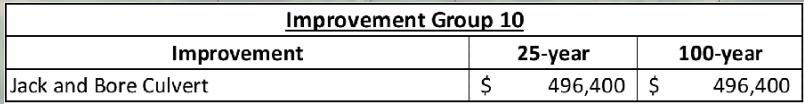

NOTES:

2. IG Extent is meant for general description only. Final locations for all IGs have not been established as part of this phase of the project. Locations are subject to change as part of permitting and detailed engineering design. As such, costs associated with each IG do not include property acquisition.

EXHIBITES-12–IMPROVEMENTGROUP10

PROPOSEDDRAINAGESYSTEMIMPROVEMENTS

HAHNVILLE 1 WATERSHED

## Page 16

**Table 16**

|  | Legend |
|---|---|
|  | Existing Railroad Culvert Location |
|  | Existing Subsurface Culvert |
|  | Proposed Development |
|  | Existing Servitudes |
|  | Parcel Boundary |
|  | SCP Parcel Boundary |
|  | Hahnville 1 Study Area |

Table snapshot (for checking): 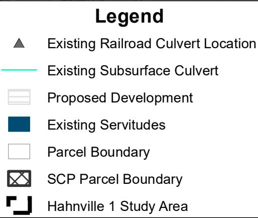

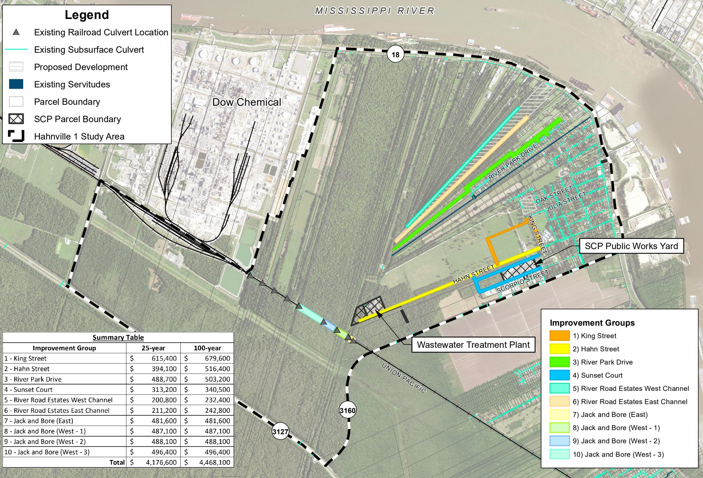

> **Figure description:** Hahnville 1 study-area overview with a legend, showing the Mississippi River, Dow Chemical, US 18, LA 3127, LA 3160 and the Union Pacific rail line. Labelled streets: River Park Drive, Oak Street, Julia Street, King Street, Hahn Street and Scorpio Street. Also labelled: the SCP Public Works Yard and the Wastewater Treatment Plant. Improvement Groups 1 to 10 are colour-coded, with a Summary Table in the bottom left. The table gives 25-year and 100-year totals of $4,176,600 and $4,468,100. Legend items: existing railroad culvert location, existing subsurface culvert, proposed development, existing servitudes, parcel boundary, SCP parcel boundary and Hahnville 1 study area.

**Table 17**

| Summary Table |  |  |
|---|---|---|
| Improvement Group | 25-year | 100-year |
| 1 - King Street | $ 615,400 | $ 679,600 |
| 2 - Hahn Street | $ 394,100 | $ 516,400 |
| 3 - River Park Drive | $ 488,700 | $ 503,200 |
| 4 - Sunset Court | $ 313,200 | $ 340,500 |
| 5 - River Road Estates West Channel | $ 200,800 | $ 232,400 |
| 6 - River Road Estates East Channel | $ 211,200 | $ 242,800 |
| 7 - Jack and Bore (East) | $ 481,600 | $ 481,600 |
| 8 - Jack and Bore (West - 1) | $ 487,100 | $ 487,100 |
| 9 - Jack and Bore (West - 2) | $ 488,100 | $ 488,100 |
| 10 - Jack and Bore (West - 3) | $ 496,400 | $ 496,400 |
| Total | $ 4,176,600 | $ 4,468,100 |

Table snapshot (for checking): 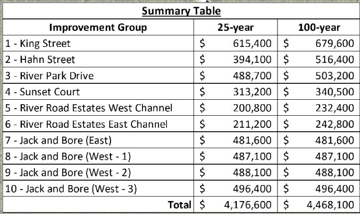

NOTES:   
1. Background Image Source: NAIP, 2015   
2. IG Extent is meant for general description only. Final locations for all IGs have not been established as part of this phase of the project. Locations are subject to change as part of permitting and detailed engineering design.As such, costs associated with each IG do not include property acquisition.
