# Hahnville II Executive Summary

Source: `Hahnville II Executive Summary.pdf` (St. Charles Parish, Master Drainage Plan). Pages: 16.

## Page 1

### ST. CHARLES PARISH WEST BANK MASTER DRAINAGE PLAN HAHNVILLE 2 WATERSHED

#### EXECUTIVE SUMMARY

The goal of this section is to give a high-level overview of the process and results of the hydraulic and hydrologic study of the Hahnville 2 watershed. This summary shall always be accompanied by the comprehensive detailed report, which follows this section.

This report presents the results of a basin-wide modeling study for the Hahnville 2 drainage basin. The purpose of this study was to identify necessary improvements to the major conveyance systems to mitigate the effects of the 100-yr event. Drainage features that were considered as part of the system upgrades were the construction of ditches and replacement of culverts along critical areas within the Hahnville 2 basin along with jack-and-bore culverts across the UP railroad. This model can be used to identify other deficiencies and provide inputs for targeted analyses that are focused on upgrades at the subdivision-scale.

#### WATERSHED CHARACTERISTICS

The Hahnville 2 drainage basin is located on the west bank of the Mississippi River in St. Charles Parish (SCP), Louisiana. The focus area for this analysis is approximately 2,220 acres (Figure 1) and is drained via gravity by a system of canals that are tidally influenced due to the connection with Lac des Allemands to the west. The Vial Canal serves as the primary outfall for Hahnville 2. It drains southwest under the bridge at LA 3127 and then west in the Eighty Arpent Canal.

#### CURRENT DRAINAGE ISSUES

At present, the majority of drainage issues occur due to the lack of conveyance capacity through the UP railroad. Residential areas adjacent to the railroad have experienced frequent flooding in recent years resulting from short duration rainfall events with high intensity.

#### PROPOSED CONDITIONS MODEL

The development of the proposed conditions model focused on upgrading the existing drainage system within the Hahnville 2 basin. These upgrades include jack-and-bore culverts through the UP railroad and additional channels within the northern and southern basin. Considerations were made for planned and potential future development.

## Page 2

#### MODEL RESULTS

The following sections review the model results for the Existing Conditions (EC) and Proposed Conditions (PC) model simulations. Since the aim of the drainage basin upgrades is to reduce the impacts experienced by the 100-yr event, those simulation results will be the focus of this analysis and review.

#### ALTERNATIVES

By the request of the SCP Administration, TBS analyzed the conceptual cost to construct the proposed improvements to convey the stormwater flow produced by the 25-year rainfall event. The proposed conditions model was constructed to analyze the effects of various storms on the 100- year improvements. Therefore, TBS tabulated the flows generated from running the 25-year rainfall event against the 100-year improvements. These flows were then used to theoretically size channel and culvert improvements which could convey these flows. These resulting “25-year improvements” have not been analyzed to determine the effect on water surface elevation. However, they have been considered for cost comparison purposes as tabulated in the section below. If SCP should decide to construct any improvement to the 25-year size, further analysis is required. It should be noted that railroad crossings which are required to be sized for the 100-yr storm by the railroad companies remain sized as such in all cost calculations.

#### CONCEPTUAL COST ESTIMATE

Table 11 Table below provides a summary for conceptual-level cost estimates associated with the recommended improvements. The table includes the cost for the “25-year improvements” as discussed above as well as the 100-year improvements as analyzed in the model. Mitigation, permitting, and land acquisition costs are not included as part of this cost assessment, as these costs can vary significantly depending on the final layout of the improvements determined during detailed design.

**Table 1: Conceptual project cost summary table**

| Prioritization Level | Improvement Group | Name | 25-year Total Cost* | 100-year Total Cost* |
|---|---|---|---|---|
| 1 | IG-1 IG-2 IG-3 Priority 1 Projects Subtotal | Bamboo Street Plantation Road Fashion Plantation Estates | $1,245,000 $522,300 $910,500 $2,677,800 | $1,327,700 $526,400 $1,043,000 $2,897,100 |
| 2 | IG-4 IG-5 Priority 2 Projects Subtotal | Avalon Subdivision Courthouse Lane | $1,236,600 $845,000 $2,081,600 | $1,273,700 $845,000 $2,118,700 |
| 3 | IG-6 IG-7 IG-8 IG-9 Priority 3 Projects Subtotal | River Place Estates Phase I Fashion Golf and Country Club River Road and Trails WayDrive River Place Estates Phases II andIII | $539,800 $528,900 $824,400 $772,400 $2,665,500 | $602,600 $528,900 $824,400 $772,400 $2,728,300 |
| 4 | IG-10 | Pump Station | $9,689,375 | $19,020,600 |
| Total Cost for Improvements |  |  | $17,114,275 | $26,764,700 |

> **Note:** the 25-year values for IG-7, IG-8 and IG-9 above are as printed on p02 and disagree with exhibits ES-9, ES-10, ES-11 (p12-p14) and the ES-13 summary (p16), which give $504,600, $785,800 and $750,900. With those, the Priority 3 25-year subtotal is $2,581,100 and the 25-year total is $17,029,875.

Table snapshot (for checking): 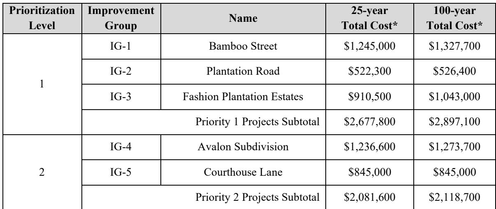

## Page 3

**Table 2**

_(continuation of Table 1 from the previous page; its rows are included there. The PDF text layer for this page matches.)_

## Page 4

**Table 3**

| Legend Existing Railroad Culvert Location |
|---|
| Existing Subsurface Culvert |
| Proposed Development |
| Existing Servitudes |
| Parcel Boundary |
| SCP Parcel Boundary |
| Hahnville 2 Study Area |

Table snapshot (for checking): 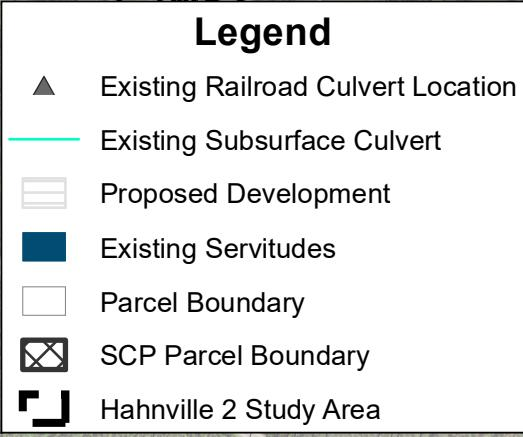

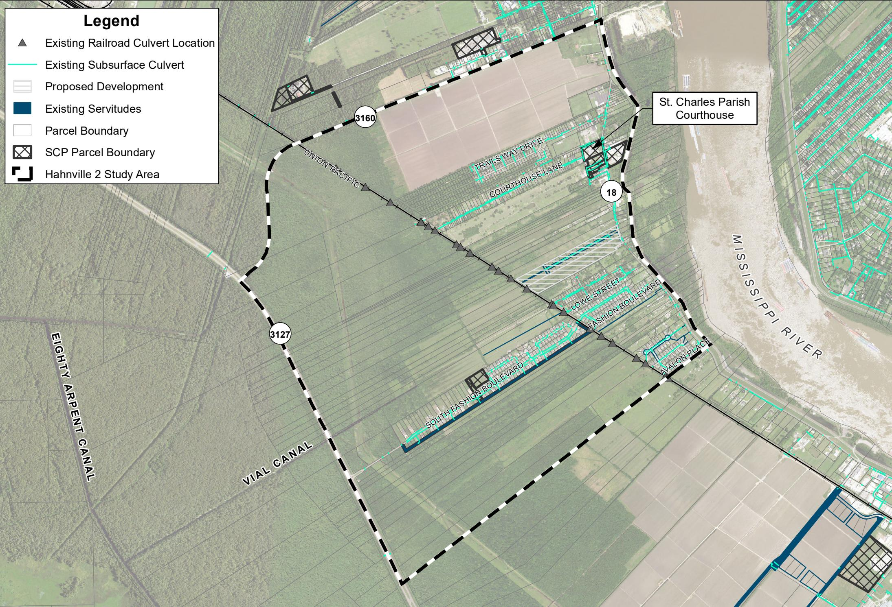

> **Figure description:** Hahnville 2 study-area overview with a legend, showing the study area boundary, Vial Canal and Eighty Arpent Canal, the Mississippi River and US 18, LA 3127 and LA 3160. Labelled streets and areas: Trails Way Drive, Courthouse Lane, Lowe Street, Fashion Boulevard, South Fashion Boulevard and Avalon Place. Union Pacific rail line runs through the site. The St. Charles Parish Courthouse is called out. Legend items: existing railroad culvert location, existing subsurface culvert, proposed development, existing servitudes, parcel boundary, SCP parcel boundary and Hahnville 2 study area. No improvement groups or dollar figures are shown.

NOTES:   
1. Background Image Source: NAIP, 2015   
2. IG Extent is meant for general description only. Final locations for all IGs have not been established as part of this phase of the project. Locations are subject to change as part of permitting and detailed engineering design.

EXISTINGCONDITIONS

HAHNVILLE 2 WATERSHED

## Page 5

**Table 4**

| 7 | Legend Existing Railroad Culvert Location |
|---|---|
|  | Existing Subsurface Culvert |
|  | Proposed Development |
|  | Existing Servitudes |
|  | Parcel Boundary |
|  | SCP Parcel Boundary |
|  | Hahnville 2 Study Area |

Table snapshot (for checking): 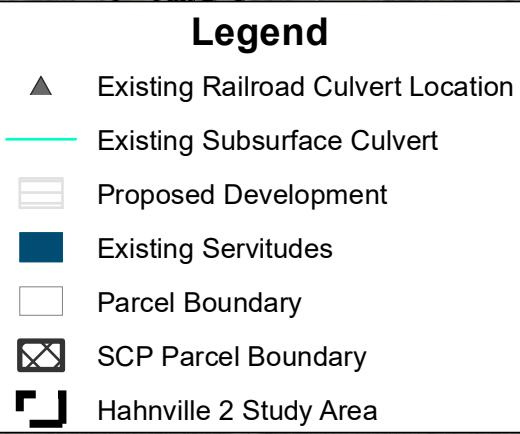

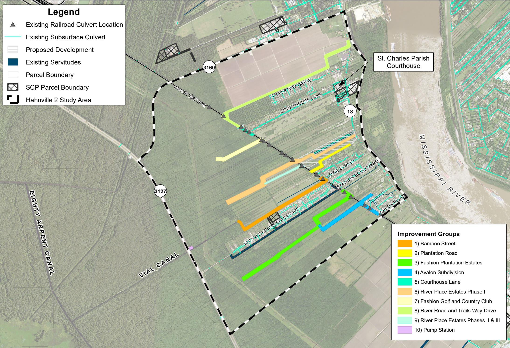

> **Figure description:** Improvement Groups overview for Hahnville 2 with ten colour-coded groups, listed in the legend: 1 Bamboo Street, 2 Plantation Road, 3 Fashion Plantation Estates, 4 Avalon Subdivision, 5 Courthouse Lane, 6 River Place Estates Phase I, 7 Fashion Golf and Country Club, 8 River Road and Trails Way Drive, 9 River Place Estates Phases II and III, and 10 Pump Station. The Union Pacific rail line runs across the site with railroad culvert locations along it. No dollar figures are shown.

## Page 6

**Table 5**

| Legend |  |
|---|---|
|  | Proposed Culvert Location (IG Color) |
|  | Channel Improvements (IG Color) |
|  | Existing Railroad Culvert Location |
|  | Existing Subsurface Culvert |
|  | Proposed Development |
|  | Existing Servitudes |
|  | Parcel Boundary |
|  | SCP Parcel Boundary |
|  | Hahnville 2 Study Area |
| Improvement Groups |  |
|  | 1) Bamboo Street |

Table snapshot (for checking): 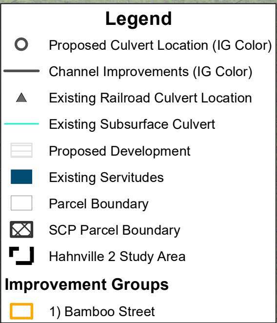

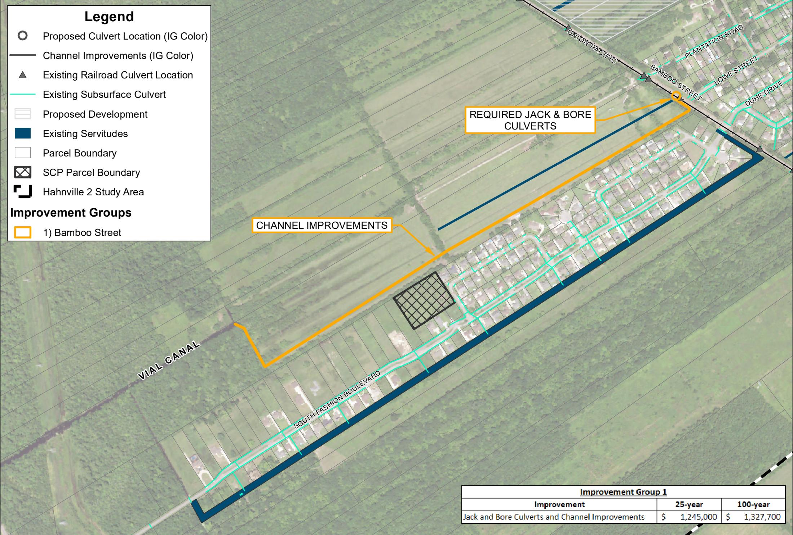

> **Figure description:** Improvement Group 1 (Bamboo Street) detail along South Fashion Boulevard and the Union Pacific rail line. The REQUIRED JACK & BORE CULVERTS call-out is at Bamboo Street, and CHANNEL IMPROVEMENTS run southwest toward the Vial Canal. Labels: Plantation Road, Lowe Street, Duhe Drive and Fashion Boulevard. Table: Improvement Group 1, Jack and Bore Culverts and Channel Improvements, $1,245,000 (25-year) and $1,327,700 (100-year).

**Table 6**

| Improvement Group 1 |  |  |
|---|---|---|
| Improvement | 25-year | 100-year |
| Jack and Bore Culverts and Channel Improvements | $ 1,245,000 | $ 1,327,700 |

_NOTES: 1. Background Image Source: NAIP, 2015 2. IG Extent is meant for general description only. Final locations for all IGs have not been established as part of this phase of the project. Locations are subject to change as part of permitting and detailed engineering design.As such, costs associated with each IG do not include property acquisition_

Table snapshot (for checking): 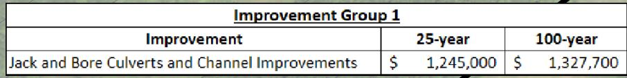

## Page 7

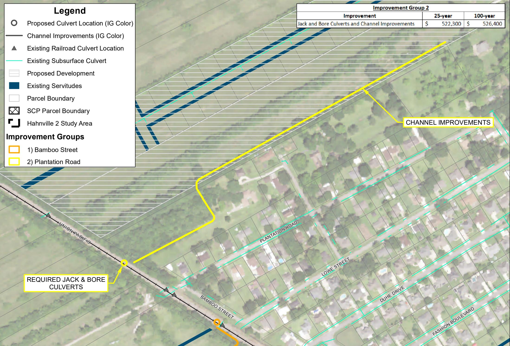

> **Figure description:** Improvement Group 2 (Plantation Road) detail along the Union Pacific rail line near Bamboo Street. The REQUIRED JACK & BORE CULVERTS call-out is at the rail line, and CHANNEL IMPROVEMENTS run northeast behind Plantation Road. Labels: Plantation Road, Lowe Street, Duhe Drive, Fashion Boulevard and Bamboo Street. Table: Improvement Group 2, Jack and Bore Culverts and Channel Improvements, $522,300 (25-year) and $526,400 (100-year).

NOTES:   
1. Background Image Source: NAIP, 2015   
2. IG Extent is meant for general description only. Final locations for all IGs have not been established as part of this phase of the project. Locations are subject to change as part of permitting and detailed engineering design.As such, costs associated with each IG do not include property acquisition

PROPOSEDDRAINAGESYSTEMIMPROVEMENTS

HAHNVILLE 2 WATERSHED

## Page 8

**Table 7**

| Legend |  |
|---|---|
|  | Proposed Culvert Location (IG Color) |
|  | Channel Improvements (IG Color) |
|  | Existing Railroad Culvert Location |
|  | Existing Subsurface Culvert |
|  | Proposed Development |
|  | Existing Servitudes |
|  | Parcel Boundary |
|  | SCP Parcel Boundary |
|  | Hahnville 2 Study Area |
| Improvement Groups |  |
|  | 1) Bamboo Street |
|  | 2) Plantation Road |
|  | 3) Fashion Plantation Estates |

Table snapshot (for checking): 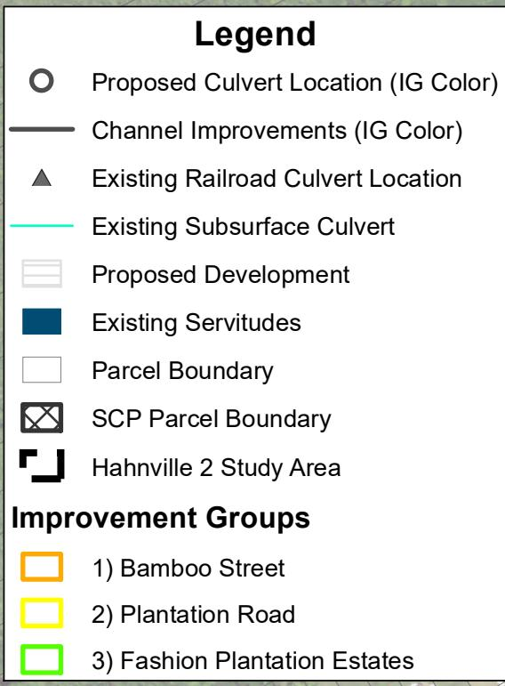

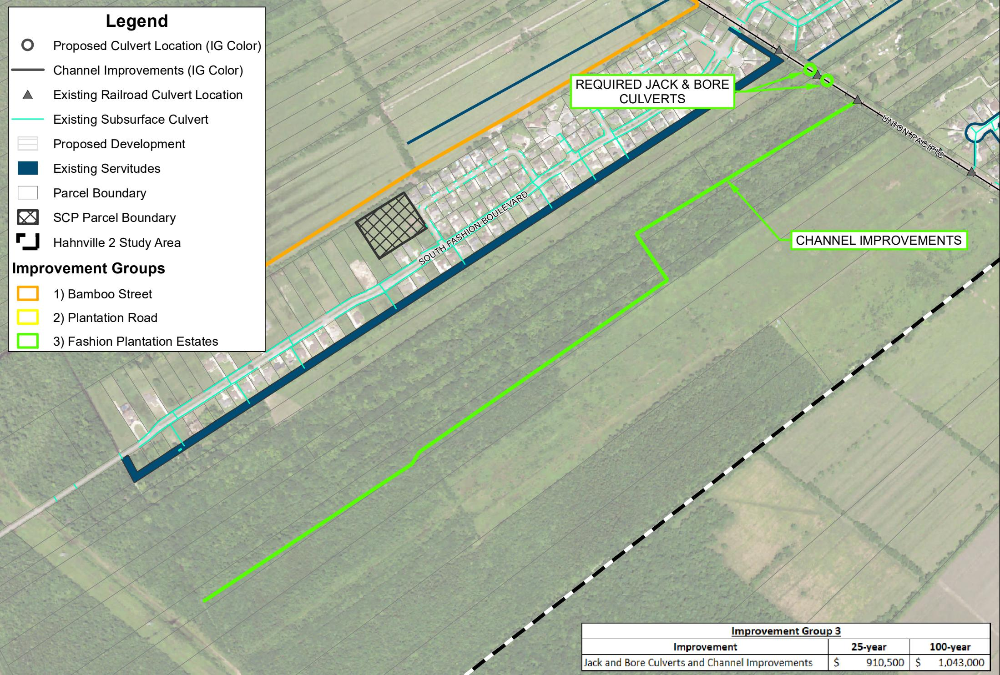

> **Figure description:** Improvement Group 3 (Fashion Plantation Estates) detail. Two REQUIRED JACK & BORE CULVERTS are called out at the Union Pacific rail line near the end of South Fashion Boulevard, and CHANNEL IMPROVEMENTS run southwest across open land. Table: Improvement Group 3, Jack and Bore Culverts and Channel Improvements, $910,500 (25-year) and $1,043,000 (100-year).

**Table 8**

| Improvement Group 3 |  |  |
|---|---|---|
| Improvement | 25-year | 100-year |
| Jack and Bore Culverts and Channel Improvements | $ 910,500 | $ 1,043,000 |

Table snapshot (for checking): 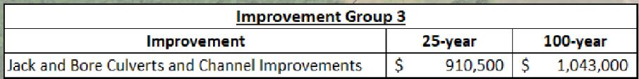

## Page 9

2. IG Extent is meant for general description only. Final locations for all IGs have not been established as part of this phase of the project. Locations are subject to change as part of permitting and detailed engineering design.As such, costs associated with each IG do not include property acquisition

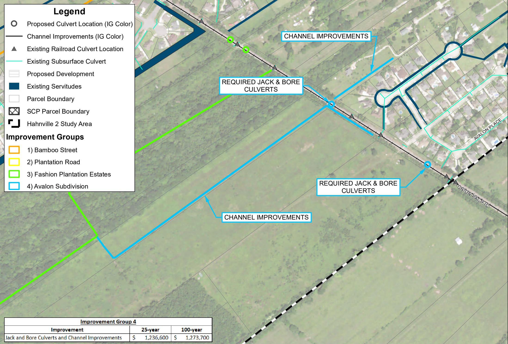

> **Figure description:** Improvement Group 4 detail map (Avalon Subdivision) Legend items: proposed culvert location, channel improvements, existing railroad culvert location, existing subsurface culvert, proposed development, existing servitudes, parcel boundary, SCP parcel boundary and Hahnville 2 Study Area. Improvement Groups listed: 1 Bamboo Street, 2 Plantation Road, 3 Fashion Plantation Estates and 4 Avalon Subdivision. Avalon Place and the Union Pacific rail line are labelled. Call-outs: channel improvements (blue) and required Jack & Bore culverts, with two proposed culvert locations on the rail line. Table: Improvement Group 4, Jack and Bore Culverts and Channel Improvements, $1,236,600 (25-year) and $1,273,700 (100-year).

**Table 9**

| Improvement Group 4 |  |  |
|---|---|---|
| Improvement | 25-year | 100-year |
| Jack and Bore Culverts and Channel Improvements | $ 1,236,600 | $ 1,273,700 |

Table snapshot (for checking): 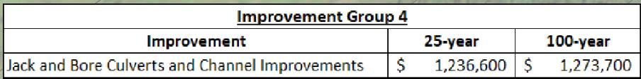

EXHIBITES-6–IMPROVEMENTGROUP4

PROPOSEDDRAINAGESYSTEMIMPROVEMENTS

HAHNVILLE 2 WATERSHED

## Page 10

NOTES:   
1. Background Image Source: NAIP, 2015   
2. IG Extent is meant for general description only. Final locations for all IGs have not been established as part of this phase of the project. Locations are subject to change as part of permitting and detailed engineering design.As such, costs associated with each IG do not include property acquisition

**Table 10**

| Legend |  |
|---|---|
|  | Proposed Culvert Location (IG Color) |
|  | Channel Improvements (IG Color) |
|  | Existing Railroad Culvert Location |
|  | Existing Subsurface Culvert |
|  | Proposed Development |
|  | Existing Servitudes |
|  | Parcel Boundary |
|  | SCP Parcel Boundary |
|  | Hahnville 2 Study Area |
| Improvement Groups |  |
|  | 1) Bamboo Street |
|  | 2) Plantation Road |
|  | 3) Fashion Plantation Estates |
|  | 4) Avalon Subdivision |
|  | 5) Courthouse Lane |

Table snapshot (for checking): 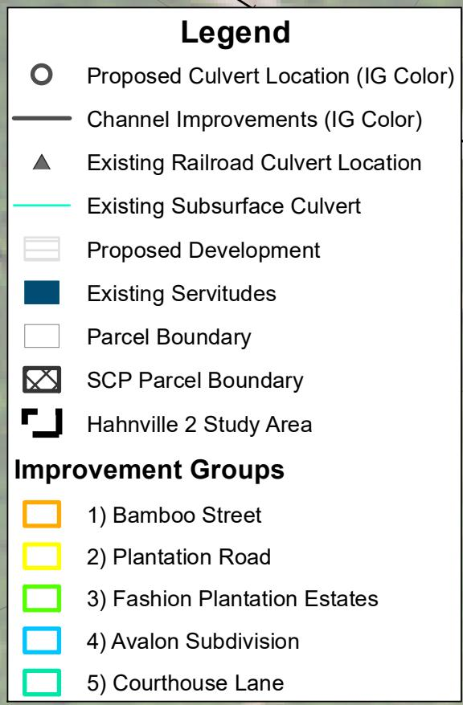

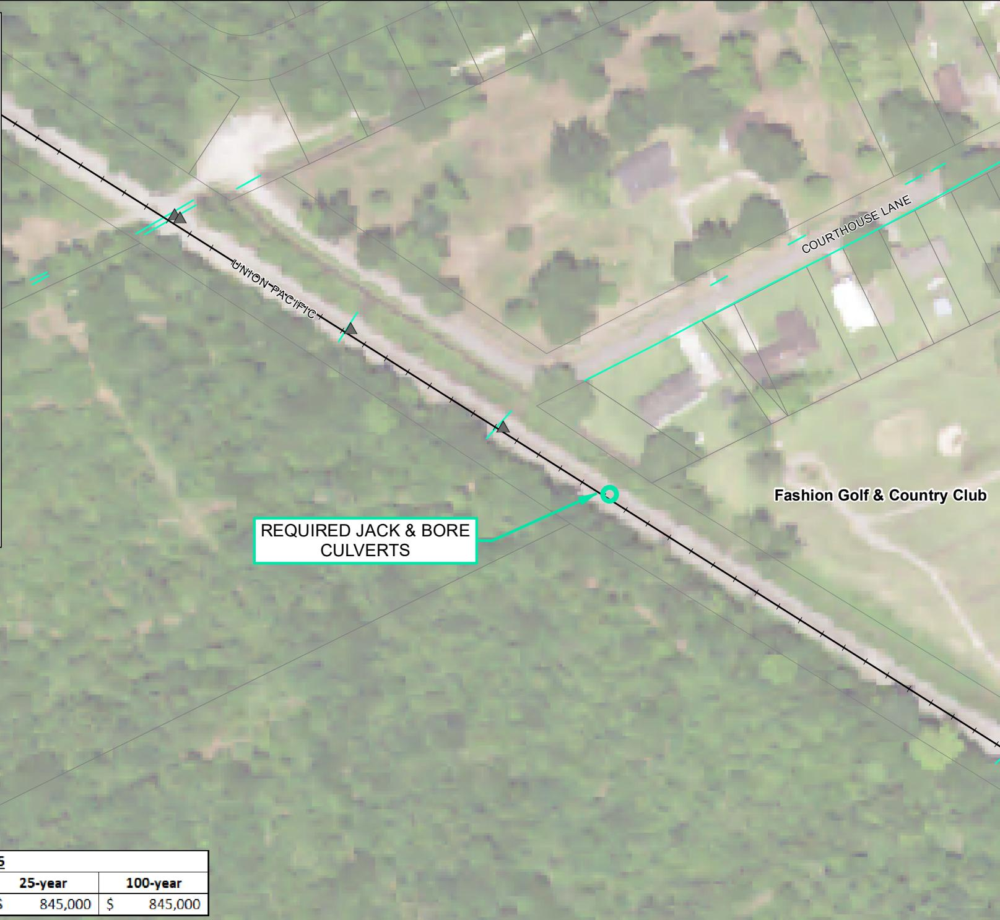

> **Figure description:** Detail map of the Union Pacific rail line near Courthouse Lane and the Fashion Golf & Country Club. Call-out: REQUIRED JACK & BORE CULVERTS (teal circle) on the rail line. Existing railroad culvert locations are marked with triangles. The table at lower left is cropped: only the group number '5' and the values $845,000 (25-year) and $845,000 (100-year) are visible, with the row label cut off.

**Table 11**

| Improvement Group 5 |  |  |
|---|---|---|
| Improvement | 25-year | 100-year |
| Jack and Bore Culverts | $ 845,000 | $ 845,000 |

Table snapshot (for checking): 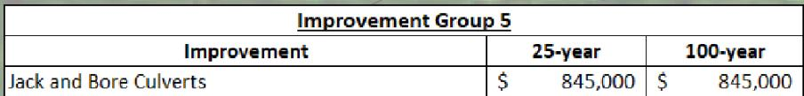

EXHIBITES-7–IMPROVEMENTGROUP5

PROPOSEDDRAINAGESYSTEMIMPROVEMENTS

## Page 11

**Table 12**

| Legend |  |
|---|---|
|  | Proposed Culvert Location (IG Color) |
|  | Channel Improvements (IG Color) |
|  | Existing Railroad Culvert Location |
|  | Existing Subsurface Culvert |
|  | Proposed Development |
|  | Existing Servitudes |
|  | Parcel Boundary |
|  | SCP Parcel Boundary |
|  | Hahnville 2 Study Area |
| Improvement Groups |  |
|  | 1) Bamboo Street |
|  | 2) Plantation Road |
|  | 3) Fashion Plantation Estates |
|  | 4) Avalon Subdivision |
|  | 5) Courthouse Lane |
|  | 6) River Place Estates Phase I |

_1. Background Image Source: NAIP, 2015 2. IG Extent is meant for general description only. Final locations for all IGs have not been established as part of this phase of the project. Locations are subject to change as part of permittin and detailed engineering design.As such, costs associated with each IG do not include property acquisition_

Table snapshot (for checking): 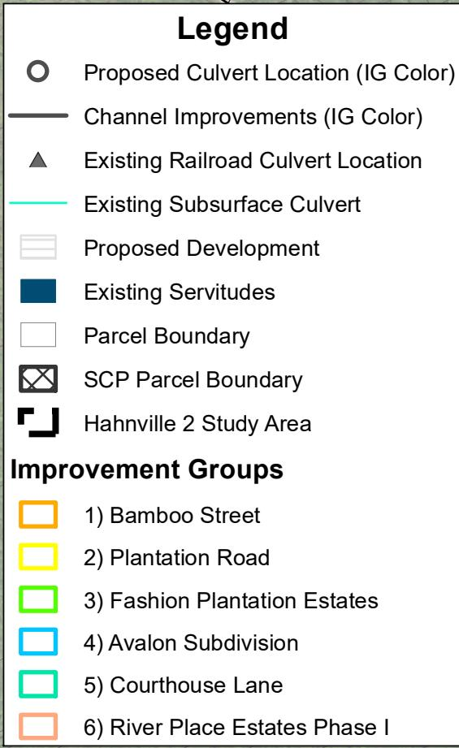

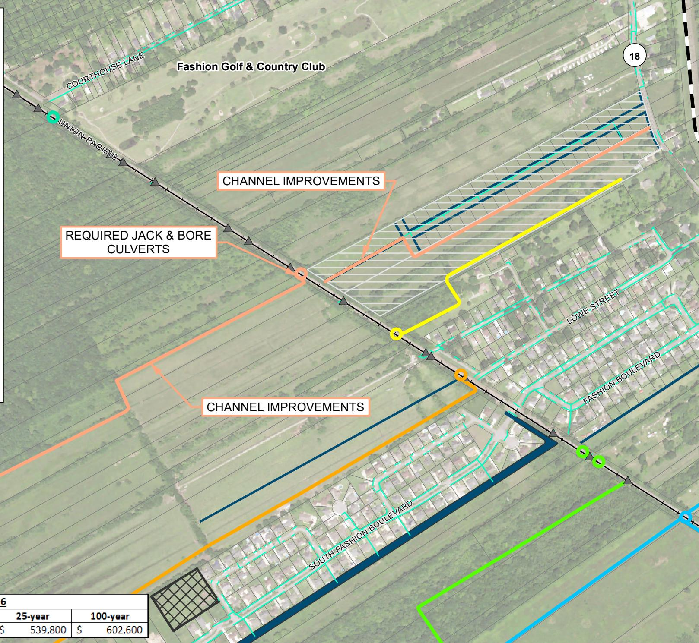

> **Figure description:** Overview map of the Hahnville 2 area around Route 18, with the Union Pacific rail line running diagonally across the image. Labelled: Courthouse Lane, Fashion Golf & Country Club, Lowe Street, Fashion Boulevard and South Fashion Boulevard. Channel improvements are drawn in salmon, orange and yellow. Required Jack & Bore culverts are marked as circles on the rail line. Proposed development is hatched. No legend is visible. The table at lower left is cropped: the group number '6' is partly visible, with $539,800 (25-year) and $602,600 (100-year).

**Table 13**

| Improvement Group 6 |  |  |
|---|---|---|
| Improvement | 25-year | 100-year |
| Jack and Bore Culverts and Channel Improvements | $ 539,800 | $ 602,600 |

Table snapshot (for checking): 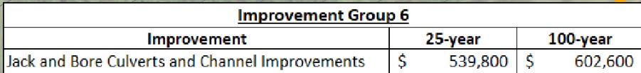

EXHIBITES-8–IMPROVEMENTGROUP6

PROPOSEDDRAINAGESYSTEMIMPROVEMENTS

HAHNVILLE 2 WATERSHED

## Page 12

NOTES:   
1. Background Image Source: NAIP, 2015   
2. IG Extent is meant for general description only. Final locations for all IGs have not been established as part of this phase of the project. Locations are subject to change as part of permitting and detailed engineering design.As such, costs associated with each IG do not include property acquisition

**Table 14**

| Legend |  |
|---|---|
|  | Proposed Culvert Location (IG Color) |
|  | Channel Improvements (IG Color) |
|  | Existing Railroad Culvert Location |
|  | Existing Subsurface Culvert |
|  | Proposed Development |
|  | Existing Servitudes |
|  | Parcel Boundary |
|  | SCP Parcel Boundary |
|  | Hahnville 2 Study Area |
| Improvement Groups |  |
|  | 1) Bamboo Street |
|  | 2) Plantation Road |
|  | 3) Fashion Plantation Estates |
|  | 4) Avalon Subdivision |
|  | 5) Courthouse Lane |
|  | 6) River Place Estates Phase I |
|  | 7) Fashion Golf and Country Club |

Table snapshot (for checking): 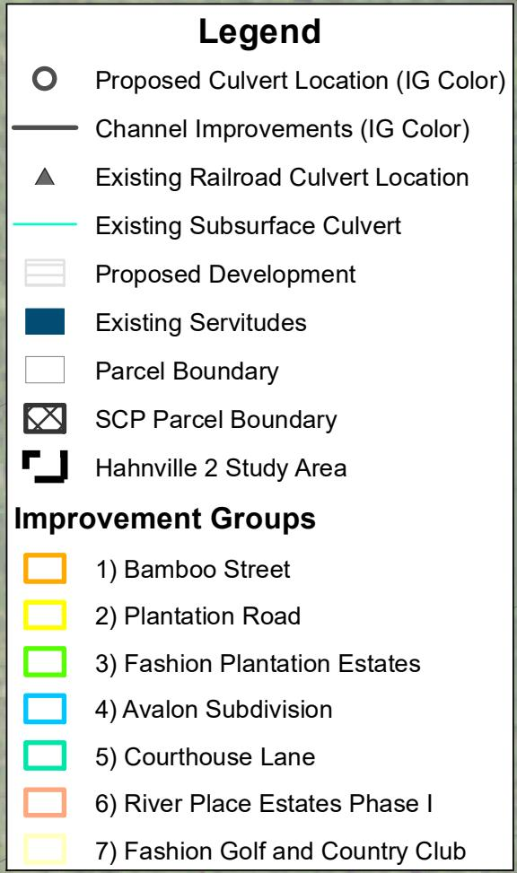

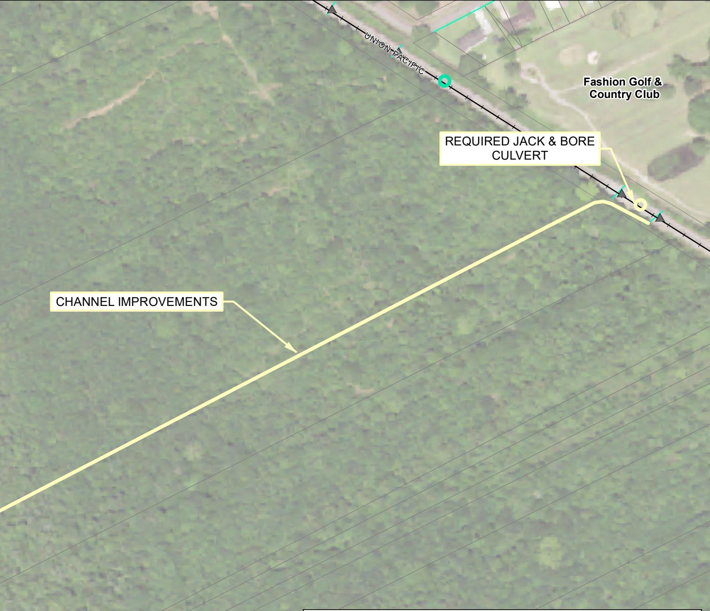

> **Figure description:** Detail map of the Union Pacific rail line west of the Fashion Golf & Country Club. Call-outs: channel improvements (yellow) running southwest across open land, and a required Jack & Bore culvert (yellow circle) on the rail line. Existing railroad culverts are marked with triangles. No table and no improvement group number are visible.

**Table 15**

| Improvement Group 7 |  |  |
|---|---|---|
| Improvement | 25-year | 100-year |
| Jack and Bore Culverts and Channel Improvements | $ 504,600 | $ 528,900 |

Table snapshot (for checking): 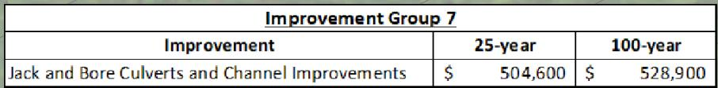

#### EXHIBITES-9–IMPROVEMENTGROUP

## Page 13

#### Legend

Proposed Culvert Location (IG Color)

Channel Improvements (IG Color)

Existing Railroad Culvert Location

Existing Subsurface Culvert

Proposed Development

Existing Servitudes

Parcel Boundary

SCP Parcel Boundary

Hahnville 2 Study Area

#### Improvement Group

1) Bamboo Street

2) Plantation Road

3) Fashion Plantation Estates

4) Avalon Subdivision

5) Courthouse Lane

6) River Place Estates Phase I

7) Fashion Golf and Country Club

8) River Road and Trails Way Drive

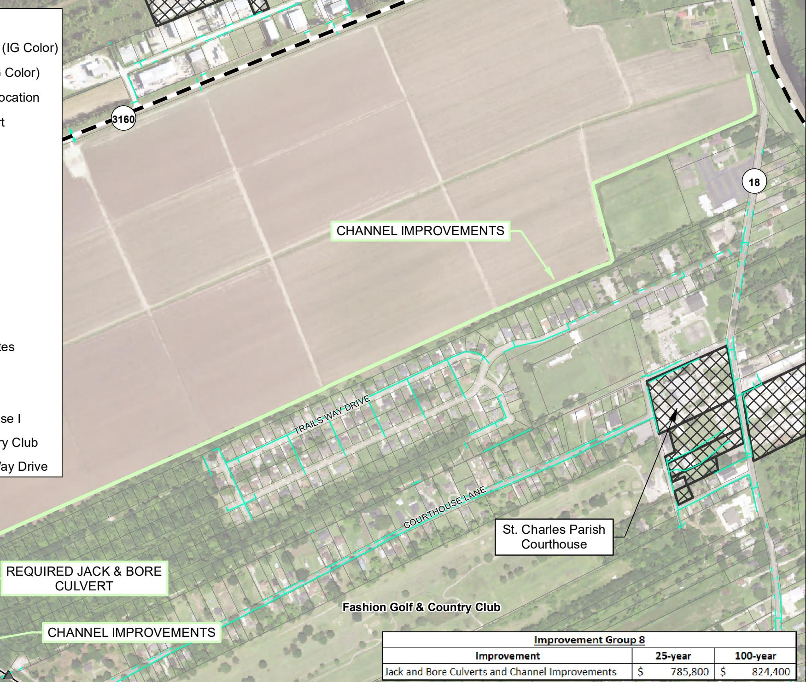

> **Figure description:** Improvement Group 8 detail map around the St. Charles Parish Courthouse, with Route 18 and Route 3160 labelled. Labelled: Trails Way Drive, Courthouse Lane and Fashion Golf & Country Club. Channel improvements run along the rear of the subdivisions. A REQUIRED JACK & BORE CULVERT call-out sits at the bottom left edge, cut off at the left; the rail line is not visible in the crop. The legend is cut off at the left edge, leaving only fragments ('...tes', '...se I', '...ry Club', '...Way Drive'). Table: Improvement Group 8, Jack and Bore Culverts and Channel Improvements, $785,800 (25-year) and $824,400 (100-year).

NOTES:   
1. Background Image Source: NAIP, 2015   
2. IG Extent is meant for general description only. Final locations for all IGs have not been established as part of this phase of the project. Locations are subject to change as part of permitting and detailed engineering design.As such, costs associated with each IG do not include property acquisition

**Table 16**

| Improvement Group 8 |  |  |
|---|---|---|
| Improvement | 25-year | 100-year |
| Jack and Bore Culverts and Channel Improvements | $ 785,800 | $ 824,400 |

Table snapshot (for checking): 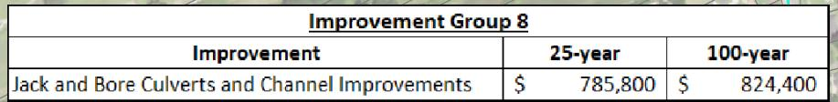

EXHIBITES-10– IMPROVEMENTGROUP8

PROPOSEDDRAINAGESYSTEMIMPROVEMENTS

HAHNVILLE 2 WATERSHED

## Page 14

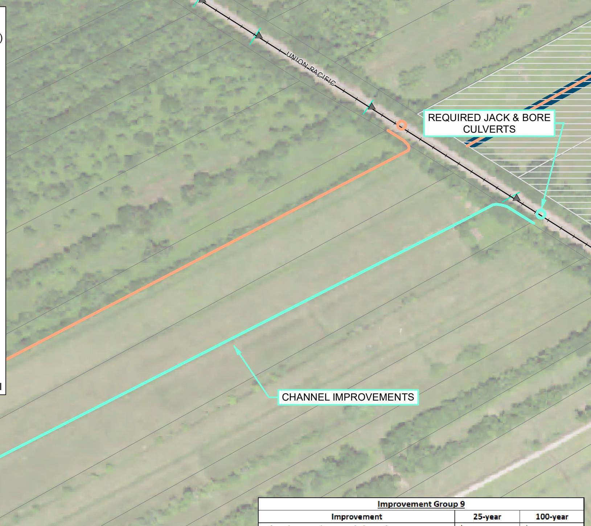

> **Figure description:** Improvement Group 9 detail map along the Union Pacific rail line. Channel improvements are drawn in salmon and teal. Required Jack & Bore culverts are marked as circles on the rail line. Proposed development is hatched, with existing servitudes shown in dark blue. The table at the bottom is cropped: the header 'Improvement Group 9' and the column heads 'Improvement', '25-year' and '100-year' are visible but the values are cut off. Only a sliver of the legend frame shows at the left edge, with no readable entries.

Legend   
Proposed Culvert Location (IG Color)   
Channel Improvements (IG Color)   
Existing Railroad Culvert Location   
Existing Subsurface Culvert   
Proposed Development   
Existing Servitudes   
Parcel Boundary   
SCP Parcel Boundary   
Hahnville 2 Study Area   
Improvement Groups   
1) Bamboo Street   
2) Plantation Road   
3) Fashion Plantation Estates   
4) Avalon Subdivision   
5) Courthouse Lane   
6) River Place Estates Phase I   
7) Fashion Golf and Country Club   
8) River Road and Trails Way Drive   
9) River Place Estates Phases II & III

**Table 17**

| Improvement Group 9 |  |  |
|---|---|---|
| Improvement | 25-year | 100-year |
| Jack and Bore Culverts and Channel Improvements | $ 750,900 | $ 772,400 |

Table snapshot (for checking): 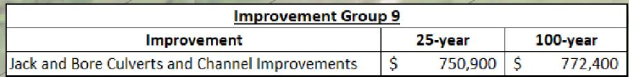

## Page 15

NOTES:   
1. Background Image Source: NAIP, 2015   
2. IG Extent is meant for general description only. Final locations for all IGs have not been established as part of this phase of the project. Locations are subject to change as part of permitting and detailed engineering design.As such, costs associated with each IG do not include property acquisition   
NOTES:   
1. Background Image Source: NAIP, 2015   
2. IG Extent is meant for general description only. Final locations for all IGs have not been established as part of this phase of the project. Locations are subject to change as part of permitting and detailed engineering design.

**Table 18**

| Legend |  |
|---|---|
|  | Proposed Culvert Location (IG Color) |
|  | Channel Improvements (IG Color) |
|  | Existing Railroad Culvert Location |
|  | Existing Subsurface Culvert |
|  | Proposed Development |
|  | Existing Servitudes |
|  | Parcel Boundary |
|  | SCP Parcel Boundary |
|  | Hahnville 2 Study Area |
| Improvement Groups |  |
|  | 1) Bamboo Street |
|  | 2) Plantation Road |
|  | 3) Fashion Plantation Estates |
|  | 4) Avalon Subdivision |
|  | 5) Courthouse Lane |
|  | 6) River Place Estates Phase I |
|  | 7) Fashion Golf and Country Club |
|  | 8) River Road and Trails Way Drive |
|  | 9) River Place Estates Phases II & III |
|  | 10) Pump Station |

Table snapshot (for checking): 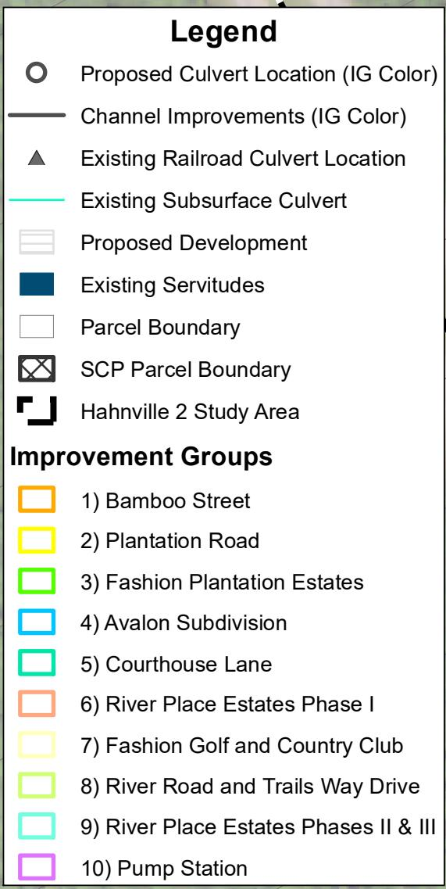

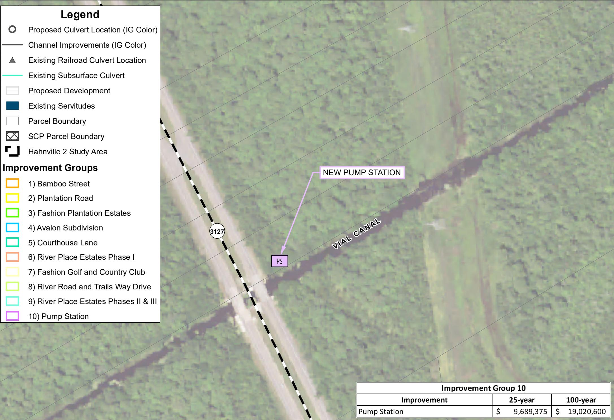

> **Figure description:** Improvement Group 10 detail map showing a new pump station (marked PS and labelled NEW PUMP STATION) beside Vial Canal, near LA 3127. The legend lists Improvement Groups 1 to 10: 1 Bamboo Street, 2 Plantation Road, 3 Fashion Plantation Estates, 4 Avalon Subdivision, 5 Courthouse Lane, 6 River Place Estates Phase I, 7 Fashion Golf and Country Club, 8 River Road and Trails Way Drive, 9 River Place Estates Phases II & III, and 10 Pump Station. Table: Improvement Group 10, Pump Station, $9,689,375 (25-year) and $19,020,600 (100-year).

**Table 19**

| Improvement Group 10 |  |  |
|---|---|---|
| Improvement | 25-year | 100-year |
| Pump Station | $ 9,689,375 | $ 19,020,600 |

Table snapshot (for checking): 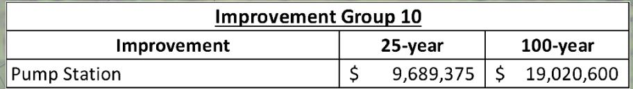

## Page 16

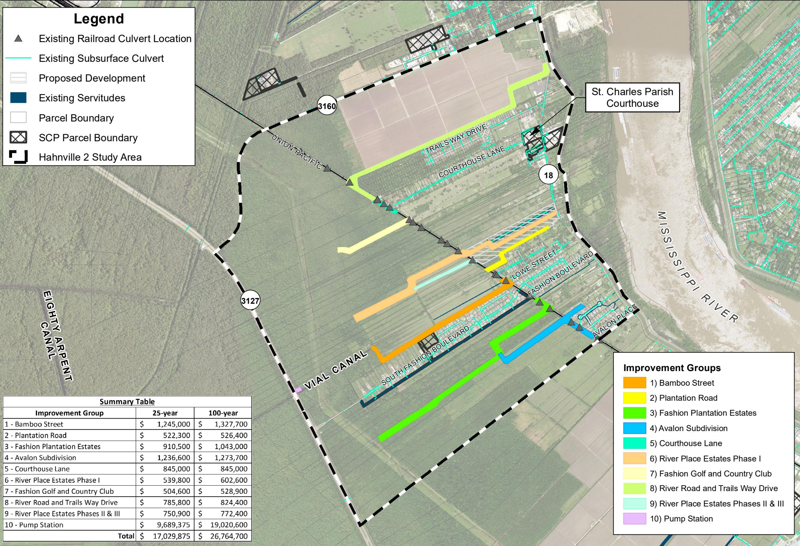

> **Figure description:** Hahnville 2 study area map with a summary table in the lower left. Improvement groups 1 to 10 are colour-coded: 1 Bamboo Street, 2 Plantation Road, 3 Fashion Plantation Estates, 4 Avalon Subdivision, 5 Courthouse Lane, 6 River Place Estates Phase I, 7 Fashion Golf and Country Club, 8 River Road and Trails Way Drive, 9 River Place Estates Phases II & III, and 10 Pump Station (purple, at Vial Canal). Labelled features: Union Pacific Railway, St. Charles Parish Courthouse, Vial Canal, Mississippi River, and route markers 3160, 3127 and 18. Summary table (25-year / 100-year): group 1 $1,245,000 / $1,327,700; group 2 $522,300 / $526,400; group 3 $910,500 / $1,043,000; group 4 $1,236,600 / $1,273,700; group 5 $845,000 / $845,000; group 6 $539,800 / $602,600; group 7 $504,600 / $528,900; group 8 $785,800 / $824,400; group 9 $750,900 / $772,400; group 10 Pump Station $9,689,375 / $19,020,600; total $17,029,875 / $26,764,700.

**Table 20**

| Summary Table |  |  |
|---|---|---|
| Improvement Group | 25-year | 100-year |
| 1 - Bamboo Street | $ 1,245,000 | $ 1,327,700 |
| 2 - Plantation Road | $ 522,300 | $ 526,400 |
| 3 - Fashion Plantation Estates | $ 910,500 | $ 1,043,000 |
| 4 - Avalon Subdivision | $ 1,236,600 | $ 1,273,700 |
| 5 - Courthouse Lane | $ 845,000 | $ 845,000 |
| 6 - River Place Estates Phase I | $ 539,800 | $ 602,600 |
| 7 - Fashion Golf and Country Club | $ 504,600 | $ 528,900 |
| 8 - River Road and Trails Way Drive | $ 785,800 | $ 824,400 |
| 9 - River Place Estates Phases II & III | $ 750,900 | $ 772,400 |
| 10 - Pump Station | $ 9,689,375 | $19,020,600 |
| Total | $ 17,029,875 | $26,764,700 |

Table snapshot (for checking): 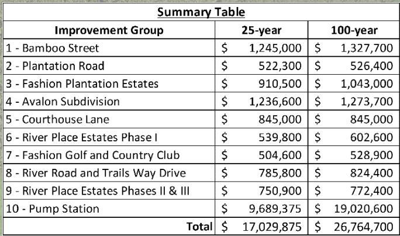

EXHIBITES-13–IMPROVEMENTGROUPSSUMMARY

PROPOSEDDRAINAGESYSTEMIMPROVEMENTS

HAHNVILLE 2 WATERSHED
