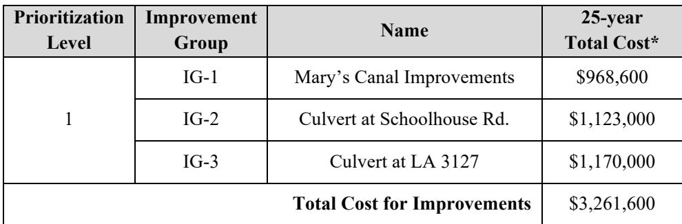

# Killona Taft Executive Summary

Source: `Killona Taft Executive Summary.pdf` (St. Charles Parish, Master Drainage Plan). Pages: 3.

## Page 1

### ST. CHARLES PARISH WEST BANK MASTER DRAINAGE PLAN KILLONA TAFT WATERSHED

#### EXECUTIVE SUMMARY

The goal of this section is to give a high-level overview of the process and results of the hydraulic and hydrologic study of the Killona Taft watershed. This summary shall always be accompanied by the comprehensive detailed report, which follows this section.

This report presents the results of a basin-wide modeling study for the Killona Taft drainage basin. The purpose of this study was to determine existing flood risk and identify necessary improvements to the major conveyance systems to mitigate the effects of the 25-year event.

Drainage features that were considered as part of the system upgrades include increasing Mary’s Canal south of the railroad tracks to a bottom width of 10’ and to 15’ at a tree line north of Julia Street with side slopes of 3H:1V. At the downstream end of Mary’s Canal, replace the existing culverts just upstream of LA 3127 with two 54”x88” RCPA. Adding culverts under the railroad at Mary’s Canal was considered, but improvements were minimal, so this was removed from the model as uneconomical. East of the residential area of Killona, a third 54” CMP is proposed under LA 3127 in line with an agricultural road which is just west of two industrial tanks. The lateral ditch running from Schoolhouse Road to LA 3127 and the lateral ditch just to the west should be widened to a 10’ flat bottom with 3H:1V side slopes. At the intersection of Schoolhouse Road and the railroad tracks, an additional 36” RCP should be installed under the tracks. If developed, the agricultural field east of the Entergy Waterford Plant Training Center and the wooded area along LA 3127 south of the DOW plant should have increased connectivity through their respective ridges to the LA 3127 ditch.

#### WATERSHED CHARACTERISTICS

The Killona Taft drainage basin is located on the west bank of the Mississippi River in St. Charles Parish (SCP), Louisiana. The focus area for this analysis is approximately 5,890 acres and is drained via gravity by a system of canals and roadside ditches that are tidally influenced due to the connection with Lac des Allemands to the southwest. This basin is generally draining southsouthwest towards LA 3127.

The drainage in this basin is generally draining south-southwest. In some locations, water stacks up against the railroad tracks and LA 3127 during severe rain events. Some floodwater gets temporarily retained on Killona Drive and Adams Street due to land south of parts of this street being lower than upstream areas preventing sheet flow from draining excess floodwater and inadequate ditch capacity.

#### CURRENT DRAINAGE ISSUES

## Page 2

At present, the majority of drainage issues occur due to the lack of conveyance capacity within localized drainage systems. Conveyance in the vicinity of Railroad Drive, Mary’s Canal which frequently fills up, has poor internal drainage as well as insufficient capacity to collect runoff are the primary issues. This is a topographically lower area surrounded by higher grades which prevents shallow surface flow away. These factors can create localized flooding during rainfall events.

#### PROPOSED IMPROVEMENTS

The development of the proposed conditions model focused on upgrading the existing drainage system within the Killona Taft basin.

Drainage features that were considered as part of the system upgrades include increasing Mary’s canal south of the railroad tracks to a bottom width of 10’ and to 15’ at a tree line north of Julia Street with side slopes of 3H:1V. At the downstream end of Mary’s Canal, replace the existing culverts just upstream of LA 3127 with two 54”x88” RCPA. Adding culverts under the railroad at Mary’s Canal was considered, but improvements were minimal, so this was removed from the model as uneconomical. East of the residential area of Killona, a third 54” CMP is proposed under LA 3127 in line with an agricultural road which is just west of two industrial tanks. The lateral ditch running from Schoolhouse Road to LA 3127 and the lateral ditch just to the west should be widened to a 10’ flat bottom with 3H:1V side slopes. At the intersection of Schoolhouse Road and the railroad tracks, an additional 36” RCP should be installed under the tracks. If developed, the agricultural field east of the Entergy Waterford Plant Training Center and the wooded area along LA 3127 south of the DOW plant should have increased connectivity through their respective ridges to the LA 3127 ditch.

#### MODEL RESULTS

The following sections review the model results for the Existing Conditions (EC) and Proposed Conditions (PC) model simulations. Since the aim of the drainage basin upgrades is to reduce the impacts experienced by the 25-year event, those simulation results will be the focus of this analysis and review.

#### CONCEPTUAL COST ESTIMATE

The table below provides a summary for conceptual-level cost estimates associated with each improvement group. The table includes the cost for the “25-year improvements” as discussed above. Mitigation, permitting, utility relocation, and land acquisition costs are not included as part of this cost assessment, as these costs can vary significantly depending on the final layout of the improvements determined during detailed design.

## Page 3

#### Conceptual Project Cost Summary Table for Killona Taft

**Table 1**

| Prioritization Level | Improvement Group | Name | 25-year Total Cost* |
|---|---|---|---|
| 1 | IG-1 IG-2 IG-3 | Mary's Canal Improvements Culvert at Schoolhouse Rd. Culvert at LA 3127 | $968,600 $1,123,000 $1,170,000 |
| Total Cost for Improvements |  |  | $3,261,600 |

_\*Total Cost includes 20% contingency._

Table snapshot (for checking): 
