# Luling and Luling I310 Mimosa Willowdale Public Meeting_62024

Source: `Luling and Luling I310 Mimosa Willowdale Public Meeting_62024.pdf` (St. Charles Parish, Master Drainage Plan). Pages: 32.

## Page 1

#### WEST BANK MASTER DRAINAGE PLAN

Luling/Luling l-310 & Mimosa-Willowdale Watersheds June 20, 2024

## Page 2

Will Bane, P.E. - Lead Professional

## Page 3

#### Master Drainage Plan for West Bank of St. Charles Parish

• Long Term Planning of Drainage Projects

• Big Picture View of Drainage

• Projects Recommended With Estimated Costs

## Page 4

#### PROCESS

Gather Available Data for Analysis (Topography, Pipes, Ditches, Pumps)

Create Computer Model of Drainage System

Verify Results with Parish Engineers

Identify Drainage Needs and Projects

Create New Computer Model with Proposed Projects

Communicate Findings to Parish and Residents

## Page 5

#### 2D HEC-RAS Models

Lidar used for ground surfaces, USGS Soil Map used for soils, NLCD land cover used for surface roughness, and survey data where available for existing drainage culverts and canals

• The model is a 2D, rain on grid model which runs for a 24-hour duration

• The 10-yr, 25-yr, 50-yr, and 100-yr storm events were run

• The Goals are to reduce flood damages, depths, and duration with proposed improvements. Proposed improvements were sized for a 25-yr duration storm event

## Page 6

Luling and Luling I-310 Watersheds

## Page 7

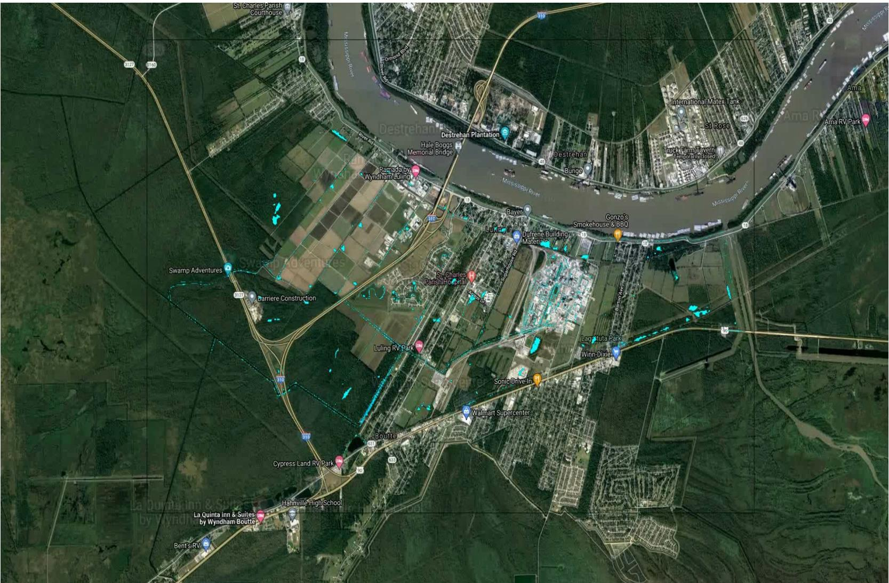

> **Figure description:** Aerial photo of the Luling and I-310 area, with the Mississippi River at the top. Sparse cyan patches are scattered through the Luling and Boutte area. The figure has no legend, so the cyan is not defined. Labelled features: Destrehan Plantation, Hale Boggs Memorial Bridge, Ramada by Wyndham Luling, Swamp Adventures, Barriere Construction, Luling RV Park, St. Charles Parish Hospital, Winn-Dixie, Lagattuta Park, Walmart Supercenter, Sonic Drive-In, Boutte, Cypress Land RV Park, Hahnville High School, and route markers 3127, 3160, 18, 310, 90, 631 and 633.

## Page 8

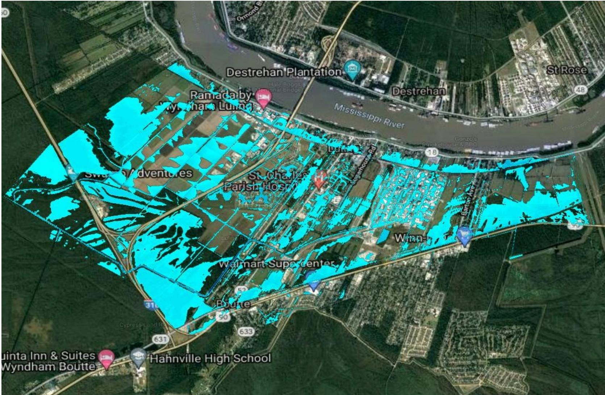

> **Figure description:** Aerial photo of the same area with a large cyan fill covering the land west of Luling, from Swamp Adventures on the west to Winn-Dixie and Hwy 90 on the south-east, and reaching the River Road corridor on the north. No legend is shown, so the fill is not defined. Labelled features: Swamp Adventures, Ramada by Wyndham Luling, St. Charles Parish Hospital, Destrehan Plantation, Winn-Dixie, Walmart Supercenter, Boutte, Hahnville High School, and route markers 3127, 18, 310, 631, 633 and 90.

## Page 9

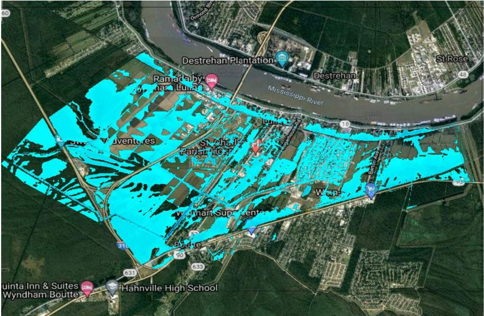

> **Figure description:** Near-duplicate of figure 4: same extent, labels and cyan fill, with a slightly different fill pattern. No legend.

## Page 10

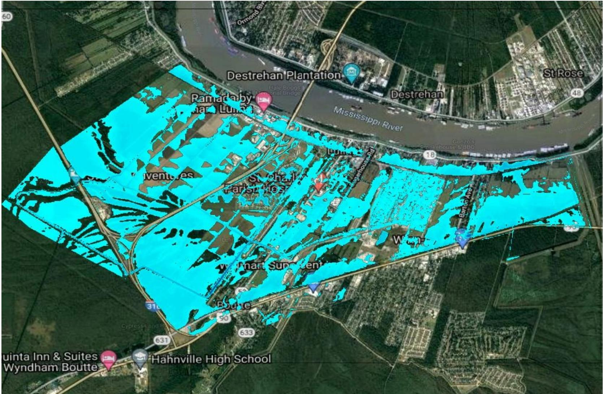

> **Figure description:** Near-duplicate of figure 4: same extent, labels and cyan fill, with a slightly different fill pattern. No legend.

## Page 11

> **Figure description:** Near-duplicate of figure 4: same extent, labels and cyan fill, with a slightly different fill pattern. No legend.

## Page 12

#### Model Results – Luling and Luling I-310

#### 25-YR Max Water Surface Depth - Luling / 310

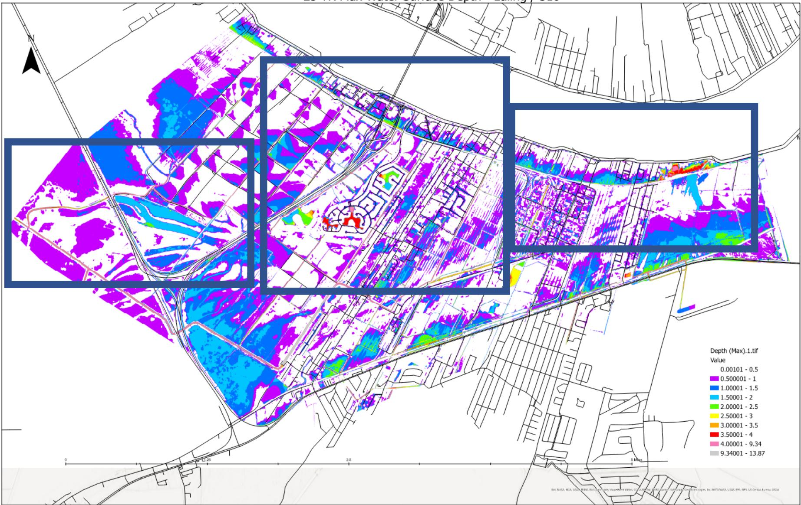

> **Figure description:** 25-YR Max Water Depth map for Luling and I-310, with a north arrow, a 0 to 5 mile scale bar, and a base map of roads and parcels. The depth legend has ten bands: 0.00101 to 0.5 (white), 0.5 to 1 (purple), 1 to 1.5 (blue), 1.5 to 2 (light blue), 2 to 2.5 (green), 2.5 to 3 (yellow), 3 to 3.5 (orange), 3.5 to 4 (red), 4 to 9.34 (pink), and 9.34 to 13.87 (grey). Units are not printed. Three outlined rectangles mark enlarged areas: west near Swamp Adventures, centre near St. Charles Parish Hospital, and east along River Road.

#### 25-YR WSD PROPOSED CONDITION

## Page 13

25-YR Max Water Surface Depth - Luling / 310

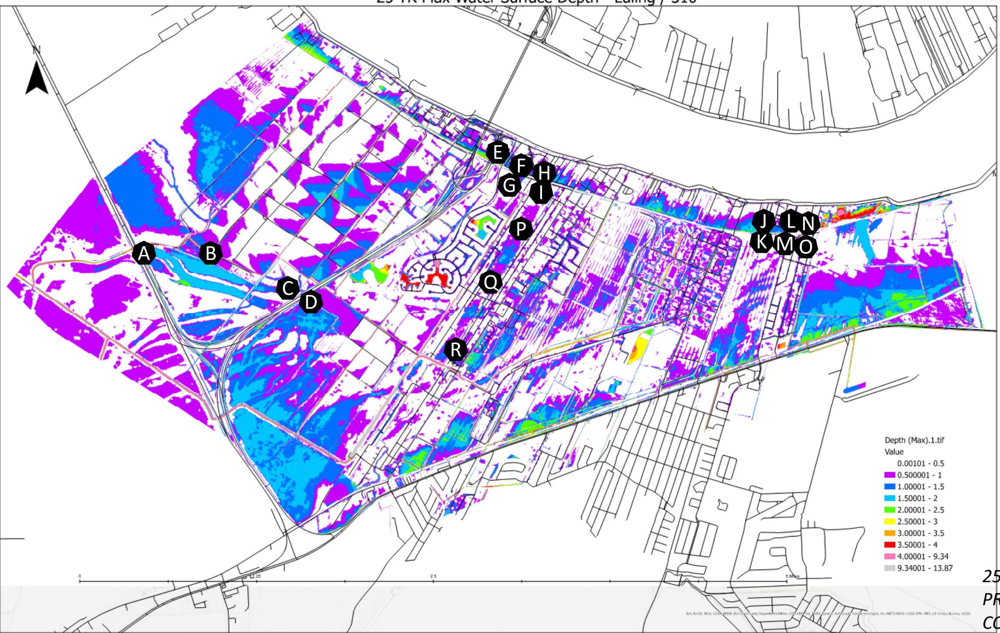

> **Figure description:** The same 25-YR Max Water Surface Depth map and legend as figure 8, without the three rectangles. Black lettered markers A to R are placed on the map: A to D west of Luling along the Swamp Adventures and LA 3127 corridor, E to I along River Road near Luling, J to O clustered at the east end near the River Road corridor, and P, Q and R in the interior. The figure has no key for the letters.

## Page 14

#### Luling Improvement Groups

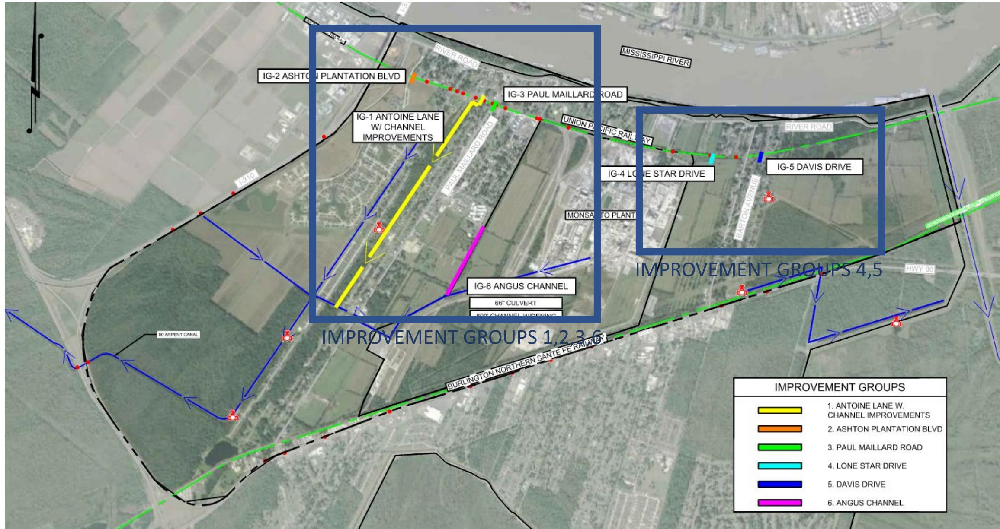

> **Figure description:** Improvement Groups 1 to 6 for the Luling and I-310 area, on an aerial base. Highlighted segments: IG-1 Antoine Lane with channel improvements (yellow), IG-2 Ashton Plantation Blvd (orange), IG-3 Paul Maillard Road (green), IG-4 Lone Star Drive (light cyan), IG-5 Davis Drive (blue), and IG-6 Angus Channel (magenta). Outlined boxes group IG-1, 2, 3 and 6 on the west and IG-4 and 5 on the east. Labelled: River Road, Union Pacific Railway, Burlington Northern Santa Fe Railway, Monsanto Plant, Hwy 90, I-310, 80 Arpent Canal and the Mississippi River. Blue arrows show flow direction. Red icons are unlabelled and not in the legend. No dollar figures are printed.

## Page 15

#### Luling IG-1,2,3

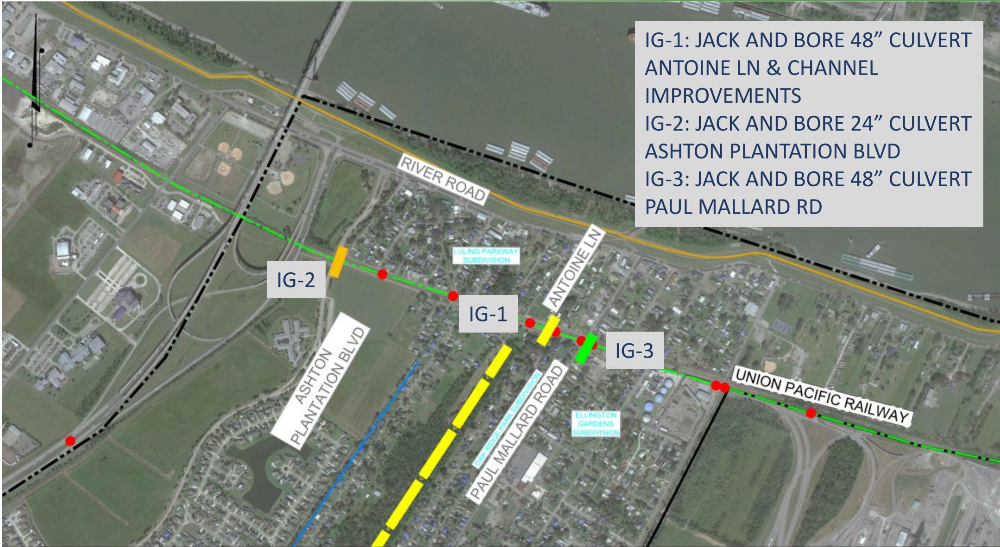

> **Figure description:** Jack and bore culvert locations for IG-1 to IG-3 on an aerial base. A callout box lists: IG-1 Jack and Bore 48-inch culvert at Antoine Ln with channel improvements; IG-2 Jack and Bore 24-inch culvert at Ashton Plantation Blvd; and IG-3 Jack and Bore 48-inch culvert at Paul Mallard Rd (the map spells it Maillard). The yellow IG-1 channel runs parallel to Paul Maillard Road, and the orange IG-2 and green IG-3 marks sit on the Union Pacific Railway. Labelled: River Road, Union Pacific Railway, Luling Parkway Subdivision, Oak Ridge Park Subdivision, Ellington Gardens Subdivision. Red dots are unlabelled.

## Page 16

#### Luling IG-4,5

IG-1: JACK AND BORE 48″ CULVERT   
ANTOINE LN & CHANNEL   
IMPROVEMENTS   
IG-2: JACK AND BORE 24" CULVERT   
ASHTON PLANTATION BLVD   
IG-3: JACK AND BORE 48″ CULVERT   
PAUL MALLARD RD   
IG-4: JACK AND BORE 36″ CULVERT   
LONE STAR DR   
IG-5: JACK AND BORE 36″ CULVERT   
DAVIS DR   
IG-1: JACK AND BORE 48″ CULVERT   
ANTOINE LN & CHANNEL   
IMPROVEMENTS

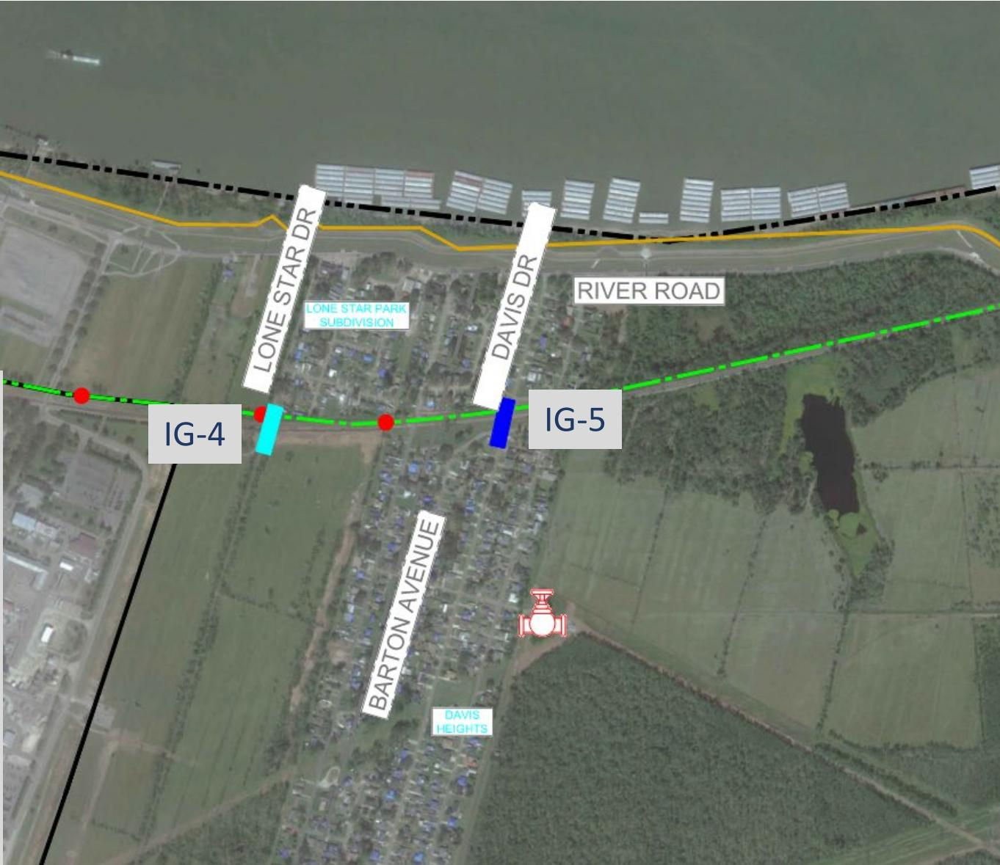

> **Figure description:** Jack and bore locations for IG-4 Lone Star Drive (light cyan) and IG-5 Davis Drive (dark blue) at the River Road crossing, on an aerial base. Labelled: Lone Star Drive, Davis Drive, Barton Avenue, River Road, Lone Star Park Subdivision and Davis Heights. A green dashed line (Union Pacific Railway) crosses the area with red dots at crossings. A red valve-type icon sits east of Davis Drive and is unlabelled. No dollar figures are printed.

## Page 17

IG-2: JACK AND BORE 24″ CULVERT ASHTON PLANTATION BLVD

IG-3: JACK AND BORE 48″ CULVERT PAUL MALLARD RD

IG-4: JACK AND BORE 36″ CULVERTLONE STAR DR

IG-5: JACK AND BORE 36″ CULVERT DAVIS DR

IG-6: ANGUS CHANNEL

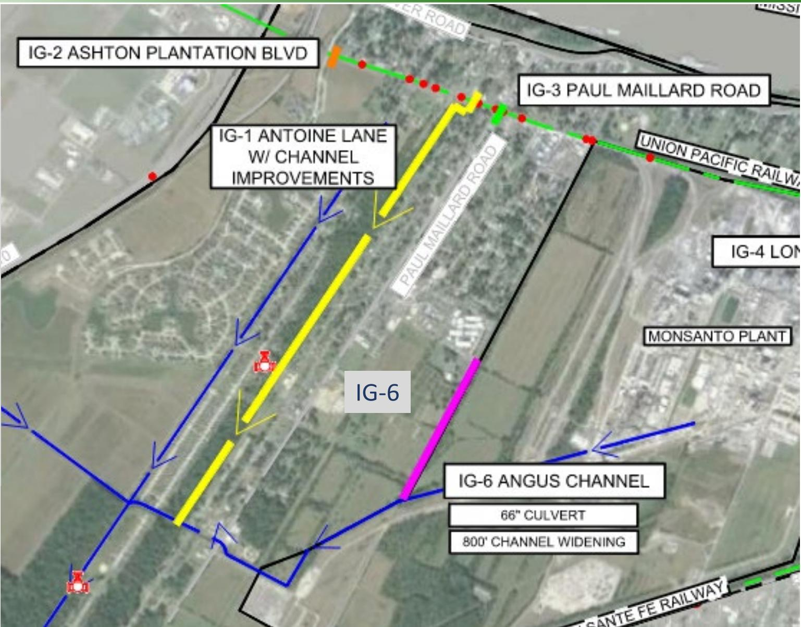

> **Figure description:** Close-up of IG-6 Angus Channel. The magenta segment is labelled 66-inch culvert and 800-foot channel widening. Also shown: IG-1 Antoine Lane channel (yellow), IG-2 Ashton Plantation Blvd (orange), IG-3 Paul Maillard Road (green), and part of IG-4 Lone Star Drive. Labelled: Paul Maillard Road, Monsanto Plant, Union Pacific Railway and Burlington Northern Santa Fe Railway. Blue arrows show channel flow direction, and one red valve-type icon sits on the left edge.

## Page 18

#### Luling l-310 Improvement Groups

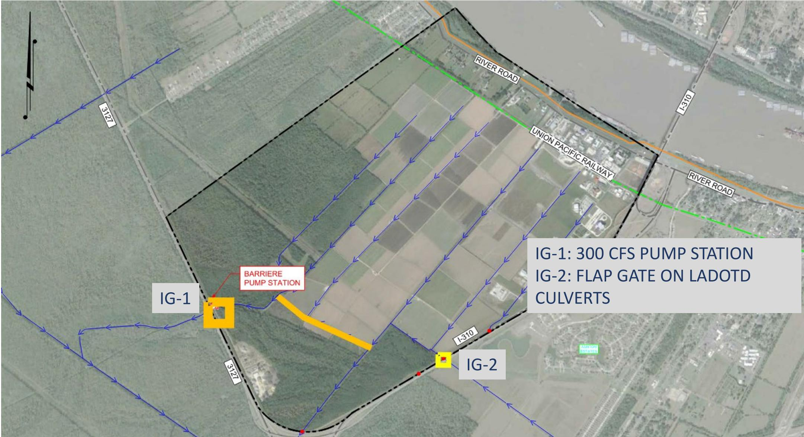

> **Figure description:** Barriere pump station area. The study boundary is a black dashed line, with the Mississippi River and River Road to the north-east and I-310 at the top right. Callouts: IG-1 300 CFS pump station (Barriere Pump Station) at the western corner, and IG-2 flap gate on the LADOTD culverts at I-310 near the south-east corner. Blue arrows show drainage from the parcel grid flowing toward the pump station. An unlabelled orange line runs from the pump station to the east. Labelled: LA 3127, I-310, River Road and Union Pacific Railway.

## Page 19

Mimosa-Willowdale Watersheds

## Page 20

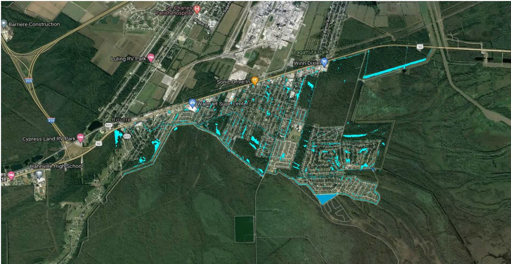

> **Figure description:** Aerial photo of Boutte and the Hwy 90 corridor with sparse cyan patches. The figure has no legend. Labelled: Barriere Construction, Luling RV Park, St. Charles Parish Hospital, Cypress Land RV Park, Hahnville High School, Lagattuta Park, Winn-Dixie, Sonic Drive-In, Walmart Supercenter, Boutte, and route markers 310, 90, 631 and 633. The cyan patches cluster along Boutte residential streets and the subdivisions south-east of Hwy 90.

## Page 21

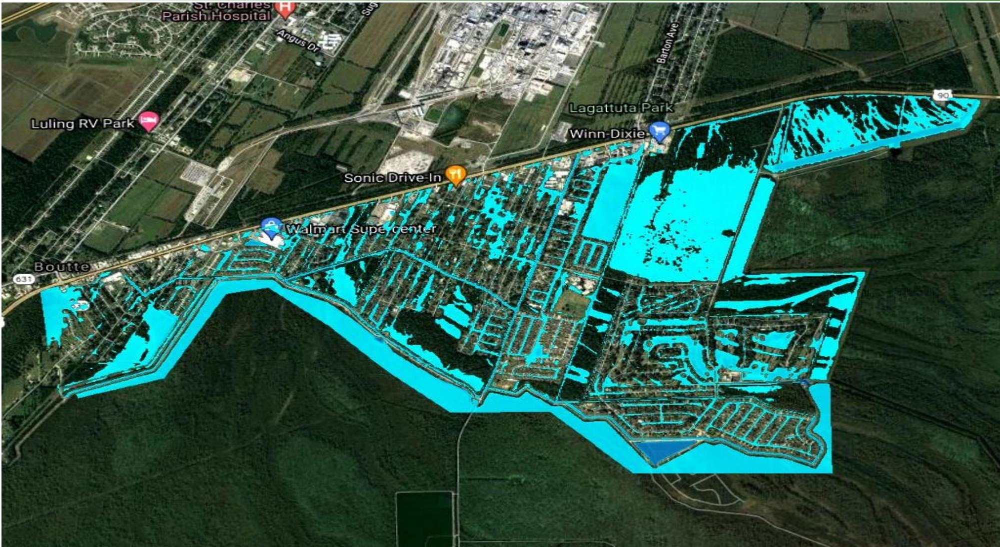

> **Figure description:** Aerial photo of the Boutte area at the same extent as figure 17, with large cyan fill across most of the residential area south of Hwy 90, the subdivisions to the south-east, and a strip north of Hwy 90 near Lagattuta Park. The figure has no legend. Labelled: Winn-Dixie, Walmart Supercenter, Sonic Drive-In, Lagattuta Park, Luling RV Park, St. Charles Parish Hospital, Boutte, and route markers 90 and 631.

## Page 22

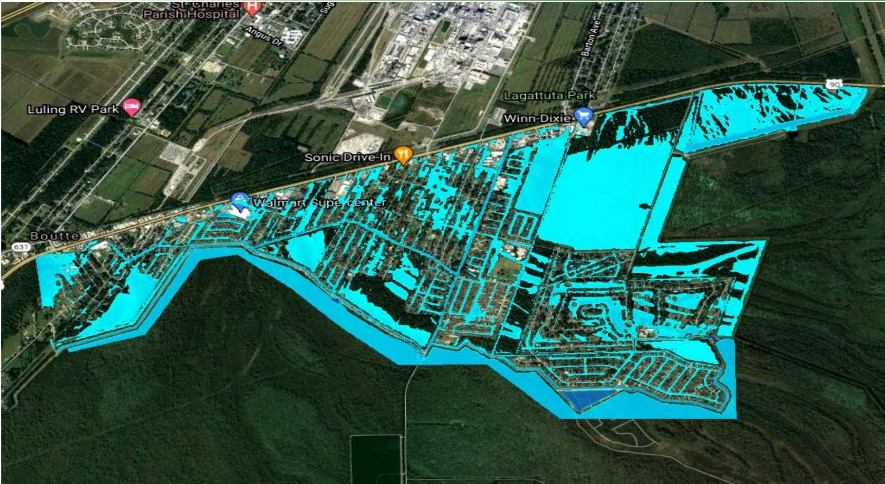

> **Figure description:** Flood-extent map of the Boutte area, with cyan fill covering the streets and lots. Labelled places: Boutte, US 90, US 631, Walmart Supercenter, Winn-Dixie, Sonic Drive-In, Lagattuta Park, Luling RV Park and St. Charles Parish Hospital. The cyan fill has no legend, so its meaning is not stated on the figure. Same extent as figs 20-22; the fill pattern differs slightly.

## Page 23

> **Figure description:** Same extent and labels as fig 19 (Boutte area, US 90, US 631, Walmart Supercenter, Winn-Dixie, Sonic Drive-In, Lagattuta Park, St. Charles Parish Hospital), with cyan fill and no legend. Near-duplicate of fig 19; the fill pattern differs slightly.

## Page 24

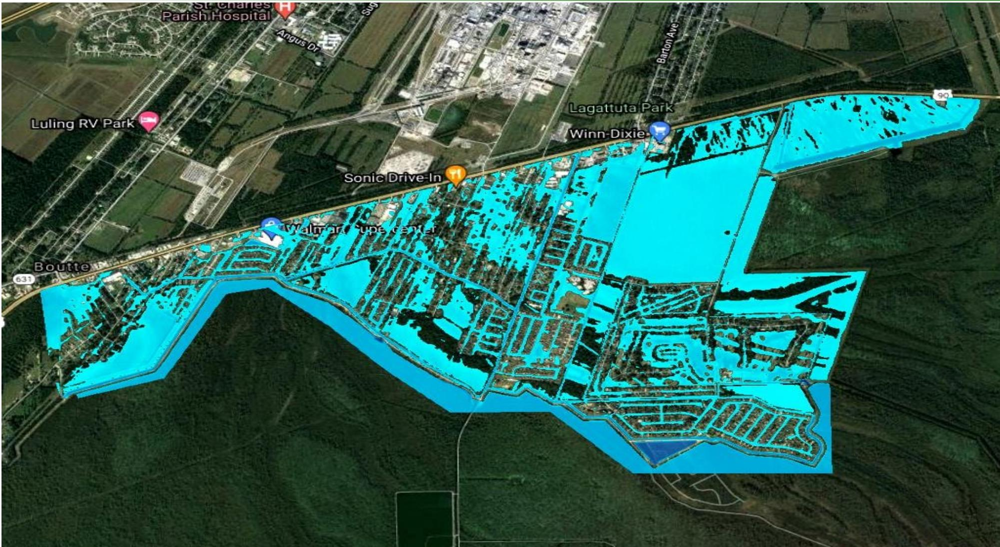

> **Figure description:** Same extent and labels as fig 19 (Boutte area, US 90, US 631, Walmart Supercenter, Winn-Dixie, Sonic Drive-In, Lagattuta Park), with cyan fill and no legend. Near-duplicate of fig 19; the fill pattern differs slightly.

## Page 25

25-YR Max Water Depth - Mimosa Willowdale

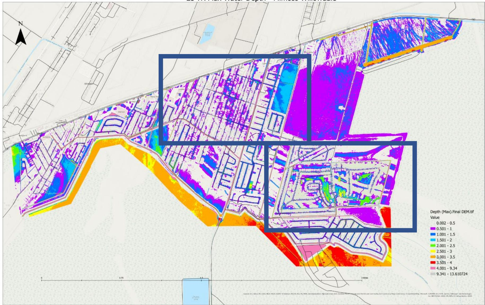

> **Figure description:** Lettered-marker map of the Mimosa-Willowdale flood-depth model, showing the same depth colour classes as fig 23 (purple 0.501-1 ft through grey 9.341-13.610724). Markers A-M are placed along the street grid of the Mimosa-Willowdale area. The marker key is not on the figure. Scale bar 0-3 miles; no units are printed on the legend.

#### 25-YR WSD PROPOSED CONDITION

## Page 26

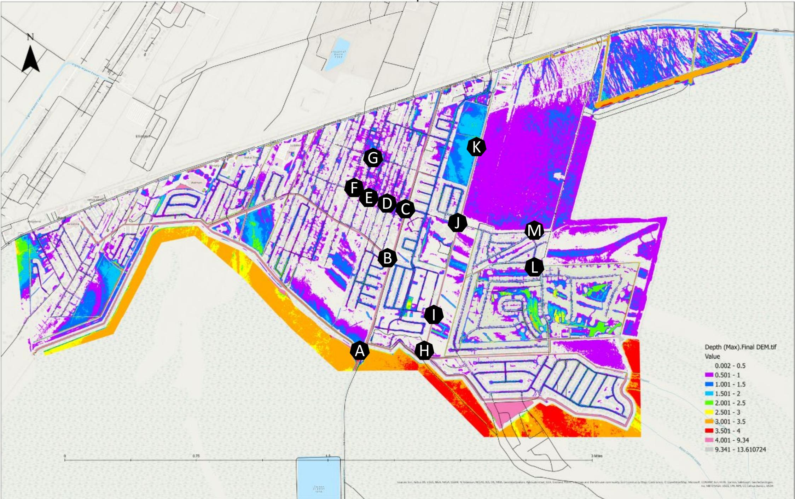

> **Figure description:** 25-YR Max Water Depth map for Mimosa-Willowdale, titled at the top. Colour-coded depth legend (Depth (Max).Final DEM.tif): 0.002-0.5, 0.501-1, 1.001-1.5, 1.501-2, 2.001-2.5, 2.501-3, 3.001-3.5, 3.501-4, 4.001-9.34 and 9.341-13.610724; units are not printed. Two dark-blue outlined boxes mark sub-areas, one over the streets near US 90 and one over the southeast subdivision. Labels visible: Ellington. Scale bar 0-3 miles.

## Page 27

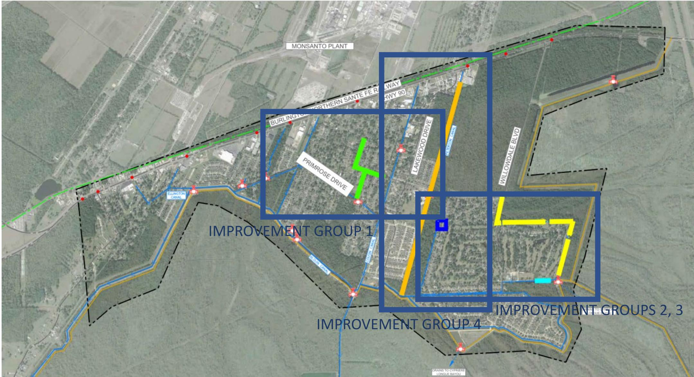

> **Figure description:** Improvement-group map of the Mimosa-Willowdale area, with a dashed black project boundary, the Burlington Northern Santa Fe railway and US 90 along the top. Labelled streets: Primrose Drive, Lakewood Drive and Willowdale Blvd. Labelled drainage: Ellington Canal, Bluin Canal, Peterson Canal. Monsanto Plant appears at the top. Four dark-blue outlined boxes are labelled IMPROVEMENT GROUP 1, IMPROVEMENT GROUP 4 and IMPROVEMENT GROUPS 2, 3. Coloured segments: green (IG 1), yellow (IG 2 and 3), a cyan rectangle at the south end of the IG 2 and 3 box, orange canal lines. Red dots and red pump symbols mark stations.

## Page 28

IG-1: BOX CULVERTS ON WANDA ST, HEATHER DR, AND MIMOSA AVE

## Page 29

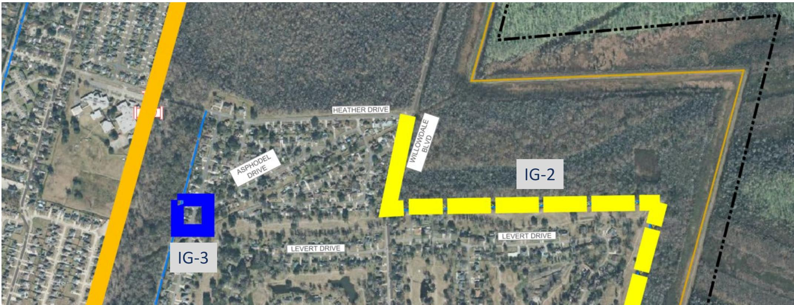

> **Figure description:** Zoom of Improvement Groups 2 and 3, with IG-2 and IG-3 labels. Labelled streets: Heather Drive, Willowdale Blvd, Asphodel Drive and Levert Drive. Yellow segments show the IG-2 channel improvements along the east edge. The dark-blue square is labelled IG-3. An orange line runs along the western canal. No dollar values or legend are shown.

IG-1: BOX CULVERTS ON WANDA ST, HEATHER DR, AND MIMOSA AVE IG-2: 48" CULVERT ALONG WILLOWDALE BLVD IG-3: REPLACE SIPHON WITH PUMP STATION AT APHODEL DR

## Page 30

IG-1: BOX CULVERTS ON WANDA ST, HEATHER DR, AND MIMOSA AVE   
IG-2: IG-2: 48" CULVERT ALONG WILLOWDALE DR   
IG-3: REPLACE SIPHON WITH PUMP STATION AT APHODEL DR   
IG-4: PETERSON CANAL CHANNEL WIDENING   
REC-1: UPGRADE WETWELL/CONVEYANCE TO PUMP STATION

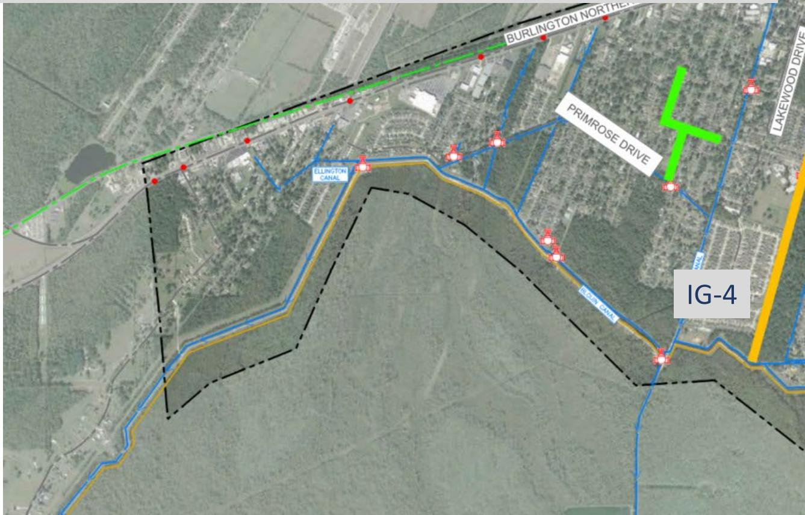

> **Figure description:** Zoom of Improvement Group 4 with its IG-4 label. Labelled features: Primrose Drive, Lakewood Drive, Ellington Canal, Bluin Canal and the Burlington Northern Santa Fe railway (top). A green segment near Primrose Drive is one improvement. Red pump or station symbols sit along the canals. Blue lines are drainage. The project boundary is dashed black.

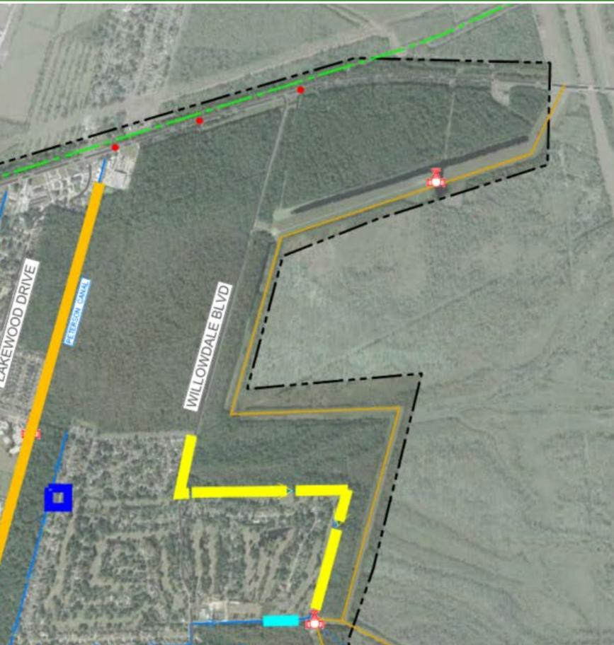

> **Figure description:** Zoom of the Lakewood Drive and Willowdale Blvd area. Labelled features: Lakewood Drive, Willowdale Blvd and Peterson Canal. Yellow segments (IG 2 and 3) run along the Willowdale Blvd edge, a dark-blue square is at the west side, a short cyan rectangle is near the southern pump symbol, and an orange line marks the canal. The project boundary is dashed black. No legend.

REC-1 UPGRADE WETWELL/ CONVEYANCE TO PUMP STATION

## Page 31

#### LULING PROJECT COST ESTIMATES

**Table 1**

| IMPROVEMENT GROUP | DESCRIPTION | EST. COST |
|---|---|---|
| IG-1 | JACK AND BORE W/CHANNEL ANTOINE LN | $875,000 |
| IG-2 | JACK AND BORE ASHTON PLANTATION BLVD | $585,000 |
| IG-3 | JACK AND BORE PAUL MALLARD RD | $1,040,000 |
| IG-4 | JACK AND BORE LONE STAR DR | $565,000 |
| IG-5 | JACK AND BORE DAVIS DR | $487,000 |
| IG-6 | ANGUS CHANNEL | $260,000 |

Table snapshot (for checking): 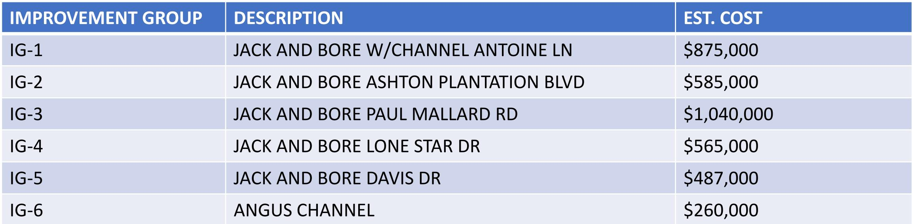

#### LULING I-310 PROJECT COST ESTIMATES

**Table 2**

| IMPROVEMENT GROUP | DESCRIPTION | EST. COST |
|---|---|---|
| IG-1 | PUMP STATION | $11,000,000 |
| IG-2 | I-310 FLAPGATES | $160,000 |

Table snapshot (for checking): 

## Page 32

#### >MIMOSA-WILLOWDALE PROJECT COST ESTIMATES

**Table 3**

| IMPROVEMENT GROUP | DESCRIPTION | EST. COST |
|---|---|---|
| REC-1 | UPGRADE WETWELL/CONVEYANCE TO PUMPSTATION |  |
| IG-1 | BOX CULVERTS NEAR MIMOSA AVE | $5,475,000 |
| IG-2 | WILLOWDALE DR CULVERTS | $986,000 |
| IG-3 | APHODEL DR PUMP STATION | $2,490,000 |
| IG-4 | PETERSON CANAL CHANNEL WIDENING | $796,000 |

Table snapshot (for checking): 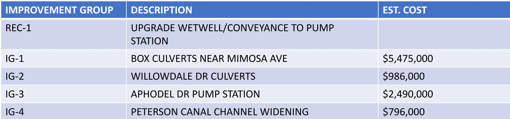
