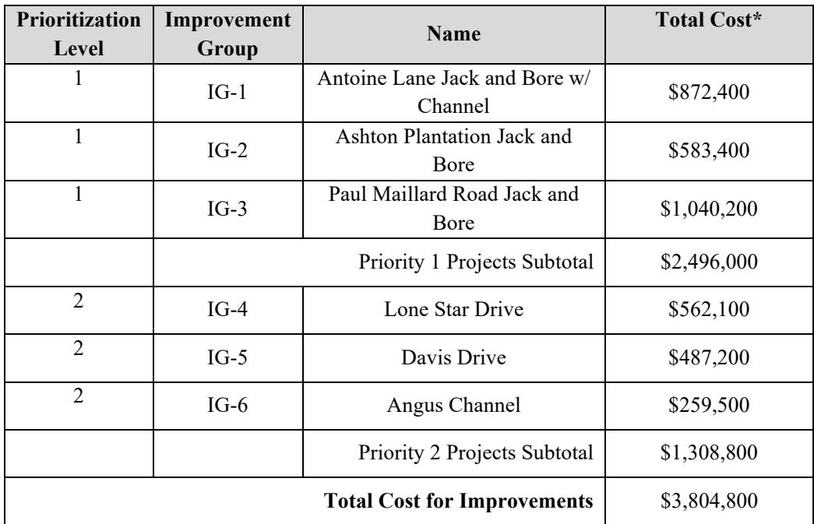
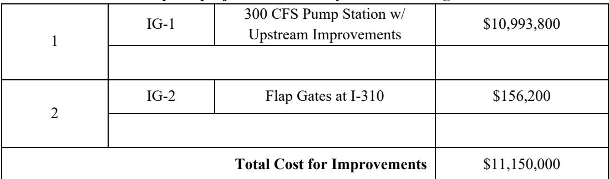

# Luling Executive Summary

Source: `Luling Executive Summary.pdf` (St. Charles Parish, Master Drainage Plan). Pages: 3.

## Page 1

### ST. CHARLES PARISH WEST BANK MASTER DRAINAGE PLAN LULING 310 WATERSHED

#### EXECUTIVE SUMMARY

The goal of this section is to give a high-level overview of the process and results of the hydraulic and hydrologic study of the Luling and Luling I-310 watersheds. This summary shall always be accompanied by the comprehensive detailed report, which follows this section.

This report presents the results of a basin-wide modeling study for the drainage basin. The purpose of this study was to identify necessary improvements to the major conveyance systems to mitigate the effects of the 25-year event. Drainage features that were considered as part of the system upgrades were the additions of culverts along critical areas within the basin along with jack-andbore culverts across the UP railroad, a lateral ditch west of Kinler Street, and a replacement pump station at HWY 3127. This model can be used to identify other deficiencies and provide inputs for targeted analyses that are focused on upgrades at the subdivision-scale.

#### WATERSHED CHARACTERISTICS

The Luling and Luling I-310 drainage basins are located on the west bank of the Mississippi River in St. Charles Parish (SCP), Louisiana. The focus area for this analysis is approximately 7,283 acres and is drained via gravity by a system of canals that are tidally influenced due to the connection with a canal draining to Lac des Allemands to the west and the marsh to the south. The drainage in this basin is generally south southwest. There is generally a significantly higher maximum water surface elevation on the north side of the railroad tracks.

#### CURRENT DRAINAGE ISSUES

At present, drainage issues occur due to the lack of conveyance capacity within localized drainage systems in the neighborhoods as well as area to the west of I-310 draining to the east side raising tailwater conditions, a lack of culvert capacity under the railroad tracks in some locations, and a collapsed culvert under railroad track at the eastern end of the study area.

#### PROPOSED IMPROVEMENTS

The development of the proposed conditions model focused on upgrading the existing drainage system within the Luling and Luling I-310 basins. These upgrades include culvert additions, a new lateral ditch, and a future replacement pump station with greater capacity at HWY 3127 to lower flooding duration and depth when development will take place in that area.

## Page 2

#### MODEL RESULTS

The following sections review the model results for the Existing Conditions (EC) and Proposed Conditions (PC) model simulations. Since the aim of the drainage basin upgrades is to reduce the impacts experienced by the 25-year event, those simulation results will be the focus of this analysis and review.

#### ALTERNATIVES

By the request of the SCP Administration, TBS analyzed the conceptual cost to construct the proposed improvements to convey the stormwater flow produced by the 25-year rainfall event. The proposed conditions model was constructed to analyze the effects of various storms for the 10-year, 25-year, and 100-year events. It should be noted that railroad crossings which are required to be sized for the 100-year storm by the railroad companies remain sized as such in all cost calculations.

#### CONCEPTUAL COST ESTIMATE

The table below provides a summary for conceptual-level cost estimates associated with each improvement group. The table includes the cost for the 25-year improvements as discussed above as well as the 100-year improvements for railroad crossings. Mitigation, permitting, and land acquisition costs are not included as part of this cost assessment, as these costs can vary significantly depending on the final layout of the improvements determined during detailed design

**Table 1: Conceptual project cost summary table for Luling**

| Prioritization Level | Improvement Group | Name | Total Cost* |
|---|---|---|---|
| 1 | IG-1 | Antoine Lane Jack and Bore w/Channel | $872,400 |
| 1 | IG-2 | Ashton Plantation Jack and Bore | $583,400 |
| 1 | IG-3 | Paul Maillard Road Jack and Bore | $1,040,200 |
|  | Priority 1 Projects Subtotal |  | $2,496,000 |
| 2 | IG-4 | Lone Star Drive | $562,100 |
| 2 | IG-5 | Davis Drive | $487,200 |
| 2 | IG-6 | Angus Channel | $259,500 |
|  |  | Priority 2 Projects Subtotal | $1,308,800 |
| Total Cost for Improvements |  |  | $3,804,800 |

_\*Total Cost includes 20% contingency._

Table snapshot (for checking): 

## Page 3

**Table 2: Conceptual project cost summary table for Luling I-310**

| 1 | IG-1 | 300 CFS Pump Station w/Upstream Improvements | $10,993,800 |
|---|---|---|---|
| 2 | IG-2 | Flap Gates at I-310 | $156,200 |
| Total Cost for Improvements |  |  | $11,150,000 |

_\*Total Cost includes 20% contingency._

Table snapshot (for checking): 
