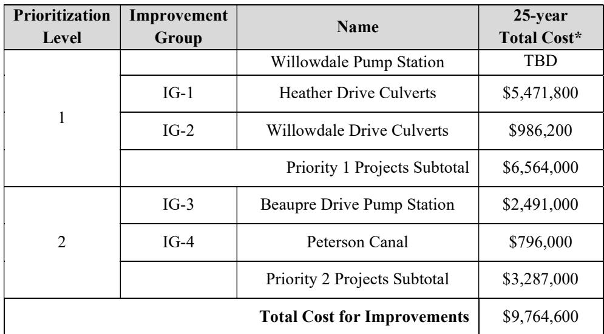

# Mimosa Willowdale Executive Summary

Source: `Mimosa Willowdale Executive Summary.pdf` (St. Charles Parish, Master Drainage Plan). Pages: 2.

## Page 1

### ST. CHARLES PARISH WEST BANK MASTER DRAINAGE PLAN MIMOSA WILLOWDALE WATERSHED

#### EXECUTIVE SUMMARY

The goal of this section is to give a high-level overview of the process and results of the hydraulic and hydrologic study of the Mimosa Willowdale watershed. This summary shall always be accompanied by the comprehensive detailed report, which follows this section.

This report presents the results of a basin-wide modeling study for the Mimosa Willowdale drainage basin. The purpose of this study was to identify necessary improvements to the major conveyance systems to mitigate the effects of the 25-year event. Drainage features that were considered as part of the system upgrades were the construction of box culverts down Wanda St., the widening of Peterson Canal, a pump station to replace the siphon at Beaupre Drive, and a 48” culvert along Willowdale Blvd. and then into the ditch east of Willowdale Blvd. just north of E. Levert Dr. In addition, it is recommended to stabilize the canal leading to the pump station along Michael Dr. This model can be used to identify other deficiencies and provide inputs for targeted analyses that are focused on upgrades at the subdivision-scale.

#### WATERSHED CHARACTERISTICS

The Mimosa Willowdale drainage basin is located on the west bank of the Mississippi River in St. Charles Parish (SCP), Louisiana. The focus area for this analysis is approximately 2,509 acres and is drained via gravity by a system of canals that are tidally influenced due to the connection with Lac des Allemands to the west. The northern basin has one primary outfall canal north of the UP. This canal flows from the southwestern boundary of the focus area, via cross-drain culverts at the existing Union Pacific (UP) railroad and a bridge at LA 3127 before joining with the Eighty Arpent Canal and west to the St. Charles Canal.

#### CURRENT DRAINAGE ISSUES

At present, the majority of drainage issues occur due to the lack of conveyance capacity within localized drainage systems in the neighborhoods. Conveyance in the vicinity of West Heather Drive, a siphon near Beaupre Drive which frequently clogs, and poor internal drainage as well as insufficient outfall capacity near Willowdale Drive are the primary issues.

#### PROPOSED IMPROVEMENTS

The development of the proposed conditions model focused on upgrading the existing drainage system within the Mimosa Willowdale basin. These upgrades include the construction of box culverts from the corner of St. Maria Street at Mimosa Avenue to West Heather Drive to Wanda Street and then south along Wanda Street to the canal as well as 2x36” culverts from St. Nicholas

## Page 2

Street to Wanda Street along W. Heather Drive, the widening of Peterson’s Canal, a 65 cfs pump station to replace the siphon at Beaupre Drive, and a 48” culvert running along Willowdale Blvd. to the golf course and then into the ditch east of Willowdale Blvd. just north of E. Levert Dr. An additional box culvert could be installed at Michael Drive to reduce erosion at the entrance and exit as well as reducing flow velocities. The sump at Willowdale Pump Station should be enlarged to ensure sufficiently longer pump cycle times to prolong pump life. The following exhibits show the proposed improvements as defined in the report and consolidated into “Improvement Groups.”

#### MODEL RESULTS

The following sections review the model results for the Existing Conditions (EC) and Proposed Conditions (PC) model simulations. Since the aim of the drainage basin upgrades is to reduce the impacts experienced by the 25-year event, those simulation results will be the focus of this analysis and review.

#### CONCEPTUAL COST ESTIMATE

The table below provides a summary for conceptual-level cost estimates associated with each improvement group. The table includes the cost for the “25-year improvements” as discussed above. Mitigation, permitting, utility relocation, and land acquisition costs are not included as part of this cost assessment, as these costs can vary significantly depending on the final layout of the improvements determined during detailed design.

**Table 1: Conceptual project cost summary table for Mimosa Willowdale**

| Prioritization Level | Improvement Group | Name | 25-year Total Cost* |
|---|---|---|---|
| 1 |  | Willowdale Pump Station | TBD |
| 1 | IG-1 | Heather Drive Culverts | $5,471,800 |
| 1 | IG-2 | Willowdale Drive Culverts | $986,200 |
|  | Priority 1 Projects Subtotal |  | $6,564,000 |
| 2 | IG-3 | Beaupre Drive Pump Station | $2,491,000 |
| 2 | IG-4 | Peterson Canal | $796,000 |
|  | Priority 2 Projects Subtotal |  | $3,287,000 |
| Total Cost for Improvements |  |  | $9,764,600 |

> **Note:** as printed, the subtotals and total do not equal their rows. The two costed Priority 1 rows sum to $6,458,000 against a printed subtotal of $6,564,000, The printed total of $9,764,600 matches neither the two printed subtotals ($9,851,000) nor the four costed rows ($9,745,000). The Willowdale Pump Station row has no improvement-group number and a cost of TBD; the summary does not say whether it accounts for either difference.

_\*Total Cost includes 20% contingency._

Table snapshot (for checking): 
