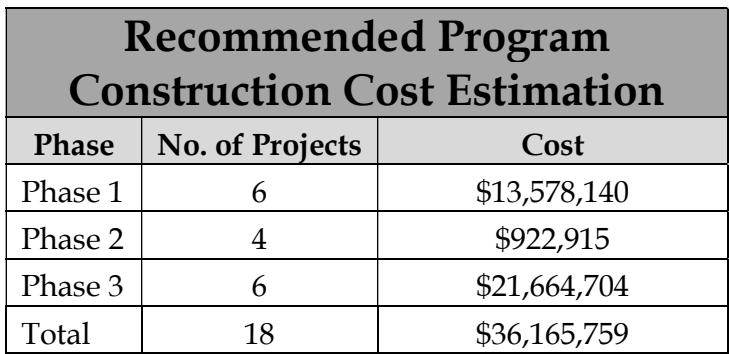
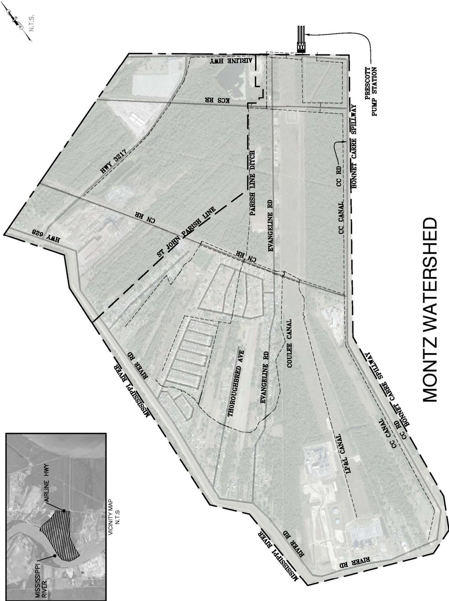
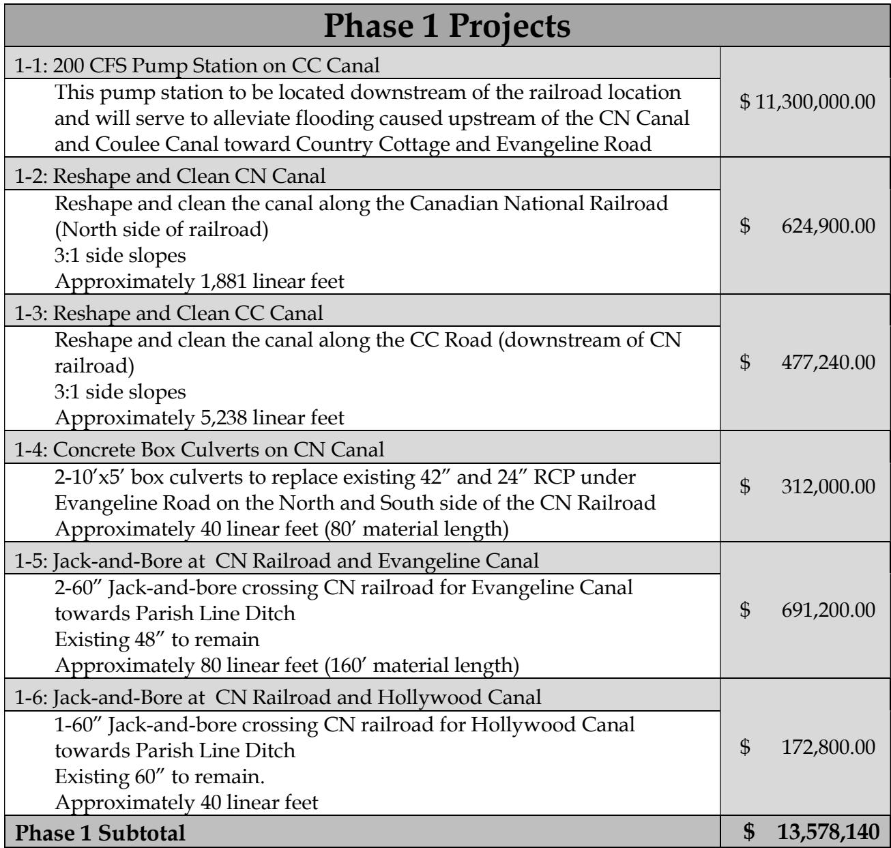
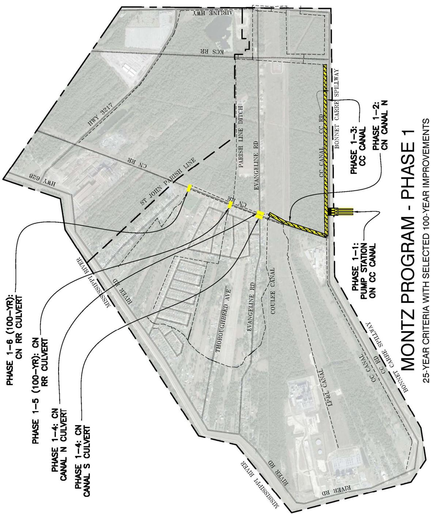
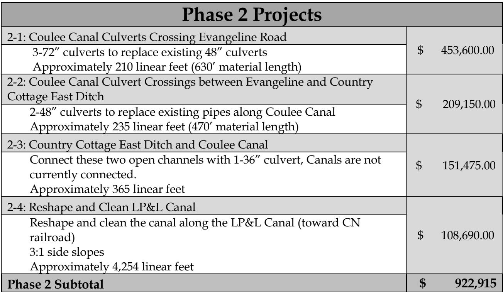
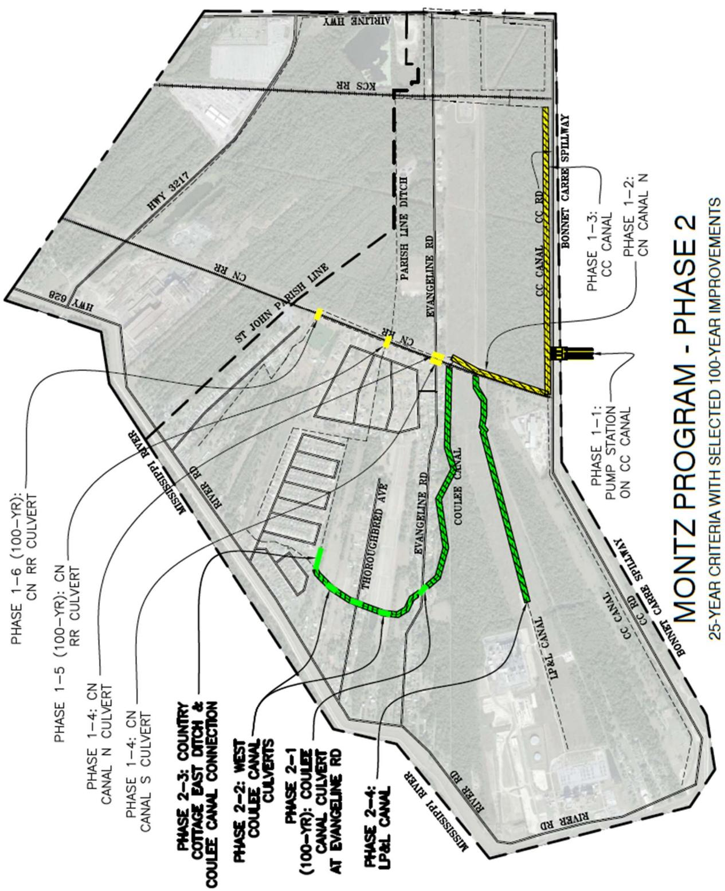
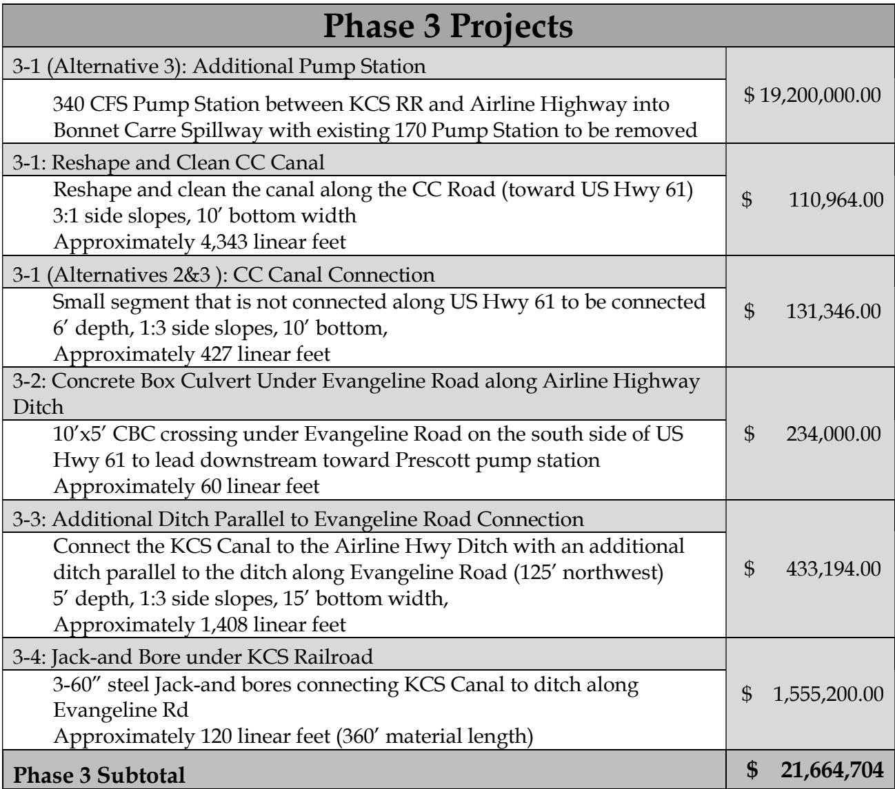
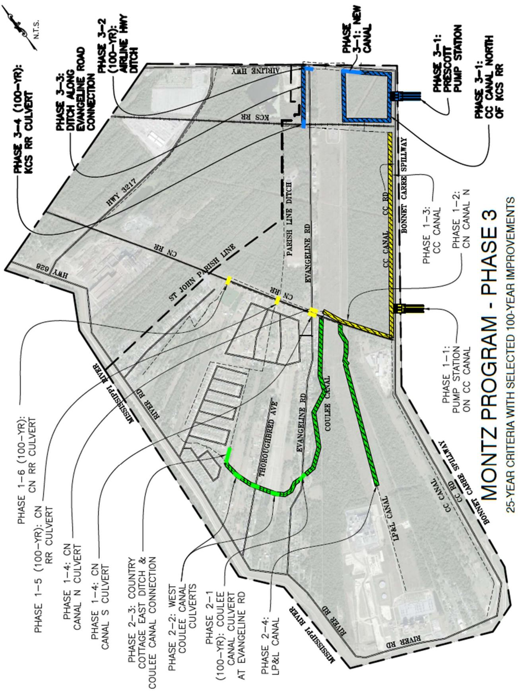

# Montz Executive Summary

Source: `Montz Executive Summary.pdf` (St. Charles Parish, Master Drainage Plan). Pages: 9.

## Page 1

#### Volume 2: Montz

#### 2.1 Executive Summary

St. Charles Parish tasked Principal Engineering, Inc. to complete the study of the Montz Drainage Area for the East Bank Master Drainage Plan. Building on a 10-Year Design Storm study performed by Meyer Engineers, Ltd., Principal Engineering performed analyses on 25- Year and 100-Year Design Storms (NOAA Atlas 14) by developing drainage improvements that:

1. 25-Year: Reduce the water surface elevations in the canals to one foot below top of the bank such that future internal drainage improvements may function to eliminate street flooding.

2. 100-Year: Lower water surface elevations in the canals such that direct structure flooding from the canals is eliminated and future internal drainage improvements may function to eliminate internal area structure flooding.

The recommended program consists of the 25-Year improvements and select 100-Year improvements at major street crossings and railroad crossings.

Analysis used models built in EPA SWMM and AutoDesk’s Storm and Sanitary Analysis. Existing flood-prone areas were identified in Country Cottage, Evangeline Estates, Evangeline Road, and Airline Highway.

The 10-year rainfall event model with proposed improvements from Meyer Engineering served as the existing conditions model for Principal Engineering, Inc. St. Charles Parish selected certain improvements recommended by Meyer, not yet constructed, that Principal Engineering, Inc. included in the existing conditions model. The results of the existing conditions simulation illustrate the inadequacy of the drainage system for the design events.

The recommended improvements are grouped into phases and projects, building from the previous, in sensible order of construction, downstream to upstream. Some the major improvements include an additional pump station along CC Road and increased capacity at the Prescott Pump Station.

## Page 2

Modeled improvements have been partitioned into executable projects with cost estimates provided. It is expected that the Parish will create an integrated priority list consisting of projects from all basins, constructed individually as funding becomes available. A summary of projects and costs is tabulated on the following pages by phase.

**Table 1**

| Recommended ProgramConstruction Cost Estimation |  |  |
|---|---|---|
| Phase | No. of Projects | Cost |
| Phase 1 | 6 | $13,578,140 |
| Phase 2 | 4 | $922,915 |
| Phase 3 | 6 | $21,664,704 |
| Total | 18 | $36,165,759 |

Table snapshot (for checking): 

## Page 3

> **Figure description:** Watershed overview map titled MONTZ WATERSHED, with a vicinity inset (N.T.S.) showing the watershed between Airline Hwy and the Mississippi River. Labelled: the Prescott Pump Station at the north end, Bonnet Carre Spillway, CC Canal, CC Rd, KCS RR, CN RR, Parish Line Ditch, St. John Parish Line, Hwy 3217, Hwy 628, Airline Hwy, Evangeline Rd, Thoroughbred Ave, Coulee Canal, LP&L Canal and River Rd. No legend and no dollar figures.

## Page 4

**Table 2**

| Phase 1 Projects |  |
|---|---|
| 1-1: 200 CFS Pump Station on CC Canal This pump station to be located downstream of the railroad locationand will serve to alleviate flooding caused upstream of the CN Canaland Coulee Canal toward Country Cottage and Evangeline Road | $11,300,000.00 |
| 1-2: Reshape and Clean CN Canal Reshape and clean the canal along the Canadian National Railroad(North side of railroad)3:1 side slopes Approximately 1,881 linear feet | $ 624,900.00 |
| 1-3: Reshape and Clean CC Canal Reshape and clean the canal along the CC Road (downstream of CNrailroad)3:1 side slopes Approximately 5,238 linear feet | $ 477,240.00 |
| 1-4: Concrete Box Culverts on CN Canal 2-10'x5' box culverts to replace existing 42" and 24" RCP under Evangeline Road on the North and South side of the CN Railroad Approximately 40 linear feet (80' material length) | $ 312,000.00 |
| 1-5: Jack-and-Bore at CN Railroad and Evangeline Canal 2-60" Jack-and-bore crossing CN railroad for Evangeline Canaltowards Parish Line Ditch Existing 48" to remain Approximately 80 linear feet (160' material length) | $ 691,200.00 |
| 1-6: Jack-and-Bore at CN Railroad and Hollywood Canal 1-60" Jack-and-bore crossing CN railroad for Hollywood Canaltowards Parish Line Ditch Existing 60" to remain.Approximately 40 linear feet | $ 172,800.00 |
| Phase 1 Subtotal | $13,578,140 |

Table snapshot (for checking): 

## Page 5

> **Figure description:** MONTZ PROGRAM - PHASE 1 (25-year criteria with selected 100-year improvements). Yellow items: Phase 1-1 pump station on CC Canal, Phase 1-2 CN Canal N, and Phase 1-3 CC Canal. Culvert call-outs: Phase 1-4 CN Canal N culvert, Phase 1-4 CN Canal S culvert, Phase 1-5 (100-yr) CN RR culvert and Phase 1-6 (100-yr) CN RR culvert. No dollar figures.

## Page 6

**Table 3**

| Phase 2 Projects |  |
|---|---|
| 2-1: Coulee Canal Culverts Crossing Evangeline Road 3-72" culverts to replace existing 48" culverts Approximately 210 linear feet (630' material length) | $ 453,600.00 |
| 2-2: Coulee Canal Culvert Crossings between Evangeline and CountryCottage East Ditch 2-48" culverts to replace existing pipes along Coulee Canal Approximately 235 linear feet (470' material length) | $ 209,150.00 |
| 2-3: Country Cottage East Ditch and Coulee Canal Connect these two open channels with 1-36" culvert, Canals are notcurrently connected.Approximately 365 linear feet | $ 151,475.00 |
| 2-4: Reshape and Clean LP&L Canal Reshape and clean the canal along the LP&L Canal (toward CNrailroad)3:1 side slopes Approximately 4,254 linear feet | $ 108,690.00 |
| Phase 2 Subtotal | $ 922,915 |

Table snapshot (for checking): 

## Page 7

> **Figure description:** MONTZ PROGRAM - PHASE 2 (25-year criteria with selected 100-year improvements). Green channel items: Phase 2-1 (100-yr) Coulee Canal culvert at Evangeline Rd, Phase 2-2 West Coulee Canal culverts, Phase 2-3 Country Cottage East Ditch and Coulee Canal connection, and Phase 2-4 LP&L Canal. Phase 1 items appear in yellow for reference. Also labelled: Thoroughbred Ave, Coulee Canal and River Rd. No dollar figures.

## Page 8

**Table 4**

| Phase 3 Projects |  |
|---|---|
| 3-1 (Alternative 3): Additional Pump Station 340 CFS Pump Station between KCS RR and Airline Highway into Bonnet Carre Spillway with existing 170 Pump Station to be removed | $ 19,200,000.00 |
| 3-1: Reshape and Clean CC Canal Reshape and clean the canal along the CC Road (toward US Hwy 61)3:1 side slopes, 10' bottom width Approximately 4,343 linear feet | $ 110,964.00 |
| 3-1 (Alternatives 2&3 ): CC Canal Connection Small segment that is not connected along US Hwy 61 to be connected6' depth, 1:3 side slopes, 10' bottom,Approximately 427 linear feet | $ 131,346.00 |
| 3-2: Concrete Box Culvert Under Evangeline Road along Airline HighwayDitch 10'x5' CBC crossing under Evangeline Road on the south side of USHwy 61 to lead downstream toward Prescott pump station Approximately 60 linear feet | $ 234,000.00 |
| 3-3: Additional Ditch Parallel to Evangeline Road Connection Connect the KCS Canal to the Airline Hwy Ditch with an additionalditch parallel to the ditch along Evangeline Road (125' northwest)5' depth, 1:3 side slopes, 15' bottom width,Approximately 1,408 linear feet | $ 433,194.00 |
| 3-4: Jack-and Bore under KCS Railroad 3-60" steel Jack-and bores connecting KCS Canal to ditch along Evangeline Rd Approximately 120 linear feet (360' material length) | $ 1,555,200.00 |
| Phase 3 Subtotal | $ 21,664,704 |

Table snapshot (for checking): 

## Page 9

> **Figure description:** MONTZ PROGRAM - PHASE 3 (25-year criteria with selected 100-year improvements). Blue items: Phase 3-1 new canal, Phase 3-1 Prescott Pump Station, Phase 3-2 (100-yr) Airline Hwy ditch, and Phase 3-3 ditch along the Evangeline Rd connection. Phase 3-4 (100-yr) KCS RR culvert is called out. Phase 3-1 CC Canal north of KCS RR is also labelled. Green items are Phase 2 and yellow items are Phase 1. No dollar figures.
