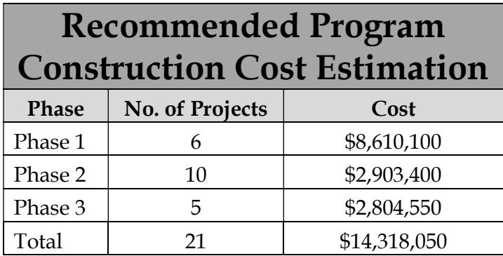
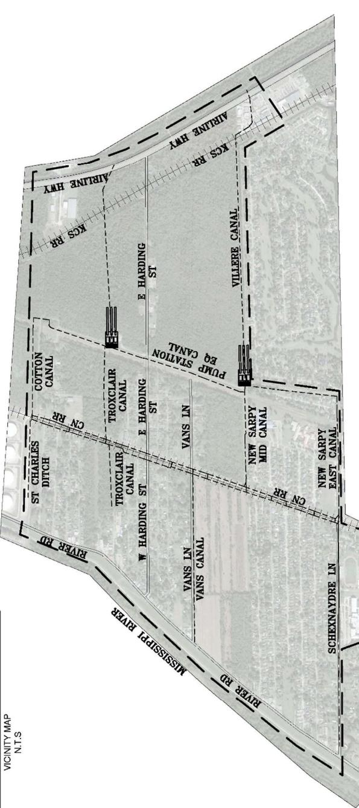
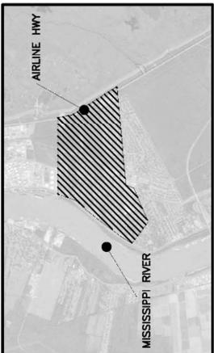
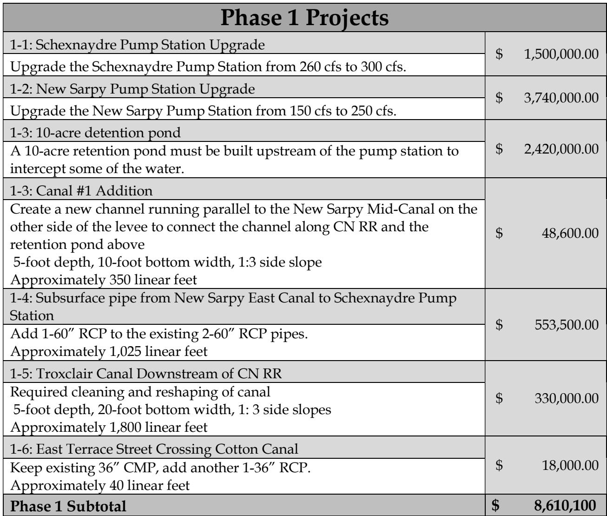
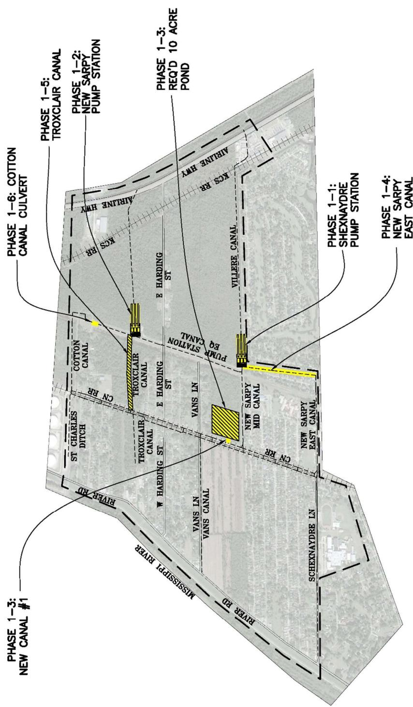
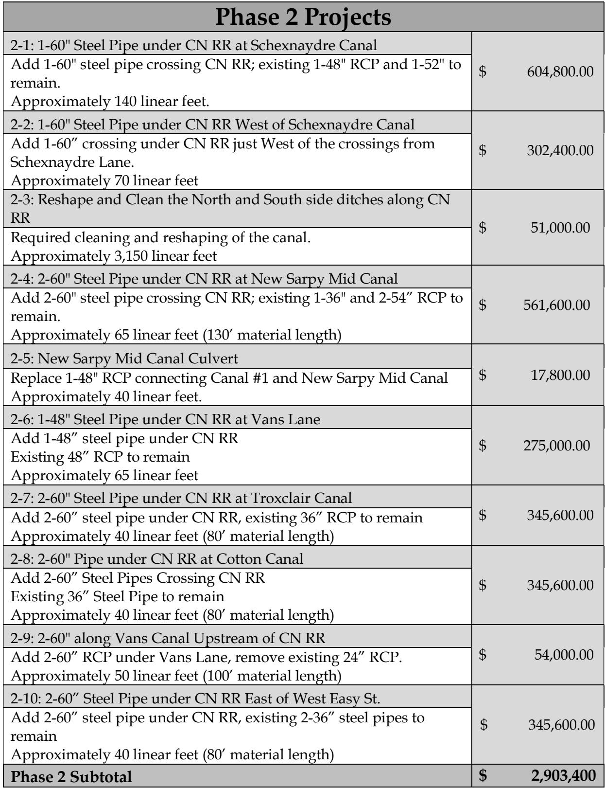
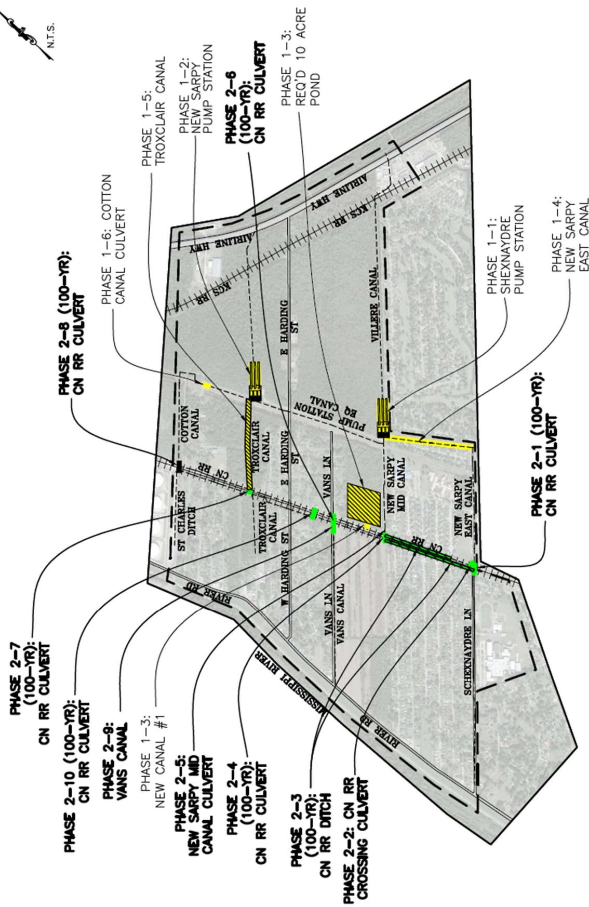
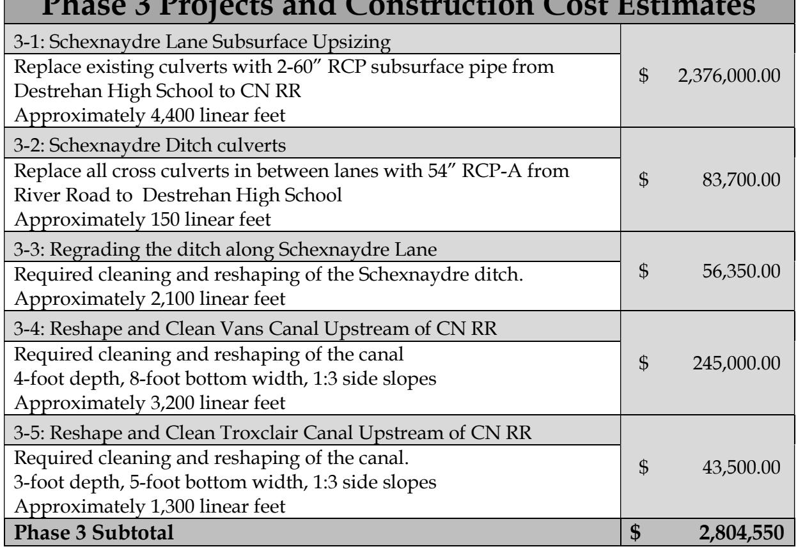
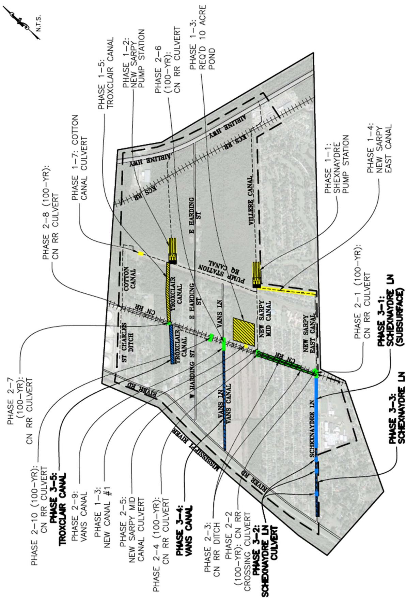

# New Sarpy Executive Summary

Source: `New Sarpy Executive Summary.pdf` (St. Charles Parish, Master Drainage Plan). Pages: 9.

## Page 1

#### Volume 4: New Sarpy

#### 4.1 Executive Summary

St. Charles Parish tasked Principal Engineering, Inc. to complete the study of the New Sarpy Drainage Area for the East Bank Master Drainage Plan. Principal Engineering performed analyses for 25-Year and 100-Year Design Storms (NOAA Atlas 14), and developed drainage improvement that:

1. 25-Year: Reduce the water surface elevations in the canals to one foot below top of the bank such that future internal drainage improvements may function to eliminate street flooding.

2. 100-Year: Lower water surface elevations in the canals such that direct structure flooding from the canals is eliminated and future internal drainage improvements may function to eliminate internal area structure flooding.

The recommended program consists of the 25-Year and select 100-Year improvements at major street crossings and railroad crossings. The 100-Year analysis also called for cleaning and reshaping of the CN Railroad Canal between New Sarpy East Canal and New Sarpy Mid Canal, which was included in the recommendation, due to its inexpensive and sensible nature.

Analysis used models built in EPA SWMM and AutoDesk’s Storm and Sanitary Analysis. Existing flood-prone areas were identified in areas along Schexnaydre Lane, upstream of the Schexnaydre Pump Station, areas along Vans Lane, among others. Thomas Coby Dr. was also found to be a problem spot because of inadequate conveyance under CN RR, even though it lies in the Ormond Drainage Area. The results of the existing conditions simulation illustrate the inadequacy of the drainage system for the design events.

The recommended improvements are grouped into phases and projects, building from the previous, in sensible order of construction, downstream to upstream. Some of the major improvements include upgrading existing Schexnaydre and New Sarpy Pump Stations, as well as potentially adding a detention pond and upsizing road and railroad crossings.

## Page 2

Modeled improvements have been partitioned into executable projects with cost estimates provided. It is expected that the Parish will create an integrated priority list consisting of projects from all basins, constructed individually as funding becomes available. A summary of projects and costs is tabulated on the following pages by phase.

**Table 1**

| Recommended ProgramConstruction Cost Estimation |  |  |
|---|---|---|
| Phase | No. of Projects | Cost |
| Phase 1 | 6 | $8,610,100 |
| Phase 2 | 10 | $2,903,400 |
| Phase 3 | 5 | $2,804,550 |
| Total | 21 | $14,318,050 |

Table snapshot (for checking): 

## Page 3

**Table 2**

| RIVERRD | COTTON DITCH R CANAL | XMH AITNE |
|---|---|---|
|  | TROXCLAIR TROXCLAIR CANAL CANAL E HARDING ST | E HARDING |
| W HARDING ST | VANS LN | STATIN ST CANAT e |
| VANS LN VANS CANAL | PUMMP | AIRE HAIMVY KCS R VILLERE CANAL |
|  | NEW SARPY MID CANAL ad |  |

Table snapshot (for checking): 

> **Figure description:** Non-content: small vicinity inset showing the hatched project area between Airline Hwy and the Mississippi River. No projects shown.

## Page 4

**Table 3**

| Phase 1 Projects |  |
|---|---|
| 1-1: Schexnaydre Pump Station Upgrade Upgrade the Schexnaydre Pump Station from 260 cfs to 300 cfs. | $ 1,500,000.00 |
| 1-2: New Sarpy Pump Station Upgrade Upgrade the New Sarpy Pump Station from 150 cfs to 250 cfs. | $ 3,740,000.00 |
| 1-3: 10-acre detention pond A 10-acre retention pond must be built upstream of the pump station tointercept some of the water. | $ 2,420,000.00 |
| 1-3: Canal #1 Addition Create a new channel running parallel to the New Sarpy Mid-Canal on theother side of the levee to connect the channel along CN RR and theretention pond above5-foot depth, 10-foot bottom width, 1:3 side slope Approximately 350 linear feet | $ 48,600.00 |
| 1-4: Subsurface pipe from New Sarpy East Canal to Schexnaydre PumpStation Add 1-60" RCP to the existing 2-60" RCP pipes.Approximately 1,025 linear feet | $ 553,500.00 |
| 1-5: Troxclair Canal Downstream of CN RR Required cleaning and reshaping of canal5-foot depth, 20-foot bottom width, 1: 3 side slopes Approximately 1,800 linear feet | $ 330,000.00 |
| 1-6: East Terrace Street Crossing Cotton Canal Keep existing 36" CMP, add another 1-36" RCP.Approximately 40 linear feet | $ 18,000.00 |
| Phase 1 Subtotal | $ 8,610,100 |

Table snapshot (for checking): 

## Page 5

> **Figure description:** Phase 1 projects on an aerial base. Call-outs: Phase 1-1 Shexnaydre pump station; Phase 1-2 New Sarpy pump station; Phase 1-3 Req'd 10 acre pond (hatched) and New Canal #1; Phase 1-4 New Sarpy East Canal; Phase 1-5 Troxclair Canal (hatched); Phase 1-6 Cotton Canal culvert (yellow dot). Other labels: Airline Hwy, KCS RR, CN RR, River Rd, Vans Canal, New Sarpy Mid Canal, Pump Station EQ canal, Cotton Canal, St Charles Ditch, E and W Harding St, Vans Ln, Schexnaydre Ln. No legend. Note: the Cotton Canal culvert is numbered 1-6 here and 1-7 on fig 4.

## Page 6

**Table 4**

| Phase 2 Projects |  |
|---|---|
| 2-1: 1-60" Steel Pipe under CN RR at Schexnaydre Canal Add 1-60" steel pipe crossing CN RR; existing 1-48" RCP and 1-52" toremain.Approximately 140 linear feet. | $ 604,800.00 |
| 2-2: 1-60" Steel Pipe under CN RR West of Schexnaydre Canal Add 1-60" crossing under CN RR just West of the crossings from Schexnaydre Lane.Approximately 70 linear feet | $ 302,400.00 |
| 2-3: Reshape and Clean the North and South side ditches along CNRR Required cleaning and reshaping of the canal.Approximately 3,150 linear feet | $ 51,000.00 |
| 2-4: 2-60" Steel Pipe under CN RR at New Sarpy Mid Canal Add 2-60" steel pipe crossing CN RR; existing 1-36" and 2-54" RCP toremain.Approximately 65 linear feet (130' material length) | $ 561,600.00 |
| 2-5: New Sarpy Mid Canal Culvert Replace 1-48" RCP connecting Canal #1 and New Sarpy Mid Canal Approximately 40 linear feet. | $ 17,800.00 |
| 2-6: 1-48" Steel Pipe under CN RR at Vans Lane Add 1-48" steel pipe under CN RRExisting 48" RCP to remain Approximately 65 linear feet | $ 275,000.00 |
| 2-7: 2-60" Steel Pipe under CN RR at Troxclair Canal Add 2-60" steel pipe under CN RR, existing 36" RCP to remain Approximately 40 linear feet (80' material length) | $ 345,600.00 |
| 2-8: 2-60" Pipe under CN RR at Cotton Canal Add 2-60" Steel Pipes Crossing CN RRExisting 36" Steel Pipe to remain Approximately 40 linear feet (80' material length) | $ 345,600.00 |
| 2-9: 2-60" along Vans Canal Upstream of CN RR Add 2-60" RCP under Vans Lane, remove existing 24" RCP.Approximately 50 linear feet (100' material length) | $ 54,000.00 |
| 2-10: 2-60" Steel Pipe under CN RR East of West Easy St. Add 2-60" steel pipe under CN RR, existing 2-36" steel pipes toremain Approximately 40 linear feet (80' material length) | $ 345,600.00 |
| Phase 2 Subtotal | $ 2,903,400 |

Table snapshot (for checking): 

## Page 7

> **Figure description:** Phase 2 projects, with 100-year CN RR culverts and ditch works (green) along the CN RR line. Call-outs: Phase 2-1 CN RR culvert (east end); Phase 2-2 CN RR crossing culvert; Phase 2-3 CN RR ditch; Phase 2-4 CN RR culvert; Phase 2-5 New Sarpy Mid Canal culvert; Phase 2-6 CN RR culvert (near Troxclair); Phase 2-7 CN RR culvert; Phase 2-8 CN RR culvert (near Cotton Canal); Phase 2-9 Vans Canal; Phase 2-10 CN RR culvert. Phase 1 call-outs (1-2, 1-3 New Canal #1, 1-5 Troxclair Canal, 1-6 Cotton Canal Culvert, and the 10 acre pond) repeat on the base. Yellow fills mark the Phase 1 pump station and Troxclair works.

## Page 8

**Table 5: Phase 3 Projects and Construction Cost Estimates**

| Phase 3 Projects and Construction Cost Estimates |  |
|---|---|
| 3-1: Schexnaydre Lane Subsurface Upsizing Replace existing culverts with 2-60" RCP subsurface pipe from Destrehan High School to CN RRApproximately 4,400 linear feet | $ 2,376,000.00 |
| 3-2: Schexnaydre Ditch culverts Replace all cross culverts in between lanes with 54" RCP-A from River Road to Destrehan High School Approximately 150 linear feet | $ 83,700.00 |
| 3-3: Regrading the ditch along Schexnaydre Lane Required cleaning and reshaping of the Schexnaydre ditch.Approximately 2,100 linear feet | $ 56,350.00 |
| 3-4: Reshape and Clean Vans Canal Upstream of CN RR Required cleaning and reshaping of the canal4-foot depth, 8-foot bottom width, 1:3 side slopes Approximately 3,200 linear feet | $ 245,000.00 |
| 3-5: Reshape and Clean Troxclair Canal Upstream of CN RR Required cleaning and reshaping of the canal.3-foot depth, 5-foot bottom width, 1:3 side slopes Approximately 1,300 linear feet | $ 43,500.00 |
| Phase 3 Subtotal | $ 2,804,550 |

Table snapshot (for checking): 

## Page 9

> **Figure description:** Phase 3 projects with Phase 1 and Phase 2 call-outs repeated. Blue segments: Phase 3-1 Schexnaydre Ln (subsurface); Phase 3-2 Schexnaydre Ln culvert; Phase 3-3 Schexnaydre Ln; Phase 3-4 Vans Canal (blue, along Vans Ln); Phase 3-5 Troxclair Canal (blue, south of the Troxclair works). Green segments on the CN RR line are Phase 2 culverts. Labelled canals: New Sarpy East, New Sarpy Mid, Vans, Troxclair and Cotton. No legend beyond the call-outs.
