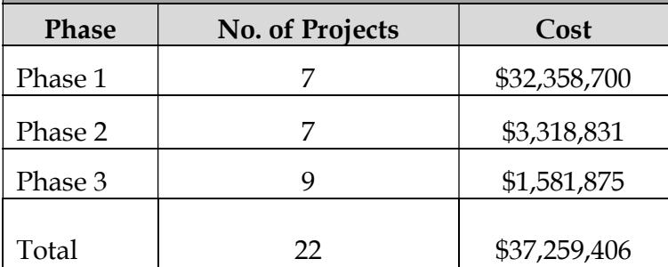
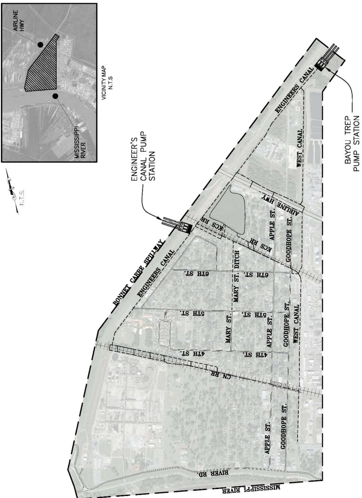
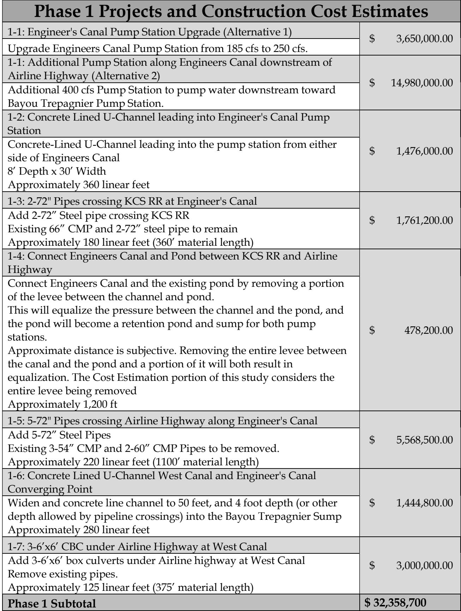
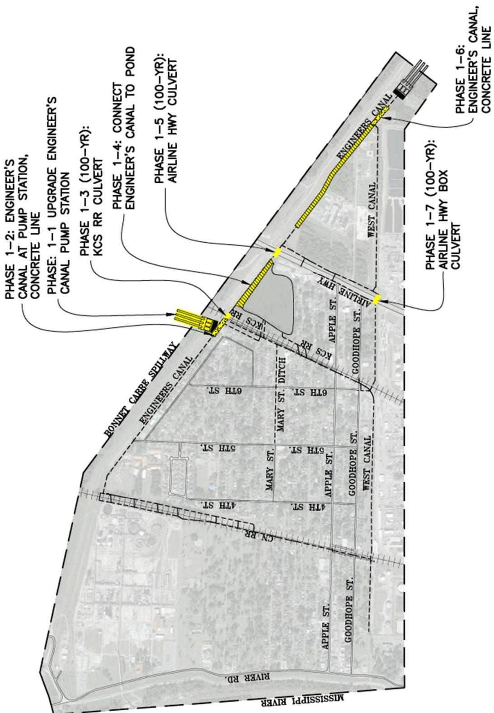
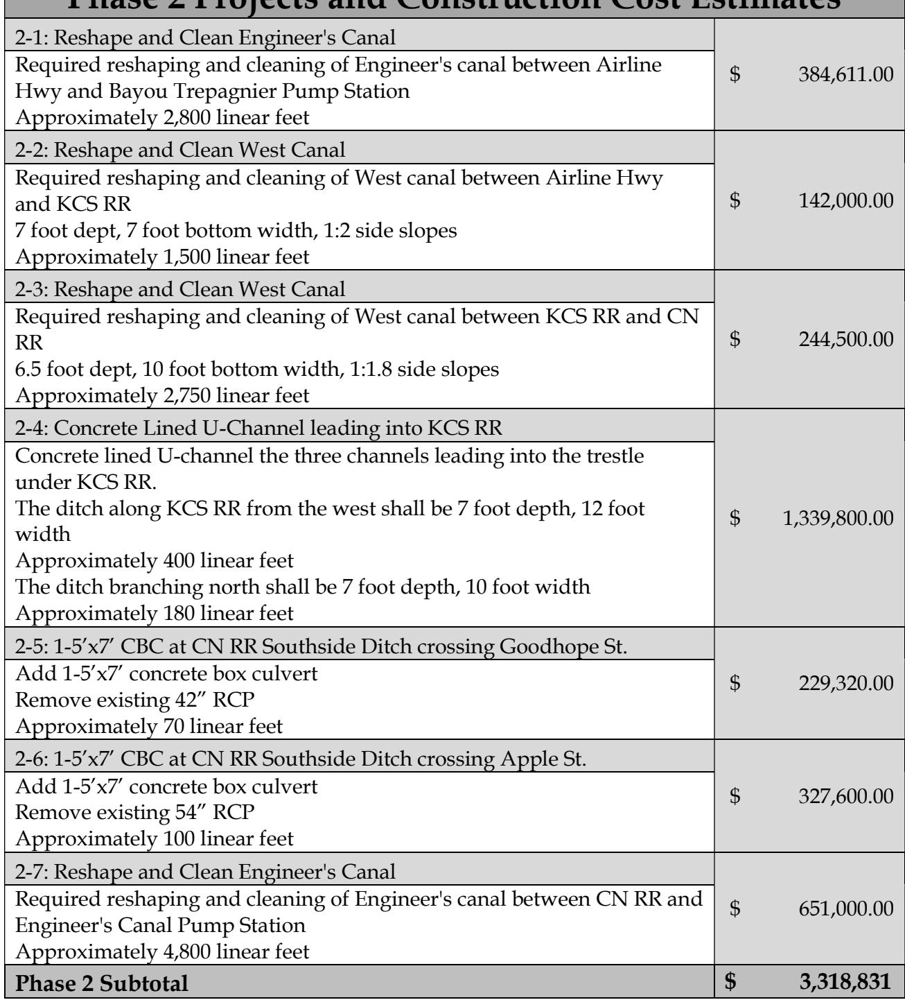
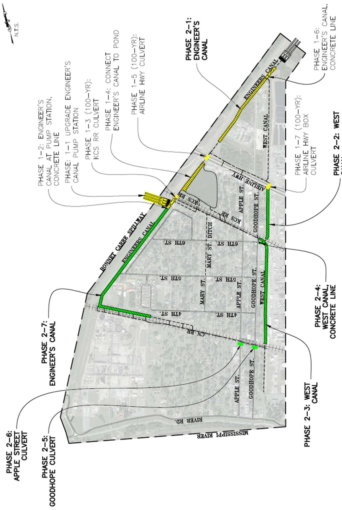
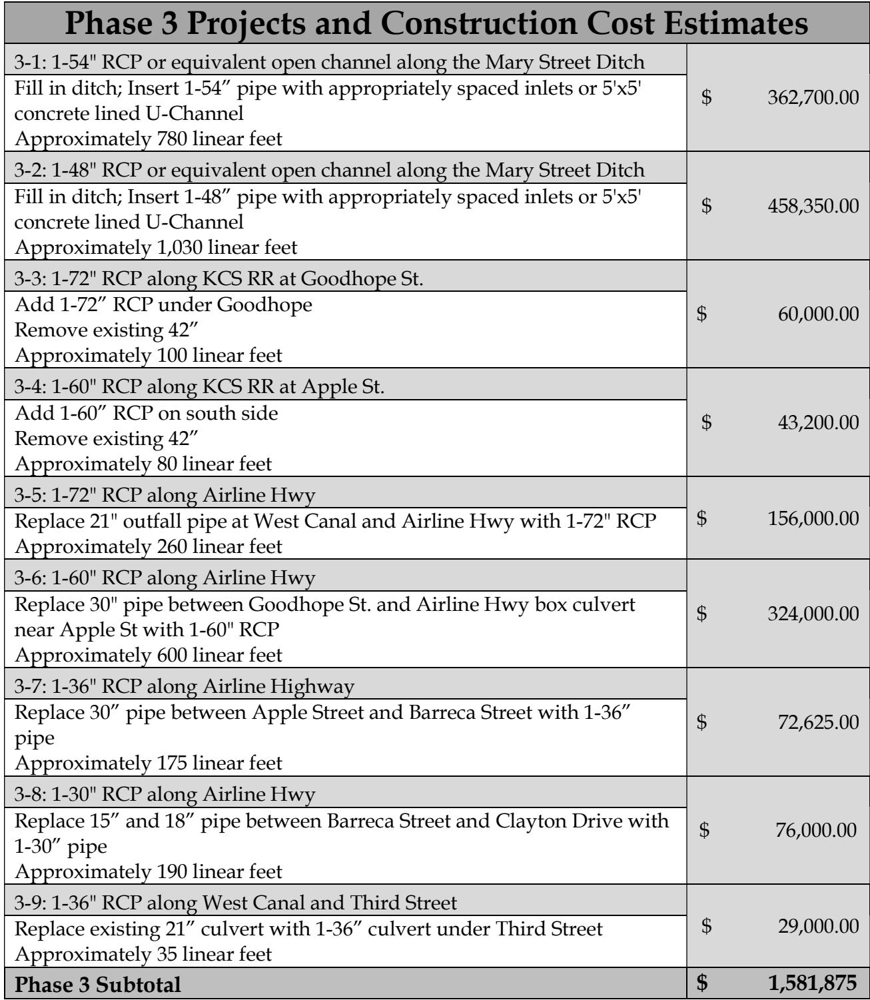
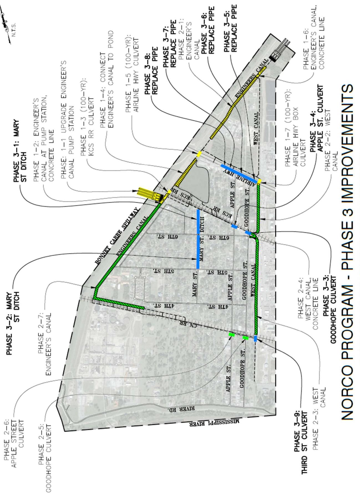

# Norco Executive Summary

Source: `Norco Executive Summary.pdf` (St. Charles Parish, Master Drainage Plan). Pages: 9.

## Page 1

#### Volume 3: Norco

#### 3.1 Executive Summary

St. Charles Parish tasked Principal Engineering, Inc. to complete the study of the Norco Drainage Area for the East Bank Master Drainage Plan. Principal Engineering performed analyses for the 25-Year and 100-Year Design Storms (NOAA Atlas 14) and developed drainage improvements that:

1. 25-Year: Reduce the water surface elevations in the canals to one foot below top of the bank such that future internal drainage improvements may function to eliminate street flooding.

2. 100-Year: Lower water surface elevations in the canals such that direct structure flooding from the canals is eliminated and future internal drainage improvements may function to eliminate internal area structure flooding.

The recommended program consists of the 25-Year improvements, and select 100-Year improvements at major street crossings and railroad crossings.

Analysis used models built in EPA SWMM and AutoDesk’s Storm and Sanitary Analysis. Existing flood-prone areas identified were the Engineer’s Canal south of KCS RR, Engineer Canal North of Airline Highway, the West Canal, and the Mary St. Canal.

The results of the existing conditions simulation illustrate the inadequacy of the drainage system for the design events.

The recommended improvements are grouped into phases and projects, building from the previous, in sensible order of construction, downstream to upstream. Some of the major improvements include upgrades to Engineer’s Canal Pump Station or a new pump station to move water to the Bayou Trepagnier Pump Station, which is obstructed by, and connection from Engineer’s Canal to Clayton’s Pond.

## Page 2

Modeled improvements have been partitioned into executable projects with cost estimates provided. It is expected that the Parish will create an integrated priority list consisting of projects from all basins, constructed individually as funding becomes available. A summary of projects and costs is tabulated on the following pages by phase.

**Table 1: Recommended Program Construction Cost Estimation**

| Phase | No. of Projects | Cost |
|---|---|---|
| Phase 1 | 7 | $32,358,700 |
| Phase 2 | 7 | $3,318,831 |
| Phase 3 | 9 | $1,581,875 |
| Total | 22 | $37,259,406 |

Table snapshot (for checking): 

## Page 3

> **Figure description:** Watershed overview map of the Norco study area with a vicinity inset (N.T.S.) showing its position between Airline Hwy and the Mississippi River. Labelled: Bonnet Carre Spillway, Engineer's Canal, Engineer's Canal Pump Station, Bayou Trep Pump Station, West Canal, Mary St Ditch, Airline Hwy, KCS RR, CN RR, River Rd, and the streets 4th, 5th and 6th St, Mary St, Apple St and Goodhope St. No legend and no dollar figures.

## Page 4

**Table 2**

| Phase 1 Projects and Construction Cost Estimates |  |
|---|---|
| 1-1: Engineer's Canal Pump Station Upgrade (Alternative 1) Upgrade Engineers Canal Pump Station from 185 cfs to 250 cfs. | $ 3,650,000.00 |
| 1-1: Additional Pump Station along Engineers Canal downstream of Airline Highway (Alternative 2) Additional 400 cfs Pump Station to pump water downstream toward Bayou Trepagnier Pump Station. | $ 14,980,000.00 |
| 1-2: Concrete Lined U-Channel leading into Engineer's Canal PumpStation Concrete-Lined U-Channel leading into the pump station from eitherside of Engineers Canal8' Depth x 30' Width Approximately 360 linear feet | $ 1,476,000.00 |
| 1-3: 2-72" Pipes crossing KCS RR at Engineer's Canal Add 2-72" Steel pipe crossing KCS RRExisting 66" CMP and 2-72" steel pipe to remain Approximately 180 linear feet (360' material length) | $ 1,761,200.00 |
| 1-4: Connect Engineers Canal and Pond between KCS RR and AirlineHighway Connect Engineers Canal and the existing pond by removing a portionof the levee between the channel and pond.This will equalize the pressure between the channel and the pond, andthe pond will become a retention pond and sump for both pumpstations.Approximate distance is subjective. Removing the entire levee betweenthe canal and the pond and a portion of it will both result inequalization. The Cost Estimation portion of this study considers theentire levee being removed Approximately 1,200 ft | $ 478,200.00 |
| 1-5: 5-72" Pipes crossing Airline Highway along Engineer's Canal Add 5-72" Steel Pipes Existing 3-54" CMP and 2-60" CMP Pipes to be removed.Approximately 220 linear feet (1100' material length) | $ 5,568,500.00 |
| 1-6: Concrete Lined U-Channel West Canal and Engineer's CanalConverging Point Widen and concrete line channel to 50 feet, and 4 foot depth (or otherdepth allowed by pipeline crossings) into the Bayou Trepagnier Sump Approximately 280 linear feet | $ 1,444,800.00 |
| 1-7: 3-6′x6' CBC under Airline Highway at West Canal Add 3-6'x6' box culverts under Airline highway at West Canal Remove existing pipes.Approximately 125 linear feet (375' material length) | $ 3,000,000.00 |
| Phase 1 Subtotal | $ 32,358,700 |

Table snapshot (for checking): 

## Page 5

> **Figure description:** Norco Phase 1 map with yellow improvements. Call-outs: Phase 1-1 upgrade of the Engineer's Canal pump station, Phase 1-2 Engineer's Canal at the pump station (concrete line), Phase 1-3 (100-yr) KCS RR culvert, Phase 1-4 connection of Engineer's Canal to the pond, Phase 1-5 (100-yr) Airline Hwy culvert, Phase 1-6 Engineer's Canal (concrete line) and Phase 1-7 (100-yr) Airline Hwy box culvert. No dollar figures.

## Page 6

**Table 3: Phase 2 Projects and Construction Cost Estimates**

| nase 2 1 rojccts aiu Conistructionr Cost Lstnniatcs |  |
|---|---|
| 2-1: Reshape and Clean Engineer's Canal Required reshaping and cleaning of Engineer's canal between AirlineHwy and Bayou Trepagnier Pump Station Approximately 2,800 linear feet | $ 384,611.00 |
| 2-2: Reshape and Clean West Canal Required reshaping and cleaning of West canal between Airline Hwyand KCS RR7 foot dept, 7 foot bottom width, 1:2 side slopes Approximately 1,500 linear feet | $ 142,000.00 |
| 2-3: Reshape and Clean West Canal Required reshaping and cleaning of West canal between KCS RR and CNRR6.5 foot dept, 10 foot bottom width, 1:1.8 side slopes Approximately 2,750 linear feet | $ 244,500.00 |
| 2-4: Concrete Lined U-Channel leading into KCS RR Concrete lined U-channel the three channels leading into the trestleunder KCS RR.The ditch along KCS RR from the west shall be 7 foot depth, 12 footwidth Approximately 400 linear feet The ditch branching north shall be 7 foot depth, 10 foot width Approximately 180 linear feet | $ 1,339,800.00 |
| 2-5: 1-5′x7' CBC at CN RR Southside Ditch crossing Goodhope St. Add 1-5′x7' concrete box culvert Remove existing 42" RCPApproximately 70 linear feet | $ 229,320.00 |
| 2-6: 1-5′x7' CBC at CN RR Southside Ditch crossing Apple St. Add 1-5′x7' concrete box culvert Remove existing 54" RCPApproximately 100 linear feet | $ 327,600.00 |
| 2-7: Reshape and Clean Engineer's Canal Required reshaping and cleaning of Engineer's canal between CN RR and Engineer's Canal Pump Station Approximately 4,800 linear feet | $ 651,000.00 |
| Phase 2 Subtotal | $ 3,318,831 |

Table snapshot (for checking): 

## Page 7

> **Figure description:** Norco Phase 2 map. Green channel items: Phase 2-2 and 2-3 West Canal, Phase 2-4 West Canal concrete line, and Phase 2-7 Engineer's Canal. Culvert call-outs in green: Phase 2-5 Goodhope culvert and Phase 2-6 Apple Street culvert. Phase 2-1 Engineer's Canal and the Phase 1 items are shown in yellow. No dollar figures.

## Page 8

**Table 4**

| Phase 3 Projects and Construction Cost Estimates |  |
|---|---|
| 3-1: 1-54" RCP or equivalent open channel along the Mary Street Ditch Fill in ditch; Insert 1-54" pipe with appropriately spaced inlets or 5'x5' concrete lined U-Channel Approximately 780 linear feet | $ 362,700.00 |
| 3-2: 1-48" RCP or equivalent open channel along the Mary Street Ditch Fill in ditch; Insert 1-48" pipe with appropriately spaced inlets or 5'x5' concrete lined U-Channel Approximately 1,030 linear feet | $ 458,350.00 |
| 3-3: 1-72" RCP along KCS RR at Goodhope St. Add 1-72" RCP under Goodhope Remove existing 42" Approximately 100 linear feet | $ 60,000.00 |
| 3-4: 1-60" RCP along KCS RR at Apple St. Add 1-60" RCP on south side Remove existing 42" Approximately 80 linear feet | $ 43,200.00 |
| 3-5: 1-72" RCP along Airline Hwy Replace 21" outfall pipe at West Canal and Airline Hwy with 1-72" RCP Approximately 260 linear feet | $ 156,000.00 |
| 3-6: 1-60" RCP along Airline Hwy Replace 30" pipe between Goodhope St. and Airline Hwy box culvert near Apple St with 1-60" RCP Approximately 600 linear feet | $ 324,000.00 |
| 3-7: 1-36" RCP along Airline Highway Replace 30" pipe between Apple Street and Barreca Street with 1-36" pipe Approximately 175 linear feet | $ 72,625.00 |
| 3-8: 1-30" RCP along Airline Hwy Replace 15" and 18" pipe between Barreca Street and Clayton Drive with 1-30" pipe Approximately 190 linear feet | $ 76,000.00 |
| 3-9: 1-36" RCP along West Canal and Third Street Replace existing 21" culvert with 1-36" culvert under Third Street Approximately 35 linear feet | $ 29,000.00 |
| Phase 3 Subtotal | $ 1,581,875 |

Table snapshot (for checking): 

## Page 9

> **Figure description:** NORCO PROGRAM - PHASE 3 IMPROVEMENTS. Blue items: Phase 3-1 and 3-2 Mary St Ditch, Phase 3-4 Apple St culvert, Phase 3-5 to 3-8 pipe replacements (call-outs marked 'Replace pipe'), and Phase 3-9 Third St culvert. Green items are Phase 2 channel work and yellow items are Phase 1. Also labelled: Phase 3-3 Goodhope culvert and the Bonnet Carre Spillway. No dollar figures.
