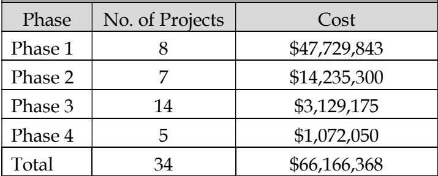
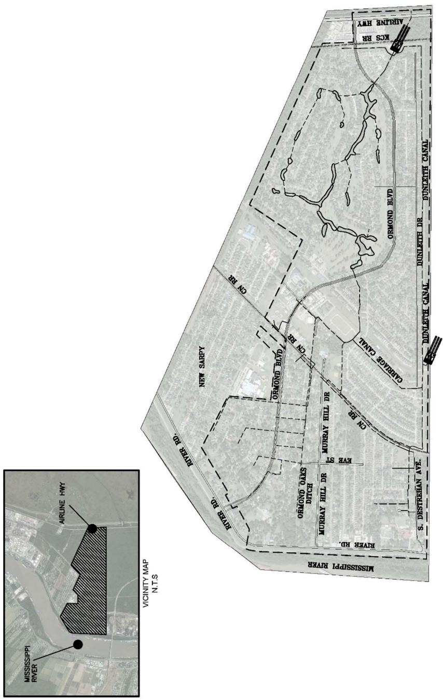
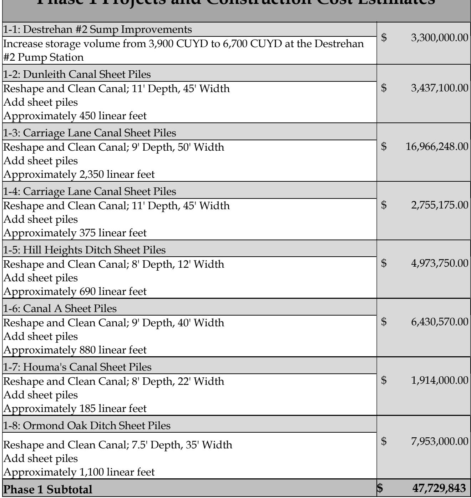
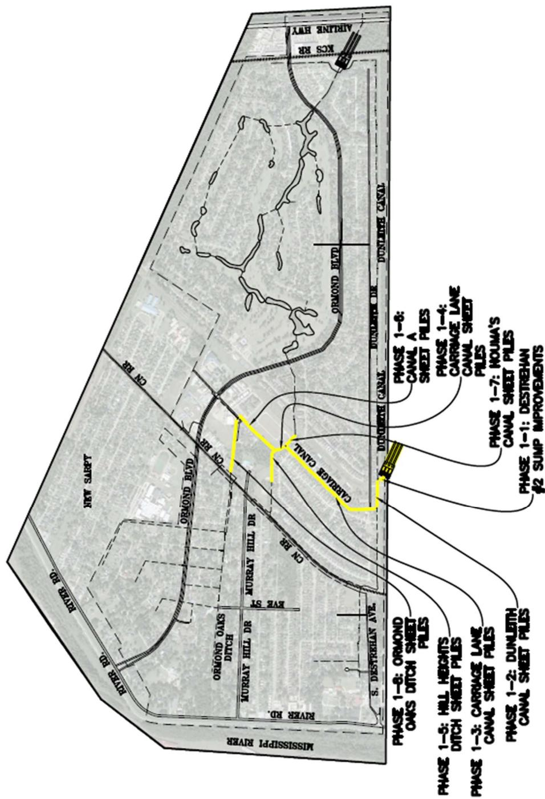
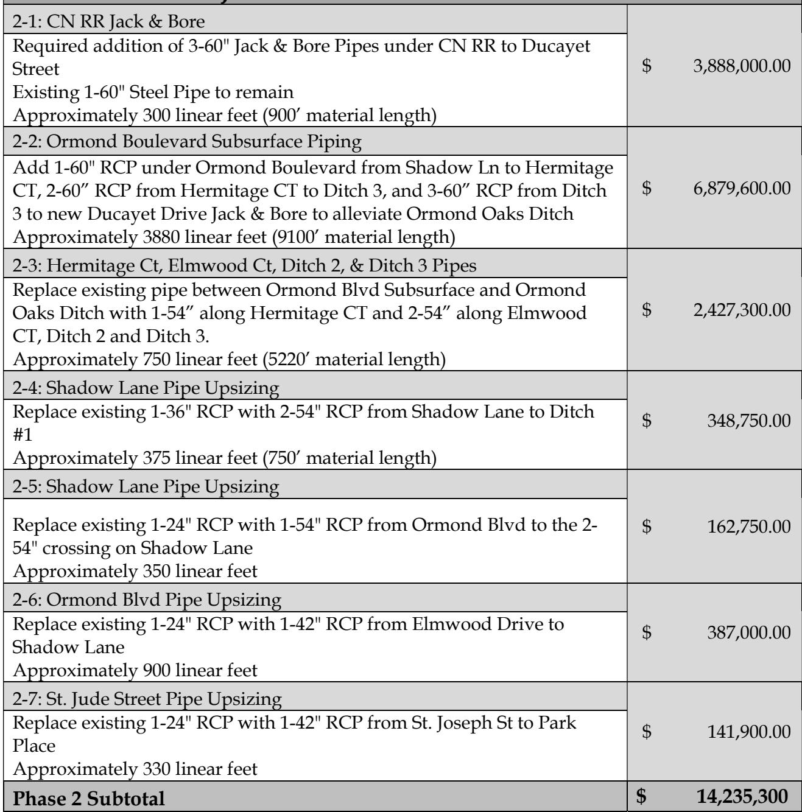
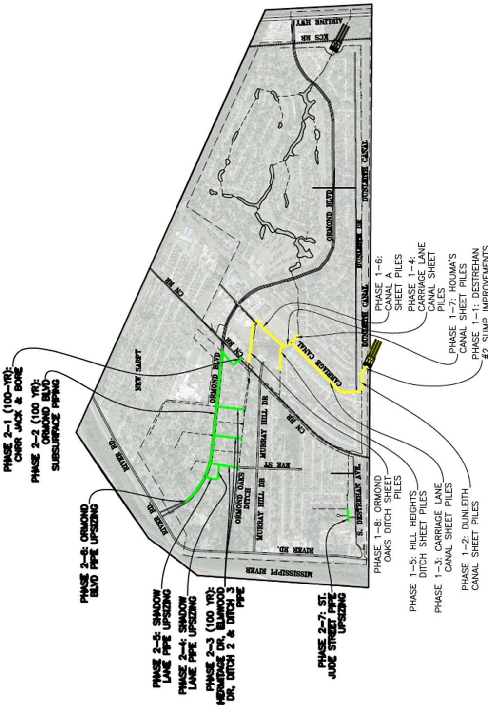
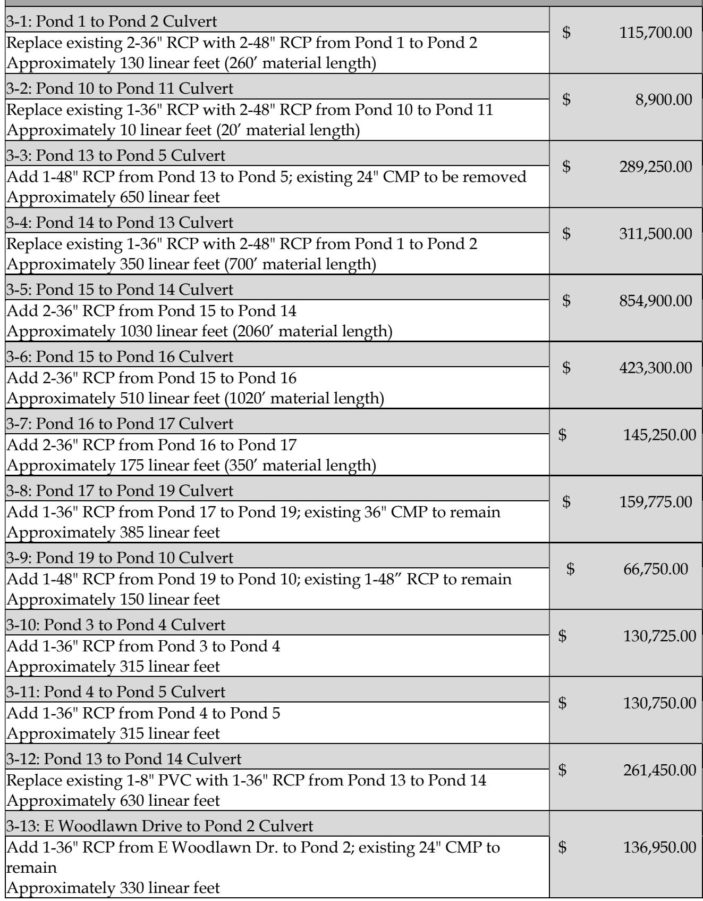
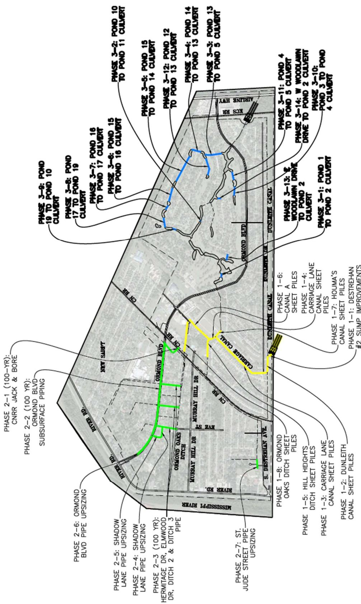
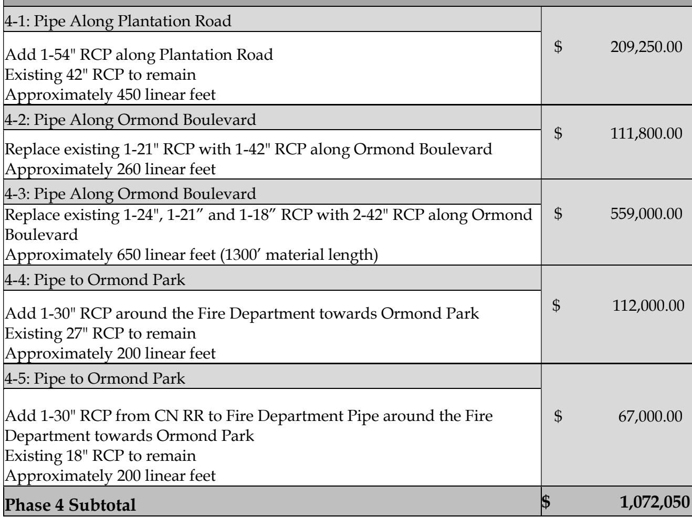
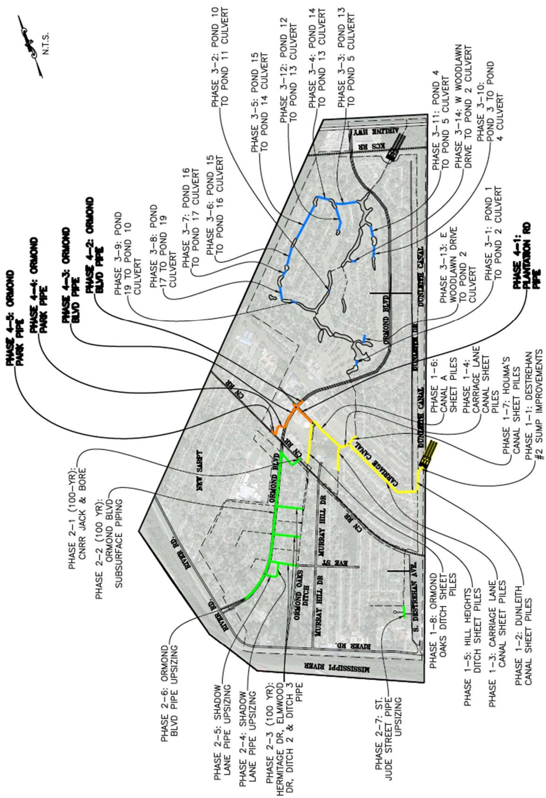

# Ormond Executive Summary

Source: `Ormond Executive Summary.pdf` (St. Charles Parish, Master Drainage Plan). Pages: 12.

## Page 1

#### Volume 5: Ormond

#### 5.1 Executive Summary

St. Charles Parish tasked Principal Engineering, Inc. to complete the study of the Ormond Drainage Area for the East Bank Master Drainage Plan. Principal Engineering performed analyses for the 25-Year and 100-Year Design Storms (NOAA Atlas 14) and developed drainage improvements that:

1. 25-Year: Reduce the water surface elevations in the canals to one foot below top of the bank such that future internal drainage improvements may function to eliminate street flooding.

2. 100-Year: Lower water surface elevations in the canals such that direct structure flooding from the canals is eliminated and future internal drainage improvements may function to eliminate internal area structure flooding.

The recommended program consists of the 25-Year and select 100-Year improvements at major street crossings and railroad crossings.

Analysis used models built in EPA SWMM and AutoDesk’s Storm and Sanitary Analysis. Existing flood-prone areas were identified in areas along Ormond Boulevard, upstream of the CN Railroad on Murray Hill Drive and Destrehan Drive, Carriage Lane, Ducayet Drive, and Thomas Coby Drive.

The results of the existing conditions simulation illustrate the inadequacy of the drainage system for the design events.

The recommended improvements are grouped into phases and projects, building from the previous, in sensible order of construction, downstream to upstream. Some the major improvements include upgrades to Destrehan #2 Pump Station, as well as increasing volumetric space in canals and railroad crossing, and adding subsurface drainage to Ormond Boulevard.

## Page 2

Modeled improvements have been partitioned into executable projects with cost estimates provided. It is expected that the Parish will create an integrated priority list consisting of projects from all basins, constructed individually as funding becomes available. A summary of projects and costs is tabulated on the following pages by phase.

**Table 1: Recommended Program Construction Cost Estimation**

| Phase | No. of Projects | Cost |
|---|---|---|
| Phase 1 | 8 | $47,729,843 |
| Phase 2 | 7 | $14,235,300 |
| Phase 3 | 14 | $3,129,175 |
| Phase 4 | 5 | $1,072,050 |
| Total | 34 | $66,166,368 |

Table snapshot (for checking): 

## Page 3

> **Figure description:** Vicinity inset (hatched project area between Airline Hwy and the Mississippi River, with Mississippi River labelled) and the Ormond project map with a dashed boundary. Labelled features: New Sarpy, Ormond Blvd, Dunleith Canal, Carriage Canal, Ormond Oaks Ditch, Murray Hill Dr, Eve St, River Rd, S. Destrehan Ave, KCS RR and CN RR. Two pump symbols sit near Airline Hwy and Dunleith Canal.

## Page 4

**Table 2: Phase 1 Projects and Construction Cost Estimates**

| Tmase 1 r rojeets aiu Construetron Cost Lstnnates |  |
|---|---|
| 1-1: Destrehan #2 Sump Improvements Increase storage volume from 3,900 CUYD to 6,700 CUYD at the Destrehan#2 Pump Station | $ 3,300,000.00 |
| 1-2: Dunleith Canal Sheet Piles Reshape and Clean Canal; 11' Depth, 45' Width Add sheet piles Approximately 450 linear feet | $ 3,437,100.00 |
| 1-3: Carriage Lane Canal Sheet Piles Reshape and Clean Canal; 9' Depth, 50' Width Add sheet piles Approximately 2,350 linear feet | $ 16,966,248.00 |
| 1-4: Carriage Lane Canal Sheet Piles Reshape and Clean Canal; 11' Depth, 45' Width Add sheet piles Approximately 375 linear feet | $ 2,755,175.00 |
| 1-5: Hill Heights Ditch Sheet Piles Reshape and Clean Canal; 8' Depth, 12' Width Add sheet piles Approximately 690 linear feet | $ 4,973,750.00 |
| 1-6: Canal A Sheet Piles Reshape and Clean Canal; 9' Depth, 40' Width Add sheet piles Approximately 880 linear feet | $ 6,430,570.00 |
| 1-7: Houma's Canal Sheet Piles Reshape and Clean Canal; 8' Depth, 22' Width Add sheet piles Approximately 185 linear feet | $ 1,914,000.00 |
| 1-8: Ormond Oak Ditch Sheet Piles Reshape and Clean Canal; 7.5' Depth, 35' Width Add sheet piles Approximately 1,100 linear feet | $ 7,953,000.00 |
| Phase 1 Subtotal | $ 47,729,843 |

Table snapshot (for checking): 

## Page 5

> **Figure description:** Phase 1 projects in yellow along Carriage Canal and the Dunleith Canal edge. Call-outs: Phase 1-1 Destrehan #2 sump improvements; Phase 1-2 Dunleith Canal sheet piles; Phase 1-3 Carriage Lane canal sheet piles; Phase 1-4 Carriage Lane canal sheet piles; Phase 1-5 Hill Heights ditch sheet piles; Phase 1-6 Canal A sheet piles; Phase 1-7 Houma's canal sheet piles; Phase 1-8 Ormond Oaks ditch sheet piles. Labelled streets: Ormond Blvd, Murray Hill Dr, Eve St and River Rd. No legend.

## Page 6

**Table 3: Phase 2 Projects and Construction Cost Estimates**

| 2-1: CN RR Jack & Bore Required addition of 3-60" Jack & Bore Pipes under CN RR to Ducayet Street Existing 1-60" Steel Pipe to remain Approximately 300 linear feet (900' material length) | $ 3,888,000.00 |
|---|---|
| 2-2: Ormond Boulevard Subsurface Piping Add 1-60" RCP under Ormond Boulevard from Shadow Ln to HermitageCT, 2-60" RCP from Hermitage CT to Ditch 3, and 3-60" RCP from Ditch3 to new Ducayet Drive Jack & Bore to alleviate Ormond Oaks Ditch Approximately 3880 linear feet (9100' material length) | $ 6,879,600.00 |
| 2-3: Hermitage Ct, Elmwood Ct, Ditch 2, & Ditch 3 Pipes Replace existing pipe between Ormond Blvd Subsurface and OrmondOaks Ditch with 1-54" along Hermitage CT and 2-54" along ElmwoodCT, Ditch 2 and Ditch 3.Approximately 750 linear feet (5220' material length) | $ 2,427,300.00 |
| 2-4: Shadow Lane Pipe Upsizing Replace existing 1-36" RCP with 2-54" RCP from Shadow Lane to Ditch#1Approximately 375 linear feet (750' material length) | $ 348,750.00 |
| 2-5: Shadow Lane Pipe Upsizing Replace existing 1-24" RCP with 1-54" RCP from Ormond Blvd to the 2-54" crossing on Shadow Lane Approximately 350 linear feet | $ 162,750.00 |
| 2-6: Ormond Blvd Pipe Upsizing Replace existing 1-24" RCP with 1-42" RCP from Elmwood Drive to Shadow Lane Approximately 900 linear feet | $ 387,000.00 |
| 2-7: St. Jude Street Pipe Upsizing Replace existing 1-24" RCP with 1-42" RCP from St. Joseph St to ParkPlace Approximately 330 linear feet | $ 141,900.00 |
| Phase 2 Subtotal | $ 14,235,300 |

Table snapshot (for checking): 

## Page 7

> **Figure description:** Phase 2 projects in green along Ormond Blvd and the streets to its east, on top of the Phase 1 yellow works. Call-outs: Phase 2-1 CNRR jack and bore (100-yr); Phase 2-2 Ormond Blvd subsurface piping (100-yr); Phase 2-3 Hermitage Dr, Elmwood Dr and Ditch 2 and Ditch 3 pipe (100-yr); Phase 2-4 and 2-5 Shadow Lane pipe upsizing; Phase 2-6 Ormond Blvd pipe upsizing; Phase 2-7 St. Jude Street pipe upsizing. Labelled: CN RR, River Rd, Ormond Oaks Ditch, Murray Hill Dr.

## Page 8

**Table 4: Phase 3 Projects and Construction Cost Estimates**

| 3-1: Pond 1 to Pond 2 Culvert Replace existing 2-36" RCP with 2-48" RCP from Pond 1 to Pond 2 Approximately 130 linear feet (260' material length) | $ 115,700.00 |
|---|---|
| 3-2: Pond 10 to Pond 11 Culvert Replace existing 1-36" RCP with 2-48" RCP from Pond 10 to Pond 11 Approximately 10 linear feet (20' material length) | $ 8,900.00 |
| 3-3: Pond 13 to Pond 5 Culvert Add 1-48" RCP from Pond 13 to Pond 5; existing 24" CMP to be removed Approximately 650 linear feet | $ 289,250.00 |
| 3-4: Pond 14 to Pond 13 Culvert Replace existing 1-36" RCP with 2-48" RCP from Pond 1 to Pond 2 Approximately 350 linear feet (700' material length) | $ 311,500.00 |
| 3-5: Pond 15 to Pond 14 Culvert Add 2-36" RCP from Pond 15 to Pond 14 Approximately 1030 linear feet (2060' material length) | $ 854,900.00 |
| 3-6: Pond 15 to Pond 16 Culvert Add 2-36" RCP from Pond 15 to Pond 16 Approximately 510 linear feet (1020' material length) | $ 423,300.00 |
| 3-7: Pond 16 to Pond 17 Culvert Add 2-36" RCP from Pond 16 to Pond 17 Approximately 175 linear feet (350' material length) | $ 145,250.00 |
| 3-8: Pond 17 to Pond 19 Culvert Add 1-36" RCP from Pond 17 to Pond 19; existing 36" CMP to remain Approximately 385 linear feet | $ 159,775.00 |
| 3-9: Pond 19 to Pond 10 Culvert Add 1-48" RCP from Pond 19 to Pond 10; existing 1-48" RCP to remain Approximately 150 linear feet | $ 66,750.00 |
| 3-10: Pond 3 to Pond 4 Culvert Add 1-36" RCP from Pond 3 to Pond 4 Approximately 315 linear feet | $ 130,725.00 |
| 3-11: Pond 4 to Pond 5 Culvert Add 1-36" RCP from Pond 4 to Pond 5 Approximately 315 linear feet | $ 130,750.00 |
| 3-12: Pond 13 to Pond 14 Culvert Replace existing 1-8" PVC with 1-36" RCP from Pond 13 to Pond 14 Approximately 630 linear feet | $ 261,450.00 |
| 3-13: E Woodlawn Drive to Pond 2 Culvert Add 1-36" RCP from E Woodlawn Dr. to Pond 2; existing 24" CMP to remain Approximately 330 linear feet | $ 136,950.00 |
| 3-14: E Woodlawn Drive to Pond 2 Culvert Add 1-30" RCP from E Woodlawn Dr. to Pond 2; existing 30" RCP to remain Approximately 235 linear feet | $ 94,000.00 |
| Phase 3 Subtotal | $ 3,129,175 |

> **Note:** as printed, the fourteen Phase 3 rows sum to $3,129,200, which is $25 more than the printed subtotal.

Table snapshot (for checking): 

## Page 9

**Table 5**

_(continuation of Table 4 from the previous page; its rows are included there. The PDF text layer for this page matches.)_

## Page 10

> **Figure description:** Phase 3 pond-culvert projects in blue, in the pond system northeast of Ormond Blvd (Woodlawn area). Call-outs run from Phase 3-1 (Pond 1 to Pond 2 culvert) through Phase 3-14 (W Woodlawn Drive to Pond 2 culvert). Pond-to-pond culverts include Pond 3 to Pond 4, Pond 4 to Pond 5, Pond 10 to Pond 11, Pond 12 to Pond 13, Pond 13 to Pond 5, Pond 14 to Pond 13, Pond 15 to Pond 14, Pond 15 to Pond 16, Pond 16 to Pond 17, Pond 17 to Pond 19 and Pond 19 to Pond 10. Phase 2 (green) and Phase 1 (yellow) works repeat on the base. No legend.

## Page 11

**Table 6: Phase 4 Projects and Construction Cost Estimates**

| 4-1: Pipe Along Plantation Road Add 1-54" RCP along Plantation Road Existing 42" RCP to remain Approximately 450 linear feet | $ 209,250.00 |
|---|---|
| 4-2: Pipe Along Ormond Boulevard Replace existing 1-21" RCP with 1-42" RCP along Ormond Boulevard Approximately 260 linear feet | $ 111,800.00 |
| 4-3: Pipe Along Ormond Boulevard Replace existing 1-24", 1-21" and 1-18" RCP with 2-42" RCP along OrmondBoulevard Approximately 650 linear feet (1300' material length) | $ 559,000.00 |
| 4-4: Pipe to Ormond Park Add 1-30" RCP around the Fire Department towards Ormond Park Existing 27" RCP to remain Approximately 200 linear feet | $ 112,000.00 |
| 4-5: Pipe to Ormond Park Add 1-30" RCP from CN RR to Fire Department Pipe around the FireDepartment towards Ormond Park Existing 18" RCP to remain Approximately 200 linear feet | $ 67,000.00 |
| Phase 4 Subtotal | $ 1,072,050 |

> **Note:** as printed, the five Phase 4 rows sum to $1,059,050, which is $13,000 less than the printed subtotal.

Table snapshot (for checking): 

## Page 12

> **Figure description:** Phase 4 projects in orange, at the CN RR crossing near Ormond Blvd and Plantation Rd. Call-outs: Phase 4-1 Plantation Rd pipe; Phase 4-2 and 4-3 Ormond Blvd pipe; Phase 4-4 and 4-5 Ormond Park pipe. Phase 3 (blue pond culverts), Phase 2 (green) and Phase 1 (yellow) works repeat on the base. Labelled: Dunleith Canal, Carriage Canal, Ormond Blvd, CN RR, River Rd and Murray Hill Dr.
