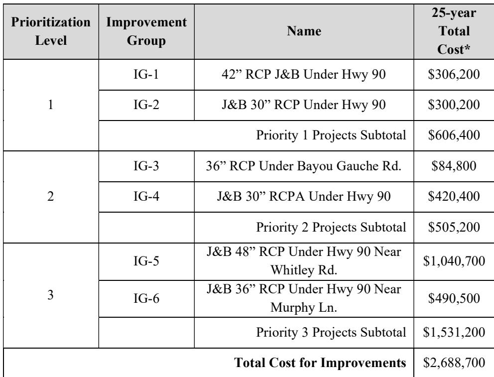

# Paradis DA Sunset Executive Summary

Source: `Paradis DA Sunset Executive Summary.pdf` (St. Charles Parish, Master Drainage Plan). Pages: 3.

## Page 1

### ST. CHARLES PARISH WEST BANK MASTER DRAINAGE PLAN DES ALLEMANDS, SUNSET, PARADIS, MAGNOLIA WATERSHED

#### EXECUTIVE SUMMARY

The goal of this section is to give a high-level overview of the process and results of the hydraulic and hydrologic study of the Des Allemands, Sunset, Paradis, and Magnolia watersheds. This summary shall always be accompanied by the comprehensive detailed report, which follows this section.

This report presents the results of a basin-wide modeling study for the Des Allemands, Sunset, Paradis, and Magnolia drainage basins. The purpose of this study was to identify necessary improvements to the major conveyance systems to mitigate the effects of the 25-year event. Drainage features that were considered as part of the system upgrades were the installation of a 42” RCP under HWY 90 at Scott Street, a 30” RCP under HWY 90 and Old US 90 at Levee Road, a 36” RCP under LA 306 at Matherne Drive, a 30” RCPA under HWY 90 at the intersection of Old US 90, a 48” RCP Culvert under HWY 90 at Whitley Road, and a 36” RCP Culvert under HWY 90 at Murphy Lane.

#### WATERSHED CHARACTERISTICS

The Des Allemands, Sunset, Paradis, and Magnolia drainage basins are located on the west bank of the Mississippi River in St. Charles Parish (SCP), Louisiana. Due to the topography of the drainage basins and to improve model performance, the model was set up with separate models for Des Allemands, Sunset and Paradis and for Magnolia. The Des Allemands, Sunset and Paradis area is approximately 11,469 acres and is drained via gravity by a system of canals within a ring levee that are pumped to Bayou des Allemands. The Magnolia area is approximately 5,265 acres and is drained via gravity by canals to pump stations. Pumped outfalls include a pump station at the end of Up the Bayou Road, at the intersection of Pump Lane and Up the Bayou Road, at the end of Down the Bayou Road, and at the end of Badeaux Lane West.

The major features that define the basin are US90 running north/south through the developed portion of the Des Allemands and Sunset. Paradis is geographically located in the southeast portion of the basin and flows to Bayou Gauche and Bayou des Allemands. The Magnolia basin runs along Rte. 633 which creates a natural ridge. The development along these areas are generally corridors along the highways with a few blocks of residential and commercial development. Large areas of the drainage shed are undeveloped, vegetated portions that are not channelized.

#### CURRENT DRAINAGE ISSUES

## Page 2

At present, the majority of drainage issues occur due to the lack of conveyance capacity within localized drainage systems. Conveyance under HWY 90 is a significant issue with five locations identified where additional culvert capacity would reduce flooding. Two locations under Old US 90 were identified as locations where additional culvert capacity would reduce flooding.

In general, flooding in developed areas is minimal with shallow flood depths and is much more problematic in the undeveloped areas which are generally lower and subject to flooding until excess floodwater can be pumped out. The area that appears to have the most problematic nuisance flooding is along Canal No. 11 east of Bayou Gauche Road where flood depths over roads and in yards is deeper in many locations than other areas within this basin. Most of these houses appear to have been built to an elevation sufficient to make them relatively low risk for flooding.

#### PROPOSED IMPROVEMENTS

The development of the proposed conditions model focused on upgrading the existing drainage system within this basin. These upgrades include the installation of a 42” RCP culvert under HWY 90 at Scott Street, a 30” RCP under Old US 90 and HWY 90 at Levee Road, a 30” CMPA under HWY 90 just east of the intersection of Old US 90, a 48” CMP under HWY 90 at Whitley Road, a 36” RCP under HWY 90 at Murphy Lane, and a 36” RCP under LA 306 at Matherne Drive. These improvements have been grouped and organized in Improvement Groups for planning and budgeting purposes in this report.

#### MODEL RESULTS

The following sections review the model results for the Existing Conditions (EC) and Proposed Conditions (PC) model simulations. Since the aim of the drainage basin upgrades is to reduce the impacts experienced by the 25-year event, those simulation results will be the focus of this analysis and review.

#### CONCEPTUAL COST ESTIMATE

The table below provides a summary for conceptual-level cost estimates associated with each improvement group. The table includes the cost for the “25-year improvements” as discussed above. Mitigation, permitting, utility relocation, and land acquisition costs are not included as part of this cost assessment, as these costs can vary significantly depending on the final layout of the improvements determined during detailed design.

## Page 3

**Table 1: Conceptual Project Cost Summary table for Des Allemands, Sunset, and Paradis**

| Prioritization Level | Improvement Group | Name | 25-year TotalCost* |
|---|---|---|---|
| 1 | IG-1 IG-2 Priority 1 Projects Subtotal | 42" RCP J&B Under Hwy 90 J&B 30" RCP Under Hwy 90 | $306,200 $300,200 $606,400 |
| 2 | IG-3 IG-4 | 36" RCP Under Bayou Gauche Rd. J&B 30" RCPA Under Hwy 90 Priority 2 Projects Subtotal | $84,800 $420,400 $505,200 |
| 3 | IG-5 IG-6 | J&B 48" RCP Under Hwy 90 NearWhitley Rd. J&B 36" RCP Under Hwy 90 NearMurphy Ln. Priority 3 Projects Subtotal | $1,040,700 $490,500 $1,531,200 |
| Total Cost for Improvements |  |  | $2,688,700 |

> **Note:** as printed, the total does not equal its parts. The three priority subtotals, each of which matches its own rows, sum to $2,642,800, which is $45,900 less than the printed total.

_\*Total Cost includes 20% contingency._

Table snapshot (for checking): 
