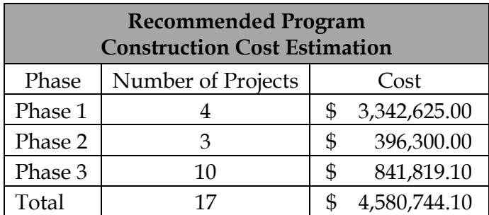
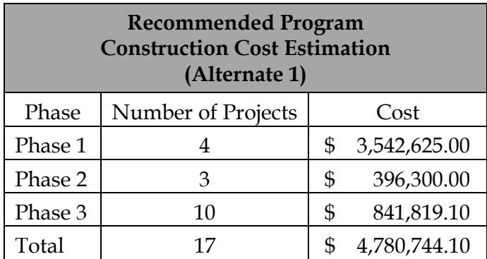
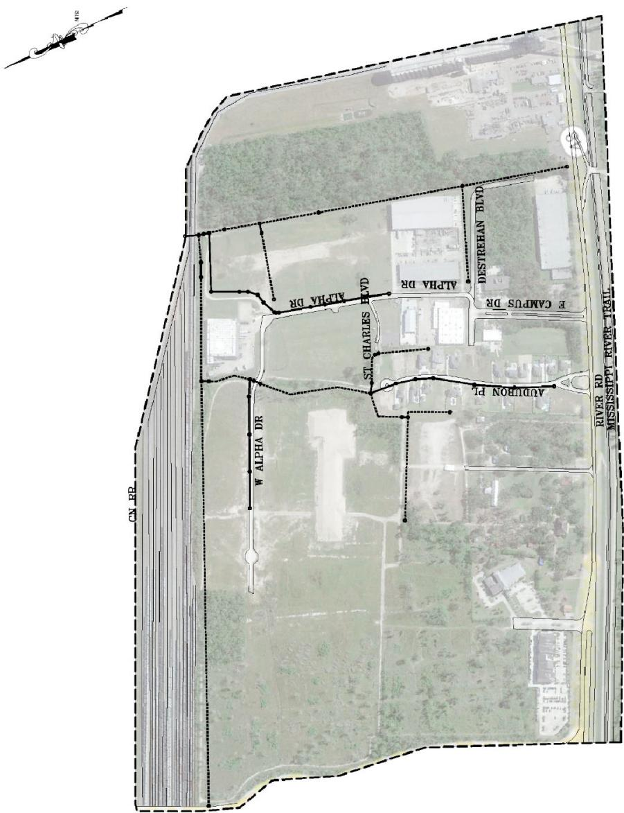
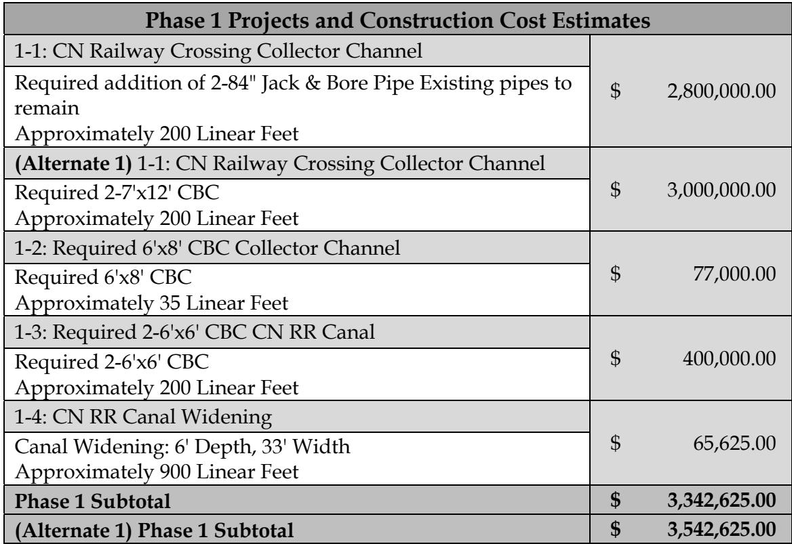
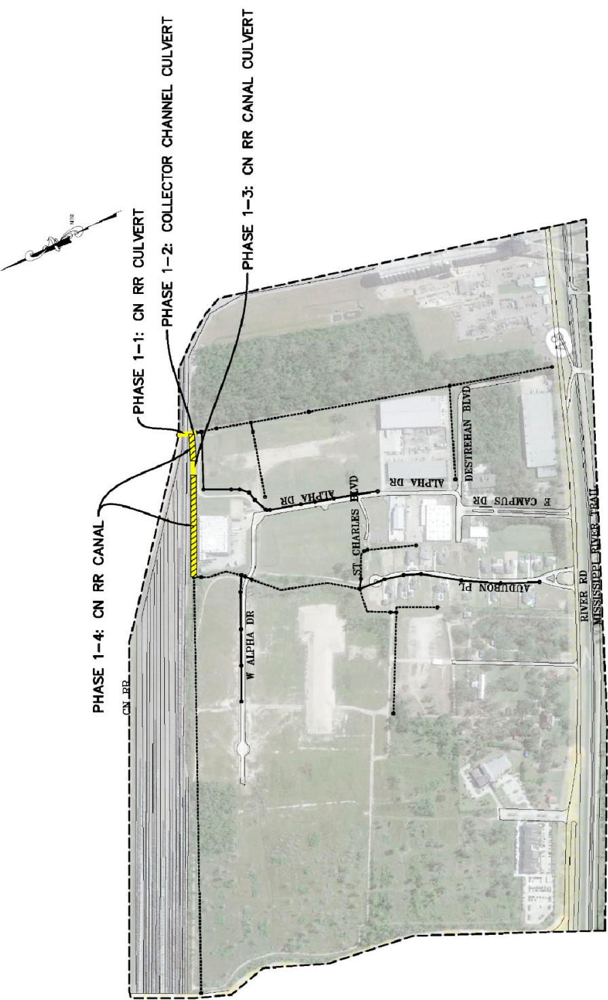
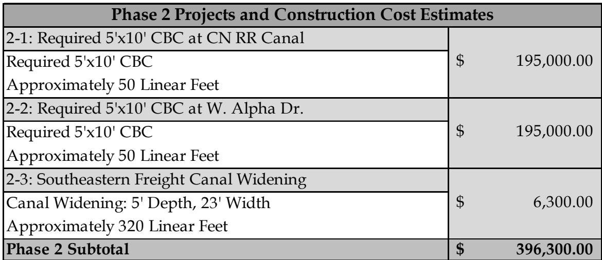
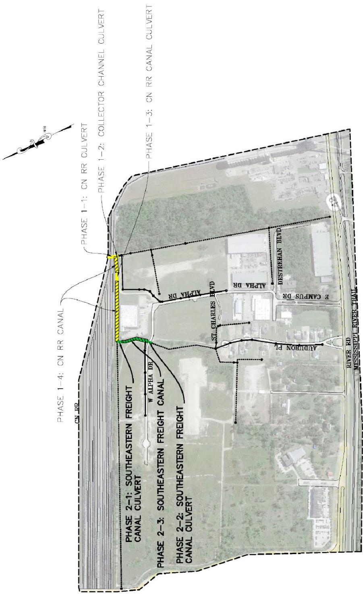
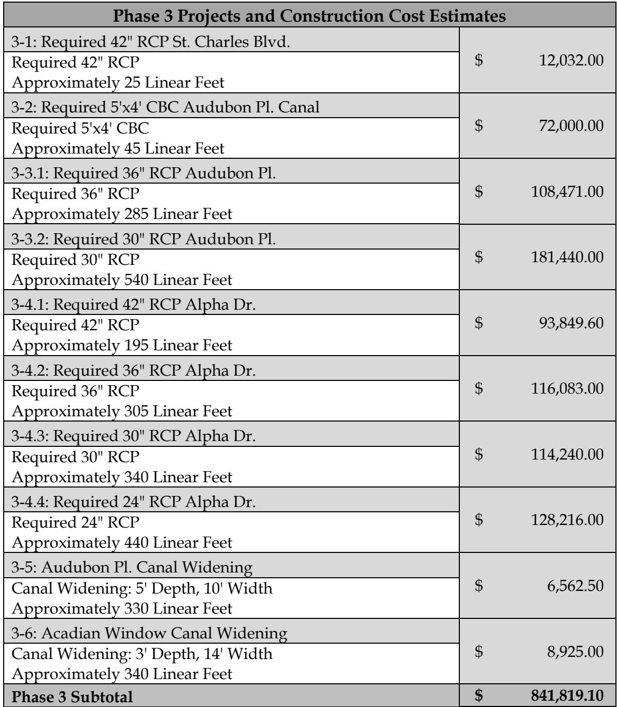
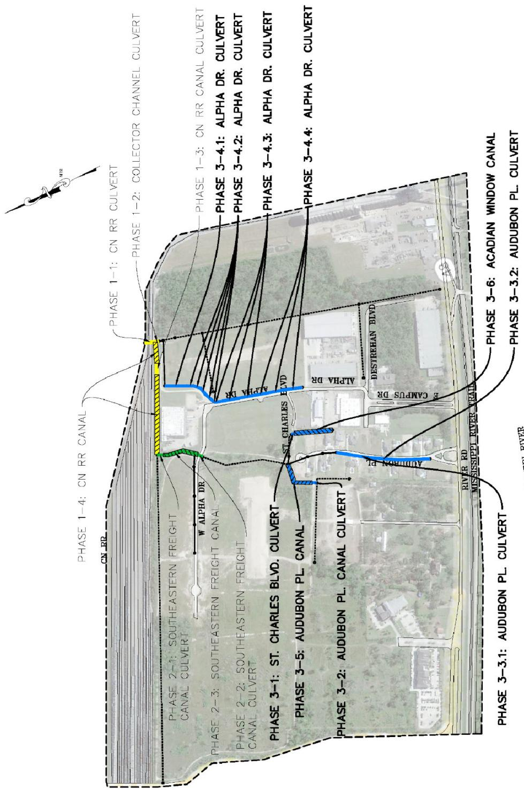

# Plantation Business Center Executive Summary

Source: `Plantation Business Center Executive Summary.pdf` (St. Charles Parish, Master Drainage Plan). Pages: 9.

## Page 1

#### Volume 12: Plantation Business Center 12.1 Executive Summary

St. Charles Parish tasked Principal Engineering, Inc. to complete the study of the Plantation Business Center Drainage Area for the East Bank Master Drainage Plan. Principal Engineering performed analyses for 25-Year and 100-Year Design Storms (NOAA Atlas 14), and developed drainage improvements that:

1. 25-Year: Reduce the water surface elevations in the canals to one foot below top of the bank such that future internal drainage improvements may function to eliminate street flooding.

2. 100-Year: Lower water surface elevations in the canals such that direct structure flooding from the canals is eliminated and future internal drainage improvements may function to eliminate internal area structure flooding.

The recommended program consists of the 25-Year and select 100-Year improvements at major street crossings and railroad crossings.

Analysis used models built in EPA SWMM and AutoDesk’s Storm and Sanitary Analysis. Existing flood-prone areas were identified in areas along Alpha Dr. and W Alpha Dr. The results of the existing conditions simulation illustrate the inadequacy of the drainage system for the design events.

The recommended improvements are grouped into phases and projects, building from the previous, in sensible order of construction, downstream to upstream. Major improvements include increasing the capacity of existing crossings under CN RR, increasing the capacity of the CN RR Canal, and increasing capacity of existing drainage pipes and culverts along Alpha Dr. and Audubon Pl.

Modeled improvements have been partitioned into executable projects with cost estimates provided. It is expected that the Parish will create an integrated priority list consisting of projects from all basins, constructed individually as funding becomes available. A summary of projects and costs is tabulated on the following pages by phase.

## Page 2

**Table 1**

| Recommended ProgramConstruction Cost Estimation |  |  |
|---|---|---|
| Phase | Number of Projects | Cost |
| Phase 1 | 4 | $ 3,342,625.00 |
| Phase 2 | 3 | $ 396,300.00 |
| Phase 3 | 10 | $ 841,819.10 |
| Total | 17 | $ 4,580,744.10 |

Table snapshot (for checking): 

**Table 2**

| Recommended ProgramConstruction Cost Estimation(Alternate 1) |  |  |
|---|---|---|
| Phase | Number of Projects | Cost |
| Phase 1 | 4 | $ 3,542,625.00 |
| Phase 2 | 3 | $ 396,300.00 |
| Phase 3 | 10 | $ 841,819.10 |
| Total | 17 | $ 4,780,744.10 |

Table snapshot (for checking): 

## Page 3

> **Figure description:** Base map of the Plantation Business Center site (dashed boundary, no projects or legend). Labelled streets: Alpha Dr, W Alpha Dr, St Charles Blvd, Audubon Pl, E Campus Dr, Destrehan Blvd, River Rd and the Mississippi River Trail. CN RR runs along the west edge. Solid and dotted lines with dot nodes; no legend, so their meaning is not stated.

## Page 4

**Table 3**

| Phase 1 Projects and Construction Cost Estimates |  |
|---|---|
| 1-1: CN Railway Crossing Collector Channel Required addition of 2-84" Jack & Bore Pipe Existing pipes toremain Approximately 200 Linear Feet | $ 2,800,000.00 |
| (Alternate 1) 1-1: CN Railway Crossing Collector Channel Required 2-7'x12' CBCApproximately 200 Linear Feet | $ 3,000,000.00 |
| 1-2: Required 6'x8' CBC Collector Channel Required 6'x8' CBCApproximately 35 Linear Feet | $ 77,000.00 |
| 1-3: Required 2-6'x6' CBC CN RR Canal Required 2-6'x6' CBCApproximately 200 Linear Feet | $ 400,000.00 |
| 1-4: CN RR Canal Widening Canal Widening: 6' Depth, 33' Width Approximately 900 Linear Feet | $ 65,625.00 |
| Phase 1 Subtotal | $ 3,342,625.00 |
| (Alternate 1) Phase 1 Subtotal | $ 3,542,625.00 |

Table snapshot (for checking): 

## Page 5

> **Figure description:** Phase 1 projects in yellow at the CN RR line on the west edge. Call-outs: Phase 1-1 CN RR culvert; Phase 1-2 Collector channel culvert; Phase 1-3 CN RR canal culvert; Phase 1-4 CN RR canal (hatched). Streets visible: Alpha Dr, W Alpha Dr, St Charles Blvd and Audubon Pl. No legend.

## Page 6

**Table 4**

| Phase 2 Projects and Construction Cost Estimates |  |
|---|---|
| 2-1: Required 5'x10' CBC at CN RR Canal Required 5'x10' CBCApproximately 50 Linear Feet | $ 195,000.00 |
| 2-2: Required 5'x10' CBC at W. Alpha Dr. Required 5'x10' CBCApproximately 50 Linear Feet | $ 195,000.00 |
| 2-3: Southeastern Freight Canal Widening Canal Widening: 5' Depth, 23' Width Approximately 320 Linear Feet | $ 6,300.00 |
| Phase 2 Subtotal | $ 396,300.00 |

Table snapshot (for checking): 

## Page 7

> **Figure description:** Base map of the Plantation Business Center project area, bounded by a dashed line between the CN RR (west) and River Rd and the Mississippi River Trail (east). Phase 1 works in yellow: 1-1 CN RR culvert, 1-2 collector channel culvert, 1-3 CN RR canal culvert and 1-4 CN RR canal. Phase 2 works in green and yellow hatch: 2-1 Southeastern Freight Canal culvert, 2-2 Southeastern Freight Canal culvert and 2-3 Southeastern Freight Canal. Labelled streets: W Alpha Dr, Alpha Dr, St. Charles Blvd, Audubon Pl, Destrehan Blvd and E Campus Dr. No legend or printed numbers.

## Page 8

**Table 5**

| Phase 3 Projects and Construction Cost Estimates |  |
|---|---|
| 3-1: Required 42" RCP St. Charles Blvd. Required 42" RCPApproximately 25 Linear Feet | $ 12,032.00 |
| 3-2: Required 5'x4' CBC Audubon Pl. Canal Required 5'x4' CBCApproximately 45 Linear Feet | $ 72,000.00 |
| 3-3.1: Required 36" RCP Audubon Pl. Required 36" RCPApproximately 285 Linear Feet | $ 108,471.00 |
| 3-3.2: Required 30" RCP Audubon Pl. Required 30" RCPApproximately 540 Linear Feet | $ 181,440.00 |
| 3-4.1: Required 42" RCP Alpha Dr. Required 42" RCPApproximately 195 Linear Feet | $ 93,849.60 |
| 3-4.2: Required 36" RCP Alpha Dr. Required 36" RCPApproximately 305 Linear Feet | $ 116,083.00 |
| 3-4.3: Required 30" RCP Alpha Dr. Required 30" RCPApproximately 340 Linear Feet | $ 114,240.00 |
| 3-4.4: Required 24" RCP Alpha Dr. Required 24" RCPApproximately 440 Linear Feet | $ 128,216.00 |
| 3-5: Audubon Pl. Canal Widening Canal Widening: 5' Depth, 10' Width Approximately 330 Linear Feet | $ 6,562.50 |
| 3-6: Acadian Window Canal Widening Canal Widening: 3' Depth, 14' Width Approximately 340 Linear Feet | $ 8,925.00 |
| Phase 3 Subtotal | $ 841,819.10 |

Table snapshot (for checking): 

## Page 9

> **Figure description:** Phase 3 projects in blue on the same base as fig 3, with Phase 1 (yellow) and Phase 2 (green) works repeated. Call-outs: Phase 3-1 St. Charles Blvd culvert; Phase 3-2 Audubon Pl canal culvert; Phase 3-3.1 and 3-3.2 Audubon Pl culvert; Phase 3-4.1 to 3-4.4 Alpha Dr culverts; Phase 3-5 Audubon Pl canal; Phase 3-6 Acadian Window canal. Labelled: Alpha Dr, Audubon Pl, St. Charles Blvd, Destrehan Blvd, River Rd and Mississippi River Trail. No legend or printed numbers.
