# St Rose Drainage Townhall_11123

Source: `St Rose Drainage Townhall_11123.pdf` (St. Charles Parish, Master Drainage Plan). Pages: 15.

## Page 1

#### St. Charles Parish

St. Rose Drainage Townhall November 1, 2023

St. Charles Parish President Matthew Jewell

## Page 2

#### St. Rose Drainage Town Hall

• Watersheds

• St. Rose

• Dianne Place

• Bar None

• Turtle Pond

• Almedia

• Grant Funding

• Total projects overview

## Page 3

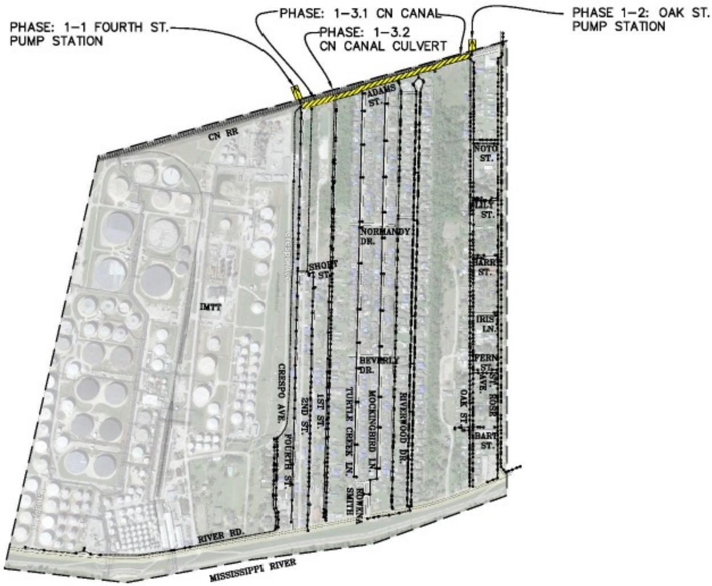

> **Figure description:** St. Rose project area base map, with dashed boundary between the CN RR and the Mississippi River. Phase 1 works in yellow: 1-1 Fourth St pump station, 1-2 Oak St pump station, 1-3.1 CN canal and 1-3.2 CN canal culvert along the CN RR edge. Labelled streets include Fourth St, Crespo Ave, Short St, 1st St, 2nd St, Adams St, Normandy Dr, Beverly Dr, Mockingbird Ln, Turtle Creek Ln, Riverwood Dr, Oak St, Noto St, Lily St, Harry St, Iris Ln, Fern St, St. Rose Ave and Bart St. Also labelled: IMTT, River Rd, CN RR and Mississippi River. No legend or printed numbers.

ST. ROSE PROGRAM - PHASE 1 IMPROVEMENTS

## Page 4

#### St. Rose - Phase 1

**Table 1**

| Phase 1 Projects and Construction Cost Estimates |  |
|---|---|
| 1-1: Fourth St Pump Station and Sump Replace and Upgrade Replace and Upgrade Pump Station 500 CFS 2400 Cubic Feet Sump | $ 21,500,000.00 |
| 1-2: Oak St Pump Station and Sump Replace and Upgrade Replace and Upgrade Pump Station 200 CFS 2400 Cubic Feet Sump | $ 8,500,000.00 |
| 1-3.1: Canal Widening Along CN Railway Canal Widening: 4' Depth, 26' Width Approximately 2000 Linear Feet | $ 105,000.00 |
| 1-3.2: Box Culvert Along CN Railway Required 4' x 10' Box Culvert Approximately 20 Linear Feet | $ 68,400.00 |
| Phase 1 Subtotal | $ 30,173,400.00 |

Table snapshot (for checking): 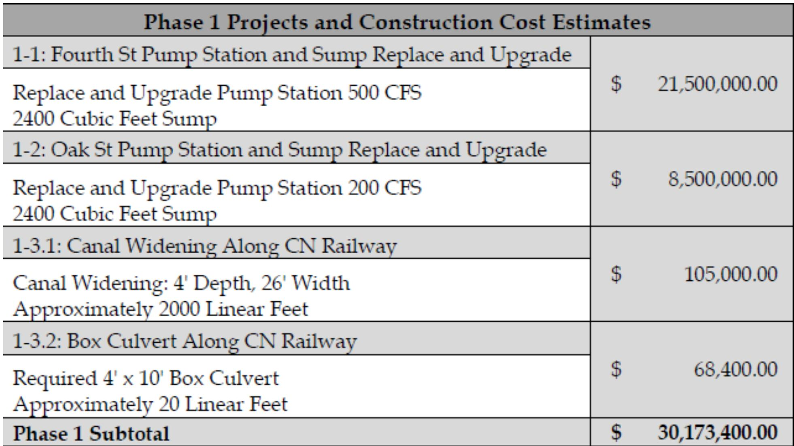

## Page 5

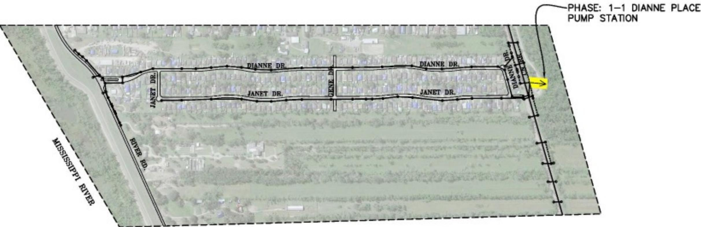

> **Figure description:** Dianne Place area map, not the St. Rose area. Dashed boundary with the Mississippi River and River Rd labelled along the west side, and Janet Dr, Dianne Dr and Gene Dr labelled. One yellow marker at the east end, with the call-out PHASE: 1-1 DIANNE PLACE PUMP STATION. The name Dianne Place appears only in the call-out. No legend or printed numbers.

## Page 6

#### Dianne Place- Phase 1

**Table 2**

| Phase 1 Projects and Construction Cost Estimates |  |
|---|---|
| 1-1: Dianne Place Pump Station and Sump Upgrade Upgrade Pump Station from 140 CFS to 250 CFS | $ 4,650,000.00 |
| Phase 1 Subtotal | $ 4,650,000.00 |

Table snapshot (for checking): 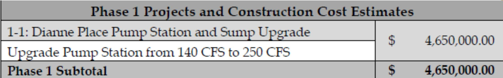

## Page 7

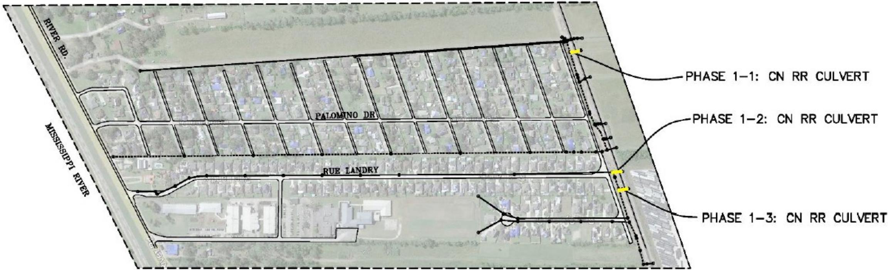

> **Figure description:** Palomino Dr and Rue Landry area map, not the St. Rose area. Dashed boundary between River Rd and the CN RR. Three yellow Phase 1 CN RR culverts at the east edge: 1-1, 1-2 and 1-3. Labelled: Palomino Dr, Rue Landry, River Rd and Mississippi River. No legend or printed numbers.

BAR-NONE PROGRAM - PHASE 1 IMPROVEMENTS

25-YEAR CRITERIA WITH SELECTED 100-YEAR IMPROVEMENTS

## Page 8

#### Bar None- Phase 1

**Table 3**

| Phase 1 Projects and Construction Cost Estimates |  |
|---|---|
| 1-1: CN Railway Crossing West of Palomino Dr Required Jack and Bore 2-42" Pipe Approximately 100 Linear Feet | $ 1,440,000.00 |
| 1-2: CN Railway Crossing at Rue Landry Required addition of 2-42" Jack & Bore Pipes Existing 1-42" Steel Pipe to remain Approximately 75 Linear Feet | $ 1,080,000.00 |
| 1-3: CN Railway Crossing East of Rue Landry Required Jack and Bore 3-42" Pipe Approximately 150 Linear Feet | $ 3,240,000.00 |
| Phase 2 Subtotal | $ 5,760,000.00 |

Table snapshot (for checking): 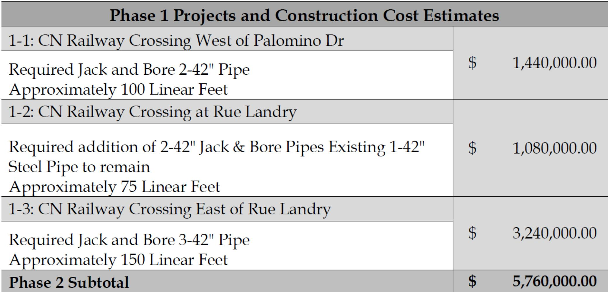

## Page 9

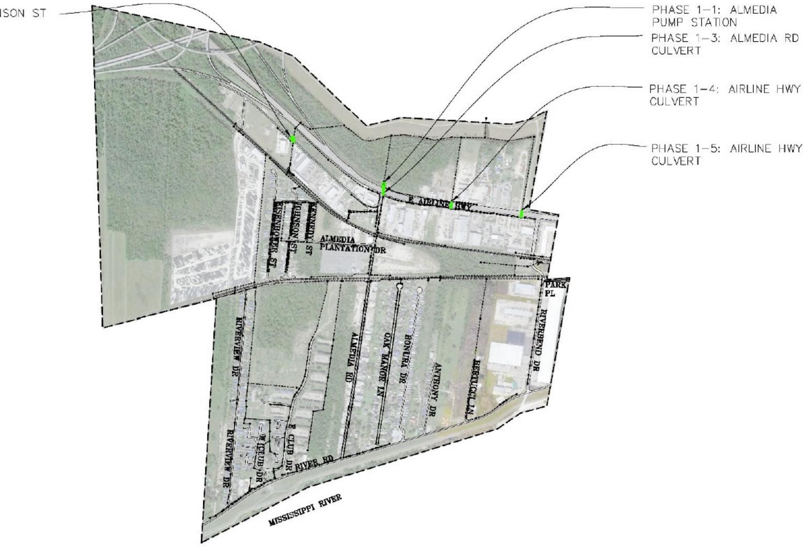

> **Figure description:** Almedia area map, not the St. Rose area. Dashed boundary with E Airline Hwy running across the north half and River Rd along the south. Green marks show culverts: Phase 1-1 Almedia pump station, 1-3 Almedia Rd culvert, 1-4 Airline Hwy culvert and 1-5 Airline Hwy culvert. No Phase 1-2 call-out is visible: a leader line at the top left ends in a cut-off label reading "...ISON ST" and runs to a green mark near the rail line. Labelled: Eisenhower St, Johnson St, Kennedy St, Almedia Plantation Dr, Almedia Rd, Oak Manor Ln, Bonura Dr, Anthony Dr, Riverview Dr, Riverbend Dr, Park Pl, E Club Dr, W Club Dr, River Rd and Mississippi River. No legend.

TURTLE POND PROGRAM - PHASE 1 IMPROVEMENTS 25-YEAR CRITERIA WITH SELECTED 100-YEAR IMPROVEMENTS

## Page 10

#### Turtle Pond- Phase 1

**Table 4**

| Phase 1 Projects and Construction Cost Estimates |  |
|---|---|
| 1-1: Almedia Pump Station Replace and Upgrade Upgrade Pump Station from 120 CFS to 200 CFS | $ 4,400,000.00 |
| 1-2: I-310 Crossing at Johnson Street Required 2-72" RCP or Equivalent Approximately 80 Linear Feet | $ 120,000.00 |
| 1-3: Crossing at Almedia Road and Airline HWY Required Jack and Bore 2-42" pipe Approximately 240 Linear Feet | $ 780,000.00 |
| 1-4: Crossing at Airline HWY around Duhon Machinery Co., Inc. Required Jack and Bore 1-42" pipe Approximately 120 Linear Feet | $ 390,000.00 |
| 1-5: Crossing Airline HWY around Fox Lane Required Jack and Bore 1-42" pipe Approximately 120 Linear Feet | $ 390,000.00 |
| Phase 1 Subtotal | $ 6,080,000.00 |

Table snapshot (for checking): 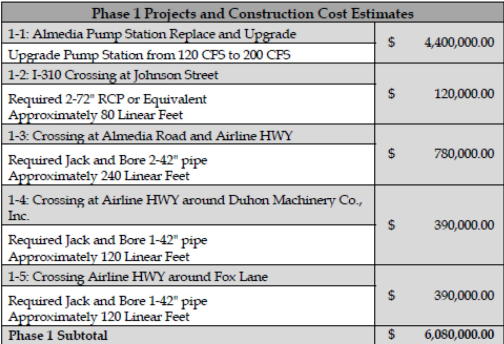

## Page 11

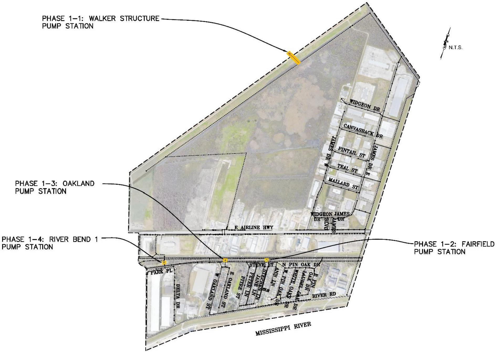

> **Figure description:** Walker Structure, Oakland and Fairfield area map, not the St. Rose area. Dashed boundary with E Airline Hwy across the lower third and the Mississippi River at the bottom. Phase 1 pump stations marked in yellow and orange: 1-1 Walker Structure pump station, 1-2 Fairfield pump station, 1-3 Oakland pump station and 1-4 River Bend 1 pump station. Labelled: Widgeon Dr, Canvasback Dr, Pintail St, Teal St, Mallard St, James Dr, Oakland St, Pin Oak Dr, Ann Ln, Park Pl, Delta Dr and River Rd. N.T.S. marked. No legend.

## Page 12

#### Almedia- Phase 1

**Table 5**

| Phase 1 Projects and Construction Cost Estimates |  |
|---|---|
| 1-1: Walker Structure Pump Station and Sump Upgrade Upgrade Pump Station from 125 CFS to 250 CFS | $ 7,500,000.00 |
| 1-2: Fairfield Pump Station Replacement Replace/Upgrade Pump Station from 25 CFS to 100 CFS | $ 4,500,000.00 |
| 1-3: Oakland Pump Station Replacement Replace/Upgrade Pump Station from 67 CFS to 150 CFS | $ 6,750,000.00 |
| 1-4: Riverbend 1 Pump Station and Sump Upgrade Upgrade Pump Station from 96 CFS to 150 CFS | $ 2,970,000.00 |
| Phase 1 Subtotal | $ 21,720,000.00 |

Table snapshot (for checking): 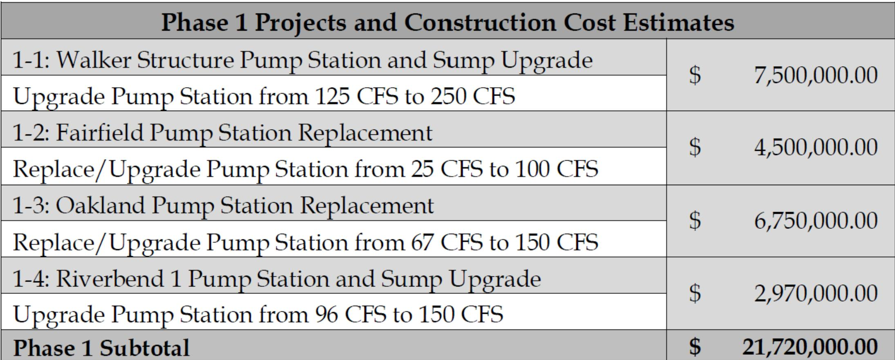

## Page 13

#### Grant Funding for St. Rose Drainage

**Table 6**

| Project Title | GrantFundingRequested | Program Name | Status |
|---|---|---|---|
| Fairfield and Oakland Pump StationImprovements | $825,000$7.6M | State of LouisianaCapital Outlay | AwardedRequested |
| Turtle Pond Pump StationImprovements | $9.2M | LouisianaWatershedInitiative | ApplicationSubmitted |
| Fairfield and Oakland Pump StationImprovements | $12.8M | LouisianaWatershedInitiative | ApplicationSubmitted |
| Oak Street Pump Station Improvements | $9.2M | LouisianaWatershedInitiative | ApplicationSubmitted |
| St. Rose Conveyance Improvements | $15M | LouisianaWatershedInitiative | ApplicationSubmitted |
| Dianne Place Pump StationImprovements | $4.6M | FEMA HazardMitigation GrantProgram | ApplicationSubmitted |

Table snapshot (for checking): 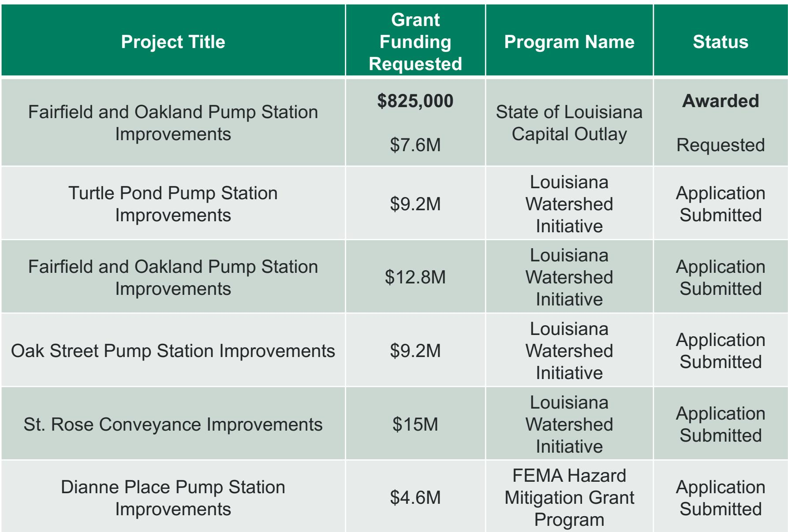

## Page 14

#### St. Rose Drainage Master Plan Overview

#### • Total: 65 projects, \$105,267,058.95

• St. Rose

• 3 Phases, 15 projects

• Total of \$ 31,135,233.95

• Dianne Place

• 3 Phases, 9 projects

•Total of \$ 10,317,613.60

#### • Bar None

• 2 Phases, 2 projects

• Total of \$5,832,278.00

#### • Turtle Pond

• 4 Phases, 28 Projects

•Total of \$26,151,803.40

#### • Almedia

• 6 Phases, 20 projects

•Total of \$ 31,830,130.00

## Page 15

#### St. Charles Parish Elevations Program

• Property must meet the FEMA FMA definition of repetitive loss

• Property must pass Benefit Cost Analysis (BCA)

• Homeowner to provide cost share/match funding

• Competitive Application Process

• Application process can take up to 3 years

• OPENING FOR APPLICATIONS NOW!
