# St Rose  Executive Summary

Source: `St Rose  Executive Summary.pdf` (St. Charles Parish, Master Drainage Plan). Pages: 25.

## Page 1

#### Volume 6: St. Rose

#### 6.1 Executive Summary

St. Charles Parish tasked Principal Engineering, Inc. to complete the study of the St. Rose Drainage Area for the East Bank Master Drainage Plan. Principal Engineering performed analyses for 25-Year and 100-Year Design Storms (NOAA Atlas 14), and developed drainage improvements that:

1. 25-Year: Reduce the water surface elevations in the canals to one foot below top of the bank such that future internal drainage improvements may function to eliminate street flooding.

2. 100-Year: Lower water surface elevations in the canals such that direct structure flooding from the canals is eliminated and future internal drainage improvements may function to eliminate internal area structure flooding.

The recommended program consists of the 25-Year and select 100-Year improvements at major street crossings and railroad crossings.

Analysis used models built in EPA SWMM and AutoDesk’s Storm and Sanitary Analysis. Existing flood-prone areas were identified in areas along Crespo St, between Fourth Street and Turtle Creek north of Short Street, along Turtle Creek Ln and Mockingbird Ln north of Normandy Drive, between Riverwood drive and Oak Street north of Lily St. The results of the existing conditions simulation illustrate the inadequacy of the drainage system for the design events.

The recommended improvements are grouped into phases and projects, building from the previous, in sensible order of construction, downstream to upstream. Some of the major improvements include upgrading existing Fourth Street and Oak Street Pump Stations, widening, and increasing capacity of the canals along CN RR, Crespo Ave, Short Street, and First Street.

## Page 2

Modeled improvements have been partitioned into executable projects with cost estimates provided. It is expected that the Parish will create an integrated priority list consisting of projects from all basins, constructed individually as funding becomes available. A summary of projects and costs is tabulated on the following pages by phase.

**Table 1**

| Recommended ProgramConstruction Cost Estimation |  |  |
|---|---|---|
| Phase | Number of Projects | Cost |
| Phase 1 | 4 | $ 30,173,400.00 |
| Phase 2 | 6 | $ 641,970.00 |
| Phase 3 | 5 | $ 319,863.95 |
| Total | 15 | $ 31,135,233.95 |

Table snapshot (for checking): 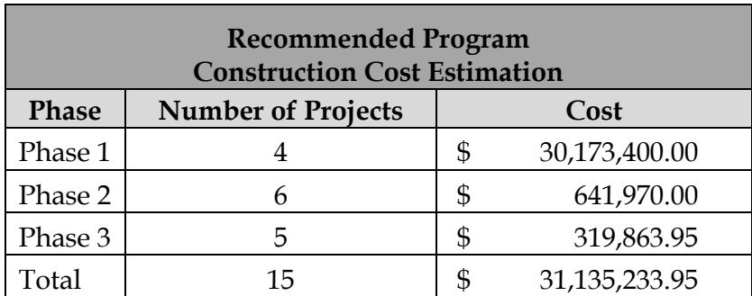

## Page 3

> **Figure description:** St. Rose base map with no project call-outs, identical in extent to the fig 5 and fig 9 base maps. Labelled: Noto St, Lily St, Harry St, Iris Ln, Fern St, St. Rose Ave, Bart St, Oak St, Riverwood Dr, Mockingbird Ln, Rowena Smith, Turtle Creek Ln, Normandy Dr, Beverly Dr, Adams St, Short St, 1st St, 2nd St, Fourth St, Crespo Ave, IMTT, CN RR, River Rd and Landry Ln. The river is labelled Mississippi River. No legend or printed numbers.

## Page 4

**Table 2**

| Phase 1 Projects and Construction Cost Estimates |  |
|---|---|
| 1-1: Fourth St Pump Station and Sump Replace and Upgrade Replace and Upgrade Pump Station 500 CFS 2400 Cubic Feet Sump | $ 21,500,000.00 |
| 1-2: Oak St Pump Station and Sump Replace and Upgrade Replace and Upgrade Pump Station 200 CFS 2400 Cubic Feet Sump | $ 8,500,000.00 |
| 1-3.1: Canal Widening Along CN Railway Canal Widening: 4' Depth, 26' Width Approximately 2000 Linear Feet | $ 105,000.00 |
| 1-3.2: Box Culvert Along CN Railway Required 4' x 10' Box Culvert Approximately 20 Linear Feet | $ 68,400.00 |
| Phase 1 Subtotal | $ 30,173,400.00 |

Table snapshot (for checking): 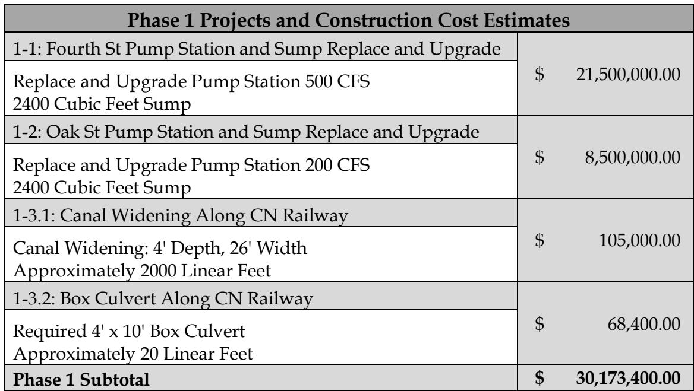

## Page 5

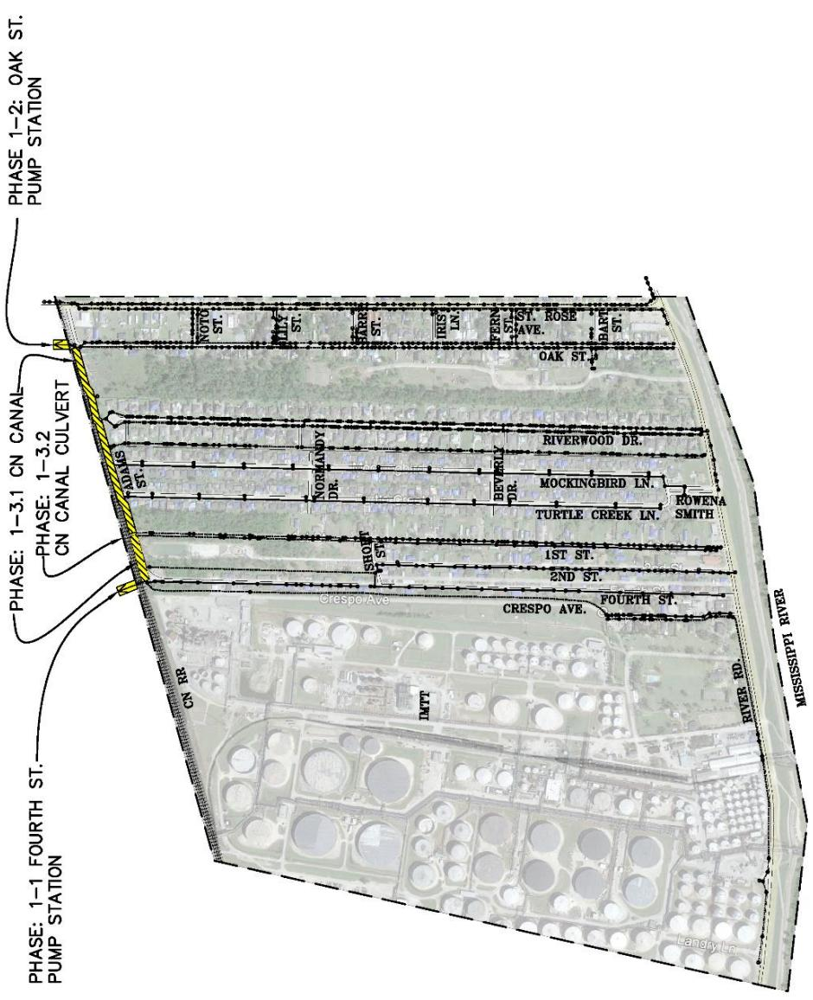

> **Figure description:** St. Rose project area map, rotated. Phase 1 works in yellow: 1-1 Fourth St pump station, 1-2 Oak St pump station, 1-3.1 CN canal and 1-3.2 CN canal culvert, all along the CN RR edge. Same street labels as fig 1. No legend or printed numbers.

## Page 6

**Table 3**

| Phase 2 Projects and Construction Cost Estimates |  |
|---|---|
| 2-1: Canal Widening Along IMTT to Crespo Ave Canal Widening: 2.5' Depth, 14' Width Approximately 3500 Linear Feet | $ 183,750.00 |
| 2-2.1: Canal Widening Along Crespo Ave Canal Widening: 2.5' Depth, 13' Width Approximately 600 Linear Feet | $ 31,500.00 |
| 2-2.2: Required 48" RCPA Along Crespo Ave Required 48" RCPAApproximately 50 Linear Feet | $ 24,400.00 |
| 2-2.3: Required 42" RCPA Along Crespo Ave Required 42" RCPAApproximately 300 Linear Feet | $ 138,160.00 |
| 2-3.1: Canal Widening Along River Rd Canal Widening: 2.5' Depth, 13' Width Approximately 2400 Linear Feet | $ 126,000.00 |
| 2-3.2: Required 42" RCPA Along River Rd Required 42" RCPAApproximately 300 Linear Feet | $ 138,160.00 |
| Phase 2 Subtotal | $ 641,970.00 |

Table snapshot (for checking): 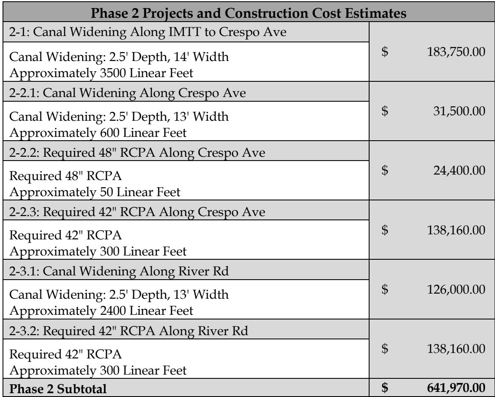

## Page 7

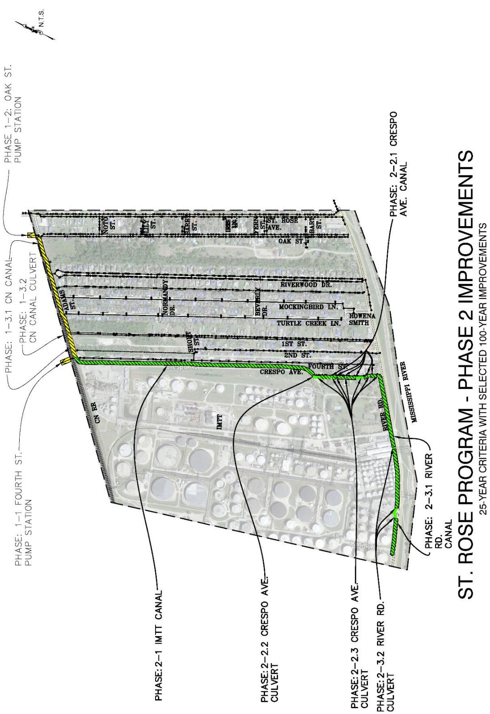

> **Figure description:** ST. ROSE PROGRAM, Phase 2 improvements, titled 25-year criteria with selected 100-year improvements. Phase 1 works in yellow, as in fig 2. Phase 2 works in green: 2-1 IMTT canal culvert, 2-2.1 Crespo Ave canal, 2-2.2 Crespo Ave culvert, 2-2.3 Crespo Ave culvert, 2-3.1 River Rd canal and 2-3.2 River Rd culvert. Labelled streets include Fourth St, Crespo Ave, Short St, 1st St, 2nd St, River Rd and Landry Ln. N.T.S. marked. No legend.

## Page 8

**Table 4**

| Phase 3 Projects and Construction Cost Estimates |  |
|---|---|
| 3-1.1: Canal Widening from Short St to CN Railroad Canal Widening: 3' Depth, 19' Width Approximately 1750 Linear Feet | $ 91,875.00 |
| 3-1.2: Required 30" RCP at Short St Outfall Required 30" RCPApproximately 100 Linear Feet | $ 29,080.00 |
| 3-2.1: Canal Widening Along First St to CN Railroad Canal Widening: 3' Depth, 16' Width Approximately 2200 Linear Feet | $ 115,500.00 |
| 3-2.2: Required 42" RCPA at First St Required 42" RCPAApproximately 115 Linear Feet | $ 52,960.95 |
| 3-2.3: Required 36" RCP at First St Required 36" RCPApproximately 80 Linear Feet | $ 30,448.00 |
| Phase 3 Subtotal | $ 319,863.95 |

Table snapshot (for checking): 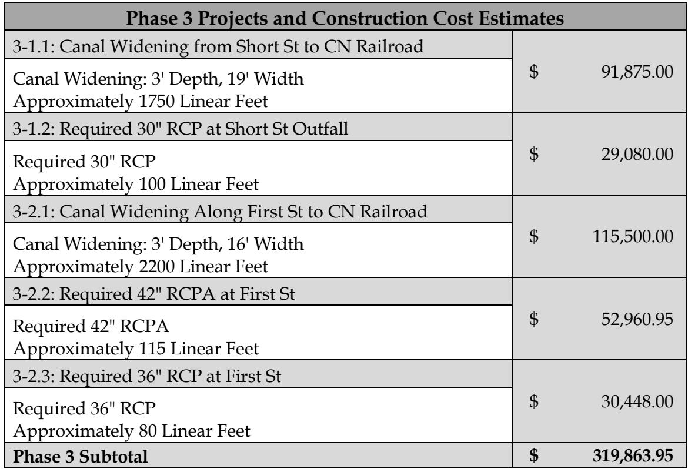

## Page 9

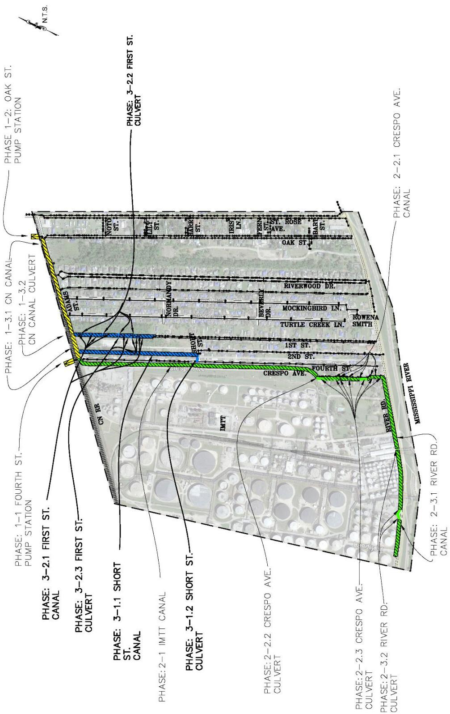

> **Figure description:** St. Rose Phase 3 projects in blue, with the Phase 1 (yellow) and Phase 2 (green) works repeated. Call-outs: Phase 3-1.1 Short St canal, 3-1.2 Short St culvert, 3-2.1 First St canal, 3-2.2 First St culvert and 3-2.3 First St culvert. Labelled: 1st St, 2nd St, Short St, Crespo Ave, IMTT and River Rd. No legend or printed numbers.

## Page 10

#### ALTERNATE 1

**Table 5**

| Recommended Program Construction Cost Estimation |  |  |
|---|---|---|
| Phase | Number of Projects | Cost |
| Phase 1 | 4 | $ 30,473,400.00 |
| Phase 2 | 6 | $ 9,208,220.00 |
| Phase 3 | 5 | $ 319,863.95 |
| Total | 15 | $ 40,001,483.95 |

Table snapshot (for checking): 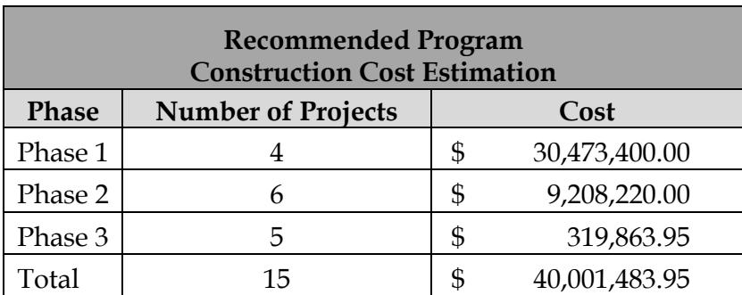

## Page 11

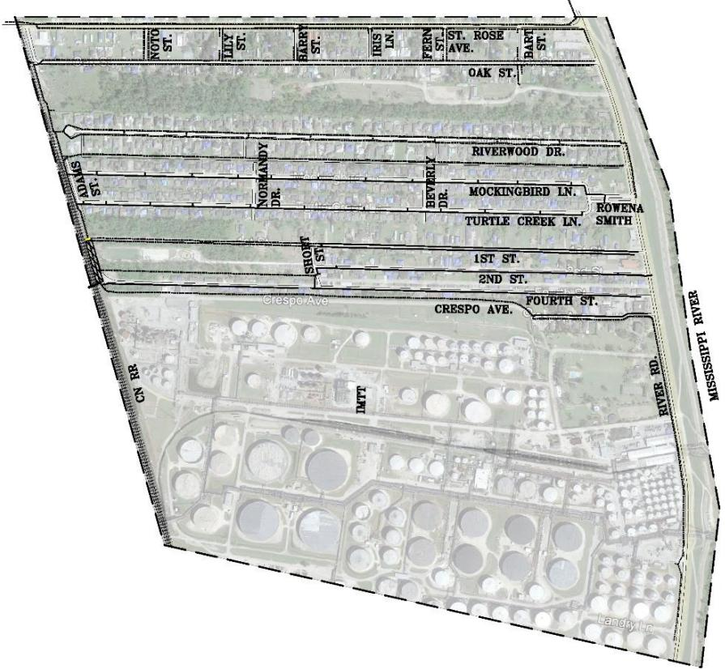

> **Figure description:** St. Rose base map with no project call-outs. Same extent and labels as fig 1. Dedupe candidate. No legend.

## Page 12

**Table 6**

| Phase 1 Projects and Construction Cost Estimates |  |
|---|---|
| 1-1: New Pump Station north of CN RR New Pump Station 525 CFSwith Sump | $ 30,000,000.00 |
| 1-2: New Trestle at CN RR Required 6' x 34' Trestle Approximately 130 Linear Feet | $ 300,000.00 |
| 1-3.1: Canal Widening Along CN Railway Canal Widening: 4' Depth, 26' Width Approximately 2000 Linear Feet | $ 105,000.00 |
| 1-3.2: Box Culvert Along CN Railway Required 4' x 10' Box Culvert Approximately 20 Linear Feet | $ 68,400.00 |
| Phase 1 Subtotal | $ 30,473,400.00 |

Table snapshot (for checking): 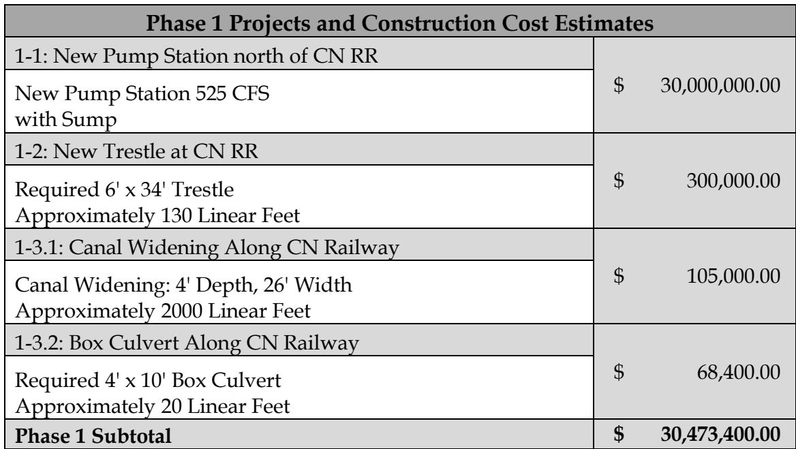

## Page 13

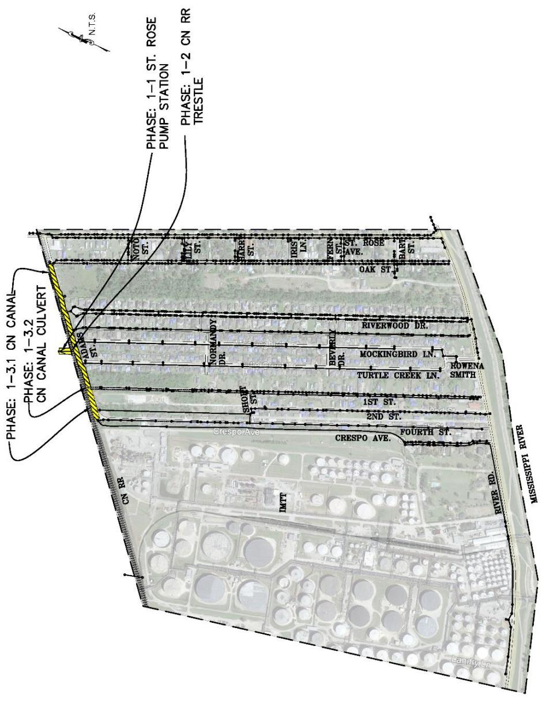

> **Figure description:** St. Rose Phase 1 works at the CN RR edge near Adams St. Call-outs: Phase 1-1 St. Rose pump station, Phase 1-2 CN RR trestle, and Phase 1-3.1 CN canal and 1-3.2 CN canal culvert (yellow hatch). Labelled: Adams St, Normandy Dr, Beverly Dr, Riverwood Dr, Mockingbird Ln, Turtle Creek Ln, Rowena Smith, Oak St, St. Rose Ave and Noto St. N.T.S. marked. No legend.

## Page 14

**Table 7**

| Phase 2 Projects and Construction Cost Estimates |  |
|---|---|
| 2-1: Box Culvert Along IMTT to Crespo Ave Required 4' x 5' Box Culvert Approximately 3500 Linear Feet | $ 8,750,000.00 |
| 2-2.1: Canal Widenning Along Crespo Ave Canal Widenning: 2.5' Depth, 13' Width Approximately 600 Linear Feet | $ 31,500.00 |
| 2-2.2: Required 48" RCPA Along Crespo Ave Required 48" RCPAApproximately 50 Linear Feet | $ 24,400.00 |
| 2-2.3: Required 42" RCPA Along Crespo Ave Required 42" RCPAApproximately 300 Linear Feet | $ 138,160.00 |
| 2-3.1: Canal Widenning Along River Rd Canal Widenning: 2.5' Depth, 13' Width Approximately 2400 Linear Feet | $ 126,000.00 |
| 2-3.2: Required 42" RCPA Along River Rd Required 42" RCPAApproximately 300 Linear Feet | $ 138,160.00 |
| Phase 2 Subtotal | $ 9,208,220.00 |

Table snapshot (for checking): 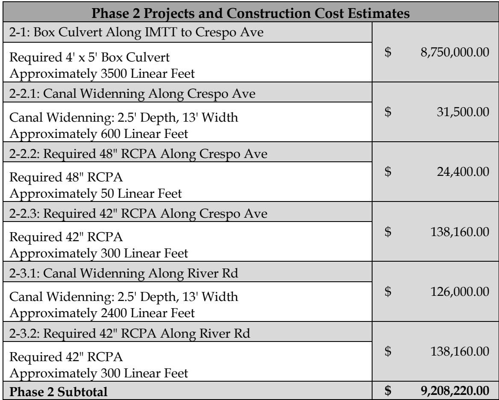

## Page 15

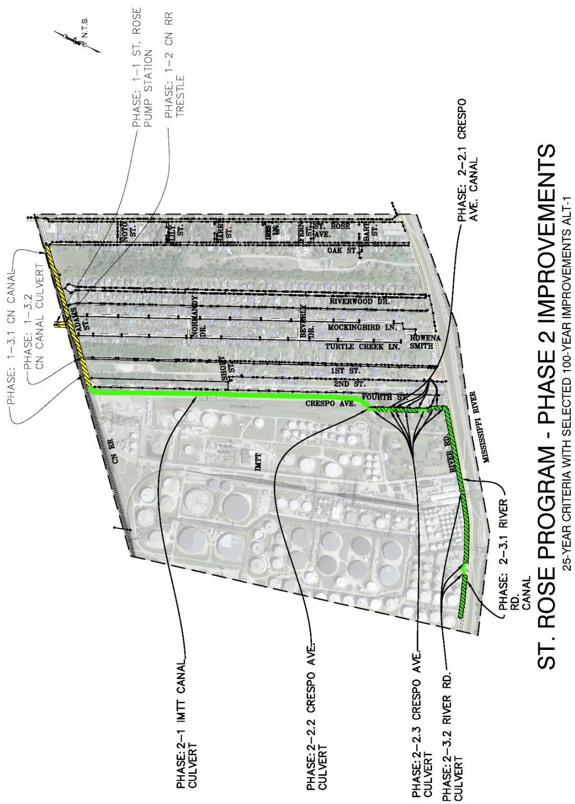

> **Figure description:** ST. ROSE PROGRAM, Phase 2 improvements, titled 25-year criteria with selected 100-year improvements ALT-1. Phase 1 works in yellow and Phase 2 works in green: 2-1 IMTT canal culvert, 2-2.1 Crespo Ave canal, 2-2.2 and 2-2.3 Crespo Ave culverts, and 2-3.1 River Rd canal with 2-3.2 River Rd culvert. Phase 1 call-outs: 1-1 St. Rose pump station and 1-2 CN RR trestle. Labelled streets as in fig 3. No legend.

## Page 16

**Table 8**

| Phase 3 Projects and Construction Cost Estimates |  |
|---|---|
| 3-1.1: Canal Widening from Short St to CN Railroad Canal Widening: 3' Depth, 19' Width Approximately 1750 Linear Feet | $ 91,875.00 |
| 3-1.2: Required 30" RCP at Short St Outfall Required 30" RCPApproximately 100 Linear Feet | $ 29,080.00 |
| 3-2.1: Canal Widening Along First St to CN Railroad Canal Widening: 3' Depth, 16' Width Approximately 2200 Linear Feet | $ 115,500.00 |
| 3-2.2: Required 42" RCPA at First St Required 42" RCPAApproximately 115 Linear Feet | $ 52,960.95 |
| 3-2.3: Required 36" RCP at First St Required 36" RCPApproximately 80 Linear Feet | $ 30,448.00 |
| Phase 3 Subtotal | $ 319,863.95 |

Table snapshot (for checking): 

## Page 17

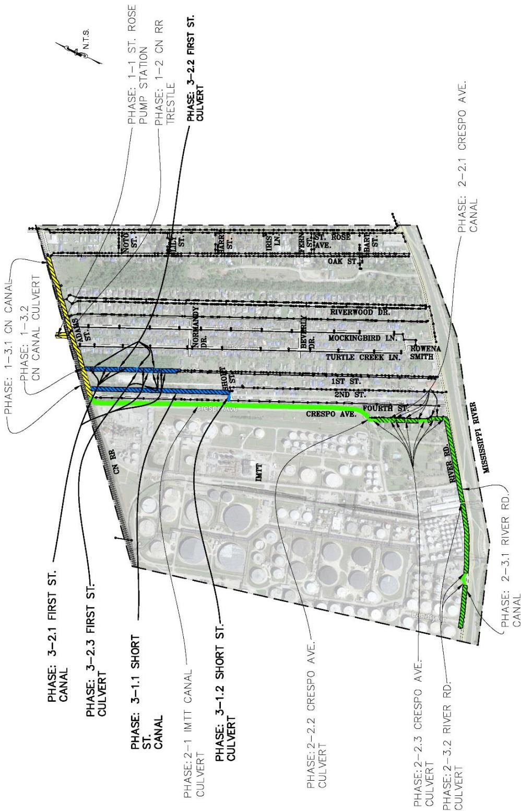

> **Figure description:** St. Rose Phase 3 projects in blue on the full program, with Phase 1 (yellow) and Phase 2 (green) works repeated. Call-outs: Phase 3-1.1 Short St canal, 3-1.2 Short St culvert, 3-2.1 First St canal, 3-2.2 First St culvert and 3-2.3 First St culvert. Phase 2 and Phase 1 call-outs as in fig 7. No legend or printed numbers.

## Page 18

#### ALTERNATE 2

**Table 9**

| Recommended Program Construction Cost Estimation |  |  |
|---|---|---|
| Phase | Number of Projects | Cost |
| Phase 1 | 4 | $ 30,173,400.00 |
| Phase 2 | 6 | $ 9,208,220.00 |
| Phase 3 | 5 | $ 319,863.95 |
| Total | 15 | $ 39,701,483.95 |

Table snapshot (for checking): 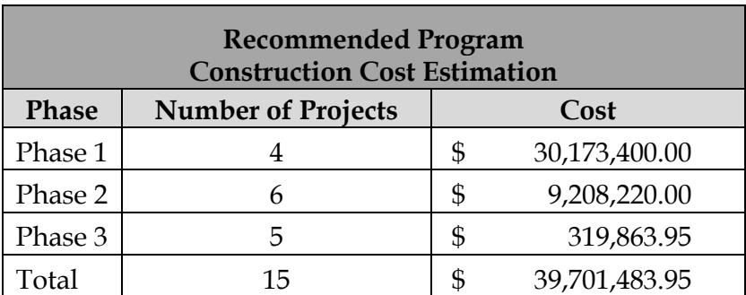

## Page 19

> **Figure description:** St. Rose base map with no project call-outs. Same extent and labels as fig 1 and fig 5. Dedupe candidate. No legend.

## Page 20

**Table 10**

| Phase 1 Projects and Construction Cost Estimates |  |
|---|---|
| 1-1: Fourth St Pump Station and Sump Replace and Upgrade Replace and Upgrade Pump Station 500 CFS 2400 Cubic Feet Sump | $ 21,500,000.00 |
| 1-2: Oak St Pump Station and Sump Replace and Upgrade Replace and Upgrade Pump Station 200 CFS 2400 Cubic Feet Sump | $ 8,500,000.00 |
| 1-3.1: Canal Widening Along CN Railway Canal Widening: 4' Depth, 26' Width Approximately 2000 Linear Feet | $ 105,000.00 |
| 1-3.2: Box Culvert Along CN Railway Required 4' x 10' Box Culvert Approximately 20 Linear Feet | $ 68,400.00 |
| Phase 1 Subtotal | $ 30,173,400.00 |

Table snapshot (for checking): 

## Page 21

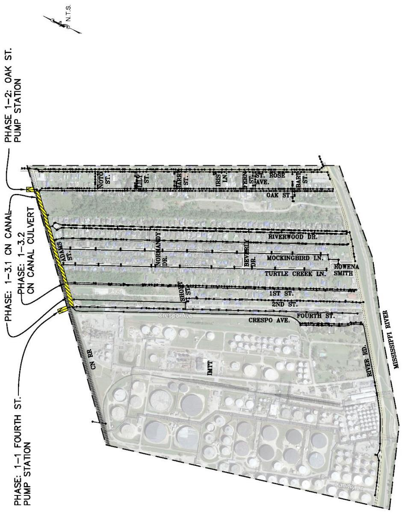

> **Figure description:** St. Rose project area map, rotated, with Phase 1 works in yellow: 1-1 Fourth St pump station, 1-2 Oak St pump station, 1-3.1 CN canal and 1-3.2 CN canal culvert. Same content as fig 2. Dedupe candidate. No legend or printed numbers.

## Page 22

**Table 11**

| Phase 2 Projects and Construction Cost Estimates |  |
|---|---|
| 2-1: Box Culvert Along IMTT to Crespo Ave Required 4' x 5' Box Culvert Approximately 3500 Linear Feet | $ 8,750,000.00 |
| 2-2.1: Canal Widening Along Crespo Ave Canal Widening: 2.5' Depth, 13' Width Approximately 600 Linear Feet | $ 31,500.00 |
| 2-2.2: Required 48" RCPA Along Crespo Ave Required 48" RCPAApproximately 50 Linear Feet | $ 24,400.00 |
| 2-2.3: Required 42" RCPA Along Crespo Ave Required 42" RCPAApproximately 300 Linear Feet | $ 138,160.00 |
| 2-3.1: Canal Widening Along River Rd Canal Widening: 2.5' Depth, 13' Width Approximately 2400 Linear Feet | $ 126,000.00 |
| 2-3.2: Required 42" RCPA Along River Rd Required 42" RCPAApproximately 300 Linear Feet | $ 138,160.00 |
| Phase 2 Subtotal | $ 9,208,220.00 |

Table snapshot (for checking): 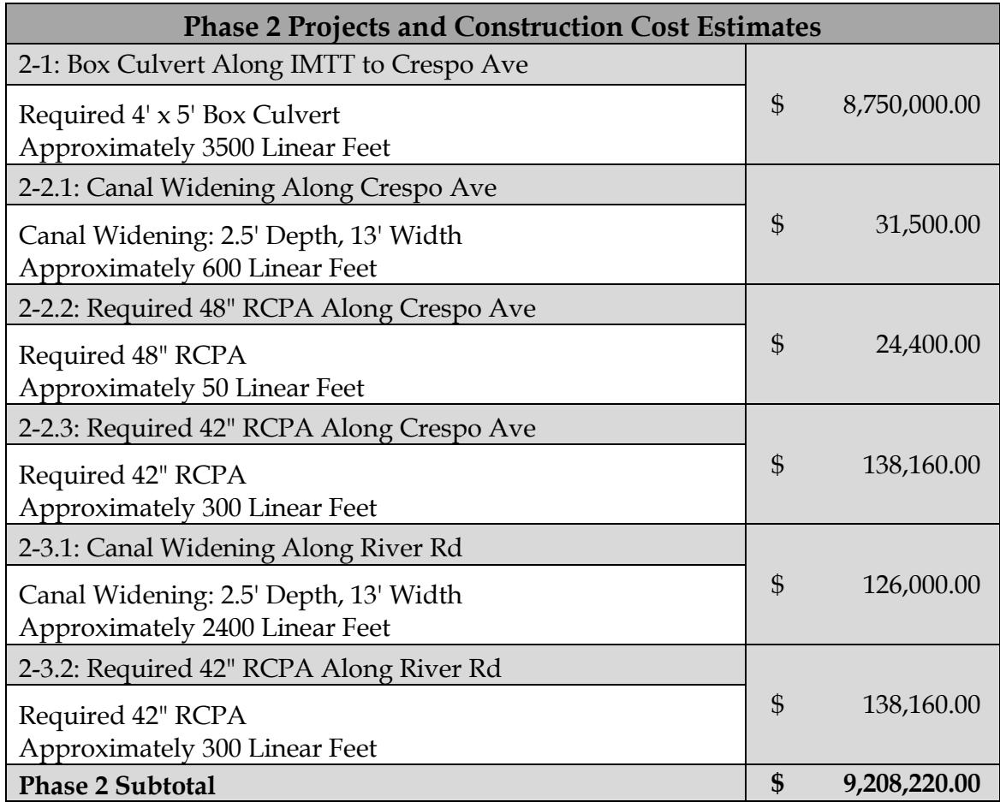

## Page 23

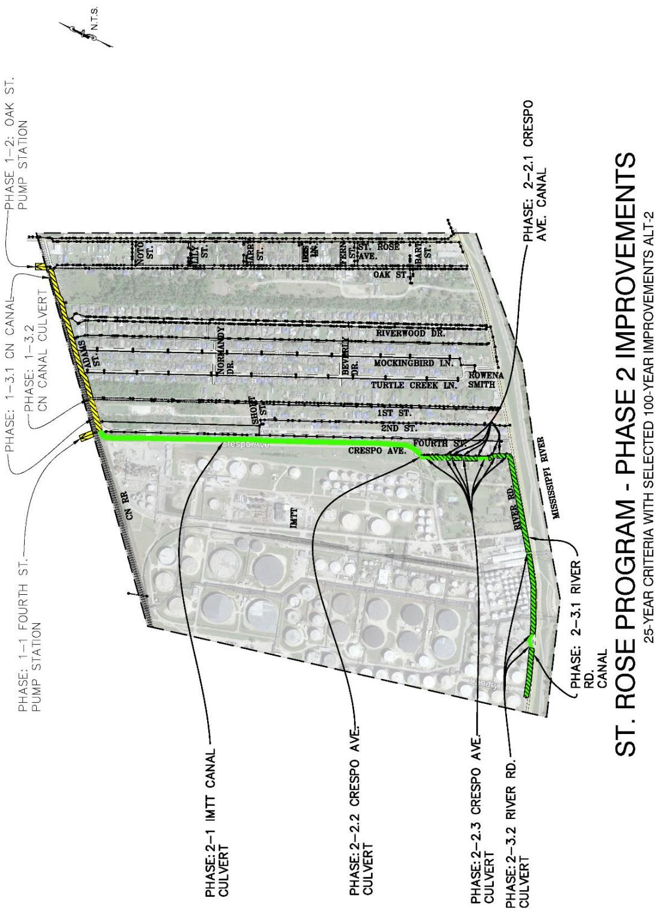

> **Figure description:** ST. ROSE PROGRAM, Phase 2 improvements, titled 25-year criteria with selected 100-year improvements ALT-2. Phase 1 works in yellow and Phase 2 works in green: 2-1 IMTT canal culvert, 2-2.1 Crespo Ave canal, 2-2.2 and 2-2.3 Crespo Ave culverts, and 2-3.1 River Rd canal with 2-3.2 River Rd culvert. Labelled streets as in fig 3. N.T.S. marked. No legend or printed numbers.

## Page 24

**Table 12**

| Phase 3 Projects and Construction Cost Estimates |  |
|---|---|
| 3-1.1: Canal Widening from Short St to CN Railroad Canal Widening: 3' Depth, 19' Width Approximately 1750 Linear Feet | $ 91,875.00 |
| 3-1.2: Required 30" RCP at Short St Outfall Required 30" RCPApproximately 100 Linear Feet | $ 29,080.00 |
| 3-2.1: Canal Widening Along First St to CN Railroad Canal Widening: 3' Depth, 16' Width Approximately 2200 Linear Feet | $ 115,500.00 |
| 3-2.2: Required 42" RCPA at First St Required 42" RCPAApproximately 115 Linear Feet | $ 52,960.95 |
| 3-2.3: Required 36" RCP at First St Required 36" RCPApproximately 80 Linear Feet | $ 30,448.00 |
| Phase 3 Subtotal | $ 319,863.95 |

Table snapshot (for checking): 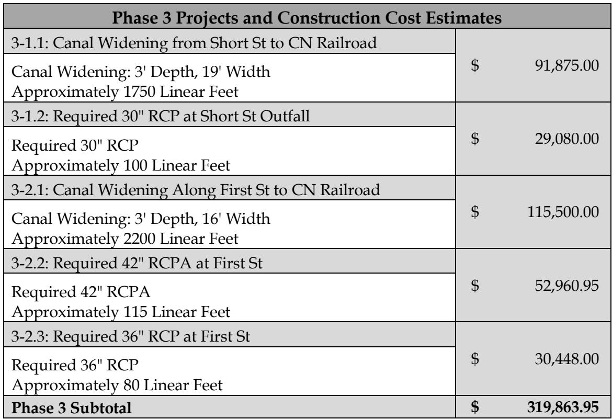

## Page 25

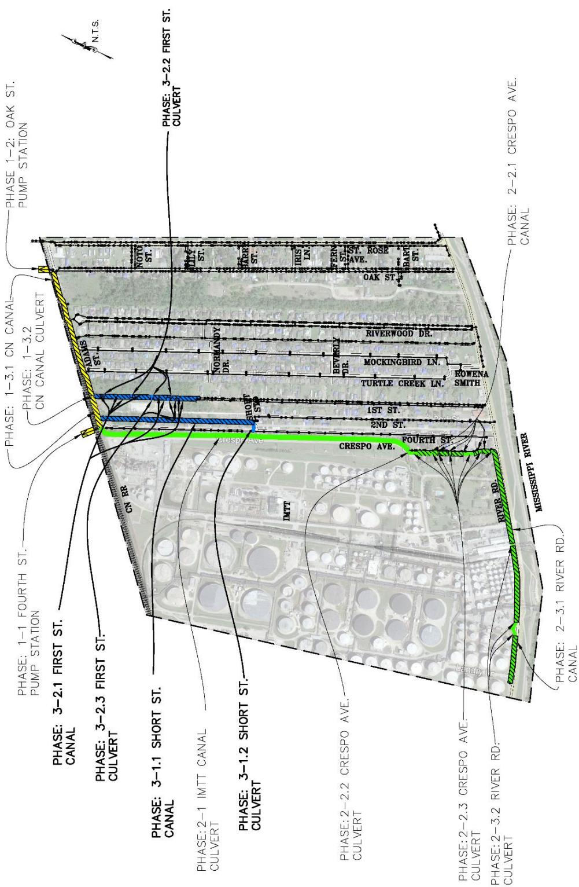

> **Figure description:** St. Rose Phase 3 projects in blue on the ALT-2 layout, with Phase 1 (yellow) and Phase 2 (green) works repeated. Call-outs: Phase 3-1.1 Short St canal, 3-1.2 Short St culvert, 3-2.1 First St canal, 3-2.2 First St culvert and 3-2.3 First St culvert. Phase 1 and Phase 2 call-outs as in fig 11. No legend or printed numbers.
