# Turtle Pond  Executive Summary

Source: `Turtle Pond  Executive Summary.pdf` (St. Charles Parish, Master Drainage Plan). Pages: 11.

## Page 1

#### Volume 9: Turtle Pond

#### 9.1 Executive Summary

St. Charles Parish tasked Principal Engineering, Inc. to complete the study of the Turtle Pond Drainage Area for the East Bank Master Drainage Plan. Principal Engineering performed analyses for 25-Year and 100-Year Design Storms (NOAA Atlas 14), and developed drainage improvement that:

1. 25-Year: Reduce the water surface elevations in the canals to one foot below top of the bank such that future internal drainage improvements may function to eliminate street flooding.

2. 100-Year: Lower water surface elevations in the canals such that direct structure flooding from the canals is eliminated and future internal drainage improvements may function to eliminate internal area structure flooding.

The recommended program consists of the 25-Year and select 100-Year improvements at major street crossings and railroad crossings.

Analysis used models built in EPA SWMM and AutoDesk’s Storm and Sanitary Analysis. Existing flood-prone areas were identified in residential area south of CN Railroad between Pirate Drive and Riverbend Drive and Parish line Canal, as well as areas between CN Railroad and US HWY 61. The results of the existing conditions simulation illustrate the inadequacy of the drainage system for the design events.

The recommended improvements are grouped into phases and projects, building from the previous, in sensible order of construction, downstream to upstream.

Modeled improvements have been partitioned into executable projects with cost estimates provided. It is expected that the Parish will create an integrated priority list consisting of projects from all basins, constructed individually as funding becomes available. A summary of projects and costs is tabulated on the following pages by phase.

## Page 2

**Table 1**

| Recommended ProgramConstruction Cost Estimation |  |  |
|---|---|---|
| Phase | Number of Projects | Cost |
| Phase 1 | 5 | $ 6,080,000.00 |
| Phase 2 | 8 | $ 9,202,388.80 |
| Phase 3 | 6 | $ 9,617,439.60 |
| Phase 4 | 9 | $ 1,251,975.00 |
| Total | 28 | $ 26,151,803.40 |

Table snapshot (for checking): 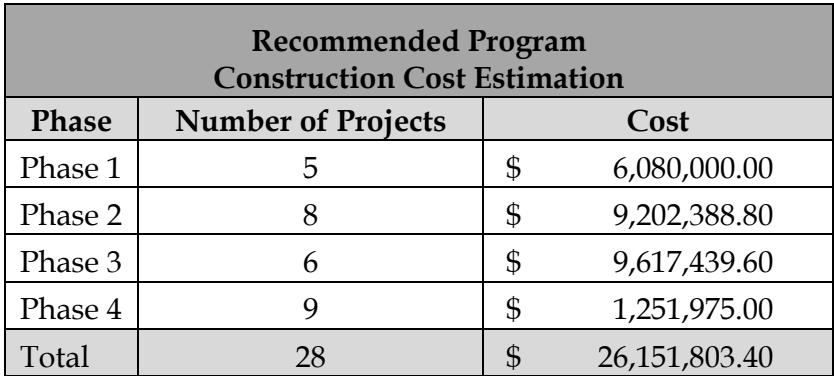

## Page 3

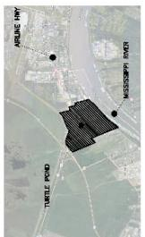

> **Figure description:** Non-content: locator inset, a small aerial with a hatched project area between E Airline Hwy and the Mississippi River, with Turtle Pond labelled. Shows location only.

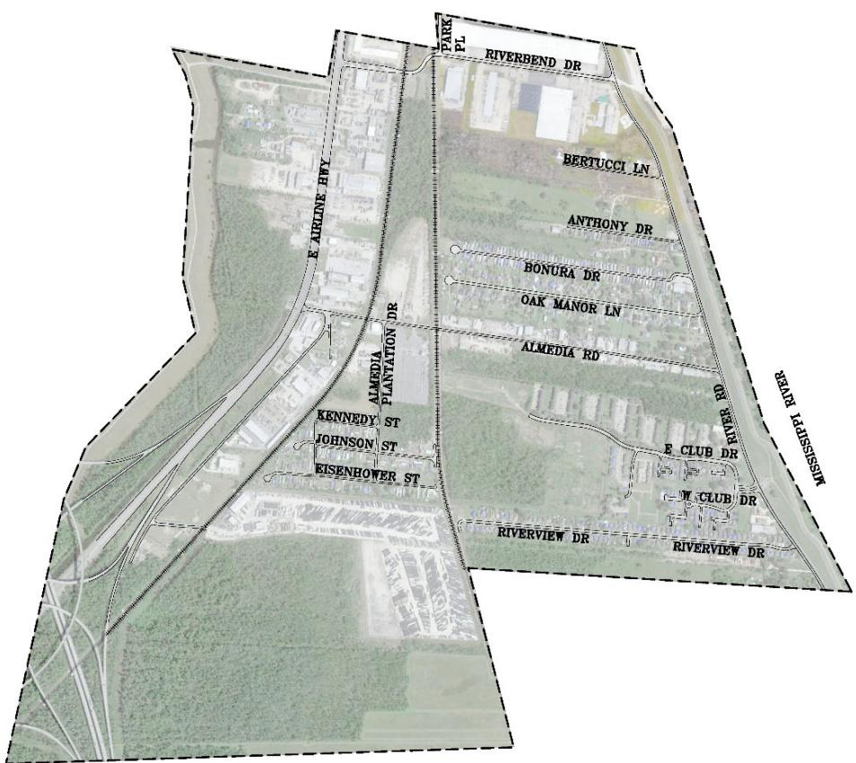

> **Figure description:** Base map of the Turtle Pond project area, bounded by a dashed line and split into a western part west of Almedia Plantation Dr and an eastern part bordered by the Mississippi River. No project call-outs. Labelled: E Airline Hwy, Almedia Plantation Dr, Park Pl, Riverbend Dr, Bertucci Ln, Anthony Dr, Bonura Dr, Oak Manor Ln, Almedia Rd, Kennedy St, Johnson St, Eisenhower St, E Club Dr, W Club Dr, Riverview Dr, River Rd and Mississippi River. No legend.

## Page 4

**Table 2**

| Phase 1 Projects and Construction Cost Estimates |  |
|---|---|
| 1-1: Almedia Pump Station Replace and Upgrade Upgrade Pump Station from 120 CFS to 200 CFS | $ 4,400,000.00 |
| 1-2: I-310 Crossing at Johnson Street Required 2-72" RCP or Equivalent Approximately 80 Linear Feet | $ 120,000.00 |
| 1-3: Crossing at Almedia Road and Airline HWY Required Jack and Bore 2-42" pipe Approximately 240 Linear Feet | $ 780,000.00 |
| 1-4: Crossing at Airline HWY around Duhon Machinery Co.,Inc. Required Jack and Bore 1-42" pipe Approximately 120 Linear Feet | $ 390,000.00 |
| 1-5: Crossing Airline HWY around Fox Lane Required Jack and Bore 1-42" pipe Approximately 120 Linear Feet | $ 390,000.00 |
| Phase 1 Subtotal | $ 6,080,000.00 |

Table snapshot (for checking): 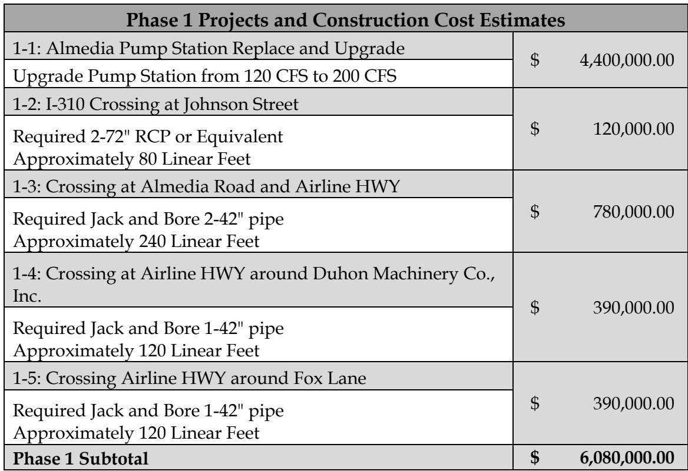

## Page 5

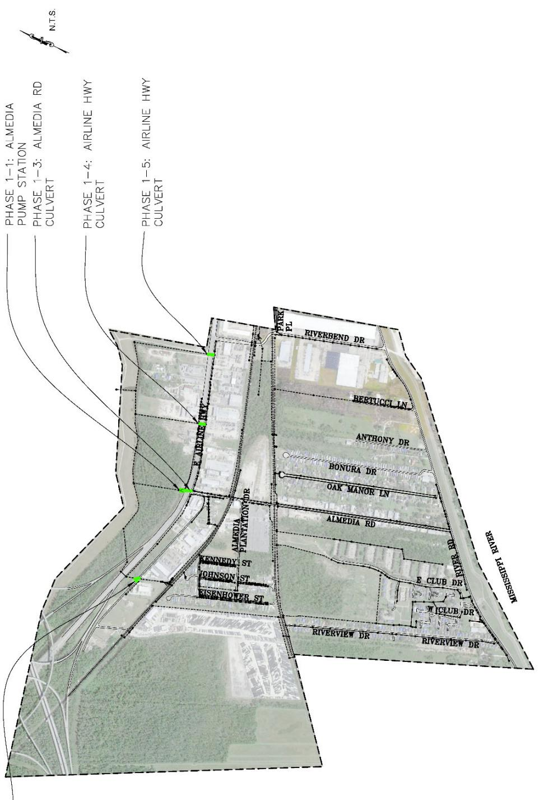

> **Figure description:** Phase 1 projects in green on the same base map: 1-1 Almedia pump station, 1-3 Almedia Rd culvert, and 1-4 and 1-5 Airline Hwy culverts. A fifth call-out at the bottom left is cut off, so Phase 1-2 is not visible. N.T.S. marked. No legend or printed numbers.

## Page 6

**Table 3**

| Phase 2 Projects and Construction Cost Estimates |  |
|---|---|
| 2-1: Turtle Pond Pump Station Replace and Upgrade Upgrade Pump Station from 86 CFS to 240 CFS | $ 8,470,000.00 |
| 2-2: Required 84" RCP or Equivalent Along Kennedy Street Required 1-84" RCPApproximately 100 Linear Feet | $ 170,000.00 |
| 2-3: Required 30" RCP at Kennedy Street Required 1-30" RCPApproximately 220 Linear Feet | $ 63,976.00 |
| 2-4: Required 42" RCP at Amelia Plantation Drive Required 1-42" RCPApproximately 260 Linear Feet | $ 125,132.80 |
| 2-5: Canal Widening Along Amelia Plantation Drive Canal Widening: 4' Depth, 10' Width Approximately 500 Linear Feet | $ 27,300.00 |
| 2-6: Required 2-42" RCP along Almedia Road Required 2-42" RCPApproximately 450 Linear Feet | $ 216,576.00 |
| 2-7: Required 2-36" RCP along Almedia Road Required 2-36" RCPApproximately 230 Linear Feet | $ 87,538.00 |
| 2-8: Required 1-36" RCP along Almedia Road Required 1-36" RCPApproximately 110 Linear Feet | $ 41,866.00 |
| Phase 2 Subtotal | $ 9,202,388.80 |

Table snapshot (for checking): 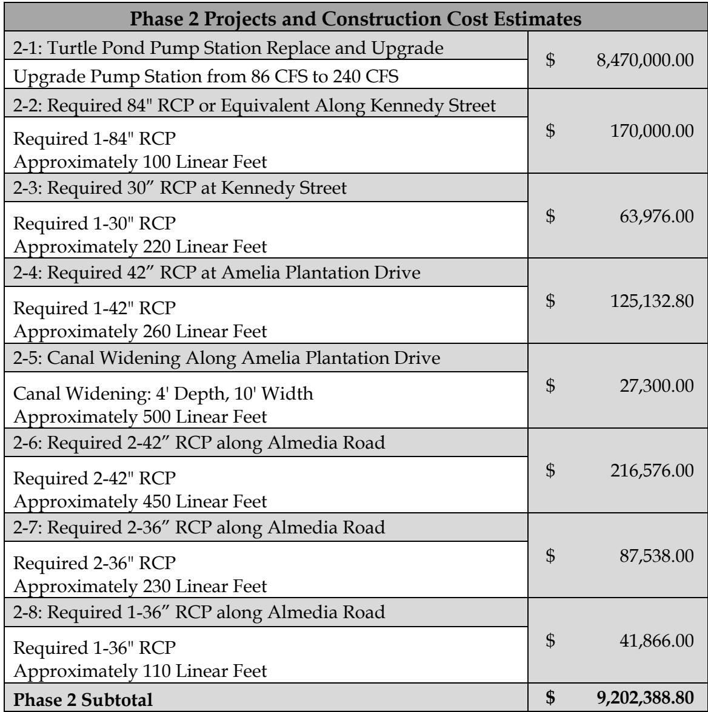

## Page 7

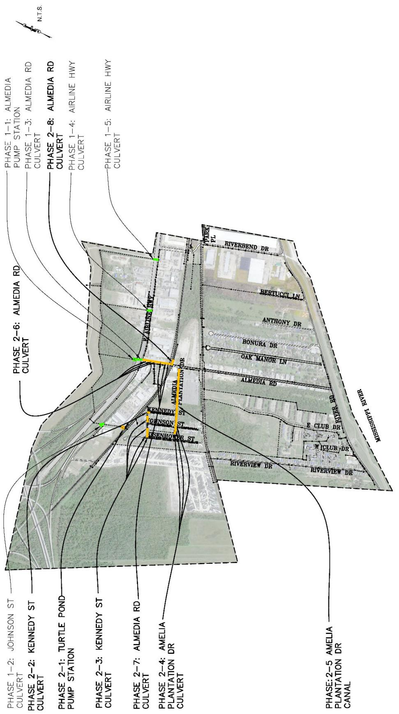

> **Figure description:** Phase 2 projects in orange, with Phase 1 (green) repeated. Call-outs: 2-1 Turtle Pond pump station; 2-2 and 2-3 Kennedy St culverts; 2-4 Amelia Plantation Dr culvert; 2-5 Amelia Plantation Dr canal; 2-6, 2-7 and 2-8 Almedia Rd culverts; and 1-2 Johnson St culvert. The orange works run along Almedia Plantation Dr and the Kennedy, Johnson and Eisenhower St corridor. N.T.S. marked. No legend or printed numbers.

## Page 8

**Table 4**

| Phase 3 Projects and Construction Cost Estimates |  |
|---|---|
| 3-1: Riverbend 2 Pump Station Replace and Upgrade Upgrade Pump Station from 96 CFS to 240 CFS | $ 7,920,000.00 |
| 3-2: Canal along CN Railroad (North) Widening Canal Widening: 6' Depth, 10' Width Approximately 1600 Linear Feet | $ 130,750.00 |
| 3-3: CN Railway Crossing East of Bonura Drive Required Jack and Bore 72" pipe Approximately 200 Linear Feet | $ 1,300,000.00 |
| 3-4: Canal along CN Railroad (South) Widening Canal Widening: 6' Depth, 10' Width Approximately 1420 Linear Feet | $ 116,000.00 |
| 3-5: Required 60" RCP or Equivalent at Almedia Ave Required 60" RCP or Equivalent Approximately 90 Linear Feet | $ 117,000.00 |
| 3-6: Required 42" RCP or Equivalent at Riverbend Dr Required 42" RCP or Equivalent Approximately 70 Linear Feet | $ 33,689.60 |
| Phase 3 Subtotal | $ 9,617,439.60 |

Table snapshot (for checking): 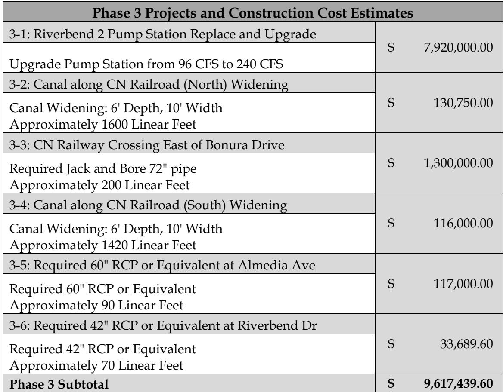

## Page 9

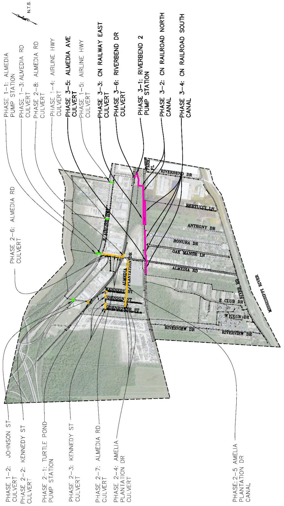

> **Figure description:** Phase 3 projects in magenta, with Phase 1 (green) and Phase 2 (orange) repeated. Phase 3 call-outs: 3-1 Riverbend 2 pump station; 3-2 CN railroad north canal; 3-3 CN railway east culvert; 3-4 CN railroad south canal; 3-5 Almedia Ave culvert; and 3-6 Riverbend Dr culvert. The magenta run goes north-south from Riverbend Dr toward Almedia Rd, parallel to the CN railway. No legend or printed numbers.

## Page 10

**Table 5**

| Phase 4 Projects and Construction Cost Estimates |  |
|---|---|
| 4-1: CN Railway Crossing East of Riverview Drive Required Jack and Bore 1-72" pipe Approximately 80 Linear Feet | $ 520,000.00 |
| 4-2: CN Railway Crossing West of Riverview Drive Required Jack and Bore 1-54" pipe Approximately 40 Linear Feet | $ 184,000.00 |
| 4-3:Canal along CN Railroad (North) Widening Canal Widening: 4' Depth, 12' Width Approximately 720 Linear Feet | $ 50,500.00 |
| 4-4: Required 48" RCP or Equivalent Along Riverview Drive Required 48" RCPApproximately 155 Linear Feet | $ 108,500.00 |
| 4-5: Canal along CN Railroad (South) Widening Canal Widening: 5' Depth, 12' Width Approximately 1450 Linear Feet | $ 127,000.00 |
| 4-6: E Club Drive Canal Widening Canal Widening: 4' Depth, 10' Width Approximately 980 Linear Feet | $ 53,075.00 |
| 4-7: E Club Drive Canal Widening Canal Widening: 4' Depth, 10' Width Approximately 960 Linear Feet | $ 52,300.00 |
| 4-8: Riverview Drive Canal Widening Canal Widening: 4' Depth, 10' Width Approximately 1880 Linear Feet | $ 102,350.00 |
| 4-9: Canal along CN Railroad (South) Widening Canal Widening: 5' Depth, 12' Width Approximately 620 Linear Feet | $ 54,250.00 |
| Phase 4 Subtotal | $ 1,251,975.00 |

Table snapshot (for checking): 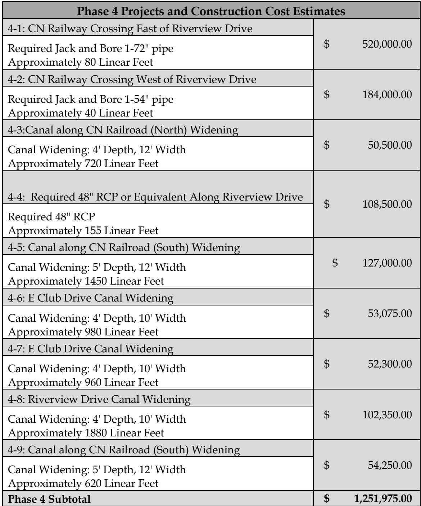

## Page 11

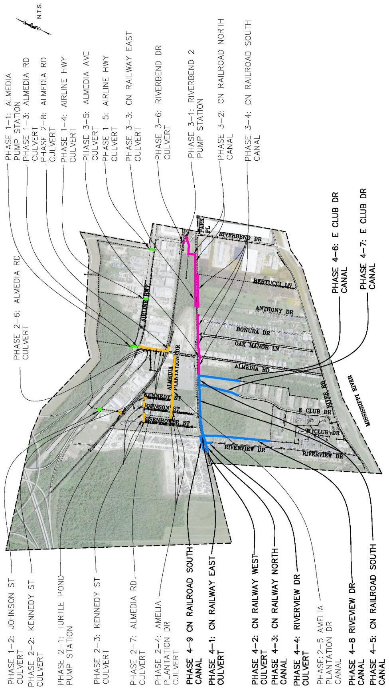

> **Figure description:** Phase 4 projects in blue, with Phase 1 (green), Phase 2 (orange) and Phase 3 (magenta) repeated. Phase 4 call-outs: 4-1 CN railway east culvert; 4-2 CN railway west culvert; 4-3 CN railway north canal; 4-4 Riverview Dr culvert; 4-5 and 4-9 CN railroad south canal (both labelled this way on the figure); 4-6 and 4-7 E Club Dr canals; and 4-8 Riverview Dr canal. The blue works run east of the CN railway toward E Club Dr and Riverview Dr. N.T.S. marked. No legend or printed numbers.
